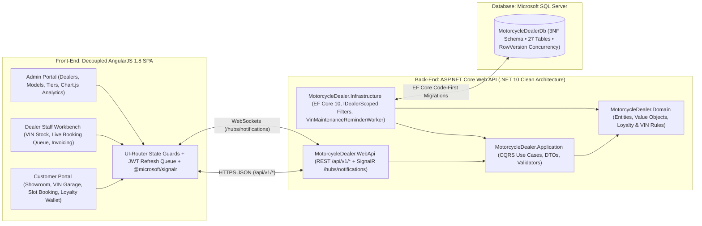

# Motorcycle Dealer & Loyalty Management Platform

[](https://dotnet.microsoft.com/)
[](https://learn.microsoft.com/aspnet/core)
[](https://learn.microsoft.com/ef/core)
[](https://angularjs.org/)
[-3DDC84?logo=android)](./docs/RELEASE_NOTES_v1.3.0.md)
[](https://www.chartjs.org/)
[-CC2927?logo=microsoftsqlserver)](https://www.microsoft.com/sql-server)
[-2EA44F)](./docs/RELEASE_NOTES_v1.3.0.md)

An enterprise-grade, closed-loop **multi-dealer motorcycle retail, showroom test-drive scheduling, workshop service & OEM spare-parts invoicing, 5-star post-service CSAT reviews (+25 bonus loyalty points), 36m/30,000km VIN warranty claims, VIN maintenance tracking, real-time staff notification, printable verification receipts, and tiered customer loyalty platform**. Engineered with **4-Layer Clean Architecture** in **C# / ASP.NET Core Web API (`.NET 10`)**, **Entity Framework Core**, **SignalR**, **Microsoft SQL Server**, a decoupled **AngularJS 1.8** Single-Page Application (`SPA`) featuring **Chart.js** executive analytics, and a native **C# `.NET 10 MAUI` Android Field Super-App** (`vn.motorcycledealer.mobile`) with **encrypted 9-table `SQLCipher` WAL offline caching** and **Camera2 VIN/QR scanning**.

---

## Project Profile

| Attribute | Details |
| :--- | :--- |
| **Project Name** | **Motorcycle Dealer & Loyalty Management Platform** |
| **Role** | Full-Stack Developer |
| **Timeline** | `02/2026 - 08/2026` |
| **Team Size** | `1 (Solo project)` |
| **GitHub Repository** | [https://github.com/quocanhh86/motorcycle-dealer](https://github.com/quocanhh86/motorcycle-dealer) |
| **Current Milestone** | **`v1.3.0` Full-Stack + Native `.NET 10 MAUI` Android Production Release (`88 / 88` = `100.0%`) — All 10 Engineering Phases Signed Off (`830 / 830` xUnit [`727` Backend + `103` Mobile] · `64 / 64` SPA · `7 / 7` MAUI Guardrails · `10 / 10` Smoke · `Pixel_8_API_35` Live APKs · `493 / 493` Files Synced)** |

---

## Key Features & Closed-Loop Capabilities

- **Role-Based Access Control (`FR-01`)**:
  - Supports three governed roles—**Customer** (`Customer`), **Dealer Staff** (`DealerStaff`, isolated to a single assigned `DealerId`), and **Admin** (`Admin`, cross-dealer network oversight).
  - Enforces defense-in-depth via **AngularJS UI-Router state guards** (`transitions.onBefore` + `has-permission` directives across `30` navigable routes) on the client and **48 granular ASP.NET Core permission policies** (`Permissions.<Module>.<Action>`: `20` / `22` / `32`) plus **EF Core `IDealerScoped` Global Query Filters (`8` tables)** on the server.
- **Showroom Catalog, Test-Drive Scheduling, VIN Inventory & Customer VIN Garage (`FR-02`, `FR-03`, `FR-08`)**:
  - Dealerships stock `DealerInventories` by globally unique 17-character ISO 3779 **Vehicle Identification Numbers (`VIN`)** and accept concurrency-capped **Showroom `TestDriveBookings`** (`<= 2` active per model/window, demo `VIN` assignment, and 1-click conversion into a showroom bike sale).
  - Completed showroom `SalesOrders` atomically mark the `VIN` sold, onboard the motorcycle into the buyer's digital `CustomerVehicles` garage bound to model `MaintenanceRules`, issue a SHA-256 verified printable receipt (`RCP-SLS-*`), and accrue spending loyalty points; existing riders can also self-register external `VIN` motorcycles to track mileage and workshop history.
- **Service Booking, OEM Spare-Parts Itemization, 5-Star CSAT Reviews & VIN Warranty Claims (`FR-04`, `FR-08`, `FR-09`)**:
  - Customers book maintenance appointments by selecting a target **Dealer**, an **available `ServiceTimeSlot`** (protected against peak-hour double-booking via SQL Server `RowVersion` optimistic concurrency), a registered `VIN`, and an optional reward voucher.
  - Workshop settlement (`ServiceInvoices`) supports model-compatible **OEM `SpareParts` line-item selection** (`ServiceInvoiceLineItems` append-only breakdown) and `@media print` printable tax/loyalty receipts (`RCP-SVC-*`), while riders can rate settled invoices `1–5★` (`ServiceReviews`, earning **`+25` bonus `AvailablePoints`**) and file **36-month / 30,000-km OEM `WarrantyClaims`** alongside automated `VinMaintenanceReminderWorker` alerts.
- **Loyalty & Rewards Engine (`FR-05`, `FR-09`)**:
  - Automatically calculates loyalty points from net customer spending across both showroom `SalesOrders` and workshop `ServiceInvoices` (`10,000 VND = 1 base point * TierMultiplier`) inside an **append-only immutable ledger (`PointLedgerEntries`)**, plus `+25` `ServiceReviewBonus` points (`AvailablePoints` only, preserving `LifetimeQualifyingPoints`).
  - Automates progression across four membership tiers—**`Bronze`** (`0+` pts, `1.0x`), **`Silver`** (`500+` pts, `1.2x`), **`Gold`** (`2,000+` pts, `1.5x`), and **`Platinum`** (`5,000+` pts, `2.0x`)—and manages `VoucherCatalogs` browsing, point deduction, and `CustomerVouchers` redemption.
- **Real-Time Notifications with SignalR (`FR-06`, `FR-09`)**:
  - Strongly-typed **SignalR** WebSocket hub (`/hubs/notifications`) routes `10` real-time event types to isolated `dealer-{dealerId}`, `user-{userId}`, and `role-Admin` groups.
  - Ensures **Dealer Staff receive new service bookings (`BookingCreated`), showroom test-drives (`TestDriveCreated`), CSAT reviews (`ServiceReviewSubmitted`), and VIN warranty claims (`WarrantyClaimCreated`) instantly on their live workbenches without page refresh**, while customers receive live status transitions, VIN maintenance reminders, and tier upgrade alerts.
- **Admin Analytics & Quality/Warranty Dashboard (`FR-07`, `FR-09`)**:
  - Cross-dealer executive portal visualizing **Showroom Sales + Workshop Service revenue per dealer**, **booking volume & status funnels**, CSAT ratings & warranty claim coverage, monthly growth trends, and loyalty tier distributions using interactive **Chart.js** charts.
- **Native Android `.NET 10 MAUI` Field Super-App (`FR-10`, `v1.3.0`)**:
  - Decoupled C# 13 `.NET 10 MAUI` Android application (`mobile/`, `net10.0-android`, API `26`–`35`, `16` compiled `x:DataType` `SourceGen` screens) serving **Public Showroom (`3` tabs)**, **Customer (`5` tabs + Bell)**, and **`DealerStaff` (`5` tabs + pushed Invoice Builder + Bell)** while redirecting `Admin` to the Web HQ console (`AdminWebConsoleNoticePage`).
  - Features **`SingleFlightTokenRefreshHandler`**, device-safe `LogoutRequest { RevokeAllDevices = false }`, Android Keystore `SecureStorage` (`allowBackup="false"`), encrypted **`9`-table `SQLCipher` WAL offline cache** (with strict `ADR-003`/`ADR-005` online-only rules), **`ZXing.Net.Maui` Camera2 17-char VIN / `dealer://` QR scanner**, pure C# offline vector QR passbook/receipts, and **`10`-event SignalR** + native Android `NotificationChannel` alerts.

---

## System Architecture Overview



---

## Technology Stack

| Layer | Technologies & Libraries | Architectural Role |
| :--- | :--- | :--- |
| **Front-End SPA** | `AngularJS 1.8` (`angular@1.8.3`), `@uirouter/angularjs`, `Chart.js 4`, `@microsoft/signalr`, HTML5 / CSS3 (`@media print`) | Component-based SPA (`30` navigable routes) with role guards, live WebSocket DOM updates, printable receipts, CSAT/warranty portals, and executive charts |
| **Native Mobile App** | `C# 13`, `.NET 10 MAUI` (`net10.0-android`, API `26`–`35`), `CommunityToolkit.Mvvm`, `ZXing.Net.Maui`, `SQLCipher` (`9` WAL tables), `SignalR.Client` | Decoupled 2-Role Android Field App (`16` `SourceGen` `x:DataType` screens), Camera2 VIN/QR scanner, offline QR passbook/receipts, and Android Notification Channels |
| **Back-End API** | `C#`, `ASP.NET Core Web API` (`.NET 10` / `net10.0`, `18` Controllers), FluentValidation, `RFC 7807 ProblemDetails` | 4-Layer Clean Architecture (`Domain`, `Application`, `Infrastructure`, `WebApi`) |
| **Real-Time & Workers** | `ASP.NET Core SignalR` (`NotificationHub`, `10` events), Hosted `BackgroundService` (`VinMaintenanceReminderWorker`) | Instant `dealer-{dealerId}` staff booking/test-drive/review/warranty alerts + automated deduplicated `VIN` maintenance scheduling |
| **Data Access & ORM** | `Entity Framework Core 10` (`IEntityTypeConfiguration<T>`, Code-First Migrations, Global Query Filters) | Strongly-typed persistence, `IDealerScoped` tenant isolation (`8` tables), and `RowVersion` optimistic concurrency (`8` tables) |
| **Database** | `Microsoft SQL Server` (`(localdb)\MSSQLLocalDB` & SQL Server 2022 Docker) | `MotorcycleDealerDb` — 27 normalized 3NF tables with `DECIMAL(18,2)` money & `DATETIMEOFFSET(7)` UTC |
| **Security & RBAC** | JWT Bearer Auth + Rotating `RefreshTokens`, Custom `PermissionAuthorizationHandler` (`[HasPermission]`) | Stateless API security, 3 roles, and 48 granular `Permissions.<Module>.<Action>` claims (`20` / `22` / `32`) |
| **Testing & QA** | `xUnit`, `FluentAssertions`, LocalDB + WebSocket SignalR Integration Suite, OpenXML `.docx` Validator | Domain unit tests, parallel slot/test-drive/voucher/review race tests, RBAC matrix checks, and line-item/ledger reconciliation tests |

---

## Domain Bounded Contexts & Loyalty Model

### 27 Normalized SQL Server Tables (`MotorcycleDealerDb`)

1. **Identity & RBAC (`6` tables)**: `Users`, `Roles`, `Permissions`, `UserRoles`, `RolePermissions`, `RefreshTokens`
2. **Dealers & Showroom Sales (`5` tables)**: `Dealers`, `MotorcycleModels`, `DealerInventories`, `SalesOrders`, `TestDriveBookings`
3. **Customer Garage, VIN Reminders & Warranty (`4` tables)**: `CustomerVehicles`, `MaintenanceRules`, `MaintenanceReminders`, `WarrantyClaims`
4. **Service Booking, OEM Spare-Parts, Invoicing & CSAT (`6` tables)**: `ServiceTimeSlots`, `ServiceBookings`, `ServiceInvoices`, `SpareParts`, `ServiceInvoiceLineItems`, `ServiceReviews`
5. **Loyalty, Tiers & Vouchers (`5` tables)**: `LoyaltyTiers`, `LoyaltyAccounts`, `PointLedgerEntries`, `VoucherCatalogs`, `CustomerVouchers`
6. **Real-Time Notifications (`1` table)**: `Notifications`

### Loyalty Tier & Accrual Schedule (`10,000 VND = 1 Base Point`)

| Tier | Qualifying Threshold (`LifetimeQualifyingPoints`) | Multiplier | Effective Rate per `100,000 VND` Spent |
| :--- | :---: | :---: | :---: |
| **`Bronze`** | `0+` pts | `1.0x` | `10` pts |
| **`Silver`** | `500+` pts | `1.2x` | `12` pts |
| **`Gold`** | `2,000+` pts | `1.5x` | `15` pts |
| **`Platinum`** | `5,000+` pts | `2.0x` | `20` pts |

---

## Repository Blueprint

```text
motorcycle-dealer/
├── REQUIREMENTS.md                  # Canonical CV & functional requirement baseline
├── AGENTS.md                        # Workspace engineering constitution & EN/VI skill router
├── README.md                        # Executive project overview & documentation hub
├── TASKS.md                         # Master 9-Phase Work Breakdown Structure (T-101..T-908: 80/80 Complete)
├── PROGRESS.md                      # Milestone gate tracker (100%), 15R+6T ledgers, traceability & risk register
├── docs/
│   ├── PRD.md                       # Product Requirements Document & Given/When/Then criteria (FR-01..FR-09)
│   ├── ARCHITECTURE.md              # C4 diagrams, Clean Architecture rules, ADR-001..006 & OWASP API1-10
│   ├── DATABASE_DESIGN.md           # 27-table 3NF SQL Server schema, ER diagram & indexing plan
│   ├── DESIGN.md                    # 48-permission RBAC matrix, REST v1 & 10-event SignalR contracts & UI specs
│   ├── openapi.v1.yaml              # OpenAPI 3.1.0 REST /api/v1/* (v1.2.0, 75+ paths) & 10 SignalR webhooks
│   ├── TEST_PLAN.md                 # 75-case 8-level QA specification & 100% PASS execution verdicts (727 xUnit)
│   ├── RUNBOOK.md                   # LocalDB/Docker setup, demo credentials & 5-min walkthrough
│   ├── RELEASE_NOTES_v1.0.0.md      # Production v1.0.0 release notes & empirical verification summary
│   ├── RELEASE_NOTES_v1.1.0.md      # Phase 8 v1.1.0 expansion release notes (Test-Drives, Spare-Parts, Receipts)
│   ├── RELEASE_NOTES_v1.2.0.md      # Phase 9 v1.2.0/v1.2.1 release notes (CSAT Reviews +25 pts, WarrantyClaims)
│   ├── screens/                     # UI/UX design system, wireframes & 30-route UI-Router states
│   │   ├── DESIGN_SYSTEM_AND_NAVIGATION.md
│   │   ├── CUSTOMER_PORTAL_SCREENS.md
│   │   └── STAFF_AND_ADMIN_SCREENS.md
│   ├── modules/                     # 6 Clean Architecture vertical feature blueprints (MOD-01..06 v1.2.0)
│   │   ├── MOD_01_AUTH_AND_RBAC.md
│   │   ├── MOD_02_SHOWROOM_AND_VIN_GARAGE.md
│   │   ├── MOD_03_SERVICE_BOOKING_AND_REMINDERS.md
│   │   ├── MOD_04_LOYALTY_TIERS_AND_VOUCHERS.md
│   │   ├── MOD_05_SIGNALR_REALTIME_NOTIFICATIONS.md
│   │   └── MOD_06_ADMIN_ANALYTICS_AND_REPORTING.md
│   ├── basic-design/                # System Basic Design Master Specification (BD-00 v1.2.0)
│   │   └── BD_00_BASIC_DESIGN_MASTER.md
│   ├── detail-design/               # Empirical Code-Parity Detail Design Suite (DD-01..DD-04 v1.2.0)
│   │   ├── DD_01_COMMON_SPECIFICATION.md
│   │   ├── DD_02_DATABASE_AND_TABLE_UPDATES.md
│   │   ├── DD_03_API_SPECIFICATIONS.md
│   │   └── DD_04_SCREEN_SPECIFICATIONS.md
│   └── Motorcycle_Dealer_Loyalty_Platform_Specification.docx
├── .agents/                         # [Phase 2/9 — Complete] Antigravity customization & MCP suite
│   ├── plugins.json                 # Workspace plugin discovery manifest
│   ├── skills.json                  # Workspace skill discovery manifest (8 skills)
│   ├── rules/AGENTS.md              # Operational .agents/ & 9-server MCP routing guide
│   ├── scripts/                     # 2 Stdio MCP servers + snapshot + verify-post-task-sync + 183-day git shipper + QA scripts
│   ├── skills/                      # dotnet-clean-api, sqlserver-efcore-dba, angularjs-enterprise-spa,
│   │                                # loyalty-booking-domain, signalr-realtime-hub, qa-verification-suite,
│   │                                # docx-spec-generator, mcp-devtools-orchestrator
│   └── plugins/motorcycle-dealer-suite/
│       ├── plugin.json              # Native workspace plugin manifest
│       ├── mcp_config.json          # Stdio MCP config (motorcycle-dealer-guardrails & sqlserver-localdb-inspector)
│       ├── hooks.json               # SessionStart & PreToolUse safety guard configuration
│       ├── hooks/                   # session-start.mjs & safety-guard.mjs
│       └── rules/AGENTS.md          # Plugin-scoped safety & MCP invariants
├── .config/dotnet-tools.json        # [Phase 4 — Complete] Pinned dotnet-ef 10.0.15 local tool manifest
├── docker-compose.yml               # [Phase 3/7 — Complete] SQL Server 2022 + non-root WebApi + SPA stack
├── backend/                         # [Phase 9 — Complete] MotorcycleDealer.sln (18 Controllers, 10-Event SignalR Hub, Reminder Worker, Test-Drives, Spare-Parts/Receipts, CSAT/Warranty, 9-Route Analytics/17-Col CSV, 727/727 xUnit tests)
├── frontend/                        # [Phase 9 — Complete] Modular AngularJS 1.8.3 SPA (26 Primary + 4 Alias = 30 Routes, Test-Drives, Spare-Parts, Printable Receipts, CSAT/Warranty, Chart.js v4, 64/64 checks)
└── mobile/                          # [Phase 10 — v1.3.0] Native C# .NET 10 MAUI Android Field App (Mobile.Core net10.0 + Mobile.App net10.0-android 16 views + 9-table SQLCipher + Camera2 VIN/QR + Mobile.UnitTests)
```

---

## Quick-Start & Verification Commands

```powershell
# 1. Provision SQL Server LocalDB & apply 27-table 3NF migrations + demo seed
powershell -NoProfile -ExecutionPolicy Bypass -File .agents/scripts/ensure-sqlserver-db.ps1 -Migrate

# 2. Run Clean Release builds (0 warnings) & full Backend (727 xUnit), Mobile (91+ xUnit) & SPA (64 checks) suites
dotnet test backend/MotorcycleDealer.sln -c Release
dotnet test mobile/tests/MotorcycleDealer.Mobile.UnitTests/MotorcycleDealer.Mobile.UnitTests.csproj -c Release --warnaserror
npm --prefix frontend test

# 3. Boot WebApi + SignalR Hub (:5080) and AngularJS 1.8.3 SPA (:4200), or launch Docker Compose
dotnet run --project backend/src/MotorcycleDealer.WebApi --urls "http://localhost:5080"
npm --prefix frontend start
# Container alternative: docker compose up --build -d

# 4. Boot Android WHPX Pixel_8_API_35 Emulator, bind ADB reverse (:5080) & run live MAUI Android Smoke
powershell -NoProfile -ExecutionPolicy Bypass -File .agents/scripts/ensure-maui-android.ps1 -BootEmulator -SetupAdbReverse
node .agents/scripts/verify-mobile-maui.mjs
powershell -NoProfile -ExecutionPolicy Bypass -File .agents/scripts/smoke-mobile-android.ps1 -Configuration Debug

# 5. Run Full-Stack Smoke (SMK-01..SMK-10), Master Quality Gate & Mandatory Post-Task Sync Gate
powershell -NoProfile -ExecutionPolicy Bypass -File .agents/scripts/smoke-fullstack.ps1 -Phase 10
powershell -NoProfile -ExecutionPolicy Bypass -File .agents/scripts/run-phase-quality-loop.ps1 -Phase 10 -Round 3
node .agents/scripts/verify-post-task-sync.mjs
node .agents/scripts/daily-git-shipper.mjs --status
```

---

## 10-Phase Master Engineering Roadmap

| Phase | Milestone Scope | Key Deliverables | Status |
| :--- | :--- | :--- | :---: |
| **Phase 1** | **Docs, Deep-Dive Specs & Governance** | `PRD.md`, `ARCHITECTURE.md`, `DATABASE_DESIGN.md`, `DESIGN.md`, `openapi.v1.yaml`, `TEST_PLAN.md`, `RUNBOOK.md`, `docs/screens/*` (18 screens), `docs/modules/MOD_01..06`, `TASKS.md`, `PROGRESS.md`, Master `.docx` (`12/12`) | **Signed Off (`100%`)** |
| **Phase 2** | **Antigravity `.agents/` & MCP Suite** | `.agents/` (`plugins.json`, `skills.json`, `rules/`, 8 `skills/`, `mcp_config.json` + 2 Stdio MCP servers, `hooks.json` + hooks, automation scripts; `8/8`) | **Signed Off (`100%`)** |
| **Phase 3** | **Clean Architecture & SPA Skeleton** | `backend/MotorcycleDealer.sln` (4 layers + 2 xUnit projects, `89/89` tests), `frontend/` AngularJS `1.8.3` shell (`21/21` checks), `docker-compose.yml` (`8/8`) | **Signed Off (`100%`)** |
| **Phase 4** | **SQL Server Migrations & Granular RBAC** | 22-table EF Core 3NF migrations (`UseCompatibilityLevel(150)`), 23 B-tree indexes, idempotent 3-dealer seeder, rotating `RefreshTokens`, 34-policy `[HasPermission]`, live SPA auth & Admin Dealers/Staff (`137/137` xUnit, `28/28` SPA; `9/9`) | **Signed Off (`100%`)** |
| **Phase 5** | **Showroom, VIN Garage & Booking Engine** | `MotorcycleModels`, `DealerInventories`, atomic `SalesOrders` -> `CustomerVehicles`, `RowVersion` `ServiceTimeSlots` & `ServiceBookings`, `VinMaintenanceReminderWorker`, live Customer/Staff/Admin UIs (`299/299` xUnit, `38/38` SPA; `10/10`) | **Signed Off (`100%`)** |
| **Phase 6** | **Loyalty Engine & SignalR Real-Time Hub** | `ServiceInvoices` settlement, immutable `PointLedgerEntries`, `Bronze..Platinum` tiers, `CustomerVouchers` 10-way race lock, `/api/v1/notifications` & `/hubs/notifications`, live Invoice Builder, Loyalty Store & Bell (`335/335` xUnit, `43/43` SPA; `9/9`) | **Signed Off (`100%`)** |
| **Phase 7** | **Admin `Chart.js` Analytics, QA & Release** | `/api/v1/admin/analytics/*` & OWASP CSV export, live `Chart.js v4` `<dealer-chart>` dashboard, `AuthRateLimitOptions` & OWASP API1–10 audit, `SMK-01..08` smoke, `.docx` `v1.0.0` & release notes (`417/417` xUnit, `48/48` SPA; `8/8`) | **Signed Off (`100%`)** |
| **Phase 8** | **`v1.1` Test-Drives, Spare-Parts & Receipts** | `25`-table `v1.1` migration (`TestDriveBookings`, `SpareParts`, `ServiceInvoiceLineItems`), `40`-policy RBAC, `/api/v1/test-drives*` + SignalR push, `/api/v1/spare-parts*`, `/receipt` SHA-256 modals (`SCR-CUS-06`, `SCR-STF-06`, `SCR-ADM-07`), `SMK-09`, `verify-post-task-sync.mjs`, `.docx` `v1.1.1` & `183`-day git sync (`348/348` files; `541/541` xUnit, `56/56` SPA; `8/8`) | **Signed Off (`100%`)** |
| **Phase 9** | **`v1.2` CSAT Reviews & VIN Warranty Claims (+ Cross-Phase `v1.2.1`)** | `27`-table `v1.2` migration (`ServiceReviews`, `WarrantyClaims`), `48`-policy RBAC, `10` SignalR events, `/api/v1/service-reviews*` (`+25` `AvailablePoints`), `/api/v1/warranty-claims*` (`36m/30,000km`), `/quality-warranty` + `17`-col CSV, `30` routes (`SCR-CUS-07`, `SCR-STF-07`, `SCR-ADM-08`), `SMK-10`, `.docx` `v1.2.1` & `183`-day git sync (`370/370` files; `727/727` xUnit, `64/64` SPA; `8/8`) | **Signed Off (`100%`)** |
| **Phase 10** | **`v1.3.0` Native `.NET 10 MAUI` Android Field App** | `mobile/MotorcycleDealer.Mobile.sln` (`Mobile.Core` `net10.0` + `Mobile.App` `net10.0-android` `16` `x:DataType` screens + `103/103` `Mobile.UnitTests`), `9`-table encrypted `SQLCipher` WAL, `SingleFlightTokenRefreshHandler`, Camera2 VIN/QR + offline QR passbook, `10`-event SignalR + Android Notification Channels, `verify-mobile-maui.mjs` (`7/7`), WHPX `Pixel_8_API_35` APKs (`90.57 MB` Debug / `67.16 MB` Release, `4` live screenshots) & `.docx v1.3.0` (`493/493` files; `8/8`) | **Signed Off (`100%`)** |

---

## Documentation & Specification Index

All Phase 1–9 engineering specifications and verified `v1.2.0` artifacts (`80 / 80` Master WBS tasks delivered = `100.0%`, enforced continuously via `.agents/scripts/verify-post-task-sync.mjs`) are cross-referenced as living artifacts:

| Document | Purpose & Scope |
| :--- | :--- |
| [**REQUIREMENTS.md**](./REQUIREMENTS.md) | Raw CV extraction, mandatory technology constraints, and core feature checklist |
| [**AGENTS.md**](./AGENTS.md) | Phase-gate governance rules, Mandatory Post-Task Synchronization Protocol, Clean Architecture invariants, and bilingual EN/VI developer intent router |
| [**docs/PRD.md**](./docs/PRD.md) | Executive vision, personas, MECE customer lifecycle, `FR-01`–`FR-09` acceptance criteria, edge cases, and NFRs |
| [**docs/ARCHITECTURE.md**](./docs/ARCHITECTURE.md) | System context/container diagrams, layer boundaries, `ADR-001`–`ADR-006`, OWASP API1–10 & automated Post-Task Sync / `183`-day Git Shipper architecture |
| [**docs/DATABASE_DESIGN.md**](./docs/DATABASE_DESIGN.md) | Full 27-table 3NF SQL Server data dictionary, Mermaid ER diagram, constraints, composite indexes, and seed strategy |
| [**docs/DESIGN.md**](./docs/DESIGN.md) | 48-permission RBAC matrix, REST API `/api/v1` & SignalR `/hubs/notifications` (`10` events) contracts, sequence flows, and UI wireframes |
| [**docs/openapi.v1.yaml**](./docs/openapi.v1.yaml) | Machine-readable OpenAPI `3.1.0` (`v1.2.0`) contract (`77+` `/api/v1/*` paths, `10` SignalR webhooks, `48` `x-required-permission` codes) |
| [**docs/TEST_PLAN.md**](./docs/TEST_PLAN.md) | Master 75-case QA & Verification Test Specification (`TC-001`–`TC-075`) across 8 levels (`RISK-01`–`RISK-06`) |
| [**docs/RUNBOOK.md**](./docs/RUNBOOK.md) | Developer setup, LocalDB/Docker operations, pre-seeded 3-dealer credentials, `verify-post-task-sync.mjs` gate, and live walkthrough |
| [**docs/RELEASE_NOTES_v1.0.0.md**](./docs/RELEASE_NOTES_v1.0.0.md) | Official `v1.0.0` release notes across `MOD-01`–`MOD-06`, OWASP API Top 10 hardening, and `417/417` xUnit + `48/48` SPA metrics |
| [**docs/RELEASE_NOTES_v1.1.0.md**](./docs/RELEASE_NOTES_v1.1.0.md) | Official `v1.1.0` Phase 8 expansion release notes (Test-Drives, OEM Spare-Parts, Itemized Invoices, Printable Receipts, `541/541` xUnit + `56/56` SPA) |
| [**docs/RELEASE_NOTES_v1.2.0.md**](./docs/RELEASE_NOTES_v1.2.0.md) | Official `v1.2.0` Phase 9 expansion release notes (5-Star CSAT `ServiceReviews` `+25` Bonus Points, `WarrantyClaims`, `48` RBAC, `10` SignalR Events, `30` Routes) |
| [**docs/RELEASE_NOTES_v1.3.0.md**](./docs/RELEASE_NOTES_v1.3.0.md) | Official `v1.3.0` Phase 10 Native C# `.NET 10 MAUI` Android Field App release notes (`16` views, `9`-table `SQLCipher`, Camera2 VIN/QR, `10`-event SignalR & WHPX `Pixel_8_API_35`) |
| [**docs/screens/DESIGN_SYSTEM_AND_NAVIGATION.md**](./docs/screens/DESIGN_SYSTEM_AND_NAVIGATION.md) | Motorsport Enterprise CSS tokens, shared AngularJS 1.8 shell/directives, `<printable-receipt-modal>`, SignalR bell/toast UX, and `30`-route UI-Router state machine |
| [**docs/screens/CUSTOMER_PORTAL_SCREENS.md**](./docs/screens/CUSTOMER_PORTAL_SCREENS.md) | Public & Customer screen specs (`SCR-PUB-01`–`03`, `SCR-CUS-01`–`07`): wireframes, `$ctrl` bindings, test-drives, CSAT reviews, VIN warranty, and `409` slot recovery |
| [**docs/screens/STAFF_AND_ADMIN_SCREENS.md**](./docs/screens/STAFF_AND_ADMIN_SCREENS.md) | Dealer Staff & Admin screen specs (`SCR-STF-01`–`07`, `SCR-ADM-01`–`08`): zero-refresh SignalR workbenches, itemized invoice builder, warranty & CSAT quality dashboards |
| [**docs/screens/MOBILE_MAUI_SCREENS.md**](./docs/screens/MOBILE_MAUI_SCREENS.md) | Native Android `.NET 10 MAUI` screen catalog (`SCR-MOB-PUB-01`..`STF-06`, `16` compiled `x:DataType` views), Role-Adaptive `AppShell`, Light/Dark Pit-Lane tokens, Camera2 & offline QR |
| [**docs/modules/MOD_01_AUTH_AND_RBAC.md**](./docs/modules/MOD_01_AUTH_AND_RBAC.md) | Vertical Module 01 (`v1.2.0`): Identity, rotating `RefreshTokens` breach detection, 48-policy RBAC, rate limiting, and `8`-table `IDealerScoped` query filters |
| [**docs/modules/MOD_02_SHOWROOM_AND_VIN_GARAGE.md**](./docs/modules/MOD_02_SHOWROOM_AND_VIN_GARAGE.md) | Vertical Module 02 (`v1.2.0`): Dealers, models, ISO 3779 `VIN` stock, `TestDriveBookings`, `WarrantyClaims`, and `SalesOrders -> CustomerVehicles` |
| [**docs/modules/MOD_03_SERVICE_BOOKING_AND_REMINDERS.md**](./docs/modules/MOD_03_SERVICE_BOOKING_AND_REMINDERS.md) | Vertical Module 03 (`v1.2.0`): `RowVersion` `ServiceTimeSlots`, OEM `SpareParts`, itemized `ServiceInvoiceLineItems`, `ServiceReviews`, and `VinMaintenanceReminderWorker` |
| [**docs/modules/MOD_04_LOYALTY_TIERS_AND_VOUCHERS.md**](./docs/modules/MOD_04_LOYALTY_TIERS_AND_VOUCHERS.md) | Vertical Module 04 (`v1.2.0`): `ServiceInvoices` settlement, `+25` `ServiceReviewBonus`, append-only `PointLedgerEntries`, two-step floor math, 4 tiers, and `CustomerVouchers` |
| [**docs/modules/MOD_05_SIGNALR_REALTIME_NOTIFICATIONS.md**](./docs/modules/MOD_05_SIGNALR_REALTIME_NOTIFICATIONS.md) | Vertical Module 05 (`v1.2.0`): `NotificationHub` (`/hubs/notifications`, `10` events), JWT claim group isolation (`dealer-{dealerId}`), and AngularJS `$applyAsync` sync |
| [**docs/modules/MOD_06_ADMIN_ANALYTICS_AND_REPORTING.md**](./docs/modules/MOD_06_ADMIN_ANALYTICS_AND_REPORTING.md) | Vertical Module 06 (`v1.2.0`): Multi-dealer Showroom vs. Service revenue, booking, CSAT & warranty projections over covering indexes + leak-free `Chart.js v4` |
| [**docs/basic-design/BD_00_BASIC_DESIGN_MASTER.md**](./docs/basic-design/BD_00_BASIC_DESIGN_MASTER.md) | System Basic Design Master (`BD-00` `v1.2.0`): Clean Architecture topology, `30`-route catalog, `97`-API catalog, `27`-table 3NF overview & `48`-permission RBAC matrix |
| [**docs/detail-design/DD_01_COMMON_SPECIFICATION.md**](./docs/detail-design/DD_01_COMMON_SPECIFICATION.md) | Detail Design 01 — Common (`DD-01` `v1.2.0`): Domain primitives, ISO 3779 `Vin`, `LoyaltyPointsCalculator`, `VoucherAndDocumentNumberHelper`, JWT/RCSI security & `RFC 7807` catalog |
| [**docs/detail-design/DD_02_DATABASE_AND_TABLE_UPDATES.md**](./docs/detail-design/DD_02_DATABASE_AND_TABLE_UPDATES.md) | Detail Design 02 — Database & Table Updates (`DD-02` `v1.2.0`): Physical `27`-table SQL Server 3NF schema, `31` workload indexes & `TX-01`–`TX-31` CRUD update specs |
| [**docs/detail-design/DD_03_API_SPECIFICATIONS.md**](./docs/detail-design/DD_03_API_SPECIFICATIONS.md) | Detail Design 03 — APIs & SignalR Hub (`DD-03` `v1.2.0`): Endpoint-by-endpoint REST `/api/v1/*` (`18` controllers) & `10` `/hubs/notifications` events |
| [**docs/detail-design/DD_04_SCREEN_SPECIFICATIONS.md**](./docs/detail-design/DD_04_SCREEN_SPECIFICATIONS.md) | Detail Design 04 — AngularJS Screens (`DD-04` `v1.2.0`): All `26` primary UI-Router screens + `4` aliases (`30` routes), `printableReceiptModal`, `Chart.js v4` & `$onDestroy` matrix |
| [**TASKS.md**](./TASKS.md) | Granular 80-task Work Breakdown Structure (`T-101`–`T-908`) with dependencies, Definitions of Done, and verification commands |
| [**PROGRESS.md**](./PROGRESS.md) | Live milestone completion tracker, `15R + 6T` quality-loop audit ledgers, OWASP API Top 10 audit, CV coverage matrix, and changelog |
| [**docs/Motorcycle_Dealer_Loyalty_Platform_Specification.docx**](./docs/Motorcycle_Dealer_Loyalty_Platform_Specification.docx) | Compiled executive & technical Word specification validated against OpenXML schema standards |

---

## License & Author

Developed as a solo full-stack architecture and engineering portfolio project (`02/2026 - 08/2026`) — [github.com/quocanhh86/motorcycle-dealer](https://github.com/quocanhh86/motorcycle-dealer).
