# Master Work Breakdown Structure (WBS) — Motorcycle Dealer & Loyalty Management Platform

> [!IMPORTANT]
> **Phase-Gate Governance Rule**: This repository enforces a strict **10-Phase Engineering Roadmap** (`v1.0.0` Phases 1–7 + `v1.1.0` Phase 8 + `v1.2.0` Phase 9 + `v1.3.0` Phase 10 Native `.NET 10 MAUI` Android Field App) and a mandatory **7-Stage Quality Loop (`5x Review -> 3x Test -> Fix -> 5x Review -> Refactor -> 5x Review -> 3x Test`)** for Phases 3–10. No source code, project files, or migrations from Phase `N+1` may be created until all exit-gate checks of Phase `N` pass and receive explicit sign-off. **All 10 Phases (`T-101`..`T-1008`: `88 / 88` Master WBS Tasks = `100.0%`) are Complete & Signed Off (`v1.3.0` Release Ready)**.

## 1. Project Governance & Specification Index

| Attribute | Canonical Value |
| :--- | :--- |
| **Project Title** | Motorcycle Dealer & Loyalty Management Platform |
| **Repository** | [https://github.com/quocanhh86/motorcycle-dealer](https://github.com/quocanhh86/motorcycle-dealer) |
| **Timeline** | `02/2026 - 08/2026` |
| **Team Topology** | `1 (Solo Project — Full-Stack Developer)` |
| **Technology Stack** | `AngularJS 1.8` (`@uirouter/angularjs`, `Chart.js`, `@microsoft/signalr`) \| Native `C# 13` `.NET 10 MAUI` Android (`net10.0-android`, `16` views, `9`-table `SQLCipher`) \| `C#`, `ASP.NET Core Web API` (`.NET 10` Clean Architecture), `Entity Framework Core 10`, `SignalR` \| `SQL Server` (`MotorcycleDealerDb`, 3NF, 27 Tables) |
| **Active Milestone** | `All 10 Phases Complete — v1.3.0 Native C# .NET 10 MAUI Android Field App Delivered (88 / 88 = 100.0%)` |

### Authoritative Specification Cross-References
- **Baseline CV Scope**: [REQUIREMENTS.md](REQUIREMENTS.md)
- **Repository Overview**: [README.md](README.md)
- **Workspace Engineering Constitution**: [AGENTS.md](AGENTS.md) · [mobile/AGENTS.md](mobile/AGENTS.md)
- **Product Requirements (`FR-01`..`FR-10`)**: [docs/PRD.md](docs/PRD.md)
- **System Architecture & ADRs (`ADR-001`..`ADR-007`)**: [docs/ARCHITECTURE.md](docs/ARCHITECTURE.md)
- **SQL Server 3NF Schema (27 Tables)**: [docs/DATABASE_DESIGN.md](docs/DATABASE_DESIGN.md)
- **RBAC (`48` Permissions), REST API v1, SignalR (`10` Events) & Mobile Contracts**: [docs/DESIGN.md](docs/DESIGN.md)
- **OpenAPI 3.1 Contract, 85-Case QA Plan, Runbook & Release Notes**: [docs/openapi.v1.yaml](docs/openapi.v1.yaml) · [docs/TEST_PLAN.md](docs/TEST_PLAN.md) · [docs/RUNBOOK.md](docs/RUNBOOK.md) · [v1.0.0](docs/RELEASE_NOTES_v1.0.0.md) · [v1.1.0](docs/RELEASE_NOTES_v1.1.0.md) · [v1.2.0](docs/RELEASE_NOTES_v1.2.0.md) · [v1.3.0](docs/RELEASE_NOTES_v1.3.0.md)
- **Web (`30` Routes) & Mobile (`16` Screens) UI/UX & Basic/Detail Design Suite**: [Design System & Nav](docs/screens/DESIGN_SYSTEM_AND_NAVIGATION.md) · [Customer Screens](docs/screens/CUSTOMER_PORTAL_SCREENS.md) · [Staff & Admin Screens](docs/screens/STAFF_AND_ADMIN_SCREENS.md) · [Mobile MAUI Screens](docs/screens/MOBILE_MAUI_SCREENS.md) · [BD_00 Master](docs/basic-design/BD_00_BASIC_DESIGN_MASTER.md) · [DD_01..DD_04](docs/detail-design/DD_01_COMMON_SPECIFICATION.md)
- **6 Vertical Clean Architecture Module Blueprints**: [MOD_01 Auth & RBAC](docs/modules/MOD_01_AUTH_AND_RBAC.md) · [MOD_02 Showroom & Garage](docs/modules/MOD_02_SHOWROOM_AND_VIN_GARAGE.md) · [MOD_03 Booking & Reminders](docs/modules/MOD_03_SERVICE_BOOKING_AND_REMINDERS.md) · [MOD_04 Loyalty & Vouchers](docs/modules/MOD_04_LOYALTY_TIERS_AND_VOUCHERS.md) · [MOD_05 SignalR Hub](docs/modules/MOD_05_SIGNALR_REALTIME_NOTIFICATIONS.md) · [MOD_06 Admin Analytics](docs/modules/MOD_06_ADMIN_ANALYTICS_AND_REPORTING.md)
- **Live Execution & Risk Dashboard**: [PROGRESS.md](PROGRESS.md)
- **Compiled Master Word Specification**: [docs/Motorcycle_Dealer_Loyalty_Platform_Specification.docx](docs/Motorcycle_Dealer_Loyalty_Platform_Specification.docx)

---

## 2. Master 10-Phase WBS Summary

| Phase | Milestone Name | Task IDs | Total | Done | Pending | Phase Exit Gate |
| :--- | :--- | :--- | :---: | :---: | :---: | :--- |
| **Phase 1** | Engineering Documentation, Deep-Dive Specs, WBS & Word (`.docx`) Specification | `T-101`..`T-112` | 12 | 12 | 0 | Stage 3 Reader Test + OpenAPI/UX/Module QA + `.docx` OpenXML validation + User Sign-off |
| **Phase 2** | Antigravity `.agents/` Workspace Suite & MCP Integration | `T-201`..`T-208` | 8 | 8 | 0 | Plugin/skill/MCP JSON & frontmatter validation + hook/MCP/script dry-run pass |
| **Phase 3** | Clean Architecture (`.NET 10`) & AngularJS 1.8 SPA Skeleton | `T-301`..`T-308` | 8 | 8 | 0 | `15R + 6T` quality loop green; `dotnet build --warnaserror` & `89/89` xUnit pass; `21/21` SPA checks & Docker Compose valid |
| **Phase 4** | SQL Server 3NF Migrations, Seed Data & Granular JWT RBAC | `T-401`..`T-409` | 9 | 9 | 0 | `15R + 6T` quality loop green; `22`-table LocalDB migration + `DatabaseSeeder` + `137/137` xUnit & `28/28` SPA + live Edge CDP E2E |
| **Phase 5** | Showroom VIN Sales, Customer Garage, Service Slot Booking & Automated VIN Reminder Worker | `T-501`..`T-510` | 10 | 10 | 0 | `15R + 6T` quality loop green; atomic VIN onboarding + `RowVersion` slot race + `299/299` xUnit & `38/38` SPA + Dual-Page SignalR E2E |
| **Phase 6** | Loyalty & Rewards Engine + SignalR Real-Time Notifications | `T-601`..`T-609` | 9 | 9 | 0 | `15R + 6T` quality loop green; `ServiceInvoices` + `PointLedgerEntries` + 10-way voucher race + `335/335` xUnit & `43/43` SPA + Dual-Page `Silver->Gold` SignalR E2E |
| **Phase 7** | Admin `Chart.js` Analytics Dashboard, End-to-End QA & GitHub Release | `T-701`..`T-708` | 8 | 8 | 0 | `15R + 6T` quality loop green; `417/417` xUnit & `48/48` SPA + `SMK-01..08` + OWASP API1–10 audit + `.docx` `v1.0.0` sync |
| **Phase 8** | `v1.1` Showroom Test-Drives, OEM Spare-Parts, Itemized Invoices & Printable Receipts | `T-801`..`T-808` | 8 | 8 | 0 | `15R + 6T` quality loop green; `25`-table `v1.1` migration + `40` permissions + `541/541` xUnit & `56/56` SPA + `SMK-01..09` + `183/183` git schedule |
| **Phase 9** | `v1.2` Post-Service 5-Star CSAT Reviews, Bonus Loyalty Points & VIN Warranty Claims | `T-901`..`T-908` | 8 | 8 | 0 | `15R + 6T` quality loop green; `27`-table `v1.2` migration + `48` permissions + `727/727` xUnit & `64/64` SPA + `SMK-01..10` + `183/183` git schedule |
| **Phase 10** | `v1.3.0` — Native C# `.NET 10 MAUI` Android Field App | `T-1001`..`T-1008` | 8 | 8 | 0 | `15R + 6T` quality loop green; `Mobile.Core` + `Mobile.App` (`16` views, `9`-table `SQLCipher`, `48`-RBAC, `10`-event SignalR) + `103/103` Mobile xUnit (`830/830` total) + WHPX `Pixel_8_API_35` smoke (`90.57 MB` Debug / `67.16 MB` Release APKs) + `.docx v1.3.0` & `493/493` git sync |
| **Total** | **Full Closed-Loop Web + Native Android Platform (`v1.0.0` .. `v1.3.0`)** | **`T-101`..`T-1008`** | **88** | **88** | **0** | **Portfolio-Grade Production Release (`quocanhh86/motorcycle-dealer` `v1.3.0`)** |

---

## 3. Dependency Critical Path Diagram

```mermaid
flowchart TD
    subgraph P1["Phase 1: Docs, Deep-Dive Specs & .docx (Complete)"]
        T101["T-101: Baseline CV Scope"] --> T102["T-102: PRD (FR-01..FR-07)"]
        T101 --> T104["T-104: AGENTS.md Rules"]
        T102 --> T103["T-103: Portfolio README.md"]
        T102 --> T105["T-105: ARCHITECTURE.md & ADR-001..006"]
        T104 --> T105
        T105 --> T106["T-106: DATABASE_DESIGN.md (22 Tables)"]
        T106 --> T107["T-107: DESIGN.md (RBAC, API, SignalR, UI)"]
        T107 --> T108["T-108: TASKS.md & PROGRESS.md"]
        T103 --> T108
        T108 --> T109["T-109: Reader Audit & Master .docx"]
        T109 --> T110["T-110..T-112: OpenAPI 3.1, 18-Screen UX & MOD-01..06"]
    end

    subgraph P2["Phase 2: Antigravity .agents/ & MCP Suite (Complete)"]
        T110 --> T201["T-201: Plugin, Skill & MCP Manifests"]
        T201 --> T202["T-202: Safety Hooks, Rules & 2 MCP Servers"]
        T201 --> T203["T-203..T-206: 8 Domain, Stack & MCP Skills"]
        T202 --> T208["T-208: .agents/ & MCP Dry-Run Gate"]
        T203 --> T207["T-207: 13 Automation Scripts"] --> T208
    end

    subgraph P3["Phase 3: .NET 10 Clean Arch & AngularJS Shell (Complete)"]
        T208 --> T301["T-301: Solution & Build Props"]
        T301 --> T302["T-302..T-305: 4 Clean Arch Layers"]
        T301 --> T307["T-307: AngularJS 1.8 SPA Shell"]
        T302 --> T306["T-306: xUnit & Arch Tests"]
        T306 --> T308["T-308: Docker Compose & LocalDB Host"]
        T307 --> T308
    end

    subgraph P4["Phase 4: 22-Table SQL Server & JWT RBAC (Complete)"]
        T308 --> T401["T-401..T-404: 22 Entities, Indexes & IDealerScoped"]
        T401 --> T405["T-405: Migration & Demo Seeder"]
        T405 --> T406["T-406..T-407: JWT Auth & PermissionHandler"]
        T406 --> T408["T-408: UI-Router Guards & Auth Views"]
        T408 --> T409["T-409: RBAC & Tenant Isolation Tests"]
    end

    subgraph P5["Phase 5: Showroom, VIN Garage, Booking & Worker (Complete)"]
        T409 --> T501["T-501..T-503: Showroom & Atomic VIN Sales"]
        T501 --> T504["T-504: Customer VIN Garage"]
        T409 --> T505["T-505: Dealer ServiceTimeSlots"]
        T504 --> T506["T-506: RowVersion Slot Booking"]
        T505 --> T506
        T506 --> T507["T-507: VinMaintenanceReminderWorker"]
        T506 --> T508["T-508..T-509: Customer & Staff Booking UIs"]
        T507 --> T510["T-510: Concurrency & Reminder Tests"]
        T508 --> T510
    end

    subgraph P6["Phase 6: Loyalty Engine & SignalR Hub (Complete)"]
        T510 --> T601["T-601: PointLedger & 4-Tier Engine"]
        T601 --> T602["T-602: ServiceInvoices Settlement"]
        T601 --> T603["T-603: Voucher Catalog & Redemption"]
        T510 --> T604["T-604..T-605: SignalR NotificationHub"]
        T602 --> T605
        T605 --> T606["T-606..T-608: Live Staff Feed & Loyalty UI"]
        T603 --> T606
        T606 --> T609["T-609: Ledger & Live WebSocket Tests"]
    end

    subgraph P7["Phase 7: Chart.js Analytics, QA & Release (Complete)"]
        T609 --> T701["T-701: Multi-Dealer Analytics API"]
        T701 --> T702["T-702..T-703: Admin Chart.js & Governance UI"]
        T702 --> T704["T-704..T-706: Full Regression, E2E & OWASP Audit"]
        T704 --> T707["T-707: Final .docx Sync & Progress Sign-off"]
        T707 --> T708["T-708: GitHub v1.0.0 Release"]
    end

    subgraph P8["Phase 8: v1.1 Test-Drives, Spare-Parts & Printable Receipts (Complete)"]
        T708 --> T801["T-801: 25-Table v1.1 Migration & 40-Perm RBAC"]
        T801 --> T802["T-802: Showroom Test-Drive & SignalR API"]
        T801 --> T803["T-803: OEM Spare-Parts & Printable Receipts API"]
        T802 --> T804["T-804: Customer & Staff Live Test-Drive UI"]
        T803 --> T805["T-805: Spare-Parts Picker, Studio & Receipt Modal"]
        T804 --> T806["T-806: Phase 8 xUnit & Concurrency Suite"]
        T805 --> T806
        T806 --> T807["T-807: BD/DD, OpenAPI, DB & .docx v1.1.0 Sync"]
        T807 --> T808["T-808: Phase 8 7-Stage Quality Loop & 183d Git Sync"]
    end

    subgraph P9["Phase 9: v1.2 CSAT Reviews, Bonus Points & VIN Warranty Claims (Complete)"]
        T808 --> T901["T-901: 27-Table v1.2 Migration, 48-Perm RBAC & 10-Event Hub"]
        T901 --> T902["T-902: 5-Star CSAT Review & +25 Bonus Points API"]
        T901 --> T903["T-903: VIN Warranty Claim (36m/30,000km) API"]
        T902 --> T904["T-904: Customer Review Modal & Warranty Portal UI"]
        T903 --> T904
        T902 --> T905["T-905: Staff Live Warranty/CSAT Desk & Admin Oversight UI"]
        T903 --> T905
        T904 --> T906["T-906: Phase 9 xUnit Race & SignalR Integration Suite"]
        T905 --> T906
        T906 --> T907["T-907: v1.2.0 Docs, OpenAPI, Test Plan & .docx Sync"]
        T907 --> T908["T-908: Phase 9 7-Stage Quality Loop, SMK-10 & 183d Git Sync"]
    end

    subgraph P10["Phase 10: v1.3.0 Native C# .NET 10 MAUI Android Field App (Complete)"]
        T908 --> T1001["T-1001: mobile/AGENTS.md, Skill #9 & Multi-Digit Phase 10 Scripts"]
        T1001 --> T1002["T-1002: Mobile.Core net10.0, SingleFlight 401 & 9-Table SQLCipher"]
        T1002 --> T1003["T-1003: 10-Event SignalRMobileService & 17 C# 13 ViewModels"]
        T1003 --> T1004["T-1004: Mobile.App net10.0-android, Theme, Camera2 & Offline QR"]
        T1004 --> T1005["T-1005: 16 Compiled x:DataType Views & Zero-Warning APKs"]
        T1005 --> T1006["T-1006: 103 Mobile.UnitTests & WHPX Pixel_8_API_35 Scripts"]
        T1006 --> T1007["T-1007: v1.3.0 Docs, ADR-007, MOBILE_MAUI_SCREENS & .docx Sync"]
        T1007 --> T1008["T-1008: Phase 10 7-Stage Loop, Live Emulator Proof & 493-File Sync"]
    end
```

---

## 4. Detailed Work Breakdown Structure (Phases 1–10)

### Phase 1: Engineering Documentation, Deep-Dive Specs, WBS & Word (`.docx`) Specification (`T-101`..`T-112`)
**Status**: `Complete — Signed Off (12 / 12 Tasks Delivered)`

- [x] **`T-101` — Baseline CV Requirements & Closed-Loop Scope Verification**
  - **Owner Role**: Product Lead (`prd-lead` / `pm-planner`)
  - **Traceability**: `FR-01`, `FR-02`, `FR-03`, `FR-04`, `FR-05`, `FR-06`, `FR-07`
  - **Dependencies**: `None`
  - **Target Deliverable Paths**: `REQUIREMENTS.md`
  - **Definition of Done (DoD)**: Every mandatory technology (`AngularJS`, `C#`, `ASP.NET Core Web API`, `Entity Framework Core`, `SignalR`, `SQL Server`), all 3 roles (`Customer`, `DealerStaff`, `Admin`), all 5 CV feature bullets, and the canonical closed-loop motorcycle showroom-to-aftersales scope (`FR-01`..`FR-07`) are inventoried with zero ambiguity.
  - **Verification Command**: `Test-Path "c:\Users\HELLO\Downloads\bike_car_management\REQUIREMENTS.md"`

- [x] **`T-102` — Author Product Requirements Document (`docs/PRD.md`)**
  - **Owner Role**: Product Lead (`prd-lead`)
  - **Traceability**: `FR-01`..`FR-07`, `ADR-001`..`ADR-006`
  - **Dependencies**: `T-101`
  - **Target Deliverable Paths**: `docs/PRD.md`
  - **Definition of Done (DoD)**: Complete PRD in authoritative International English covering Executive Summary, Problem Statement, KPIs, 3 User Personas (`Customer`, `DealerStaff`, `Admin`), MECE End-to-End Customer Journey Mermaid diagram, detailed User Stories and Given/When/Then Acceptance Criteria for `FR-01`..`FR-07`, Edge Cases, Non-Goals, and Non-Functional Requirements (Security, Concurrency, Idempotency, Performance, Auditability).
  - **Verification Command**: `Select-String -Path "docs/PRD.md" -Pattern "FR-01","FR-02","FR-03","FR-04","FR-05","FR-06","FR-07"`

- [x] **`T-103` — Author Portfolio-Grade Repository Landing Page (`README.md`)**
  - **Owner Role**: Product Lead (`prd-lead`)
  - **Traceability**: `FR-01`..`FR-07`, `ADR-001`..`ADR-006`
  - **Dependencies**: `T-101`, `T-102`
  - **Target Deliverable Paths**: `README.md`
  - **Definition of Done (DoD)**: Executive landing page aligned with CV metadata (`02/2026 - 08/2026`, Solo Full-Stack Developer, `https://github.com/quocanhh86/motorcycle-dealer`), system overview Mermaid diagram, tech stack summary, 7-phase roadmap table, and working relative links to all 8 Markdown specifications and `docs/Motorcycle_Dealer_Loyalty_Platform_Specification.docx`.
  - **Verification Command**: `Select-String -Path "README.md" -Pattern "quocanhh86/motorcycle-dealer","DATABASE_DESIGN.md","PROGRESS.md"`

- [x] **`T-104` — Author Workspace Engineering Constitution & Bilingual Intent Router (`AGENTS.md`)**
  - **Owner Role**: System Architect (`arch-lead`)
  - **Traceability**: `ADR-001`..`ADR-006`
  - **Dependencies**: `T-101`
  - **Target Deliverable Paths**: `AGENTS.md`
  - **Definition of Done (DoD)**: Standalone Markdown governance file (`< 24,000 bytes`, zero YAML frontmatter) enforcing the Phase-Gate rule, Clean Architecture inward dependency direction, `IDealerScoped` EF Core Global Query Filter, append-only `PointLedgerEntries`, `RowVersion` concurrency, `DECIMAL(18,2)` money, `DATETIMEOFFSET(7)` UTC, `RFC 7807 ProblemDetails`, and EN/VI intent routing to all 7 planned Phase 2 skills.
  - **Verification Command**: `(Get-Item "AGENTS.md").Length -lt 24000 -and -not ((Get-Content "AGENTS.md" -TotalCount 1) -eq "---")`

- [x] **`T-105` — Author System Architecture Specification & 6 ADRs (`docs/ARCHITECTURE.md`)**
  - **Owner Role**: System Architect (`arch-lead`)
  - **Traceability**: `FR-01`..`FR-07`, `ADR-001`..`ADR-006`
  - **Dependencies**: `T-102`, `T-104`
  - **Target Deliverable Paths**: `docs/ARCHITECTURE.md`
  - **Definition of Done (DoD)**: Includes C4 Context, Container, and Clean Architecture Dependency Mermaid diagrams (quoted labels), full repository blueprint (`backend/`, `frontend/`, `docs/`, `.agents/`), layer responsibilities, all 6 complete ADRs (`ADR-001`..`ADR-006`), and cross-cutting security, concurrency, error-handling, and deployment specifications.
  - **Verification Command**: `Select-String -Path "docs/ARCHITECTURE.md" -Pattern "ADR-001","ADR-002","ADR-003","ADR-004","ADR-005","ADR-006"`

- [x] **`T-106` — Author SQL Server 3NF Database Design & 22-Table Data Dictionary (`docs/DATABASE_DESIGN.md`)**
  - **Owner Role**: Database Architect (`db-architect`)
  - **Traceability**: `FR-01`..`FR-07`, `ADR-002`, `ADR-003`, `ADR-005`
  - **Dependencies**: `T-102`, `T-105`
  - **Target Deliverable Paths**: `docs/DATABASE_DESIGN.md`
  - **Definition of Done (DoD)**: Complete Mermaid `erDiagram` and full Data Dictionary for all 22 normalized 3NF tables in `MotorcycleDealerDb` across 6 bounded contexts, SQL Server column types, PK/FK `ON DELETE` rules, `CHECK`/`UNIQUE` constraints, `RowVersion` columns, composite/filtered B-tree indexes, transaction/concurrency patterns, and idempotent demo seed plan.
  - **Verification Command**: `Select-String -Path "docs/DATABASE_DESIGN.md" -Pattern "PointLedgerEntries","ServiceTimeSlots","CustomerVehicles","DealerInventories","MaintenanceReminders"`

- [x] **`T-107` — Author Detailed RBAC, REST API v1, SignalR & UI/UX Design (`docs/DESIGN.md`)**
  - **Owner Role**: System Designer (`system-designer`)
  - **Traceability**: `FR-01`..`FR-07`, `ADR-001`..`ADR-006`
  - **Dependencies**: `T-102`, `T-105`, `T-106`
  - **Target Deliverable Paths**: `docs/DESIGN.md`
  - **Definition of Done (DoD)**: Documents complete 34 `Permissions.<Module>.<Action>` RBAC matrix, AngularJS UI-Router state tree & `transitions.onBefore` guards, REST API `/api/v1/...` contracts with `RFC 7807 ProblemDetails`, SignalR `/hubs/notifications` events (`BookingCreated`, `BookingStatusChanged`, `MaintenanceReminderTriggered`, `LoyaltyPointsUpdated`, `TierUpgraded`), 4 Mermaid `sequenceDiagram` flows, Loyalty math (`Floor(Floor(NetPaidAmount / 10000m) * TierMultiplier)`), and role-specific UI wireframes + `Chart.js` schemas.
  - **Verification Command**: `Select-String -Path "docs/DESIGN.md" -Pattern "/api/v1/","/hubs/notifications","BookingCreated","Chart.js"`

- [x] **`T-108` — Author Master 7-Phase WBS (`TASKS.md`) & Executive Progress Tracker (`PROGRESS.md`)**
  - **Owner Role**: Project Planner (`pm-planner`)
  - **Traceability**: `FR-01`..`FR-07`, `ADR-001`..`ADR-006`
  - **Dependencies**: `T-101`..`T-107`
  - **Target Deliverable Paths**: `TASKS.md`, `PROGRESS.md`
  - **Definition of Done (DoD)**: `TASKS.md` defines 61 granular tasks (`T-101`..`T-708`) with traceability, dependencies, target paths, DoD, verification commands, and critical-path Mermaid diagram; `PROGRESS.md` provides executive completion dashboard, phase gate statuses, 100% CV traceability matrix, pre-mortem risk register, ADR log, and dated session changelog.
  - **Verification Command**: `Test-Path "TASKS.md"; Test-Path "PROGRESS.md"`

- [x] **`T-109` — Execute Stage 3 Reader Testing Audit & Compile Master Word Specification (`.docx`)**
  - **Owner Role**: QA Auditor & Spec Publisher (`doc-verifier`)
  - **Traceability**: `FR-01`..`FR-07`, `ADR-001`..`ADR-006`
  - **Dependencies**: `T-102`..`T-108`
  - **Target Deliverable Paths**: `docs/Motorcycle_Dealer_Loyalty_Platform_Specification.docx`
  - **Definition of Done (DoD)**: All 8 Markdown specifications pass cross-document consistency audit with zero contradictions; executive Word specification is built from scratch space (leaving zero `.js`/`node_modules` in workspace), passes OpenXML validation via `validate.py`, and workspace inventory confirms zero premature application code.
  - **Verification Command**: `python "C:\Users\HELLO\.gemini\config\plugins\developer-power-skills\skills\docx\scripts\office\validate.py" "c:\Users\HELLO\Downloads\bike_car_management\docs\Motorcycle_Dealer_Loyalty_Platform_Specification.docx"`

- [x] **`T-110` — Author OpenAPI 3.1.0 Contract, 55-Case QA Test Plan & Developer Operations Runbook**
  - **Owner Role**: API & QA Specification Lead (`spec-openapi-ops`)
  - **Traceability**: `FR-01`..`FR-07`, `ADR-001`..`ADR-006`
  - **Dependencies**: `T-106`, `T-107`, `T-108`
  - **Target Deliverable Paths**: `docs/openapi.v1.yaml`, `docs/TEST_PLAN.md`, `docs/RUNBOOK.md`
  - **Definition of Done (DoD)**: Valid OpenAPI `3.1.0` YAML contract (`60` `/api/v1/*` paths, `72` operations, `5` SignalR webhooks, `34` exact `Permissions.<Module>.<Action>` extensions, `107` schemas including `ProblemDetails` & ISO 3779 `VIN`); `TEST_PLAN.md` specifying `55` test cases (`TC-001`..`TC-055`) across 6 verification levels covering `RISK-01`..`RISK-06`; and `RUNBOOK.md` detailing LocalDB/Docker boot, pre-seeded 3-dealer/8-account credentials, and a 5-minute live technical interview walkthrough.
  - **Verification Command**: `Test-Path "docs/openapi.v1.yaml"; Test-Path "docs/TEST_PLAN.md"; Test-Path "docs/RUNBOOK.md"`

- [x] **`T-111` — Author 18-Screen UI/UX Catalog, Design System & Role Portal Wireframe Specifications**
  - **Owner Role**: UI/UX Screen Architect (`screen-ux-architect`)
  - **Traceability**: `FR-01`..`FR-07`, `ADR-004`, `ADR-006`
  - **Dependencies**: `T-102`, `T-107`
  - **Target Deliverable Paths**: `docs/screens/DESIGN_SYSTEM_AND_NAVIGATION.md`, `docs/screens/CUSTOMER_PORTAL_SCREENS.md`, `docs/screens/STAFF_AND_ADMIN_SCREENS.md`
  - **Definition of Done (DoD)**: Complete Motorsport Enterprise CSS design tokens (WCAG AA), shared AngularJS `1.8.3` shell/directives (`has-permission`, `vin-input`, `vndCurrency`, `utcToLocal`, `dealerChart`, `ProblemDetailsMapper`), `SCR-PUB-01`..`SCR-ADM-06` UI-Router state machine, and 6-part screen blueprints (desktop/mobile wireframes, `$ctrl` bindings, validation rules, SignalR reactions, and `409 Conflict` UX recovery) across Public, Customer, Dealer Staff, and Admin portals.
  - **Verification Command**: `Test-Path "docs/screens/DESIGN_SYSTEM_AND_NAVIGATION.md"; Test-Path "docs/screens/CUSTOMER_PORTAL_SCREENS.md"; Test-Path "docs/screens/STAFF_AND_ADMIN_SCREENS.md"`

- [x] **`T-112` — Author 6 Clean Architecture Vertical Module Blueprints (`MOD-01`..`MOD-06`)**
  - **Owner Role**: Module Blueprint Leads (`mod-core-booking`, `mod-loyalty-rt`, `deepdesign-sync-verifier`)
  - **Traceability**: `FR-01`..`FR-07`, `ADR-001`..`ADR-006`
  - **Dependencies**: `T-105`, `T-106`, `T-107`, `T-110`, `T-111`
  - **Target Deliverable Paths**: `docs/modules/MOD_01_AUTH_AND_RBAC.md`, `docs/modules/MOD_02_SHOWROOM_AND_VIN_GARAGE.md`, `docs/modules/MOD_03_SERVICE_BOOKING_AND_REMINDERS.md`, `docs/modules/MOD_04_LOYALTY_TIERS_AND_VOUCHERS.md`, `docs/modules/MOD_05_SIGNALR_REALTIME_NOTIFICATIONS.md`, `docs/modules/MOD_06_ADMIN_ANALYTICS_AND_REPORTING.md`
  - **Definition of Done (DoD)**: Implementation-ready vertical slices mapping `Domain -> Application -> Infrastructure -> WebApi -> AngularJS SPA -> Tests` across Identity/RBAC (`MOD-01`), Showroom & VIN Garage (`MOD-02`), Concurrency-Safe Slot Booking & VIN Reminder Worker (`MOD-03`), Workshop Invoicing, Immutable `PointLedgerEntries` & 4-Tier Loyalty/Vouchers (`MOD-04`), SignalR `NotificationHub` Group Isolation (`MOD-05`), and Multi-Dealer `Chart.js v4` Analytics (`MOD-06`), synchronized in `baseline-spec-snapshot.json` and Master `.docx`.
  - **Verification Command**: `1..6 | ForEach-Object { Get-ChildItem "docs/modules/MOD_0$_*.md" } | Measure-Object | Select-Object -ExpandProperty Count`

---

### Phase 2: Antigravity `.agents/` Workspace Suite (`T-201`..`T-208`)
**Status**: `Complete — Signed Off (8 / 8 Tasks Delivered)`

- [x] **`T-201` — Initialize `.agents/` Workspace Manifests, Plugin Descriptor, MCP Config & Spec Snapshot**
  - **Owner Role**: Full-Stack Developer (`plugin-mcp-core`)
  - **Traceability**: `ADR-001`..`ADR-006`
  - **Dependencies**: `T-109`
  - **Target Deliverable Paths**: `.agents/plugins.json`, `.agents/skills.json`, `.agents/plugins/motorcycle-dealer-suite/plugin.json`, `.agents/plugins/motorcycle-dealer-suite/mcp_config.json`, `.agents/scripts/baseline-spec-snapshot.json`
  - **Definition of Done (DoD)**: Valid Antigravity JSON manifests registering `.agents/plugins` and `.agents/skills` (keeping skills solely in `.agents/skills/` to prevent duplicate loading), native `motorcycle-dealer-suite` plugin descriptor, Stdio `mcp_config.json` wiring both workspace MCP servers, and canonical `baseline-spec-snapshot.json` encoding all 7 phases, 22 SQL Server tables, 34 permissions, 4 loyalty tiers, and SignalR contracts.
  - **Verification Command**: `'plugins.json','skills.json','plugins/motorcycle-dealer-suite/plugin.json','plugins/motorcycle-dealer-suite/mcp_config.json','scripts/baseline-spec-snapshot.json' | ForEach-Object { Get-Content ".agents/$_" -Raw | ConvertFrom-Json | Out-Null }`

- [x] **`T-202` — Configure Phase-Gate Safety Hooks, Scoped Rulebooks & Workspace Stdio MCP Servers**
  - **Owner Role**: Full-Stack Developer (`plugin-mcp-core`)
  - **Traceability**: `ADR-001`, `ADR-002`, `ADR-003`
  - **Dependencies**: `T-104`, `T-201`
  - **Target Deliverable Paths**: `.agents/rules/AGENTS.md`, `.agents/plugins/motorcycle-dealer-suite/rules/AGENTS.md`, `.agents/plugins/motorcycle-dealer-suite/hooks.json`, `.agents/plugins/motorcycle-dealer-suite/hooks/session-start.mjs`, `.agents/plugins/motorcycle-dealer-suite/hooks/safety-guard.mjs`, `.agents/scripts/mcp-dealer-guardrails-server.mjs`, `.agents/scripts/mcp-sqlserver-localdb-server.mjs`
  - **Definition of Done (DoD)**: Standalone operational and plugin rulebooks (`< 24,000` bytes, zero YAML frontmatter); `SessionStart` (`session-start.mjs`) active-phase context injector and `PreToolUse` (`safety-guard.mjs`) guard blocking destructive SQL (`DROP DATABASE`, `TRUNCATE TABLE`, `DELETE`/`UPDATE` against `PointLedgerEntries`, `SalesOrders`, `ServiceInvoices`) and destructive Git commands; plus two zero-dependency Node.js JSON-RPC 2.0 Stdio MCP servers (`motorcycle-dealer-guardrails` with 5 tools and read-only `sqlserver-localdb-inspector` with 4 tools).
  - **Verification Command**: `Get-Content ".agents/plugins/motorcycle-dealer-suite/hooks.json" -Raw | ConvertFrom-Json | Out-Null; Test-Path ".agents/scripts/mcp-dealer-guardrails-server.mjs"; Test-Path ".agents/scripts/mcp-sqlserver-localdb-server.mjs"`

- [x] **`T-203` — Author `dotnet-clean-api` & `sqlserver-efcore-dba` Skills**
  - **Owner Role**: Full-Stack Developer (`skills-backend-db`)
  - **Traceability**: `FR-01`..`FR-07`, `ADR-001`, `ADR-002`
  - **Dependencies**: `T-105`, `T-106`, `T-201`
  - **Target Deliverable Paths**: `.agents/skills/dotnet-clean-api/SKILL.md`, `.agents/skills/sqlserver-efcore-dba/SKILL.md`
  - **Definition of Done (DoD)**: Both `SKILL.md` files include valid YAML frontmatter (`name`, bilingual EN/VI `description`), `.NET 10` Clean Architecture controllers, `RFC 7807 ProblemDetails`, `[Authorize(Policy = Permissions.<Module>.<Action>)]`, 22-table `IEntityTypeConfiguration<T>`, `IDealerScoped` query filters, `RowVersion`, SQL Server composite B-tree indexes, and MCP-accelerated workflows (`motorcycle-dealer-guardrails`, `sqlserver-localdb-inspector`, `context7_context7`, `postman_postman`).
  - **Verification Command**: `Test-Path ".agents/skills/dotnet-clean-api/SKILL.md"; Test-Path ".agents/skills/sqlserver-efcore-dba/SKILL.md"`

- [x] **`T-204` — Author `angularjs-enterprise-spa` & `signalr-realtime-hub` Skills**
  - **Owner Role**: Full-Stack Developer (`skills-spa-qa-mcp`, `skills-backend-db`)
  - **Traceability**: `FR-01`, `FR-06`, `ADR-004`, `ADR-006`
  - **Dependencies**: `T-107`, `T-201`
  - **Target Deliverable Paths**: `.agents/skills/angularjs-enterprise-spa/SKILL.md`, `.agents/skills/signalr-realtime-hub/SKILL.md`
  - **Definition of Done (DoD)**: Playbooks with valid YAML frontmatter covering AngularJS `1.8.3` `.component()` (`controllerAs: '$ctrl'`), `@uirouter/angularjs` `$transitions.onBefore` guards, single-flight `401` refresh-token HTTP queueing, `Chart.js 4` `destroy()` lifecycle cleanup (`RISK-04`), strongly-typed SignalR `/hubs/notifications` group push (`dealer-{dealerId}`, `user-{userId}`, `role-Admin`) with `$rootScope.$applyAsync()`, and `playwright` / `chrome-devtools-plugin_chrome-devtools` / `figma_figma` MCP workflows.
  - **Verification Command**: `Test-Path ".agents/skills/angularjs-enterprise-spa/SKILL.md"; Test-Path ".agents/skills/signalr-realtime-hub/SKILL.md"`

- [x] **`T-205` — Author `loyalty-booking-domain` Skill**
  - **Owner Role**: Full-Stack Developer (`skills-backend-db`)
  - **Traceability**: `FR-02`, `FR-03`, `FR-04`, `FR-05`, `ADR-003`, `ADR-005`
  - **Dependencies**: `T-106`, `T-107`, `T-201`
  - **Target Deliverable Paths**: `.agents/skills/loyalty-booking-domain/SKILL.md`
  - **Definition of Done (DoD)**: Encodes canonical domain invariants: 17-char ISO 3779 `VIN` validation (no `I`, `O`, `Q`), atomic `SalesOrders -> CustomerVehicles` onboarding, `ServiceTimeSlots` `RowVersion` locking, `VinMaintenanceReminderWorker` deduplication (`{VIN}:{MaintenanceRuleId}:{TargetMileageKm}`), two-step floor loyalty math `Floor(Floor(NetPaidAmount / 10000m) * TierMultiplier)`, 4-tier progression (`Bronze`/`Silver`/`Gold`/`Platinum`), and `calculate_loyalty_preview` / `sqlserver-localdb-inspector` MCP verification.
  - **Verification Command**: `Select-String -Path ".agents/skills/loyalty-booking-domain/SKILL.md" -Pattern "Platinum","RowVersion","DeduplicationKey"`

- [x] **`T-206` — Author `qa-verification-suite`, `docx-spec-generator` & `mcp-devtools-orchestrator` Skills**
  - **Owner Role**: Full-Stack Developer (`skills-spa-qa-mcp`)
  - **Traceability**: `FR-01`..`FR-07`, `ADR-001`..`ADR-006`
  - **Dependencies**: `T-109`, `T-201`
  - **Target Deliverable Paths**: `.agents/skills/qa-verification-suite/SKILL.md`, `.agents/skills/docx-spec-generator/SKILL.md`, `.agents/skills/mcp-devtools-orchestrator/SKILL.md`
  - **Definition of Done (DoD)**: Standardized playbooks for `RISK-01`..`RISK-06` xUnit concurrency/RBAC/ledger testing, repeatable root-clean `build-spec-docx.mjs` + OpenXML `validate.py` regeneration of `docs/Motorcycle_Dealer_Loyalty_Platform_Specification.docx`, and the master 9-server MCP orchestration guide (`2` workspace Stdio MCP servers + `7` global MCP servers).
  - **Verification Command**: `Test-Path ".agents/skills/qa-verification-suite/SKILL.md"; Test-Path ".agents/skills/docx-spec-generator/SKILL.md"; Test-Path ".agents/skills/mcp-devtools-orchestrator/SKILL.md"`

- [x] **`T-207` — Implement `.agents/scripts/` Cross-Platform Developer & QA Automation Utilities**
  - **Owner Role**: Full-Stack Developer (`automation-scripts`)
  - **Traceability**: `ADR-001`, `ADR-002`, `ADR-003`
  - **Dependencies**: `T-202`..`T-206`
  - **Target Deliverable Paths**: `.agents/scripts/audit-dealer-guardrails.ps1`, `.agents/scripts/audit-dealer-guardrails.sh`, `.agents/scripts/ensure-sqlserver-db.ps1`, `.agents/scripts/ensure-sqlserver-db.sh`, `.agents/scripts/seed-demo-scenarios.mjs`, `.agents/scripts/capture-live-evidence.mjs`, `.agents/scripts/run-and-capture-dealer-platform.ps1`, `.agents/scripts/smoke-fullstack.ps1`, `.agents/scripts/smoke-fullstack.sh`, `.agents/scripts/verify-dealer-platform.ps1`, `.agents/scripts/verify-dealer-platform.sh`, `.agents/scripts/sync-progress.mjs`, `.agents/scripts/build-spec-docx.mjs`
  - **Definition of Done (DoD)**: Idempotent PowerShell (`.ps1`), LF-normalized Bash (`.sh`), and zero-dependency Node ESM (`.mjs`) utilities supporting `-DryRun` / `--dry-run` flags for phase-gate & Clean Architecture guardrail auditing, LocalDB/Docker SQL Server readiness, closed-loop demo seeding, live Playwright/SignalR evidence capture, HTTP/WebSocket smoke verification, `TASKS.md <-> PROGRESS.md` sync, and Master `.docx` compilation.
  - **Verification Command**: `powershell -NoProfile -ExecutionPolicy Bypass -File ".agents/scripts/verify-dealer-platform.ps1" -DryRun`

- [x] **`T-208` — Phase 2 Exit Gate: Validate `.agents/` Suite, MCP Servers, Script Dry-Runs & `.docx` Sync**
  - **Owner Role**: QA Verifier & Doc Sync (`phase2-doc-sync`, `phase2-verifier`)
  - **Traceability**: `ADR-001`..`ADR-006`
  - **Dependencies**: `T-201`..`T-207`
  - **Target Deliverable Paths**: `PROGRESS.md`, `TASKS.md`, `docs/Motorcycle_Dealer_Loyalty_Platform_Specification.docx`
  - **Definition of Done (DoD)**: All `.agents/**/*.json` manifests parse cleanly, all 8 `SKILL.md` files pass frontmatter & MCP workflow checks, hooks & both Stdio MCP servers pass live JSON-RPC 2.0 tests, scripts pass `-DryRun` & `sync-progress.mjs --check`, `docs/Motorcycle_Dealer_Loyalty_Platform_Specification.docx` passes `validate.py`, and `TASKS.md` (`20/64`) + `PROGRESS.md` (`31.3%`) record Phase 1 & 2 completion.
  - **Verification Command**: `powershell -NoProfile -ExecutionPolicy Bypass -File ".agents/scripts/verify-dealer-platform.ps1" -DryRun; node ".agents/scripts/sync-progress.mjs" --check`

---

### Phase 3: Clean Architecture (`.NET 10`) & AngularJS 1.8 SPA Skeleton (`T-301`..`T-308`)
**Status**: `Complete / Ready for Sign-off (8 / 8 Tasks Delivered · 15R + 6T Quality Loop Passed)`

- [x] **`T-301` — Scaffold `MotorcycleDealer.sln`, `Directory.Build.props` & Repository Hygiene**
  - **Owner Role**: Full-Stack Developer (`p3-backend`, `p3-devops-gov`)
  - **Traceability**: `ADR-001`
  - **Dependencies**: `T-208`
  - **Target Deliverable Paths**: `.gitignore`, `.editorconfig`, `.env.example`, `backend/Directory.Build.props`, `backend/MotorcycleDealer.sln`, `backend/AGENTS.md`
  - **Definition of Done (DoD)**: Centralized `.NET 10` (`net10.0`) build properties (`Nullable=enable`, `ImplicitUsings=enable`, `TreatWarningsAsErrors=true`, `LangVersion=latest`), scoped `backend/AGENTS.md` (`5,051` B < `8,000` B, zero frontmatter), `.editorconfig` naming/indentation standards, and `.gitignore` excluding `bin/`, `obj/`, `node_modules/`, `frontend/src/vendor/`, `.vs/`, and secrets while preserving `docs/*.docx` and `.agents/**`.
  - **Verification Command**: `dotnet sln "backend/MotorcycleDealer.sln" list`

- [x] **`T-302` — Scaffold `MotorcycleDealer.Domain` Core Primitives & Contracts**
  - **Owner Role**: Full-Stack Developer (`p3-backend`)
  - **Traceability**: `ADR-001`, `ADR-002`, `ADR-003`
  - **Dependencies**: `T-301`
  - **Target Deliverable Paths**: `backend/src/MotorcycleDealer.Domain/MotorcycleDealer.Domain.csproj`, `Common/BaseEntity.cs`, `Common/IDealerScoped.cs`, `Common/IAuditableEntity.cs`, `Common/DomainException.cs`, `ValueObjects/Vin.cs`, `Constants/Permissions.cs`, `Constants/JwtClaimNames.cs`, `Services/LoyaltyPointsCalculator.cs`
  - **Definition of Done (DoD)**: Zero external NuGet or project dependencies in `Domain`; defines `Guid.CreateVersion7()` identity base, `IDealerScoped` (`Guid DealerId`), `IConcurrencyProtected`, `IAppendOnlyEntity`/`IImmutableFinancialEntity`, `Result<T>`, domain exceptions, ISO 3779 17-char `Vin` value object (`^[A-HJ-NPR-Z0-9]{17}$`), all 34 canonical `Permissions.<Module>.<Action>` constants, `JwtClaimNames`, 10 domain enums, and two-step floor `LoyaltyPointsCalculator`.
  - **Verification Command**: `dotnet build "backend/src/MotorcycleDealer.Domain/MotorcycleDealer.Domain.csproj" -c Release --warnaserror`

- [x] **`T-303` — Scaffold `MotorcycleDealer.Application` Pipeline, Abstractions & Validation**
  - **Owner Role**: Full-Stack Developer (`p3-backend`)
  - **Traceability**: `ADR-001`
  - **Dependencies**: `T-302`
  - **Target Deliverable Paths**: `backend/src/MotorcycleDealer.Application/MotorcycleDealer.Application.csproj`, `Common/Interfaces/IApplicationDbContext.cs`, `Common/Interfaces/ICurrentUserContext.cs`, `Common/Interfaces/INotificationPublisher.cs`, `Common/Models/PagedResult.cs`, `Common/Models/PaginationQuery.cs`, `DependencyInjection.cs`
  - **Definition of Done (DoD)**: References `Domain` only; configures `FluentValidation` pipeline (`PaginationQueryValidator`), `PagedResult<T>` envelope contracts, `INotificationPublisher` + 5 SignalR realtime event DTO records, `IJwtTokenService`, and `IDateTimeProvider` abstractions.
  - **Verification Command**: `dotnet build "backend/src/MotorcycleDealer.Application/MotorcycleDealer.Application.csproj" -c Release --warnaserror`

- [x] **`T-304` — Scaffold `MotorcycleDealer.Infrastructure` Persistence & Services Shell**
  - **Owner Role**: Full-Stack Developer (`p3-backend`)
  - **Traceability**: `ADR-001`, `ADR-002`, `ADR-003`, `ADR-005`
  - **Dependencies**: `T-303`
  - **Target Deliverable Paths**: `backend/src/MotorcycleDealer.Infrastructure/MotorcycleDealer.Infrastructure.csproj`, `Persistence/MotorcycleDealerDbContext.cs`, `Persistence/Interceptors/AuditableEntityInterceptor.cs`, `Persistence/Interceptors/AppendOnlyLedgerInterceptor.cs`, `BackgroundJobs/VinMaintenanceReminderWorker.cs`, `Identity/JwtTokenService.cs`, `DependencyInjection.cs`
  - **Definition of Done (DoD)**: References `Application` + `Domain` and EF Core SQL Server (`Microsoft.EntityFrameworkCore.SqlServer` `10.*`); configures `MotorcycleDealerDbContext` (`decimal(18,2)` convention, `IDealerScoped` + `ISoftDeletable` Global Query Filter hooks, `RowVersion` convention), `AuditableEntityInterceptor`, `AppendOnlyLedgerInterceptor` (blocking mutations on `PointLedgerEntries` and `ServiceInvoices`), `JwtTokenService` (strict `Development`/`Testing`-only fallback guard), and `VinMaintenanceReminderWorker` (`PeriodicTimer` skeleton).
  - **Verification Command**: `dotnet build "backend/src/MotorcycleDealer.Infrastructure/MotorcycleDealer.Infrastructure.csproj" -c Release --warnaserror`

- [x] **`T-305` — Scaffold `MotorcycleDealer.WebApi` Host, `RFC 7807 ProblemDetails`, CORS & Health Checks**
  - **Owner Role**: Full-Stack Developer (`p3-backend`)
  - **Traceability**: `ADR-001`, `ADR-004`, `ADR-006`
  - **Dependencies**: `T-304`
  - **Target Deliverable Paths**: `backend/src/MotorcycleDealer.WebApi/MotorcycleDealer.WebApi.csproj`, `Program.cs`, `Middleware/GlobalExceptionHandler.cs`, `Security/PermissionPolicyProvider.cs`, `Security/PermissionAuthorizationHandler.cs`, `Security/HttpCurrentUserContext.cs`, `Security/CorsOptions.cs`, `Hubs/NotificationHub.cs`, `Controllers/HealthController.cs`, `appsettings.json`, `appsettings.Development.json`
  - **Definition of Done (DoD)**: Configures `/api/v1/health` (including `?probeDb=true` `503` readiness `ProblemDetails`), `GlobalExceptionHandler` + `UseStatusCodePages` emitting `RFC 7807 ProblemDetails` with `traceId` (sanitizing non-Development `500` responses), `FrozenDictionary`-cached 34-permission `PermissionPolicyProvider`, `SpaCorsPolicy` (`AllowCredentials()`), SignalR `NotificationHub` (`/hubs/notifications` aborting unscoped `DealerStaff` sockets), OpenAPI, and `/health`.
  - **Verification Command**: `dotnet build "backend/src/MotorcycleDealer.WebApi/MotorcycleDealer.WebApi.csproj" -c Release --warnaserror`

- [x] **`T-306` — Create `Domain.UnitTests` & `Api.IntegrationTests` Projects with Architecture Tests**
  - **Owner Role**: Full-Stack Developer (`p3-backend`)
  - **Traceability**: `ADR-001`, `ADR-003`
  - **Dependencies**: `T-305`
  - **Target Deliverable Paths**: `backend/tests/MotorcycleDealer.Domain.UnitTests/`, `backend/tests/MotorcycleDealer.Api.IntegrationTests/`
  - **Definition of Done (DoD)**: `88 / 88` passing xUnit tests (`73` in `Domain.UnitTests` + `15` in `Api.IntegrationTests`) verifying Clean Architecture inward dependencies (including recursive generic `BaseEntity` return-type inspection), exact 34 permissions, ISO 3779 `Vin`, two-step floor `LoyaltyPointsCalculator`, `AppendOnlyLedgerInterceptor`, `Staging`/`Production` JWT fail-fast, `/health` & `/api/v1/health`, CORS preflight, SignalR negotiate/abort, and `RFC 7807 ProblemDetails` `traceId` contracts.
  - **Verification Command**: `dotnet test "backend/MotorcycleDealer.sln" -c Release`

- [x] **`T-307` — Scaffold Decoupled Modular AngularJS 1.8 SPA Shell (`frontend/src/`)**
  - **Owner Role**: Full-Stack Developer (`p3-frontend`)
  - **Traceability**: `FR-01`, `ADR-006`
  - **Dependencies**: `T-301`
  - **Target Deliverable Paths**: `frontend/AGENTS.md`, `frontend/package.json`, `frontend/scripts/stage-vendor.mjs`, `frontend/scripts/dev-server.mjs`, `frontend/scripts/verify-spa.mjs`, `frontend/src/index.html`, `frontend/src/styles/`, `frontend/src/app/`
  - **Definition of Done (DoD)**: Installs pinned `angular@1.8.3`, `@uirouter/angularjs`, `chart.js@4`, and `@microsoft/signalr` inside `frontend/` (staging offline vendor bundles into `src/vendor/`); implements `motorcycleDealerApp` (`ng-strict-di`), 20 primary + 4 `DESIGN.md` alias UI-Router states (`29` total), `$transitions.onBefore` guards + sanitized `resolvePostLoginState`, single-flight `401` refresh queue, `SignalRClientService` (`$applyAsync` + `$onDestroy`), `dealerChart` (`RISK-04` `destroy()`), `has-permission` (preserving `ng-disabled`), `vin-input`, `vndCurrency`, `utcToLocal` (`datetime`/`date`/`relative`), and `19 / 19` automated `npm test` checks.
  - **Verification Command**: `Push-Location frontend; npm.cmd test; Pop-Location`

- [x] **`T-308` — Configure `docker-compose.yml`, Multi-Stage Dockerfiles & Quality-Loop Automation**
  - **Owner Role**: Full-Stack Developer (`p3-devops-gov`)
  - **Traceability**: `ADR-001`, `ADR-002`
  - **Dependencies**: `T-305`, `T-306`, `T-307`
  - **Target Deliverable Paths**: `docker-compose.yml`, `backend/Dockerfile`, `frontend/Dockerfile`, `.env.example`, `.agents/scripts/run-phase-quality-loop.ps1`
  - **Definition of Done (DoD)**: `docker-compose.yml` defines `sqlserver` (`mcr.microsoft.com/mssql/server:2022-latest` + healthcheck + volume), non-root `webapi` (`mcr.microsoft.com/dotnet/aspnet:10.0`, `USER $APP_UID`), and non-root `frontend` (`node:22-alpine`, `USER node`) stripping host `bin`/`obj`/`vendor` artifacts; `.agents/scripts/run-phase-quality-loop.ps1` automates all 3 test batteries across Phases 3–7 (`docker compose config -q` and Round 3 `3/3` batteries green).
  - **Verification Command**: `docker compose config -q; powershell -NoProfile -ExecutionPolicy Bypass -File ".agents/scripts/run-phase-quality-loop.ps1" -Phase 3 -Round 3`

---

### Phase 4: SQL Server 3NF Migrations, Seed Data & Granular JWT RBAC (`T-401`..`T-409`)
**Status**: `Complete / Ready for Sign-off (9 / 9 Tasks Delivered · 15R + 6T Quality Loop Passed)`

- [x] **`T-401` — Implement Identity & RBAC Entities + EF Core Configurations (6 Tables)**
  - **Owner Role**: Full-Stack Developer (`p4-schema-seed`)
  - **Traceability**: `FR-01`, `ADR-002`
  - **Dependencies**: `T-106`, `T-304`
  - **Target Deliverable Paths**: `backend/src/MotorcycleDealer.Domain/Entities/Identity/`, `backend/src/MotorcycleDealer.Infrastructure/Persistence/Configurations/Identity/`
  - **Definition of Done (DoD)**: Implements `Users`, `Roles`, `Permissions`, `UserRoles`, `RolePermissions`, and `RefreshTokens` with `NEWSEQUENTIALID()` PKs, unique email/code constraints, `TokenFamilyId` rotation support, and `CK_Users_DealerStaff_DealerId` validation ensuring `DealerStaff` users always bind to a valid `DealerId` and `StaffEmployeeCode`.
  - **Verification Command**: `dotnet build "backend/MotorcycleDealer.sln" -c Release --warnaserror`

- [x] **`T-402` — Implement Dealers, Showroom, Garage & Service Entities + Configurations (10 Tables)**
  - **Owner Role**: Full-Stack Developer (`p4-schema-seed`)
  - **Traceability**: `FR-02`, `FR-03`, `FR-04`, `ADR-002`, `ADR-005`
  - **Dependencies**: `T-401`
  - **Target Deliverable Paths**: `backend/src/MotorcycleDealer.Domain/Entities/Showroom/`, `Garage/`, `Booking/`, `backend/src/MotorcycleDealer.Infrastructure/Persistence/Configurations/`
  - **Definition of Done (DoD)**: Implements `Dealers`, `MotorcycleModels`, `DealerInventories`, `SalesOrders`, `CustomerVehicles`, `MaintenanceRules`, `MaintenanceReminders`, `ServiceTimeSlots`, `ServiceBookings`, and `ServiceInvoices` with `VARCHAR(17)` unique `VIN` constraints, `DECIMAL(18,2)` money precision, explicit `DeleteBehavior.Restrict` rules, and `RowVersion` on `DealerInventories`, `ServiceTimeSlots`, and `ServiceBookings`.
  - **Verification Command**: `dotnet build "backend/MotorcycleDealer.sln" -c Release --warnaserror`

- [x] **`T-403` — Implement Loyalty, Vouchers & Notifications Entities + Configurations (6 Tables)**
  - **Owner Role**: Full-Stack Developer (`p4-schema-seed`)
  - **Traceability**: `FR-05`, `FR-06`, `ADR-003`, `ADR-004`
  - **Dependencies**: `T-402`
  - **Target Deliverable Paths**: `backend/src/MotorcycleDealer.Domain/Entities/Loyalty/`, `Notifications/`, `backend/src/MotorcycleDealer.Infrastructure/Persistence/Configurations/`
  - **Definition of Done (DoD)**: Implements `LoyaltyTiers`, `LoyaltyAccounts`, `PointLedgerEntries`, `VoucherCatalogs`, `CustomerVouchers`, and `Notifications`; enforces append-only immutability on `PointLedgerEntries` (unique `IdempotencyKey` + `TR_PointLedgerEntries_BlockMutation` SQL trigger) and `RowVersion` concurrency on `LoyaltyAccounts` and `CustomerVouchers`.
  - **Verification Command**: `dotnet build "backend/MotorcycleDealer.sln" -c Release --warnaserror`

- [x] **`T-404` — Configure Composite B-Tree Indexes & `IDealerScoped` Global Query Filters**
  - **Owner Role**: Full-Stack Developer (`p4-schema-seed`)
  - **Traceability**: `FR-01`, `FR-07`, `ADR-002`
  - **Dependencies**: `T-401`, `T-402`, `T-403`
  - **Target Deliverable Paths**: `backend/src/MotorcycleDealer.Infrastructure/Persistence/MotorcycleDealerDbContext.cs`
  - **Definition of Done (DoD)**: Applies EF Core Global Query Filter (`e.DealerId == _currentUser.DealerId`) automatically when current user role is `DealerStaff` (bypassed for `Admin`), `SaveChangesAsync` write guard (`FORBIDDEN_DEALER_SCOPE`), plus all 23 covering/filtered B-tree indexes for slot lookup, VIN lookup, ledger history, unread notifications, pending VIN reminders, and `Chart.js` dealer revenue analytics.
  - **Verification Command**: `dotnet test "backend/tests/MotorcycleDealer.Domain.UnitTests" -c Release`

- [x] **`T-405` — Generate Initial EF Core Migration & Idempotent Demo Data Seeder (`MotorcycleDealerDb`)**
  - **Owner Role**: Full-Stack Developer (`p4-schema-seed`, `p4-ops-gov`)
  - **Traceability**: `FR-01`..`FR-07`, `ADR-002`, `ADR-003`
  - **Dependencies**: `T-404`
  - **Target Deliverable Paths**: `.config/dotnet-tools.json`, `backend/src/MotorcycleDealer.Infrastructure/Persistence/Migrations/`, `Persistence/Seed/DatabaseSeeder.cs`, `.agents/scripts/mcp-sqlserver-localdb-server.mjs`, `.agents/scripts/ensure-sqlserver-db.ps1`
  - **Definition of Done (DoD)**: Applies cleanly to `(localdb)\MSSQLLocalDB` (`UseCompatibilityLevel(150)` on SQL Server 2019 `15.0.4382.1`, `READ_COMMITTED_SNAPSHOT ON`) creating all 22 tables; idempotently seeds 3 Dealers (`DLR-HN-01`, `DLR-DN-01`, `DLR-HCM-01`), 3 Roles (`Customer`, `DealerStaff`, `Admin`), all 34 `Permissions.<Module>.<Action>` mappings, 4 `LoyaltyTiers` (`Bronze` 0/1.0x, `Silver` 500/1.2x, `Gold` 2000/1.5x, `Platinum` 5000/2.0x), 6 `MotorcycleModels` with `MaintenanceRules`, 18 VIN stock units, 10 demo accounts (`SUM(PointsDelta) == AvailablePoints` reconciled across all 5 `LoyaltyAccounts`), and historical transactions.
  - **Verification Command**: `powershell -NoProfile -ExecutionPolicy Bypass -File ".agents/scripts/ensure-sqlserver-db.ps1" -Migrate`

- [x] **`T-406` — Implement JWT Authentication, Password Hashing & Refresh Token Rotation API**
  - **Owner Role**: Full-Stack Developer (`p4-auth-rbac`, `p4-schema-seed`)
  - **Traceability**: `FR-01`, `ADR-001`, `ADR-006`
  - **Dependencies**: `T-405`
  - **Target Deliverable Paths**: `backend/src/MotorcycleDealer.Application/Features/Auth/`, `backend/src/MotorcycleDealer.Infrastructure/Identity/Pbkdf2PasswordHasher.cs`, `backend/src/MotorcycleDealer.Infrastructure/Identity/AuthService.cs`, `backend/src/MotorcycleDealer.WebApi/Controllers/AuthController.cs`
  - **Definition of Done (DoD)**: Exposes `/api/v1/auth/register` (auto-initializing `Customer` role + `Bronze` `LoyaltyAccount`), `/login` (`PBKDF2-SHA512` `210,000` iterations with `stackalloc` zero-heap UTF-8 & `CryptographicOperations.ZeroMemory`), `/refresh` (atomic RCSI `ExecuteUpdateAsync` token rotation + `TokenFamilyId` replay-breach cascade revocation), `/logout`, and `/me`, embedding `sub`, `role`, `dealer_id`, and `permissions` claims.
  - **Verification Command**: `dotnet test "backend/tests/MotorcycleDealer.Api.IntegrationTests" -c Release --filter "FullyQualifiedName~RbacAndTenancyTests"`

- [x] **`T-407` — Implement Granular `PermissionAuthorizationHandler` & Admin Dealer/Staff Management API**
  - **Owner Role**: Full-Stack Developer (`p4-auth-rbac`)
  - **Traceability**: `FR-01`, `ADR-002`
  - **Dependencies**: `T-406`
  - **Target Deliverable Paths**: `backend/src/MotorcycleDealer.Application/Features/Dealers/`, `backend/src/MotorcycleDealer.Infrastructure/Identity/DealerAdministrationService.cs`, `backend/src/MotorcycleDealer.WebApi/Security/PermissionAuthorizationHandler.cs`, `backend/src/MotorcycleDealer.WebApi/Security/ActivePrincipalMiddleware.cs`, `backend/src/MotorcycleDealer.WebApi/Controllers/DealersController.cs`
  - **Definition of Done (DoD)**: `FrozenDictionary`-backed `PermissionPolicyProvider` + `PermissionAuthorizationHandler` enforces all 34 `Permissions.<Module>.<Action>` policies (verifying valid `dealer_id` claim on `DealerStaff` principals) alongside `ActivePrincipalMiddleware` + `NotificationHub` immediate unexpired-JWT revocation (`403 ACCOUNT_LOCKED` / `STAFF_DEALER_UNASSIGNED`); `Admin` endpoints manage `Dealers` (`/api/v1/dealers`, `Permissions.Dealers.ManageAll`, revoking branch staff refresh tokens on branch deactivation) and dealer staff provisioning/lockout (`/api/v1/dealers/{dealerId}/staff/{userId}/status`, `Permissions.Users.ManageStaff` with `bool? IsActive` validation).
  - **Verification Command**: `dotnet test "backend/tests/MotorcycleDealer.Api.IntegrationTests" -c Release --filter "FullyQualifiedName~RbacAndTenancyTests"`

- [x] **`T-408` — Implement AngularJS Auth Service, Refresh-Token Queue, UI-Router Guards & `has-permission` Directive**
  - **Owner Role**: Full-Stack Developer (`p4-frontend-auth`)
  - **Traceability**: `FR-01`, `ADR-006`
  - **Dependencies**: `T-307`, `T-406`, `T-407`
  - **Target Deliverable Paths**: `frontend/src/app/core/auth/`, `frontend/src/app/core/api/problem-details-mapper.service.js`, `frontend/src/app/features/public/`, `frontend/src/app/features/admin/{dealers.component.js,staff.component.js}`, `frontend/scripts/verify-spa.mjs`
  - **Definition of Done (DoD)**: Wires live `/api/v1/auth/{login,register,refresh,logout,me}` with `sessionStorage` tab hydration, `$http` single-flight `401` `pendingRequests[]` refresh queue (`refreshCalls=1`), mid-session `403 ACCOUNT_LOCKED` teardown, `AuthService.isPasswordComplex`, `ProblemDetailsMapper.clearFieldError`, synchronous `SignalRClientService` WebSocket `Connected -> Disconnected` lifecycle, live Showroom `/api/v1/dealers`, Login/Register/Forbidden views, and live Admin Dealers (`SCR-ADM-02`) & Staff (`SCR-ADM-03`) modals (`28 / 28` `npm test` checks + live Edge CDP E2E `0` console errors).
  - **Verification Command**: `Push-Location frontend; npm.cmd test; Pop-Location`

- [x] **`T-409` — Phase 4 Exit Gate: RBAC Permission Matrix & Cross-Dealer Isolation Integration Tests**
  - **Owner Role**: Full-Stack Developer & QA Orchestrator (`p4-auth-rbac`, `p4-ops-gov`, `p4-review-test`, `p4-deep-auditor`)
  - **Traceability**: `FR-01`, `ADR-002`
  - **Dependencies**: `T-405`..`T-408`
  - **Target Deliverable Paths**: `backend/tests/MotorcycleDealer.Domain.UnitTests/Phase4SchemaAndDomainTests.cs`, `backend/tests/MotorcycleDealer.Api.IntegrationTests/Security/RbacAndTenancyTests.cs`, `.agents/scripts/run-phase-quality-loop.ps1`
  - **Definition of Done (DoD)**: `137 / 137` xUnit tests (`113` unit + `24` real SQL Server LocalDB integration) verify all 22 EF Core entity metadata/constraints, unified `AddInfrastructure` DI cohesion, all 10 `RUNBOOK.md` §3.2 accounts/aliases, unauthenticated (`401`), insufficient permission/unscoped/deactivated-principal (`403`), authorized (`200`/`201` with `Location`), 6-way concurrent RCSI `RefreshToken` rotation race + `ReuseDetected` family revocation, `TR_PointLedgerEntries_BlockMutation` trigger, and `IDealerScoped` cross-dealer read/write isolation (`DLR-HN-01` vs `DLR-HCM-01`/`DLR-DN-01`), passing Round 3 of the 7-Stage Quality Loop (`3 / 3` batteries green).
  - **Verification Command**: `powershell -NoProfile -ExecutionPolicy Bypass -File ".agents/scripts/run-phase-quality-loop.ps1" -Phase 4 -Round 3`

---

### Phase 5: Showroom VIN Sales, Customer Garage, Service Slot Booking & Automated VIN Reminder Worker (`T-501`..`T-510`)
**Status**: `Complete / Ready for Sign-off (10 / 10 Tasks Delivered · 15R + 6T Quality Loop Passed)`

- [x] **`T-501` — Implement Dealers Directory & Motorcycle Showroom Catalog API**
  - **Owner Role**: Full-Stack Developer (`p5-showroom-garage`)
  - **Traceability**: `FR-02`, `FR-03`
  - **Dependencies**: `T-409`
  - **Target Deliverable Paths**: `backend/src/MotorcycleDealer.Application/Features/Showroom/`, `backend/src/MotorcycleDealer.Infrastructure/Services/Showroom/`, `backend/src/MotorcycleDealer.WebApi/Controllers/DealersController.cs`, `backend/src/MotorcycleDealer.WebApi/Controllers/MotorcyclesController.cs`
  - **Definition of Done (DoD)**: Exposes public/authenticated `/api/v1/dealers` (`Dealers.ViewPublic`) and `/api/v1/motorcycles` (`Showroom.View`) with model specs and `MaintenanceRules` schedules, plus Admin CRUD (`Showroom.ManageModels`, `Vehicles.ManageRules`).
  - **Verification Command**: `dotnet test "backend/tests/MotorcycleDealer.Api.IntegrationTests" -c Release --filter "FullyQualifiedName~Showroom"`

- [x] **`T-502` — Implement Dealer 17-Char VIN Inventory Management API**
  - **Owner Role**: Full-Stack Developer (`p5-showroom-garage`)
  - **Traceability**: `FR-02`, `ADR-002`
  - **Dependencies**: `T-501`
  - **Target Deliverable Paths**: `backend/src/MotorcycleDealer.Application/Features/Inventories/`, `backend/src/MotorcycleDealer.Infrastructure/Services/Showroom/`, `backend/src/MotorcycleDealer.WebApi/Controllers/InventoriesController.cs`
  - **Definition of Done (DoD)**: Exposes `/api/v1/inventories` (`Inventories.ViewDealer`, `Inventories.ManageDealer`, plus public `?publicOnly=true` masking `EngineNumber`) enforcing 17-character alphanumeric ISO 3779 `VIN` validation (excluding `I`, `O`, `Q`), global VIN uniqueness across `DealerInventories` & `CustomerVehicles`, `DealerId` scoping, and exact 8-byte `RowVersion` concurrency.
  - **Verification Command**: `dotnet test "backend/tests/MotorcycleDealer.Api.IntegrationTests" -c Release --filter "FullyQualifiedName~Showroom"`

- [x] **`T-503` — Implement Atomic Showroom Bike `SalesOrders` -> Auto `CustomerVehicles` Onboarding**
  - **Owner Role**: Full-Stack Developer (`p5-showroom-garage`)
  - **Traceability**: `FR-02`, `FR-03`, `FR-05`, `ADR-002`, `ADR-003`
  - **Dependencies**: `T-502`
  - **Target Deliverable Paths**: `backend/src/MotorcycleDealer.Application/Features/SalesOrders/`, `backend/src/MotorcycleDealer.Infrastructure/Services/Showroom/`, `backend/src/MotorcycleDealer.WebApi/Controllers/SalesOrdersController.cs`
  - **Definition of Done (DoD)**: Completing a `SalesOrders` transaction (`/api/v1/sales-orders`) inside `CreateExecutionStrategy()` + `BeginTransactionAsync()` atomically transitions `DealerInventories` status to `Sold`, registers the `VIN` into `CustomerVehicles` linked to `PurchasedSalesOrderId` with baseline maintenance schedule, records Loyalty spending points in `PointLedgerEntries` (`SALES_ORDER:{id}:EARN`), evaluates 4-tier promotion, and publishes post-commit SignalR `LoyaltyPointsUpdated` / `TierUpgraded`.
  - **Verification Command**: `dotnet test "backend/tests/MotorcycleDealer.Api.IntegrationTests" -c Release --filter "FullyQualifiedName~Showroom"`

- [x] **`T-504` — Implement Customer VIN Garage & Manual External VIN Registration API**
  - **Owner Role**: Full-Stack Developer (`p5-showroom-garage`)
  - **Traceability**: `FR-03`
  - **Dependencies**: `T-501`, `T-503`
  - **Target Deliverable Paths**: `backend/src/MotorcycleDealer.Application/Features/Vehicles/`, `backend/src/MotorcycleDealer.Infrastructure/Services/Showroom/`, `backend/src/MotorcycleDealer.WebApi/Controllers/VehiclesController.cs`
  - **Definition of Done (DoD)**: Exposes `/api/v1/vehicles` (`Vehicles.ViewOwn`, `Vehicles.RegisterOwn`, `Vehicles.ViewDealer`) allowing customers to inspect owned motorcycles by `VIN`, update `CurrentMileageKm` monotonically (`422 ODOMETER_REGRESSION`), view completed service history & next due milestone, and manually onboard externally purchased motorcycles by `VIN` (`.IgnoreQueryFilters()` license plate & VIN uniqueness).
  - **Verification Command**: `dotnet test "backend/tests/MotorcycleDealer.Api.IntegrationTests" -c Release --filter "FullyQualifiedName~Showroom"`

- [x] **`T-505` — Implement Dealer `ServiceTimeSlots` Capacity Generation & Availability API**
  - **Owner Role**: Full-Stack Developer (`p5-booking-worker`)
  - **Traceability**: `FR-04`, `ADR-002`
  - **Dependencies**: `T-409`
  - **Target Deliverable Paths**: `backend/src/MotorcycleDealer.Application/Features/TimeSlots/`, `backend/src/MotorcycleDealer.Infrastructure/Services/Booking/`, `backend/src/MotorcycleDealer.WebApi/Controllers/TimeSlotsController.cs`
  - **Definition of Done (DoD)**: Exposes `/api/v1/time-slots` and `/api/v1/time-slots/dealer` (`TimeSlots.ViewAvailable`, `TimeSlots.ManageDealer`) enabling `DealerStaff`/`Admin` to publish daily bay capacity windows (`SlotDate`, `StartTime`, `EndTime`, `MaxCapacity`) idempotently and customers to query open slots (`BookedCount < MaxCapacity`) per dealer and date.
  - **Verification Command**: `dotnet test "backend/tests/MotorcycleDealer.Api.IntegrationTests" -c Release --filter "FullyQualifiedName~SlotConcurrencyAndReminderTests"`

- [x] **`T-506` — Implement Concurrency-Safe `ServiceBookings` Engine with Voucher Reservation**
  - **Owner Role**: Full-Stack Developer (`p5-booking-worker`)
  - **Traceability**: `FR-04`, `FR-05`, `FR-06`, `ADR-002`, `ADR-004`, `ADR-005`
  - **Dependencies**: `T-504`, `T-505`
  - **Target Deliverable Paths**: `backend/src/MotorcycleDealer.Application/Features/Bookings/`, `backend/src/MotorcycleDealer.Infrastructure/Services/Booking/`, `backend/src/MotorcycleDealer.WebApi/Controllers/BookingsController.cs`
  - **Definition of Done (DoD)**: Exposes `/api/v1/bookings` (`Bookings.Create`, `Bookings.CancelOwn`, `Bookings.ViewOwn`, `Bookings.ViewDealer`, `Bookings.UpdateStatus`); atomically increments `ServiceTimeSlots.BookedCount` guarded by `RowVersion` optimistic concurrency (`409 SLOT_CAPACITY_EXHAUSTED`), optionally locks an eligible `CustomerVouchers` record as `ReservedOnBooking`, dispatches post-commit SignalR `BookingCreated` / `BookingStatusChanged`, and releases slot/voucher cleanly upon cancellation.
  - **Verification Command**: `dotnet test "backend/tests/MotorcycleDealer.Api.IntegrationTests" -c Release --filter "FullyQualifiedName~SlotConcurrencyAndReminderTests"`

- [x] **`T-507` — Implement `VinMaintenanceReminderWorker` (`BackgroundService`) with Deduplication**
  - **Owner Role**: Full-Stack Developer (`p5-booking-worker`)
  - **Traceability**: `FR-04`, `ADR-005`
  - **Dependencies**: `T-504`, `T-506`
  - **Target Deliverable Paths**: `backend/src/MotorcycleDealer.Infrastructure/BackgroundJobs/VinMaintenanceReminderOptions.cs`, `backend/src/MotorcycleDealer.Infrastructure/BackgroundJobs/VinMaintenanceReminderScanner.cs`, `backend/src/MotorcycleDealer.Infrastructure/BackgroundJobs/VinMaintenanceReminderWorker.cs`
  - **Definition of Done (DoD)**: Hosted `BackgroundService` periodically evaluates `CustomerVehicles` via covering index `IX_CustomerVehicles_ReminderScan` against model `MaintenanceRules` (selecting the single winning milestone with `MAJOR_12000` tie-break at `12,000 km`), computes deterministic `DeduplicationKey` (`{VIN}:{MilestoneId}:{TargetKm}`), inserts idempotent `MaintenanceReminders` + `Notifications`, and exposes `IVinMaintenanceReminderScanner` trigger hook for deterministic integration testing.
  - **Verification Command**: `dotnet test "backend/tests/MotorcycleDealer.Api.IntegrationTests" -c Release --filter "FullyQualifiedName~SlotConcurrencyAndReminderTests"`

- [x] **`T-508` — Build AngularJS Customer Portal: Showroom, My VIN Garage & Slot Booking Wizard**
  - **Owner Role**: Full-Stack Developer (`p5-frontend`)
  - **Traceability**: `FR-02`, `FR-03`, `FR-04`, `ADR-006`
  - **Dependencies**: `T-408`, `T-501`..`T-506`
  - **Target Deliverable Paths**: `frontend/src/app/core/api/dealer-api.service.js`, `frontend/src/app/features/public/showroom.component.js`, `frontend/src/app/features/customer/dashboard.component.js`, `frontend/src/app/features/customer/garage.component.js`, `frontend/src/app/features/customer/booking-new.component.js`, `frontend/src/app/features/customer/bookings.component.js`
  - **Definition of Done (DoD)**: Interactive AngularJS `1.8.3` components enabling customers to browse live dealer `VIN` inventory (`SCR-PUB-01`), inspect due-maintenance alerts on the overview dashboard (`SCR-CUS-01`), view/register motorcycles & update odometers in My VIN Garage (`SCR-CUS-02`), book appointments via the 4-step wizard with automatic `409 SLOT_CAPACITY_EXHAUSTED` slot refresh (`SCR-CUS-03`), and manage/cancel live appointments (`SCR-CUS-04`).
  - **Verification Command**: `'frontend/src/app/features/public/showroom.component.js','frontend/src/app/features/customer/dashboard.component.js','frontend/src/app/features/customer/garage.component.js','frontend/src/app/features/customer/booking-new.component.js','frontend/src/app/features/customer/bookings.component.js' | ForEach-Object { if (-not (Test-Path $_)) { throw "Missing $_" } }; Push-Location frontend; npm.cmd test; Pop-Location`

- [x] **`T-509` — Build AngularJS Dealer Staff Workbench: VIN Stock, Bike Sales & Workshop Queue**
  - **Owner Role**: Full-Stack Developer (`p5-frontend`)
  - **Traceability**: `FR-02`, `FR-04`, `FR-06`, `ADR-004`, `ADR-006`
  - **Dependencies**: `T-408`, `T-502`, `T-503`, `T-506`
  - **Target Deliverable Paths**: `frontend/src/app/features/staff/workbench.component.js`, `frontend/src/app/features/staff/sales-desk.component.js`, `frontend/src/app/features/staff/time-slots.component.js`, `frontend/src/app/features/staff/customers.component.js`, `frontend/src/app/features/admin/models.component.js`, `frontend/scripts/verify-spa.mjs`
  - **Definition of Done (DoD)**: Dealer-scoped workbench & admin catalog views (`app.staff.workbench` with zero-refresh SignalR `BookingCreated` prepend verified at `19ms` post-`201`, `app.staff.salesDesk`/`app.staff.salesNew` for `DealerInventories` & atomic `SalesOrders`, `app.staff.timeSlots`/`app.staff.slots` consuming `/api/v1/time-slots/dealer`, `app.staff.customers` for `VIN` lookup, and `app.admin.models` for `MotorcycleModels` & `MaintenanceRules`).
  - **Verification Command**: `'frontend/src/app/features/staff/workbench.component.js','frontend/src/app/features/staff/sales-desk.component.js','frontend/src/app/features/staff/time-slots.component.js','frontend/src/app/features/staff/customers.component.js','frontend/src/app/features/admin/models.component.js' | ForEach-Object { if (-not (Test-Path $_)) { throw "Missing $_" } }; Push-Location frontend; npm.cmd test; Pop-Location`

- [x] **`T-510` — Phase 5 Exit Gate: Parallel Slot Race Condition & VIN Reminder Idempotency Tests**
  - **Owner Role**: Full-Stack Developer & QA Orchestrator (`p5-booking-worker`, `p5-showroom-garage`, `p5-ops-gov`, `p5-review-test`)
  - **Traceability**: `FR-02`, `FR-03`, `FR-04`, `ADR-002`, `ADR-005`
  - **Dependencies**: `T-503`..`T-509`
  - **Target Deliverable Paths**: `backend/tests/MotorcycleDealer.Domain.UnitTests/Showroom/Phase5ShowroomGarageBoundaryTests.cs`, `backend/tests/MotorcycleDealer.Domain.UnitTests/Booking/Phase5BookingBoundaryTests.cs`, `backend/tests/MotorcycleDealer.Api.IntegrationTests/Showroom/ShowroomAndGarageIntegrationTests.cs`, `backend/tests/MotorcycleDealer.Api.IntegrationTests/Booking/SlotConcurrencyAndReminderTests.cs`, `.agents/scripts/run-phase-quality-loop.ps1`
  - **Definition of Done (DoD)**: `275 / 275` xUnit tests (`232` unit + `43` real SQL Server LocalDB integration) and `34 / 34` SPA checks verify parallel `Task.WhenAll` slot race (`MaxCapacity - BookedCount == 1` -> `1x 201 Created`, `9x 409 Conflict`, `BookedCount == 1`), parallel VIN sale lock, 3-cycle `VinMaintenanceReminderScanner` deduplication (`0` duplicates), `IDealerScoped` isolation, and Dual-Page Headless Edge CDP SignalR zero-refresh E2E (`19ms` post-`201` DOM render, `0` console errors across all `24` states), passing Round 3 of the 7-Stage Quality Loop (`3 / 3` batteries green).
  - **Verification Command**: `powershell -NoProfile -ExecutionPolicy Bypass -File ".agents/scripts/run-phase-quality-loop.ps1" -Phase 5 -Round 3`

---

### Phase 6: Loyalty & Rewards Engine + SignalR Real-Time Notifications (`T-601`..`T-609`)
**Status**: `Complete — Signed Off (9 / 9 Tasks Delivered · 15R + 6T Quality Loop Passed)`

- [x] **`T-601` — Implement Loyalty Point Calculation, Immutable Ledger & 4-Tier Progression Service**
  - **Owner Role**: Full-Stack Developer (`p6-loyalty-vouchers`)
  - **Traceability**: `FR-05`, `ADR-003`
  - **Dependencies**: `T-403`, `T-510`
  - **Target Deliverable Paths**: `backend/src/MotorcycleDealer.Domain/Services/LoyaltyPointsCalculator.cs`, `backend/src/MotorcycleDealer.Application/Features/Loyalty/`, `backend/src/MotorcycleDealer.Infrastructure/Services/Loyalty/LoyaltyService.cs`, `backend/src/MotorcycleDealer.WebApi/Controllers/LoyaltyController.cs`
  - **Definition of Done (DoD)**: Implements canonical two-step floor formula `PointsEarned = Floor(Floor(NetPaidAmount / 10000m) * TierMultiplier)`, pure `CalculateVoucherDiscount` & 33-char `VoucherCodeSuffixAlphabet` (`no I/O/Q`), appends immutable `PointLedgerEntries` (`BalanceAfter`, unique `IdempotencyKey`), projects `ListMyPointLedgerAsync` directly to `PointLedgerEntryDto`, updates `LoyaltyAccounts` under `RowVersion` protection, and automatically upgrades `CurrentTierId` across `Bronze` (`0+` / `1.0x`), `Silver` (`500+` / `1.2x`), `Gold` (`2,000+` / `1.5x`), and `Platinum` (`5,000+` / `2.0x`).
  - **Verification Command**: `dotnet test "backend/tests/MotorcycleDealer.Domain.UnitTests" -c Release --filter "FullyQualifiedName~LoyaltyPointsCalculator"`

- [x] **`T-602` — Implement Workshop `ServiceInvoices` Settlement & Voucher Consumption API**
  - **Owner Role**: Full-Stack Developer (`p6-invoices-notifs`)
  - **Traceability**: `FR-03`, `FR-04`, `FR-05`, `ADR-003`
  - **Dependencies**: `T-506`, `T-601`
  - **Target Deliverable Paths**: `backend/src/MotorcycleDealer.Application/Features/Invoices/`, `backend/src/MotorcycleDealer.Infrastructure/Services/Invoices/ServiceInvoiceService.cs`, `backend/src/MotorcycleDealer.WebApi/Controllers/ServiceInvoicesController.cs`
  - **Definition of Done (DoD)**: Exposes `/api/v1/service-invoices` (`Invoices.CreateDealer`, `Invoices.ViewOwn`, `Invoices.ViewDealer`); in a single SQL Server transaction (`CreateExecutionStrategy()` + `BeginTransactionAsync()`), transitions `ServiceBookings` to `Completed`, marks applied `CustomerVouchers` as `Used` (or releases unused `ReservedOnBooking` vouchers back to `Available`), updates `CustomerVehicles` (`CurrentMileageKm`, `LastServiceMileageKm`, `LastServiceDateUtc`, `NextDueMileageKm`, `NextDueDateUtc` via `ComputeNextMaintenanceSchedule`), resolves open `MaintenanceReminders`, creates `ServiceInvoices`, accrues `PointLedgerEntries`, and evaluates tier promotion.
  - **Verification Command**: `dotnet test "backend/tests/MotorcycleDealer.Api.IntegrationTests" -c Release --filter "FullyQualifiedName~ServiceInvoicesAndNotificationsTests"`

- [x] **`T-603` — Implement `VoucherCatalogs` Administration & `CustomerVouchers` Redemption API**
  - **Owner Role**: Full-Stack Developer (`p6-loyalty-vouchers`)
  - **Traceability**: `FR-05`, `ADR-003`
  - **Dependencies**: `T-601`
  - **Target Deliverable Paths**: `backend/src/MotorcycleDealer.Application/Features/Vouchers/`, `backend/src/MotorcycleDealer.Infrastructure/Services/Loyalty/VoucherService.cs`, `backend/src/MotorcycleDealer.WebApi/Controllers/VouchersController.cs`, `backend/src/MotorcycleDealer.WebApi/Controllers/LoyaltyController.cs`
  - **Definition of Done (DoD)**: Exposes `/api/v1/vouchers` and `/api/v1/loyalty` (`Loyalty.ViewOwn`, `Loyalty.RedeemVoucher`, `Loyalty.ViewDealerCustomer`, `Loyalty.ManageTiers`, `Loyalty.ManageVoucherCatalog`, `Loyalty.AdjustPoints`); validates `!u.IsDeleted && u.IsActive`, `AvailablePoints >= PointsCost`, `MinTierId` eligibility, and atomic SQL `QuotaRedeemed < QuotaTotal`, deducts `AvailablePoints` ONLY (preserving `LifetimeQualifyingPoints`) via negative `PointLedgerEntries`, reconciles `VoucherCatalogs.QuotaRedeemed == COUNT(CustomerVouchers)`, and issues unique `CustomerVouchers` codes.
  - **Verification Command**: `dotnet test "backend/tests/MotorcycleDealer.Api.IntegrationTests" -c Release --filter "FullyQualifiedName~LoyaltyAndSignalRTests"`

- [x] **`T-604` — Implement Strongly-Typed SignalR `NotificationHub` (`/hubs/notifications`)**
  - **Owner Role**: Full-Stack Developer (`p6-invoices-notifs`)
  - **Traceability**: `FR-06`, `ADR-004`
  - **Dependencies**: `T-403`, `T-406`
  - **Target Deliverable Paths**: `backend/src/MotorcycleDealer.WebApi/Hubs/INotificationClient.cs`, `backend/src/MotorcycleDealer.WebApi/Hubs/NotificationHub.cs`, `backend/src/MotorcycleDealer.WebApi/Hubs/SignalRNotificationPublisher.cs`
  - **Definition of Done (DoD)**: Configures JWT `access_token` query-string extraction for `/hubs/notifications`; `OnConnectedAsync` authenticates claims + active principal status and strictly enrolls connections into `user-{userId}`, `dealer-{dealerId}` (from server-verified JWT `dealer_id` claim for `DealerStaff`), and `role-Admin` (for `Admin`) with zero client-spoofable group join methods.
  - **Verification Command**: `dotnet build "backend/src/MotorcycleDealer.WebApi/MotorcycleDealer.WebApi.csproj" -c Release --warnaserror`

- [x] **`T-605` — Wire Real-Time SignalR Event Dispatcher & `/api/v1/notifications` Endpoints**
  - **Owner Role**: Full-Stack Developer (`p6-invoices-notifs`)
  - **Traceability**: `FR-04`, `FR-05`, `FR-06`, `ADR-004`, `ADR-005`
  - **Dependencies**: `T-506`, `T-507`, `T-602`, `T-604`
  - **Target Deliverable Paths**: `backend/src/MotorcycleDealer.Application/Features/Notifications/`, `backend/src/MotorcycleDealer.Infrastructure/Services/Notifications/NotificationInboxService.cs`, `backend/src/MotorcycleDealer.WebApi/Hubs/SignalRNotificationPublisher.cs`, `backend/src/MotorcycleDealer.WebApi/Controllers/NotificationsController.cs`
  - **Definition of Done (DoD)**: Persists `Notifications` rows inside ACID transactions and pushes post-commit real-time events via `IHubContext<NotificationHub, INotificationClient>`: `BookingCreated` -> `dealer-{dealerId}` & `role-Admin`, `BookingStatusChanged` -> `user-{userId}` & `dealer-{dealerId}`, `MaintenanceReminderTriggered` -> `user-{userId}`, and `LoyaltyPointsUpdated` / `TierUpgraded` -> `user-{userId}`; exposes role/dealer-scoped inbox (`unreadCount`), single mark-as-read, and scoped `read-all` endpoints.
  - **Verification Command**: `dotnet test "backend/tests/MotorcycleDealer.Api.IntegrationTests" -c Release --filter "FullyQualifiedName~ServiceInvoicesAndNotificationsTests"`

- [x] **`T-606` — Implement AngularJS `SignalRClientService` with Auto-Reconnect & Digest-Safe Dispatch**
  - **Owner Role**: Full-Stack Developer (`p6-frontend`)
  - **Traceability**: `FR-06`, `ADR-004`, `ADR-006`
  - **Dependencies**: `T-408`, `T-604`
  - **Target Deliverable Paths**: `frontend/src/app/core/realtime/signalr-client.service.js`, `frontend/src/app/shared/notification-bell.component.js`, `frontend/src/app/shared/toast-container.component.js`
  - **Definition of Done (DoD)**: Wraps `@microsoft/signalr` `HubConnectionBuilder` with `accessTokenFactory`, `.withAutomaticReconnect([0, 2000, 5000, 10000, 30000])`, `$rootScope.$applyAsync()` digest marshaling, reconnect unread-inbox delta sync + `NotificationStore.mergeUnreadFeed` (`Unread -> All` preservation) in `notificationBell`, `PATCH /{id}/read` & `POST /read-all` actions, clean disconnect on logout, and `$onDestroy` subscription deregistration preventing memory leaks.
  - **Verification Command**: `Select-String -Path "frontend/src/app/core/realtime/signalr-client.service.js","frontend/src/app/shared/notification-bell.component.js" -Pattern "withAutomaticReconnect","\$applyAsync","/hubs/notifications"; Push-Location frontend; npm.cmd test; Pop-Location`

- [x] **`T-607` — Build AngularJS Dealer Staff Live Incoming Bookings Feed & Invoice Builder UI**
  - **Owner Role**: Full-Stack Developer (`p6-frontend`)
  - **Traceability**: `FR-04`, `FR-05`, `FR-06`, `ADR-004`, `ADR-006`
  - **Dependencies**: `T-509`, `T-602`, `T-605`, `T-606`
  - **Target Deliverable Paths**: `frontend/src/app/core/api/dealer-api.service.js`, `frontend/src/app/features/staff/workbench.component.js`, `frontend/src/app/features/staff/invoice-builder.component.js`
  - **Definition of Done (DoD)**: When a `Customer` books an appointment, `DealerStaff` viewing `app.staff.workbench` receives an instant toast alert, unread counter increment, and prepended booking card via `BookingCreated` **without page refresh**, plus 1-click handoff into the live workshop settlement form (`frontend/src/app/features/staff/invoice-builder.component.js`) preserving mid-edit advisor drafts on background SignalR updates while computing labor/parts, reserved voucher discount, and dynamic-tier two-step floor loyalty points / promotion preview before submitting `POST /api/v1/service-invoices`.
  - **Verification Command**: `Select-String -Path "frontend/src/app/features/staff/workbench.component.js","frontend/src/app/features/staff/invoice-builder.component.js" -Pattern "BookingCreated","\$onDestroy"; Push-Location frontend; npm.cmd test; Pop-Location`

- [x] **`T-608` — Build AngularJS Customer Loyalty Wallet, Tier Progress & Voucher Redemption Store UI**
  - **Owner Role**: Full-Stack Developer (`p6-frontend`)
  - **Traceability**: `FR-05`, `FR-06`, `ADR-003`, `ADR-006`
  - **Dependencies**: `T-508`, `T-603`, `T-605`, `T-606`
  - **Target Deliverable Paths**: `frontend/src/app/features/customer/loyalty.component.js`, `frontend/src/app/features/customer/booking-new.component.js`, `frontend/src/app/features/customer/bookings.component.js`, `frontend/src/app/features/admin/loyalty-tiers.component.js`, `frontend/src/app/features/admin/voucher-catalog.component.js`, `frontend/scripts/verify-spa.mjs`
  - **Definition of Done (DoD)**: Displays live `AvailablePoints` (`frontend/src/app/features/customer/loyalty.component.js`), current `Bronze`/`Silver`/`Gold`/`Platinum` badge & multiplier progress bar to next tier, paginated immutable `PointLedgerEntries` history, one-click `VoucherCatalogs` redemption, My Vouchers wallet (`Available`/`ReservedOnBooking`/`Used`/`Expired`) integrated into `booking-new` Step 4, completed `ServiceInvoice` modal on `bookings`, live SignalR `LoyaltyPointsUpdated` / `TierUpgraded` celebration sync, and Admin `loyalty-tiers` + `voucher-catalog` governance studios (`43 / 43` SPA checks green).
  - **Verification Command**: `'frontend/src/app/features/customer/loyalty.component.js','frontend/src/app/features/admin/loyalty-tiers.component.js','frontend/src/app/features/admin/voucher-catalog.component.js' | ForEach-Object { if (-not (Test-Path $_)) { throw "Missing $_" } }; Push-Location frontend; npm.cmd test; Pop-Location`

- [x] **`T-609` — Phase 6 Exit Gate: Atomic Ledger, Tier Progression & Live SignalR WebSocket Tests**
  - **Owner Role**: Full-Stack Developer & QA Orchestrator (`p6-loyalty-vouchers`, `p6-invoices-notifs`, `p6-ops-gov`, `p6-review-test`)
  - **Traceability**: `FR-05`, `FR-06`, `ADR-003`, `ADR-004`
  - **Dependencies**: `T-601`..`T-608`
  - **Target Deliverable Paths**: `backend/tests/MotorcycleDealer.Api.IntegrationTests/Loyalty/LoyaltyAndSignalRTests.cs`, `backend/tests/MotorcycleDealer.Api.IntegrationTests/Invoices/ServiceInvoicesAndNotificationsTests.cs`, `.agents/scripts/run-phase-quality-loop.ps1`
  - **Definition of Done (DoD)**: `335 / 335` passing xUnit tests (`266` unit + `69` SQL Server LocalDB integration, `0` flaky across `1,005/1,005` executions) and `43 / 43` SPA checks verify exact `Bronze -> Silver -> Gold -> Platinum` transitions & two-step floor math, reject duplicate `IdempotencyKey` ledger writes (`409`), block 10-way parallel voucher over-redemption (`1x 201`, `9x 409/422`, `AvailablePoints == 0 == SUM(PointsDelta)`, `LifetimeQualifyingPoints` preserved, `VoucherQuotaDriftCount == 0`), prove real WebSocket `HubConnection` isolation (`staff.hcm` receives `BookingCreated` while `staff.hn` receives `0`), and pass Round 3 (`147,952 ms`, `3/3` batteries) + Dual-Page Headless Edge CDP Closed-Loop `Silver -> Gold` SignalR E2E (`0` `console.error` across `24/24` states).
  - **Verification Command**: `powershell -NoProfile -ExecutionPolicy Bypass -File ".agents/scripts/run-phase-quality-loop.ps1" -Phase 6 -Round 3`

---

### Phase 7: Admin `Chart.js` Analytics Dashboard, End-to-End QA & GitHub Release (`T-701`..`T-708`)
**Status**: `Complete — Signed Off (8 / 8 Tasks Delivered · 15R + 6T Quality Loop Passed)`

- [x] **`T-701` — Implement Admin Multi-Dealer Revenue & Booking Analytics API (`/api/v1/admin/analytics`)**
  - **Owner Role**: Full-Stack Developer (`p7-analytics-sec`)
  - **Traceability**: `FR-07`, `FR-01`, `FR-02`, `FR-04`, `FR-05`, `ADR-001`, `ADR-002`
  - **Dependencies**: `T-503`, `T-602`, `T-609`
  - **Target Deliverable Paths**: `backend/src/MotorcycleDealer.Application/Features/Analytics/`, `backend/src/MotorcycleDealer.Infrastructure/Services/Analytics/`, `backend/src/MotorcycleDealer.WebApi/Controllers/AdminAnalyticsController.cs`
  - **Definition of Done (DoD)**: Exposes all 8 bindings (`/overview` & `/kpis`, `/revenue-by-dealer`, `/bookings-by-dealer`, `/monthly-trends`, `/loyalty-distribution`, `/export` & `/export-csv`) protected by `Permissions.Analytics.ViewAllDealers` and `Permissions.Analytics.ExportReports` plus runtime `Admin` verification, returning KPI totals, zero-filled per-dealer Showroom (`SalesOrders.FinalAmount` where `Status == 'Completed'`) + Workshop (`ServiceInvoices.NetPaidAmount`) revenue breakdown, 7-status booking funnel & completion/cancellation rates per dealer, 12-month contiguous `YYYY-MM` zero-filled trends (`AT TIME ZONE 'UTC'`), 4-tier loyalty distribution & `PointsLiabilityVnd` (`AvailablePoints * 500m`), and OWASP formula-sanitized UTF-8 BOM CSV export.
  - **Verification Command**: `dotnet test "backend/tests/MotorcycleDealer.Api.IntegrationTests" -c Release --filter "FullyQualifiedName~AdminAnalytics"`

- [x] **`T-702` — Build AngularJS Admin Analytics Dashboard with `Chart.js` Visualizations**
  - **Owner Role**: Full-Stack Developer (`p7-frontend`)
  - **Traceability**: `FR-07`, `ADR-006`, `RISK-04`
  - **Dependencies**: `T-408`, `T-701`
  - **Target Deliverable Paths**: `frontend/src/app/core/api/dealer-api.service.js`, `frontend/src/app/shared/dealer-chart.component.js`, `frontend/src/app/features/admin/analytics.component.js`, `frontend/scripts/verify-spa.mjs`
  - **Definition of Done (DoD)**: Renders live executive KPI summary cards & points-liability banner (`app.admin.analytics`), date-range preset/custom & branch filter controls (`LAST_12M` exact 12 calendar months, inactive branch `(Inactive)` filter/badge, `fromDate <= toDate` validated), authenticated `arraybuffer` CSV export (`Permissions.Analytics.ExportReports` + `sanitizeCsvBasename`), and 4 interactive `Chart.js v4` charts via `<dealer-chart>` (Stacked Bar: Showroom vs Service Revenue per Dealer; Toggleable Grouped Bar / 7-Status Doughnut: Bookings & Funnel per Dealer; Dual-Axis Line: Monthly Revenue & Booking Trends; 4-Tier Doughnut: Customer Loyalty Tier Distribution) with leak-free chart-type re-instantiation and mandatory `chartInstance.destroy()` inside `$onDestroy` (`48 / 48` SPA checks PASS).
  - **Verification Command**: `Select-String -Path "frontend/src/app/shared/dealer-chart.component.js","frontend/src/app/features/admin/analytics.component.js" -Pattern "new window\.Chart","destroy\("`

- [x] **`T-703` — Build AngularJS Admin Platform Governance Portal (Dealers, Models, Tiers, Vouchers & Staff)**
  - **Owner Role**: Full-Stack Developer (`p7-frontend`)
  - **Traceability**: `FR-01`, `FR-02`, `FR-03`, `FR-05`, `ADR-006`
  - **Dependencies**: `T-407`, `T-501`, `T-603`, `T-702`
  - **Target Deliverable Paths**: `frontend/src/app/features/admin/dealers.component.js`, `frontend/src/app/features/admin/staff.component.js`, `frontend/src/app/features/admin/models.component.js`, `frontend/src/app/features/admin/loyalty-tiers.component.js`, `frontend/src/app/features/admin/voucher-catalog.component.js`
  - **Definition of Done (DoD)**: Complete `Admin` management screens (`app.admin.dealers`, `app.admin.staff`, `app.admin.models` + `app.admin.maintenanceRules`, `app.admin.loyaltyTiers`, `app.admin.voucherCatalog`) with seamless deep-link drill-downs from `app.admin.analytics` (`$location.search()` / `consumeAdminFocusContext()`) for managing `Dealers`, `MotorcycleModels` & `MaintenanceRules`, `LoyaltyTiers` & `VoucherCatalogs`, and assigning `DealerStaff` accounts to branches, gated by granular `has-permission` directives and UI-Router `$transitions.onBefore` guards (`48 / 48` SPA checks PASS).
  - **Verification Command**: `'frontend/src/app/features/admin/dealers.component.js','frontend/src/app/features/admin/staff.component.js','frontend/src/app/features/admin/models.component.js','frontend/src/app/features/admin/loyalty-tiers.component.js','frontend/src/app/features/admin/voucher-catalog.component.js' | ForEach-Object { if (-not (Test-Path $_)) { throw "Missing $_" } }; Push-Location frontend; npm.cmd test; Pop-Location`

- [x] **`T-704` — Execute Full xUnit Unit & API Integration Regression Suite**
  - **Owner Role**: Full-Stack Developer (`p7-analytics-sec`, `p7-review-test`)
  - **Traceability**: `FR-01`..`FR-07`, `ADR-001`..`ADR-006`
  - **Dependencies**: `T-701`..`T-703`
  - **Target Deliverable Paths**: `backend/tests/MotorcycleDealer.Domain.UnitTests/Analytics/AdminAnalyticsBoundaryTests.cs`, `backend/tests/MotorcycleDealer.Api.IntegrationTests/Analytics/AdminAnalyticsIntegrationTests.cs`
  - **Definition of Done (DoD)**: `417 / 417` passing xUnit tests (`340` `Domain.UnitTests` + `77` SQL Server LocalDB `Api.IntegrationTests`, `1,251 / 1,251` Round 3 executions with `0` flaky tests) covering Clean Architecture boundaries, ISO 3779 `Vin`, loyalty math, `RowVersion` concurrency, all `/api/v1/*` controller modules, `/hubs/notifications`, `VinMaintenanceReminderWorker`, `AdminAnalyticsController`, and OWASP API security with `0` compiler warnings (`--warnaserror`) and `0` stray test databases.
  - **Verification Command**: `dotnet test "backend/MotorcycleDealer.sln" --configuration Release`

- [x] **`T-705` — Execute End-to-End Closed-Loop Smoke Verification Across All 3 Portals**
  - **Owner Role**: Full-Stack Developer (`p7-ops-gov`, `p7-review-test`)
  - **Traceability**: `FR-01`..`FR-07`
  - **Dependencies**: `T-702`..`T-704`
  - **Target Deliverable Paths**: `.agents/scripts/smoke-fullstack.ps1`, `.agents/scripts/smoke-fullstack.sh`, `.agents/scripts/run-phase-quality-loop.ps1`, `.agents/scripts/run-and-capture-dealer-platform.ps1`
  - **Definition of Done (DoD)**: End-to-end automated smoke suite (`SMK-01`..`SMK-08` across all 8 `AdminAnalyticsController` bindings) and Headless Microsoft Edge CDP closed-loop verification prove: `/api/v1/health?probeDb=true` + OWASP headers -> `401`/`403` `RFC 7807 ProblemDetails` -> `IDealerScoped` isolation -> SignalR negotiate & zero-refresh push -> Hanoi `SalesOrder` (`+86,000,000` `FinalAmount`) + HCMC `ServiceInvoice` (`+700,000` `NetPaidAmount`) settlement -> `Admin` `Chart.js v4` analytics (`4` `<dealer-chart>` canvases, `4->0->4->0` leak-free route remount, `'bar'<->'doughnut'` toggle, and UTF-8 BOM CSV export with `Access-Control-Expose-Headers: Content-Disposition`) reflecting exact dealer revenue & booking increments (`0` console errors across `24/24` states).
  - **Verification Command**: `powershell -NoProfile -ExecutionPolicy Bypass -File ".agents/scripts/smoke-fullstack.ps1"`

- [x] **`T-706` — Perform OWASP API Top 10 Security, RBAC & Tenant Isolation Audit**
  - **Owner Role**: Full-Stack Developer (`p7-analytics-sec`, `p7-ops-gov`, `p7-review-test`)
  - **Traceability**: `FR-01`, `ADR-001`, `ADR-002`, `ADR-004`
  - **Dependencies**: `T-704`
  - **Target Deliverable Paths**: `backend/src/MotorcycleDealer.WebApi/Security/AuthRateLimitOptions.cs`, `backend/src/MotorcycleDealer.WebApi/Program.cs`, `backend/tests/MotorcycleDealer.Api.IntegrationTests/Security/OwaspApiSecurityAuditTests.cs`, `docs/ARCHITECTURE.md`, `docs/TEST_PLAN.md`, `PROGRESS.md`
  - **Definition of Done (DoD)**: Verifies IP-partitioned rate limiting on `/api/v1/auth/{login,register,refresh}` (`429 RATE_LIMIT_EXCEEDED` `ProblemDetails` + `Retry-After`), OWASP security headers (`X-Content-Type-Options: nosniff`, `X-Frame-Options: DENY`, `Referrer-Policy: strict-origin-when-cross-origin`), `WithExposedHeaders("Content-Disposition", "Retry-After", "Location")`, parameterized EF Core queries (`0` unparameterized `FromSqlRaw` calls in `src/`), CSV formula-injection sanitization, strict `IDealerScoped` & ownership BOLA/BFLA isolation, JWT secret externalization, CORS whitelist, and OWASP API1–API10 audit documentation.
  - **Verification Command**: `dotnet test "backend/tests/MotorcycleDealer.Api.IntegrationTests" -c Release --filter "FullyQualifiedName~OwaspApiSecurityAuditTests"`

- [x] **`T-707` — Finalize Documentation, `PROGRESS.md` 100% Completion & Master `.docx` Specification Sync**
  - **Owner Role**: Full-Stack Developer (`p7-ops-gov`)
  - **Traceability**: `FR-01`..`FR-07`, `ADR-001`..`ADR-006`
  - **Dependencies**: `T-705`, `T-706`
  - **Target Deliverable Paths**: `README.md`, `TASKS.md`, `PROGRESS.md`, `docs/RUNBOOK.md`, `.agents/scripts/build-spec-docx.mjs`, `docs/Motorcycle_Dealer_Loyalty_Platform_Specification.docx`
  - **Definition of Done (DoD)**: Updates `TASKS.md` (`64 / 64 [x]`) and `PROGRESS.md` (`100.0%`), synchronizes `README.md`, `docs/RUNBOOK.md`, `docs/TEST_PLAN.md`, and `BD_00`/`DD_03`/`DD_04` status badges, updates `.agents/scripts/build-spec-docx.mjs` (`v1.0.0` Final Release Edition), regenerates `docs/Motorcycle_Dealer_Loyalty_Platform_Specification.docx` with zero root `node_modules`, and passes OpenXML `validate.py` (`All validations PASSED!`).
  - **Verification Command**: `python "C:\Users\HELLO\.gemini\config\plugins\developer-power-skills\skills\docx\scripts\office\validate.py" "c:\Users\HELLO\Downloads\bike_car_management\docs\Motorcycle_Dealer_Loyalty_Platform_Specification.docx"`

- [x] **`T-708` — Verify Clean Docker Packaging, `v1.0.0` Release Notes & 183-Day Git Schedule Readiness (`quocanhh86/motorcycle-dealer`)**
  - **Owner Role**: Full-Stack Developer (`p7-ops-gov`)
  - **Traceability**: `FR-01`..`FR-07`
  - **Dependencies**: `T-707`
  - **Target Deliverable Paths**: `docker-compose.yml`, `docs/RELEASE_NOTES_v1.0.0.md`, `.agents/scripts/git-6month-schedule-plan.json`
  - **Definition of Done (DoD)**: `docker compose config -q` validates the non-root `SQL Server 2022` + `ASP.NET Core 10` Web API/SignalR + `AngularJS 1.8.3` SPA container topology cleanly, `docs/RELEASE_NOTES_v1.0.0.md` documents the complete `v1.0.0` platform release, and `183 / 183` daily git schedule slices in `.agents/scripts/git-6month-schedule-plan.json` are verified on disk (`100%` workspace file coverage, `0` missing files, `0` untracked build artifacts) while daily commits ship sequentially via `.agents/scripts/daily-git-shipper.mjs` to `https://github.com/quocanhh86/motorcycle-dealer`.
  - **Verification Command**: `Test-Path "docs/RELEASE_NOTES_v1.0.0.md"; docker compose config -q`

---

### Phase 8: `v1.1` Showroom Test-Drives, OEM Spare-Parts, Itemized Invoices & Printable Receipts (`T-801`..`T-808`)
**Status**: `Complete — Signed Off (8 / 8 Tasks Delivered · 15R + 6T Quality Loop Passed)`

- [x] **`T-801` — Domain & SQL Server 3NF Migration `v1.1` (`TestDriveBookings`, `SpareParts`, `ServiceInvoiceLineItems` -> `25` tables, `40` RBAC permissions, idempotent seeder)**
  - **Owner Role**: Full-Stack Developer (`p8-domain-schema`)
  - **Traceability**: `FR-01`, `FR-02`, `FR-03`, `FR-04`, `FR-05`, `FR-06`, `ADR-001`..`ADR-005`
  - **Dependencies**: `T-708`
  - **Target Deliverable Paths**: `backend/src/MotorcycleDealer.Domain/Constants/Permissions.cs`, `backend/src/MotorcycleDealer.Domain/Entities/Showroom/TestDriveBooking.cs`, `backend/src/MotorcycleDealer.Domain/Entities/Booking/{SparePart.cs,ServiceInvoiceLineItem.cs}`, `backend/src/MotorcycleDealer.Infrastructure/Persistence/Configurations/`, `backend/src/MotorcycleDealer.Infrastructure/Persistence/Migrations/`, `backend/src/MotorcycleDealer.Infrastructure/Persistence/Seed/DatabaseSeeder.cs`
  - **Definition of Done (DoD)**: Expands `Permissions.All` from `34` to `40` (`Customer=16`, `DealerStaff=18`, `Admin=28`), adds `TestDriveBookings` (`IDealerScoped` + `RowVersion`), `SpareParts` (`ISoftDeletable`), and immutable `ServiceInvoiceLineItems` (`IImmutableFinancialEntity`), wires `TestDriveCreated` & `TestDriveStatusChanged` SignalR publisher contracts, applies EF Core migration `AddTestDriveAndSparePartsV11` (`25` `dbo` tables), and idempotently seeds `8` OEM `SpareParts`, itemized `ServiceInvoiceLineItems`, and `4` `TestDriveBookings`.
  - **Verification Command**: `dotnet build "backend/MotorcycleDealer.sln" -c Release --warnaserror`

- [x] **`T-802` — Showroom Test-Drive Scheduling & Real-Time SignalR API (`/api/v1/test-drives`, `TestDriveCreated` & `TestDriveStatusChanged`)**
  - **Owner Role**: Full-Stack Developer (`p8-api-services`)
  - **Traceability**: `FR-01`, `FR-02`, `FR-04`, `FR-06`, `ADR-002`, `ADR-004`, `ADR-005`
  - **Dependencies**: `T-801`
  - **Target Deliverable Paths**: `backend/src/MotorcycleDealer.Application/Features/TestDrives/`, `backend/src/MotorcycleDealer.Infrastructure/Services/Showroom/TestDriveService.cs`, `backend/src/MotorcycleDealer.WebApi/Controllers/TestDrivesController.cs`
  - **Definition of Done (DoD)**: Exposes `/api/v1/test-drives` (`GET /my`, `GET /`, `GET /{id}`, `POST /`, `POST /{id}/cancel`, `PATCH /{id}/status`) enforcing `IDealerScoped` branch isolation, `(DealerId, MotorcycleModelId, PreferredDate, StartTime)` concurrency cap (`<= 2` active -> `409 TEST_DRIVE_SLOT_FULL`), customer overlap protection (`409 TEST_DRIVE_OVERLAP`), demo `AssignedInventoryId` validation, `RowVersion` optimistic concurrency, and post-commit SignalR `TestDriveCreated` & `TestDriveStatusChanged` broadcasts.
  - **Verification Command**: `dotnet test "backend/tests/MotorcycleDealer.Api.IntegrationTests" -c Release --filter "FullyQualifiedName~TestDrive"`

- [x] **`T-803` — OEM Spare-Parts Catalog, Itemized `ServiceInvoices` & Printable Receipts API (`/api/v1/spare-parts`, `/api/v1/service-invoices/{id}/receipt`, `/api/v1/sales-orders/{id}/receipt`)**
  - **Owner Role**: Full-Stack Developer (`p8-api-services`)
  - **Traceability**: `FR-01`, `FR-02`, `FR-03`, `FR-04`, `FR-05`, `FR-07`, `ADR-001`..`ADR-003`
  - **Dependencies**: `T-801`
  - **Target Deliverable Paths**: `backend/src/MotorcycleDealer.Application/Features/SpareParts/`, `backend/src/MotorcycleDealer.Application/Features/Invoices/`, `backend/src/MotorcycleDealer.Application/Features/SalesOrders/`, `backend/src/MotorcycleDealer.Infrastructure/Services/Invoices/{SparePartService.cs,ServiceInvoiceService.cs}`, `backend/src/MotorcycleDealer.Infrastructure/Services/Showroom/SalesOrderService.cs`, `backend/src/MotorcycleDealer.WebApi/Controllers/{SparePartsController.cs,ServiceInvoicesController.cs,SalesOrdersController.cs}`
  - **Definition of Done (DoD)**: Exposes dual-mode `/api/v1/spare-parts` catalog + Admin CRUD (`Permissions.SpareParts.ManageCatalog`, `409 DUPLICATE_PART_CODE`), extends `POST /api/v1/service-invoices` with optional itemized `LineItems` (`422 SPARE_PART_INCOMPATIBLE` / `SPARE_PART_INACTIVE`, `SUM(LineTotalVnd) == GrossAmount`, 100% backward-compatible), and exposes tenant/owner-isolated `GET /api/v1/service-invoices/{id}/receipt` (`RCP-SVC-*`) & `GET /api/v1/sales-orders/{id}/receipt` (`RCP-SLS-*`) with deterministic SHA-256 verification codes.
  - **Verification Command**: `dotnet test "backend/tests/MotorcycleDealer.Api.IntegrationTests" -c Release --filter "FullyQualifiedName~TestDriveAndSpareParts"`

- [x] **`T-804` — AngularJS Customer & Staff Live SignalR Test-Drive Screens (`SCR-CUS-06`, `SCR-STF-06`, Showroom CTA)**
  - **Owner Role**: Full-Stack Developer (`p8-frontend`)
  - **Traceability**: `FR-01`, `FR-02`, `FR-04`, `FR-06`, `ADR-004`, `ADR-006`
  - **Dependencies**: `T-802`
  - **Target Deliverable Paths**: `frontend/src/app/app.routes.js`, `frontend/src/app/core/auth/permissions.constants.js`, `frontend/src/app/core/realtime/signalr-client.service.js`, `frontend/src/app/shared/{app-shell.component.js,notification-bell.component.js}`, `frontend/src/app/features/public/showroom.component.js`, `frontend/src/app/features/customer/test-drives.component.js`, `frontend/src/app/features/staff/test-drives.component.js`
  - **Definition of Done (DoD)**: Adds `[Book Test Drive]` Showroom CTA (`SCR-PUB-01`), Customer Test-Drives booking & live status view (`app.customer.testDrives`, `SCR-CUS-06`), and Dealer Staff Live Test-Drive Workbench (`app.staff.testDrives`, `SCR-STF-06`) with zero-refresh SignalR `TestDriveCreated` prepend, demo `VIN` assignment, status transitions, 1-click `[Convert to Bike Sale]`, and `$onDestroy` listener cleanup.
  - **Verification Command**: `Push-Location frontend; npm.cmd test; Pop-Location`

- [x] **`T-805` — AngularJS Workshop Spare-Parts Picker, Admin Parts Studio (`SCR-ADM-07`) & Printable `@media print` Receipt Modal**
  - **Owner Role**: Full-Stack Developer (`p8-frontend`)
  - **Traceability**: `FR-01`, `FR-03`, `FR-04`, `FR-05`, `ADR-006`
  - **Dependencies**: `T-803`, `T-804`
  - **Target Deliverable Paths**: `frontend/src/styles/`, `frontend/src/app/shared/printable-receipt-modal.component.js`, `frontend/src/app/features/staff/{invoice-builder.component.js,sales-desk.component.js}`, `frontend/src/app/features/customer/{bookings.component.js,loyalty.component.js}`, `frontend/src/app/features/admin/spare-parts.component.js`, `frontend/scripts/verify-spa.mjs`
  - **Definition of Done (DoD)**: Delivers reusable `<printable-receipt-modal>` with clean `@media print` styling (`$window.print()`), interactive OEM `SpareParts` line-item picker inside `staffInvoiceBuilder` (`SCR-STF-02`, preserving drafts across SignalR events), `[Print Receipt]` actions across Customer & Staff views, and Admin OEM Spare-Parts Catalog Studio (`app.admin.spareParts`, `SCR-ADM-07`).
  - **Verification Command**: `Push-Location frontend; npm.cmd test; Pop-Location`

- [x] **`T-806` — Phase 8 xUnit Concurrency, RBAC & Receipt/Line-Item Reconciliation Suite**
  - **Owner Role**: Full-Stack Developer (`p8-domain-schema`, `p8-api-services`, `p8-review-test`)
  - **Traceability**: `FR-01`..`FR-07`, `ADR-001`..`ADR-005`
  - **Dependencies**: `T-802`..`T-805`
  - **Target Deliverable Paths**: `backend/tests/MotorcycleDealer.Domain.UnitTests/TestDrives/TestDriveAndSparePartBoundaryTests.cs`, `backend/tests/MotorcycleDealer.Api.IntegrationTests/TestDrives/TestDriveAndSparePartsIntegrationTests.cs`
  - **Definition of Done (DoD)**: `541 / 541` passing xUnit tests (`461` unit + `80` SQL Server LocalDB + WebSocket SignalR integration tests, `0` flaky across `1,623 / 1,623` Round 3 runs) verifying 6-way parallel test-drive slot race (`<= 2` active, `2x 201` + `4x 409 TEST_DRIVE_SLOT_FULL`), customer overlap rejection (`409 TEST_DRIVE_OVERLAP`), `IDealerScoped` SignalR & REST isolation, incompatible model `SparePart` rejection (`422 SPARE_PART_INCOMPATIBLE`), itemized `ServiceInvoiceLineItems` reconciliation (`InvoiceLineItemsDriftCount == 0`), and receipt RBAC (`200` owner/scoped staff vs `401`/`403`/`404`), with `0` stray test DBs.
  - **Verification Command**: `dotnet test "backend/MotorcycleDealer.sln" -c Release`

- [x] **`T-807` — Synchronize `BD_00`, `DD_01..04`, `DATABASE_DESIGN.md`, `openapi.v1.yaml` & Master `.docx` (`v1.1.0`)**
  - **Owner Role**: Full-Stack Developer (`p8-ops-gov`)
  - **Traceability**: `FR-01`..`FR-07`, `ADR-001`..`ADR-006`
  - **Dependencies**: `T-806`
  - **Target Deliverable Paths**: `docs/DATABASE_DESIGN.md`, `docs/openapi.v1.yaml`, `docs/RELEASE_NOTES_v1.1.0.md`, `docs/basic-design/BD_00_BASIC_DESIGN_MASTER.md`, `docs/detail-design/DD_01_COMMON_SPECIFICATION.md`, `docs/detail-design/DD_02_DATABASE_AND_TABLE_UPDATES.md`, `docs/detail-design/DD_03_API_SPECIFICATIONS.md`, `docs/detail-design/DD_04_SCREEN_SPECIFICATIONS.md`, `.agents/scripts/build-spec-docx.mjs`, `docs/Motorcycle_Dealer_Loyalty_Platform_Specification.docx`
  - **Definition of Done (DoD)**: Synchronizes all Phase 8 (`v1.1.0`) tables (`25`), permissions (`40`), SignalR events (`7`), transactions (`TX-25`..`TX-28`), OpenAPI 3.1 endpoints, UI screens (`SCR-CUS-06`, `SCR-STF-06`, `SCR-ADM-07`, `printableReceiptModal`), and `v1.1.0` Release Notes, and regenerates + validates `docs/Motorcycle_Dealer_Loyalty_Platform_Specification.docx` (`validate.py` `All validations PASSED!`).
  - **Verification Command**: `python "C:\Users\HELLO\.gemini\config\plugins\developer-power-skills\skills\docx\scripts\office\validate.py" "c:\Users\HELLO\Downloads\bike_car_management\docs\Motorcycle_Dealer_Loyalty_Platform_Specification.docx"`

- [x] **`T-808` — Phase 8 Full 7-Stage Quality Loop (`5R -> 3T -> Fix -> 5R -> Refactor -> 5R -> 3T`) & `183`-Day Git Schedule Sync**
  - **Owner Role**: Full-Stack Developer & QA Orchestrator (`p8-ops-gov`, `p8-review-test`)
  - **Traceability**: `FR-01`..`FR-07`, `ADR-001`..`ADR-006`
  - **Dependencies**: `T-806`, `T-807`
  - **Target Deliverable Paths**: `.agents/scripts/register-daily-git-schedule.ps1`, `.agents/scripts/smoke-fullstack.ps1`, `.agents/scripts/smoke-fullstack.sh`, `.agents/scripts/run-phase-quality-loop.ps1`, `.agents/scripts/git-6month-schedule-plan.json`, `TASKS.md`, `PROGRESS.md`, `README.md`
  - **Definition of Done (DoD)**: Passes all 7 stages (`15` adversarial reviews + `6` test batteries via `run-phase-quality-loop.ps1 -Phase 8 -Round 3` in `210,766 ms` + `SMK-01`..`SMK-09` + Dual-Page Headless Edge CDP Test-Drive + Spare-Parts + Printable Receipt E2E across all `27` navigable UI-Router routes with `0` console errors), hardens Windows Scheduled Task `MotorcycleDealer-DailyGitShipper` (`StopOnIdleEnd == False`), and maps `100%` of workspace files (`347 / 347`) across `Days 001..183` in `git-6month-schedule-plan.json` (`0` missing files, `0` unmapped files, `0` empty days, `Days 001..002` untouched).
  - **Verification Command**: `powershell -NoProfile -ExecutionPolicy Bypass -File ".agents/scripts/run-phase-quality-loop.ps1" -Phase 8 -Round 3; node ".agents/scripts/sync-progress.mjs" --check`

---

### Phase 9: `v1.2` Post-Service 5-Star CSAT Reviews, Bonus Loyalty Points & VIN Warranty Claims (`T-901`..`T-908`)
**Status**: `Complete & Signed Off (8 / 8 Tasks Delivered · 15R + 6T Quality Loop Green)`

- [x] **`T-901` — Domain & SQL Server 3NF Migration `v1.2` (`ServiceReviews` & `WarrantyClaims` -> `27` tables, `48` RBAC permissions, `10` SignalR events, idempotent seeder)**
  - **Owner Role**: Full-Stack Developer (`p9-domain-schema`)
  - **Traceability**: `FR-01`, `FR-03`, `FR-04`, `FR-05`, `FR-06`, `FR-09`, `ADR-001`..`ADR-005`
  - **Dependencies**: `T-808`
  - **Target Deliverable Paths**: `backend/src/MotorcycleDealer.Domain/Constants/Permissions.cs`, `backend/src/MotorcycleDealer.Domain/Enums/{LedgerTransactionType.cs,NotificationEventType.cs,WarrantyDefectCategory.cs,WarrantyClaimStatus.cs}`, `backend/src/MotorcycleDealer.Domain/Entities/{Booking/ServiceReview.cs,Garage/WarrantyClaim.cs}`, `backend/src/MotorcycleDealer.Infrastructure/Persistence/{MotorcycleDealerDbContext.cs,Configurations/,Migrations/,Seed/DatabaseSeeder.cs}`, `backend/src/MotorcycleDealer.WebApi/Hubs/{INotificationClient.cs,SignalRNotificationPublisher.cs}`
  - **Definition of Done (DoD)**: Expands `Permissions.All` from `40` to `48` (`Customer=20`, `DealerStaff=22`, `Admin=32`), adds `ServiceReviews` (`IDealerScoped`, `RowVersion`, 1:1 `UQ_ServiceReviews_ServiceInvoiceId`) and `WarrantyClaims` (`IDealerScoped`, `RowVersion`), adds `LedgerTransactionType.ServiceReviewBonus`, wires `ServiceReviewSubmitted`, `WarrantyClaimCreated`, and `WarrantyClaimStatusChanged` (`10` SignalR events), applies migration `AddServiceReviewsAndWarrantyClaimsV12` (`27` `dbo` tables), and idempotently seeds `ServiceReviews` (with reconciled `SERVICE_REVIEW:{invoiceId}:BONUS` ledger entries preserving `LifetimeQualifyingPoints`) and `3` `WarrantyClaims`.
  - **Verification Command**: `dotnet build "backend/MotorcycleDealer.sln" -c Release --warnaserror`

- [x] **`T-902` — Post-Service 5-Star CSAT Review & `+25` Bonus `AvailablePoints` API (`/api/v1/service-reviews`, `ServiceReviewSubmitted`)**
  - **Owner Role**: Full-Stack Developer (`p9-api-services`)
  - **Traceability**: `FR-01`, `FR-04`, `FR-05`, `FR-06`, `FR-09`, `ADR-002`..`ADR-005`
  - **Dependencies**: `T-901`
  - **Target Deliverable Paths**: `backend/src/MotorcycleDealer.Application/Features/Reviews/`, `backend/src/MotorcycleDealer.Infrastructure/Services/Reviews/ServiceReviewService.cs`, `backend/src/MotorcycleDealer.WebApi/Controllers/ServiceReviewsController.cs`
  - **Definition of Done (DoD)**: Exposes `/api/v1/service-reviews` (`GET /my`, `GET /`, `GET /by-invoice/{invoiceId}`, `POST /`, `PATCH /{reviewId}/response`) enforcing 1:1 invoice review uniqueness (`409 REVIEW_ALREADY_SUBMITTED`), awarding `+25` `AvailablePoints` ONLY (`LifetimeQualifyingPoints` strictly unchanged per `ADR-003`) via `SERVICE_REVIEW:{invoiceId}:BONUS` `PointLedgerEntry`, `RowVersion`-guarded staff replies, and post-commit SignalR `ServiceReviewSubmitted` + `LoyaltyPointsUpdated`.
  - **Verification Command**: `dotnet test "backend/tests/MotorcycleDealer.Api.IntegrationTests" -c Release --filter "FullyQualifiedName~ReviewsAndWarranty"`

- [x] **`T-903` — VIN Warranty Claim Lifecycle & Analytics Enrichment API (`36m / 30,000km` OEM Coverage, `/api/v1/warranty-claims`, `WarrantyClaimCreated` & `WarrantyClaimStatusChanged`)**
  - **Owner Role**: Full-Stack Developer (`p9-api-services`)
  - **Traceability**: `FR-01`, `FR-03`, `FR-06`, `FR-07`, `FR-09`, `ADR-002`, `ADR-004`, `ADR-005`
  - **Dependencies**: `T-901`
  - **Target Deliverable Paths**: `backend/src/MotorcycleDealer.Application/Features/{Warranty/,Analytics/AdminAnalyticsContracts.cs}`, `backend/src/MotorcycleDealer.Infrastructure/Services/{Warranty/WarrantyClaimService.cs,Analytics/AdminAnalyticsService.cs}`, `backend/src/MotorcycleDealer.WebApi/Controllers/WarrantyClaimsController.cs`
  - **Definition of Done (DoD)**: Exposes `/api/v1/warranty-claims` (`GET /my`, `GET /`, `GET /{claimId}`, `POST /`, `PATCH /{claimId}/status`) enforcing `<= 36` months & `<= 30,000` km OEM warranty eligibility (`422 WARRANTY_COVERAGE_EXPIRED`), monotonic odometer (`422 ODOMETER_REGRESSION`), duplicate active `(Vehicle, DefectCategory)` guard (`409 ACTIVE_WARRANTY_CLAIM_EXISTS`), compatible OEM `CoveredSparePartId` (`422 SPARE_PART_INCOMPATIBLE`), `RowVersion` concurrency, post-commit SignalR `WarrantyClaimCreated` & `WarrantyClaimStatusChanged`, and `AdminAnalyticsOverviewDto` CSAT/Warranty KPI enrichment.
  - **Verification Command**: `dotnet test "backend/tests/MotorcycleDealer.Api.IntegrationTests" -c Release --filter "FullyQualifiedName~ReviewsAndWarranty"`

- [x] **`T-904` — AngularJS Customer 5-Star CSAT Review Modal (`SCR-CUS-04`) & VIN Warranty Portal (`SCR-CUS-07`, `/customer/warranty`)**
  - **Owner Role**: Full-Stack Developer (`p9-frontend`)
  - **Traceability**: `FR-01`, `FR-03`, `FR-05`, `FR-06`, `FR-09`, `ADR-004`, `ADR-006`
  - **Dependencies**: `T-902`, `T-903`
  - **Target Deliverable Paths**: `frontend/src/app/{app.routes.js,core/auth/permissions.constants.js,core/realtime/signalr-client.service.js,core/api/dealer-api.service.js}`, `frontend/src/app/features/customer/{bookings.component.js,garage.component.js,warranty.component.js}`
  - **Definition of Done (DoD)**: Adds `[Rate 5★ & Earn +25 Pts]` interactive CSAT modal + official dealership reply display on `customerBookings` (`SCR-CUS-04`), OEM warranty eligibility pill & `[Warranty Claim]` deep-link on `customerGarage` (`SCR-CUS-02`), and Customer VIN Warranty Portal (`app.customer.warranty`, `SCR-CUS-07`) with zero-reload `WarrantyClaimStatusChanged` SignalR sync and `$onDestroy` cleanup.
  - **Verification Command**: `Push-Location frontend; npm.cmd test; Pop-Location`

- [x] **`T-905` — AngularJS Dealer Staff Live SignalR Warranty & CSAT Desk (`SCR-STF-07`) & Admin Quality & Warranty Oversight (`SCR-ADM-08`)**
  - **Owner Role**: Full-Stack Developer (`p9-frontend`)
  - **Traceability**: `FR-01`, `FR-06`, `FR-07`, `FR-09`, `ADR-004`, `ADR-006`
  - **Dependencies**: `T-902`, `T-903`, `T-904`
  - **Target Deliverable Paths**: `frontend/src/index.html`, `frontend/src/styles/`, `frontend/src/app/shared/{app-shell.component.js,notification-bell.component.js}`, `frontend/src/app/features/staff/warranty-reviews.component.js`, `frontend/src/app/features/admin/{analytics.component.js,quality-warranty.component.js}`, `frontend/scripts/verify-spa.mjs`
  - **Definition of Done (DoD)**: Delivers Dealer Staff Live SignalR Warranty & CSAT Desk (`app.staff.warrantyReviews`, `SCR-STF-07`) with zero-reload `WarrantyClaimCreated`, `WarrantyClaimStatusChanged`, and `ServiceReviewSubmitted` card prepend, compatible OEM `SparePart` warranty approval/completion modal & official CSAT reply modal, plus Admin Quality & Warranty Oversight (`app.admin.qualityWarranty`, `SCR-ADM-08`) across `30` navigable UI-Router routes (`26` primary + `4` aliases).
  - **Verification Command**: `Push-Location frontend; npm.cmd test; Pop-Location`

- [x] **`T-906` — Phase 9 xUnit Boundary, Duplicate-Review Race & Live WebSocket SignalR Integration Suites**
  - **Owner Role**: Full-Stack Developer (`p9-domain-schema`, `p9-api-services`, `p9-review-test`)
  - **Traceability**: `FR-01`..`FR-09`, `ADR-001`..`ADR-005`
  - **Dependencies**: `T-902`..`T-905`
  - **Target Deliverable Paths**: `backend/tests/MotorcycleDealer.Domain.UnitTests/ReviewsAndWarranty/ReviewAndWarrantyBoundaryTests.cs`, `backend/tests/MotorcycleDealer.Api.IntegrationTests/ReviewsAndWarranty/ReviewsAndWarrantyIntegrationTests.cs`
  - **Definition of Done (DoD)**: Passing xUnit unit (`595`) and SQL Server LocalDB + WebSocket SignalR integration (`82` -> `677 / 677` total) tests verifying 6-way parallel `POST /api/v1/service-reviews` race (`1x 201` + `5x 409 REVIEW_ALREADY_SUBMITTED`, `+25` `AvailablePoints` ONLY, `LifetimeQualifyingPoints` unchanged, `ReviewBonusDriftCount == 0`), `36m / 30,000km` OEM warranty coverage boundaries, compatible `CoveredSparePartId`, `IDealerScoped` REST & SignalR group isolation, and `0` stray test DBs.
  - **Verification Command**: `dotnet test "backend/MotorcycleDealer.sln" -c Release`

- [x] **`T-907` — Synchronize All `docs/` Specifications (`+FR-09`, `27` Tables, `48` Permissions, `10` Events, `30` Routes, `TC-066..TC-075`, `RELEASE_NOTES_v1.2.0.md`) & Master `.docx` (`v1.2.0`)**
  - **Owner Role**: Full-Stack Developer (`p9-ops-gov`)
  - **Traceability**: `FR-01`..`FR-09`, `ADR-001`..`ADR-006`
  - **Dependencies**: `T-906`
  - **Target Deliverable Paths**: `docs/PRD.md`, `docs/ARCHITECTURE.md`, `docs/DATABASE_DESIGN.md`, `docs/DESIGN.md`, `docs/openapi.v1.yaml`, `docs/TEST_PLAN.md`, `docs/RUNBOOK.md`, `docs/RELEASE_NOTES_v1.2.0.md`, `docs/modules/MOD_01..MOD_06_*.md`, `docs/screens/*.md`, `docs/basic-design/BD_00_BASIC_DESIGN_MASTER.md`, `docs/detail-design/DD_01..DD_04_*.md`, `.agents/scripts/build-spec-docx.mjs`, `docs/Motorcycle_Dealer_Loyalty_Platform_Specification.docx`
  - **Definition of Done (DoD)**: Synchronizes all `23` Markdown/OpenAPI specifications to `v1.2.0` (`27` 3NF tables, `48` RBAC permissions, `10` SignalR events, `30` navigable routes, `SCR-CUS-07`, `SCR-STF-07`, `SCR-ADM-08`, `TC-066`..`TC-075`), updates `.agents/scripts/build-spec-docx.mjs` (`v1.2.0` Edition), regenerates `docs/Motorcycle_Dealer_Loyalty_Platform_Specification.docx`, and passes OpenXML `validate.py` (`All validations PASSED!`).
  - **Verification Command**: `python "C:\Users\HELLO\.gemini\config\plugins\developer-power-skills\skills\docx\scripts\office\validate.py" "c:\Users\HELLO\Downloads\bike_car_management\docs\Motorcycle_Dealer_Loyalty_Platform_Specification.docx"`

- [x] **`T-908` — Phase 9 Full 7-Stage Quality Loop (`5R -> 3T -> Fix -> 5R -> Refactor -> 5R -> 3T`), `SMK-10` & `183`-Day Git Schedule Sync (`100%` Workspace Mapped)**
  - **Owner Role**: Full-Stack Developer & QA Orchestrator (`p9-ops-gov`, `p9-review-test`)
  - **Traceability**: `FR-01`..`FR-09`, `ADR-001`..`ADR-006`
  - **Dependencies**: `T-906`, `T-907`
  - **Target Deliverable Paths**: `.agents/scripts/{baseline-spec-snapshot.json,mcp-dealer-guardrails-server.mjs,audit-dealer-guardrails.ps1,audit-dealer-guardrails.sh,smoke-fullstack.ps1,smoke-fullstack.sh,run-phase-quality-loop.ps1,verify-post-task-sync.mjs,git-6month-schedule-plan.json}`, `AGENTS.md`, `TASKS.md`, `PROGRESS.md`, `README.md`
  - **Definition of Done (DoD)**: Passes all 7 stages (`15` adversarial reviews + `6` test batteries via `run-phase-quality-loop.ps1 -Phase 9 -Round 3` + `SMK-01`..`SMK-10` + Dual-Page Headless Edge CDP Closed-Loop 5-Star CSAT Review & VIN Warranty SignalR E2E across all `30` navigable routes with `0` console errors), maps `100%` of git-trackable workspace files (`370 / 370`) exclusively across `Days 001..183` (`Days 001..002` untouched), and passes `node .agents/scripts/verify-post-task-sync.mjs` (`11 / 11` checks PASS).
  - **Verification Command**: `powershell -NoProfile -ExecutionPolicy Bypass -File ".agents/scripts/run-phase-quality-loop.ps1" -Phase 9 -Round 3; node ".agents/scripts/verify-post-task-sync.mjs"`

---

### Phase 10: `v1.3.0` — Native C# `.NET 10 MAUI` Android Field App (`T-1001`..`T-1008`)
**Status**: `Complete & Signed Off (8 / 8 Tasks Delivered · 15R + 6T Quality Loop Green)`

- [x] **`T-1001` — Mobile Governance (`mobile/AGENTS.md`), `dotnet-maui-mobile` Skill #9 & Multi-Digit Phase 10 Script Hardening**
  - **Owner Role**: Full-Stack Developer (`p10-gov-ops`)
  - **Traceability**: `FR-10`, `ADR-001`, `ADR-007`
  - **Dependencies**: `T-908`
  - **Target Deliverable Paths**: `mobile/AGENTS.md`, `.agents/skills/dotnet-maui-mobile/SKILL.md`, `.agents/skills.json`, `.agents/scripts/{baseline-spec-snapshot.json,mcp-dealer-guardrails-server.mjs,audit-dealer-guardrails.ps1,audit-dealer-guardrails.sh,sync-progress.mjs,verify-dealer-platform.ps1,verify-dealer-platform.sh,run-phase-quality-loop.ps1,verify-post-task-sync.mjs}`
  - **Definition of Done (DoD)**: Creates scoped `mobile/AGENTS.md` (`6,487 B < 8,000 B`, zero YAML frontmatter), registers skill #9 (`dotnet-maui-mobile`), adds Phase 10 (`T-1001`..`T-1008`, `88` total WBS tasks) to `baseline-spec-snapshot.json`, fixes multi-digit `Phase 10` regexes (`T-([1-9]\d*)\d{2}`), adds JDK 21+ `Resolve-MauiJavaSdkDir` in `run-phase-quality-loop.ps1`, and enforces 3-way `48`-permission parity across Backend, Frontend, and `Mobile.Core`.
  - **Verification Command**: `node .agents/scripts/verify-mobile-maui.mjs`

- [x] **`T-1002` — Scaffold `MotorcycleDealer.Mobile.Core` (`net10.0`), `SingleFlightTokenRefreshHandler`, `9`-Table Encrypted `SQLCipher` WAL Cache & Outbox**
  - **Owner Role**: Full-Stack Developer (`p10-mobile-core`)
  - **Traceability**: `FR-01`..`FR-10`, `ADR-002`, `ADR-003`, `ADR-005`, `ADR-006`, `ADR-007`
  - **Dependencies**: `T-1001`
  - **Target Deliverable Paths**: `mobile/Directory.Build.props`, `mobile/MotorcycleDealer.Mobile.sln`, `mobile/src/MotorcycleDealer.Mobile.Core/{Contracts/,Security/,Domain/,Persistence/,Api/}`
  - **Definition of Done (DoD)**: Pure `net10.0` (`LangVersion=13.0`, `TreatWarningsAsErrors=true`, zero `<UseMaui>`) library implementing verbatim `48`-permission `Permissions.cs`, AOT `MobileJsonSerializerContext`, `SingleFlightTokenRefreshHandler` (`SemaphoreSlim(1,1)`), `LogoutCoordinator` (`RevokeAllDevices = false`), `MobileRoleGuard`, `Iso3779VinValidator`, `TwoStepLoyaltyPreviewCalculator`, `DealerQrPayloadParser`, `DealerMobileApiClient` (`ExecuteRequestAsync<T>`, HTTP `Idempotency-Key` header on voucher redeem, graceful `INVALID_JSON_PAYLOAD`), `9`-table encrypted `SQLCipher` WAL `MobileOfflineDb` (`OwnerScopeKey`), and `OfflineOutboxSyncService` rejecting all `6` online-only financial/`RowVersion` ops.
  - **Verification Command**: `dotnet build mobile/src/MotorcycleDealer.Mobile.Core/MotorcycleDealer.Mobile.Core.csproj -c Release --warnaserror`

- [x] **`T-1003` — Implement Mobile `10`-Event `SignalRMobileService` & All `17` C# 13 `partial` `[ObservableProperty]` ViewModels**
  - **Owner Role**: Full-Stack Developer (`p10-mobile-core`)
  - **Traceability**: `FR-06`, `FR-10`, `ADR-004`, `ADR-007`
  - **Dependencies**: `T-1002`
  - **Target Deliverable Paths**: `mobile/src/MotorcycleDealer.Mobile.Core/{Realtime/,ViewModels/,DependencyInjection/}`
  - **Definition of Done (DoD)**: Implements `SignalRMobileService` subscribing to all `10` `/hubs/notifications` events with `[0,2,5,10,30]s` reconnect backoff, clean `StopAsync()` watermark/unread reset (`F-P10-03`), and `Window.Stopped`/`Window.Resumed` `sinceUtc` delta recovery, plus `AppShellViewModel` and all `16` screen ViewModels (`Public`, `Customer`, `DealerStaff`, `Shared`) using C# 13 `partial` `[ObservableProperty]` (`0` legacy `_field` properties).
  - **Verification Command**: `dotnet test mobile/tests/MotorcycleDealer.Mobile.UnitTests/MotorcycleDealer.Mobile.UnitTests.csproj -c Release --warnaserror`

- [x] **`T-1004` — Build `MotorcycleDealer.Mobile.App` (`net10.0-android`), Motorsport Adaptive Theme, Camera2 VIN/QR Scanner & Pure C# Offline QR Renderer**
  - **Owner Role**: Full-Stack Developer (`p10-mobile-app`)
  - **Traceability**: `FR-10`, `ADR-007`
  - **Dependencies**: `T-1003`
  - **Target Deliverable Paths**: `mobile/src/MotorcycleDealer.Mobile.App/{MotorcycleDealer.Mobile.App.csproj,MauiProgram.cs,App.xaml*,AppShell.xaml*,Platforms/Android/,Resources/,Controls/,Converters/}`
  - **Definition of Done (DoD)**: Configures `net10.0-android` (API `26`–`35`, `vn.motorcycledealer.mobile`, `<MauiXamlInflator>SourceGen</MauiXamlInflator>`, `<EmbedAssembliesIntoApk>true</EmbedAssembliesIntoApk>`), hardened `AndroidManifest.xml` (`allowBackup="false"`), `network_security_config.xml` (HTTPS base-config; `10.0.2.2`/`localhost`/`127.0.0.1` only), Android Keystore `SecureStorage`, native `NotificationChannel` service (`BookingAlerts`, `LoyaltyRewards`, `WarrantyUpdates`), Light/Dark Pit-Lane `MotorsportColors`/`Styles` (`>= 48dp` touch), `ZXing.Net.Maui.Controls` `CameraBarcodeScannerPage` (+ manual emulator fallback), and pure C# offline `QrCodeMatrixEncoder` + `QrCodeDisplayView`.
  - **Verification Command**: `node .agents/scripts/verify-mobile-maui.mjs`

- [x] **`T-1005` — Implement All `16` Compiled `x:DataType` Android Views (`Public`, `Customer`, `DealerStaff`, `NotificationsFeed`) & Zero-Warning APK Builds**
  - **Owner Role**: Full-Stack Developer (`p10-mobile-app`)
  - **Traceability**: `FR-01`..`FR-10`, `ADR-007`
  - **Dependencies**: `T-1004`
  - **Target Deliverable Paths**: `mobile/src/MotorcycleDealer.Mobile.App/Views/{Public/,Customer/,Staff/,Shared/}`
  - **Definition of Done (DoD)**: Implements all `16` compiled `x:DataType` screens (`SCR-MOB-PUB-01..04`, `SCR-MOB-CUS-01..06`, `SCR-MOB-STF-01..06`, `21/21` `x:DataType` XAML files), Role-Adaptive `AppShell` tab bars + `AdminWebConsoleNoticePage` redirect, `SwipeView` bay check-in, OEM `SpareParts` mobile invoice builder with live two-step floor preview, and compiles both self-contained `Debug` (`90.57 MB`) and `Release` (`67.16 MB`) `-f net10.0-android` signed APKs with `0` errors and `0` warnings (`--warnaserror`).
  - **Verification Command**: `dotnet build mobile/src/MotorcycleDealer.Mobile.App/MotorcycleDealer.Mobile.App.csproj -c Release -f net10.0-android -p:AndroidSdkDirectory="C:\Program Files (x86)\Android\android-sdk" -p:JavaSdkDirectory="C:\Program Files\Android\openjdk\jdk-21.0.8" --warnaserror`

- [x] **`T-1006` — Author Pure `net10.0` `MotorcycleDealer.Mobile.UnitTests` Suite (`103 / 103` xUnit Tests) & Android WHPX Emulator Automation Scripts**
  - **Owner Role**: Full-Stack Developer (`p10-mobile-core`, `p10-gov-ops`)
  - **Traceability**: `FR-01`..`FR-10`, `ADR-007`
  - **Dependencies**: `T-1003`, `T-1005`
  - **Target Deliverable Paths**: `mobile/tests/MotorcycleDealer.Mobile.UnitTests/`, `.agents/scripts/{verify-mobile-maui.mjs,ensure-maui-android.ps1,smoke-mobile-android.ps1}`
  - **Definition of Done (DoD)**: Passes **`103 / 103`** pure `net10.0` xUnit tests (`0` warnings, `0` failed; expanded from `91` via `RF-P10-02`) covering `10`-way `401` single-flight refresh, `403` lockout wipe, `RevokeAllDevices=false`, real `SQLCipher` wrong-key rejection & `OwnerScopeKey` isolation, FIFO outbox vs online-only rejection, `48/48` backend permission parity, VIN/Loyalty/QR math, `10` SignalR events + multi-user `StopAsync` reset, and `17`-ViewModel DI resolution, alongside automated WHPX `Pixel_8_API_35` provisioning and ADB smoke scripts.
  - **Verification Command**: `dotnet test mobile/tests/MotorcycleDealer.Mobile.UnitTests/MotorcycleDealer.Mobile.UnitTests.csproj -c Release --warnaserror`

- [x] **`T-1007` — Synchronize `v1.3.0` Docs (`FR-10`, `ADR-007`, `MOBILE_MAUI_SCREENS.md`, `RELEASE_NOTES_v1.3.0.md`, `BD_00`, `DD_01..04`) & Executive `.docx` (`v1.3.0`)**
  - **Owner Role**: Full-Stack Developer (`p10-sync-docs`)
  - **Traceability**: `FR-01`..`FR-10`, `ADR-001`..`ADR-007`
  - **Dependencies**: `T-1006`
  - **Target Deliverable Paths**: `docs/screens/MOBILE_MAUI_SCREENS.md`, `docs/RELEASE_NOTES_v1.3.0.md`, `docs/{PRD,ARCHITECTURE,DESIGN,TEST_PLAN,RUNBOOK}.md`, `docs/basic-design/BD_00_BASIC_DESIGN_MASTER.md`, `docs/detail-design/DD_01..DD_04_*.md`, `AGENTS.md`, `.agents/rules/AGENTS.md`, `.agents/plugins/motorcycle-dealer-suite/rules/AGENTS.md`, `.agents/scripts/build-spec-docx.mjs`, `docs/Motorcycle_Dealer_Loyalty_Platform_Specification.docx`
  - **Definition of Done (DoD)**: Synchronizes all specifications, all `6` `AGENTS.md` rulebooks under byte caps with zero YAML frontmatter, `MOBILE_MAUI_SCREENS.md`, `RELEASE_NOTES_v1.3.0.md`, and regenerates + OpenXML-validates `docs/Motorcycle_Dealer_Loyalty_Platform_Specification.docx` (`v1.3.0`, `validate.py` `All validations PASSED!`).
  - **Verification Command**: `python "C:\Users\HELLO\.gemini\config\plugins\developer-power-skills\skills\docx\scripts\office\validate.py" "c:\Users\HELLO\Downloads\bike_car_management\docs\Motorcycle_Dealer_Loyalty_Platform_Specification.docx"`

- [x] **`T-1008` — Phase 10 Full 7-Stage Quality Loop (`15R + 6T`), Live WHPX `Pixel_8_API_35` Interactive Proof & `183`-Day Git Schedule Sync**
  - **Owner Role**: Full-Stack Developer & QA Lead (`p10-qa-lead`, `p10-sync-docs`)
  - **Traceability**: `FR-01`..`FR-10`, `ADR-001`..`ADR-007`
  - **Dependencies**: `T-1005`, `T-1006`, `T-1007`
  - **Target Deliverable Paths**: `.agents/scripts/git-6month-schedule-plan.json`, `TASKS.md`, `PROGRESS.md`, `README.md`
  - **Definition of Done (DoD)**: Passes all 7 stages (`15` adversarial reviews + `6` test batteries via `run-phase-quality-loop.ps1 -Phase 10 -Round 3` + live WHPX `Pixel_8_API_35` ADB walkthrough capturing `4` verified screenshots against `:5080` with `0` `AndroidRuntime:E` crashes, `PID=6540` Debug / `PID=2656` Release), maps `100%` of git-trackable workspace files (`493 / 493`) across `Days 001..183` (`Days 001..003` untouched, `0` unmapped/missing/duplicate/empty days), and passes `sync-progress.mjs --check` (`88 / 88`) and `verify-post-task-sync.mjs` (`11 / 11 PASS`).
  - **Verification Command**: `powershell -NoProfile -ExecutionPolicy Bypass -File ".agents/scripts/run-phase-quality-loop.ps1" -Phase 10 -Round 3; node ".agents/scripts/verify-post-task-sync.mjs"`
