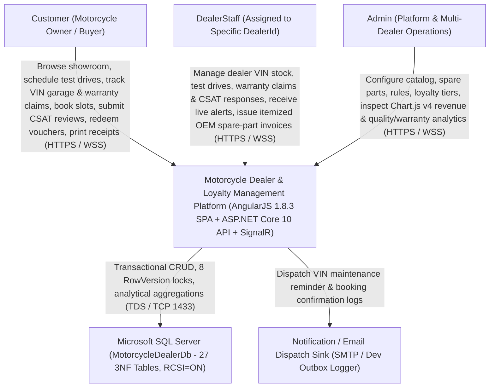
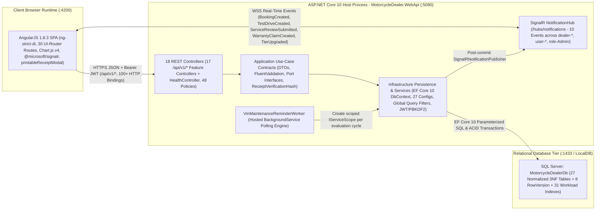
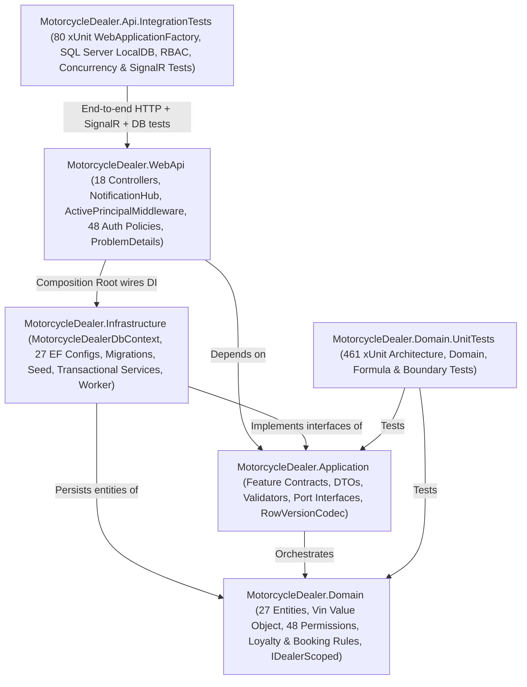
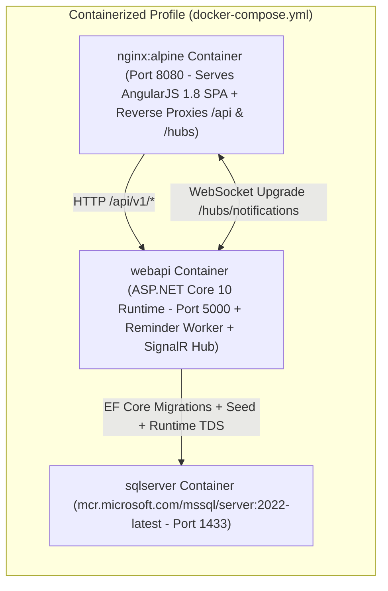

# System Architecture Specification — Motorcycle Dealer & Loyalty Management Platform

| Metadata | Details |
| :--- | :--- |
| **Project Name** | Motorcycle Dealer & Loyalty Management Platform |
| **Repository** | `https://github.com/quocanhh86/motorcycle-dealer` |
| **Timeline & Team** | `02/2026 - 08/2026` · Solo Full-Stack Developer (`Team Size: 1`) |
| **Architecture Style** | 4-Layer Clean Architecture Modular Monolith (`.NET 10`, `18` C# Controllers / `17` `/api/v1/*` Feature Controllers, `100+` HTTP Bindings) + Decoupled `AngularJS 1.8.3` SPA (`30` Navigable UI-Router Routes) + Native C# `.NET 10 MAUI` Android & iOS Field App (`net10.0-android;net10.0-ios`, `CommunityToolkit.Maui 13.0`, `16` Compiled Screens, `9`-Table `SQLCipher` WAL) |
| **Primary Data Store** | Microsoft SQL Server (`MotorcycleDealerDb` — **`27` Normalized 3NF Tables**, `READ_COMMITTED_SNAPSHOT = ON`) + Device Encrypted `SQLCipher` Cache (`9` Local Tables) |
| **Real-Time Transport** | ASP.NET Core SignalR (`/hubs/notifications` — **`10` Strongly-Typed Events** over WebSockets to Web SPA and Android/iOS MAUI Field App) |
| **Document Status** | **Production & Portfolio Release (`v1.3.3` — Phases 1–10 Architecture: `88` WBS Tasks across `T-101`..`T-1008` + Multi-Platform Android & iOS MAUI Upgrade)** |

### Related Canonical Documents
- **CV Baseline**: [REQUIREMENTS.md](../REQUIREMENTS.md) · **Landing Overview**: [README.md](../README.md) · **Governance Rules**: [AGENTS.md](../AGENTS.md) · [mobile/AGENTS.md](../mobile/AGENTS.md)
- **Product Requirements (`FR-01`..`FR-10`)**: [PRD.md](./PRD.md) · **Database Schema (`27` Tables)**: [DATABASE_DESIGN.md](./DATABASE_DESIGN.md) · **API, RBAC & UI Design**: [DESIGN.md](./DESIGN.md) · **Mobile Screens (`16`)**: [MOBILE_MAUI_SCREENS.md](./screens/MOBILE_MAUI_SCREENS.md) · **Basic Design Master**: [BD_00_BASIC_DESIGN_MASTER.md](./basic-design/BD_00_BASIC_DESIGN_MASTER.md) · **Release Notes**: [RELEASE_NOTES_v1.1.0.md](./RELEASE_NOTES_v1.1.0.md) · [RELEASE_NOTES_v1.2.0.md](./RELEASE_NOTES_v1.2.0.md) · [RELEASE_NOTES_v1.3.0.md](./RELEASE_NOTES_v1.3.0.md)
- **10-Phase WBS (`T-101`..`T-1008`, `88` Tasks)**: [TASKS.md](../TASKS.md) · **Live Progress & Risk Register**: [PROGRESS.md](../PROGRESS.md) · **Master Word Spec**: [Motorcycle_Dealer_Loyalty_Platform_Specification.docx](./Motorcycle_Dealer_Loyalty_Platform_Specification.docx)

---

## 1. Architectural Vision & Quality Attributes

The **Motorcycle Dealer & Loyalty Management Platform** unifies multi-dealer motorcycle showroom sales, VIN-level vehicle ownership tracking, time-slot workshop service booking, automated VIN maintenance reminders, spend-based loyalty point accrual with tiered multipliers, voucher redemption, real-time staff booking alerts, and cross-dealer executive analytics inside a cohesive, auditable platform.

### Core Quality Attributes

| Quality Attribute | Target Architectural Guarantee | Primary Mechanism |
| :--- | :--- | :--- |
| **Maintainability & Modularity** | Strict separation between pure domain invariants, application orchestration, infrastructure persistence, and transport adapters | 4-Layer Clean Architecture (`ADR-001`) with inward-only project references |
| **Multi-Dealer Tenant Isolation** | Zero cross-dealer data leakage for `DealerStaff` while supporting unified `Customer` accounts and cross-dealer `Admin` analytics | Shared SQL Server schema with `IDealerScoped` + EF Core Global Query Filters (`ADR-002`) |
| **Financial & Loyalty Auditability** | Every earned, redeemed, or adjusted loyalty point is traceable to an immutable source transaction with zero balance drift | Append-only `PointLedgerEntries` with unique `IdempotencyKey` (`ADR-003`) |
| **Real-Time Operational Latency** | Sub-second delivery of new service booking alerts to assigned `DealerStaff` workbenches without browser refresh | Strongly-typed SignalR `NotificationHub` scoped to `dealer-{dealerId}` groups (`ADR-004`) |
| **Concurrency Correctness** | Zero double-booked workshop capacity slots and zero negative/duplicate voucher or point redemptions under concurrent load | SQL Server `ROWVERSION` optimistic concurrency tokens + atomic transactions |
| **Proactive Retention Automation** | Deterministic, duplicate-free maintenance reminders triggered per motorcycle `VIN` by mileage or time interval | Hosted `VinMaintenanceReminderWorker` (`BackgroundService`) + SQL `DeduplicationKey` (`ADR-005`) |
| **Responsive Role-Scoped UX** | Instant client-side state protection, seamless token renewal, and interactive multi-dealer `Chart.js` visualizations | Decoupled Modular `AngularJS 1.8` SPA + `@uirouter/angularjs` guards (`ADR-006`) |

---

## 2. System Context, Container & Layer Diagrams (C4 + Clean Architecture)

### 2.1 C4 Level 1 — System Context Diagram



### 2.2 C4 Level 2 — Container & Runtime Topology Diagram



### 2.3 Clean Architecture Layer & Dependency Rule Diagram



> [!IMPORTANT]
> **Inward Dependency Invariant**: `MotorcycleDealer.Domain` sits at the center of the dependency graph and holds **zero** NuGet or project references to Entity Framework Core, ASP.NET Core, SignalR, or JSON serialization libraries. All external I/O (SQL Server, WebSockets, system clock, JWT signing) is abstracted behind interfaces in `MotorcycleDealer.Application` and implemented in `MotorcycleDealer.Infrastructure`.

---

## 3. Delivered Repository Directory Architecture (`v1.1.0` — Phases 1–8)

> [!NOTE]
> All **8 engineering phases (`72 / 72` WBS tasks = `100.0%`)** are delivered and verified in production code (`541 / 541` xUnit tests, `56 / 56` SPA checks, `9 / 9` `SMK-01..09` probes, and `27 / 27` Headless Edge CDP routes).

```text
motorcycle-dealer/
├── README.md                                        # Landing overview, v1.1.0 architecture & quick-start
├── REQUIREMENTS.md                                  # Extracted CV baseline & closed-loop scope mapping
├── AGENTS.md                                        # Workspace constitution, 8-skill router & post-task sync rule
├── TASKS.md                                         # Master 8-Phase WBS (T-101..T-808, 72/72 complete)
├── PROGRESS.md                                      # Gate dashboard (72/72 = 100.0%), quality-loop ledger & risks
├── docker-compose.yml                               # SQL Server 2022 + .NET 10 WebApi (:5080) + Node 22 SPA (:4200)
├── .editorconfig                                    # C# & JS formatting conventions
├── .gitignore                                       # Ignore bin/, obj/, node_modules/, vendor/, .env, secrets
│
├── docs/                                            # Canonical Engineering Specifications (v1.1.0)
│   ├── PRD.md                                       # Product Requirements & Given/When/Then criteria (FR-01..FR-08)
│   ├── ARCHITECTURE.md                              # System Architecture, C4, ADRs & Daily Git Shipper (This file)
│   ├── DATABASE_DESIGN.md                           # 25-table 3NF SQL Server data dictionary & 27 workload indexes
│   ├── DESIGN.md                                    # 40-permission RBAC, REST/SignalR (7 events) & UI wireframes
│   ├── openapi.v1.yaml                              # OpenAPI 3.1.0 contract covering all /api/v1/* & /receipt routes
│   ├── TEST_PLAN.md                                 # 65-case QA specification (TC-001..TC-065) & execution ledger
│   ├── RUNBOOK.md                                   # Setup, operations, v1.1.0 demo walkthrough & shipper runbook
│   ├── RELEASE_NOTES_v1.0.0.md                      # Phase 7 (v1.0.0) baseline release notes
│   ├── RELEASE_NOTES_v1.1.0.md                      # Phase 8 (v1.1.0) feature expansion release notes
│   ├── basic-design/BD_00_BASIC_DESIGN_MASTER.md    # Master Basic Design (Kihon Sekkei) specification
│   ├── detail-design/DD_01..DD_04_*.md              # 4 Detail Design (Shosai Sekkei) specifications
│   ├── modules/MOD_01..MOD_06_*.md                  # 6 Clean Architecture vertical module blueprints
│   ├── screens/{DESIGN_SYSTEM_AND_NAVIGATION,CUSTOMER_PORTAL_SCREENS,STAFF_AND_ADMIN_SCREENS}.md
│   └── Motorcycle_Dealer_Loyalty_Platform_Specification.docx
│
├── .agents/                                         # Antigravity Workspace Customization, MCP & Shipper Suite
│   ├── plugins.json                                 # Explicit workspace plugin discovery (.agents/plugins)
│   ├── skills.json                                  # Explicit workspace skill discovery (.agents/skills — single-load)
│   ├── rules/AGENTS.md                              # Operational .agents/ guide & 9-server MCP routing matrix
│   ├── scripts/                                     # Zero-dep Node v22 MCP servers, QA gates & 6-month Git shipper
│   │   ├── baseline-spec-snapshot.json              # Canonical 8-phase, 25-table, 40-permission, 7-event JSON oracle
│   │   ├── mcp-dealer-guardrails-server.mjs         # Workspace Stdio MCP server (5 governance/RBAC/DB/loyalty/WBS tools)
│   │   ├── mcp-sqlserver-localdb-server.mjs         # Workspace Stdio MCP server (4 read-only LocalDB SQL tools)
│   │   ├── verify-post-task-sync.mjs                # Automated Post-Task Docs, Snapshot & 183-Day Git Schedule Gate
│   │   ├── daily-git-shipper.mjs                    # Lock-safe 183-day scheduled GitHub commit & push engine
│   │   ├── git-6month-schedule-plan.json            # Deterministic 183-day workspace file -> commit mapping plan
│   │   ├── register-daily-git-schedule.ps1          # Windows Task Scheduler installer (StopOnIdleEnd = False)
│   │   ├── audit-dealer-guardrails.{ps1,sh}         # Clean Arch boundary, immutable tables & secret hygiene auditor
│   │   ├── ensure-sqlserver-db.{ps1,sh}             # (localdb)\MSSQLLocalDB & Docker SQL Server 2022 bootstrap
│   │   ├── run-phase-quality-loop.ps1               # 3-battery runner for the mandatory 15R+6T quality loop
│   │   ├── smoke-fullstack.{ps1,sh}                 # SMK-01..SMK-09 HTTP, RFC 7807, RBAC, SignalR & v1.1 smoke suite
│   │   ├── verify-dealer-platform.{ps1,sh}          # Master JSON, skill, guardrail, MCP, sync & dotnet/SPA verifier
│   │   ├── sync-progress.mjs                        # TASKS.md <-> PROGRESS.md deterministic synchronization check
│   │   └── build-spec-docx.mjs                      # Root-clean OpenXML Master Word Specification generator
│   ├── skills/                                      # 8 Workspace Domain, Stack & MCP Orchestration Skills
│   └── plugins/motorcycle-dealer-suite/             # Native plugin manifest, 2 Stdio MCPs & PreToolUse safety hooks
│
├── backend/                                         # .NET 10 Clean Architecture Backend (6 Projects, 0 Warnings)
│   ├── MotorcycleDealer.sln
│   ├── Directory.Build.props                        # net10.0, Nullable=enable, ImplicitUsings, TreatWarningsAsErrors=true
│   ├── src/
│   │   ├── MotorcycleDealer.Domain/                 # 25 Entities, Vin, 40 Permissions, LoyaltyPointsCalculator, IDealerScoped
│   │   ├── MotorcycleDealer.Application/            # Feature DTOs, FluentValidation, Port Interfaces, ReceiptVerificationHash
│   │   ├── MotorcycleDealer.Infrastructure/         # MotorcycleDealerDbContext, 25 Configs, Migrations, Seed, Services, Worker
│   │   └── MotorcycleDealer.WebApi/                 # 16 Thin Controllers (/api/v1/* & /health), NotificationHub, Middleware
│   └── tests/
│       ├── MotorcycleDealer.Domain.UnitTests/       # 461 pure architecture, domain, math & validator unit tests
│       └── MotorcycleDealer.Api.IntegrationTests/   # 80 SQL Server LocalDB RBAC, concurrency, SignalR & receipt tests
│
└── frontend/                                        # Decoupled Modular AngularJS 1.8.3 SPA (56/56 Checks PASS)
    ├── package.json                                 # Zero runtime framework lock-in; verify-spa.mjs & dev-server.mjs
    └── src/
        ├── index.html                               # ng-strict-di bootstrap + 46 ordered module/component scripts
        ├── styles/                                  # Design tokens, responsive shell & @media print receipt rules
        └── app/
            ├── app.module.js / app.config.js / app.routes.js  # 32 UI-Router states (23 primary + 4 aliases = 27 routes)
            ├── core/                                # 40 PERMISSIONS, AuthHttpInterceptor, SignalRClientService (7 events)
            ├── shared/                              # appShell, notificationBell, printableReceiptModal, dealerChart
            └── features/{public,customer,staff,admin}/  # All 23 primary screens (including Test-Drives & Spare-Parts)
```

### 3.1 Antigravity `.agents/` & 9-Server MCP Developer Ecosystem

To enforce architectural invariants across Phases 1–8 without adding runtime bloat to `MotorcycleDealer.sln` or `frontend/`, the workspace pairs **2 zero-dependency Node.js Stdio MCP servers** (`.agents/plugins/motorcycle-dealer-suite/mcp_config.json`) with **7 global MCP servers**:

| MCP Server | Scope | Primary Engineering Role |
| :--- | :---: | :--- |
| `motorcycle-dealer-guardrails` | Workspace (`Stdio`) | Phase-gate file boundary checks (`check_phase_gate`), **40-permission** RBAC lookup (`lookup_rbac_permission`), **25-table** spec lookup (`lookup_db_table_spec`), canonical two-step loyalty math oracle (`calculate_loyalty_preview`), and WBS task queries (`get_wbs_tasks` across `72` tasks) |
| `sqlserver-localdb-inspector` | Workspace (`Stdio`) | Strictly read-only `(localdb)\MSSQLLocalDB` (`MotorcycleDealerDb`, `25` 3NF tables) introspection (`sqlserver_status`, `list_sqlserver_tables`, `inspect_sqlserver_schema`, `query_readonly_sql`) isolating SQL Server checks from unrelated global `dbhub` Oracle connections |
| `context7_context7` | Global | Up-to-date official documentation queries for `.NET 10`, `EF Core 10`, `SignalR`, `AngularJS 1.8`, `@uirouter/angularjs`, and `Chart.js 4` |
| `playwright` | Global | Automated multi-tab browser E2E testing (proving zero-refresh `Customer` -> `DealerStaff` SignalR `BookingCreated` & `TestDriveCreated` delivery across isolated tabs) |
| `chrome-devtools-plugin_chrome-devtools` | Global | WebSocket `/hubs/notifications` frame inspection, `RFC 7807` network verification, heap snapshots (`RISK-04` leak checks), and Lighthouse audits |
| `postman_postman` | Global | Synchronizing `/api/v1/*` OpenAPI collections, role environments, and **40-permission** regression monitors |
| `github` | Global | Repository, branch, issue, PR, and `v1.0.0` / `v1.1.0` release automation on `quocanhh86/motorcycle-dealer` |
| `figma_figma` | Global | UI wireframe design context extraction and architecture diagram generation |
| `notion_notion` | Global | Engineering handbook and milestone sprint tracking synchronization |

---

## 4. Layer-by-Layer Responsibilities & Bounded Context Mapping

### 4.1 Backend & Frontend Layer Contracts

1. **`MotorcycleDealer.Domain` (Enterprise Business Rules)**:
   - Encapsulates **25 rich domain entities** and invariant enforcement across all 6 bounded contexts with **zero** external package dependencies.
   - Implements the `Vin` value object enforcing 17-character uppercase alphanumeric format (excluding `I`, `O`, `Q` per ISO 3779).
   - Houses pure deterministic domain calculations:
     - **Loyalty Accrual**: `PointsEarned = (int)Math.Floor(Math.Floor(NetPaidAmount / 10000m) * TierMultiplier)` across `Bronze` (`0+`, `1.00x`), `Silver` (`500+`, `1.20x`), `Gold` (`2,000+`, `1.50x`), and `Platinum` (`5,000+`, `2.00x`).
     - **Maintenance Due Evaluation**: Computes `NextDueMileageKm` and `NextDueDateUtc`, triggering reminders when approaching lead windows or overdue.
   - Defines `IDealerScoped` (`6` dealer-owned entities: `DealerInventories`, `SalesOrders`, `ServiceTimeSlots`, `ServiceBookings`, `ServiceInvoices`, `TestDriveBookings`), `ISoftDeletable` (`6` tables including `SpareParts`), `IImmutableFinancialEntity` (`SalesOrders`, `ServiceInvoices`, `ServiceInvoiceLineItems`), `IAppendOnlyEntity` (`PointLedgerEntries`), and all **`40` canonical `Permissions.<Module>.<Action>` constants** (`Customer = 16`, `DealerStaff = 18`, `Admin = 28`).

2. **`MotorcycleDealer.Application` (Application Business Rules)**:
   - Organizes vertical feature contracts (`Auth`, `Dealers`, `Showroom`, `TestDrives`, `Garage`, `Bookings`, `Invoices`, `SpareParts`, `Loyalty`, `Notifications`, `Analytics`).
   - Validates every incoming command/query via `FluentValidation` before hitting persistence, encodes/decodes 8-byte concurrency tokens via `RowVersionCodec`, and computes deterministic 16-char SHA-256 verification seals via `ReceiptVerificationHash`.
   - Coordinates multi-aggregate atomic workflows (e.g., completing a `SalesOrder`, scheduling a `TestDriveBooking` within the `<= 2` window cap, or settling an itemized `ServiceInvoice` with `ServiceInvoiceLineItems`, `CustomerVouchers`, `PointLedgerEntries`, and `LoyaltyAccount` tier evaluation in a single database transaction).

3. **`MotorcycleDealer.Infrastructure` (Frameworks, Persistence & Workers)**:
   - Implements `MotorcycleDealerDbContext` over SQL Server (`MotorcycleDealerDb`) with **25 dedicated `IEntityTypeConfiguration<T>` classes** enforcing 3NF constraints, `DECIMAL(18,2)` precision, `DATETIMEOFFSET(7)` UTC storage, **`6` `ROWVERSION` concurrency tokens** (`DealerInventories`, `ServiceTimeSlots`, `ServiceBookings`, `LoyaltyAccounts`, `CustomerVouchers`, `TestDriveBookings`), `AppendOnlyLedgerInterceptor` blocking mutations on all **`4` immutable financial/audit tables**, and **27 workload/covering B-Tree indexes**.
   - Applies **EF Core Global Query Filters** + `SaveChangesAsync` write guards on all `6` `IDealerScoped` entities whenever `ICurrentUserContext.IsDealerStaff` is active.
   - Hosts `VinMaintenanceReminderWorker` (`BackgroundService`), periodically scanning active `CustomerVehicles` against `MaintenanceRules`, writing deduplicated `MaintenanceReminders` + `Notifications`, and pushing real-time alerts via `INotificationPublisher`.

4. **`MotorcycleDealer.WebApi` (Transport & Composition Root)**:
   - Exposes **16 C# Controllers** (**15** `/api/v1/*` feature controllers: `Auth`, `Dealers`, `Motorcycles`, `Inventories`, `SalesOrders` [+`/receipt`], `TestDrives`, `Vehicles`, `TimeSlots`, `Bookings`, `ServiceInvoices` [+`/receipt`], `SpareParts`, `Loyalty`, `Vouchers`, `Notifications`, `AdminAnalytics`, plus `HealthController` and minimal `/health` liveness probe — **`90+` HTTP bindings**).
   - Hosts `NotificationHub` (`/hubs/notifications`, **`7` server-to-client events**) with JWT WebSocket query-string token extraction (`access_token`) and `ActivePrincipalMiddleware` immediate revocation checks.
   - Enforces `PermissionPolicyProvider` (`FrozenDictionary` of `40` policies) + `PermissionAuthorizationHandler` and translates exceptions into `RFC 7807 ProblemDetails`.

5. **`frontend/` Decoupled AngularJS 1.8.3 SPA (Presentation Tier)**:
   - Structured around `ng-strict-di` AngularJS 1.8.3 `.component()` definitions (`controllerAs: '$ctrl'`), one-time bindings (`::`), and **27 navigable UI-Router routes** (`23` primary feature screens + `4` route aliases across `32` states).
   - Enforces client-side role and `40`-permission state protection via `@uirouter/angularjs` `$transitions.onBefore` hooks across `app.public.*`, `app.customer.*`, `app.staff.*`, and `app.admin.*`.
   - Integrates `@microsoft/signalr` inside `SignalRClientService` across all **`7` hub events** so `DealerStaff` workbenches prepend incoming `BookingCreated` (`SCR-STF-01`) and `TestDriveCreated` (`SCR-STF-06`) cards immediately without page refresh.
   - Provides `<printable-receipt-modal>` (`@media print` A4/thermal stylesheet) for official `RCP-SLS-*` and `RCP-SVC-*` receipts and leak-free `<dealer-chart>` `Chart.js v4` executive dashboards (`chart.destroy()` on `$onDestroy`).

### 4.2 Bounded Contexts to 25-Table Mapping

| Bounded Context | Functional Scope | Canonical SQL Server Tables (`25` Total) |
| :--- | :--- | :--- |
| **1. Identity & RBAC** | `FR-01` Authentication, Token Rotation & `40` Granular Permissions | `Users`, `Roles`, `Permissions`, `UserRoles`, `RolePermissions`, `RefreshTokens` (`6`) |
| **2. Dealers, Showroom Sales & Test-Drives** | `FR-02`, `FR-08` Multi-Dealer Network, Catalog, VIN Stock, Test-Drives & Bike Purchases | `Dealers`, `MotorcycleModels`, `DealerInventories`, `SalesOrders`, `TestDriveBookings` (`5`) |
| **3. Customer Garage & Reminders** | `FR-03`, `FR-04` Owned VIN Tracking, Schedules & Automated Alerts | `CustomerVehicles`, `MaintenanceRules`, `MaintenanceReminders` (`3`) |
| **4. Service Booking, OEM Parts & Invoicing** | `FR-04`, `FR-08` Time-Slot Locking, Appointments, OEM Spare-Parts & Itemized Settlement | `ServiceTimeSlots`, `ServiceBookings`, `ServiceInvoices`, `SpareParts`, `ServiceInvoiceLineItems` (`5`) |
| **5. Loyalty, Tiers & Vouchers** | `FR-05` Immutable Point Ledger, Tier Multipliers & Rewards Store | `LoyaltyTiers`, `LoyaltyAccounts`, `PointLedgerEntries`, `VoucherCatalogs`, `CustomerVouchers` (`5`) |
| **6. Real-Time Notifications** | `FR-06` Persistent Inbox + SignalR `7`-Event Push Delivery Audit | `Notifications` (`1`) |

*(Admin Analytics `FR-07` executes read-optimized aggregation projections across `Dealers`, `SalesOrders`, `ServiceBookings`, `ServiceInvoices`, and `LoyaltyAccounts` backed by covering indexes detailed in [DATABASE_DESIGN.md](./DATABASE_DESIGN.md).)*

---

## 5. Architecture Decision Records (`ADR-001`..`ADR-006`)

### ADR-001: Clean Architecture 4-Layer Modular Monolith on ASP.NET Core 10

- **Status**: Accepted (`2026-02`)
- **Related Requirements**: `FR-01`..`FR-07`
- **Context**: As a solo full-stack engineering project (`02/2026 - 08/2026`) spanning six tightly coupled transactional domains (e.g., completing a `SalesOrder` or `ServiceInvoice` must atomically update inventory/booking state, calculate tier-multiplied loyalty points, append a ledger entry, redeem a voucher, and trigger a SignalR event), the backend architecture must maximize domain testability and code clarity without incurring distributed-systems operational overhead.
- **Decision**: Build the backend as a **4-Layer Clean Architecture Modular Monolith** on **ASP.NET Core 10 (`net10.0`)** split into `MotorcycleDealer.Domain`, `MotorcycleDealer.Application`, `MotorcycleDealer.Infrastructure`, and `MotorcycleDealer.WebApi`, verified by `MotorcycleDealer.Domain.UnitTests` and `MotorcycleDealer.Api.IntegrationTests`.
- **Alternatives Considered**:
  1. *Distributed Microservices (Separate Booking, Loyalty, and Notification Services)*: Rejected because cross-service saga orchestration, eventual consistency between invoice payment and voucher/point balance, and multi-container operational complexity slow solo delivery without proportional scale benefit.
  2. *2-Tier Transaction Script (Controllers calling `DbContext` directly)*: Rejected because embedding SQL queries, concurrency handling, and loyalty multiplier math inside HTTP controllers makes unit testing brittle and invites authorization/scoping bugs.
- **Consequences**:
  - *Positive*: ACID database transactions span booking, invoicing, and loyalty accrual seamlessly; pure domain logic (`LoyaltyTierCalculator`, `MaintenanceDueEvaluator`, `Vin` validation) executes in sub-millisecond unit tests without mocking EF Core; clear boundaries enable future extraction of modules if scale ever demands it.
  - *Trade-offs & Mitigations*: Requires disciplined DTO mapping between layers, mitigated by concise C# 13/`net10.0` `record` DTOs and explicit projection extension methods.

---

### ADR-002: Single SQL Server Database with `DealerId` Row-Level Scoping & EF Core Global Query Filters

- **Status**: Accepted (`2026-02`)
- **Related Requirements**: `FR-01`, `FR-02`, `FR-04`, `FR-07`
- **Context**: The platform serves three distinct operational scopes simultaneously:
  1. `Customer` accounts roam across the entire dealer network (buying a motorcycle at Dealer A in Hanoi, booking maintenance at Dealer B in Da Nang, and accumulating loyalty points in a single unified wallet).
  2. `DealerStaff` users belong strictly to one assigned `DealerId` and must never view or mutate another dealer's VIN inventory, time slots, bookings, or invoices.
  3. `Admin` users require real-time cross-dealer `Chart.js` revenue and booking aggregations.
- **Decision**: Use a **single normalized SQL Server database (`MotorcycleDealerDb`, `25` 3NF tables)** with explicit `DealerId UNIQUEIDENTIFIER` foreign keys on all **6 dealer-owned tables** (`DealerInventories`, `ServiceTimeSlots`, `SalesOrders`, `ServiceBookings`, `ServiceInvoices`, `TestDriveBookings`, plus nullable `DealerId` on `Users` enforced for `DealerStaff`). Implement an `IDealerScoped` marker interface and register **EF Core Global Query Filters** in `MotorcycleDealerDbContext` bound dynamically to `ICurrentUserContext`:
  - When `Role == "DealerStaff"`, EF Core automatically appends `WHERE DealerId = @currentDealerId` to every query and validates `entity.DealerId == currentUser.DealerId` inside `SaveChangesAsync`.
  - When `Role == "Admin"`, cross-dealer visibility is enabled for platform management and analytics.
- **Alternatives Considered**:
  1. *Database-per-Dealer Multi-Tenancy*: Rejected because customers, vehicles (`VIN`), loyalty wallets, and vouchers are global across dealers, and `Admin` analytics would require complex cross-database federated queries.
  2. *Manual `WHERE DealerId == ...` Clauses in Every Query Only*: Rejected as sole defense because omitting a single predicate in a new endpoint creates a Broken Object Level Authorization (BOLA / IDOR) vulnerability.
- **Consequences**:
  - *Positive*: Defense-in-depth data isolation for `DealerStaff`; effortless single-query `GROUP BY DealerId` analytics for `Admin`; seamless cross-dealer customer mobility.
  - *Trade-offs & Mitigations*: Background workers (`VinMaintenanceReminderWorker`) run outside an HTTP user context and must explicitly query with `IgnoreQueryFilters()` inside controlled system scopes.

---

### ADR-003: Immutable Append-Only Ledger Pattern (`PointLedgerEntries`) for Loyalty Points & Tier Progression

- **Status**: Accepted (`2026-03`)
- **Related Requirements**: `FR-02`, `FR-05`
- **Context**: Loyalty points represent monetary value redeemable for service discounts (`CustomerVouchers`). Updating a mutable `PointsBalance` integer column in place makes it impossible to audit why a customer's balance changed, detect double-credited invoices on network retries, or distinguish spendable `AvailablePoints` from tier-determining `LifetimeQualifyingPoints`.
- **Decision**: Implement a **Double-Check Immutable Ledger Pattern** combining:
  1. **`PointLedgerEntries` (Source-of-Truth Audit Log) & `4` Immutable Financial Tables**: Strictly append-only `PointLedgerEntries` table (`IAppendOnlyEntity` + SQL trigger `TR_PointLedgerEntries_BlockMutation`) recording `LoyaltyAccountId`, `TransactionType` (`SalesOrderEarn`, `ServiceInvoiceEarn`, `VoucherRedeem`, `VoucherExpireRefund`, `AdminAdjustment`, `WelcomeBonus`), signed `PointsDelta`, `BalanceAfter`, polymorphic `ReferenceType`/`ReferenceId`, and a unique `IdempotencyKey` (`UQ_PointLedgerEntries_IdempotencyKey`). Furthermore, `SalesOrders`, `ServiceInvoices`, and itemized `ServiceInvoiceLineItems` implement `IImmutableFinancialEntity` enforced by `AppendOnlyLedgerInterceptor` and `.agents/` safety hooks.
  2. **`LoyaltyAccounts` (Read-Optimized Snapshot with `RowVersion`)**: Stores `AvailablePoints` (spendable balance), `LifetimeQualifyingPoints` (monotonically increasing except on invoice reversal; drives automatic tier upgrades across `Bronze` `0+` / `Silver` `500+` / `Gold` `2,000+` / `Platinum` `5,000+`), `LifetimeSpentVnd`, `CurrentTierId`, and `RowVersion`.
  3. **Atomic Unit-of-Work**: Every point mutation inserts the `PointLedgerEntries` row, updates `LoyaltyAccounts`, re-evaluates `CurrentTierId` against `LoyaltyTiers`, and commits in one SQL transaction.
- **Alternatives Considered**:
  1. *Mutable `Users.LoyaltyPoints` Counter Only*: Rejected due to zero audit trail, race-condition vulnerability, and inability to enforce idempotency.
  2. *Compute Balance via `SUM(PointsDelta)` on Every Read Without `LoyaltyAccounts` Snapshot*: Rejected because scanning ledger history on every navbar load and voucher check degrades read latency as history grows.
- **Consequences**:
  - *Positive*: Bank-grade auditability, mathematical reconciliation (`SUM(PointsDelta) == AvailablePoints`), built-in idempotency against duplicate webhook/API retries, and fast `O(1)` balance reads.
  - *Trade-offs & Mitigations*: Concurrent point redemptions on the same account contend on `LoyaltyAccounts.RowVersion`, cleanly caught and surfaced as `409 Conflict` to prevent negative balances.

---

### ADR-004: SignalR `/hubs/notifications` Strongly-Typed Hub with Group Routing (`dealer-{dealerId}`, `user-{userId}`, `role-Admin`)

- **Status**: Accepted (`2026-03`)
- **Related Requirements**: `FR-04`, `FR-06`
- **Context**: `REQUIREMENTS.md` explicitly mandates real-time notifications via **SignalR** so `DealerStaff` receive new booking alerts instantly without refreshing the browser page. Simultaneously, notifications must strictly obey multi-dealer boundaries (Dealer A's staff must never receive Dealer B's booking alerts over WebSockets).
- **Decision**: Implement a strongly-typed ASP.NET Core SignalR hub (`NotificationHub : Hub<INotificationClient>`) mapped to `/hubs/notifications` and authenticated via JWT (`JwtBearerEvents.OnMessageReceived` reading `access_token` from query string for WebSocket handshakes):
  - During `OnConnectedAsync`, the server inspects verified JWT claims (`sub`, `role`, `dealer_id`) and enrolls `Context.ConnectionId` into deterministic server-controlled groups:
    - Every authenticated user joins `user-{userId}`.
    - Users with `Role == "DealerStaff"` and valid `dealer_id` join `dealer-{dealerId}`.
    - Users with `Role == "Admin"` join `role-Admin`.
  - No client-callable hub method is exposed to join arbitrary groups.
  - Every real-time event (**`10` canonical events**: `BookingCreated`, `BookingStatusChanged`, `MaintenanceReminderTriggered`, `LoyaltyPointsUpdated`, `TierUpgraded`, `TestDriveCreated`, `TestDriveStatusChanged`, `ServiceReviewSubmitted`, `WarrantyClaimCreated`, `WarrantyClaimStatusChanged`) is first persisted to the `Notifications` table (for offline durability and unread badge recovery) and then broadcast post-commit via `IHubContext<NotificationHub, INotificationClient>`.
- **Alternatives Considered**:
  1. *Short-Interval HTTP Polling (`setInterval` every 5s)*: Violates the mandatory SignalR requirement, wastes server connections, and introduces polling lag.
  2. *Client-Requested Group Subscription (`hub.invoke('JoinDealerGroup', dealerId)`)*: Rejected because malicious clients could subscribe to competing dealers' live booking streams.
- **Consequences**:
  - *Positive*: Instant (`< 100 ms` local/LAN) push updates into the `DealerStaff` live queue without page refresh; cryptographic tenant isolation on WebSockets; offline resilience backed by the `Notifications` SQL table.
  - *Trade-offs & Mitigations*: Single-node in-memory SignalR backplane suffices for single-instance deployment; scaling out to multiple API replicas in the future only requires adding `AddStackExchangeRedis()` without changing hub or client code.

---

### ADR-005: Hosted `BackgroundService` (`VinMaintenanceReminderWorker`) with Deduplication Keys for VIN Reminders

- **Status**: Accepted (`2026-04`)
- **Related Requirements**: `FR-03`, `FR-04`, `FR-06`
- **Context**: Each customer motorcycle (`CustomerVehicles`, keyed by unique 17-char `VIN`) follows model-specific `MaintenanceRules` defined by both mileage intervals (e.g., `1,000 km`, `4,000 km`, `8,000 km`, `12,000 km`) and calendar intervals (e.g., every `6 months`). Reminders must fire automatically when either threshold approaches (e.g., within `300 km` or `7 days` of due date, or overdue) without requiring third-party job servers and without generating duplicate alerts across worker ticks or app restarts.
- **Decision**: Implement `VinMaintenanceReminderWorker` inheriting from `Microsoft.Extensions.Hosting.BackgroundService` inside `MotorcycleDealer.Infrastructure`:
  - Uses `PeriodicTimer` (configurable interval in `appsettings.json`, e.g., every `60 minutes` in production and `60 seconds` / on-demand admin trigger in demo/testing) creating a fresh DI `IServiceScope` per sweep.
  - Evaluates active `CustomerVehicles` (`IgnoreQueryFilters()`) against their model's `MaintenanceRules` using `LastServiceMileageKm`, `CurrentMileageKm`, and `LastServiceDateUtc`.
  - Computes a deterministic **`DeduplicationKey`** formatted as `{VIN}:{MaintenanceRuleId}:{TargetMileageKm}` guarded by a SQL Server `UNIQUE` constraint (`UQ_MaintenanceReminders_DeduplicationKey`).
  - Inserts new `MaintenanceReminders` + `Notifications` records and pushes `MaintenanceReminderTriggered` to `user-{customerId}` via SignalR.
- **Alternatives Considered**:
  1. *External Scheduler Infrastructure (Hangfire / Quartz Cluster / Azure Functions)*: Rejected as unnecessary dependency bloat when `.NET 10` `BackgroundService` + SQL unique deduplication provides zero-cost, self-contained reliability.
  2. *SQL Server Agent Jobs / Database Triggers*: Rejected because business logic in T-SQL triggers bypasses Clean Architecture, cannot push SignalR WebSocket notifications directly, and is difficult to unit test.
- **Consequences**:
  - *Positive*: Zero extra infrastructure containers; 100% deterministic unit-testable reminder evaluation; database-enforced idempotency guarantees at-most-once notification per VIN milestone even across restarts.
  - *Trade-offs & Mitigations*: Runs in-process with the Web API host; queries use indexed batch pagination (`AsNoTracking()`) to keep memory and CPU footprint negligible.

---

### ADR-006: Decoupled Modular AngularJS 1.8 SPA with UI-Router State Guards & Refresh-Token Queue

- **Status**: Accepted (`2026-02`)
- **Related Requirements**: `FR-01`, `FR-06`, `FR-07`
- **Context**: `REQUIREMENTS.md` specifies **AngularJS** on the frontend with **route guards** for three roles (`Customer`, `DealerStaff`, `Admin`), real-time **SignalR** updates without page refresh, and **Chart.js** analytics dashboards. Legacy AngularJS 1.x codebases often suffer from global `$scope` mutation, broken digest cycles on external WebSocket callbacks, and race conditions when multiple concurrent `$http` calls hit an expired JWT simultaneously.
- **Decision**: Architect `frontend/` as a **decoupled, standalone modular AngularJS 1.8 (`1.8.3`) SPA** following the AngularJS Component Pattern:
  1. **UI-Router State Hierarchy & Guards**: Use `@uirouter/angularjs` with declarative `data: { roles: [...], requiredPermission: '...' }` metadata on states (`app.public.*`, `app.customer.*`, `app.staff.*`, `app.admin.*`). Register a global `$transitions.onBefore({}, ...)` guard redirecting unauthenticated users to `app.public.login` and unauthorized role/permission transitions to `app.public.forbidden` (`403` view).
  2. **Single-Flight Refresh-Token Interceptor**: Store short-lived JWT access tokens in memory/session state and rotate refresh tokens via `/api/v1/auth/refresh`. When parallel `$http` requests receive `401 Unauthorized`, `AuthHttpInterceptor` queues pending `$q` deferred promises behind a single refresh call and replays them transparently.
  3. **Digest-Safe SignalR & Chart.js Wrappers**: Wrap `@microsoft/signalr` callbacks inside `$rootScope.$applyAsync()` to batch DOM updates safely without `$digest already in progress` errors, and encapsulate `Chart.js 4` instances inside dedicated components that destroy canvas instances on `$onDestroy`.
- **Alternatives Considered**:
  1. *Razor Views Mixing Server HTML and Inline `ng-controller` Scripts*: Rejected because decoupling the SPA cleanly separates REST/SignalR API contracts, simplifies CORS/JWT testing, and prevents server-coupled view sprawl.
  2. *Legacy `ngRoute`*: Rejected because `@uirouter/angularjs` provides nested role shells (`app.staff.*`, `app.admin.*`) and composable `$transitions.onBefore` transition hooks superior to `ngRoute`.
- **Consequences**:
  - *Positive*: Clean component encapsulation, leak-free WebSocket and `Chart.js` lifecycles, flicker-free route protection, and crisp separation between frontend static assets and `.NET 10` API endpoints.
  - *Trade-offs & Mitigations*: Client-side route guards alone cannot enforce security; every backend endpoint independently enforces `[Authorize(Policy = ...)]` and `IDealerScoped` filtering.

---

### ADR-007: Decoupled Multi-Platform Android & iOS `.NET 10 MAUI` Topology, Enterprise `.NET 10` Libraries, Encrypted `SQLCipher` Cache & `TokenFamilyId` Isolation (`v1.3.0` / `v1.3.3`)

- **Status**: Accepted (`2026-11`, expanded for iOS `net10.0-ios`, `CommunityToolkit.Maui 13.0` & `.NET 10` resilience/validation/Humanizer in `v1.3.3`)
- **Related Requirements**: `FR-01`..`FR-10`
- **Context**: Showroom floor advisors, service bay technicians, and customers inside low-signal basement workshops need native mobile capabilities across both **Android (`API 26`–`35`)** and **Apple iOS (`iOS 15.0+`)**—native camera 1D/2D `VIN` & `dealer://` QR scanning (`Camera2` on Android, `AVFoundation` on iOS), offline loyalty passbook & receipt display, native push/local notifications (`NotificationChannel` / `UNUserNotificationCenter`), enterprise HTTP fault-tolerance & form validation, and thumb-reachable `48dp` ergonomics—without coupling mobile build toolchains (`net10.0-android;net10.0-ios`, JDK 21, Android/iOS workloads) into `backend/MotorcycleDealer.sln` or weakening server-side `ADR-002`/`ADR-003`/`ADR-005` invariants.
- **Decision**:
  1. **Decoupled 3-Project Mobile Solution (`mobile/MotorcycleDealer.Mobile.sln`)**:
     - `MotorcycleDealer.Mobile.Core` (`net10.0`, zero `<UseMaui>` or `Microsoft.Maui.*` references, `LangVersion=13.0`, `TreatWarningsAsErrors=true`): Houses all `48` verbatim `Permissions` constants, AOT-safe `MobileJsonSerializerContext`, `SingleFlightTokenRefreshHandler` paired with **`Microsoft.Extensions.Http.Resilience 10.11.1`** (Polly v8 `DealerMobileResilience` pipeline: exponential jitter retry `2x` **strictly on idempotent `GET`/`HEAD`/`OPTIONS` or explicit `Idempotency-Key`**, circuit breaker `30s / 0.5 / 6 / 15s`, `15s` attempt timeout), **`FluentValidation 11.11.0`** (`Validation/MobileFormValidators.cs` — `LoginInputValidator`, `RegisterInputValidator`, `RegisterVehicleInputValidator`, `WarrantyClaimInputValidator`, `SalesOrderInputValidator`), **`Humanizer.Core 2.14.1`** (`ToQuantity`, `.Humanize(LetterCasing.Title)`, relative sync age), **`WeakReferenceMessenger` (`IMessenger` + `Messaging/MobileMessages.cs`)** + `IUserFeedbackService`, `LogoutCoordinator`, `MobileRoleGuard`, domain helpers (`Iso3779VinValidator`, `TwoStepLoyaltyPreviewCalculator`, `DealerQrPayloadParser`, `MobileEndpointDefaults.IosSimulatorBaseUrl`), `9`-table `MobileOfflineDb`, `OfflineOutboxSyncService`, `DealerMobileApiClient`, `10`-event `SignalRMobileService`, and all `17` `CommunityToolkit.Mvvm` C# 13 `partial` `[ObservableProperty]` ViewModels.
     - `MotorcycleDealer.Mobile.App` (**`net10.0-android;net10.0-ios`**, Android API `26.0`–`35` + iOS `15.0+`, `<MauiXamlInflator>SourceGen</MauiXamlInflator>`, `100%` `x:DataType`): Native cross-platform host with **`CommunityToolkit.Maui 13.0.0`** (`StatusBarBehavior`, `Expander`, `TouchBehavior`, `EmailValidationBehavior`, `Toast`/`Snackbar` via `Services/MauiUserFeedbackService.cs`, official `InvertedBoolConverter`/`IsStringNotNullOrEmptyConverter`/`IsNotNullConverter`), shared cross-platform `Services/` (`MauiSecureTokenStore`, `MauiPlatformServices`, `MauiUserFeedbackService`), `AppShell` (`Public` `3` tabs, `Customer` `5` tabs, `DealerStaff` `5` tabs + pushed Invoice Builder, `Admin` Web HQ notice), Motorsport Adaptive Light/Dark Pit-Lane theme, `ZXing.Net.Maui.Controls` scanner (Android Camera2 + iOS `AVCaptureDevice` simulator fallback), pure C# `QrCodeMatrixEncoder`, Android `NotificationCompat` (`Platforms/Android/`), and Apple iOS host (`Platforms/iOS/{Info.plist,Entitlements.plist,AppDelegate.cs,Program.cs,Services/IosLocalNotificationService.cs}`).
     - `MotorcycleDealer.Mobile.UnitTests` (`net10.0` xUnit): Executes fast, headless unit/security/encryption/ViewModel tests with zero emulator requirement.
  2. **Encrypted `9`-Table `SQLCipher` WAL Offline Cache & Online-Only Law**:
     - Persists `CacheSyncState`, `CachedDealer`, `CachedMotorcycleModel` (public) and `CachedCustomerVehicle`, `CachedLoyaltyWallet`, `CachedCustomerVoucher`, `CachedActiveAppointment`, `CachedReceiptSnapshot` (infinite TTL), `OfflineMutationQueueItem` (user/dealer-scoped via `OwnerScopeKey = "{UserId}:{Role}:{DealerId ?? 'global'}"`) inside an AES-256 `SQLCipher` database (`PRAGMA journal_mode=WAL;`) keyed from platform `SecureStorage.Default` (Android Keystore / iOS Keychain).
     - Enforces `ADR-003`/`ADR-005`: strictly prohibits offline queueing of `SalesOrders`, `ServiceInvoices`, `ServiceInvoiceLineItems`, `PointLedgerEntries`, `RowVersion` slot/test-drive reservations, or voucher redemptions; allows only `NotificationRead`, `NotificationReadAll`, `VehicleMileageUpdate`, `ServiceReviewSubmit`, and `WarrantyClaimSubmit` in FIFO order (dropping on `409`/`422`).
  3. **Multi-Device `TokenFamilyId` Isolation & Dual-Platform Hardening (`Android + iOS`)**:
     - Mobile logins establish an independent `RefreshTokens.TokenFamilyId` alongside any active desktop AngularJS SPA session; `SingleFlightTokenRefreshHandler` (`SemaphoreSlim(1,1)`) wraps Polly v8 resilience without `401` retry storms, and `LogoutCoordinator` defaults to `LogoutRequest { RefreshToken, RevokeAllDevices = false }` so signing out on mobile preserves the desktop Web SPA session while purging `SecureStorage` and user-scoped `SQLCipher` rows.
     - **Android**: `AndroidManifest.xml` mandates `android:allowBackup="false"`, and `network_security_config.xml` enforces `<base-config cleartextTrafficPermitted="false" />` restricting cleartext exclusively to loopback/emulator hosts (`10.0.2.2`, `localhost`, `127.0.0.1`).
     - **Apple iOS**: `Platforms/iOS/Entitlements.plist` scopes `keychain-access-groups` to `$(AppIdentifierPrefix)vn.motorcycledealer.mobile`; `Platforms/iOS/Info.plist` enforces strict App Transport Security (`NSAllowsLocalNetworking=true` ONLY, zero `NSAllowsArbitraryLoads`), declares `NSCameraUsageDescription` & `UIStatusBarStyleLightContent`; `AppDelegate` registers foreground banner presentation (`ApexIosNotificationDelegate`); and `IosLocalNotificationService` dispatches categorized `UNUserNotificationCenter` alerts (`BookingAlerts`, `LoyaltyRewards`, `WarrantyUpdates`).
- **Alternatives Considered**:
  1. *Adding `Mobile.App` directly into `backend/MotorcycleDealer.sln`*: Rejected because backend CI/Docker builds (`mcr.microsoft.com/dotnet/sdk:10.0`) do not install Android/iOS MAUI workloads or OpenJDK 21.
  2. *Full Offline-First Write Sync for Invoices & Bookings*: Rejected because queuing `RowVersion` workshop slots or immutable `ServiceInvoices` offline would violate `ADR-003` financial immutability and `ADR-005` zero-overbooking guarantees.
- **Consequences**:
  - *Positive*: Sub-second pure `net10.0` mobile unit tests, dual-platform Android & iOS `net10.0-ios` compilation (`0` warnings), zero impact on backend/SPA Docker images, full `48`-permission & `10`-event parity, idempotent Polly v8 HTTP resilience, `FluentValidation` + `CommunityToolkit.Maui 13.0` native polish, offline QR passbook/receipts in basement workshops, and hardened multi-device session security.
  - *Trade-offs & Mitigations*: Requires mirroring backend DTO/permission contracts in `Mobile.Core` and validating both platform manifests, mitigated automatically by `verify-mobile-maui.mjs` (`8 / 8` checks including `[MAUI-IOS-AND-TOOLKIT]`) and `verify-post-task-sync.mjs` (`11 / 11` checks) enforcing 3-way `48`-permission parity across Backend, Frontend, and Mobile on every build.

---

## 6. Cross-Cutting Engineering Concerns

### 6.1 Security Architecture & OWASP API Top 10 (2023) Verification Matrix (`T-706`)

1. **Authentication & Refresh Token Rotation (`Pbkdf2PasswordHasher` & `AuthService`)**:
   - Passwords hashed with `stackalloc` `PBKDF2-SHA512` (`210,000` iterations, cryptographic random salt, constant-time `CryptographicOperations.FixedTimeEquals`, and `CryptographicOperations.ZeroMemory` buffer wiping).
   - Short-lived `HMAC-SHA256` JWT Access Tokens (`15 minutes` default expiry, fail-fast startup validation rejecting `< 256-bit` signing keys in non-test environments) carrying `sub` (`UserId`), `email`, `role` (`Customer` | `DealerStaff` | `Admin`), `dealer_id` (mandatory for `DealerStaff`), `permissions`, and `jti`.
   - Long-lived (`7 days`) cryptographically random `RefreshTokens` stored hashed (`SHA-256`) in SQL Server with atomic RCSI `ExecuteUpdateAsync` rotation and `TokenFamilyId` tracking; presenting an already-rotated token triggers immediate `ReuseDetected` cascade revocation of the entire token family, while `ActivePrincipalMiddleware` + `NotificationHub.OnConnectedAsync` close the 15-minute JWT window by rejecting locked users or deactivated branches immediately (`403 ACCOUNT_LOCKED` / `STAFF_DEALER_UNASSIGNED`).
2. **Granular Policy-Based Authorization (`PermissionPolicyProvider` & `PermissionAuthorizationHandler`)**:
   - Precomputed `O(1)` `FrozenDictionary` of all **48** `Permissions.<Module>.<Action>` policies (`Customer = 20`, `DealerStaff = 22`, `Admin = 32`) evaluated against per-request `FrozenSet<string>` claims, combined with runtime `IsAdmin` verification inside `AdminAnalyticsService`.
3. **CORS, Rate Limiting & Security Response Headers (`Program.cs` & `AuthRateLimitOptions`)**:
   - Explicit origin allowlist via `CorsOptions` (`SpaCorsPolicy` with `.AllowCredentials()` and `.WithExposedHeaders("Content-Disposition", "Retry-After", "Location")` — never `AllowAnyOrigin()`).
   - Fixed-window IP rate limiting (`AuthRateLimitOptions`, `[EnableRateLimiting(AuthRateLimitOptions.PolicyName)]`) on `/api/v1/auth/{login,register,refresh}` emitting `429 Too Many Requests` (`application/problem+json`, `errorCode: "RATE_LIMIT_EXCEEDED"`, `traceId`, and `Retry-After` header).
   - Deterministic security headers (`AuthRateLimitOptions.ApplySecurityResponseHeaders`): `X-Content-Type-Options: nosniff`, `X-Frame-Options: DENY`, and `Referrer-Policy: strict-origin-when-cross-origin`.

#### Verified OWASP API Security Top 10 (2023) Audit Matrix (`API1`..`API10`)

| OWASP Risk ID | Risk Category | Implemented Architectural & Code Controls | Automated Verification Evidence (`PASS`) |
| :--- | :--- | :--- | :--- |
| **`API1:2023`** | **Broken Object Level Authorization (BOLA)** | EF Core `IDealerScoped` Global Query Filters + `EnforceDealerScopeWriteGuard` (`403 FORBIDDEN_DEALER_SCOPE`) on all **8** dealer tables (`+TestDriveBookings`, `+ServiceReviews`, `+WarrantyClaims`); strict `CustomerId == currentUser.UserId` ownership checks (`403 FORBIDDEN_RESOURCE_OWNER`) including `/receipt`, `/service-reviews`, and `/warranty-claims`; server-derived `dealer-{dealerId}` & `user-{userId}` SignalR groups. | `OwaspApiSecurityAuditTests`, `RbacAndTenancyTests`, `TestDriveAndSparePartsIntegrationTests`, `ServiceReviewAndWarrantyIntegrationTests`, `SMK-04`, `SMK-09`, `SMK-10` (`0` cross-dealer or cross-customer leaks) |
| **`API2:2023`** | **Broken Authentication** | `PBKDF2-SHA512` (`210k` iters + dummy verify against timing enumeration), `>= 32-byte` JWT key enforcement, `alg: none` & tampered-signature rejection (`401`), RCSI refresh rotation + `TokenFamilyId` breach cascade, `ActivePrincipalMiddleware` instant lockout. | `OwaspApiSecurityAuditTests`, `Phase4SchemaAndDomainTests` (`401`/`403` verified) |
| **`API3:2023`** | **Broken Object Property Level Auth (BOPLA)** | Dedicated per-endpoint C# `record` DTOs (`0` EF Core `BaseEntity` types returned by controllers); `EngineNumber` masked to `""` on public `?publicOnly=true` inventory reads; `Role`, `DealerId`, `PointsEarned`, and `AvailablePoints` never mass-assigned from client JSON. | `CleanArchitectureDependencyTests`, `OwaspApiSecurityAuditTests`, `SMK-07` |
| **`API4:2023`** | **Unrestricted Resource Consumption** | IP-partitioned `AuthRateLimitOptions` (`PermitLimit` / `WindowSeconds` clamped `1..3600`, `X-Test-RateLimit-Partition` capped at `80` chars -> `429 RATE_LIMIT_EXCEEDED` + `Retry-After`); `PaginationQueryValidator` (`pageSize` `1..100`); `AdminAnalyticsValidators` (`<= 731` days). | `OwaspApiSecurityAuditTests`, `AdminAnalyticsBoundaryTests` (`429` & `400` verified) |
| **`API5:2023`** | **Broken Function Level Authorization (BFLA)** | **`48`** granular `[HasPermission(Permissions.*)]` policies, Separation-of-Duties blocking `Admin`/`DealerStaff` from customer `*Own` mutations, `?includeInactive=true` restricted to `Admin` (`SpareParts.ManageCatalog` / `Dealers.ManageAll`), and double-gated `[HasPermission]` + runtime `IsAdmin` check on all `/api/v1/admin/analytics/*` & `/export*` endpoints. | `OwaspApiSecurityAuditTests`, `RbacAndTenancyTests`, `SMK-03`, `SMK-09`, `SMK-10` (`403` verified) |
| **`API6:2023`** | **Unrestricted Access to Sensitive Business Flows** | SQL Server `ROWVERSION` optimistic concurrency (`8` tables) + `CreateExecutionStrategy` ACID transactions preventing slot double-booking (`10`-way race), test-drive overbooking (`6`-way race `<= 2` cap), duplicate CSAT review bonus farming (`6`-way race `1:1` `UQ_ServiceReviews_ServiceInvoiceId`), duplicate VIN sale, and voucher over-redemption (`10`-way race); unique `IdempotencyKey` on `PointLedgerEntries`. | `SlotConcurrencyAndReminderTests`, `LoyaltyAndSignalRTests`, `TestDriveAndSparePartsIntegrationTests`, `ServiceReviewAndWarrantyIntegrationTests` |
| **`API7:2023`** | **Server-Side Request Forgery (SSRF)** | Zero server-side outbound HTTP fetchers accepting user-supplied URLs across all 4 Clean Architecture layers; catalog `ImageUrl` validated as passive asset path/URL metadata only. | Static architecture & source audit (`0` outbound user-URL clients) |
| **`API8:2023`** | **Security Misconfiguration** | Explicit `CorsOptions` origin allowlist + `WithExposedHeaders`, `X-Content-Type-Options: nosniff`, `X-Frame-Options: DENY`, `Referrer-Policy: strict-origin-when-cross-origin`, `GlobalExceptionHandler` suppressing stack traces outside `Development`, non-root Dockerfiles (`USER $APP_UID` / `USER node`). | `OwaspApiSecurityAuditTests`, `SMK-01`, `docker compose config -q` |
| **`API9:2023`** | **Improper Inventory Management** | Strictly versioned `/api/v1/*` route namespace (`16` C# controllers [`15` `/api/v1/*` feature controllers + `HealthController`], `90+` documented HTTP bindings in `DD_03`), `MapOpenApi()` gated strictly to `app.Environment.IsDevelopment()`, zero exposed debug/shadow endpoints. | `audit-dealer-guardrails.ps1`, `DD_03_API_SPECIFICATIONS.md` |
| **`API10:2023`** | **Unsafe Consumption / Injection & Output Safety** | `100%` parameterized EF Core LINQ (`0` unparameterized `FromSqlRaw` in `backend/src/`), `TR_PointLedgerEntries_BlockMutation` SQL trigger, `AnalyticsCsvExporter` formula-injection prefixing (`'` on `=,+,-,@,\t,\r`), `sanitizeCsvBasename` traversal stripping, `resolvePostLoginTarget` open-redirect sanitizer. | `OwaspApiSecurityAuditTests`, `AdminAnalyticsBoundaryTests`, `verify-spa.mjs` |

### 6.2 Concurrency, Transactions & Idempotency Matrix

| High-Contention Flow | Race / Failure Mode | Architectural Protection | HTTP Outcome on Conflict |
| :--- | :--- | :--- | :--- |
| **Service Slot Booking** | Two customers select the last remaining slot (`BookedCount = MaxCapacity - 1`) simultaneously | `ServiceTimeSlots.RowVersion` (`ROWVERSION`) checked during `UPDATE ... SET BookedCount = BookedCount + 1 WHERE Id = @id AND RowVersion = @rv` inside transaction | `409 Conflict` (`SLOT_CAPACITY_EXHAUSTED` / `CONCURRENCY_CONFLICT`) |
| **Showroom Test-Drive Booking (`v1.1.0`)** | Parallel riders request the same `(DealerId, MotorcycleModelId, PreferredDate, StartTime)` window (`cap = 2`) or overlapping customer slot | ACID `CreateExecutionStrategy()` transaction counting active `Requested`/`Confirmed` bookings + `TestDriveBookings.RowVersion` on status/demo `VIN` transitions | `409 Conflict` (`TEST_DRIVE_SLOT_FULL` / `TEST_DRIVE_OVERLAP` / `CONCURRENCY_CONFLICT`) |
| **Showroom VIN Purchase** | Two staff members create a `SalesOrder` for the same physical `VIN` in stock | `DealerInventories.RowVersion` + state guard (`StockStatus == Available -> Sold`) + `UQ_CustomerVehicles_VIN` in one ACID transaction | `409 Conflict` (`ProblemDetails`: VIN already sold/reserved) |
| **Voucher Redemption & Booking Attachment** | Double-click on "Redeem Voucher" or attaching the same `CustomerVoucher` to two bookings | `LoyaltyAccounts.RowVersion` + `CustomerVouchers.RowVersion` + atomic `QuotaRedeemed` CAS + status transition (`Available -> ReservedOnBooking -> Used`) | `409 Conflict` or `422 Unprocessable Entity` |
| **Itemized Invoice & Loyalty Accrual** | Client retries `POST /api/v1/service-invoices` or submits incompatible OEM spare part | `UQ_ServiceInvoices_BookingId` (1:1) + `UQ_PointLedgerEntries_IdempotencyKey` (`SERVICE_INVOICE:{InvoiceId}:EARN`) + `SpareParts` model compatibility check + immutable `ServiceInvoiceLineItems` | `409 Conflict` (`INVOICE_ALREADY_ISSUED`) / `422` (`SPARE_PART_INCOMPATIBLE`) |
| **Post-Service CSAT Review & `+25` Bonus (`v1.2.0`)** | Parallel duplicate `POST /api/v1/service-reviews` on the same paid `ServiceInvoice` or concurrent staff response edit | `UQ_ServiceReviews_ServiceInvoiceId` (1:1) + `UQ_PointLedgerEntries_IdempotencyKey` (`SERVICE_REVIEW:{InvoiceId}:BONUS`, `+25` `AvailablePoints` ONLY) + `ServiceReviews.RowVersion` | `409 Conflict` (`REVIEW_ALREADY_SUBMITTED` / `CONCURRENCY_CONFLICT`) |
| **VIN Warranty Claim Adjudication (`v1.2.0`)** | Expired `> 36m / 30,000km` vehicle, duplicate active defect claim, or concurrent staff status update | ACID check of `WarrantyMonths`/`WarrantyMileageKm` + active `(CustomerVehicleId, DefectCategory)` guard + `WarrantyClaims.RowVersion` | `422` (`WARRANTY_COVERAGE_EXPIRED`) / `409` (`ACTIVE_WARRANTY_CLAIM_EXISTS`) |
| **Automated VIN Reminders** | `VinMaintenanceReminderWorker` restarts mid-batch or runs consecutive ticks | `UQ_MaintenanceReminders_DedupKey` (`{VIN}:{MaintenanceRuleId}:{TargetMileageKm}`) | Duplicate skipped cleanly; zero duplicate alerts |

### 6.3 Standardized Error Handling (`RFC 7807 ProblemDetails`)

All unhandled exceptions and domain failures pass through `GlobalExceptionHandler` (`IExceptionHandler` in ASP.NET Core 10), returning `application/problem+json`:

| Exception / Failure Category | HTTP Status | `type` Slug | Client Behavior in AngularJS SPA |
| :--- | :--- | :--- | :--- |
| `ValidationException` (`FluentValidation`) | `400 Bad Request` | `https://httpstatuses.com/400` | Highlight field-level validation messages under form inputs |
| Missing / Expired JWT | `401 Unauthorized` | `https://httpstatuses.com/401` | Trigger `AuthHttpInterceptor` single-flight refresh or redirect to login |
| Missing Permission / Wrong `DealerId` Scope | `403 Forbidden` | `https://httpstatuses.com/403` | Redirect state transition or display access-denied banner |
| `EntityNotFoundException` | `404 Not Found` | `https://httpstatuses.com/404` | Display empty/not-found state notification |
| `DbUpdateConcurrencyException` / Duplicate Key | `409 Conflict` | `https://httpstatuses.com/409` | Refresh stale slot/balance state and prompt user retry |
| `BusinessRuleViolationException` (e.g., insufficient points, expired voucher, odometer regression) | `422 Unprocessable Entity` | `https://httpstatuses.com/422` | Show actionable domain rule toast message |
| Unhandled Infrastructure Failure | `500 Internal Server Error` | `https://httpstatuses.com/500` | Show generic error toast with correlation `traceId` (no stack trace leaked) |

### 6.4 Observability, End-to-End Correlated User Action Logging & Health Checks

- **3-Tier Correlated User Action Audit (`v1.3.4`)**:
  - **Server (`MotorcycleDealer.WebApi`)**: `UserActionLoggingMiddleware` intercepts every `/api/v1/*` request, propagates/echoes `X-Correlation-Id` (exposed via CORS) alongside `X-Client-Platform` (`WebSpa` | `MobileAndroid` | `MobileIos`), `X-Client-Session-Id`, and `X-Client-Screen`, and records verified JWT principal context (`UserId`, `Email`, `Role`, `DealerId`), semantic `Controller.Action`, HTTP status, outcome, and latency into `UserActionAuditStore` (structured `ILogger` category `MotorcycleDealer.UserActionAudit`, thread-safe `2,000`-entry query ring, and daily rolling NDJSON file `logs/user-actions-yyyyMMdd.ndjson`). `NotificationHub` logs `SignalR.Connected`/`Disconnected`, and `ActivityLogsController` exposes `POST /api/v1/activity-logs` (batch client/mobile ingestion with authoritative JWT claim enrichment & strict PII/secret redaction), `GET /api/v1/activity-logs/my`, and Admin `GET /api/v1/activity-logs` (`Permissions.Analytics.ViewAllDealers`).
  - **Web Client (`AngularJS 1.8.3 SPA`)**: `UserActionLoggerService`, `user-action-tracker.run.js`, and `AuthHttpInterceptor` automatically capture every route transition, RBAC redirect, DOM button/link click, form submit, safe select/filter input change, auth state change, SignalR 10-event delivery, and API latency into `localStorage`, browser `console.info`, and batched `POST /api/v1/activity-logs` (`keepalive` flush on `pagehide`), viewable live via the top-navbar `<activity-log-drawer>` across both Client and Server/Multi-Platform tabs.
  - **Mobile App (`.NET 10 MAUI` Android & iOS)**: `UserActionLogger` and `UserActionHttpLoggingHandler` in `Mobile.Core` log every app lifecycle event (`App.Started`/`Backgrounded`/`Resumed`), `AppShell` route navigation & guard block, camera VIN/QR scan, share/external link, Toast/Snackbar, ViewModel action, SignalR event, and correlated HTTP call to native Android **`logcat`** (`MotorcycleDealer.UserAction`) / Apple iOS Console, durable `user_actions.ndjson` (keeping exact `9` `SQLCipher` tables), and offline-safe batched sync to `POST /api/v1/activity-logs`, inspectable live in the `Activity Logs` segment of `NotificationsFeedPage`.
  - **Zero-Secret Hygiene**: `Password`, `AccessToken`, `RefreshToken`, `Authorization`, `Cookie`, and secret/key parameters are deterministically redacted across all 3 tiers.
- **Background Worker Telemetry**: `VinMaintenanceReminderWorker` logs sweep duration, vehicles evaluated, new reminders generated, and exceptions per tick.
- **Health Endpoints**:
  - `GET /health`: Lightweight Kestrel container liveness probe (`200 Healthy`).
  - `GET /api/v1/health` (`?probeDb=true`): Versioned readiness & SQL Server `MotorcycleDealerDb` connectivity probe (`200 OK` / `503 DATABASE_UNAVAILABLE` `ProblemDetails`) emitting OWASP security response headers.

---

## 7. Deployment & Local Development Topology

The platform supports two friction-free execution profiles so reviewers and developers can run the full stack either natively on Windows or via Docker containers:



1. **Profile A — Native Windows Developer Mode (Default Local Fast-Loop)**:
   - **Database**: SQL Server LocalDB (`Server=(localdb)\MSSQLLocalDB;Database=MotorcycleDealerDb;Trusted_Connection=True;MultipleActiveResultSets=true`). On startup in Development, `MotorcycleDealer.WebApi` applies pending EF Core migrations (`27` 3NF tables, `READ_COMMITTED_SNAPSHOT ON`, `TR_PointLedgerEntries_BlockMutation`) and runs the idempotent demo data seeder (`3` Dealers in Hanoi, Da Nang, and Ho Chi Minh City; `3` Roles + `48` Permissions; `4` Loyalty Tiers; `6` Motorcycle Models; `8` OEM `SpareParts`; `VIN` inventory; sample Customer Garage, Test-Drives, `ServiceReviews`, `WarrantyClaims` & historical invoices/bookings so `Chart.js v4` dashboards render rich charts immediately).
   - **Backend**: `dotnet run --project backend/src/MotorcycleDealer.WebApi --urls "http://localhost:5080"`.
   - **Frontend**: Zero-dependency SPA dev server (`node frontend/scripts/dev-server.mjs` on `http://localhost:4200` across `30` navigable UI-Router routes).
2. **Profile B — Reproducible Container Stack (`docker compose up --build -d`)**:
   - Launches `mcr.microsoft.com/mssql/server:2022-latest` (`1433:1433`), non-root `MotorcycleDealer.WebApi` (`mcr.microsoft.com/dotnet/aspnet:10.0`, `5080:8080`, `/health` probe), and non-root `node:22-alpine` (`4200:4200`) on isolated bridge network `motorcycle_dealer_net`.

---

## 8. Automated Post-Task Synchronization & 6-Month (`183`-Day) Daily GitHub Shipper Architecture

To guarantee zero drift between live source code, engineering documentation, OpenXML `.docx` deliverables, and the scheduled GitHub release cadence, the `.agents/scripts/` governance layer enforces two complementary zero-dependency Node.js v22 subsystems:

### 8.1 Mandatory Post-Task Synchronization Gate (`.agents/scripts/verify-post-task-sync.mjs`)
Wired directly into `verify-dealer-platform.{ps1,sh}` and Battery 3 of `run-phase-quality-loop.ps1`, `verify-post-task-sync.mjs` runs automatically after every phase, feature, or bugfix and exits `1` if any workspace artifact falls out of sync:
1. **100% Workspace-to-Git-Schedule Coverage**: Enumerates all git-trackable workspace files (`git ls-files --cached --others --exclude-standard`, honoring `.gitignore` exclusions for `bin/`, `obj/`, `node_modules/`, and `frontend/src/vendor/`) and asserts:
   - `unmappedCount === 0` (every trackable file on disk is assigned to a day in `git-6month-schedule-plan.json`),
   - `missingOnDiskCount === 0` (every mapped workspace path exists on disk),
   - `emptyDaysCount === 0` and `duplicateFuturePathsCount === 0` across all uncommitted future days (`day > highestCommittedDay`).
2. **Code <-> Snapshot <-> Specification Parity**: Cross-checks `.agents/scripts/baseline-spec-snapshot.json` against live C#, JavaScript, and Markdown artifacts, asserting **`27` `DbSet<T>` tables** in `MotorcycleDealerDbContext.cs`, **`48` `Permissions.*` constants** in both `Permissions.cs` and `permissions.constants.js`, **`80` WBS tasks** across `TASKS.md` and `PROGRESS.md`, **`10` SignalR events**, and up-to-date `v1.2.0` architecture references across all core `docs/` files and `Motorcycle_Dealer_Loyalty_Platform_Specification.docx` (`> 50 KB`).

### 8.2 Lock-Safe 6-Month (`183`-Day) Daily GitHub Shipper (`.agents/scripts/daily-git-shipper.mjs`)
- **Deterministic `183`-Day Schedule Plan (`git-6month-schedule-plan.json`)**: Partitions `100%` of git-trackable workspace files across `Days 001..183` in dependency-respecting architectural slices (Specifications -> `.agents/` Suite -> Clean Architecture Skeleton -> 3NF Migrations & RBAC -> Showroom, Garage & Booking -> Loyalty & SignalR -> Admin Analytics -> `v1.1.0` Test-Drives, OEM Spare-Parts & Printable Receipts).
- **Concurrency Lock & Catch-Up Execution**: Uses an atomic `.git/daily-shipper/shipper.lock` (`wx` flag with `10-minute` stale-lock recovery), append-only `shipper-history.jsonl` audit logging, and safe catch-up progression when a workstation wakes after missed days. Read-only status is inspectable anytime via `node .agents/scripts/daily-git-shipper.mjs --status`.
- **Windows Modern Standby Task Scheduler Hardening (`register-daily-git-schedule.ps1`)**: Registers `MotorcycleDealer-DailyGitShipper` with `-StartWhenAvailable` and `-DontStopOnIdleEnd` (`StopOnIdleEnd = False`), preventing Windows Modern Standby wake transitions from terminating scheduled `git push` runs with `0x00041306`.
