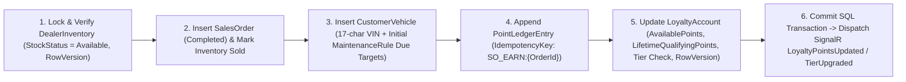

# Database Design Specification — Motorcycle Dealer & Loyalty Management Platform

| Metadata | Value |
| :--- | :--- |
| **Document ID** | `DB-SPEC-001` |
| **Version** | `1.2.0` (Phase 9 `v1.2.0` Expansion — 27 Normalized 3NF Tables) |
| **Project** | Motorcycle Dealer & Loyalty Management Platform ([GitHub Repository](https://github.com/quocanhh86/motorcycle-dealer)) |
| **Target DBMS** | Microsoft SQL Server 2022 (`(localdb)\MSSQLLocalDB` for local development; `mcr.microsoft.com/mssql/server:2022-latest` for Docker) |
| **Database Name** | `MotorcycleDealerDb` (Default Schema: `dbo`, Collation: `SQL_Latin1_General_CP1_CI_AS`) |
| **ORM & Migration Strategy** | Entity Framework Core 10 (`net10.0`) Code-First Migrations via explicit `IEntityTypeConfiguration<T>` classes |
| **Normalization Level** | Strict Third Normal Form (**3NF**) across **27 Tables** in **6 Bounded Contexts** |
| **Related Documents** | [REQUIREMENTS.md](../REQUIREMENTS.md) · [README.md](../README.md) · [AGENTS.md](../AGENTS.md) · [PRD.md](./PRD.md) · [ARCHITECTURE.md](./ARCHITECTURE.md) · [DESIGN.md](./DESIGN.md) · [RELEASE_NOTES_v1.1.0.md](./RELEASE_NOTES_v1.1.0.md) · [RELEASE_NOTES_v1.2.0.md](./RELEASE_NOTES_v1.2.0.md) · [TASKS.md](../TASKS.md) · [PROGRESS.md](../PROGRESS.md) · [Master Specification (.docx)](./Motorcycle_Dealer_Loyalty_Platform_Specification.docx) |

---

## 1. Executive Summary & 3NF Normalization Strategy

`MotorcycleDealerDb` serves as the single transactional system of record for the **Motorcycle Dealer & Loyalty Management Platform**. In accordance with `ADR-001` (Clean Architecture 4-Layer Monolith) and `ADR-002` (Single SQL Server Database with `DealerId` Row-Level Scoping), all domain aggregates persist within a unified **Third Normal Form (3NF)** relational schema engineered for financial auditability, high-concurrency time-slot and test-drive booking, itemized OEM spare-parts invoicing, post-service 5-star CSAT reviews, factory VIN warranty claims, automated VIN maintenance tracking, and sub-second cross-dealer analytics.

### 1.1 Bounded Context & 27-Table Master Inventory

| # | Table Name | Bounded Context | PK Strategy | `IDealerScoped` (`DealerId`) | `RowVersion` Concurrency | Deletion Policy | Traceability |
| :-: | :--- | :--- | :--- | :-: | :-: | :--- | :--- |
| 1 | `Users` | Identity & RBAC | `UNIQUEIDENTIFIER` | Nullable (`DealerStaff` only) | No | Soft Delete (`IsDeleted`) | `FR-01`, `ADR-002` |
| 2 | `Roles` | Identity & RBAC | `UNIQUEIDENTIFIER` | No | No | Protected System Seed | `FR-01`, `ADR-001` |
| 3 | `Permissions` | Identity & RBAC | `UNIQUEIDENTIFIER` | No | No | Protected System Seed | `FR-01`, `ADR-001` |
| 4 | `UserRoles` | Identity & RBAC | Composite `(UserId, RoleId)` | No | No | Hard Cascade on Revoke | `FR-01` |
| 5 | `RolePermissions` | Identity & RBAC | Composite `(RoleId, PermissionId)` | No | No | Hard Cascade on Revoke | `FR-01` |
| 6 | `RefreshTokens` | Identity & RBAC | `UNIQUEIDENTIFIER` | No | No | Revocation Timestamp + TTL Purge | `FR-01`, `ADR-006` |
| 7 | `Dealers` | Dealers & Showroom Sales | `UNIQUEIDENTIFIER` | Root Tenant (`Id`) | No | Soft Delete (`IsDeleted`) | `FR-02`, `ADR-002` |
| 8 | `MotorcycleModels` | Dealers & Showroom Sales | `UNIQUEIDENTIFIER` | No (Catalog-wide) | No | Soft Delete (`IsDeleted`) | `FR-02`, `FR-03` |
| 9 | `DealerInventories` | Dealers & Showroom Sales | `UNIQUEIDENTIFIER` | Required (`NOT NULL`) | **Yes** | Status-Driven (`StockStatus`) | `FR-02`, `ADR-002` |
| 10 | `SalesOrders` | Dealers & Showroom Sales | `UNIQUEIDENTIFIER` | Required (`NOT NULL`) | No | **Immutable** (Never Deleted) | `FR-02`, `FR-05`, `FR-07` |
| 11 | `CustomerVehicles` | Customer Garage & VIN Reminders | `UNIQUEIDENTIFIER` | No (Customer-owned) | No | Soft Delete (`IsDeleted`) | `FR-02`, `FR-03`, `FR-04` |
| 12 | `MaintenanceRules` | Customer Garage & VIN Reminders | `UNIQUEIDENTIFIER` | No (Model-wide) | No | `IsActive` Deactivation | `FR-03`, `FR-04`, `ADR-005` |
| 13 | `MaintenanceReminders` | Customer Garage & VIN Reminders | `UNIQUEIDENTIFIER` | No (Vehicle-scoped) | No | Immutable Audit Log | `FR-04`, `ADR-005` |
| 14 | `ServiceTimeSlots` | Service Booking & Workshop Invoicing | `UNIQUEIDENTIFIER` | Required (`NOT NULL`) | **Yes** | `IsBlocked` Flag | `FR-04`, `ADR-002` |
| 15 | `ServiceBookings` | Service Booking & Workshop Invoicing | `UNIQUEIDENTIFIER` | Required (`NOT NULL`) | **Yes** | Status-Driven (`Cancelled`) | `FR-04`, `FR-06`, `FR-07` |
| 16 | `ServiceInvoices` | Service Booking & Workshop Invoicing | `UNIQUEIDENTIFIER` | Required (`NOT NULL`) | No | **Immutable** (Never Deleted) | `FR-04`, `FR-05`, `FR-07` |
| 17 | `LoyaltyTiers` | Loyalty, Tiers & Vouchers | `UNIQUEIDENTIFIER` | No (Platform-wide) | No | `IsActive` Deactivation | `FR-05`, `ADR-003` |
| 18 | `LoyaltyAccounts` | Loyalty, Tiers & Vouchers | `UNIQUEIDENTIFIER` | No (Customer 1:1) | **Yes** | Permanent Financial Account | `FR-05`, `ADR-003` |
| 19 | `PointLedgerEntries` | Loyalty, Tiers & Vouchers | `UNIQUEIDENTIFIER` | No (Account-scoped) | No | **Append-Only** (Never Updated/Deleted) | `FR-05`, `ADR-003` |
| 20 | `VoucherCatalogs` | Loyalty, Tiers & Vouchers | `UNIQUEIDENTIFIER` | No (Platform-wide) | No | Soft Delete (`IsDeleted`) | `FR-05` |
| 21 | `CustomerVouchers` | Loyalty, Tiers & Vouchers | `UNIQUEIDENTIFIER` | No (Account-scoped) | **Yes** | Status-Driven (`Used`/`Expired`) | `FR-04`, `FR-05` |
| 22 | `Notifications` | Real-Time Notifications | `UNIQUEIDENTIFIER` | Nullable (`TargetDealerId`) | No | Read-State + Archival | `FR-06`, `ADR-004` |
| 23 | `TestDriveBookings` | Dealers & Showroom Sales | `UNIQUEIDENTIFIER` | Required (`NOT NULL`) | **Yes** | Status-Driven (`Cancelled`) | `FR-02`, `FR-04`, `FR-06`, `T-801` |
| 24 | `SpareParts` | Service Booking & Workshop Invoicing | `UNIQUEIDENTIFIER` | No (Platform-wide) | No | Soft Delete (`IsDeleted`) | `FR-03`, `FR-04`, `FR-05`, `T-801` |
| 25 | `ServiceInvoiceLineItems` | Service Booking & Workshop Invoicing | `UNIQUEIDENTIFIER` | No (Via `ServiceInvoiceId`) | No | **Immutable** (Never Updated/Deleted) | `FR-04`, `FR-05`, `ADR-003`, `T-801` |
| 26 | `ServiceReviews` | Service Booking & Workshop Invoicing | `UNIQUEIDENTIFIER` | Required (`NOT NULL`) | **Yes** | Permanent CSAT Audit | `FR-05`, `FR-06`, `FR-09`, `T-901` |
| 27 | `WarrantyClaims` | Customer Garage & VIN Reminders | `UNIQUEIDENTIFIER` | Required (`NOT NULL`) | **Yes** | Status-Driven (`Rejected`/`Completed`) | `FR-03`, `FR-06`, `FR-09`, `T-901` |

### 1.2 Third Normal Form (3NF) Verification

1. **First Normal Form (1NF — Atomicity)**:
   - Every relational attribute stores a single scalar value (`VIN`, `SlotDate`, `StartTime`, `PointsDelta`, `AvailablePoints`).
   - Multi-valued relationships (`Users <-> Roles`, `Roles <-> Permissions`, `MotorcycleModels <-> MaintenanceRules`, `ServiceInvoices <-> ServiceInvoiceLineItems`) are decomposed into dedicated junction or child tables rather than comma-delimited strings or repeating column groups.
   - Controlled `NVARCHAR(MAX)` JSON columns (`SpecificationsJson`, `BenefitsJson`, `LineItemsJson`, `PayloadJson`) are strictly bounded to non-relational display metadata or immutable document snapshots, validated at write time by SQL Server `CHECK (ISJSON(...) = 1)` constraints, and are never used as join predicates.
2. **Second Normal Form (2NF — Full Functional Dependency)**:
   - Twenty-three entity tables use single-column surrogate primary keys (`Id UNIQUEIDENTIFIER`), making partial key dependencies structurally impossible.
   - Both composite-key junction tables (`UserRoles(UserId, RoleId)` and `RolePermissions(RoleId, PermissionId)`) contain only relationship audit metadata (`AssignedAtUtc`, `AssignedByUserId`, `GrantedAtUtc`) that depends on the entire composite key.
3. **Third Normal Form (3NF — Zero Mutable Transitive Dependencies)**:
   - Vehicle specifications (`Brand`, `ModelName`, `EngineDisplacementCc`, `WarrantyMonths`) live exclusively in `MotorcycleModels` and are referenced by `MotorcycleModelId` from `DealerInventories`, `CustomerVehicles`, and `MaintenanceRules`.
   - Loyalty tier rules (`TierCode`, `MinQualifyingPoints`, `PointsMultiplier`) reside exclusively in `LoyaltyTiers`; `LoyaltyAccounts` stores only `CurrentTierId`.
   - **Controlled Point-in-Time Financial Snapshots**: Columns such as `SalesOrders.FinalAmount`, `ServiceInvoices.NetPaidAmount`, `CustomerVouchers.PointsSpent`, and `PointLedgerEntries.BalanceAfter` represent **historical accounting facts** at the exact instant of settlement (so future price changes to `MotorcycleModels.BaseRetailPrice` or `VoucherCatalogs.PointsCost` never retroactively corrupt closed financial statements). `LoyaltyAccounts.AvailablePoints` and `ServiceTimeSlots.BookedCount` act as concurrency-guarded (`RowVersion`) materialized counters maintained atomically in the exact same ACID transaction as their child records.

---

## 2. Global Physical Schema Conventions

### 2.1 Primary Keys & Clustered Index Sequentiality
- Every primary entity table defines `Id UNIQUEIDENTIFIER NOT NULL CONSTRAINT DF_<Table>_Id DEFAULT NEWSEQUENTIALID()` as its `PRIMARY KEY CLUSTERED`.
- **Application-Layer Synergy (`.NET 10`)**: Domain entities initialize `Id = Guid.CreateVersion7()` upon construction (`RFC 9562` time-ordered UUIDv7), while database-side scripts fall back to `NEWSEQUENTIALID()`. Both guarantee monotonically increasing key insertion order, eliminating B-Tree page splits and maintaining `> 98%` clustered index fill efficiency.

### 2.2 Temporal & Character Encoding Standards
- **UTC Timestamps**: All point-in-time columns use `DATETIMEOFFSET(7)` stored strictly in UTC (`DEFAULT SYSUTCDATETIME()`). Local workshop calendar scheduling uses `DATE` (`SlotDate`) and `TIME(0)` (`StartTime`, `EndTime`, `OpeningTime`, `ClosingTime`) interpreted in the dealer's local Vietnam timezone (`Asia/Ho_Chi_Minh`, `UTC+07:00`).
- **String Storage Optimization**:
  - `VARCHAR(n)` is used for strictly ASCII identifiers, codes, ISO 3779 `VIN` values, phone numbers, hashes, emails, and finite state machine status strings (saving 50% storage and narrowing index key width).
  - `NVARCHAR(n)` is used for human-readable names, Vietnamese addresses, titles, and free-text workshop notes (`FullName`, `Address`, `ReportedNotes`, `WorkSummaryNotes`).

### 2.3 Monetary Precision
- Every currency attribute (Vietnamese Dong — `VND`) is typed as `DECIMAL(18,2) NOT NULL` with explicit non-negative `CHECK` constraints. Binary floating-point types (`FLOAT`, `REAL`) are strictly prohibited across the database and C# domain layer.

### 2.4 Soft-Delete vs. Financial Immutability Policy
- **Soft-Deletable Master & Customer Aggregates**: `Dealers`, `Users`, `MotorcycleModels`, `CustomerVehicles`, `VoucherCatalogs`, and `SpareParts` implement `ISoftDeletable` (`IsDeleted BIT NOT NULL DEFAULT 0`, `DeletedAtUtc DATETIMEOFFSET(7) NULL`), automatically filtered via EF Core Global Query Filters (`e => !e.IsDeleted`).
- **Strictly Immutable Financial & Audit Tables**:
  - `SalesOrders`, `ServiceInvoices`, `ServiceInvoiceLineItems`, and `PointLedgerEntries` **never** define `IsDeleted` and **never** permit physical `DELETE` or `UPDATE` statements (`IImmutableFinancialEntity` / `IAppendOnlyEntity` enforced in `AppendOnlyLedgerInterceptor`).
  - `PointLedgerEntries` additionally enforces a SQL Server `AFTER UPDATE, DELETE` safety trigger (`TR_PointLedgerEntries_BlockMutation`). Corrections must append a compensating entry (`TransactionType = 'AdminAdjustment'` or `'VoucherExpireRefund'`).

### 2.5 Multi-Dealer Row-Level Tenancy (`ADR-002`)
- **Scoped Operational Entities (`IDealerScoped` — `8` Tables)**: `DealerInventories`, `ServiceTimeSlots`, `SalesOrders`, `ServiceBookings`, `ServiceInvoices`, `TestDriveBookings`, `ServiceReviews`, and `WarrantyClaims` carry a mandatory `DealerId UNIQUEIDENTIFIER NOT NULL` foreign key to `Dealers(Id)`.
- **Staff User Binding**: `Users.DealerId` is `NULL` for platform-wide `Customer` and `Admin` accounts and `NOT NULL` (paired with `StaffEmployeeCode`) for `DealerStaff` accounts via `CK_Users_DealerStaff_DealerId` and Domain RBAC invariants.
- **EF Core Global Query Filter**: Whenever an authenticated HTTP or SignalR request carries the `DealerStaff` role, `MotorcycleDealerDbContext` predicates every `IDealerScoped` query with `e.DealerId == _currentUser.DealerId`, preventing cross-dealer IDOR data leakage by construction.

### 2.6 Foreign Key `ON DELETE` Policy (Preventing SQL Server `Msg 1785`)
SQL Server rejects DDL migrations (`Msg 1785`) whenever a table can be reached via multiple cascading foreign key paths (for example, `Dealers -> Users -> ServiceBookings` alongside `Dealers -> ServiceBookings`, or `MotorcycleModels -> CustomerVehicles -> MaintenanceReminders` alongside `MotorcycleModels -> MaintenanceRules -> MaintenanceReminders`).
- **Default Policy**: All domain aggregate relationships use `ON DELETE NO ACTION` (`DeleteBehavior.Restrict` in EF Core). Parent deactivation uses soft-delete (`IsDeleted = 1`) or `IsActive = 0`.
- **Permitted Leaf Cascades**: `ON DELETE CASCADE` is enabled exclusively on single-parent security/ephemeral leaf tables where no diamond cycle exists: `UserRoles` (`Users`, `Roles`), `RolePermissions` (`Roles`, `Permissions`), `RefreshTokens` (`Users`), and `Notifications.RecipientUserId` (`Users`).

---

## 3. Complete Entity-Relationship Diagram (25 Tables)

```mermaid
erDiagram
    Dealers ||--o{ Users : "scopes staff"
    Users ||--o{ UserRoles : "assigned"
    Roles ||--o{ UserRoles : "granted to"
    Roles ||--o{ RolePermissions : "contains"
    Permissions ||--o{ RolePermissions : "mapped to"
    Users ||--o{ RefreshTokens : "authenticates via"

    Dealers ||--o{ DealerInventories : "stocks VIN"
    MotorcycleModels ||--o{ DealerInventories : "classifies"
    Dealers ||--o{ TestDriveBookings : "hosts test drive"
    Users ||--o{ TestDriveBookings : "requests test drive"
    MotorcycleModels ||--o{ TestDriveBookings : "models test drive"
    DealerInventories |o--o{ TestDriveBookings : "assigns demo VIN"
    Dealers ||--o{ SalesOrders : "closes"
    Users ||--o{ SalesOrders : "buys"
    DealerInventories ||--o| SalesOrders : "sold in"
    CustomerVouchers |o--o{ SalesOrders : "discounts"

    SalesOrders |o--o| CustomerVehicles : "auto-onboards VIN"
    Users ||--o{ CustomerVehicles : "owns in garage"
    MotorcycleModels ||--o{ CustomerVehicles : "specifies"
    MotorcycleModels ||--o{ MaintenanceRules : "defines schedule"
    CustomerVehicles ||--o{ MaintenanceReminders : "triggers"
    MaintenanceRules ||--o{ MaintenanceReminders : "evaluates"
    ServiceBookings |o--o{ MaintenanceReminders : "fulfills"

    Dealers ||--o{ ServiceTimeSlots : "publishes"
    ServiceTimeSlots ||--o{ ServiceBookings : "allocates capacity"
    Dealers ||--o{ ServiceBookings : "hosts"
    Users ||--o{ ServiceBookings : "books"
    CustomerVehicles ||--o{ ServiceBookings : "serviced at"
    CustomerVouchers |o--o{ ServiceBookings : "reserved on"

    ServiceBookings ||--o| ServiceInvoices : "settled by"
    Dealers ||--o{ ServiceInvoices : "issues"
    Users ||--o{ ServiceInvoices : "pays"
    CustomerVouchers |o--o{ ServiceInvoices : "redeemed on"
    MotorcycleModels |o--o{ SpareParts : "compatible SKU"
    ServiceInvoices ||--o{ ServiceInvoiceLineItems : "itemizes"
    SpareParts |o--o{ ServiceInvoiceLineItems : "supplies SKU"

    Users ||--o| LoyaltyAccounts : "holds 1-to-1"
    LoyaltyTiers ||--o{ LoyaltyAccounts : "ranks"
    LoyaltyAccounts ||--o{ PointLedgerEntries : "appends"
    LoyaltyTiers ||--o{ VoucherCatalogs : "gates min tier"
    LoyaltyAccounts ||--o{ CustomerVouchers : "redeems"
    VoucherCatalogs ||--o{ CustomerVouchers : "instantiates"

    Users |o--o{ Notifications : "receives"
    Dealers |o--o{ Notifications : "alerts staff"

    Users {
        uniqueidentifier Id PK
        varchar Email UK
        varchar NormalizedEmail UK
        varchar PhoneNumber UK
        nvarchar FullName
        uniqueidentifier DealerId FK "Nullable for Customer and Admin"
        varchar StaffEmployeeCode UK
        bit IsActive
        bit IsDeleted
        datetimeoffset CreatedAtUtc
    }

    Roles {
        uniqueidentifier Id PK
        varchar Name UK "Customer | DealerStaff | Admin"
        nvarchar DisplayName
        bit IsSystemRole
        datetimeoffset CreatedAtUtc
    }

    Permissions {
        uniqueidentifier Id PK
        varchar Code UK "Permissions.Module.Action"
        varchar Module
        nvarchar DisplayName
        datetimeoffset CreatedAtUtc
    }

    UserRoles {
        uniqueidentifier UserId PK,FK
        uniqueidentifier RoleId PK,FK
        datetimeoffset AssignedAtUtc
        uniqueidentifier AssignedByUserId FK
    }

    RolePermissions {
        uniqueidentifier RoleId PK,FK
        uniqueidentifier PermissionId PK,FK
        datetimeoffset GrantedAtUtc
    }

    RefreshTokens {
        uniqueidentifier Id PK
        uniqueidentifier UserId FK
        varchar TokenHash UK
        uniqueidentifier TokenFamilyId
        datetimeoffset ExpiresAtUtc
        datetimeoffset RevokedAtUtc
        datetimeoffset CreatedAtUtc
    }

    Dealers {
        uniqueidentifier Id PK
        varchar Code UK
        nvarchar Name
        nvarchar City
        nvarchar Address
        time OpeningTime
        time ClosingTime
        int DefaultSlotCapacity
        bit IsActive
        bit IsDeleted
    }

    MotorcycleModels {
        uniqueidentifier Id PK
        varchar ModelCode UK
        nvarchar Brand
        nvarchar ModelName
        varchar Category
        int EngineDisplacementCc
        decimal BaseRetailPrice
        int WarrantyMonths
        int WarrantyMileageKm
        bit IsDeleted
    }

    DealerInventories {
        uniqueidentifier Id PK
        uniqueidentifier DealerId FK
        uniqueidentifier MotorcycleModelId FK
        varchar VIN UK "17-char ISO 3779"
        varchar EngineNumber UK
        nvarchar ColorName
        decimal ListedPrice
        varchar StockStatus
        rowversion RowVersion
    }

    SalesOrders {
        uniqueidentifier Id PK
        varchar OrderNumber UK
        uniqueidentifier DealerId FK
        uniqueidentifier CustomerId FK
        uniqueidentifier DealerInventoryId FK
        uniqueidentifier AppliedCustomerVoucherId FK
        uniqueidentifier SoldByStaffId FK
        decimal TotalAmount
        decimal DiscountAmount
        decimal FinalAmount
        int PointsEarned
        varchar Status
        datetimeoffset CompletedAtUtc
    }

    CustomerVehicles {
        uniqueidentifier Id PK
        varchar VIN UK "17-char ISO 3779"
        uniqueidentifier CustomerId FK
        uniqueidentifier MotorcycleModelId FK
        uniqueidentifier PurchasedSalesOrderId FK "Nullable for external VIN"
        varchar LicensePlate UK
        int CurrentMileageKm
        datetimeoffset LastServiceDateUtc
        int LastServiceMileageKm
        int NextDueMileageKm
        datetimeoffset NextDueDateUtc
        bit IsDeleted
    }

    MaintenanceRules {
        uniqueidentifier Id PK
        uniqueidentifier MotorcycleModelId FK
        varchar MilestoneCode
        nvarchar MilestoneName
        int IntervalKm
        int IntervalMonths
        bit IsRecurring
        nvarchar ChecklistSummary
    }

    MaintenanceReminders {
        uniqueidentifier Id PK
        uniqueidentifier CustomerVehicleId FK
        uniqueidentifier MaintenanceRuleId FK
        int TargetMileageKm
        datetimeoffset DueDateUtc
        varchar DeduplicationKey UK
        varchar Status
        uniqueidentifier ResolvedBookingId FK
        datetimeoffset SentAtUtc
    }

    ServiceTimeSlots {
        uniqueidentifier Id PK
        uniqueidentifier DealerId FK
        date SlotDate
        time StartTime
        time EndTime
        int MaxCapacity
        int BookedCount
        bit IsBlocked
        rowversion RowVersion
    }

    ServiceBookings {
        uniqueidentifier Id PK
        varchar BookingNumber UK
        uniqueidentifier CustomerId FK
        uniqueidentifier DealerId FK
        uniqueidentifier CustomerVehicleId FK
        uniqueidentifier ServiceTimeSlotId FK
        uniqueidentifier AppliedCustomerVoucherId FK
        varchar ServiceType
        nvarchar ReportedNotes
        int OdometerAtBookingKm
        varchar Status
        rowversion RowVersion
    }

    ServiceInvoices {
        uniqueidentifier Id PK
        varchar InvoiceNumber UK
        uniqueidentifier ServiceBookingId FK,UK "1-to-1 with Booking"
        uniqueidentifier DealerId FK
        uniqueidentifier CustomerId FK
        uniqueidentifier AppliedCustomerVoucherId FK
        uniqueidentifier IssuedByStaffId FK
        decimal LaborAmount
        decimal PartsAmount
        decimal GrossAmount
        decimal VoucherDiscountAmount
        decimal NetPaidAmount
        int OdometerAtCompletionKm
        int PointsEarned
        datetimeoffset PaidAtUtc
    }

    LoyaltyTiers {
        uniqueidentifier Id PK
        varchar TierCode UK "Bronze | Silver | Gold | Platinum"
        tinyint RankOrder UK
        int MinQualifyingPoints UK
        decimal PointsMultiplier
        nvarchar BenefitsJson
    }

    LoyaltyAccounts {
        uniqueidentifier Id PK
        uniqueidentifier CustomerId FK,UK "1-to-1 with User"
        uniqueidentifier CurrentTierId FK
        int AvailablePoints
        int LifetimeQualifyingPoints
        decimal LifetimeSpentVnd
        rowversion RowVersion
    }

    PointLedgerEntries {
        uniqueidentifier Id PK
        uniqueidentifier LoyaltyAccountId FK
        varchar TransactionType
        int PointsDelta
        int BalanceAfter
        varchar ReferenceType
        uniqueidentifier ReferenceId
        varchar IdempotencyKey UK
        nvarchar Notes
        datetimeoffset CreatedAtUtc
    }

    VoucherCatalogs {
        uniqueidentifier Id PK
        varchar CodePrefix UK
        nvarchar Title
        int PointsCost
        varchar DiscountType
        decimal DiscountValue
        decimal MaxDiscountAmount
        decimal MinOrderAmount
        int ValidDays
        int QuotaTotal
        int QuotaRedeemed
        uniqueidentifier MinTierId FK
        bit IsActive
    }

    CustomerVouchers {
        uniqueidentifier Id PK
        varchar VoucherCode UK
        uniqueidentifier LoyaltyAccountId FK
        uniqueidentifier VoucherCatalogId FK
        int PointsSpent
        varchar Status
        datetimeoffset RedeemedAtUtc
        datetimeoffset ExpiresAtUtc
        datetimeoffset UsedAtUtc
        rowversion RowVersion
    }

    Notifications {
        uniqueidentifier Id PK
        uniqueidentifier RecipientUserId FK
        uniqueidentifier TargetDealerId FK
        varchar TargetRole
        varchar EventType
        nvarchar Title
        nvarchar Message
        nvarchar PayloadJson
        bit IsRead
        datetimeoffset ReadAtUtc
        datetimeoffset CreatedAtUtc
    }

    TestDriveBookings {
        uniqueidentifier Id PK
        varchar BookingNumber UK
        uniqueidentifier CustomerId FK
        uniqueidentifier DealerId FK
        uniqueidentifier MotorcycleModelId FK
        uniqueidentifier AssignedInventoryId FK
        date PreferredDate
        time StartTime
        time EndTime
        varchar DriverLicenseNumber
        varchar ContactPhone
        varchar Status
        rowversion RowVersion
    }

    SpareParts {
        uniqueidentifier Id PK
        varchar PartCode UK
        nvarchar Name
        varchar Category
        uniqueidentifier CompatibleModelId FK "Nullable universal fit"
        nvarchar UnitLabel
        decimal UnitPriceVnd
        bit IsActive
        bit IsDeleted
    }

    ServiceInvoiceLineItems {
        uniqueidentifier Id PK
        uniqueidentifier ServiceInvoiceId FK
        int LineNumber
        uniqueidentifier SparePartId FK "Nullable for Labor"
        varchar PartCodeSnapshot
        nvarchar Description
        varchar ItemType "Part | Labor"
        int Quantity
        decimal UnitPriceVnd
        decimal LineTotalVnd
    }
```



---

## 4. Table-by-Table Data Dictionary (All 25 Tables)

### 4.1 Bounded Context 1 — Identity & Role-Based Access Control (`FR-01`)

#### Table 1: `dbo.Users`
Stores authentication credentials, profile identity, and optional dealer assignment for `DealerStaff` personnel.

| Column | SQL Server Type | Null | Default | Constraints / Keys | Description |
| :--- | :--- | :-: | :--- | :--- | :--- |
| `Id` | `UNIQUEIDENTIFIER` | `NOT NULL` | `NEWSEQUENTIALID()` | `PK_Users` | Surrogate primary key (`Guid.CreateVersion7()` in app) |
| `Email` | `VARCHAR(256)` | `NOT NULL` | — | `UQ_Users_Email` | User login email address (display casing preserved) |
| `NormalizedEmail` | `VARCHAR(256)` | `NOT NULL` | — | `UQ_Users_NormalizedEmail` | Uppercase invariant email used for fast auth lookup |
| `PasswordHash` | `VARCHAR(512)` | `NOT NULL` | — | — | Salted PBKDF2-HMAC-SHA512 / Argon2id password digest |
| `FullName` | `NVARCHAR(150)` | `NOT NULL` | — | — | Full legal/display name (Unicode Vietnamese supported) |
| `PhoneNumber` | `VARCHAR(20)` | `NOT NULL` | — | `UQ_Users_PhoneNumber` (filtered) | E.164 or domestic phone number (`09xxxxxxxx`) |
| `DealerId` | `UNIQUEIDENTIFIER` | `NULL` | `NULL` | `FK_Users_Dealers_DealerId` (`NO ACTION`) | Assigned dealer for `DealerStaff`; `NULL` for `Customer` & `Admin` |
| `StaffEmployeeCode` | `VARCHAR(30)` | `NULL` | `NULL` | `UQ_Users_StaffEmployeeCode` (filtered) | Dealer staff badge ID (e.g., `EMP-HN-001`); `NULL` for non-staff |
| `IsActive` | `BIT` | `NOT NULL` | `1` | — | `0` blocks token issuance and API access immediately |
| `LastLoginAtUtc` | `DATETIMEOFFSET(7)` | `NULL` | `NULL` | — | Timestamp of most recent successful login |
| `IsDeleted` | `BIT` | `NOT NULL` | `0` | — | Soft-delete flag filtered globally in EF Core |
| `DeletedAtUtc` | `DATETIMEOFFSET(7)` | `NULL` | `NULL` | — | UTC timestamp when soft-deleted |
| `CreatedAtUtc` | `DATETIMEOFFSET(7)` | `NOT NULL` | `SYSUTCDATETIME()` | — | Immutable record creation timestamp |
| `UpdatedAtUtc` | `DATETIMEOFFSET(7)` | `NULL` | `NULL` | — | Last profile/credential update timestamp |

- **Constraints**:
  - `PK_Users PRIMARY KEY CLUSTERED (Id)`
  - `FK_Users_Dealers_DealerId FOREIGN KEY (DealerId) REFERENCES dbo.Dealers(Id) ON DELETE NO ACTION`
  - `UQ_Users_Email UNIQUE (Email)` and `UQ_Users_NormalizedEmail UNIQUE (NormalizedEmail)`
  - `UQ_Users_PhoneNumber UNIQUE (PhoneNumber) WHERE IsDeleted = 0`
  - `UQ_Users_StaffEmployeeCode UNIQUE (StaffEmployeeCode) WHERE StaffEmployeeCode IS NOT NULL AND IsDeleted = 0`
  - `CK_Users_DealerStaff_DealerId CHECK ((StaffEmployeeCode IS NULL AND DealerId IS NULL) OR (StaffEmployeeCode IS NOT NULL AND DealerId IS NOT NULL))` *(paired with Domain/Application validation requiring `DealerId IS NOT NULL` whenever `DealerStaff` role is assigned)*.

---

#### Table 2: `dbo.Roles`
Defines the three canonical security roles mandated by `FR-01`: `Customer`, `DealerStaff`, and `Admin`.

| Column | SQL Server Type | Null | Default | Constraints / Keys | Description |
| :--- | :--- | :-: | :--- | :--- | :--- |
| `Id` | `UNIQUEIDENTIFIER` | `NOT NULL` | `NEWSEQUENTIALID()` | `PK_Roles` | Surrogate primary key |
| `Name` | `VARCHAR(50)` | `NOT NULL` | — | `UQ_Roles_Name`, `CK_Roles_Name` | Canonical programmatic code (`Customer`, `DealerStaff`, `Admin`) |
| `DisplayName` | `NVARCHAR(100)` | `NOT NULL` | — | — | UI label (`Customer`, `Dealer Staff`, `Administrator`) |
| `Description` | `NVARCHAR(300)` | `NOT NULL` | — | — | Scope description of role capabilities |
| `IsSystemRole` | `BIT` | `NOT NULL` | `1` | — | Prevents accidental administrative deletion of core roles |
| `CreatedAtUtc` | `DATETIMEOFFSET(7)` | `NOT NULL` | `SYSUTCDATETIME()` | — | Creation timestamp |
| `UpdatedAtUtc` | `DATETIMEOFFSET(7)` | `NULL` | `NULL` | — | Last update timestamp |

- **Constraints**:
  - `PK_Roles PRIMARY KEY CLUSTERED (Id)`
  - `UQ_Roles_Name UNIQUE (Name)`
  - `CK_Roles_Name CHECK (Name IN ('Customer', 'DealerStaff', 'Admin'))`

---

#### Table 3: `dbo.Permissions`
Master catalog of all 40 granular authorization claims evaluated by ASP.NET Core `PermissionAuthorizationHandler` and AngularJS `has-permission` directives (`34` `v1.0` core policies + `6` `v1.1` Test-Drive & Spare-Parts policies).

| Column | SQL Server Type | Null | Default | Constraints / Keys | Description |
| :--- | :--- | :-: | :--- | :--- | :--- |
| `Id` | `UNIQUEIDENTIFIER` | `NOT NULL` | `NEWSEQUENTIALID()` | `PK_Permissions` | Surrogate primary key |
| `Code` | `VARCHAR(100)` | `NOT NULL` | — | `UQ_Permissions_Code` | Policy code (`Permissions.<Module>.<Action>`) |
| `Module` | `VARCHAR(50)` | `NOT NULL` | — | — | Logical module (`Showroom`, `Bookings`, `Loyalty`, `Analytics`, etc.) |
| `DisplayName` | `NVARCHAR(150)` | `NOT NULL` | — | — | Human-readable permission title |
| `Description` | `NVARCHAR(300)` | `NOT NULL` | — | — | Exact endpoint/action authorization behavior |
| `CreatedAtUtc` | `DATETIMEOFFSET(7)` | `NOT NULL` | `SYSUTCDATETIME()` | — | Creation timestamp |

- **Constraints**:
  - `PK_Permissions PRIMARY KEY CLUSTERED (Id)`
  - `UQ_Permissions_Code UNIQUE (Code)`
  - `CK_Permissions_CodePrefix CHECK (Code LIKE 'Permissions.%._%')`

---

#### Table 4: `dbo.UserRoles`
Many-to-many junction table mapping users to security roles.

| Column | SQL Server Type | Null | Default | Constraints / Keys | Description |
| :--- | :--- | :-: | :--- | :--- | :--- |
| `UserId` | `UNIQUEIDENTIFIER` | `NOT NULL` | — | `PK_UserRoles` (1), `FK_UserRoles_Users` | Reference to `Users.Id` |
| `RoleId` | `UNIQUEIDENTIFIER` | `NOT NULL` | — | `PK_UserRoles` (2), `FK_UserRoles_Roles` | Reference to `Roles.Id` |
| `AssignedAtUtc` | `DATETIMEOFFSET(7)` | `NOT NULL` | `SYSUTCDATETIME()` | — | UTC timestamp of role grant |
| `AssignedByUserId` | `UNIQUEIDENTIFIER` | `NULL` | `NULL` | `FK_UserRoles_AssignedBy` (`NO ACTION`) | Optional Admin user who granted the role (`NULL` on self-signup) |

- **Constraints**:
  - `PK_UserRoles PRIMARY KEY CLUSTERED (UserId, RoleId)`
  - `FK_UserRoles_Users FOREIGN KEY (UserId) REFERENCES dbo.Users(Id) ON DELETE CASCADE`
  - `FK_UserRoles_Roles FOREIGN KEY (RoleId) REFERENCES dbo.Roles(Id) ON DELETE CASCADE`
  - `FK_UserRoles_AssignedBy FOREIGN KEY (AssignedByUserId) REFERENCES dbo.Users(Id) ON DELETE NO ACTION`

---

#### Table 5: `dbo.RolePermissions`
Many-to-many junction table binding roles to granular `Permissions.<Module>.<Action>` claims.

| Column | SQL Server Type | Null | Default | Constraints / Keys | Description |
| :--- | :--- | :-: | :--- | :--- | :--- |
| `RoleId` | `UNIQUEIDENTIFIER` | `NOT NULL` | — | `PK_RolePermissions` (1), `FK_RolePermissions_Roles` | Reference to `Roles.Id` |
| `PermissionId` | `UNIQUEIDENTIFIER` | `NOT NULL` | — | `PK_RolePermissions` (2), `FK_RolePermissions_Permissions` | Reference to `Permissions.Id` |
| `GrantedAtUtc` | `DATETIMEOFFSET(7)` | `NOT NULL` | `SYSUTCDATETIME()` | — | UTC timestamp when permission was mapped |

- **Constraints**:
  - `PK_RolePermissions PRIMARY KEY CLUSTERED (RoleId, PermissionId)`
  - `FK_RolePermissions_Roles FOREIGN KEY (RoleId) REFERENCES dbo.Roles(Id) ON DELETE CASCADE`
  - `FK_RolePermissions_Permissions FOREIGN KEY (PermissionId) REFERENCES dbo.Permissions(Id) ON DELETE CASCADE`

---

#### Table 6: `dbo.RefreshTokens`
Supports rotating refresh tokens and token-family reuse detection for the AngularJS SPA (`ADR-006`). Raw tokens are never persisted; only SHA-256 hex digests are stored.

| Column | SQL Server Type | Null | Default | Constraints / Keys | Description |
| :--- | :--- | :-: | :--- | :--- | :--- |
| `Id` | `UNIQUEIDENTIFIER` | `NOT NULL` | `NEWSEQUENTIALID()` | `PK_RefreshTokens` | Surrogate primary key |
| `UserId` | `UNIQUEIDENTIFIER` | `NOT NULL` | — | `FK_RefreshTokens_Users` (`CASCADE`) | Owning user |
| `TokenHash` | `VARCHAR(128)` | `NOT NULL` | — | `UQ_RefreshTokens_TokenHash` | SHA-256 hex digest of the opaque refresh token |
| `TokenFamilyId` | `UNIQUEIDENTIFIER` | `NOT NULL` | — | — | Rotation chain ID; replay of a revoked token revokes entire family |
| `ExpiresAtUtc` | `DATETIMEOFFSET(7)` | `NOT NULL` | — | `CK_RefreshTokens_Expiry` | Absolute expiration timestamp (e.g., `+7 days`) |
| `RevokedAtUtc` | `DATETIMEOFFSET(7)` | `NULL` | `NULL` | — | Populated when rotated, logged out, or compromised |
| `ReplacedByTokenHash` | `VARCHAR(128)` | `NULL` | `NULL` | — | Hash of successor token issued during rotation |
| `RevocationReason` | `VARCHAR(100)` | `NULL` | `NULL` | — | `'Rotated'`, `'UserLogout'`, `'ReuseDetected'`, `'AccountDisabled'` |
| `CreatedByIp` | `VARCHAR(45)` | `NULL` | `NULL` | — | IPv4/IPv6 client address at token issuance |
| `CreatedAtUtc` | `DATETIMEOFFSET(7)` | `NOT NULL` | `SYSUTCDATETIME()` | — | Token creation timestamp |

- **Constraints**:
  - `PK_RefreshTokens PRIMARY KEY CLUSTERED (Id)`
  - `FK_RefreshTokens_Users FOREIGN KEY (UserId) REFERENCES dbo.Users(Id) ON DELETE CASCADE`
  - `UQ_RefreshTokens_TokenHash UNIQUE (TokenHash)`
  - `CK_RefreshTokens_Expiry CHECK (ExpiresAtUtc > CreatedAtUtc)`

---

### 4.2 Bounded Context 2 — Dealers & Showroom Sales (`FR-02`, `FR-07`)

#### Table 7: `dbo.Dealers`
Represents physical authorized dealership branches and service workshops across Vietnam.

| Column | SQL Server Type | Null | Default | Constraints / Keys | Description |
| :--- | :--- | :-: | :--- | :--- | :--- |
| `Id` | `UNIQUEIDENTIFIER` | `NOT NULL` | `NEWSEQUENTIALID()` | `PK_Dealers` | Root tenant identifier referenced by `DealerId` across 6 tables |
| `Code` | `VARCHAR(20)` | `NOT NULL` | — | `UQ_Dealers_Code` | Unique branch code (`DLR-HN-01`, `DLR-DN-01`, `DLR-HCM-01`) |
| `Name` | `NVARCHAR(150)` | `NOT NULL` | — | — | Official dealership name |
| `City` | `NVARCHAR(80)` | `NOT NULL` | — | — | Municipality (`Hanoi`, `Da Nang`, `Ho Chi Minh City`) |
| `Address` | `NVARCHAR(300)` | `NOT NULL` | — | — | Full street address |
| `PhoneNumber` | `VARCHAR(20)` | `NOT NULL` | — | — | Dealership reception hotline |
| `ContactEmail` | `VARCHAR(256)` | `NOT NULL` | — | — | Official dealership contact email |
| `Latitude` | `DECIMAL(9,6)` | `NULL` | `NULL` | `CK_Dealers_Coordinates` | Optional map latitude (`-90..90`) |
| `Longitude` | `DECIMAL(9,6)` | `NULL` | `NULL` | `CK_Dealers_Coordinates` | Optional map longitude (`-180..180`) |
| `OpeningTime` | `TIME(0)` | `NOT NULL` | `'08:00:00'` | `CK_Dealers_Hours` | Daily service bay opening time |
| `ClosingTime` | `TIME(0)` | `NOT NULL` | `'18:00:00'` | `CK_Dealers_Hours` | Daily service bay closing time |
| `DefaultSlotCapacity` | `INT` | `NOT NULL` | `4` | `CK_Dealers_Capacity` | Default concurrent service bays per generated time slot |
| `IsActive` | `BIT` | `NOT NULL` | `1` | — | Controls visibility in public Showroom and Slot Picker |
| `IsDeleted` | `BIT` | `NOT NULL` | `0` | — | Soft-delete flag |
| `DeletedAtUtc` | `DATETIMEOFFSET(7)` | `NULL` | `NULL` | — | Soft-delete timestamp |
| `CreatedAtUtc` | `DATETIMEOFFSET(7)` | `NOT NULL` | `SYSUTCDATETIME()` | — | Creation timestamp |
| `UpdatedAtUtc` | `DATETIMEOFFSET(7)` | `NULL` | `NULL` | — | Last update timestamp |

- **Constraints**:
  - `PK_Dealers PRIMARY KEY CLUSTERED (Id)`
  - `UQ_Dealers_Code UNIQUE (Code)`
  - `CK_Dealers_Hours CHECK (ClosingTime > OpeningTime)`
  - `CK_Dealers_Capacity CHECK (DefaultSlotCapacity BETWEEN 1 AND 50)`
  - `CK_Dealers_Coordinates CHECK ((Latitude IS NULL AND Longitude IS NULL) OR (Latitude BETWEEN -90 AND 90 AND Longitude BETWEEN -180 AND 180))`

---

#### Table 8: `dbo.MotorcycleModels`
Platform-wide catalog of motorcycle models, technical specifications, and factory warranty baselines.

| Column | SQL Server Type | Null | Default | Constraints / Keys | Description |
| :--- | :--- | :-: | :--- | :--- | :--- |
| `Id` | `UNIQUEIDENTIFIER` | `NOT NULL` | `NEWSEQUENTIALID()` | `PK_MotorcycleModels` | Surrogate primary key |
| `ModelCode` | `VARCHAR(30)` | `NOT NULL` | — | `UQ_MotorcycleModels_ModelCode` | Manufacturer SKU/model code (e.g., `HND-SH160I-2026`) |
| `Brand` | `NVARCHAR(80)` | `NOT NULL` | — | — | Manufacturer brand (`Honda`, `Yamaha`, `Kawasaki`, `Triumph`, etc.) |
| `ModelName` | `NVARCHAR(150)` | `NOT NULL` | — | — | Commercial model name |
| `Category` | `VARCHAR(30)` | `NOT NULL` | — | `CK_MotorcycleModels_Category` | `'Scooter'`, `'Underbone'`, `'Sport'`, `'Naked'`, `'Adventure'`, `'Cruiser'` |
| `EngineDisplacementCc` | `INT` | `NOT NULL` | — | `CK_MotorcycleModels_EngineCc` | Engine displacement in cubic centimeters (`49..2500`) |
| `BaseRetailPrice` | `DECIMAL(18,2)` | `NOT NULL` | — | `CK_MotorcycleModels_Price` | Suggested MSRP in VND |
| `WarrantyMonths` | `INT` | `NOT NULL` | `36` | `CK_MotorcycleModels_Warranty` | Standard warranty duration in months |
| `WarrantyMileageKm` | `INT` | `NOT NULL` | `30000` | `CK_MotorcycleModels_Warranty` | Standard warranty mileage ceiling in km |
| `ImageUrl` | `VARCHAR(500)` | `NULL` | `NULL` | — | Showroom hero image URL/path |
| `SpecificationsJson` | `NVARCHAR(MAX)` | `NULL` | `NULL` | `CK_MotorcycleModels_SpecsJson` | Validated JSON specs (horsepower, seat height, ABS, fuel tank L) |
| `IsActive` | `BIT` | `NOT NULL` | `1` | — | Whether model appears in active showroom listings |
| `IsDeleted` | `BIT` | `NOT NULL` | `0` | — | Soft-delete flag |
| `DeletedAtUtc` | `DATETIMEOFFSET(7)` | `NULL` | `NULL` | — | Soft-delete timestamp |
| `CreatedAtUtc` | `DATETIMEOFFSET(7)` | `NOT NULL` | `SYSUTCDATETIME()` | — | Creation timestamp |
| `UpdatedAtUtc` | `DATETIMEOFFSET(7)` | `NULL` | `NULL` | — | Last update timestamp |

- **Constraints**:
  - `PK_MotorcycleModels PRIMARY KEY CLUSTERED (Id)`
  - `UQ_MotorcycleModels_ModelCode UNIQUE (ModelCode)`
  - `CK_MotorcycleModels_Category CHECK (Category IN ('Scooter', 'Underbone', 'Sport', 'Naked', 'Adventure', 'Cruiser'))`
  - `CK_MotorcycleModels_EngineCc CHECK (EngineDisplacementCc BETWEEN 49 AND 2500)`
  - `CK_MotorcycleModels_Price CHECK (BaseRetailPrice > 0)`
  - `CK_MotorcycleModels_Warranty CHECK (WarrantyMonths > 0 AND WarrantyMileageKm > 0)`
  - `CK_MotorcycleModels_SpecsJson CHECK (SpecificationsJson IS NULL OR ISJSON(SpecificationsJson) = 1)`

---

#### Table 9: `dbo.DealerInventories` (`IDealerScoped`, `RowVersion`)
Tracks physical showroom motorcycles stocked per dealer at individual 17-character ISO 3779 `VIN` granularity.

| Column | SQL Server Type | Null | Default | Constraints / Keys | Description |
| :--- | :--- | :-: | :--- | :--- | :--- |
| `Id` | `UNIQUEIDENTIFIER` | `NOT NULL` | `NEWSEQUENTIALID()` | `PK_DealerInventories` | Surrogate primary key |
| `DealerId` | `UNIQUEIDENTIFIER` | `NOT NULL` | — | `FK_DealerInventories_Dealers` (`NO ACTION`) | Owning dealership branch (`IDealerScoped`) |
| `MotorcycleModelId` | `UNIQUEIDENTIFIER` | `NOT NULL` | — | `FK_DealerInventories_Models` (`NO ACTION`) | Reference to `MotorcycleModels.Id` |
| `VIN` | `VARCHAR(17)` | `NOT NULL` | — | `UQ_DealerInventories_VIN`, `CK_DealerInventories_VIN` | Unique 17-char ISO 3779 Vehicle Identification Number |
| `EngineNumber` | `VARCHAR(30)` | `NOT NULL` | — | `UQ_DealerInventories_EngineNumber` | Stamped factory engine serial number |
| `ColorName` | `NVARCHAR(60)` | `NOT NULL` | — | — | Factory colorway (e.g., `Matte Black`, `Racing Red`) |
| `ManufactureYear` | `SMALLINT` | `NOT NULL` | — | `CK_DealerInventories_Year` | Year of manufacture (`2000..2100`) |
| `ListedPrice` | `DECIMAL(18,2)` | `NOT NULL` | — | `CK_DealerInventories_Price` | Dealer showroom selling price in VND |
| `StockStatus` | `VARCHAR(20)` | `NOT NULL` | `'Available'` | `CK_DealerInventories_Status` | `'Available'`, `'Reserved'`, `'Sold'`, `'Transferred'` |
| `ReceivedAtUtc` | `DATETIMEOFFSET(7)` | `NOT NULL` | `SYSUTCDATETIME()` | — | Date unit arrived in dealer showroom |
| `SoldAtUtc` | `DATETIMEOFFSET(7)` | `NULL` | `NULL` | — | Populated atomically when `SalesOrders` completes |
| `CreatedAtUtc` | `DATETIMEOFFSET(7)` | `NOT NULL` | `SYSUTCDATETIME()` | — | Creation timestamp |
| `UpdatedAtUtc` | `DATETIMEOFFSET(7)` | `NULL` | `NULL` | — | Last update timestamp |
| `RowVersion` | `ROWVERSION` | `NOT NULL` | Auto-generated | Optimistic Concurrency Token | Prevents two staff members selling the same `VIN` concurrently |

- **Constraints**:
  - `PK_DealerInventories PRIMARY KEY CLUSTERED (Id)`
  - `FK_DealerInventories_Dealers FOREIGN KEY (DealerId) REFERENCES dbo.Dealers(Id) ON DELETE NO ACTION`
  - `FK_DealerInventories_Models FOREIGN KEY (MotorcycleModelId) REFERENCES dbo.MotorcycleModels(Id) ON DELETE NO ACTION`
  - `UQ_DealerInventories_VIN UNIQUE (VIN)`
  - `UQ_DealerInventories_EngineNumber UNIQUE (EngineNumber)`
  - `CK_DealerInventories_VIN CHECK (LEN(VIN) = 17 AND VIN NOT LIKE '%[^A-HJ-NPR-Z0-9]%')` *(enforces exact 17 uppercase alphanumeric chars excluding `I`, `O`, `Q` per ISO 3779)*
  - `CK_DealerInventories_Year CHECK (ManufactureYear BETWEEN 2000 AND 2100)`
  - `CK_DealerInventories_Price CHECK (ListedPrice >= 0)`
  - `CK_DealerInventories_Status CHECK (StockStatus IN ('Available', 'Reserved', 'Sold', 'Transferred'))`

---

#### Table 10: `dbo.SalesOrders` (`IDealerScoped`, Immutable Financial Record)
Records showroom motorcycle purchases. Completing a `SalesOrder` atomically marks the `DealerInventory` unit `Sold`, onboards the `VIN` into `CustomerVehicles`, and credits Loyalty points (`FR-02`, `FR-05`, `FR-07`).

| Column | SQL Server Type | Null | Default | Constraints / Keys | Description |
| :--- | :--- | :-: | :--- | :--- | :--- |
| `Id` | `UNIQUEIDENTIFIER` | `NOT NULL` | `NEWSEQUENTIALID()` | `PK_SalesOrders` | Surrogate primary key |
| `OrderNumber` | `VARCHAR(30)` | `NOT NULL` | — | `UQ_SalesOrders_OrderNumber` | Human-readable receipt code (`SO-YYYYMM-NNNN`) |
| `DealerId` | `UNIQUEIDENTIFIER` | `NOT NULL` | — | `FK_SalesOrders_Dealers` (`NO ACTION`) | Selling dealership (`IDealerScoped`) |
| `CustomerId` | `UNIQUEIDENTIFIER` | `NOT NULL` | — | `FK_SalesOrders_Customer` (`NO ACTION`) | Purchasing `Customer` user |
| `DealerInventoryId` | `UNIQUEIDENTIFIER` | `NOT NULL` | — | `FK_SalesOrders_Inventory` (`NO ACTION`) | Purchased `VIN` stock record |
| `AppliedCustomerVoucherId` | `UNIQUEIDENTIFIER` | `NULL` | `NULL` | `FK_SalesOrders_Voucher` (`NO ACTION`) | Optional showroom-applicable voucher applied |
| `SoldByStaffId` | `UNIQUEIDENTIFIER` | `NOT NULL` | — | `FK_SalesOrders_Staff` (`NO ACTION`) | `DealerStaff` user who closed the sale |
| `TotalAmount` | `DECIMAL(18,2)` | `NOT NULL` | — | `CK_SalesOrders_Amounts` | Gross vehicle price before discount in VND |
| `DiscountAmount` | `DECIMAL(18,2)` | `NOT NULL` | `0.00` | `CK_SalesOrders_Amounts` | Promotional/voucher discount in VND |
| `FinalAmount` | `DECIMAL(18,2)` | `NOT NULL` | — | `CK_SalesOrders_Amounts` | Net amount paid (`TotalAmount - DiscountAmount`) |
| `PointsEarned` | `INT` | `NOT NULL` | `0` | `CK_SalesOrders_Points` | Loyalty points accrued from `FinalAmount` |
| `PaymentMethod` | `VARCHAR(30)` | `NOT NULL` | `'BankTransfer'` | `CK_SalesOrders_PaymentMethod` | `'Cash'`, `'BankTransfer'`, `'Card'`, `'Installment'` |
| `Status` | `VARCHAR(20)` | `NOT NULL` | `'Completed'` | `CK_SalesOrders_Status` | `'Pending'`, `'Completed'`, `'Cancelled'` |
| `Notes` | `NVARCHAR(500)` | `NULL` | `NULL` | — | Delivery/registration remarks |
| `CompletedAtUtc` | `DATETIMEOFFSET(7)` | `NULL` | `NULL` | — | Settlement timestamp driving `Chart.js` monthly revenue |
| `CreatedAtUtc` | `DATETIMEOFFSET(7)` | `NOT NULL` | `SYSUTCDATETIME()` | — | Order creation timestamp |
| `UpdatedAtUtc` | `DATETIMEOFFSET(7)` | `NULL` | `NULL` | — | Last status transition timestamp |

- **Constraints**:
  - `PK_SalesOrders PRIMARY KEY CLUSTERED (Id)`
  - `FK_SalesOrders_Dealers FOREIGN KEY (DealerId) REFERENCES dbo.Dealers(Id) ON DELETE NO ACTION`
  - `FK_SalesOrders_Customer FOREIGN KEY (CustomerId) REFERENCES dbo.Users(Id) ON DELETE NO ACTION`
  - `FK_SalesOrders_Inventory FOREIGN KEY (DealerInventoryId) REFERENCES dbo.DealerInventories(Id) ON DELETE NO ACTION`
  - `FK_SalesOrders_Voucher FOREIGN KEY (AppliedCustomerVoucherId) REFERENCES dbo.CustomerVouchers(Id) ON DELETE NO ACTION`
  - `FK_SalesOrders_Staff FOREIGN KEY (SoldByStaffId) REFERENCES dbo.Users(Id) ON DELETE NO ACTION`
  - `UQ_SalesOrders_OrderNumber UNIQUE (OrderNumber)`
  - `UQ_SalesOrders_ActiveInventory UNIQUE (DealerInventoryId) WHERE Status <> 'Cancelled'` *(guarantees a physical VIN can only have one non-cancelled sales order while allowing re-sale if an uncompleted order was cancelled)*
  - `CK_SalesOrders_Amounts CHECK (TotalAmount >= 0 AND DiscountAmount >= 0 AND DiscountAmount <= TotalAmount AND FinalAmount = TotalAmount - DiscountAmount)`
  - `CK_SalesOrders_Points CHECK (PointsEarned >= 0)`
  - `CK_SalesOrders_PaymentMethod CHECK (PaymentMethod IN ('Cash', 'BankTransfer', 'Card', 'Installment'))`
  - `CK_SalesOrders_Status CHECK (Status IN ('Pending', 'Completed', 'Cancelled'))`

---

### 4.3 Bounded Context 3 — Customer Garage & VIN Reminders (`FR-03`, `FR-04`, `ADR-005`)

#### Table 11: `dbo.CustomerVehicles`
Represents motorcycles owned by customers in their digital VIN Garage—populated either automatically upon `SalesOrders` completion (`PurchasedSalesOrderId IS NOT NULL`) or manually via external VIN registration (`PurchasedSalesOrderId IS NULL`).

| Column | SQL Server Type | Null | Default | Constraints / Keys | Description |
| :--- | :--- | :-: | :--- | :--- | :--- |
| `Id` | `UNIQUEIDENTIFIER` | `NOT NULL` | `NEWSEQUENTIALID()` | `PK_CustomerVehicles` | Surrogate primary key |
| `VIN` | `VARCHAR(17)` | `NOT NULL` | — | `UQ_CustomerVehicles_VIN`, `CK_CustomerVehicles_VIN` | Unique 17-char ISO 3779 Vehicle Identification Number |
| `CustomerId` | `UNIQUEIDENTIFIER` | `NOT NULL` | — | `FK_CustomerVehicles_Users` (`NO ACTION`) | Owning `Customer` user |
| `MotorcycleModelId` | `UNIQUEIDENTIFIER` | `NOT NULL` | — | `FK_CustomerVehicles_Models` (`NO ACTION`) | Links vehicle to model `MaintenanceRules` |
| `PurchasedSalesOrderId` | `UNIQUEIDENTIFIER` | `NULL` | `NULL` | `FK_CustomerVehicles_SalesOrders` (`NO ACTION`) | Populated when bought at showroom; `NULL` for external bikes |
| `LicensePlate` | `VARCHAR(20)` | `NULL` | `NULL` | `UQ_CustomerVehicles_LicensePlate` (filtered) | Registered license plate (e.g., `29A1-888.99`); nullable pre-registration |
| `ColorName` | `NVARCHAR(60)` | `NULL` | `NULL` | — | Vehicle exterior color |
| `RegistrationSource` | `VARCHAR(20)` | `NOT NULL` | `'ShowroomSale'` | `CK_CustomerVehicles_Source` | `'ShowroomSale'` or `'ExternalManual'` |
| `OwnershipStartDateUtc` | `DATETIMEOFFSET(7)` | `NOT NULL` | `SYSUTCDATETIME()` | — | Baseline date for initial maintenance interval calculation |
| `CurrentMileageKm` | `INT` | `NOT NULL` | `0` | `CK_CustomerVehicles_Mileage` | Latest known odometer reading in km |
| `LastServiceDateUtc` | `DATETIMEOFFSET(7)` | `NULL` | `NULL` | — | Date of most recent completed `ServiceInvoice` |
| `LastServiceMileageKm` | `INT` | `NOT NULL` | `0` | `CK_CustomerVehicles_Mileage` | Odometer reading at most recent completed service |
| `NextDueMileageKm` | `INT` | `NOT NULL` | — | `CK_CustomerVehicles_Mileage` | Precomputed next milestone odometer target for `VinMaintenanceReminderWorker` |
| `NextDueDateUtc` | `DATETIMEOFFSET(7)` | `NOT NULL` | — | — | Precomputed next milestone calendar target for `VinMaintenanceReminderWorker` |
| `IsActive` | `BIT` | `NOT NULL` | `1` | — | Controls active reminder evaluation |
| `IsDeleted` | `BIT` | `NOT NULL` | `0` | — | Soft-delete flag |
| `DeletedAtUtc` | `DATETIMEOFFSET(7)` | `NULL` | `NULL` | — | Soft-delete timestamp |
| `CreatedAtUtc` | `DATETIMEOFFSET(7)` | `NOT NULL` | `SYSUTCDATETIME()` | — | Creation timestamp |
| `UpdatedAtUtc` | `DATETIMEOFFSET(7)` | `NULL` | `NULL` | — | Last mileage/service update timestamp |

- **Constraints**:
  - `PK_CustomerVehicles PRIMARY KEY CLUSTERED (Id)`
  - `FK_CustomerVehicles_Users FOREIGN KEY (CustomerId) REFERENCES dbo.Users(Id) ON DELETE NO ACTION`
  - `FK_CustomerVehicles_Models FOREIGN KEY (MotorcycleModelId) REFERENCES dbo.MotorcycleModels(Id) ON DELETE NO ACTION`
  - `FK_CustomerVehicles_SalesOrders FOREIGN KEY (PurchasedSalesOrderId) REFERENCES dbo.SalesOrders(Id) ON DELETE NO ACTION`
  - `UQ_CustomerVehicles_VIN UNIQUE (VIN)`
  - `UQ_CustomerVehicles_SalesOrder UNIQUE (PurchasedSalesOrderId) WHERE PurchasedSalesOrderId IS NOT NULL`
  - `UQ_CustomerVehicles_LicensePlate UNIQUE (LicensePlate) WHERE LicensePlate IS NOT NULL AND IsDeleted = 0`
  - `CK_CustomerVehicles_VIN CHECK (LEN(VIN) = 17 AND VIN NOT LIKE '%[^A-HJ-NPR-Z0-9]%')`
  - `CK_CustomerVehicles_Source CHECK (RegistrationSource IN ('ShowroomSale', 'ExternalManual'))`
  - `CK_CustomerVehicles_Mileage CHECK (CurrentMileageKm >= 0 AND LastServiceMileageKm >= 0 AND CurrentMileageKm >= LastServiceMileageKm AND NextDueMileageKm > LastServiceMileageKm)`

---

#### Table 12: `dbo.MaintenanceRules`
Defines manufacturer-prescribed maintenance intervals (mileage and calendar thresholds) per `MotorcycleModel`.

| Column | SQL Server Type | Null | Default | Constraints / Keys | Description |
| :--- | :--- | :-: | :--- | :--- | :--- |
| `Id` | `UNIQUEIDENTIFIER` | `NOT NULL` | `NEWSEQUENTIALID()` | `PK_MaintenanceRules` | Surrogate primary key |
| `MotorcycleModelId` | `UNIQUEIDENTIFIER` | `NOT NULL` | — | `FK_MaintenanceRules_Models` (`NO ACTION`) | Target motorcycle model |
| `MilestoneCode` | `VARCHAR(30)` | `NOT NULL` | — | `UQ_MaintenanceRules_Model_Code` | Code (`BREAKIN_1000`, `PERIODIC_4000`, `MAJOR_12000`) |
| `MilestoneName` | `NVARCHAR(120)` | `NOT NULL` | — | — | Display title (e.g., `Initial 1,000 km Break-In Inspection`) |
| `IntervalKm` | `INT` | `NOT NULL` | — | `CK_MaintenanceRules_Intervals` | Odometer step in kilometers (e.g., `1000`, `4000`, `12000`) |
| `IntervalMonths` | `INT` | `NOT NULL` | — | `CK_MaintenanceRules_Intervals` | Time step in months (e.g., `1`, `6`, `12`) |
| `IsRecurring` | `BIT` | `NOT NULL` | `1` | — | `0` for one-time break-in check; `1` for repeating intervals |
| `LeadTimeDays` | `INT` | `NOT NULL` | `7` | `CK_MaintenanceRules_Intervals` | Advance notice window in days before `DueDateUtc` |
| `LeadMileageKm` | `INT` | `NOT NULL` | `250` | `CK_MaintenanceRules_Intervals` | Advance notice window in km before `TargetMileageKm` |
| `EstimatedDurationMinutes` | `INT` | `NOT NULL` | `60` | `CK_MaintenanceRules_Intervals` | Expected bay duration in minutes |
| `ChecklistSummary` | `NVARCHAR(1000)` | `NOT NULL` | — | — | Recommended inspection items (oil, filter, belt, brake fluid) |
| `IsActive` | `BIT` | `NOT NULL` | `1` | — | Enables/disables rule in background worker evaluation |
| `CreatedAtUtc` | `DATETIMEOFFSET(7)` | `NOT NULL` | `SYSUTCDATETIME()` | — | Creation timestamp |
| `UpdatedAtUtc` | `DATETIMEOFFSET(7)` | `NULL` | `NULL` | — | Last update timestamp |

- **Constraints**:
  - `PK_MaintenanceRules PRIMARY KEY CLUSTERED (Id)`
  - `FK_MaintenanceRules_Models FOREIGN KEY (MotorcycleModelId) REFERENCES dbo.MotorcycleModels(Id) ON DELETE NO ACTION`
  - `UQ_MaintenanceRules_Model_Code UNIQUE (MotorcycleModelId, MilestoneCode)`
  - `CK_MaintenanceRules_Intervals CHECK (IntervalKm > 0 AND IntervalMonths > 0 AND LeadTimeDays >= 0 AND LeadMileageKm >= 0 AND EstimatedDurationMinutes > 0)`

---

#### Table 13: `dbo.MaintenanceReminders`
Deduplicated audit log of automated VIN maintenance reminders generated by `VinMaintenanceReminderWorker` (`ADR-005`).

| Column | SQL Server Type | Null | Default | Constraints / Keys | Description |
| :--- | :--- | :-: | :--- | :--- | :--- |
| `Id` | `UNIQUEIDENTIFIER` | `NOT NULL` | `NEWSEQUENTIALID()` | `PK_MaintenanceReminders` | Surrogate primary key |
| `CustomerVehicleId` | `UNIQUEIDENTIFIER` | `NOT NULL` | — | `FK_MaintenanceReminders_Vehicles` (`NO ACTION`) | Target `CustomerVehicle` |
| `MaintenanceRuleId` | `UNIQUEIDENTIFIER` | `NOT NULL` | — | `FK_MaintenanceReminders_Rules` (`NO ACTION`) | Triggered `MaintenanceRule` |
| `TargetMileageKm` | `INT` | `NOT NULL` | — | `CK_MaintenanceReminders_TargetKm` | Milestone odometer target (e.g., `4000`, `8000`) |
| `DueDateUtc` | `DATETIMEOFFSET(7)` | `NOT NULL` | — | — | Computed calendar due date |
| `TriggerReason` | `VARCHAR(20)` | `NOT NULL` | — | `CK_MaintenanceReminders_Reason` | `'MileageThreshold'`, `'DateThreshold'`, `'Overdue'` |
| `DeduplicationKey` | `VARCHAR(120)` | `NOT NULL` | — | `UQ_MaintenanceReminders_DedupKey` | Canonical `{VIN}:{MaintenanceRuleId}:{TargetMileageKm}` |
| `Status` | `VARCHAR(20)` | `NOT NULL` | `'Pending'` | `CK_MaintenanceReminders_Status` | `'Pending'`, `'Sent'`, `'Booked'`, `'Completed'`, `'Dismissed'`, `'Failed'` |
| `ResolvedBookingId` | `UNIQUEIDENTIFIER` | `NULL` | `NULL` | `FK_MaintenanceReminders_Bookings` (`NO ACTION`) | Linked `ServiceBooking` when customer books from reminder |
| `SentAtUtc` | `DATETIMEOFFSET(7)` | `NULL` | `NULL` | — | Timestamp when SignalR/notification dispatch succeeded |
| `CreatedAtUtc` | `DATETIMEOFFSET(7)` | `NOT NULL` | `SYSUTCDATETIME()` | — | Creation timestamp |
| `UpdatedAtUtc` | `DATETIMEOFFSET(7)` | `NULL` | `NULL` | — | Last status update timestamp |

- **Constraints**:
  - `PK_MaintenanceReminders PRIMARY KEY CLUSTERED (Id)`
  - `FK_MaintenanceReminders_Vehicles FOREIGN KEY (CustomerVehicleId) REFERENCES dbo.CustomerVehicles(Id) ON DELETE NO ACTION`
  - `FK_MaintenanceReminders_Rules FOREIGN KEY (MaintenanceRuleId) REFERENCES dbo.MaintenanceRules(Id) ON DELETE NO ACTION`
  - `FK_MaintenanceReminders_Bookings FOREIGN KEY (ResolvedBookingId) REFERENCES dbo.ServiceBookings(Id) ON DELETE NO ACTION`
  - `UQ_MaintenanceReminders_DedupKey UNIQUE (DeduplicationKey)`
  - `CK_MaintenanceReminders_TargetKm CHECK (TargetMileageKm > 0)`
  - `CK_MaintenanceReminders_Reason CHECK (TriggerReason IN ('MileageThreshold', 'DateThreshold', 'Overdue'))`
  - `CK_MaintenanceReminders_Status CHECK (Status IN ('Pending', 'Sent', 'Booked', 'Completed', 'Dismissed', 'Failed'))`

---

### 4.4 Bounded Context 4 — Service Booking & Workshop Invoicing (`FR-04`, `FR-06`, `FR-07`)

#### Table 14: `dbo.ServiceTimeSlots` (`IDealerScoped`, `RowVersion`)
Defines bookable workshop bay capacity windows per dealer and calendar date. Guarded by `RowVersion` and `CK_ServiceTimeSlots_Capacity` to guarantee zero overbooking under concurrent load.

| Column | SQL Server Type | Null | Default | Constraints / Keys | Description |
| :--- | :--- | :-: | :--- | :--- | :--- |
| `Id` | `UNIQUEIDENTIFIER` | `NOT NULL` | `NEWSEQUENTIALID()` | `PK_ServiceTimeSlots` | Surrogate primary key |
| `DealerId` | `UNIQUEIDENTIFIER` | `NOT NULL` | — | `FK_ServiceTimeSlots_Dealers` (`NO ACTION`) | Owning dealership (`IDealerScoped`) |
| `SlotDate` | `DATE` | `NOT NULL` | — | `UQ_ServiceTimeSlots_Dealer_Window` | Local workshop date (`YYYY-MM-DD`) |
| `StartTime` | `TIME(0)` | `NOT NULL` | — | `UQ_ServiceTimeSlots_Dealer_Window` | Window start time (e.g., `09:00:00`) |
| `EndTime` | `TIME(0)` | `NOT NULL` | — | `UQ_ServiceTimeSlots_Dealer_Window` | Window end time (e.g., `10:00:00`) |
| `MaxCapacity` | `INT` | `NOT NULL` | `4` | `CK_ServiceTimeSlots_Capacity` | Total service bays allocated to this window |
| `BookedCount` | `INT` | `NOT NULL` | `0` | `CK_ServiceTimeSlots_Capacity` | Active non-cancelled bookings occupying this window |
| `IsBlocked` | `BIT` | `NOT NULL` | `0` | — | `1` closes window for holiday or equipment maintenance |
| `CreatedAtUtc` | `DATETIMEOFFSET(7)` | `NOT NULL` | `SYSUTCDATETIME()` | — | Creation timestamp |
| `UpdatedAtUtc` | `DATETIMEOFFSET(7)` | `NULL` | `NULL` | — | Last booking/cancellation count update |
| `RowVersion` | `ROWVERSION` | `NOT NULL` | Auto-generated | Optimistic Concurrency Token | Detects concurrent `BookedCount` updates (`DbUpdateConcurrencyException`) |

- **Constraints**:
  - `PK_ServiceTimeSlots PRIMARY KEY CLUSTERED (Id)`
  - `FK_ServiceTimeSlots_Dealers FOREIGN KEY (DealerId) REFERENCES dbo.Dealers(Id) ON DELETE NO ACTION`
  - `UQ_ServiceTimeSlots_Dealer_Window UNIQUE (DealerId, SlotDate, StartTime, EndTime)`
  - `CK_ServiceTimeSlots_TimeRange CHECK (EndTime > StartTime)`
  - `CK_ServiceTimeSlots_Capacity CHECK (MaxCapacity >= 1 AND BookedCount >= 0 AND BookedCount <= MaxCapacity)`

---

#### Table 15: `dbo.ServiceBookings` (`IDealerScoped`, `RowVersion`)
Customer maintenance appointment linking a `CustomerVehicle`, `Dealer`, `ServiceTimeSlot`, and optional `CustomerVoucher`. Creation triggers an instant SignalR `BookingCreated` broadcast to `dealer-{dealerId}` (`FR-06`).

| Column | SQL Server Type | Null | Default | Constraints / Keys | Description |
| :--- | :--- | :-: | :--- | :--- | :--- |
| `Id` | `UNIQUEIDENTIFIER` | `NOT NULL` | `NEWSEQUENTIALID()` | `PK_ServiceBookings` | Surrogate primary key |
| `BookingNumber` | `VARCHAR(30)` | `NOT NULL` | — | `UQ_ServiceBookings_BookingNumber` | Human-readable booking reference (`SB-YYYYMM-NNNN`) |
| `CustomerId` | `UNIQUEIDENTIFIER` | `NOT NULL` | — | `FK_ServiceBookings_Customer` (`NO ACTION`) | Booking `Customer` user |
| `DealerId` | `UNIQUEIDENTIFIER` | `NOT NULL` | — | `FK_ServiceBookings_Dealers` (`NO ACTION`) | Selected workshop dealership (`IDealerScoped`) |
| `CustomerVehicleId` | `UNIQUEIDENTIFIER` | `NOT NULL` | — | `FK_ServiceBookings_Vehicles` (`NO ACTION`) | Motorcycle (`VIN`) scheduled for service |
| `ServiceTimeSlotId` | `UNIQUEIDENTIFIER` | `NOT NULL` | — | `FK_ServiceBookings_Slots` (`NO ACTION`) | Reserved `ServiceTimeSlot` |
| `AppliedCustomerVoucherId` | `UNIQUEIDENTIFIER` | `NULL` | `NULL` | `FK_ServiceBookings_Vouchers` (`NO ACTION`) | Optional voucher reserved (`ReservedOnBooking`) at booking time |
| `ServiceType` | `VARCHAR(30)` | `NOT NULL` | — | `CK_ServiceBookings_ServiceType` | `'PeriodicMaintenance'`, `'WarrantyRepair'`, `'GeneralRepair'`, `'Inspection'`, `'OilAndTire'` |
| `ReportedNotes` | `NVARCHAR(1000)` | `NULL` | `NULL` | — | Customer-reported symptoms or special requests |
| `OdometerAtBookingKm` | `INT` | `NOT NULL` | — | `CK_ServiceBookings_Odometer` | Customer-declared mileage at time of booking |
| `Status` | `VARCHAR(20)` | `NOT NULL` | `'Pending'` | `CK_ServiceBookings_Status` | `'Pending'`, `'Confirmed'`, `'CheckedIn'`, `'InProgress'`, `'Completed'`, `'Cancelled'`, `'NoShow'` |
| `CancellationReason` | `NVARCHAR(300)` | `NULL` | `NULL` | — | Reason recorded when `Cancelled` |
| `CheckedInAtUtc` | `DATETIMEOFFSET(7)` | `NULL` | `NULL` | — | Timestamp when vehicle arrived at dealer bay |
| `CompletedAtUtc` | `DATETIMEOFFSET(7)` | `NULL` | `NULL` | — | Timestamp when workshop service finished |
| `CancelledAtUtc` | `DATETIMEOFFSET(7)` | `NULL` | `NULL` | — | Timestamp when booking was cancelled (decrements `BookedCount`) |
| `CreatedAtUtc` | `DATETIMEOFFSET(7)` | `NOT NULL` | `SYSUTCDATETIME()` | — | Creation timestamp |
| `UpdatedAtUtc` | `DATETIMEOFFSET(7)` | `NULL` | `NULL` | — | Last status update timestamp |
| `RowVersion` | `ROWVERSION` | `NOT NULL` | Auto-generated | Optimistic Concurrency Token | Prevents race between customer cancellation and staff check-in |

- **Constraints**:
  - `PK_ServiceBookings PRIMARY KEY CLUSTERED (Id)`
  - `FK_ServiceBookings_Customer FOREIGN KEY (CustomerId) REFERENCES dbo.Users(Id) ON DELETE NO ACTION`
  - `FK_ServiceBookings_Dealers FOREIGN KEY (DealerId) REFERENCES dbo.Dealers(Id) ON DELETE NO ACTION`
  - `FK_ServiceBookings_Vehicles FOREIGN KEY (CustomerVehicleId) REFERENCES dbo.CustomerVehicles(Id) ON DELETE NO ACTION`
  - `FK_ServiceBookings_Slots FOREIGN KEY (ServiceTimeSlotId) REFERENCES dbo.ServiceTimeSlots(Id) ON DELETE NO ACTION`
  - `FK_ServiceBookings_Vouchers FOREIGN KEY (AppliedCustomerVoucherId) REFERENCES dbo.CustomerVouchers(Id) ON DELETE NO ACTION`
  - `UQ_ServiceBookings_BookingNumber UNIQUE (BookingNumber)`
  - `UQ_ServiceBookings_ActiveVehicleSlot UNIQUE (CustomerVehicleId, ServiceTimeSlotId) WHERE Status NOT IN ('Cancelled', 'NoShow')`
  - `UQ_ServiceBookings_ActiveVoucher UNIQUE (AppliedCustomerVoucherId) WHERE AppliedCustomerVoucherId IS NOT NULL AND Status NOT IN ('Cancelled', 'NoShow')`
  - `CK_ServiceBookings_Odometer CHECK (OdometerAtBookingKm >= 0)`
  - `CK_ServiceBookings_ServiceType CHECK (ServiceType IN ('PeriodicMaintenance', 'WarrantyRepair', 'GeneralRepair', 'Inspection', 'OilAndTire'))`
  - `CK_ServiceBookings_Status CHECK (Status IN ('Pending', 'Confirmed', 'CheckedIn', 'InProgress', 'Completed', 'Cancelled', 'NoShow'))`

---

#### Table 16: `dbo.ServiceInvoices` (`IDealerScoped`, Immutable Financial Record)
Finalized 1-to-1 workshop invoice generated upon service completion. Settles voucher discounts, updates `CustomerVehicles` mileage/maintenance baselines, and triggers Loyalty point accrual (`FR-04`, `FR-05`, `FR-07`).

| Column | SQL Server Type | Null | Default | Constraints / Keys | Description |
| :--- | :--- | :-: | :--- | :--- | :--- |
| `Id` | `UNIQUEIDENTIFIER` | `NOT NULL` | `NEWSEQUENTIALID()` | `PK_ServiceInvoices` | Surrogate primary key |
| `InvoiceNumber` | `VARCHAR(30)` | `NOT NULL` | — | `UQ_ServiceInvoices_InvoiceNumber` | Sequential tax/workshop invoice code (`INV-YYYYMM-NNNN`) |
| `ServiceBookingId` | `UNIQUEIDENTIFIER` | `NOT NULL` | — | `UQ_ServiceInvoices_BookingId`, `FK_ServiceInvoices_Bookings` | Strict 1:1 link to completed `ServiceBookings.Id` |
| `DealerId` | `UNIQUEIDENTIFIER` | `NOT NULL` | — | `FK_ServiceInvoices_Dealers` (`NO ACTION`) | Issuing dealership (`IDealerScoped`) |
| `CustomerId` | `UNIQUEIDENTIFIER` | `NOT NULL` | — | `FK_ServiceInvoices_Customer` (`NO ACTION`) | Billed `Customer` user |
| `AppliedCustomerVoucherId` | `UNIQUEIDENTIFIER` | `NULL` | `NULL` | `FK_ServiceInvoices_Vouchers` (`NO ACTION`) | Redeemed `CustomerVoucher` (`Status -> Used`) |
| `IssuedByStaffId` | `UNIQUEIDENTIFIER` | `NOT NULL` | — | `FK_ServiceInvoices_Staff` (`NO ACTION`) | `DealerStaff` user who finalized settlement |
| `LaborAmount` | `DECIMAL(18,2)` | `NOT NULL` | `0.00` | `CK_ServiceInvoices_Amounts` | Technician labor charges in VND |
| `PartsAmount` | `DECIMAL(18,2)` | `NOT NULL` | `0.00` | `CK_ServiceInvoices_Amounts` | Genuine replacement parts & fluids charges in VND |
| `GrossAmount` | `DECIMAL(18,2)` | `NOT NULL` | — | `CK_ServiceInvoices_Amounts` | `LaborAmount + PartsAmount` |
| `VoucherDiscountAmount` | `DECIMAL(18,2)` | `NOT NULL` | `0.00` | `CK_ServiceInvoices_Amounts` | Discount deducted by `AppliedCustomerVoucherId` |
| `NetPaidAmount` | `DECIMAL(18,2)` | `NOT NULL` | — | `CK_ServiceInvoices_Amounts` | Final spending paid (`GrossAmount - VoucherDiscountAmount`) |
| `OdometerAtCompletionKm` | `INT` | `NOT NULL` | — | `CK_ServiceInvoices_Odometer` | Verified workshop exit mileage pushed to `CustomerVehicles` |
| `PointsEarned` | `INT` | `NOT NULL` | `0` | `CK_ServiceInvoices_Points` | Loyalty points accrued from `NetPaidAmount` |
| `WorkSummaryNotes` | `NVARCHAR(1500)` | `NULL` | `NULL` | — | Technician completion report & next-visit advice |
| `LineItemsJson` | `NVARCHAR(MAX)` | `NULL` | `NULL` | `CK_ServiceInvoices_LineItemsJson` | Immutable itemized breakdown of parts/operations |
| `PaymentMethod` | `VARCHAR(30)` | `NOT NULL` | `'BankTransfer'` | `CK_ServiceInvoices_PaymentMethod` | `'Cash'`, `'BankTransfer'`, `'Card'`, `'EWallet'` |
| `PaidAtUtc` | `DATETIMEOFFSET(7)` | `NOT NULL` | `SYSUTCDATETIME()` | — | Settlement timestamp driving `Chart.js` service revenue |
| `CreatedAtUtc` | `DATETIMEOFFSET(7)` | `NOT NULL` | `SYSUTCDATETIME()` | — | Immutable invoice creation timestamp |

- **Constraints**:
  - `PK_ServiceInvoices PRIMARY KEY CLUSTERED (Id)`
  - `FK_ServiceInvoices_Bookings FOREIGN KEY (ServiceBookingId) REFERENCES dbo.ServiceBookings(Id) ON DELETE NO ACTION`
  - `FK_ServiceInvoices_Dealers FOREIGN KEY (DealerId) REFERENCES dbo.Dealers(Id) ON DELETE NO ACTION`
  - `FK_ServiceInvoices_Customer FOREIGN KEY (CustomerId) REFERENCES dbo.Users(Id) ON DELETE NO ACTION`
  - `FK_ServiceInvoices_Vouchers FOREIGN KEY (AppliedCustomerVoucherId) REFERENCES dbo.CustomerVouchers(Id) ON DELETE NO ACTION`
  - `FK_ServiceInvoices_Staff FOREIGN KEY (IssuedByStaffId) REFERENCES dbo.Users(Id) ON DELETE NO ACTION`
  - `UQ_ServiceInvoices_InvoiceNumber UNIQUE (InvoiceNumber)`
  - `UQ_ServiceInvoices_BookingId UNIQUE (ServiceBookingId)`
  - `CK_ServiceInvoices_Amounts CHECK (LaborAmount >= 0 AND PartsAmount >= 0 AND GrossAmount = LaborAmount + PartsAmount AND VoucherDiscountAmount >= 0 AND VoucherDiscountAmount <= GrossAmount AND NetPaidAmount = GrossAmount - VoucherDiscountAmount)`
  - `CK_ServiceInvoices_Odometer CHECK (OdometerAtCompletionKm >= 0)`
  - `CK_ServiceInvoices_Points CHECK (PointsEarned >= 0)`
  - `CK_ServiceInvoices_PaymentMethod CHECK (PaymentMethod IN ('Cash', 'BankTransfer', 'Card', 'EWallet'))`
  - `CK_ServiceInvoices_LineItemsJson CHECK (LineItemsJson IS NULL OR ISJSON(LineItemsJson) = 1)`

---

### 4.5 Bounded Context 5 — Loyalty, Tiers & Vouchers (`FR-05`, `ADR-003`)

#### Table 17: `dbo.LoyaltyTiers`
Defines the four canonical membership tiers, qualifying point thresholds, and point earning multipliers.

| Column | SQL Server Type | Null | Default | Constraints / Keys | Description |
| :--- | :--- | :-: | :--- | :--- | :--- |
| `Id` | `UNIQUEIDENTIFIER` | `NOT NULL` | `NEWSEQUENTIALID()` | `PK_LoyaltyTiers` | Surrogate primary key |
| `TierCode` | `VARCHAR(20)` | `NOT NULL` | — | `UQ_LoyaltyTiers_TierCode`, `CK_LoyaltyTiers_Code` | `'Bronze'`, `'Silver'`, `'Gold'`, `'Platinum'` |
| `DisplayName` | `NVARCHAR(60)` | `NOT NULL` | — | — | UI badge name (`Bronze Member`, `Silver Member`, etc.) |
| `RankOrder` | `TINYINT` | `NOT NULL` | — | `UQ_LoyaltyTiers_RankOrder` | Strict progression order (`1 = Bronze .. 4 = Platinum`) |
| `MinQualifyingPoints` | `INT` | `NOT NULL` | — | `UQ_LoyaltyTiers_MinPoints`, `CK_LoyaltyTiers_MinPoints` | `0` (`Bronze`), `500` (`Silver`), `2000` (`Gold`), `5000` (`Platinum`) |
| `PointsMultiplier` | `DECIMAL(5,2)` | `NOT NULL` | — | `CK_LoyaltyTiers_Multiplier` | `1.00`, `1.20`, `1.50`, `2.00` applied to base spending points |
| `BenefitsJson` | `NVARCHAR(MAX)` | `NOT NULL` | — | `CK_LoyaltyTiers_BenefitsJson` | JSON list of tier perks (priority bay, free wash, VIP vouchers) |
| `IsActive` | `BIT` | `NOT NULL` | `1` | — | Active flag |
| `CreatedAtUtc` | `DATETIMEOFFSET(7)` | `NOT NULL` | `SYSUTCDATETIME()` | — | Creation timestamp |
| `UpdatedAtUtc` | `DATETIMEOFFSET(7)` | `NULL` | `NULL` | — | Last update timestamp |

- **Constraints**:
  - `PK_LoyaltyTiers PRIMARY KEY CLUSTERED (Id)`
  - `UQ_LoyaltyTiers_TierCode UNIQUE (TierCode)`
  - `UQ_LoyaltyTiers_RankOrder UNIQUE (RankOrder)`
  - `UQ_LoyaltyTiers_MinPoints UNIQUE (MinQualifyingPoints)`
  - `CK_LoyaltyTiers_Code CHECK (TierCode IN ('Bronze', 'Silver', 'Gold', 'Platinum'))`
  - `CK_LoyaltyTiers_MinPoints CHECK (MinQualifyingPoints >= 0)`
  - `CK_LoyaltyTiers_Multiplier CHECK (PointsMultiplier BETWEEN 1.00 AND 10.00)`
  - `CK_LoyaltyTiers_BenefitsJson CHECK (ISJSON(BenefitsJson) = 1)`

---

#### Table 18: `dbo.LoyaltyAccounts` (`RowVersion`)
1-to-1 customer loyalty wallet tracking spendable `AvailablePoints` separately from cumulative `LifetimeQualifyingPoints` (so redeeming vouchers never penalizes or downgrades a customer's membership tier).

| Column | SQL Server Type | Null | Default | Constraints / Keys | Description |
| :--- | :--- | :-: | :--- | :--- | :--- |
| `Id` | `UNIQUEIDENTIFIER` | `NOT NULL` | `NEWSEQUENTIALID()` | `PK_LoyaltyAccounts` | Surrogate primary key |
| `CustomerId` | `UNIQUEIDENTIFIER` | `NOT NULL` | — | `UQ_LoyaltyAccounts_CustomerId`, `FK_LoyaltyAccounts_Users` | 1:1 link to `Users.Id` |
| `CurrentTierId` | `UNIQUEIDENTIFIER` | `NOT NULL` | — | `FK_LoyaltyAccounts_Tiers` (`NO ACTION`) | Current `LoyaltyTiers.Id` (defaults to `Bronze` on onboarding) |
| `AvailablePoints` | `INT` | `NOT NULL` | `0` | `CK_LoyaltyAccounts_Balances` | Current spendable balance; must equal latest `PointLedgerEntries.BalanceAfter` |
| `LifetimeQualifyingPoints` | `INT` | `NOT NULL` | `0` | `CK_LoyaltyAccounts_Balances` | Cumulative earned points determining `CurrentTierId` upgrades |
| `LifetimeSpentVnd` | `DECIMAL(18,2)` | `NOT NULL` | `0.00` | `CK_LoyaltyAccounts_Balances` | Cumulative net VND spent across `SalesOrders` + `ServiceInvoices` |
| `TierUpgradedAtUtc` | `DATETIMEOFFSET(7)` | `NULL` | `NULL` | — | Timestamp of most recent tier promotion |
| `CreatedAtUtc` | `DATETIMEOFFSET(7)` | `NOT NULL` | `SYSUTCDATETIME()` | — | Wallet creation timestamp |
| `UpdatedAtUtc` | `DATETIMEOFFSET(7)` | `NULL` | `NULL` | — | Last balance/tier mutation timestamp |
| `RowVersion` | `ROWVERSION` | `NOT NULL` | Auto-generated | Optimistic Concurrency Token | Prevents lost updates during simultaneous point earn & redemption |

- **Constraints**:
  - `PK_LoyaltyAccounts PRIMARY KEY CLUSTERED (Id)`
  - `FK_LoyaltyAccounts_Users FOREIGN KEY (CustomerId) REFERENCES dbo.Users(Id) ON DELETE NO ACTION`
  - `FK_LoyaltyAccounts_Tiers FOREIGN KEY (CurrentTierId) REFERENCES dbo.LoyaltyTiers(Id) ON DELETE NO ACTION`
  - `UQ_LoyaltyAccounts_CustomerId UNIQUE (CustomerId)`
  - `CK_LoyaltyAccounts_Balances CHECK (AvailablePoints >= 0 AND LifetimeQualifyingPoints >= 0 AND LifetimeSpentVnd >= 0)`

---

#### Table 19: `dbo.PointLedgerEntries` (Immutable Append-Only Ledger — `ADR-003`)
Double-verified financial point ledger. Every point credit or debit appends an immutable row guarded by a unique `IdempotencyKey`.

| Column | SQL Server Type | Null | Default | Constraints / Keys | Description |
| :--- | :--- | :-: | :--- | :--- | :--- |
| `Id` | `UNIQUEIDENTIFIER` | `NOT NULL` | `NEWSEQUENTIALID()` | `PK_PointLedgerEntries` | Surrogate primary key |
| `LoyaltyAccountId` | `UNIQUEIDENTIFIER` | `NOT NULL` | — | `FK_PointLedgerEntries_Accounts` (`NO ACTION`) | Owning `LoyaltyAccounts.Id` |
| `TransactionType` | `VARCHAR(30)` | `NOT NULL` | — | `CK_PointLedgerEntries_TxType` | `'SalesOrderEarn'`, `'ServiceInvoiceEarn'`, `'ServiceReviewBonus'`, `'VoucherRedeem'`, `'VoucherExpireRefund'`, `'AdminAdjustment'`, `'WelcomeBonus'` |
| `PointsDelta` | `INT` | `NOT NULL` | — | `CK_PointLedgerEntries_NonZero` | Signed delta (`+N` earned, `-N` redeemed/deducted) |
| `BalanceAfter` | `INT` | `NOT NULL` | — | `CK_PointLedgerEntries_Balance` | Running `AvailablePoints` balance immediately after applying delta |
| `ReferenceType` | `VARCHAR(30)` | `NOT NULL` | — | `CK_PointLedgerEntries_RefType` | `'SalesOrder'`, `'ServiceInvoice'`, `'ServiceReview'`, `'CustomerVoucher'`, `'AdminManual'`, `'AccountOnboarding'` |
| `ReferenceId` | `UNIQUEIDENTIFIER` | `NOT NULL` | — | — | Originating aggregate ID (`SalesOrders.Id`, `ServiceInvoices.Id`, `ServiceReviews.Id`, etc.) |
| `IdempotencyKey` | `VARCHAR(120)` | `NOT NULL` | — | `UQ_PointLedgerEntries_IdempotencyKey` | Deterministic deduplication key (e.g., `SERVICE_INVOICE:{InvoiceId}:EARN`, `SERVICE_REVIEW:{InvoiceId}:BONUS`) |
| `Notes` | `NVARCHAR(500)` | `NULL` | `NULL` | — | Human-readable ledger description |
| `CreatedByUserId` | `UNIQUEIDENTIFIER` | `NULL` | `NULL` | `FK_PointLedgerEntries_Users` (`NO ACTION`) | Acting user (`NULL` for automated background worker) |
| `CreatedAtUtc` | `DATETIMEOFFSET(7)` | `NOT NULL` | `SYSUTCDATETIME()` | — | Immutable ledger posting timestamp |

- **Constraints & Triggers**:
  - `PK_PointLedgerEntries PRIMARY KEY CLUSTERED (Id)`
  - `FK_PointLedgerEntries_Accounts FOREIGN KEY (LoyaltyAccountId) REFERENCES dbo.LoyaltyAccounts(Id) ON DELETE NO ACTION`
  - `FK_PointLedgerEntries_Users FOREIGN KEY (CreatedByUserId) REFERENCES dbo.Users(Id) ON DELETE NO ACTION`
  - `UQ_PointLedgerEntries_IdempotencyKey UNIQUE (IdempotencyKey)`
  - `CK_PointLedgerEntries_NonZero CHECK (PointsDelta <> 0)`
  - `CK_PointLedgerEntries_Balance CHECK (BalanceAfter >= 0)`
  - `CK_PointLedgerEntries_TxType CHECK (TransactionType IN ('SalesOrderEarn', 'ServiceInvoiceEarn', 'ServiceReviewBonus', 'VoucherRedeem', 'VoucherExpireRefund', 'AdminAdjustment', 'WelcomeBonus'))`
  - `CK_PointLedgerEntries_RefType CHECK (ReferenceType IN ('SalesOrder', 'ServiceInvoice', 'ServiceReview', 'CustomerVoucher', 'AdminManual', 'AccountOnboarding'))`
  - `TR_PointLedgerEntries_BlockMutation` (`AFTER UPDATE, DELETE` trigger raising `THROW 50001, 'PointLedgerEntries is strictly append-only and immutable.', 1;`).

---

#### Table 20: `dbo.VoucherCatalogs`
Reward store templates that customers can redeem using their `AvailablePoints`, optionally gated by minimum membership tier (`MinTierId`).

| Column | SQL Server Type | Null | Default | Constraints / Keys | Description |
| :--- | :--- | :-: | :--- | :--- | :--- |
| `Id` | `UNIQUEIDENTIFIER` | `NOT NULL` | `NEWSEQUENTIALID()` | `PK_VoucherCatalogs` | Surrogate primary key |
| `CodePrefix` | `VARCHAR(15)` | `NOT NULL` | — | `UQ_VoucherCatalogs_CodePrefix` | Prefix prepended to issued codes (`SVC50K`, `OIL100K`, `GOLD15P`) |
| `Title` | `NVARCHAR(150)` | `NOT NULL` | — | — | Reward display title |
| `Description` | `NVARCHAR(500)` | `NOT NULL` | — | — | Terms and eligible services/purchases |
| `ApplicableScope` | `VARCHAR(20)` | `NOT NULL` | `'ServiceOnly'` | `CK_VoucherCatalogs_Scope` | `'ServiceOnly'`, `'ShowroomOnly'`, `'All'` |
| `PointsCost` | `INT` | `NOT NULL` | — | `CK_VoucherCatalogs_PointsCost` | Points deducted from `AvailablePoints` on redemption |
| `DiscountType` | `VARCHAR(20)` | `NOT NULL` | — | `CK_VoucherCatalogs_DiscountRules` | `'FixedAmount'` or `'Percentage'` |
| `DiscountValue` | `DECIMAL(18,2)` | `NOT NULL` | — | `CK_VoucherCatalogs_DiscountRules` | VND value (for `FixedAmount`) or `1..100` (for `Percentage`) |
| `MaxDiscountAmount` | `DECIMAL(18,2)` | `NULL` | `NULL` | `CK_VoucherCatalogs_DiscountRules` | Mandatory VND cap when `DiscountType = 'Percentage'` |
| `MinOrderAmount` | `DECIMAL(18,2)` | `NOT NULL` | `0.00` | `CK_VoucherCatalogs_MinOrder` | Minimum gross invoice/order amount required to apply voucher |
| `ValidDays` | `INT` | `NOT NULL` | `90` | `CK_VoucherCatalogs_ValidDays` | Validity window in days after redemption (`1..3650`) |
| `QuotaTotal` | `INT` | `NULL` | `NULL` | `CK_VoucherCatalogs_Quota` | Optional total issuance limit (`NULL` = unlimited) |
| `QuotaRedeemed` | `INT` | `NOT NULL` | `0` | `CK_VoucherCatalogs_Quota` | Count of vouchers issued so far |
| `MinTierId` | `UNIQUEIDENTIFIER` | `NOT NULL` | — | `FK_VoucherCatalogs_Tiers` (`NO ACTION`) | Minimum `LoyaltyTier` required to redeem |
| `IsActive` | `BIT` | `NOT NULL` | `1` | — | Controls visibility in customer Reward Store |
| `IsDeleted` | `BIT` | `NOT NULL` | `0` | — | Soft-delete flag |
| `DeletedAtUtc` | `DATETIMEOFFSET(7)` | `NULL` | `NULL` | — | Soft-delete timestamp |
| `CreatedAtUtc` | `DATETIMEOFFSET(7)` | `NOT NULL` | `SYSUTCDATETIME()` | — | Creation timestamp |
| `UpdatedAtUtc` | `DATETIMEOFFSET(7)` | `NULL` | `NULL` | — | Last update timestamp |

- **Constraints**:
  - `PK_VoucherCatalogs PRIMARY KEY CLUSTERED (Id)`
  - `FK_VoucherCatalogs_Tiers FOREIGN KEY (MinTierId) REFERENCES dbo.LoyaltyTiers(Id) ON DELETE NO ACTION`
  - `UQ_VoucherCatalogs_CodePrefix UNIQUE (CodePrefix)`
  - `CK_VoucherCatalogs_Scope CHECK (ApplicableScope IN ('ServiceOnly', 'ShowroomOnly', 'All'))`
  - `CK_VoucherCatalogs_PointsCost CHECK (PointsCost > 0)`
  - `CK_VoucherCatalogs_MinOrder CHECK (MinOrderAmount >= 0)`
  - `CK_VoucherCatalogs_ValidDays CHECK (ValidDays BETWEEN 1 AND 3650)`
  - `CK_VoucherCatalogs_DiscountRules CHECK ((DiscountType = 'FixedAmount' AND DiscountValue > 0) OR (DiscountType = 'Percentage' AND DiscountValue > 0 AND DiscountValue <= 100 AND MaxDiscountAmount IS NOT NULL AND MaxDiscountAmount > 0))`
  - `CK_VoucherCatalogs_Quota CHECK (QuotaRedeemed >= 0 AND (QuotaTotal IS NULL OR (QuotaTotal >= 1 AND QuotaRedeemed <= QuotaTotal)))`

---

#### Table 21: `dbo.CustomerVouchers` (`RowVersion`)
Individual serialized vouchers owned by a customer's `LoyaltyAccount` after redeeming points from `VoucherCatalogs`.

| Column | SQL Server Type | Null | Default | Constraints / Keys | Description |
| :--- | :--- | :-: | :--- | :--- | :--- |
| `Id` | `UNIQUEIDENTIFIER` | `NOT NULL` | `NEWSEQUENTIALID()` | `PK_CustomerVouchers` | Surrogate primary key |
| `VoucherCode` | `VARCHAR(32)` | `NOT NULL` | — | `UQ_CustomerVouchers_VoucherCode` | Unique cryptographically random code (`SVC50K-9X4M2K8Q`) |
| `LoyaltyAccountId` | `UNIQUEIDENTIFIER` | `NOT NULL` | — | `FK_CustomerVouchers_Accounts` (`NO ACTION`) | Owning customer `LoyaltyAccount` |
| `VoucherCatalogId` | `UNIQUEIDENTIFIER` | `NOT NULL` | — | `FK_CustomerVouchers_Catalogs` (`NO ACTION`) | Source catalog definition |
| `PointsSpent` | `INT` | `NOT NULL` | — | `CK_CustomerVouchers_PointsSpent` | Historical points spent at redemption time |
| `Status` | `VARCHAR(25)` | `NOT NULL` | `'Available'` | `CK_CustomerVouchers_Status` | `'Available'`, `'ReservedOnBooking'`, `'Used'`, `'Expired'` |
| `RedeemedAtUtc` | `DATETIMEOFFSET(7)` | `NOT NULL` | `SYSUTCDATETIME()` | `CK_CustomerVouchers_Dates` | Redemption timestamp |
| `ExpiresAtUtc` | `DATETIMEOFFSET(7)` | `NOT NULL` | — | `CK_CustomerVouchers_Dates` | Expiration deadline (`RedeemedAtUtc + ValidDays`) |
| `UsedAtUtc` | `DATETIMEOFFSET(7)` | `NULL` | `NULL` | — | Populated when consumed by `ServiceInvoices` or `SalesOrders` |
| `CreatedAtUtc` | `DATETIMEOFFSET(7)` | `NOT NULL` | `SYSUTCDATETIME()` | — | Creation timestamp |
| `UpdatedAtUtc` | `DATETIMEOFFSET(7)` | `NULL` | `NULL` | — | Last state transition timestamp |
| `RowVersion` | `ROWVERSION` | `NOT NULL` | Auto-generated | Optimistic Concurrency Token | Prevents attaching/spending the same voucher on two bookings simultaneously |

- **Constraints**:
  - `PK_CustomerVouchers PRIMARY KEY CLUSTERED (Id)`
  - `FK_CustomerVouchers_Accounts FOREIGN KEY (LoyaltyAccountId) REFERENCES dbo.LoyaltyAccounts(Id) ON DELETE NO ACTION`
  - `FK_CustomerVouchers_Catalogs FOREIGN KEY (VoucherCatalogId) REFERENCES dbo.VoucherCatalogs(Id) ON DELETE NO ACTION`
  - `UQ_CustomerVouchers_VoucherCode UNIQUE (VoucherCode)`
  - `CK_CustomerVouchers_PointsSpent CHECK (PointsSpent > 0)`
  - `CK_CustomerVouchers_Status CHECK (Status IN ('Available', 'ReservedOnBooking', 'Used', 'Expired'))`
  - `CK_CustomerVouchers_Dates CHECK (ExpiresAtUtc > RedeemedAtUtc)`

---

### 4.6 Bounded Context 6 — Real-Time Notifications (`FR-06`, `ADR-004`)

#### Table 22: `dbo.Notifications`
Persistent backing store for SignalR real-time push alerts (`/hubs/notifications`), ensuring offline or reconnecting `DealerStaff`, `Customer`, and `Admin` users never miss transient WebSocket events.

| Column | SQL Server Type | Null | Default | Constraints / Keys | Description |
| :--- | :--- | :-: | :--- | :--- | :--- |
| `Id` | `UNIQUEIDENTIFIER` | `NOT NULL` | `NEWSEQUENTIALID()` | `PK_Notifications` | Surrogate primary key |
| `RecipientUserId` | `UNIQUEIDENTIFIER` | `NULL` | `NULL` | `FK_Notifications_Users` (`CASCADE`) | Direct recipient (`user-{userId}` SignalR group) |
| `TargetDealerId` | `UNIQUEIDENTIFIER` | `NULL` | `NULL` | `FK_Notifications_Dealers` (`NO ACTION`) | Broadcast target for dealer staff (`dealer-{dealerId}` group) |
| `TargetRole` | `VARCHAR(30)` | `NULL` | `NULL` | `CK_Notifications_TargetRole` | Role broadcast target (e.g., `'Admin'` -> `role-Admin` group) |
| `EventType` | `VARCHAR(50)` | `NOT NULL` | — | `CK_Notifications_EventType` | SignalR event name (`BookingCreated`, `TierUpgraded`, etc.) |
| `Title` | `NVARCHAR(200)` | `NOT NULL` | — | — | Short toast/bell header |
| `Message` | `NVARCHAR(1000)` | `NOT NULL` | — | — | Notification body text |
| `PayloadJson` | `NVARCHAR(MAX)` | `NULL` | `NULL` | `CK_Notifications_PayloadJson` | Structured metadata (`bookingId`, `bookingNumber`, `vin`, `slotTime`) |
| `IsRead` | `BIT` | `NOT NULL` | `0` | — | Read acknowledgement state |
| `ReadAtUtc` | `DATETIMEOFFSET(7)` | `NULL` | `NULL` | — | Timestamp when marked read |
| `CreatedAtUtc` | `DATETIMEOFFSET(7)` | `NOT NULL` | `SYSUTCDATETIME()` | — | Event creation timestamp |

- **Constraints**:
  - `PK_Notifications PRIMARY KEY CLUSTERED (Id)`
  - `FK_Notifications_Users FOREIGN KEY (RecipientUserId) REFERENCES dbo.Users(Id) ON DELETE CASCADE`
  - `FK_Notifications_Dealers FOREIGN KEY (TargetDealerId) REFERENCES dbo.Dealers(Id) ON DELETE NO ACTION`
  - `CK_Notifications_Audience CHECK (RecipientUserId IS NOT NULL OR TargetDealerId IS NOT NULL OR TargetRole IS NOT NULL)`
  - `CK_Notifications_TargetRole CHECK (TargetRole IS NULL OR TargetRole IN ('Customer', 'DealerStaff', 'Admin'))`
  - `CK_Notifications_EventType CHECK (EventType IN ('BookingCreated', 'BookingStatusChanged', 'MaintenanceReminderTriggered', 'LoyaltyPointsUpdated', 'TierUpgraded', 'SalesOrderCompleted', 'VoucherRedeemed', 'TestDriveCreated', 'TestDriveStatusChanged', 'ServiceReviewSubmitted', 'WarrantyClaimCreated', 'WarrantyClaimStatusChanged'))`
  - `CK_Notifications_PayloadJson CHECK (PayloadJson IS NULL OR ISJSON(PayloadJson) = 1)`

---

### 4.7 Phase 8 (`v1.1.0`) Expansion Tables — Showroom Test-Drives & OEM Spare-Parts (`T-801`)

#### Table 23: `dbo.TestDriveBookings` (`IDealerScoped`, `RowVersion`)
Tracks customer showroom test-drive appointments per dealership, model, and local calendar window (`<= 2` active `Requested`/`Confirmed` test drives per `(DealerId, MotorcycleModelId, PreferredDate, StartTime)`), supporting optional demo `DealerInventory` (`VIN`) assignment and post-commit SignalR `TestDriveCreated` / `TestDriveStatusChanged` notifications.

| Column | SQL Server Type | Null | Default | Constraints / Keys | Description |
| :--- | :--- | :-: | :--- | :--- | :--- |
| `Id` | `UNIQUEIDENTIFIER` | `NOT NULL` | `NEWSEQUENTIALID()` | `PK_TestDriveBookings` | Surrogate primary key (`Guid.CreateVersion7()`) |
| `BookingNumber` | `VARCHAR(32)` | `NOT NULL` | — | `UQ_TestDriveBookings_BookingNumber` | Human-readable booking code (`TD-YYYYMMDD-XXXXXX`) |
| `CustomerId` | `UNIQUEIDENTIFIER` | `NOT NULL` | — | `FK_TestDriveBookings_Customer` (`NO ACTION`) | Requesting `Customer` user |
| `DealerId` | `UNIQUEIDENTIFIER` | `NOT NULL` | — | `FK_TestDriveBookings_Dealers` (`NO ACTION`) | Hosting dealership branch (`IDealerScoped`) |
| `MotorcycleModelId` | `UNIQUEIDENTIFIER` | `NOT NULL` | — | `FK_TestDriveBookings_Models` (`NO ACTION`) | Requested `MotorcycleModels.Id` |
| `AssignedInventoryId` | `UNIQUEIDENTIFIER` | `NULL` | `NULL` | `FK_TestDriveBookings_Inventories` (`NO ACTION`) | Optional showroom demo `DealerInventories.Id` (`VIN`) |
| `PreferredDate` | `DATE` | `NOT NULL` | — | — | Requested test-drive date (`YYYY-MM-DD`) |
| `StartTime` | `TIME(0)` | `NOT NULL` | — | `CK_TestDriveBookings_TimeWindow` | Requested window start time |
| `EndTime` | `TIME(0)` | `NOT NULL` | — | `CK_TestDriveBookings_TimeWindow` | Requested window end time (`EndTime > StartTime`) |
| `DriverLicenseNumber` | `VARCHAR(32)` | `NOT NULL` | — | — | Rider A1/A2 driver license identifier |
| `ContactPhone` | `VARCHAR(20)` | `NOT NULL` | — | — | Rider contact phone number |
| `Status` | `VARCHAR(24)` | `NOT NULL` | `'Requested'` | `CK_TestDriveBookings_Status` | `'Requested'`, `'Confirmed'`, `'Completed'`, `'Cancelled'`, `'NoShow'` |
| `CustomerNotes` | `NVARCHAR(500)` | `NULL` | `NULL` | — | Optional rider notes or riding gear requests |
| `StaffNotes` | `NVARCHAR(500)` | `NULL` | `NULL` | — | Optional sales advisor notes |
| `CancellationReason` | `NVARCHAR(300)` | `NULL` | `NULL` | — | Recorded cancellation reason |
| `ConfirmedAtUtc` | `DATETIMEOFFSET(7)` | `NULL` | `NULL` | — | UTC timestamp when confirmed by `DealerStaff`/`Admin` |
| `CompletedAtUtc` | `DATETIMEOFFSET(7)` | `NULL` | `NULL` | — | UTC timestamp when test-drive ride finished |
| `CancelledAtUtc` | `DATETIMEOFFSET(7)` | `NULL` | `NULL` | — | UTC timestamp when cancelled |
| `CreatedAtUtc` | `DATETIMEOFFSET(7)` | `NOT NULL` | `SYSUTCDATETIME()` | — | Creation timestamp |
| `UpdatedAtUtc` | `DATETIMEOFFSET(7)` | `NULL` | `NULL` | — | Last update timestamp |
| `RowVersion` | `ROWVERSION` | `NOT NULL` | Auto-generated | Optimistic Concurrency Token | Prevents concurrent staff/customer status conflicts |

- **Constraints**:
  - `PK_TestDriveBookings PRIMARY KEY CLUSTERED (Id)`
  - `FK_TestDriveBookings_Customer FOREIGN KEY (CustomerId) REFERENCES dbo.Users(Id) ON DELETE NO ACTION`
  - `FK_TestDriveBookings_Dealers FOREIGN KEY (DealerId) REFERENCES dbo.Dealers(Id) ON DELETE NO ACTION`
  - `FK_TestDriveBookings_Models FOREIGN KEY (MotorcycleModelId) REFERENCES dbo.MotorcycleModels(Id) ON DELETE NO ACTION`
  - `FK_TestDriveBookings_Inventories FOREIGN KEY (AssignedInventoryId) REFERENCES dbo.DealerInventories(Id) ON DELETE NO ACTION`
  - `UQ_TestDriveBookings_BookingNumber UNIQUE (BookingNumber)`
  - `CK_TestDriveBookings_TimeWindow CHECK (EndTime > StartTime)`
  - `CK_TestDriveBookings_Status CHECK (Status IN ('Requested', 'Confirmed', 'Completed', 'Cancelled', 'NoShow'))`

---

#### Table 24: `dbo.SpareParts` (`ISoftDeletable`)
Platform-wide master catalog of genuine OEM replacement parts, fluids, consumables, and accessories used in itemized workshop `ServiceInvoices` (`CompatibleModelId IS NULL` denotes universal fit across all models).

| Column | SQL Server Type | Null | Default | Constraints / Keys | Description |
| :--- | :--- | :-: | :--- | :--- | :--- |
| `Id` | `UNIQUEIDENTIFIER` | `NOT NULL` | `NEWSEQUENTIALID()` | `PK_SpareParts` | Surrogate primary key (`Guid.CreateVersion7()`) |
| `PartCode` | `VARCHAR(32)` | `NOT NULL` | — | `UQ_SpareParts_PartCode` | Unique OEM SKU code (`PRT-OIL-10W30`, `PRT-BRK-FR01`, etc.) |
| `Name` | `NVARCHAR(150)` | `NOT NULL` | — | — | Commercial spare-part display name |
| `Category` | `VARCHAR(32)` | `NOT NULL` | — | `CK_SpareParts_Category` | `'EngineOil'`, `'Filter'`, `'Brakes'`, `'Transmission'`, `'Tires'`, `'Electrical'`, `'Accessory'` |
| `CompatibleModelId` | `UNIQUEIDENTIFIER` | `NULL` | `NULL` | `FK_SpareParts_Models` (`NO ACTION`) | Specific `MotorcycleModels.Id` or `NULL` for universal fit |
| `UnitLabel` | `NVARCHAR(24)` | `NOT NULL` | `'Unit'` | — | Billing unit (`Bottle`, `Piece`, `Set`, `Pair`, `Unit`) |
| `UnitPriceVnd` | `DECIMAL(18,2)` | `NOT NULL` | — | `CK_SpareParts_UnitPrice` | Listed unit retail price in VND (`> 0`) |
| `IsActive` | `BIT` | `NOT NULL` | `1` | — | Controls availability in workshop invoice picker |
| `IsDeleted` | `BIT` | `NOT NULL` | `0` | — | Soft-delete flag filtered globally in EF Core |
| `DeletedAtUtc` | `DATETIMEOFFSET(7)` | `NULL` | `NULL` | — | Soft-delete timestamp |
| `CreatedAtUtc` | `DATETIMEOFFSET(7)` | `NOT NULL` | `SYSUTCDATETIME()` | — | Creation timestamp |
| `UpdatedAtUtc` | `DATETIMEOFFSET(7)` | `NULL` | `NULL` | — | Last update timestamp |

- **Constraints**:
  - `PK_SpareParts PRIMARY KEY CLUSTERED (Id)`
  - `FK_SpareParts_Models FOREIGN KEY (CompatibleModelId) REFERENCES dbo.MotorcycleModels(Id) ON DELETE NO ACTION`
  - `UQ_SpareParts_PartCode UNIQUE (PartCode)`
  - `CK_SpareParts_Category CHECK (Category IN ('EngineOil', 'Filter', 'Brakes', 'Transmission', 'Tires', 'Electrical', 'Accessory'))`
  - `CK_SpareParts_UnitPrice CHECK (UnitPriceVnd > 0)`

---

#### Table 25: `dbo.ServiceInvoiceLineItems` (Immutable Financial Breakdown)
Append-only itemized breakdown of `Part` and `Labor` charges belonging to a finalized `ServiceInvoice` (`IImmutableFinancialEntity`). Snapshots `PartCodeSnapshot` and `UnitPriceVnd` at settlement time so subsequent catalog price edits never alter closed invoices or printable tax receipts (`RCP-SVC-*`).

| Column | SQL Server Type | Null | Default | Constraints / Keys | Description |
| :--- | :--- | :-: | :--- | :--- | :--- |
| `Id` | `UNIQUEIDENTIFIER` | `NOT NULL` | `NEWSEQUENTIALID()` | `PK_ServiceInvoiceLineItems` | Surrogate primary key (`Guid.CreateVersion7()`) |
| `ServiceInvoiceId` | `UNIQUEIDENTIFIER` | `NOT NULL` | — | `FK_ServiceInvoiceLineItems_Invoices` (`NO ACTION`) | Parent `ServiceInvoices.Id` |
| `LineNumber` | `INT` | `NOT NULL` | — | `UQ_ServiceInvoiceLineItems_Invoice_Line`, `CK_ServiceInvoiceLineItems_LineNumber` | Sequential 1-based line number within the invoice |
| `SparePartId` | `UNIQUEIDENTIFIER` | `NULL` | `NULL` | `FK_ServiceInvoiceLineItems_SpareParts` (`NO ACTION`) | Linked `SpareParts.Id` (`NULL` for `'Labor'` lines) |
| `PartCodeSnapshot` | `VARCHAR(32)` | `NULL` | `NULL` | — | Immutable SKU snapshot at settlement time |
| `Description` | `NVARCHAR(200)` | `NOT NULL` | — | — | Part name or labor operation description |
| `ItemType` | `VARCHAR(20)` | `NOT NULL` | `'Part'` | `CK_ServiceInvoiceLineItems_ItemType` | `'Part'` or `'Labor'` |
| `Quantity` | `INT` | `NOT NULL` | `1` | `CK_ServiceInvoiceLineItems_Quantity` | Quantity billed (`>= 1`) |
| `UnitPriceVnd` | `DECIMAL(18,2)` | `NOT NULL` | — | `CK_ServiceInvoiceLineItems_UnitPrice` | Historical unit price in VND (`>= 0`) |
| `LineTotalVnd` | `DECIMAL(18,2)` | `NOT NULL` | — | `CK_ServiceInvoiceLineItems_LineTotal` | Exact `Quantity * UnitPriceVnd` (`SUM(LineTotalVnd) == GrossAmount`) |

- **Constraints**:
  - `PK_ServiceInvoiceLineItems PRIMARY KEY CLUSTERED (Id)`
  - `FK_ServiceInvoiceLineItems_Invoices FOREIGN KEY (ServiceInvoiceId) REFERENCES dbo.ServiceInvoices(Id) ON DELETE NO ACTION`
  - `FK_ServiceInvoiceLineItems_SpareParts FOREIGN KEY (SparePartId) REFERENCES dbo.SpareParts(Id) ON DELETE NO ACTION`
  - `UQ_ServiceInvoiceLineItems_Invoice_Line UNIQUE (ServiceInvoiceId, LineNumber)`
  - `CK_ServiceInvoiceLineItems_LineNumber CHECK (LineNumber >= 1)`
  - `CK_ServiceInvoiceLineItems_ItemType CHECK (ItemType IN ('Part', 'Labor'))`
  - `CK_ServiceInvoiceLineItems_Quantity CHECK (Quantity >= 1)`
  - `CK_ServiceInvoiceLineItems_UnitPrice CHECK (UnitPriceVnd >= 0)`
  - `CK_ServiceInvoiceLineItems_LineTotal CHECK (LineTotalVnd = (Quantity * UnitPriceVnd))`

---

### 4.8 Phase 9 (`v1.2.0`) Expansion Tables — Post-Service CSAT Reviews & VIN Warranty Claims (`T-901`)

#### Table 26: `dbo.ServiceReviews` (`IDealerScoped`, `RowVersion`)
Stores strict 1-to-1 post-service 5-star customer satisfaction (`CSAT`) reviews against settled `ServiceInvoices`, awarding `+25` spendable bonus points (`AvailablePoints` ONLY via `SERVICE_REVIEW:{ServiceInvoiceId}:BONUS`) and supporting `RowVersion`-guarded official dealership `StaffResponse` replies.

| Column | SQL Server Type | Null | Default | Constraints / Keys | Description |
| :--- | :--- | :-: | :--- | :--- | :--- |
| `Id` | `UNIQUEIDENTIFIER` | `NOT NULL` | `NEWSEQUENTIALID()` | `PK_ServiceReviews` | Surrogate primary key (`Guid.CreateVersion7()`) |
| `ReviewNumber` | `VARCHAR(32)` | `NOT NULL` | — | `UQ_ServiceReviews_ReviewNumber` | Human-readable review reference (`REV-YYYYMMDD-XXXXXX`) |
| `ServiceInvoiceId` | `UNIQUEIDENTIFIER` | `NOT NULL` | — | `UQ_ServiceReviews_ServiceInvoiceId`, `FK_ServiceReviews_Invoices` (`NO ACTION`) | Strict 1:1 link to settled `ServiceInvoices.Id` |
| `ServiceBookingId` | `UNIQUEIDENTIFIER` | `NOT NULL` | — | `FK_ServiceReviews_Bookings` (`NO ACTION`) | Linked `ServiceBookings.Id` |
| `DealerId` | `UNIQUEIDENTIFIER` | `NOT NULL` | — | `FK_ServiceReviews_Dealers` (`NO ACTION`) | Servicing dealership (`IDealerScoped`) |
| `CustomerId` | `UNIQUEIDENTIFIER` | `NOT NULL` | — | `FK_ServiceReviews_Customer` (`NO ACTION`) | Reviewing `Customer` user |
| `CustomerVehicleId` | `UNIQUEIDENTIFIER` | `NOT NULL` | — | `FK_ServiceReviews_Vehicles` (`NO ACTION`) | Serviced `CustomerVehicles.Id` (`VIN`) |
| `OverallRating` | `INT` | `NOT NULL` | — | `CK_ServiceReviews_Ratings` | Overall CSAT score (`1..5` stars) |
| `TechnicianQualityRating` | `INT` | `NOT NULL` | — | `CK_ServiceReviews_Ratings` | Workshop technician quality score (`1..5`) |
| `AdvisorHospitalityRating` | `INT` | `NOT NULL` | — | `CK_ServiceReviews_Ratings` | Service advisor hospitality score (`1..5`) |
| `WouldRecommend` | `BIT` | `NOT NULL` | `1` | — | Net-promoter style dealership recommendation flag |
| `Comment` | `NVARCHAR(1000)` | `NULL` | `NULL` | — | Customer written feedback |
| `BonusPointsAwarded` | `INT` | `NOT NULL` | `25` | `CK_ServiceReviews_BonusPoints` | Flat spendable bonus points granted (`0` or `25`) |
| `StaffResponse` | `NVARCHAR(1000)` | `NULL` | `NULL` | — | Official branch response posted by `DealerStaff`/`Admin` |
| `RespondedByStaffId` | `UNIQUEIDENTIFIER` | `NULL` | `NULL` | `FK_ServiceReviews_RespondedByStaff` (`NO ACTION`) | Staff/Admin user who posted `StaffResponse` |
| `RespondedAtUtc` | `DATETIMEOFFSET(7)` | `NULL` | `NULL` | — | UTC timestamp of official branch response |
| `CreatedAtUtc` | `DATETIMEOFFSET(7)` | `NOT NULL` | `SYSUTCDATETIME()` | — | Review submission timestamp |
| `UpdatedAtUtc` | `DATETIMEOFFSET(7)` | `NULL` | `NULL` | — | Last update timestamp |
| `RowVersion` | `ROWVERSION` | `NOT NULL` | Auto-generated | Optimistic Concurrency Token | Prevents concurrent staff response overwrites |

- **Constraints**:
  - `PK_ServiceReviews PRIMARY KEY CLUSTERED (Id)`
  - `FK_ServiceReviews_Invoices FOREIGN KEY (ServiceInvoiceId) REFERENCES dbo.ServiceInvoices(Id) ON DELETE NO ACTION`
  - `FK_ServiceReviews_Bookings FOREIGN KEY (ServiceBookingId) REFERENCES dbo.ServiceBookings(Id) ON DELETE NO ACTION`
  - `FK_ServiceReviews_Dealers FOREIGN KEY (DealerId) REFERENCES dbo.Dealers(Id) ON DELETE NO ACTION`
  - `FK_ServiceReviews_Customer FOREIGN KEY (CustomerId) REFERENCES dbo.Users(Id) ON DELETE NO ACTION`
  - `FK_ServiceReviews_Vehicles FOREIGN KEY (CustomerVehicleId) REFERENCES dbo.CustomerVehicles(Id) ON DELETE NO ACTION`
  - `FK_ServiceReviews_RespondedByStaff FOREIGN KEY (RespondedByStaffId) REFERENCES dbo.Users(Id) ON DELETE NO ACTION`
  - `UQ_ServiceReviews_ReviewNumber UNIQUE (ReviewNumber)`
  - `UQ_ServiceReviews_ServiceInvoiceId UNIQUE (ServiceInvoiceId)`
  - `CK_ServiceReviews_Ratings CHECK (OverallRating BETWEEN 1 AND 5 AND TechnicianQualityRating BETWEEN 1 AND 5 AND AdvisorHospitalityRating BETWEEN 1 AND 5)`
  - `CK_ServiceReviews_BonusPoints CHECK (BonusPointsAwarded >= 0)`

---

#### Table 27: `dbo.WarrantyClaims` (`IDealerScoped`, `RowVersion`)
Tracks 36-month / 30,000-km factory `VIN` warranty claims submitted by customers against owned `CustomerVehicles` and adjudicated by dealership quality teams with optional OEM `CoveredSparePartId` attribution and live SignalR `WarrantyClaimCreated` / `WarrantyClaimStatusChanged` updates.

| Column | SQL Server Type | Null | Default | Constraints / Keys | Description |
| :--- | :--- | :-: | :--- | :--- | :--- |
| `Id` | `UNIQUEIDENTIFIER` | `NOT NULL` | `NEWSEQUENTIALID()` | `PK_WarrantyClaims` | Surrogate primary key (`Guid.CreateVersion7()`) |
| `ClaimNumber` | `VARCHAR(32)` | `NOT NULL` | — | `UQ_WarrantyClaims_ClaimNumber` | Human-readable claim code (`WC-YYYYMMDD-XXXXXX`) |
| `CustomerId` | `UNIQUEIDENTIFIER` | `NOT NULL` | — | `FK_WarrantyClaims_Customer` (`NO ACTION`) | Filing `Customer` user |
| `DealerId` | `UNIQUEIDENTIFIER` | `NOT NULL` | — | `FK_WarrantyClaims_Dealers` (`NO ACTION`) | Inspecting dealership branch (`IDealerScoped`) |
| `CustomerVehicleId` | `UNIQUEIDENTIFIER` | `NOT NULL` | — | `FK_WarrantyClaims_Vehicles` (`NO ACTION`) | Covered `CustomerVehicles.Id` (`VIN`) |
| `CoveredSparePartId` | `UNIQUEIDENTIFIER` | `NULL` | `NULL` | `FK_WarrantyClaims_SpareParts` (`NO ACTION`) | Optional compatible OEM `SpareParts.Id` replaced under warranty |
| `ReviewedByStaffId` | `UNIQUEIDENTIFIER` | `NULL` | `NULL` | `FK_WarrantyClaims_ReviewedByStaff` (`NO ACTION`) | Adjudicating `DealerStaff` / `Admin` user |
| `DefectCategory` | `VARCHAR(32)` | `NOT NULL` | — | `CK_WarrantyClaims_Category` | `'Engine'`, `'Transmission'`, `'Electrical'`, `'Brakes'`, `'FrameSuspension'`, `'PaintBody'`, `'Other'` |
| `SymptomDescription` | `NVARCHAR(1000)` | `NOT NULL` | — | — | Customer-reported defect symptoms |
| `MileageAtClaimKm` | `INT` | `NOT NULL` | — | `CK_WarrantyClaims_Mileage` | Odometer reading at claim time (`>= 0`, `<= WarrantyMileageKm`) |
| `Status` | `VARCHAR(24)` | `NOT NULL` | `'Submitted'` | `CK_WarrantyClaims_Status` | `'Submitted'`, `'UnderReview'`, `'Approved'`, `'Rejected'`, `'Completed'` |
| `ApprovedCoveredAmountVnd` | `DECIMAL(18,2)` | `NOT NULL` | `0.00` | `CK_WarrantyClaims_CoveredAmount` | Approved factory warranty coverage value in VND (`>= 0`) |
| `ResolutionNotes` | `NVARCHAR(1000)` | `NULL` | `NULL` | — | Technical inspection & adjudication summary |
| `ReviewedAtUtc` | `DATETIMEOFFSET(7)` | `NULL` | `NULL` | — | UTC timestamp when reviewed/approved/rejected |
| `CompletedAtUtc` | `DATETIMEOFFSET(7)` | `NULL` | `NULL` | — | UTC timestamp when warranty repair completed |
| `CreatedAtUtc` | `DATETIMEOFFSET(7)` | `NOT NULL` | `SYSUTCDATETIME()` | — | Claim submission timestamp |
| `UpdatedAtUtc` | `DATETIMEOFFSET(7)` | `NULL` | `NULL` | — | Last status update timestamp |
| `RowVersion` | `ROWVERSION` | `NOT NULL` | Auto-generated | Optimistic Concurrency Token | Prevents concurrent staff adjudication overwrites |

- **Constraints**:
  - `PK_WarrantyClaims PRIMARY KEY CLUSTERED (Id)`
  - `FK_WarrantyClaims_Customer FOREIGN KEY (CustomerId) REFERENCES dbo.Users(Id) ON DELETE NO ACTION`
  - `FK_WarrantyClaims_Dealers FOREIGN KEY (DealerId) REFERENCES dbo.Dealers(Id) ON DELETE NO ACTION`
  - `FK_WarrantyClaims_Vehicles FOREIGN KEY (CustomerVehicleId) REFERENCES dbo.CustomerVehicles(Id) ON DELETE NO ACTION`
  - `FK_WarrantyClaims_SpareParts FOREIGN KEY (CoveredSparePartId) REFERENCES dbo.SpareParts(Id) ON DELETE NO ACTION`
  - `FK_WarrantyClaims_ReviewedByStaff FOREIGN KEY (ReviewedByStaffId) REFERENCES dbo.Users(Id) ON DELETE NO ACTION`
  - `UQ_WarrantyClaims_ClaimNumber UNIQUE (ClaimNumber)`
  - `CK_WarrantyClaims_Category CHECK (DefectCategory IN ('Engine', 'Transmission', 'Electrical', 'Brakes', 'FrameSuspension', 'PaintBody', 'Other'))`
  - `CK_WarrantyClaims_Status CHECK (Status IN ('Submitted', 'UnderReview', 'Approved', 'Rejected', 'Completed'))`
  - `CK_WarrantyClaims_Mileage CHECK (MileageAtClaimKm >= 0)`
  - `CK_WarrantyClaims_CoveredAmount CHECK (ApprovedCoveredAmountVnd >= 0)`

---

## 5. Composite B-Tree, Covering & Filtered Indexing Strategy

Beyond clustered primary keys and unique constraint indexes, `MotorcycleDealerDb` defines **31 workload-tailored non-clustered indexes** (`23` in `v1.0` + `4` in `v1.1` + `4` in `v1.2`) engineered to eliminate key lookups and table scans across every hot API endpoint, background worker cycle, and `Chart.js` aggregation query.

| Index Name | Table | Key Columns (Sort Order) | `INCLUDE` Covering Columns | Filter Predicate (`WHERE`) | Target Hot Query / Workload |
| :--- | :--- | :--- | :--- | :--- | :--- |
| `IX_Users_DealerId_Active` | `Users` | `(DealerId ASC, IsActive ASC)` | `(FullName, Email, StaffEmployeeCode)` | `DealerId IS NOT NULL AND IsDeleted = 0` | Admin/Dealer lookup of active `DealerStaff` per branch |
| `IX_RefreshTokens_UserId_Active` | `RefreshTokens` | `(UserId ASC, ExpiresAtUtc DESC)` | `(TokenHash, TokenFamilyId)` | `RevokedAtUtc IS NULL` | Active session enumeration & family revocation on token replay |
| `IX_MotorcycleModels_Category_Active` | `MotorcycleModels` | `(Category ASC, BaseRetailPrice ASC)` | `(Brand, ModelName, EngineDisplacementCc, ImageUrl)` | `IsActive = 1 AND IsDeleted = 0` | Public Showroom catalog filtering & price sorting |
| `IX_DealerInventories_Dealer_Status_Model` | `DealerInventories` | `(DealerId ASC, StockStatus ASC, MotorcycleModelId ASC)` | `(VIN, ColorName, ListedPrice, ManufactureYear)` | — | Showroom stock availability per dealer & `IDealerScoped` inventory list |
| `IX_SalesOrders_Customer_CreatedDesc` | `SalesOrders` | `(CustomerId ASC, CreatedAtUtc DESC)` | `(OrderNumber, DealerId, FinalAmount, PointsEarned, Status)` | — | Customer purchase history (`GET /api/v1/sales-orders/my`) |
| `IX_SalesOrders_Dealer_CreatedDesc` | `SalesOrders` | `(DealerId ASC, CreatedAtUtc DESC)` | `(OrderNumber, CustomerId, DealerInventoryId, FinalAmount, Status)` | — | `DealerStaff` showroom order ledger (`IDealerScoped`) |
| `IX_SalesOrders_Analytics_Covering` | `SalesOrders` | `(DealerId ASC, CompletedAtUtc ASC)` | `(TotalAmount, DiscountAmount, FinalAmount, PointsEarned)` | `Status = 'Completed'` | **Admin `Chart.js` Showroom Revenue per Dealer & Monthly Trend** (100% index-only scan) |
| `IX_CustomerVehicles_Customer_Active` | `CustomerVehicles` | `(CustomerId ASC, CreatedAtUtc DESC)` | `(VIN, MotorcycleModelId, LicensePlate, CurrentMileageKm, NextDueMileageKm, NextDueDateUtc)` | `IsDeleted = 0` | Customer VIN Garage dashboard (`GET /api/v1/vehicles/my`) |
| `IX_CustomerVehicles_ReminderScan` | `CustomerVehicles` | `(NextDueDateUtc ASC, NextDueMileageKm ASC)` | `(CustomerId, MotorcycleModelId, VIN, CurrentMileageKm, LastServiceMileageKm)` | `IsActive = 1 AND IsDeleted = 0` | **`VinMaintenanceReminderWorker` periodic sweep** for due/approaching vehicles |
| `IX_MaintenanceReminders_PendingDispatch` | `MaintenanceReminders` | `(Status ASC, DueDateUtc ASC)` | `(CustomerVehicleId, MaintenanceRuleId, TargetMileageKm, DeduplicationKey)` | `Status IN ('Pending', 'Sent')` | Worker retry dispatch & active customer maintenance alerts |
| `IX_MaintenanceReminders_Vehicle_History` | `MaintenanceReminders` | `(CustomerVehicleId ASC, CreatedAtUtc DESC)` | `(MaintenanceRuleId, TargetMileageKm, Status, SentAtUtc)` | — | Vehicle-specific reminder timeline in VIN Garage |
| `IX_ServiceTimeSlots_Dealer_Date_Open` | `ServiceTimeSlots` | `(DealerId ASC, SlotDate ASC, StartTime ASC)` | `(EndTime, MaxCapacity, BookedCount, RowVersion)` | `IsBlocked = 0` | Customer Slot Picker (`GET /api/v1/time-slots?dealerId=&date=`) |
| `IX_ServiceBookings_Dealer_Status_Created` | `ServiceBookings` | `(DealerId ASC, Status ASC, CreatedAtUtc DESC)` | `(BookingNumber, CustomerId, CustomerVehicleId, ServiceTimeSlotId, ServiceType)` | — | **`DealerStaff` Live Workbench Queue** filtered by dealer & status |
| `IX_ServiceBookings_Slot_Active` | `ServiceBookings` | `(ServiceTimeSlotId ASC, Status ASC)` | `(CustomerId, CustomerVehicleId, BookingNumber)` | `Status NOT IN ('Cancelled', 'NoShow')` | Bay manifest inspection for a specific time slot |
| `IX_ServiceBookings_Customer_CreatedDesc` | `ServiceBookings` | `(CustomerId ASC, CreatedAtUtc DESC)` | `(BookingNumber, DealerId, CustomerVehicleId, ServiceTimeSlotId, Status)` | — | Customer appointment list (`GET /api/v1/bookings/my`) |
| `IX_ServiceBookings_Analytics_Dealer` | `ServiceBookings` | `(DealerId ASC, CreatedAtUtc ASC, Status ASC)` | `(ServiceType)` | — | **Admin `Chart.js` Booking Volume & Status Doughnut per Dealer** |
| `IX_ServiceInvoices_Customer_PaidDesc` | `ServiceInvoices` | `(CustomerId ASC, PaidAtUtc DESC)` | `(InvoiceNumber, DealerId, ServiceBookingId, NetPaidAmount, PointsEarned)` | — | Customer workshop invoice receipts |
| `IX_ServiceInvoices_Analytics_Covering` | `ServiceInvoices` | `(DealerId ASC, PaidAtUtc ASC)` | `(LaborAmount, PartsAmount, GrossAmount, VoucherDiscountAmount, NetPaidAmount, PointsEarned)` | — | **Admin `Chart.js` Workshop Service Revenue per Dealer & Monthly Trend** (100% index-only scan) |
| `IX_LoyaltyAccounts_Tier_Distribution` | `LoyaltyAccounts` | `(CurrentTierId ASC)` | `(AvailablePoints, LifetimeQualifyingPoints, LifetimeSpentVnd)` | — | Admin `Chart.js` Customer Membership Tier Doughnut aggregation |
| `IX_PointLedgerEntries_Account_CreatedDesc` | `PointLedgerEntries` | `(LoyaltyAccountId ASC, CreatedAtUtc DESC)` | `(TransactionType, PointsDelta, BalanceAfter, ReferenceType, ReferenceId, Notes)` | — | Paginated customer Loyalty Wallet statement (`GET /api/v1/loyalty/ledger`) |
| `IX_CustomerVouchers_Account_Usable` | `CustomerVouchers` | `(LoyaltyAccountId ASC, Status ASC, ExpiresAtUtc ASC)` | `(VoucherCode, VoucherCatalogId, PointsSpent)` | `Status IN ('Available', 'ReservedOnBooking')` | Customer active voucher picker during Booking & Checkout |
| `IX_Notifications_Recipient_Unread` | `Notifications` | `(RecipientUserId ASC, CreatedAtUtc DESC)` | `(EventType, Title, Message, PayloadJson)` | `IsRead = 0 AND RecipientUserId IS NOT NULL` | Instant unread notification badge & dropdown for `Customer`/`Admin` |
| `IX_Notifications_Dealer_Unread` | `Notifications` | `(TargetDealerId ASC, CreatedAtUtc DESC)` | `(EventType, Title, Message, PayloadJson)` | `IsRead = 0 AND TargetDealerId IS NOT NULL` | Instant unread workshop alert feed for `DealerStaff` |
| `IX_TestDriveBookings_Dealer_Date_Status` | `TestDriveBookings` | `(DealerId ASC, PreferredDate ASC, Status ASC)` | `(BookingNumber, CustomerId, MotorcycleModelId, StartTime, EndTime, AssignedInventoryId)` | — | `DealerStaff` live Test-Drive Workbench & concurrency window check (`<= 2` active) |
| `IX_TestDriveBookings_Customer_CreatedDesc` | `TestDriveBookings` | `(CustomerId ASC, CreatedAtUtc DESC)` | `(BookingNumber, DealerId, MotorcycleModelId, PreferredDate, StartTime, EndTime, Status)` | — | Customer Test-Drives history (`GET /api/v1/test-drives/my`) |
| `IX_SpareParts_Category_Active` | `SpareParts` | `(Category ASC, IsActive ASC)` | `(PartCode, Name, CompatibleModelId, UnitLabel, UnitPriceVnd)` | `IsDeleted = 0` | Public/Workshop OEM Spare-Parts catalog & model-compatibility picker |
| `IX_ServiceInvoiceLineItems_Invoice` | `ServiceInvoiceLineItems` | `(ServiceInvoiceId ASC, LineNumber ASC)` | `(SparePartId, PartCodeSnapshot, Description, ItemType, Quantity, UnitPriceVnd, LineTotalVnd)` | — | Covering fetch of itemized invoice breakdown & printable receipt lines (`RCP-SVC-*`) |
| `IX_ServiceReviews_Dealer_CreatedDesc` | `ServiceReviews` | `(DealerId ASC, CreatedAtUtc DESC)` | `(ReviewNumber, ServiceInvoiceId, CustomerId, OverallRating, WouldRecommend, RespondedAtUtc)` | — | `DealerStaff` CSAT feedback queue (`SCR-STF-07`) & Admin `AverageCsatRating` analytics (`SCR-ADM-08`) |
| `IX_ServiceReviews_Customer_CreatedDesc` | `ServiceReviews` | `(CustomerId ASC, CreatedAtUtc DESC)` | `(ReviewNumber, ServiceInvoiceId, DealerId, OverallRating, BonusPointsAwarded, StaffResponse)` | — | Customer CSAT review history (`GET /api/v1/service-reviews/my`) |
| `IX_WarrantyClaims_Dealer_Status_Created` | `WarrantyClaims` | `(DealerId ASC, Status ASC, CreatedAtUtc DESC)` | `(ClaimNumber, CustomerId, CustomerVehicleId, DefectCategory, MileageAtClaimKm, ApprovedCoveredAmountVnd)` | — | `DealerStaff` Warranty Claims Workbench (`SCR-STF-07`) & Admin `ApprovedWarrantyCoveredVnd` analytics |
| `IX_WarrantyClaims_Vehicle_CreatedDesc` | `WarrantyClaims` | `(CustomerVehicleId ASC, CreatedAtUtc DESC)` | `(ClaimNumber, DealerId, DefectCategory, Status, MileageAtClaimKm, ApprovedCoveredAmountVnd)` | — | Customer VIN warranty history & duplicate active `(CustomerVehicleId, DefectCategory)` check |

---

## 6. Transaction Boundaries, Concurrency Control & Idempotency Patterns

### 6.1 Database Isolation Baseline (`READ_COMMITTED_SNAPSHOT`)
During initial migration provisioning (`T-405`), `MotorcycleDealerDb` enables **Read Committed Snapshot Isolation (RCSI)**:
```sql
ALTER DATABASE [MotorcycleDealerDb] SET READ_COMMITTED_SNAPSHOT ON WITH ROLLBACK IMMEDIATE;
```
Readers (`Chart.js` analytics queries, showroom catalog browsing, customer garage reads) use row versioning in `tempdb` and **never block writers**, while critical state mutations rely on explicit `DbContext.Database.BeginTransactionAsync()` scopes combined with `ROWVERSION` optimistic concurrency tokens.

### 6.2 Pattern A — Atomic Showroom Motorcycle Purchase (`SalesOrders` -> `VIN` Garage -> `PointLedger`)



- **Atomicity**: Steps 1–5 execute inside a single EF Core `SaveChangesAsync()` / `IDbContextTransaction`. If two `DealerStaff` users attempt to sell the same `VIN` concurrently, SQL Server's `WHERE Id = @InvId AND RowVersion = @ExpectedRowVersion` updates `0` rows for the second caller, raising `DbUpdateConcurrencyException`, rolling back the entire transaction, and returning `HTTP 409 Conflict` (`ProblemDetails`).
- **Initial VIN Maintenance Target Calculation**: Upon onboarding into `CustomerVehicles`, the handler queries the lowest `IntervalKm` active `MaintenanceRule` for `MotorcycleModelId` (e.g., `1,000 km` / `1 month` Break-In Inspection) and sets `NextDueMileageKm = IntervalKm` and `NextDueDateUtc = DATEADD(MONTH, IntervalMonths, CompletedAtUtc)`.

### 6.3 Pattern B — Anti-Double-Booking Slot Reservation (`ServiceTimeSlots.RowVersion`)
1. Customer submits `POST /api/v1/bookings` with `DealerId`, `ServiceTimeSlotId`, `CustomerVehicleId`, and optional `CustomerVoucherId`.
2. Application loads `ServiceTimeSlot` (capturing `RowVersion`) and verifies `!IsBlocked && BookedCount < MaxCapacity`.
3. If `CustomerVoucherId` is supplied, application loads `CustomerVoucher` (capturing `RowVersion`), verifies ownership, `Status == 'Available'`, `ExpiresAtUtc > UtcNow`, and transitions `Status = 'ReservedOnBooking'`.
4. Application increments `ServiceTimeSlot.BookedCount += 1` and inserts `ServiceBookings` (`Status = 'Pending'`).
5. EF Core emits:
   ```sql
   UPDATE [dbo].[ServiceTimeSlots]
   SET [BookedCount] = @p0, [UpdatedAtUtc] = @p1
   WHERE [Id] = @p2 AND [RowVersion] = @p3;
   ```
6. **Bounded Concurrency Retry**:
   - If `DbUpdateConcurrencyException` occurs on `ServiceTimeSlots` (two customers booking different bays in the same 4-bay slot at the exact same millisecond), the command handler reloads `ServiceTimeSlots` with `AsNoTracking()` up to **3 retries** (`25ms`, `60ms`, `120ms` jittered backoff).
   - If capacity still remains (`BookedCount < MaxCapacity`), the retry succeeds transparently; if the last bay was taken (`BookedCount == MaxCapacity`), the handler aborts immediately with `HTTP 409 Conflict` (`"Selected service time slot is now full"`).
   - Even under direct ad-hoc SQL bypass, `CK_ServiceTimeSlots_Capacity (BookedCount <= MaxCapacity)` makes overbooking physically impossible.
7. **Post-Commit Real-Time Alert (`FR-06`)**: Only **after** `transaction.CommitAsync()` succeeds, the outbox/domain-event dispatcher persists a `Notifications` row (`TargetDealerId = DealerId`, `EventType = 'BookingCreated'`) and broadcasts `INotificationClient.BookingCreated` to SignalR group `dealer-{DealerId}` so `DealerStaff` workbenches update instantly without page refresh.

### 6.4 Pattern C — Workshop Invoice Settlement, Loyalty Formula & Ledger Idempotency (`ADR-003`)
When `DealerStaff` settles a completed booking (`POST /api/v1/service-invoices`):
1. **Net Spending Calculation**:
   - `GrossAmount = LaborAmount + PartsAmount`
   - `NetPaidAmount = GrossAmount - VoucherDiscountAmount`
   - If `AppliedCustomerVoucherId` is present, `CustomerVouchers.Status` transitions from `'ReservedOnBooking'` (or `'Available'`) to `'Used'` (`UsedAtUtc = UtcNow`).
2. **Canonical Loyalty Points Formula**:
   - Base earn rate: **`10,000 VND = 1 base point`**.
   - Using the customer's active `LoyaltyTiers.PointsMultiplier` (`1.00`, `1.20`, `1.50`, or `2.00`):
     ```text
     BasePoints   = Floor(NetPaidAmount / 10,000 VND)
     PointsEarned = Floor(BasePoints * PointsMultiplier)
     ```
   - *Example*: A `Gold` member (`1.50x`) paying `NetPaidAmount = 455,000 VND` earns `Floor(455,000 / 10,000) = 45` base points -> `Floor(45 * 1.50) = 67` `PointsEarned` (the exact same formula applies to `SalesOrders.FinalAmount` on showroom purchases).
3. **Idempotent Ledger Append & Automatic Tier Upgrade**:
   - If `PointsEarned > 0`, insert `PointLedgerEntries` with `IdempotencyKey = $"INV_EARN:{serviceInvoice.Id}"` (or `$"SO_EARN:{salesOrder.Id}"` for showroom purchases). `UQ_PointLedgerEntries_IdempotencyKey` guarantees zero duplicate point grants on network retries.
   - Update `LoyaltyAccounts`:
     - `AvailablePoints += PointsEarned`
     - `LifetimeQualifyingPoints += PointsEarned`
     - `LifetimeSpentVnd += NetPaidAmount`
   - Evaluate highest `LoyaltyTiers` where `MinQualifyingPoints <= LifetimeQualifyingPoints`:
     - `0..499` -> `Bronze` (`1.00x`)
     - `500..1,999` -> `Silver` (`1.20x`)
     - `2,000..4,999` -> `Gold` (`1.50x`)
     - `>= 5,000` -> `Platinum` (`2.00x`)
     - If `NewTier.RankOrder > CurrentTier.RankOrder`, promote `CurrentTierId = NewTier.Id`, stamp `TierUpgradedAtUtc = UtcNow`, and emit SignalR `TierUpgraded` to `user-{CustomerId}`.
4. **Garage Odometer & Next-Due Rollforward**:
   - Update `CustomerVehicles`: `CurrentMileageKm = MAX(CurrentMileageKm, OdometerAtCompletionKm)`, `LastServiceMileageKm = OdometerAtCompletionKm`, `LastServiceDateUtc = PaidAtUtc`, and advance `NextDueMileageKm` / `NextDueDateUtc` using the model's recurring `MaintenanceRules`.

### 6.5 Pattern D — Automated `VinMaintenanceReminderWorker` Deduplication (`ADR-005`)
- `VinMaintenanceReminderWorker` polls `CustomerVehicles` via `IX_CustomerVehicles_ReminderScan` for active vehicles where:
  - `CurrentMileageKm >= NextDueMileageKm - LeadMileageKm`, **OR**
  - `SYSUTCDATETIME() >= DATEADD(DAY, -LeadTimeDays, NextDueDateUtc)`.
- For each candidate vehicle, it constructs `DeduplicationKey = $"{vehicle.VIN}:{rule.Id}:{vehicle.NextDueMileageKm}"`.
- Because `UQ_MaintenanceReminders_DedupKey` enforces uniqueness at the SQL Server storage engine level, concurrent worker instances or restarts safely skip already-logged milestones without spamming customers.

### 6.6 Pattern E — Concurrency-Capped Showroom Test-Drive Scheduling & Itemized Invoice Settlement (`v1.1.0`)
- **Test-Drive Window Concurrency (`TestDriveBookings`)**: Inside `CreateExecutionStrategy()` + `BeginTransactionAsync(IsolationLevel.Serializable)` (or `UPDLOCK, HOLDLOCK` window count check), `TestDriveService` verifies that active (`Requested` / `Confirmed`) bookings for `(DealerId, MotorcycleModelId, PreferredDate, StartTime)` are strictly `< 2` (else `409 TEST_DRIVE_SLOT_FULL`) and that the customer has no overlapping active window on `PreferredDate` (else `409 TEST_DRIVE_OVERLAP`), committing `TestDriveBookings` + `Notifications` before broadcasting SignalR `TestDriveCreated` to `dealer-{DealerId}` and `role-Admin`.
- **Itemized `ServiceInvoiceLineItems` Reconciliation**: When `CreateServiceInvoiceRequest.LineItems` is supplied, `ServiceInvoiceService` validates that every referenced `SparePart` is active (`422 SPARE_PART_INACTIVE`) and either universal (`CompatibleModelId == NULL`) or matched to the booked vehicle's `MotorcycleModelId` (`422 SPARE_PART_INCOMPATIBLE`), snapshots `PartCodeSnapshot` and `UnitPriceVnd`, inserts immutable `ServiceInvoiceLineItems` rows (`LineTotalVnd = Quantity * UnitPriceVnd`), and guarantees `SUM(Part lines) == PartsAmount`, `SUM(Labor lines) == LaborAmount`, and `PartsAmount + LaborAmount == GrossAmount` (`InvoiceLineItemsDriftCount == 0`).

### 6.7 Pattern F — 1:1 Post-Service CSAT Review Bonus & VIN Warranty Claim Adjudication (`v1.2.0`)
- **Idempotent `+25` `ServiceReviewBonus` Credit (`ServiceReviews`)**: Inside `CreateExecutionStrategy()` + `BeginTransactionAsync()`, `ServiceReviewService` verifies invoice ownership (`CustomerId == currentUser.UserId`) and `Status == 'Paid'`, inserts `ServiceReviews` guarded by `UQ_ServiceReviews_ServiceInvoiceId` (`409 REVIEW_ALREADY_SUBMITTED` on duplicate race), appends `PointLedgerEntries` (`TransactionType = 'ServiceReviewBonus'`, `PointsDelta = +25`, `ReferenceType = 'ServiceReview'`, `IdempotencyKey = $"SERVICE_REVIEW:{invoice.Id}:BONUS"`), and increments `LoyaltyAccounts.AvailablePoints += 25` (`RowVersion` guarded) while leaving `LifetimeQualifyingPoints` strictly unchanged (`ReviewBonusDriftCount == 0`).
- **Warranty Coverage & Adjudication (`WarrantyClaims`)**: `WarrantyClaimService` enforces `OwnershipStartDateUtc + WarrantyMonths [36]` and `MileageAtClaimKm <= WarrantyMileageKm [30,000]` (`422 WARRANTY_COVERAGE_EXPIRED`), rejects duplicate open claims in the same `(CustomerVehicleId, DefectCategory)` (`409 ACTIVE_WARRANTY_CLAIM_EXISTS`), and guards staff adjudication (`PATCH /status`) with `WarrantyClaims.RowVersion` and OEM `CoveredSparePartId` model compatibility (`422 SPARE_PART_INCOMPATIBLE`).

---

## 7. EF Core 10 Migration & Idempotent Demo Seed Strategy

### 7.1 EF Core Configuration Architecture (`MotorcycleDealer.Infrastructure`)
- **Connection Strings**:
  - **Local Development (`appsettings.Development.json`)**:
    `Server=(localdb)\MSSQLLocalDB;Database=MotorcycleDealerDb;Trusted_Connection=True;MultipleActiveResultSets=True;TrustServerCertificate=True`
  - **Docker Compose (`docker-compose.yml`)**:
    `Server=sqlserver,1433;Database=MotorcycleDealerDb;User Id=sa;Password=${MSSQL_SA_PASSWORD};TrustServerCertificate=True;Encrypt=True`
- **Fluent Configuration Organization**:
  - One dedicated `IEntityTypeConfiguration<T>` per table under `backend/src/MotorcycleDealer.Infrastructure/Persistence/Configurations/` (`27` configuration classes registered via `modelBuilder.ApplyConfigurationsFromAssembly(...)`), keeping `MotorcycleDealer.Domain` 100% free of ORM data annotations.
- **Migration History (`Persistence/Migrations`)**:
  1. `20261121162940_InitialCreate_22Tables_3NF` (`Phase 4` `T-405` — initial 22 tables, RCSI, `TR_PointLedgerEntries_BlockMutation`, 23 workload indexes).
  2. `20261123130936_AddTestDriveAndSparePartsV11` (`Phase 8` `T-801` — adds `TestDriveBookings`, `SpareParts`, `ServiceInvoiceLineItems` -> `25` 3NF tables & `27` workload indexes).
  3. `20261123171402_AddServiceReviewsAndWarrantyClaimsV12` (`Phase 9` `T-901` — adds `ServiceReviews` & `WarrantyClaims`, expanded `CK_PointLedgerEntries_TxType`/`RefType` & `CK_Notifications_EventType`, and 4 workload indexes -> **`27` 3NF tables & `31` workload indexes**).
  ```powershell
  dotnet ef database update --project backend/src/MotorcycleDealer.Infrastructure --startup-project backend/src/MotorcycleDealer.WebApi
  ```

### 7.2 Idempotent Demo Seed Data Blueprint (`DatabaseSeeder` — Phase 4 `T-405`, Phase 8 `T-801` & Phase 9 `T-901`)
On startup in `Development` (or via `--seed-only`), `DatabaseSeeder` executes idempotently inside an explicit transaction (checking natural unique keys `Code`, `Name`, `TierCode`, `ModelCode`, `VIN`, `OrderNumber`, `InvoiceNumber`, `PartCode`, `BookingNumber`, `ReviewNumber`, `ClaimNumber`) so repeated restarts never duplicate data:

1. **3 Regional Dealerships (`Dealers`)**:
   - `DLR-HN-01`: **Apex Moto Hanoi Flagship** (Hoan Kiem, Hanoi — 4 service bays, `08:00–18:00`)
   - `DLR-DN-01`: **Apex Moto Da Nang Coastal Hub** (Hai Chau, Da Nang — 4 service bays, `08:00–18:00`)
   - `DLR-HCM-01`: **Apex Moto Saigon Center** (District 1, Ho Chi Minh City — 5 service bays, `08:00–19:00`)
2. **3 Roles & All 48 Canonical Permissions (`Roles`, `Permissions`, `RolePermissions` = `74` grants: `Customer=20`, `DealerStaff=22`, `Admin=32`)**:
   - **Showroom & Sales (7)**: `Permissions.Showroom.View`, `Permissions.Showroom.ManageModels`, `Permissions.Inventories.ViewDealer`, `Permissions.Inventories.ManageDealer`, `Permissions.SalesOrders.Create`, `Permissions.SalesOrders.ViewOwn`, `Permissions.SalesOrders.ViewDealer`
   - **Vehicles & Rules (4)**: `Permissions.Vehicles.ViewOwn`, `Permissions.Vehicles.RegisterOwn`, `Permissions.Vehicles.ViewDealer`, `Permissions.Vehicles.ManageRules`
   - **TimeSlots & Bookings (7)**: `Permissions.TimeSlots.ViewAvailable`, `Permissions.TimeSlots.ManageDealer`, `Permissions.Bookings.Create`, `Permissions.Bookings.CancelOwn`, `Permissions.Bookings.ViewOwn`, `Permissions.Bookings.ViewDealer`, `Permissions.Bookings.UpdateStatus`
   - **Invoices (3)**: `Permissions.Invoices.CreateDealer`, `Permissions.Invoices.ViewOwn`, `Permissions.Invoices.ViewDealer`
   - **Loyalty & Vouchers (6)**: `Permissions.Loyalty.ViewOwn`, `Permissions.Loyalty.RedeemVoucher`, `Permissions.Loyalty.ViewDealerCustomer`, `Permissions.Loyalty.ManageTiers`, `Permissions.Loyalty.ManageVoucherCatalog`, `Permissions.Loyalty.AdjustPoints`
   - **Notifications (2)**: `Permissions.Notifications.ViewOwn`, `Permissions.Notifications.ViewDealer`
   - **Dealers, Users & Analytics (5)**: `Permissions.Dealers.ViewPublic`, `Permissions.Dealers.ManageAll`, `Permissions.Users.ManageStaff`, `Permissions.Analytics.ViewAllDealers`, `Permissions.Analytics.ExportReports`
   - **Showroom Test-Drives & OEM Spare-Parts (`v1.1.0`, 6)**: `Permissions.TestDrives.Create`, `Permissions.TestDrives.CancelOwn`, `Permissions.TestDrives.ViewOwn`, `Permissions.TestDrives.ViewDealer`, `Permissions.TestDrives.UpdateStatus`, `Permissions.SpareParts.ManageCatalog`
   - **Post-Service CSAT Reviews & VIN Warranty Claims (`v1.2.0`, 8)**: `Permissions.Reviews.CreateOwn`, `Permissions.Reviews.ViewOwn`, `Permissions.Reviews.ViewDealer`, `Permissions.Reviews.RespondDealer`, `Permissions.Warranty.CreateOwn`, `Permissions.Warranty.ViewOwn`, `Permissions.Warranty.ViewDealer`, `Permissions.Warranty.ManageDealer`
3. **4 Canonical Loyalty Tiers (`LoyaltyTiers`)**:
   - `Bronze` (`RankOrder = 1`, `MinQualifyingPoints = 0`, `PointsMultiplier = 1.00`)
   - `Silver` (`RankOrder = 2`, `MinQualifyingPoints = 500`, `PointsMultiplier = 1.20`)
   - `Gold` (`RankOrder = 3`, `MinQualifyingPoints = 2000`, `PointsMultiplier = 1.50`)
   - `Platinum` (`RankOrder = 4`, `MinQualifyingPoints = 5000`, `PointsMultiplier = 2.00`)
4. **10 Demo User Accounts (`Users`, `UserRoles`, `5` `LoyaltyAccounts`)**:
   - `admin@motorcycledealer.vn` (`Admin`, `DealerId = NULL`)
   - `staff.hn@motorcycledealer.vn` (plus alias `lan.tran.hn@dealer.vn`), `staff.dn@motorcycledealer.vn`, `staff.hcm@motorcycledealer.vn` (`DealerStaff`, each bound to its respective `DealerId` & `StaffEmployeeCode`)
   - 5 `Customer` accounts (`customer.bronze@...` + alias `minh.nguyen@customer.vn`, `customer.silver@...`, `customer.gold@...`, `customer.platinum@...`) showcasing all four membership tiers.
5. **6 Motorcycle Models, 18 Maintenance Rules & 8 OEM Spare-Parts (`MotorcycleModels`, `MaintenanceRules`, `SpareParts`)**:
   - Urban Scooter (`125cc`, `42,500,000 VND`), Executive Scooter (`160cc`, `98,000,000 VND`), Sport Underbone (`155cc`, `51,000,000 VND`), Naked Streetfighter (`300cc`, `139,000,000 VND`), Supersport (`400cc`, `186,000,000 VND`), Adventure Tourer (`500cc`, `195,000,000 VND`) — each seeded with `1,000 km / 1 mo`, `4,000 km / 6 mo`, and `12,000 km / 12 mo` `MaintenanceRules`, plus `8` OEM `SpareParts` (`PRT-OIL-10W30`, `PRT-OIL-10W40`, `PRT-FLT-AIR01`, `PRT-FLT-OIL01`, `PRT-BRK-FR01`, `PRT-CHN-520VX`, `PRT-SPK-IR01`, `PRT-CVT-BLT01`).
6. **Showroom VIN Stock, Test-Drives, Customer Garage, Rolling Time Slots & 6-Month Itemized Analytics History**:
   - **18 `DealerInventories` rows** with valid ISO 3779 17-character `VIN` numbers distributed across Hanoi, Da Nang, and HCMC, plus **4 `TestDriveBookings`** (`TD-SEED-HN-001`, `TD-SEED-DN-001`, `TD-SEED-HCM-001`, `TD-SEED-HCM-002`).
   - **6 `CustomerVehicles` rows** (4 onboarded via showroom `SalesOrders`, 2 registered via `ExternalManual`), including 2 vehicles pre-positioned inside the `LeadTimeDays` / `LeadMileageKm` window so `VinMaintenanceReminderWorker` immediately demonstrates live VIN reminder generation.
   - **Rolling 14-day `ServiceTimeSlots`** (`08:00–17:00` hourly windows) across all 3 dealers (`291` slots, `SlotDriftCount = 0`).
   - **5 `VoucherCatalogs`** (`SVC50K`, `OIL100K`, `PARTS10P`, `GOLD15P`, `PLATVIP300K`) and sample redeemed `CustomerVouchers` (`VoucherQuotaDriftCount = 0`).
   - **Historical 6-month `SalesOrders`, `ServiceBookings`, `ServiceInvoices` (`13` itemized `ServiceInvoiceLineItems`, `InvoiceLineItemsDriftCount = 0`), `2` `ServiceReviews` (`REV-SEED-HN-001` `5★` answered, `REV-SEED-DN-001` `4★` unanswered; `INV-202608-0001` left unreviewed for live demo), `3` `WarrantyClaims` (`WC-SEED-HN-001` `Completed` `350,000 VND`, `WC-SEED-DN-001` `UnderReview`, `WC-SEED-HCM-001` `Submitted`), and `PointLedgerEntries` (`ReviewBonusDriftCount = 0`)** spanning Hanoi, Da Nang, and HCMC so the Admin `Chart.js` Analytics Dashboards (`FR-07`, `FR-09`) and Printable Receipts (`RCP-SLS-*` / `RCP-SVC-*`) render rich multi-dealer data out of the box.
