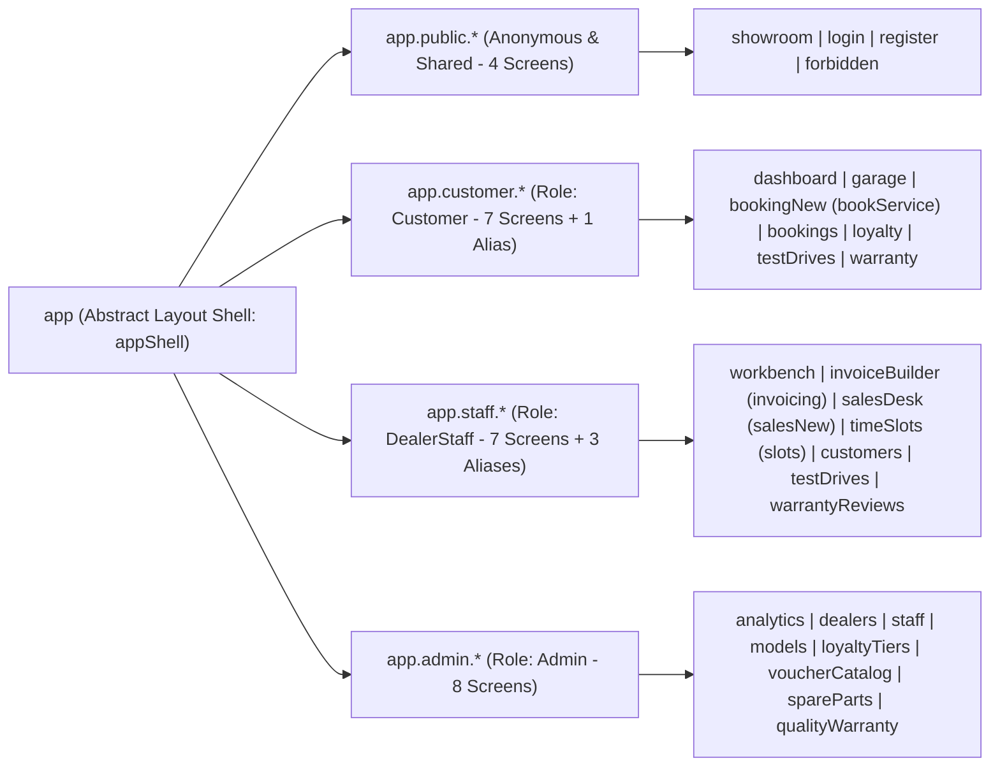
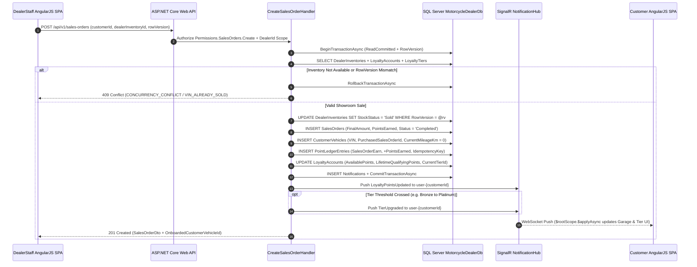
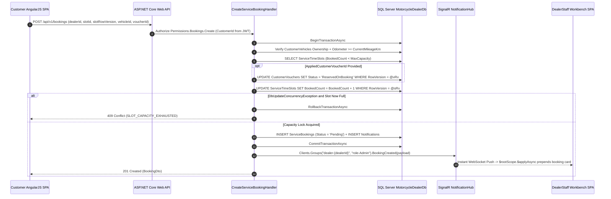
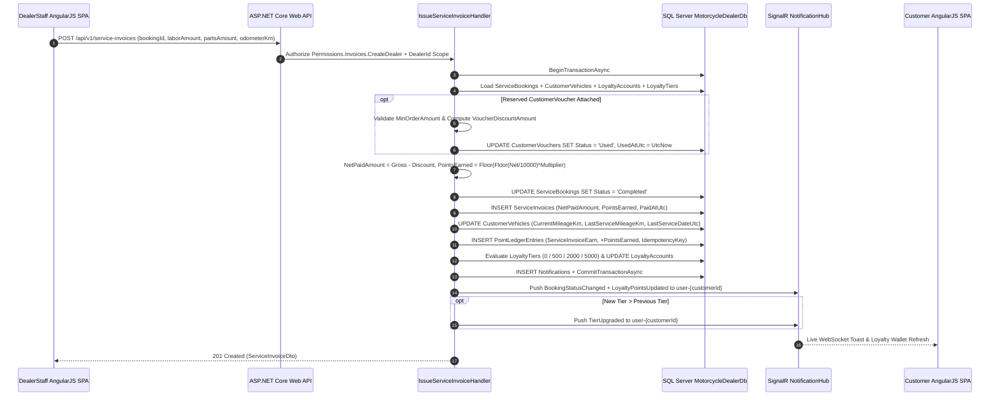
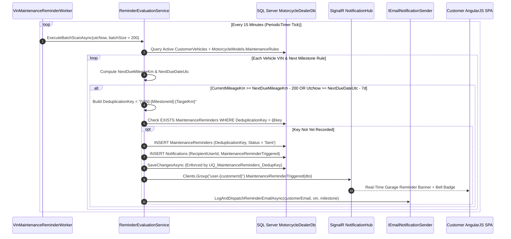

# Detailed System, API, Domain Algorithm & UI/UX Design Specification

| Metadata | Value |
| :--- | :--- |
| **Project** | Motorcycle Dealer & Loyalty Management Platform |
| **Repository** | [https://github.com/quocanhh86/motorcycle-dealer](https://github.com/quocanhh86/motorcycle-dealer) |
| **Author / Role** | Full-Stack Developer (`Solo Project`, `02/2026 - 08/2026`) |
| **Implementation Status** | **Phases 1–9 Delivered & Phase 10 (`v1.3.0`) Specification (`88` WBS Tasks across `T-101`..`T-1008`)** |
| **Stack Baseline** | AngularJS 1.8.3 (`30` Navigable UI-Router Routes, `Chart.js` v4, `@microsoft/signalr`) • Native C# `.NET 10 MAUI` Android Field App (`net10.0-android`, `16` Compiled Screens, `9`-Table `SQLCipher`) • C# / ASP.NET Core 10 Web API (`18` Controllers / `100+` HTTP Bindings) • EF Core 10 • SignalR (`10` Events) • SQL Server (`MotorcycleDealerDb`, **`27` 3NF Tables**) |
| **Requirement Traceability** | `FR-01` through `FR-10` ([PRD.md](./PRD.md), [REQUIREMENTS.md](../REQUIREMENTS.md), [RELEASE_NOTES_v1.1.0.md](./RELEASE_NOTES_v1.1.0.md), [RELEASE_NOTES_v1.2.0.md](./RELEASE_NOTES_v1.2.0.md), [RELEASE_NOTES_v1.3.0.md](./RELEASE_NOTES_v1.3.0.md)) |
| **Architecture Alignment** | `ADR-001` through `ADR-007` ([ARCHITECTURE.md](./ARCHITECTURE.md), [DATABASE_DESIGN.md](./DATABASE_DESIGN.md), [MOBILE_MAUI_SCREENS.md](./screens/MOBILE_MAUI_SCREENS.md), [BD_00_BASIC_DESIGN_MASTER.md](./basic-design/BD_00_BASIC_DESIGN_MASTER.md)) |
| **Companion Governance** | [README.md](../README.md) • [AGENTS.md](../AGENTS.md) • [TASKS.md](../TASKS.md) • [PROGRESS.md](../PROGRESS.md) • [Master Word Specification](./Motorcycle_Dealer_Loyalty_Platform_Specification.docx) |

---

## Table of Contents

1. [Granular RBAC & Route Guard Specification](#1-granular-rbac--route-guard-specification)
   - [1.1 Authentication, JWT Claims & Multi-Dealer Data-Scope Rule](#11-authentication-jwt-claims--multi-dealer-data-scope-rule)
   - [1.2 Complete 40-Permission RBAC Matrix](#12-complete-40-permission-rbac-matrix)
   - [1.3 AngularJS 1.8 UI-Router State Tree](#13-angularjs-18-ui-router-state-tree)
   - [1.4 UI-Router `transitions.onBefore` Guard & `has-permission` Directive](#14-ui-router-transitionsonbefore-guard--has-permission-directive)
2. [REST API v1 & SignalR Real-Time Contract Catalog](#2-rest-api-v1--signalr-real-time-contract-catalog)
   - [2.1 Standard Envelope, Pagination, Concurrency & RFC 7807 Error Contract](#21-standard-envelope-pagination-concurrency--rfc-7807-error-contract)
   - [2.2 Complete REST API v1 Endpoint Catalog](#22-complete-rest-api-v1-endpoint-catalog)
   - [2.3 Canonical Request & Response DTO JSON Examples](#23-canonical-request--response-dto-json-examples)
   - [2.4 SignalR Real-Time Notification Hub Contract (`/hubs/notifications`)](#24-signalr-real-time-notification-hub-contract-hubsnotifications)
3. [Core Domain Algorithms & Sequence Diagrams](#3-core-domain-algorithms--sequence-diagrams)
   - [3.1 Flow 1 — Showroom Bike Sale, VIN Auto-Registration & Loyalty Accrual](#31-flow-1--showroom-bike-sale-vin-auto-registration--loyalty-accrual)
   - [3.2 Flow 2 — Customer Service Booking, `RowVersion` Slot Lock & Instant SignalR Push](#32-flow-2--customer-service-booking-rowversion-slot-lock--instant-signalr-push)
   - [3.3 Flow 3 — Workshop Completion, `ServiceInvoices`, Voucher Consumption & Tier Upgrade](#33-flow-3--workshop-completion-serviceinvoices-voucher-consumption--tier-upgrade)
   - [3.4 Flow 4 — `VinMaintenanceReminderWorker` Evaluation, Deduplication & Dispatch](#34-flow-4--vinmaintenancereminderworker-evaluation-deduplication--dispatch)
4. [UI/UX Screen Architecture & Chart.js Analytics Specification](#4-uiux-screen-architecture--chartjs-analytics-specification)
   - [4.1 Frontend Module Layout & Visual Design Tokens](#41-frontend-module-layout--visual-design-tokens)
   - [4.2 Customer Portal Wireframes & Component Breakdown](#42-customer-portal-wireframes--component-breakdown)
   - [4.3 Dealer Staff Live Workbench Wireframes & Component Breakdown](#43-dealer-staff-live-workbench-wireframes--component-breakdown)
   - [4.4 Admin Multi-Dealer Analytics Dashboard & `Chart.js` Specification](#44-admin-multi-dealer-analytics-dashboard--chartjs-specification)

---

## 1. Granular RBAC & Route Guard Specification

This section defines the full-stack authorization contract satisfying `FR-01` and aligning with `ADR-002` (Row-Level `DealerId` Scoping) and `ADR-006` (AngularJS UI-Router State Guards).

### 1.1 Authentication, JWT Claims & Multi-Dealer Data-Scope Rule

#### Canonical Roles
The platform enforces **exactly three application roles** stored in the `Roles` table (`Users` <-> `UserRoles` <-> `Roles` <-> `RolePermissions` <-> `Permissions`):

| Role Code | Display Label | Tenancy / Data Scope (`DealerId`) | Primary Portal Entry State |
| :--- | :--- | :--- | :--- |
| `Customer` | Customer | `Users.DealerId IS NULL` — Strictly scoped to self-owned records (`CustomerId == CurrentUser.UserId`). | `app.customer.garage` |
| `DealerStaff` | Dealer Staff | `Users.DealerId == <AssignedDealerGuid>` (Mandatory non-null via `CK_Users_DealerStaff_DealerId`) — Strictly isolated to the staff member's assigned dealership. | `app.staff.workbench` |
| `Admin` | Admin | `Users.DealerId IS NULL` — Global cross-dealer visibility, catalog/rule governance, loyalty administration, and executive analytics. | `app.admin.analytics` |

#### JWT Access Token Payload Schema
Short-lived JWT Access Tokens (`15 minutes` TTL) are paired with rotating, database-backed `RefreshTokens` (`7 days` TTL, SHA-256 token hash stored in SQL Server with reuse-detection revocation).

```json
{
  "sub": "8d4a2b90-41e2-4c61-9a11-72f01c8e3001",
  "email": "staff.hcmc@motorcycledealer.vn",
  "full_name": "Nguyen Minh Tuan",
  "role": "DealerStaff",
  "dealer_id": "22222222-2222-2222-2222-222222222201",
  "permissions": [
    "Permissions.Dealers.ViewPublic",
    "Permissions.Showroom.View",
    "Permissions.Inventories.ViewDealer",
    "Permissions.Inventories.ManageDealer",
    "Permissions.SalesOrders.Create",
    "Permissions.SalesOrders.ViewDealer",
    "Permissions.TestDrives.ViewDealer",
    "Permissions.TestDrives.UpdateStatus",
    "Permissions.Vehicles.ViewDealer",
    "Permissions.TimeSlots.ViewAvailable",
    "Permissions.TimeSlots.ManageDealer",
    "Permissions.Bookings.ViewDealer",
    "Permissions.Bookings.UpdateStatus",
    "Permissions.Invoices.CreateDealer",
    "Permissions.Invoices.ViewDealer",
    "Permissions.Loyalty.ViewDealerCustomer",
    "Permissions.Notifications.ViewOwn",
    "Permissions.Notifications.ViewDealer"
  ],
  "jti": "c9f1a4d2-89b3-40f1-b122-910293847561",
  "iat": 1778747400,
  "exp": 1778748300,
  "iss": "MotorcycleDealer.WebApi",
  "aud": "MotorcycleDealer.Spa"
}
```

#### Multi-Dealer Data-Scope Enforcement Rule (`IDealerScoped`)
Permission checks alone (`[HasPermission]`) determine **what action** a principal may invoke; data-scope rules determine **which rows** that action can read or mutate:

1. **Read Isolation (`EF Core Global Query Filter`)**: Every dealer-owned entity (**`8` `IDealerScoped` entities**: `DealerInventories`, `SalesOrders`, `ServiceTimeSlots`, `ServiceBookings`, `ServiceInvoices`, `TestDriveBookings`, `ServiceReviews`, `WarrantyClaims`) implements `IDealerScoped` (`Guid DealerId { get; }`). `MotorcycleDealerDbContext` applies a global filter parameterized by `ICurrentUserContext`:
   - When `CurrentUser.Role == "DealerStaff"`, EF Core automatically appends `WHERE DealerId = @currentDealerId` to every LINQ query.
   - When `CurrentUser.Role == "Admin"`, the tenant filter evaluates to `true`, allowing cross-dealer queries and optional `?dealerId={guid}` filtering.
2. **Write Isolation (Command Handler Guard)**: `DealerStaff` command handlers never trust a client-supplied `dealerId` body property if it differs from `CurrentUser.DealerId`. Mismatched dealer IDs immediately fail with `403 Forbidden` (`FORBIDDEN_DEALER_SCOPE`), and created records bind `DealerId = CurrentUser.DealerId` server-side.
3. **Customer Ownership Isolation**: Endpoints bearing `*.ViewOwn`, `*.RegisterOwn`, `*.CancelOwn`, `*.CreateOwn`, `Bookings.Create`, `TestDrives.Create`, or `Loyalty.RedeemVoucher` bind `CustomerId = CurrentUser.UserId` directly from the verified JWT `sub` claim, preventing Insecure Direct Object Reference (`IDOR` / OWASP API1:2023 Broken Object Level Authorization).

---

### 1.2 Complete 48-Permission RBAC Matrix

All backend controllers enforce `[HasPermission("Permissions.<Module>.<Action>")]` via ASP.NET Core `PermissionAuthorizationHandler` (`PermissionPolicyProvider` `FrozenDictionary` of `48` policies). Role grants are strictly partitioned as **`Customer = 20`**, **`DealerStaff = 22`**, and **`Admin = 32`** (`74` total `RolePermissions` grants).

| # | Canonical Permission Code | Bounded Context | `Customer` (`20`) | `DealerStaff` (`22`) | `Admin` (`32`) | Scope & Separation-of-Duties Rule |
| :---: | :--- | :--- | :---: | :---: | :---: | :--- |
| 1 | `Permissions.Showroom.View` | Showroom & Sales | Yes* | Yes* | Yes* | *Also permitted anonymously on public catalog endpoints (`GET /api/v1/motorcycles`). |
| 2 | `Permissions.Showroom.ManageModels` | Showroom & Sales | — | — | Yes | Create/update `MotorcycleModels` specs, pricing, and images. |
| 3 | `Permissions.Inventories.ViewDealer` | Showroom & Sales | — | Yes | Yes | `DealerStaff`: own `DealerId` VIN stock; `Admin`: any dealer's stock. |
| 4 | `Permissions.Inventories.ManageDealer` | Showroom & Sales | — | Yes | Yes | Intake new 17-char `VIN` units into `DealerInventories` (`DealerStaff` scoped to own `DealerId`). |
| 5 | `Permissions.SalesOrders.Create` | Showroom & Sales | — | Yes | Yes | Issue showroom `SalesOrders`, mark `VIN` sold, onboard `CustomerVehicles`, accrue points. |
| 6 | `Permissions.SalesOrders.ViewOwn` | Showroom & Sales | Yes | — | — | Customer views only `SalesOrders` (& `/receipt`) where `CustomerId == CurrentUser.UserId`. |
| 7 | `Permissions.SalesOrders.ViewDealer` | Showroom & Sales | — | Yes | Yes | `DealerStaff`: own `DealerId` sales orders (& `/receipt`); `Admin`: cross-dealer sales audit. |
| 8 | `Permissions.Vehicles.ViewOwn` | Customer VIN Garage | Yes | — | — | View motorcycles in `CustomerVehicles` owned by `CurrentUser.UserId` + schedule/reminders. |
| 9 | `Permissions.Vehicles.RegisterOwn` | Customer VIN Garage | Yes | — | — | Register external 17-char `VIN` into own garage and update own odometer (`CurrentMileageKm`). |
| 10 | `Permissions.Vehicles.ViewDealer` | Customer VIN Garage | — | Yes | Yes | Lookup customer vehicle `VIN`, service history, and due milestones during workshop intake. |
| 11 | `Permissions.Vehicles.ManageRules` | Customer VIN Garage | — | — | Yes | Configure OEM `MaintenanceRules` (`IntervalKm`, `IntervalMonths`, checklist) per model. |
| 12 | `Permissions.TimeSlots.ViewAvailable` | Service Booking | Yes | Yes | Yes | Query bookable `ServiceTimeSlots` (`BookedCount < MaxCapacity`) for a selected dealer and date. |
| 13 | `Permissions.TimeSlots.ManageDealer` | Service Booking | — | Yes | Yes | Generate/adjust bay capacity (`MaxCapacity`) on `ServiceTimeSlots` (`DealerStaff`: own `DealerId`). |
| 14 | `Permissions.Bookings.Create` | Service Booking | Yes | — | — | Book a maintenance appointment for an owned `CustomerVehicle` (`VIN`). |
| 15 | `Permissions.Bookings.CancelOwn` | Service Booking | Yes | — | — | Cancel own `Pending`/`Confirmed` booking; releases slot capacity & reserved voucher. |
| 16 | `Permissions.Bookings.ViewOwn` | Service Booking | Yes | — | — | View own `ServiceBookings` history and live status timeline. |
| 17 | `Permissions.Bookings.ViewDealer` | Service Booking | — | Yes | Yes | `DealerStaff`: live workshop queue for own `DealerId`; `Admin`: cross-dealer bookings. |
| 18 | `Permissions.Bookings.UpdateStatus` | Service Booking | — | Yes | Yes | Transition booking status (`Confirmed`, `CheckedIn`, `InProgress`, `Cancelled`, `NoShow`). |
| 19 | `Permissions.Invoices.CreateDealer` | Workshop Invoicing | — | Yes | Yes | Finalize `ServiceInvoices` (+ itemized `ServiceInvoiceLineItems`), consume voucher, accrue points. |
| 20 | `Permissions.Invoices.ViewOwn` | Workshop Invoicing | Yes | — | — | View itemized workshop `ServiceInvoices` (& `/receipt`) for own bookings. |
| 21 | `Permissions.Invoices.ViewDealer` | Workshop Invoicing | — | Yes | Yes | `DealerStaff`: own `DealerId` workshop invoices (& `/receipt`); `Admin`: cross-dealer invoice ledger. |
| 22 | `Permissions.Loyalty.ViewOwn` | Loyalty & Vouchers | Yes | — | — | View own `LoyaltyAccounts` summary, tier progress, `PointLedgerEntries`, and `CustomerVouchers`. |
| 23 | `Permissions.Loyalty.RedeemVoucher` | Loyalty & Vouchers | Yes | — | — | Redeem `AvailablePoints` for a `VoucherCatalogs` item into `CustomerVouchers`. |
| 24 | `Permissions.Loyalty.ViewDealerCustomer` | Loyalty & Vouchers | — | Yes | Yes | View customer tier badge, multiplier, and eligible `CustomerVouchers` during sale/checkout. |
| 25 | `Permissions.Loyalty.ManageTiers` | Loyalty & Vouchers | — | — | Yes | Manage `LoyaltyTiers` metadata/benefits (`Bronze`, `Silver`, `Gold`, `Platinum`). |
| 26 | `Permissions.Loyalty.ManageVoucherCatalog` | Loyalty & Vouchers | — | — | Yes | Create/update `VoucherCatalogs` (`PointsCost`, `DiscountType`, `QuotaTotal`, `MinTierId`). |
| 27 | `Permissions.Loyalty.AdjustPoints` | Loyalty & Vouchers | — | — | Yes | Record audited manual goodwill/dispute `PointLedgerEntries` with mandatory reason notes. |
| 28 | `Permissions.Notifications.ViewOwn` | Notifications | Yes | Yes | Yes | Read and mark-as-read personal notifications (`RecipientUserId == CurrentUser.UserId`). |
| 29 | `Permissions.Notifications.ViewDealer` | Notifications | — | Yes | Yes | View dealer-targeted booking & test-drive feed notifications (`TargetDealerId == DealerId`). |
| 30 | `Permissions.Dealers.ViewPublic` | Platform & Admin | Yes* | Yes* | Yes* | *Also permitted anonymously on public dealer locator (`GET /api/v1/dealers`). |
| 31 | `Permissions.Dealers.ManageAll` | Platform & Admin | — | — | Yes | Create, update, or deactivate `Dealers` locations nationwide. |
| 32 | `Permissions.Users.ManageStaff` | Platform & Admin | — | — | Yes | Provision `DealerStaff` accounts, assign `DealerId`, or lock/unlock staff users. |
| 33 | `Permissions.Analytics.ViewAllDealers` | Platform & Admin | — | — | Yes | Access cross-dealer `Chart.js v4` revenue, booking, and loyalty analytics endpoints. |
| 34 | `Permissions.Analytics.ExportReports` | Platform & Admin | — | — | Yes | Export aggregated dealer revenue and booking datasets as UTF-8 BOM CSV reports. |
| 35 | `Permissions.TestDrives.Create` | Showroom & Sales (`v1.1`) | Yes | — | — | Schedule showroom `TestDriveBookings` (`<= 2` active window cap) for an active model/dealer. |
| 36 | `Permissions.TestDrives.CancelOwn` | Showroom & Sales (`v1.1`) | Yes | — | — | Cancel own `Requested`/`Confirmed` test-drive booking (`RowVersion` guarded). |
| 37 | `Permissions.TestDrives.ViewOwn` | Showroom & Sales (`v1.1`) | Yes | — | — | View own `TestDriveBookings` (`CustomerId == CurrentUser.UserId`) and assigned demo `VIN`. |
| 38 | `Permissions.TestDrives.ViewDealer` | Showroom & Sales (`v1.1`) | — | Yes | Yes | `DealerStaff`: live test-drive schedule for own `DealerId`; `Admin`: cross-dealer test drives. |
| 39 | `Permissions.TestDrives.UpdateStatus` | Showroom & Sales (`v1.1`) | — | Yes | Yes | Confirm, assign branch demo `VIN`, complete, or mark `NoShow`/`Cancelled` (`IDealerScoped`). |
| 40 | `Permissions.SpareParts.ManageCatalog` | Workshop Invoicing (`v1.1`) | — | — | Yes | Create/update master OEM `SpareParts` SKUs, model fitment, pricing, and `IsActive` toggle. |
| 41 | `Permissions.Reviews.CreateOwn` | CSAT Reviews (`v1.2`) | Yes | — | — | Submit a 1-to-5 star `ServiceReview` on an owned `Paid` `ServiceInvoice` (`+25` `AvailablePoints` bonus). |
| 42 | `Permissions.Reviews.ViewOwn` | CSAT Reviews (`v1.2`) | Yes | — | — | View own submitted `ServiceReviews` and branch advisor responses. |
| 43 | `Permissions.Reviews.ViewDealer` | CSAT Reviews (`v1.2`) | — | Yes | Yes | `DealerStaff`: own `DealerId` `ServiceReviews`; `Admin`: cross-dealer CSAT feedback feed. |
| 44 | `Permissions.Reviews.RespondDealer` | CSAT Reviews (`v1.2`) | — | Yes | Yes | Post/update official dealership `StaffResponse` (`RowVersion` guarded, `IDealerScoped`). |
| 45 | `Permissions.Warranty.CreateOwn` | VIN Warranty (`v1.2`) | Yes | — | — | Submit a `WarrantyClaim` on an owned `CustomerVehicle` within `36` months / `30,000` km. |
| 46 | `Permissions.Warranty.ViewOwn` | VIN Warranty (`v1.2`) | Yes | — | — | View own `WarrantyClaims` status timeline and adjudication notes. |
| 47 | `Permissions.Warranty.ViewDealer` | VIN Warranty (`v1.2`) | — | Yes | Yes | `DealerStaff`: own `DealerId` `WarrantyClaims`; `Admin`: cross-dealer warranty claims queue. |
| 48 | `Permissions.Warranty.ManageDealer` | VIN Warranty (`v1.2`) | — | Yes | Yes | Adjudicate `WarrantyClaims` (`UnderReview`, `Approved`, `Rejected`, `Completed`), covered part & VND. |

> [!IMPORTANT]
> **Separation of Duties Invariant**: The `16` customer self-service permissions (`SalesOrders.ViewOwn`, `Vehicles.ViewOwn`, `Vehicles.RegisterOwn`, `Bookings.Create`, `Bookings.CancelOwn`, `Bookings.ViewOwn`, `TestDrives.Create`, `TestDrives.CancelOwn`, `TestDrives.ViewOwn`, `Invoices.ViewOwn`, `Loyalty.ViewOwn`, `Loyalty.RedeemVoucher`, `Reviews.CreateOwn`, `Reviews.ViewOwn`, `Warranty.CreateOwn`, `Warranty.ViewOwn`) are granted **exclusively** to `Customer` accounts (`20` total = `16` exclusive + `4` shared). `Admin` (`32` = `22` operational + `10` admin-exclusive) and `DealerStaff` (`22` operational) operate strictly through dealer/administrative permissions so audit trails never conflate customer actions with staff actions.

---

### 1.3 AngularJS 1.8.3 UI-Router State Tree (`30` Navigable Routes)

The decoupled Single-Page Application (`angular@1.8.3` + `@uirouter/angularjs`) registers **`35` UI-Router states** (`5` abstract layout/namespace shells + **`26` primary feature screens** + **`4` route aliases** = **`30` navigable concrete routes**):



#### Complete UI-Router State & Guard Configuration Table (`35` Registered States)

| UI-Router State Name | URL Route | Component | `data.requiresAuth` | `data.roles` | `data.permissions` (`ALL` Mode) |
| :--- | :--- | :--- | :---: | :--- | :--- |
| `app` | *(abstract)* | `appShell` | `false` | — | — |
| `app.public` | *(abstract)* | `<ui-view>` | `false` | — | — |
| `app.public.showroom` | `/showroom` | `publicShowroom` | `false` | — | — |
| `app.public.login` | `/login?returnUrl&returnTo&reason` | `publicLogin` | `false` | — | — |
| `app.public.register` | `/register` | `publicRegister` | `false` | — | — |
| `app.public.forbidden` | `/403` | `publicForbidden` | `false` | — | — |
| `app.customer` | `/customer` *(abstract)* | `<ui-view>` | `true` | `['Customer']` | — |
| `app.customer.dashboard` | `/customer/dashboard` | `customerDashboard` | `true` | `['Customer']` | `['Permissions.Vehicles.ViewOwn', 'Permissions.Bookings.ViewOwn', 'Permissions.Loyalty.ViewOwn']` |
| `app.customer.garage` | `/customer/garage` | `customerGarage` | `true` | `['Customer']` | `['Permissions.Vehicles.ViewOwn', 'Permissions.Vehicles.RegisterOwn']` |
| `app.customer.bookingNew` *(+ alias `bookService`)* | `/customer/bookings/new?vehicleId&dealerId&voucherId` *(+ `/customer/book-service`)* | `customerBookingNew` | `true` | `['Customer']` | `['Permissions.Bookings.Create', 'Permissions.TimeSlots.ViewAvailable']` |
| `app.customer.bookings` | `/customer/bookings` | `customerBookings` | `true` | `['Customer']` | `['Permissions.Bookings.ViewOwn', 'Permissions.Bookings.CancelOwn', 'Permissions.Invoices.ViewOwn']` |
| `app.customer.loyalty` | `/customer/loyalty` | `customerLoyalty` | `true` | `['Customer']` | `['Permissions.Loyalty.ViewOwn', 'Permissions.Loyalty.RedeemVoucher', 'Permissions.SalesOrders.ViewOwn']` |
| `app.customer.testDrives` | `/customer/test-drives?modelId&dealerId` | `customerTestDrives` | `true` | `['Customer']` | `['Permissions.TestDrives.ViewOwn', 'Permissions.TestDrives.Create']` |
| `app.customer.warranty` | `/customer/warranty?vehicleId&invoiceId` | `customerWarranty` | `true` | `['Customer']` | `['Permissions.Warranty.ViewOwn', 'Permissions.Warranty.CreateOwn', 'Permissions.Reviews.ViewOwn']` |
| `app.staff` | `/staff` *(abstract)* | `<ui-view>` | `true` | `['DealerStaff']` | — |
| `app.staff.workbench` | `/staff/workbench` | `staffWorkbench` | `true` | `['DealerStaff']` | `['Permissions.Bookings.ViewDealer', 'Permissions.Bookings.UpdateStatus', 'Permissions.Vehicles.ViewDealer']` |
| `app.staff.invoiceBuilder` *(+ alias `invoicing`)* | `/staff/bookings/:bookingId/invoice` *(+ `/staff/invoicing/:bookingId`)* | `staffInvoiceBuilder` | `true` | `['DealerStaff']` | `['Permissions.Invoices.CreateDealer', 'Permissions.Invoices.ViewDealer', 'Permissions.Loyalty.ViewDealerCustomer']` |
| `app.staff.salesDesk` *(+ alias `salesNew`)* | `/staff/sales-orders/new` *(+ `/staff/sales-new`)* | `staffSalesDesk` | `true` | `['DealerStaff']` | `['Permissions.SalesOrders.Create', 'Permissions.SalesOrders.ViewDealer', 'Permissions.Inventories.ViewDealer', 'Permissions.Inventories.ManageDealer']` |
| `app.staff.timeSlots` *(+ alias `slots`)* | `/staff/time-slots` *(+ `/staff/slots`)* | `staffTimeSlots` | `true` | `['DealerStaff']` | `['Permissions.TimeSlots.ManageDealer', 'Permissions.TimeSlots.ViewAvailable']` |
| `app.staff.customers` | `/staff/customers` | `staffCustomers` | `true` | `['DealerStaff']` | `['Permissions.Vehicles.ViewDealer', 'Permissions.Loyalty.ViewDealerCustomer']` |
| `app.staff.testDrives` | `/staff/test-drives` | `staffTestDrives` | `true` | `['DealerStaff']` | `['Permissions.TestDrives.ViewDealer', 'Permissions.TestDrives.UpdateStatus']` |
| `app.staff.warrantyReviews` | `/staff/warranty-reviews` | `staffWarrantyReviews` | `true` | `['DealerStaff']` | `['Permissions.Warranty.ViewDealer', 'Permissions.Warranty.ManageDealer', 'Permissions.Reviews.ViewDealer', 'Permissions.Reviews.RespondDealer']` |
| `app.admin` | `/admin` *(abstract)* | `<ui-view>` | `true` | `['Admin']` | — |
| `app.admin.analytics` | `/admin/analytics` | `adminAnalytics` | `true` | `['Admin']` | `['Permissions.Analytics.ViewAllDealers', 'Permissions.Analytics.ExportReports']` |
| `app.admin.dealers` | `/admin/dealers` | `adminDealers` | `true` | `['Admin']` | `['Permissions.Dealers.ManageAll', 'Permissions.Dealers.ViewPublic']` |
| `app.admin.staff` | `/admin/staff?dealerId` | `adminStaff` | `true` | `['Admin']` | `['Permissions.Users.ManageStaff']` |
| `app.admin.models` | `/admin/models` | `adminModels` | `true` | `['Admin']` | `['Permissions.Showroom.ManageModels', 'Permissions.Vehicles.ManageRules']` |
| `app.admin.loyaltyTiers` | `/admin/loyalty/tiers` | `adminLoyaltyTiers` | `true` | `['Admin']` | `['Permissions.Loyalty.ManageTiers', 'Permissions.Loyalty.AdjustPoints']` |
| `app.admin.voucherCatalog` | `/admin/loyalty/vouchers` | `adminVoucherCatalog` | `true` | `['Admin']` | `['Permissions.Loyalty.ManageVoucherCatalog']` |
| `app.admin.spareParts` | `/admin/spare-parts` | `adminSpareParts` | `true` | `['Admin']` | `['Permissions.SpareParts.ManageCatalog']` |
| `app.admin.qualityWarranty` | `/admin/quality-warranty` | `adminQualityWarranty` | `true` | `['Admin']` | `['Permissions.Analytics.ViewAllDealers', 'Permissions.Reviews.ViewDealer', 'Permissions.Warranty.ViewDealer']` |

---

### 1.4 UI-Router `transitions.onBefore` Guard & `has-permission` Directive

#### Transition Guard Specification (`$transitions.onBefore`)
During the AngularJS `.run()` bootstrap phase, the SPA registers two deterministic transition hooks on `@uirouter/angularjs` `$transitions`:

1. **Authenticated Entry Redirect (`login` / `register` guard)**:
   - Criteria: `{ to: state => state.name === 'app.public.login' || state.name === 'app.public.register' }`.
   - Behavior: If `AuthStore.isAuthenticated()` is already `true`, cancels navigation to `/login` and redirects to the user's role home (`Customer` -> `app.customer.garage`, `DealerStaff` -> `app.staff.workbench`, `Admin` -> `app.admin.analytics`).
2. **Protected Route Guard (`requiresAuth` / `roles` / `permissions`)**:
   - Criteria: `{ to: state => Boolean(state.data && (state.data.requiresAuth || state.data.roles || state.data.permissions)) }`.
   - Step-by-step evaluation algorithm:
     1. Merge inherited `data` metadata across parent-to-child UI-Router state hierarchy (`app.staff` -> `app.staff.invoicing`).
     2. Call `AuthService.ensureValidSession()` (returns `$q` promise):
        - If in-memory access token is valid (`exp - now > 30s`), resolves immediately.
        - If access token is missing or expiring within 30 seconds and a refresh token exists, awaits the **single shared refresh promise** (`POST /api/v1/auth/refresh`).
        - If unauthenticated or refresh fails, clears session, stops SignalR hub connection, and returns `transition.router.stateService.target('app.public.login', { returnTo: transition.to().name })`.
     3. Verify role membership: if `mergedData.roles` is non-empty and `!mergedData.roles.includes(AuthStore.getRole())`, redirects to `transition.router.stateService.target('app.public.forbidden')`.
     4. Verify granular permissions: if `mergedData.permissions` is non-empty:
        - `permissionMode === 'ANY'`: requires at least one matching permission in `AuthStore.getPermissionSet()`.
        - `permissionMode === 'ALL'` (default): requires every listed permission to exist in `AuthStore.getPermissionSet()`.
        - On failure, redirects to `app.public.forbidden` (`/403`).

```javascript
// Architectural Reference Contract (Phase 4 Target: frontend/src/app/core/guards/route-guard.run.js)
angular.module('app.core').run(['$transitions', 'AuthService', 'AuthStore',
  function registerRouteGuards($transitions, AuthService, AuthStore) {
    $transitions.onBefore(
      { to: function (state) { return !!(state.data && state.data.requiresAuth); } },
      function enforceRbacGuard(transition) {
        var $state = transition.router.stateService;
        var targetData = transition.to().data || {};

        return AuthService.ensureValidSession().then(function (authenticated) {
          if (!authenticated) {
            return $state.target('app.public.login', { returnTo: transition.to().name });
          }
          if (targetData.roles && targetData.roles.indexOf(AuthStore.getRole()) === -1) {
            return $state.target('app.public.forbidden');
          }
          if (targetData.permissions && !AuthStore.hasPermissions(targetData.permissions, targetData.permissionMode || 'ALL')) {
            return $state.target('app.public.forbidden');
          }
          return true;
        });
      }
    );
  }
]);
```

#### `has-permission` Attribute Directive Specification
Fine-grained UI elements inside shared or multi-capability templates use the `has-permission` directive to hide/disable controls lacking required permissions:

- **Selector**: Attribute (`restrict: 'A'`), name `hasPermission` (`has-permission` in HTML).
- **Supported Bindings**:
  - Single string literal or expression: `<button has-permission="Permissions.Loyalty.RedeemVoucher">Redeem</button>`
  - Array expression with optional mode: `<div has-permission="['Permissions.Inventories.ManageDealer', 'Permissions.SalesOrders.Create']" permission-mode="ANY">...</div>`
- **DOM & Digest Lifecycle**:
  - Evaluates `AuthStore.hasPermissions(requiredList, mode)` during `link()`.
  - Applies `ng-hide` / `aria-hidden="true"` and `disabled` when unauthorized (avoiding layout thrashing while preventing accidental clicks).
  - Subscribes to `$rootScope.$on('auth:changed', evaluate)` and automatically unregisters on `$scope.$on('$destroy')` to guarantee zero detached listener leaks.
  - **Defense-in-Depth Rule**: Client-side `has-permission` and UI-Router guards exist solely for responsive UX; every ASP.NET Core endpoint independently validates JWT signature, expiration, `[HasPermission]`, and `IDealerScoped` / `CustomerId` ownership.

---

## 2. REST API v1 & SignalR Real-Time Contract Catalog

### 2.1 Standard Envelope, Pagination, Concurrency & RFC 7807 Error Contract

#### Protocol & Serialization Standards
- **Base Route Prefix**: `/api/v1`
- **JSON Naming Policy**: `camelCase` properties (`System.Text.Json`), enums serialized as exact PascalCase strings (`"Bronze"`, `"Pending"`, `"ReservedOnBooking"`), money serialized as numeric `DECIMAL(18,2)` in VND, timestamps serialized as `ISO-8601` UTC (`"2026-05-14T09:15:30Z"`).
- **Optimistic Concurrency Token**: Entities carrying SQL Server `ROWVERSION` expose `"rowVersion": "AAAAAAAAB9E="` (Base64 string) in read DTOs and require `"rowVersion"` in mutating requests.
- **Idempotency Header**: Financial and booking creation endpoints accept `Idempotency-Key: <UUIDv4>` (or derive deterministic server keys) to guarantee safe client retries.

#### Standard Success & Paginated Envelopes

```json
// Single-Resource Envelope: ApiResponse<T>
{
  "success": true,
  "data": { "id": "9f82c1d0-23a1-4b8c-98a2-1029384756ab" },
  "meta": {
    "timestampUtc": "2026-05-14T09:15:30Z",
    "traceId": "00-4bf92f3577b34da6a3ce929d0e0e4736-00f067aa0ba902b7-01"
  }
}
```

```json
// Collection Envelope: PagedResponse<T>
{
  "success": true,
  "data": [ /* array of DTO items */ ],
  "pagination": {
    "pageNumber": 1,
    "pageSize": 20,
    "totalCount": 142,
    "totalPages": 8,
    "hasPreviousPage": false,
    "hasNextPage": true
  },
  "meta": {
    "timestampUtc": "2026-05-14T09:15:30Z",
    "traceId": "00-4bf92f3577b34da6a3ce929d0e0e4736-00f067aa0ba902b7-01"
  }
}
```

#### RFC 7807 `ProblemDetails` Error Contract
All non-2xx responses return `Content-Type: application/problem+json` produced by ASP.NET Core `IExceptionHandler` middleware:

```json
{
  "type": "https://httpstatuses.io/409",
  "title": "Service Time Slot Capacity Exhausted",
  "status": 409,
  "detail": "Selected slot 09:00-10:00 on 2026-05-20 at Saigon Central Honda is now full (4/4 bays booked).",
  "instance": "/api/v1/bookings",
  "errorCode": "SLOT_CAPACITY_EXHAUSTED",
  "traceId": "00-71a82f3577b34da6a3ce929d0e0e9912-11a067aa0ba902c4-01",
  "errors": {}
}
```

| HTTP Status | Canonical `errorCode` Values | Trigger Condition |
| :---: | :--- | :--- |
| `400 Bad Request` | `VALIDATION_FAILED` | FluentValidation rule failure (populates `errors` field dictionary, e.g., invalid 17-char `VIN` format). |
| `401 Unauthorized` | `UNAUTHORIZED`, `TOKEN_EXPIRED`, `INVALID_REFRESH_TOKEN` | Missing/invalid JWT or revoked/expired refresh token. |
| `403 Forbidden` | `FORBIDDEN_PERMISSION`, `FORBIDDEN_DEALER_SCOPE`, `FORBIDDEN_RESOURCE_OWNER` | Missing `[HasPermission]`, cross-dealer access by `DealerStaff`, or customer IDOR attempt. |
| `404 Not Found` | `RESOURCE_NOT_FOUND` | Target entity GUID or `VIN` does not exist (or is hidden by `IDealerScoped` query filter). |
| `409 Conflict` | `CONCURRENCY_CONFLICT`, `SLOT_CAPACITY_EXHAUSTED`, `TEST_DRIVE_SLOT_FULL`, `TEST_DRIVE_OVERLAP`, `DUPLICATE_VIN`, `DUPLICATE_PART_CODE`, `INVOICE_ALREADY_ISSUED` | SQL Server `RowVersion` mismatch (`DbUpdateConcurrencyException`), full bay/test-drive window, customer overlap, or duplicate unique key. |
| `422 Unprocessable Entity` | `INSUFFICIENT_LOYALTY_POINTS`, `VOUCHER_INELIGIBLE`, `VOUCHER_QUOTA_EXHAUSTED`, `SPARE_PART_INCOMPATIBLE`, `SPARE_PART_INACTIVE`, `INVALID_STATUS_TRANSITION`, `ODOMETER_REGRESSION` | Domain invariant violation despite syntactically valid payload. |
| `429 Too Many Requests` | `RATE_LIMIT_EXCEEDED` | Auth or booking rate-limiter policy threshold exceeded. |
| `500 Internal Server Error` | `INTERNAL_SERVER_ERROR` | Unhandled server exception (stack trace suppressed outside `Development`). |

---

### 2.2 Complete REST API v1 Endpoint Catalog

Every endpoint resides strictly under the **15 canonical `/api/v1/*` feature controller prefixes** (`16` C# Controllers including `HealthController` + minimal `/health` probe, `90+` HTTP route bindings):

| Module | Method | Route (`/api/v1/...`) | Required Permission / Auth | Purpose & Key Behavior |
| :--- | :---: | :--- | :--- | :--- |
| **Auth** | `POST` | `/api/v1/auth/register` | `Anonymous` | Register new `Customer` account + initialize `Bronze` `LoyaltyAccounts` row. |
| **Auth** | `POST` | `/api/v1/auth/login` | `Anonymous` | Authenticate credentials; issue JWT access token + rotating refresh token. |
| **Auth** | `POST` | `/api/v1/auth/refresh` | `Anonymous` *(Refresh Token)* | Rotate `RefreshTokens` row and return fresh JWT + permissions array. |
| **Auth** | `POST` | `/api/v1/auth/logout` | `[Authorize]` | Revoke current `RefreshTokens` family and log session termination. |
| **Auth** | `GET` | `/api/v1/auth/me` | `[Authorize]` | Return current user profile, `role`, `dealerId`, and granted `permissions`. |
| **Dealers** | `GET` | `/api/v1/dealers` | `Anonymous` / `Permissions.Dealers.ViewPublic` | List active dealerships (`City`, address, coordinates, workshop hours). |
| **Dealers** | `GET` | `/api/v1/dealers/{dealerId}` | `Anonymous` / `Permissions.Dealers.ViewPublic` | Get single dealership details and active stock count summary. |
| **Dealers** | `POST` | `/api/v1/dealers` | `Permissions.Dealers.ManageAll` | (`Admin`) Create a new dealership branch. |
| **Dealers** | `PUT` | `/api/v1/dealers/{dealerId}` | `Permissions.Dealers.ManageAll` | (`Admin`) Update dealership metadata or active status. |
| **Dealers** | `GET` | `/api/v1/dealers/{dealerId}/staff` | `Permissions.Users.ManageStaff` | (`Admin`) List `DealerStaff` accounts assigned to `{dealerId}`. |
| **Dealers** | `POST` | `/api/v1/dealers/{dealerId}/staff` | `Permissions.Users.ManageStaff` | (`Admin`) Provision a `DealerStaff` user scoped to `{dealerId}`. |
| **Dealers** | `PATCH` | `/api/v1/dealers/{dealerId}/staff/{userId}/status` | `Permissions.Users.ManageStaff` | (`Admin`) Activate/deactivate a `DealerStaff` account. |
| **Motorcycles** | `GET` | `/api/v1/motorcycles` | `Anonymous` / `Permissions.Showroom.View` | Paginated showroom catalog (`MotorcycleModels`) with per-dealer availability summary. |
| **Motorcycles** | `GET` | `/api/v1/motorcycles/{modelId}` | `Anonymous` / `Permissions.Showroom.View` | Detailed model specs, MSRP, `MaintenanceRules`, and dealer stock breakdown. |
| **Motorcycles** | `POST` | `/api/v1/motorcycles` | `Permissions.Showroom.ManageModels` | (`Admin`) Create a new `MotorcycleModels` catalog entry. |
| **Motorcycles** | `PUT` | `/api/v1/motorcycles/{modelId}` | `Permissions.Showroom.ManageModels` | (`Admin`) Update motorcycle model specifications or pricing. |
| **Motorcycles** | `GET` | `/api/v1/motorcycles/{modelId}/maintenance-rules` | `Anonymous` / `Permissions.Showroom.View` | List OEM `MaintenanceRules` milestones (`IntervalKm`, `IntervalMonths`) for a model. |
| **Motorcycles** | `POST` | `/api/v1/motorcycles/{modelId}/maintenance-rules` | `Permissions.Vehicles.ManageRules` | (`Admin`) Add a milestone rule to `MaintenanceRules`. |
| **Motorcycles** | `PUT` | `/api/v1/motorcycles/{modelId}/maintenance-rules/{ruleId}` | `Permissions.Vehicles.ManageRules` | (`Admin`) Update milestone `IntervalKm`, `IntervalMonths`, or `ChecklistSummary`. |
| **Inventories** | `GET` | `/api/v1/inventories` | `Permissions.Inventories.ViewDealer` | Paginated `DealerInventories` (`VIN`, color, status) scoped to `DealerId` (or `?dealerId` for `Admin`). |
| **Inventories** | `POST` | `/api/v1/inventories` | `Permissions.Inventories.ManageDealer` | Intake a physical motorcycle (`VIN VARCHAR(17)`, `StockStatus = 'Available'`) into `DealerInventories`. |
| **Inventories** | `PATCH` | `/api/v1/inventories/{inventoryId}` | `Permissions.Inventories.ManageDealer` | Update inventory `StockStatus` (`Available`, `Reserved`, `Sold`, `Transferred`) guarded by `RowVersion`. |
| **Sales Orders** | `POST` | `/api/v1/sales-orders` | `Permissions.SalesOrders.Create` | Complete showroom bike sale -> mark `VIN` `'Sold'` + create `CustomerVehicles` + accrue Loyalty points. |
| **Sales Orders** | `GET` | `/api/v1/sales-orders/my` | `Permissions.SalesOrders.ViewOwn` | (`Customer`) List own motorcycle purchase `SalesOrders`. |
| **Sales Orders** | `GET` | `/api/v1/sales-orders` | `Permissions.SalesOrders.ViewDealer` | (`DealerStaff` / `Admin`) List dealer or cross-dealer `SalesOrders`. |
| **Sales Orders** | `GET` | `/api/v1/sales-orders/{orderId}` | `Permissions.SalesOrders.ViewOwn` *or* `ViewDealer` | Retrieve itemized sales order, onboarded `VIN`, and `PointsEarned`. |
| **Sales Orders** | `GET` | `/api/v1/sales-orders/{orderId}/receipt` | `Permissions.SalesOrders.ViewOwn` *or* `ViewDealer` | (`v1.1.0`) Issue `PrintableSalesOrderReceiptDto` (`RCP-SLS-*`) with SHA-256 `VerificationCode` (`403` foreign customer / `404` foreign dealer). |
| **Test Drives** | `GET` | `/api/v1/test-drives/my` | `Permissions.TestDrives.ViewOwn` | (`v1.1.0` `Customer`) Paginated list of own `TestDriveBookings` and assigned demo `VIN`. |
| **Test Drives** | `GET` | `/api/v1/test-drives` | `Permissions.TestDrives.ViewDealer` | (`v1.1.0` `DealerStaff` / `Admin`) `IDealerScoped` branch test-drive schedule (`?preferredDate=&status=`). |
| **Test Drives** | `GET` | `/api/v1/test-drives/{testDriveId}` | `Permissions.TestDrives.ViewOwn` *or* `ViewDealer` | (`v1.1.0`) Retrieve test-drive detail, customer license/phone, demo `VIN`, and `rowVersion`. |
| **Test Drives** | `POST` | `/api/v1/test-drives` | `Permissions.TestDrives.Create` | (`v1.1.0` `Customer`) Schedule showroom test drive (`<= 2` active cap -> `409 TEST_DRIVE_SLOT_FULL`, overlap -> `409 TEST_DRIVE_OVERLAP`) + push `TestDriveCreated`. |
| **Test Drives** | `POST` | `/api/v1/test-drives/{testDriveId}/cancel` | `Permissions.TestDrives.CancelOwn` *or* `UpdateStatus` | (`v1.1.0`) Cancel `Requested`/`Confirmed` test drive (`RowVersion`) + push `TestDriveStatusChanged`. |
| **Test Drives** | `PATCH` | `/api/v1/test-drives/{testDriveId}/status` | `Permissions.TestDrives.UpdateStatus` | (`v1.1.0` `DealerStaff` / `Admin`) Transition status (`Confirmed`, `Completed`, `NoShow`, `Cancelled`) with optional demo `AssignedInventoryId` (`RowVersion`) + push `TestDriveStatusChanged`. |
| **Vehicles** | `GET` | `/api/v1/vehicles/my` | `Permissions.Vehicles.ViewOwn` | (`Customer`) List owned `CustomerVehicles` in garage with next-due maintenance badges. |
| **Vehicles** | `POST` | `/api/v1/vehicles` | `Permissions.Vehicles.RegisterOwn` | (`Customer`) Manually register an external 17-char `VIN` into `CustomerVehicles` (`PurchasedSalesOrderId = NULL`). |
| **Vehicles** | `PATCH` | `/api/v1/vehicles/{vehicleId}/mileage` | `Permissions.Vehicles.RegisterOwn` | (`Customer`) Update `CurrentMileageKm` (monotonic `>=` check) for proactive VIN reminder tracking. |
| **Vehicles** | `GET` | `/api/v1/vehicles/{vehicleId}/maintenance-history` | `Permissions.Vehicles.ViewOwn` *or* `ViewDealer` | Computed milestone schedule (`Completed`, `DueSoon`, `Overdue`, `Upcoming`), service history & `MaintenanceReminders`. |
| **Vehicles** | `GET` | `/api/v1/vehicles/lookup` | `Permissions.Vehicles.ViewDealer` | (`DealerStaff` / `Admin`) Lookup `CustomerVehicles` by `?vin=` or `?licensePlate=` or `?email=`. |
| **Time Slots** | `GET` | `/api/v1/time-slots` | `Permissions.TimeSlots.ViewAvailable` | List available slots for `?dealerId=&fromDate=&toDate=` with `availableBays = MaxCapacity - BookedCount`. |
| **Time Slots** | `GET` | `/api/v1/time-slots/dealer` | `Permissions.TimeSlots.ManageDealer` | (`DealerStaff` / `Admin`) Full branch slot grid including full/closed windows and `rowVersion`. |
| **Time Slots** | `POST` | `/api/v1/time-slots/dealer/generate` | `Permissions.TimeSlots.ManageDealer` | Batch-generate daily workshop `ServiceTimeSlots` for a date range. |
| **Time Slots** | `PATCH` | `/api/v1/time-slots/{slotId}` | `Permissions.TimeSlots.ManageDealer` | Adjust `MaxCapacity` (`>= BookedCount`) guarded by `RowVersion`. |
| **Bookings** | `POST` | `/api/v1/bookings` | `Permissions.Bookings.Create` | (`Customer`) Book slot (`RowVersion`), reserve optional `CustomerVoucher`, push SignalR `BookingCreated`. |
| **Bookings** | `GET` | `/api/v1/bookings/my` | `Permissions.Bookings.ViewOwn` | (`Customer`) Paginated list of own `ServiceBookings`. |
| **Bookings** | `POST` | `/api/v1/bookings/{bookingId}/cancel` | `Permissions.Bookings.CancelOwn` | (`Customer`) Cancel own `Pending`/`Confirmed` booking; decrement `BookedCount` & release voucher. |
| **Bookings** | `GET` | `/api/v1/bookings/dealer` | `Permissions.Bookings.ViewDealer` | (`DealerStaff` / `Admin`) Filterable workshop queue (`?slotDate=&status=`). |
| **Bookings** | `GET` | `/api/v1/bookings/{bookingId}` | `Permissions.Bookings.ViewOwn` *or* `ViewDealer` | Detailed booking view with vehicle `VIN`, slot window, and reserved voucher details. |
| **Bookings** | `PATCH` | `/api/v1/bookings/{bookingId}/status` | `Permissions.Bookings.UpdateStatus` | (`DealerStaff` / `Admin`) Transition status (`Confirmed`, `CheckedIn`, `InProgress`, `Cancelled`, `NoShow`) + push `BookingStatusChanged`. |
| **Invoices** | `POST` | `/api/v1/service-invoices` | `Permissions.Invoices.CreateDealer` | Issue `ServiceInvoices` (+ optional itemized `ServiceInvoiceLineItems` validated against OEM `SpareParts`), consume voucher, accrue points, check tier upgrade, push SignalR events. |
| **Invoices** | `GET` | `/api/v1/service-invoices/my` | `Permissions.Invoices.ViewOwn` | (`Customer`) List own workshop `ServiceInvoices` with itemized `lineItems`. |
| **Invoices** | `GET` | `/api/v1/service-invoices` | `Permissions.Invoices.ViewDealer` | (`DealerStaff` / `Admin`) List dealer or cross-dealer `ServiceInvoices`. |
| **Invoices** | `GET` | `/api/v1/service-invoices/{invoiceId}` | `Permissions.Invoices.ViewOwn` *or* `ViewDealer` | Detailed workshop invoice breakdown, `ServiceInvoiceLineItems`, and `PointLedgerEntries` reference. |
| **Invoices** | `GET` | `/api/v1/service-invoices/{invoiceId}/receipt` | `Permissions.Invoices.ViewOwn` *or* `ViewDealer` | (`v1.1.0`) Issue `PrintableServiceReceiptDto` (`RCP-SVC-*`) with itemized parts/labor & SHA-256 `VerificationCode`. |
| **Spare Parts** | `GET` | `/api/v1/spare-parts` | `Anonymous` *(Dual-Mode)* | (`v1.1.0`) List active OEM `SpareParts` (`?compatibleModelId=&category=&search=`); `?includeInactive=true` requires `Permissions.SpareParts.ManageCatalog`. |
| **Spare Parts** | `GET` | `/api/v1/spare-parts/{partId}` | `Anonymous` *(Dual-Mode)* | (`v1.1.0`) Get single OEM `SparePart` SKU (`404` if inactive unless caller holds `SpareParts.ManageCatalog`). |
| **Spare Parts** | `POST` | `/api/v1/spare-parts` | `Permissions.SpareParts.ManageCatalog` | (`v1.1.0` `Admin`) Create master OEM `SpareParts` SKU (`UQ_SpareParts_PartCode` -> `409 DUPLICATE_PART_CODE`). |
| **Spare Parts** | `PUT` | `/api/v1/spare-parts/{partId}` | `Permissions.SpareParts.ManageCatalog` | (`v1.1.0` `Admin`) Update SKU pricing, model compatibility, or `IsActive` flag (historical `ServiceInvoiceLineItems` remain immutable). |
| **Loyalty** | `GET` | `/api/v1/loyalty/account` | `Permissions.Loyalty.ViewOwn` | (`Customer`) Current tier (`Bronze`..`Platinum`), multiplier, `AvailablePoints`, `LifetimeQualifyingPoints`, next-tier progress. |
| **Loyalty** | `GET` | `/api/v1/loyalty/ledger` | `Permissions.Loyalty.ViewOwn` | (`Customer`) Paginated immutable `PointLedgerEntries` audit trail. |
| **Loyalty** | `GET` | `/api/v1/loyalty/tiers` | `Anonymous` / `Permissions.Loyalty.ViewOwn` | List all 4 `LoyaltyTiers` thresholds, multipliers, and benefits. |
| **Loyalty** | `PUT` | `/api/v1/loyalty/tiers/{tierId}` | `Permissions.Loyalty.ManageTiers` | (`Admin`) Update tier display benefits (`BenefitsJson`). |
| **Loyalty** | `GET` | `/api/v1/loyalty/customers/{customerId}` | `Permissions.Loyalty.ViewDealerCustomer` | (`DealerStaff` / `Admin`) Inspect customer's tier multiplier & available vouchers at checkout. |
| **Loyalty** | `POST` | `/api/v1/loyalty/accounts/{accountId}/adjustments` | `Permissions.Loyalty.AdjustPoints` | (`Admin`) Append manual `PointLedgerEntries` adjustment with `IdempotencyKey` and mandatory audit note. |
| **Vouchers** | `GET` | `/api/v1/vouchers/catalog` | `[Authorize]` | List active `VoucherCatalogs` with eligibility flags against caller's tier & points. |
| **Vouchers** | `POST` | `/api/v1/vouchers/catalog` | `Permissions.Loyalty.ManageVoucherCatalog` | (`Admin`) Create a new `VoucherCatalogs` reward definition. |
| **Vouchers** | `PUT` | `/api/v1/vouchers/catalog/{catalogId}` | `Permissions.Loyalty.ManageVoucherCatalog` | (`Admin`) Update reward quota, validity days, or active state. |
| **Vouchers** | `POST` | `/api/v1/vouchers/redeem` | `Permissions.Loyalty.RedeemVoucher` | (`Customer`) Deduct `PointsCost` from `AvailablePoints` and mint unique `CustomerVouchers` code. |
| **Vouchers** | `GET` | `/api/v1/vouchers/my` | `Permissions.Loyalty.ViewOwn` | (`Customer`) List redeemed `CustomerVouchers` filtered by `?status=Available`. |
| **Notifications** | `GET` | `/api/v1/notifications` | `Permissions.Notifications.ViewOwn` *or* `ViewDealer` | Paginated notifications feed (`?unreadOnly=true&sinceUtc=`). |
| **Notifications** | `PATCH` | `/api/v1/notifications/{notificationId}/read` | `Permissions.Notifications.ViewOwn` *or* `ViewDealer` | Mark a single notification as read (`IsRead = 1`, `ReadAtUtc = UtcNow`). |
| **Notifications** | `POST` | `/api/v1/notifications/read-all` | `Permissions.Notifications.ViewOwn` *or* `ViewDealer` | Mark all unread notifications for the current user/dealer feed as read. |
| **Analytics** | `GET` | `/api/v1/admin/analytics/overview` | `Permissions.Analytics.ViewAllDealers` | (`Admin`) Executive KPI summary + per-dealer revenue & booking table (`?fromUtc=&toUtc=&dealerId=`). |
| **Analytics** | `GET` | `/api/v1/admin/analytics/revenue-by-dealer` | `Permissions.Analytics.ViewAllDealers` | (`Admin`) Dataset for `Chart.js` Stacked Bar (Showroom `SalesOrders` vs Workshop `ServiceInvoices` per dealer). |
| **Analytics** | `GET` | `/api/v1/admin/analytics/bookings-by-dealer` | `Permissions.Analytics.ViewAllDealers` | (`Admin`) Dataset for `Chart.js` Doughnut / Bar breakdown of `ServiceBookings` by `Status` and `DealerId`. |
| **Analytics** | `GET` | `/api/v1/admin/analytics/monthly-trends` | `Permissions.Analytics.ViewAllDealers` | (`Admin`) Dataset for `Chart.js` Multi-Line (Monthly Revenue & Booking volume trends). |
| **Analytics** | `GET` | `/api/v1/admin/analytics/loyalty-distribution` | `Permissions.Analytics.ViewAllDealers` | (`Admin`) Dataset for `Chart.js` Doughnut of `Customer` distribution across `LoyaltyTiers`. |
| **Analytics** | `GET` | `/api/v1/admin/analytics/export` | `Permissions.Analytics.ExportReports` | (`Admin`) Stream CSV report of per-dealer revenue and booking metrics. |
| **Analytics (`v1.2`)** | `GET` | `/api/v1/admin/analytics/quality-warranty` | `Permissions.Analytics.ViewAllDealers` | (`Admin`) Per-dealer CSAT (`AverageCsatRating`, recommendation rate) & warranty claim (`ApprovedWarrantyCoveredVnd`, defect breakdown) metrics (`SCR-ADM-08`). |
| **ServiceReviews (`v1.2`)** | `POST` | `/api/v1/service-reviews` | `Permissions.Reviews.CreateOwn` | (`Customer`) Submit 1:1 5-star CSAT `ServiceReview` on owned `Paid` `ServiceInvoice`, crediting `+25` `AvailablePoints` (`SERVICE_REVIEW:{InvoiceId}:BONUS`) & pushing `ServiceReviewSubmitted`. |
| **ServiceReviews (`v1.2`)** | `GET` | `/api/v1/service-reviews/my` | `Permissions.Reviews.ViewOwn` | (`Customer`) List own submitted `ServiceReviews` (`CustomerId == CurrentUser.UserId`). |
| **ServiceReviews (`v1.2`)** | `GET` | `/api/v1/service-reviews` | `Permissions.Reviews.ViewDealer` | (`DealerStaff` / `Admin`) Paginated dealer-scoped CSAT review queue (`?dealerId=&minRating=&unansweredOnly=`). |
| **ServiceReviews (`v1.2`)** | `GET` | `/api/v1/service-reviews/by-invoice/{invoiceId}` | `Permissions.Reviews.ViewOwn` *or* `ViewDealer` | Lookup CSAT review attached to a specific `ServiceInvoice` (`Customer` ownership or `IDealerScoped`). |
| **ServiceReviews (`v1.2`)** | `PATCH` | `/api/v1/service-reviews/{reviewId}/response` | `Permissions.Reviews.RespondDealer` | (`DealerStaff` / `Admin`) Post/update branch `StaffResponse` (`RowVersion` guarded, `IDealerScoped`). |
| **WarrantyClaims (`v1.2`)** | `POST` | `/api/v1/warranty-claims` | `Permissions.Warranty.CreateOwn` | (`Customer`) Submit `WarrantyClaim` on owned `CustomerVehicle` (`<= 36m` & `<= 30,000 km`), pushing `WarrantyClaimCreated`. |
| **WarrantyClaims (`v1.2`)** | `GET` | `/api/v1/warranty-claims/my` | `Permissions.Warranty.ViewOwn` | (`Customer`) List own `WarrantyClaims` (`CustomerId == CurrentUser.UserId`). |
| **WarrantyClaims (`v1.2`)** | `GET` | `/api/v1/warranty-claims` | `Permissions.Warranty.ViewDealer` | (`DealerStaff` / `Admin`) Paginated `IDealerScoped` warranty claims queue (`?dealerId=&status=&defectCategory=`). |
| **WarrantyClaims (`v1.2`)** | `GET` | `/api/v1/warranty-claims/{claimId}` | `Permissions.Warranty.ViewOwn` *or* `ViewDealer` | Retrieve single `WarrantyClaim` detail (`Customer` ownership or `IDealerScoped`). |
| **WarrantyClaims (`v1.2`)** | `PATCH` | `/api/v1/warranty-claims/{claimId}/status` | `Permissions.Warranty.ManageDealer` | (`DealerStaff` / `Admin`) Adjudicate `WarrantyClaim` (`UnderReview`, `Approved`, `Rejected`, `Completed`) with `RowVersion`, optional compatible `CoveredSparePartId`, `ApprovedCoveredAmountVnd`, and `WarrantyClaimStatusChanged` push. |

---

### 2.3 Canonical Request & Response DTO JSON Examples

#### Example A — Showroom Bike Sale (`POST /api/v1/sales-orders`)
```json
// Request (DealerStaff scoped to DealerId 22222222-2222-2222-2222-222222222201)
{
  "customerId": "77777777-7777-7777-7777-777777777701",
  "dealerInventoryId": "44444444-4444-4444-4444-444444444409",
  "inventoryRowVersion": "AAAAAAAAC1A=",
  "licensePlate": "59-A3 889.21",
  "discountAmount": 1500000.00,
  "notes": "Launch promotion discount applied"
}
```
```json
// Response (201 Created)
{
  "success": true,
  "data": {
    "salesOrderId": "55555555-5555-5555-5555-555555555501",
    "orderNumber": "SO-20260514-0042",
    "dealerId": "22222222-2222-2222-2222-222222222201",
    "customerId": "77777777-7777-7777-7777-777777777701",
    "vin": "RLHJF5109RZ104829",
    "motorcycleModelName": "Honda SH160i ABS Sport",
    "totalAmount": 102500000.00,
    "discountAmount": 1500000.00,
    "finalAmount": 101000000.00,
    "appliedTierCode": "Bronze",
    "appliedMultiplier": 1.00,
    "pointsEarned": 10100,
    "newTierCode": "Platinum",
    "tierUpgraded": true,
    "onboardedCustomerVehicleId": "66666666-6666-6666-6666-666666666601",
    "status": "Completed",
    "createdAtUtc": "2026-05-14T08:40:12Z"
  }
}
```

#### Example B — Customer Service Booking (`POST /api/v1/bookings`)
```json
// Request (Customer)
{
  "dealerId": "22222222-2222-2222-2222-222222222201",
  "serviceTimeSlotId": "88888888-8888-8888-8888-888888888812",
  "slotRowVersion": "AAAAAAAAD4F=",
  "customerVehicleId": "66666666-6666-6666-6666-666666666601",
  "appliedCustomerVoucherId": "99999999-9999-9999-9999-999999999905",
  "voucherRowVersion": "AAAAAAAAE0C=",
  "serviceType": "PeriodicMaintenance",
  "odometerAtBookingKm": 3920,
  "reportedNotes": "4,000 km periodic oil change, CVT belt inspection, and front brake check."
}
```
```json
// Response (201 Created)
{
  "success": true,
  "data": {
    "bookingId": "aaaaaaaa-aaaa-aaaa-aaaa-aaaaaaaaaa01",
    "bookingNumber": "BK-20260514-9C41",
    "status": "Pending",
    "dealerId": "22222222-2222-2222-2222-222222222201",
    "dealerName": "Saigon Central Flagship Dealer",
    "slotDate": "2026-05-16",
    "startTime": "09:00:00",
    "endTime": "10:00:00",
    "vin": "RLHJF5109RZ104829",
    "reservedVoucherCode": "SVC100K-7K9P2M4X",
    "rowVersion": "AAAAAAAAF10=",
    "createdAtUtc": "2026-05-14T09:02:18Z"
  }
}
```

#### Example C — Workshop Service Invoice Settlement (`POST /api/v1/service-invoices`)
```json
// Request (DealerStaff)
{
  "serviceBookingId": "aaaaaaaa-aaaa-aaaa-aaaa-aaaaaaaaaa01",
  "bookingRowVersion": "AAAAAAAAF18=",
  "laborAmount": 250000.00,
  "partsAmount": 680000.00,
  "odometerAtCompletionKm": 3935,
  "notes": "Synthetic 10W-30 oil, genuine oil filter, front brake pad cleaning completed."
}
```
```json
// Response (201 Created)
{
  "success": true,
  "data": {
    "invoiceId": "bbbbbbbb-bbbb-bbbb-bbbb-bbbbbbbbbb01",
    "invoiceNumber": "INV-20260516-0118",
    "serviceBookingId": "aaaaaaaa-aaaa-aaaa-aaaa-aaaaaaaaaa01",
    "laborAmount": 250000.00,
    "partsAmount": 680000.00,
    "grossAmount": 930000.00,
    "voucherDiscountAmount": 100000.00,
    "netPaidAmount": 830000.00,
    "odometerAtCompletionKm": 3935,
    "appliedTierCode": "Silver",
    "appliedMultiplier": 1.20,
    "pointsEarned": 99,
    "availablePointsAfter": 649,
    "lifetimeQualifyingPointsAfter": 849,
    "currentTierAfter": "Silver",
    "tierUpgraded": false,
    "paidAtUtc": "2026-05-16T09:54:00Z"
  }
}
```

#### Example D — Voucher Redemption (`POST /api/v1/vouchers/redeem`)
```json
// Request (Customer)
{
  "voucherCatalogId": "cccccccc-cccc-cccc-cccc-cccccccccc02",
  "accountRowVersion": "AAAAAAAAG22="
}
```
```json
// Response (201 Created)
{
  "success": true,
  "data": {
    "customerVoucherId": "99999999-9999-9999-9999-999999999908",
    "voucherCode": "SVC15PCT-4R8N2W9Q",
    "title": "15% Off Periodic Workshop Maintenance (Up to 200,000 VND)",
    "pointsSpent": 300,
    "availablePointsAfter": 349,
    "lifetimeQualifyingPoints": 849,
    "status": "Available",
    "redeemedAtUtc": "2026-05-16T10:12:05Z",
    "expiresAtUtc": "2026-08-14T10:12:05Z",
    "rowVersion": "AAAAAAAAH01="
  }
}
```

#### Example E — Showroom Test-Drive Scheduling (`POST /api/v1/test-drives`, `v1.1.0`)
```json
// Request (Customer)
{
  "dealerId": "22222222-2222-2222-2222-222222222201",
  "motorcycleModelId": "33333333-3333-3333-3333-333333333301",
  "preferredDate": "2026-05-18",
  "startTime": "10:00:00",
  "endTime": "10:45:00",
  "driverLicenseNumber": "790198004512",
  "contactPhone": "0909123456",
  "customerNotes": "Interested in comparing ABS braking feel before trading in."
}
```
```json
// Response (201 Created)
{
  "success": true,
  "data": {
    "id": "dddddddd-dddd-dddd-dddd-dddddddddd01",
    "bookingNumber": "TD-20260518-A4F91C",
    "dealerId": "22222222-2222-2222-2222-222222222201",
    "dealerName": "Apex Moto Saigon Center",
    "motorcycleModelId": "33333333-3333-3333-3333-333333333301",
    "motorcycleModelName": "Honda SH160i ABS Sport",
    "preferredDate": "2026-05-18",
    "startTime": "10:00:00",
    "endTime": "10:45:00",
    "status": "Requested",
    "assignedInventoryId": null,
    "assignedVin": null,
    "rowVersion": "AAAAAAAAJ14="
  }
}
```

#### Example F — Official Printable Workshop Receipt (`GET /api/v1/service-invoices/{invoiceId}/receipt`, `v1.1.0`)
```json
// Response (200 OK — PrintableServiceReceiptDto)
{
  "success": true,
  "data": {
    "receiptNumber": "RCP-SVC-INV-20260516-0118",
    "verificationCode": "8F3C29D174E0AB52",
    "invoiceId": "bbbbbbbb-bbbb-bbbb-bbbb-bbbbbbbbbb01",
    "invoiceNumber": "INV-20260516-0118",
    "dealerCode": "DLR-HCM-01",
    "dealerName": "Apex Moto Saigon Center",
    "customerFullName": "Minh Nguyen",
    "vin": "RLHJF5109RZ104829",
    "motorcycleModelName": "Honda SH160i ABS Sport",
    "odometerAtCompletionKm": 3935,
    "lineItems": [
      { "lineNumber": 1, "itemType": "Part", "partCodeSnapshot": "PRT-OIL-10W30", "description": "Honda Pro Synthetic 10W-30 Engine Oil (1L)", "quantity": 1, "unitPriceVnd": 180000.00, "lineTotalVnd": 180000.00 },
      { "lineNumber": 2, "itemType": "Part", "partCodeSnapshot": "PRT-FLT-SH160", "description": "OEM Air Filter Element SH160i", "quantity": 1, "unitPriceVnd": 500000.00, "lineTotalVnd": 500000.00 },
      { "lineNumber": 3, "itemType": "Labor", "partCodeSnapshot": null, "description": "4,000 km Periodic Maintenance Labor", "quantity": 1, "unitPriceVnd": 250000.00, "lineTotalVnd": 250000.00 }
    ],
    "laborAmount": 250000.00,
    "partsAmount": 680000.00,
    "grossAmount": 930000.00,
    "voucherDiscountAmount": 100000.00,
    "netPaidAmount": 830000.00,
    "pointsEarned": 99,
    "appliedTierCode": "Silver",
    "paidAtUtc": "2026-05-16T09:54:00Z"
  }
}
```

---

### 2.4 SignalR Real-Time Notification Hub Contract (`/hubs/notifications`)

Real-time push (`FR-06`, `ADR-004`) uses ASP.NET Core SignalR strongly-typed hub `NotificationHub : Hub<INotificationClient>` exposed at `/hubs/notifications`.

#### WebSocket Authentication Handshake & Group Isolation
1. **Query-String JWT Handshake**: Because browser `WebSocket` upgrades do not attach custom `Authorization` headers, the AngularJS `RealtimeNotificationService` configures `@microsoft/signalr` with `accessTokenFactory: () => AuthService.getValidAccessToken()`, sending `/hubs/notifications?access_token={jwt}` over HTTPS/WSS.
2. **Server Extraction**: `JwtBearerOptions.Events.OnMessageReceived` reads `context.Request.Query["access_token"]` **exclusively** when `HttpContext.Request.Path.StartsWithSegments("/hubs/notifications")`.
3. **Server-Enforced Group Assignment (`OnConnectedAsync`)**: Clients have **zero** hub methods allowing arbitrary group subscription. The server inspects verified JWT claims and assigns connections deterministically:
   - `user-{userId}`: Joined by every authenticated connection (`Customer`, `DealerStaff`, `Admin`).
   - `dealer-{dealerId}`: Joined automatically when `role == "DealerStaff"` and `dealer_id` claim is present (`DealerStaff` for Dealer A never receives Dealer B's booking alerts).
   - `role-Admin`: Joined automatically when `role == "Admin"`.

#### Reconnect Backoff & AngularJS `$rootScope.$applyAsync` Live Update Contract
- **Reconnect Schedule**: `.withAutomaticReconnect([0, 2000, 5000, 10000, 30000])`.
- **Delta Recovery on Reconnect**: `connection.onreconnected()` invokes `NotificationApi.getUnreadSince(lastSeenUtc)` and, if the user is viewing `app.staff.workbench`, silently refreshes `GET /api/v1/bookings/dealer?slotDate=today` to reconcile any bookings created while offline.
- **Zero-Refresh Digest Synchronization**: SignalR WebSocket callbacks fire outside AngularJS's digest loop. Every event listener wraps state mutation inside `$rootScope.$applyAsync()` so `DealerStaff` sees incoming bookings appear at the top of the live queue **instantly without page refresh**:

```javascript
// Architectural Reference Contract (Phase 6 Target: frontend/src/app/core/realtime/signalr-client.service.js)
connection.on('BookingCreated', function onBookingCreated(payload) {
  $rootScope.$applyAsync(function () {
    LiveBookingQueueStore.prependIncomingBooking(payload);
    NotificationStore.incrementUnread(payload);
    ToastService.info('New Service Booking: ' + payload.bookingNumber + ' (' + payload.vin + ')');
    $rootScope.$broadcast('signalr:BookingCreated', payload);
  });
});
```

#### Strongly-Typed `INotificationClient` Events & JSON Schemas

| Event Name | Target SignalR Group(s) | Triggering Domain Flow | UI Action Without Page Refresh |
| :--- | :--- | :--- | :--- |
| `BookingCreated` | `dealer-{dealerId}`, `role-Admin` | Customer creates `ServiceBookings` | Prepends highlighted booking card into `DealerStaff` Live Workbench + plays subtle chime/toast. |
| `BookingStatusChanged` | `user-{customerId}`, `dealer-{dealerId}` | Staff updates booking status or customer cancels | Updates status badge in Customer Booking list & syncs peer `DealerStaff` tabs at the same dealer. |
| `MaintenanceReminderTriggered` | `user-{customerId}` | `VinMaintenanceReminderWorker` detects due milestone | Displays persistent maintenance due banner in Customer VIN Garage + increments bell counter. |
| `LoyaltyPointsUpdated` | `user-{customerId}` | `SalesOrders`, `ServiceInvoices`, Voucher redeem, or Admin adjustment | Animates `AvailablePoints` & `LifetimeQualifyingPoints` balance in Customer Loyalty header. |
| `TierUpgraded` | `user-{customerId}` | `LifetimeQualifyingPoints` crosses `Silver`/`Gold`/`Platinum` threshold | Launches celebratory Tier-Up toast/modal showing new multiplier (`1.2x` / `1.5x` / `2.0x`). |
| `TestDriveCreated` (`v1.1.0`) | `dealer-{dealerId}`, `role-Admin` | Customer creates `TestDriveBookings` | Prepends highlighted test-drive card into `DealerStaff` Test-Drive Workbench (`SCR-STF-06`) + plays toast without page refresh. |
| `TestDriveStatusChanged` (`v1.1.0`) | `user-{customerId}`, `dealer-{dealerId}` | Staff confirms (assigns demo `VIN`), completes, or cancels test drive, or customer cancels | Updates status badge & `assignedVin` in `SCR-CUS-06` and syncs peer `DealerStaff` tabs without page refresh. |
| `ServiceReviewSubmitted` (`v1.2.0`) | `dealer-{dealerId}`, `role-Admin` | Customer submits 5-star `ServiceReviews` on paid `ServiceInvoice` | Prepends new CSAT review card into `DealerStaff` Warranty & Reviews Desk (`SCR-STF-07`) + updates `SCR-ADM-08` without page refresh. |
| `WarrantyClaimCreated` (`v1.2.0`) | `dealer-{dealerId}`, `role-Admin` | Customer files `WarrantyClaims` on owned `CustomerVehicle` | Prepends new warranty claim card into `DealerStaff` Warranty & Reviews Desk (`SCR-STF-07`) + plays toast without page refresh. |
| `WarrantyClaimStatusChanged` (`v1.2.0`) | `user-{customerId}`, `dealer-{dealerId}` | Staff/Admin adjudicates `WarrantyClaims` (`UnderReview`, `Approved`, `Rejected`, `Completed`) | Updates claim status, `approvedCoveredAmountVnd` & resolution notes in `SCR-CUS-07` and peer `DealerStaff` tabs without page refresh. |

```json
// 1. BookingCreated Payload
{
  "notificationId": "d1000000-0000-0000-0000-000000000001",
  "eventType": "BookingCreated",
  "bookingId": "aaaaaaaa-aaaa-aaaa-aaaa-aaaaaaaaaa01",
  "bookingNumber": "BK-20260514-9C41",
  "dealerId": "22222222-2222-2222-2222-222222222201",
  "customerFullName": "Tran Quoc Anh",
  "vin": "RLHJF5109RZ104829",
  "motorcycleModelName": "Honda SH160i ABS Sport",
  "slotDate": "2026-05-16",
  "startTime": "09:00:00",
  "endTime": "10:00:00",
  "serviceType": "PeriodicMaintenance",
  "hasReservedVoucher": true,
  "status": "Pending",
  "occurredAtUtc": "2026-05-14T09:02:18Z"
}
```

```json
// 2. BookingStatusChanged Payload
{
  "notificationId": "d1000000-0000-0000-0000-000000000002",
  "eventType": "BookingStatusChanged",
  "bookingId": "aaaaaaaa-aaaa-aaaa-aaaa-aaaaaaaaaa01",
  "bookingNumber": "BK-20260514-9C41",
  "previousStatus": "Pending",
  "newStatus": "Confirmed",
  "dealerName": "Saigon Central Flagship Dealer",
  "occurredAtUtc": "2026-05-14T09:05:44Z"
}
```

```json
// 3. MaintenanceReminderTriggered Payload
{
  "notificationId": "d1000000-0000-0000-0000-000000000003",
  "eventType": "MaintenanceReminderTriggered",
  "reminderId": "e2000000-0000-0000-0000-000000000009",
  "customerVehicleId": "66666666-6666-6666-6666-666666666601",
  "vin": "RLHJF5109RZ104829",
  "motorcycleModelName": "Honda SH160i ABS Sport",
  "milestoneName": "4,000 km Periodic Service",
  "currentMileageKm": 3850,
  "targetMileageKm": 4000,
  "dueDateUtc": "2026-05-25T00:00:00Z",
  "deduplicationKey": "RLHJF5109RZ104829:33333333-3333-3333-3333-333333333302:4000",
  "occurredAtUtc": "2026-05-14T02:00:04Z"
}
```

```json
// 4. LoyaltyPointsUpdated Payload
{
  "notificationId": "d1000000-0000-0000-0000-000000000004",
  "eventType": "LoyaltyPointsUpdated",
  "loyaltyAccountId": "f3000000-0000-0000-0000-000000000001",
  "transactionType": "ServiceInvoiceEarn",
  "pointsDelta": 99,
  "availablePointsAfter": 649,
  "lifetimeQualifyingPointsAfter": 849,
  "referenceType": "ServiceInvoice",
  "referenceNumber": "INV-20260516-0118",
  "occurredAtUtc": "2026-05-16T09:54:00Z"
}
```

```json
// 5. TierUpgraded Payload
{
  "notificationId": "d1000000-0000-0000-0000-000000000005",
  "eventType": "TierUpgraded",
  "loyaltyAccountId": "f3000000-0000-0000-0000-000000000001",
  "previousTierCode": "Bronze",
  "newTierCode": "Platinum",
  "newPointsMultiplier": 2.00,
  "lifetimeQualifyingPoints": 10100,
  "occurredAtUtc": "2026-05-14T08:40:12Z"
}
```

```json
// 6. TestDriveCreated Payload (v1.1.0)
{
  "notificationId": "d1000000-0000-0000-0000-000000000006",
  "eventType": "TestDriveCreated",
  "testDriveBookingId": "dddddddd-dddd-dddd-dddd-dddddddddd01",
  "bookingNumber": "TD-20260518-A4F91C",
  "dealerId": "22222222-2222-2222-2222-222222222201",
  "customerFullName": "Minh Nguyen",
  "motorcycleModelName": "Honda SH160i ABS Sport",
  "preferredDate": "2026-05-18",
  "startTime": "10:00:00",
  "endTime": "10:45:00",
  "status": "Requested",
  "occurredAtUtc": "2026-05-16T10:15:00Z"
}
```

```json
// 7. TestDriveStatusChanged Payload (v1.1.0)
{
  "notificationId": "d1000000-0000-0000-0000-000000000007",
  "eventType": "TestDriveStatusChanged",
  "testDriveBookingId": "dddddddd-dddd-dddd-dddd-dddddddddd01",
  "bookingNumber": "TD-20260518-A4F91C",
  "previousStatus": "Requested",
  "newStatus": "Confirmed",
  "dealerName": "Apex Moto Saigon Center",
  "assignedVin": "RLHJC9204RY000309",
  "occurredAtUtc": "2026-05-16T10:18:30Z"
}
```

```json
// 8. ServiceReviewSubmitted Payload (v1.2.0)
{
  "notificationId": "d1000000-0000-0000-0000-000000000008",
  "eventType": "ServiceReviewSubmitted",
  "reviewId": "eeeeeeee-eeee-eeee-eeee-eeeeeeeeee01",
  "reviewNumber": "REV-20260516-9B2A10",
  "serviceInvoiceId": "bbbbbbbb-bbbb-bbbb-bbbb-bbbbbbbbbb01",
  "invoiceNumber": "INV-20260516-0118",
  "dealerId": "22222222-2222-2222-2222-222222222201",
  "customerFullName": "Minh Nguyen",
  "rating": 5,
  "qualityTags": ["FastTurnaround", "TransparentPricing"],
  "bonusPointsAwarded": 25,
  "occurredAtUtc": "2026-05-16T11:05:00Z"
}
```

```json
// 9. WarrantyClaimCreated Payload (v1.2.0)
{
  "notificationId": "d1000000-0000-0000-0000-000000000009",
  "eventType": "WarrantyClaimCreated",
  "warrantyClaimId": "ffffffff-ffff-ffff-ffff-ffffffffff01",
  "claimNumber": "WC-20260517-4C8E21",
  "dealerId": "22222222-2222-2222-2222-222222222201",
  "customerFullName": "Minh Nguyen",
  "vin": "RLHJF5109RZ104829",
  "motorcycleModelName": "Honda SH160i ABS Sport",
  "defectCategory": "Electrical",
  "mileageAtClaimKm": 3950,
  "status": "Submitted",
  "occurredAtUtc": "2026-05-17T08:30:00Z"
}
```

```json
// 10. WarrantyClaimStatusChanged Payload (v1.2.0)
{
  "notificationId": "d1000000-0000-0000-0000-000000000010",
  "eventType": "WarrantyClaimStatusChanged",
  "warrantyClaimId": "ffffffff-ffff-ffff-ffff-ffffffffff01",
  "claimNumber": "WC-20260517-4C8E21",
  "previousStatus": "UnderReview",
  "newStatus": "Approved",
  "dealerName": "Apex Moto Saigon Center",
  "approvedCoveredAmountVnd": 350000.00,
  "occurredAtUtc": "2026-05-17T09:15:00Z"
}
```

---

## 3. Core Domain Algorithms & Sequence Diagrams

#### Canonical Loyalty & Membership Tier Rules (`FR-05`, `ADR-003`)
All spending-based point calculations across both Showroom `SalesOrders` (`FinalAmount`) and Workshop `ServiceInvoices` (`NetPaidAmount`) obey one deterministic formula (`10,000 VND = 1 base point`), while post-service CSAT reviews (`ServiceReviews`) award a flat `+25` spendable engagement bonus (`SERVICE_REVIEW:{ServiceInvoiceId}:BONUS`) to `AvailablePoints` ONLY (`LifetimeQualifyingPoints` unchanged):

```text
BasePoints   = Floor(NetPaidAmount / 10000m)
PointsEarned = Floor(Floor(NetPaidAmount / 10000m) * TierMultiplier)
```

| Tier Code | `MinQualifyingPoints` | `PointsMultiplier` | Qualifying Criteria & Downgrade Protection |
| :--- | :---: | :---: | :--- |
| `Bronze` | `0` | `1.0x` (`1.00`) | Default entry tier provisioned upon `Customer` registration. |
| `Silver` | `500` | `1.2x` (`1.20`) | Automatically awarded when `LifetimeQualifyingPoints >= 500`. |
| `Gold` | `2,000` | `1.5x` (`1.50`) | Automatically awarded when `LifetimeQualifyingPoints >= 2,000`. |
| `Platinum` | `5,000` | `2.0x` (`2.00`) | Automatically awarded when `LifetimeQualifyingPoints >= 5,000`. |

- **Pre-Transaction Multiplier Rule**: `PointsEarned` on an invoice/order uses the customer's active `CurrentTier.PointsMultiplier` at the moment of payment; if the newly earned points cross one or more higher tier thresholds, the upgrade takes effect immediately for all subsequent transactions.
- **Redemption Non-Downgrade Invariant**: Voucher redemption deducts `PointsCost` strictly from `LoyaltyAccounts.AvailablePoints` while leaving `LifetimeQualifyingPoints` untouched, guaranteeing that spending rewards never demotes a customer's membership tier.

---

### 3.1 Flow 1 — Showroom Bike Sale, VIN Auto-Registration & Loyalty Accrual

#### Domain Algorithm (`CreateSalesOrderCommandHandler`)
1. Verify caller has `Permissions.SalesOrders.Create` and enforce `DealerId` scope (`CurrentUser.DealerId` for `DealerStaff`).
2. Load `DealerInventories` by `DealerInventoryId` within the dealer scope; verify `StockStatus == 'Available'` and match `RowVersion`.
3. Compute `FinalAmount = TotalAmount - DiscountAmount`; reject with `422` if `DiscountAmount < 0` or `FinalAmount < 0`.
4. Load customer's `LoyaltyAccounts` joined with `LoyaltyTiers` (matching `LoyaltyAccounts.RowVersion`).
5. Compute `PointsEarned = (int)Math.Floor(Math.Floor(FinalAmount / 10_000m) * currentTier.PointsMultiplier)`.
6. Execute inside a single EF Core SQL Server transaction:
   - Transition `DealerInventories.StockStatus = 'Sold'`.
   - Insert `SalesOrders` (`OrderNumber`, `DealerId`, `CustomerId`, `DealerInventoryId`, `TotalAmount`, `DiscountAmount`, `FinalAmount`, `PointsEarned`, `Status = 'Completed'`).
   - Auto-insert `CustomerVehicles` (`VIN = inventory.VIN`, `CustomerId`, `MotorcycleModelId = inventory.MotorcycleModelId`, `PurchasedSalesOrderId = salesOrder.Id`, `LicensePlate`, `CurrentMileageKm = 0`, `LastServiceMileageKm = 0`, `LastServiceDateUtc = UtcNow`), immediately binding the bike to all `MaintenanceRules` of its `MotorcycleModelId`.
   - Append immutable `PointLedgerEntries` (`TransactionType = 'SalesOrderEarn'`, `PointsDelta = +PointsEarned`, `BalanceAfter = AvailablePoints + PointsEarned`, `ReferenceType = 'SalesOrder'`, `ReferenceId = salesOrder.Id`, `IdempotencyKey = $"SALE_EARN:{salesOrder.Id}"`).
   - Increment `LoyaltyAccounts.AvailablePoints += PointsEarned`, `LifetimeQualifyingPoints += PointsEarned`, `LifetimeSpentVnd += FinalAmount`, and evaluate highest `LoyaltyTiers` where `MinQualifyingPoints <= LifetimeQualifyingPoints`.
   - Persist `Notifications` rows; commit transaction; dispatch SignalR `LoyaltyPointsUpdated` and (if upgraded) `TierUpgraded` to `user-{customerId}`.



---

### 3.2 Flow 2 — Customer Service Booking, `RowVersion` Slot Lock & Instant SignalR Push

#### Domain Algorithm (`CreateServiceBookingCommandHandler`)
1. Verify `CustomerVehicles` exists with `CustomerId == CurrentUser.UserId` and `OdometerAtBookingKm >= CurrentMileageKm` (monotonic odometer check).
2. Verify no active booking (`Pending`, `Confirmed`, `CheckedIn`, `InProgress`) already exists for the same `CustomerVehicleId` on `SlotDate`.
3. Load `ServiceTimeSlots` for `DealerId`; check `SlotDate + StartTime > UtcNow` and `BookedCount < MaxCapacity`.
4. Increment `ServiceTimeSlots.BookedCount += 1` guarded by `ServiceTimeSlots.RowVersion`:
   - If `SaveChangesAsync` raises `DbUpdateConcurrencyException` due to simultaneous customer booking attempts, reload `ServiceTimeSlots` up to 2 retries; if `BookedCount >= MaxCapacity`, abort and return `409 Conflict` (`SLOT_CAPACITY_EXHAUSTED`).
5. **Optional Voucher Reservation**: If `AppliedCustomerVoucherId` is supplied, verify ownership (`CustomerVoucher.LoyaltyAccount.CustomerId == CurrentUser.UserId`), `Status == 'Available'`, and `ExpiresAtUtc > UtcNow`; set `Status = 'ReservedOnBooking'` guarded by `CustomerVouchers.RowVersion`.
6. Insert `ServiceBookings` (`Status = 'Pending'`) and dealer `Notifications` record inside the same transaction; commit; broadcast `BookingCreated` to `dealer-{dealerId}` and `role-Admin` over SignalR.



---

### 3.3 Flow 3 — Workshop Completion, `ServiceInvoices`, Voucher Consumption & Tier Upgrade

#### Domain Algorithm (`IssueServiceInvoiceCommandHandler`)
1. Authorize `Permissions.Invoices.CreateDealer` and verify `ServiceBookings.DealerId == CurrentUser.DealerId` (for `DealerStaff`).
2. Require `ServiceBookings.Status` in `CheckedIn` or `InProgress`, and confirm no `ServiceInvoices` exists yet (`UQ_ServiceInvoices_ServiceBookingId`).
3. Compute `GrossAmount = LaborAmount + PartsAmount`.
4. **Voucher Consumption**:
   - If `ServiceBookings.AppliedCustomerVoucherId` is present (`Status == 'ReservedOnBooking'`), validate `GrossAmount >= VoucherCatalog.MinOrderAmount` and `ExpiresAtUtc > UtcNow`.
   - Compute `VoucherDiscountAmount`:
     - `FixedAmount`: `Math.Min(DiscountValue, GrossAmount)`
     - `Percentage`: `Math.Min(Math.Round(GrossAmount * (DiscountValue / 100m), 2, MidpointRounding.AwayFromZero), MaxDiscountAmount ?? GrossAmount)` clamped to `GrossAmount`.
   - Transition `CustomerVouchers.Status = 'Used'`, `UsedAtUtc = UtcNow`.
5. Compute `NetPaidAmount = GrossAmount - VoucherDiscountAmount`.
6. Load `LoyaltyAccounts` + `CurrentTier`; calculate `PointsEarned = (int)Math.Floor(Math.Floor(NetPaidAmount / 10_000m) * CurrentTier.PointsMultiplier)`.
7. Execute atomic persistence:
   - Transition `ServiceBookings.Status = 'Completed'`.
   - Insert `ServiceInvoices` (`LaborAmount`, `PartsAmount`, `GrossAmount`, `VoucherDiscountAmount`, `NetPaidAmount`, `OdometerAtCompletionKm`, `PointsEarned`, `IssuedByStaffId`, `PaidAtUtc`).
   - Update `CustomerVehicles`: `CurrentMileageKm = Math.Max(CurrentMileageKm, OdometerAtCompletionKm)`, `LastServiceMileageKm = OdometerAtCompletionKm`, `LastServiceDateUtc = PaidAtUtc`; mark open `MaintenanceReminders` (`TargetMileageKm <= OdometerAtCompletionKm`) as `'Completed'`.
   - Insert `PointLedgerEntries` (`TransactionType = 'ServiceInvoiceEarn'`, `PointsDelta = +PointsEarned`, `IdempotencyKey = $"INV_EARN:{invoice.Id}"`).
   - Update `LoyaltyAccounts` (`AvailablePoints += PointsEarned`, `LifetimeQualifyingPoints += PointsEarned`, `LifetimeSpentVnd += NetPaidAmount`) and evaluate `LoyaltyTiers` (`Bronze` 0, `Silver` 500, `Gold` 2,000, `Platinum` 5,000) for automatic upgrade.
8. Commit transaction and push `BookingStatusChanged`, `LoyaltyPointsUpdated`, and (if upgraded) `TierUpgraded` to `user-{customerId}`.



---

### 3.4 Flow 4 — `VinMaintenanceReminderWorker` Evaluation, Deduplication & Dispatch

#### Domain Algorithm (`VinMaintenanceReminderWorker : BackgroundService`, `ADR-005`)
1. Hosted inside `MotorcycleDealer.Infrastructure` using `PeriodicTimer` (configurable `ScanIntervalMinutes = 15`, triggerable on-demand in integration tests, creating a fresh `IServiceScope` per tick).
2. Stream active `CustomerVehicles` in batches of `200` with their model's `MaintenanceRules` (`ORDER BY IntervalKm ASC`) and baseline `LastServiceMileageKm` / `LastServiceDateUtc` (falling back to `CreatedAtUtc` if never serviced).
3. For each vehicle, compute the next actionable milestone rule `R`:
   - **Target Mileage (`NextDueMileageKm`)**:
     - For fixed progressive milestones (`1,000 km`, `4,000 km`, `8,000 km`, `12,000 km`...): smallest `R.IntervalKm > vehicle.LastServiceMileageKm`; for repeating interval rules, `((vehicle.LastServiceMileageKm / R.IntervalKm) + 1) * R.IntervalKm`.
   - **Target Date (`NextDueDateUtc`)**:
     - `(vehicle.LastServiceDateUtc ?? vehicle.CreatedAtUtc).AddMonths(R.IntervalMonths)`.
   - **Trigger Condition (Mileage OR Calendar Lead Window)**:
     - `isMileageDue = vehicle.CurrentMileageKm >= (NextDueMileageKm - 200)` *(within 200 km lead threshold or overdue)*
     - `isDateDue = utcNow >= NextDueDateUtc.AddDays(-7)` *(within 7 days lead threshold or overdue)*
4. **Deterministic Deduplication Key**:
   - Construct `DeduplicationKey = $"{vehicle.VIN}:{rule.Id}:{nextDueMileageKm}"` (`{VIN}:{MilestoneId}:{TargetKm}`).
   - Check against `MaintenanceReminders` (`UQ_MaintenanceReminders_DedupKey`). If already present, skip immediately — ensuring restarts, overlapping scans, or unchanged odometers **never emit duplicate reminders**.
5. If not yet sent:
   - Insert `MaintenanceReminders` (`CustomerVehicleId`, `MaintenanceRuleId`, `TargetMileageKm = nextDueMileageKm`, `DueDateUtc = nextDueDateUtc`, `TriggerReason`, `DeduplicationKey`, `Status = 'Sent'`, `SentAtUtc = utcNow`).
   - Insert `Notifications` (`RecipientUserId = vehicle.CustomerId`, `EventType = 'MaintenanceReminderTriggered'`).
   - Commit unit-of-work, push SignalR `MaintenanceReminderTriggered` to `user-{customerId}`, and invoke `IEmailNotificationSender` structured dispatch log.



---

## 4. UI/UX Screen Architecture & Chart.js Analytics Specification

### 4.1 Frontend Module Layout & Visual Design Tokens

- **SPA Architecture (`frontend/src/app/`)**:
  - `core/`: `AuthService`, `TokenStorageService`, `AuthHttpInterceptor` (refresh queue), `RouteGuardRunBlock`, `SignalRClientService`, `ApiClient` & `ProblemDetails` toast parser.
  - `shared/`: `hasPermission` directive, `vinInput` directive, `appShell`, `notificationBell`, `toastContainer`, `printableReceiptModal` (`@media print` official receipts), `dealerChart`.
  - `features/public/` & `features/customer/`: Login/Registration, Motorcycle Catalog with `[Book Test Drive]` CTA (`SCR-PUB-01`), Customer Overview (`SCR-CUS-01`), Digital VIN Garage (`SCR-CUS-02`), Guided Service Slot Picker (`SCR-CUS-03`), Appointments & Printable Service Receipts (`SCR-CUS-04`), Loyalty Wallet & Printable Sales Receipts (`SCR-CUS-05`), Showroom Test-Drives (`SCR-CUS-06`).
  - `features/staff/`: Real-Time SignalR Booking Workbench (`SCR-STF-01`), Workshop Invoice Builder with OEM Spare-Parts Line-Item Picker & Printable Receipt (`SCR-STF-02`), Showroom Sales Desk & Printable Receipt (`SCR-STF-03`), Workshop Time-Slot Manager (`SCR-STF-04`), Customer/VIN Lookup (`SCR-STF-05`), Real-Time Test-Drive Workbench (`SCR-STF-06`).
  - `features/admin/`: `Chart.js v4` Executive Analytics Dashboard (`SCR-ADM-01`), Dealer & Staff Governance (`SCR-ADM-02`, `SCR-ADM-03`), Model & Maintenance Rule Studio (`SCR-ADM-04`), Loyalty Tier & Voucher Catalog Studio (`SCR-ADM-05`, `SCR-ADM-06`), OEM Spare-Parts Master Catalog Studio (`SCR-ADM-07`).
- **Color & Status Tokens**:
  - Brand Primary `#DC2626` (Racing Red), Slate Dark `#0F172A`, Surface `#F8FAFC`, Success `#16A34A`, Warning `#D97706`, Info `#2563EB`.
  - Tier Accent Badges: `Bronze` (`#B45309`), `Silver` (`#64748B`), `Gold` (`#CA8A04`), `Platinum` (`#4F46E5`).

---

### 4.2 Customer Portal Wireframes & Component Breakdown

#### Screen 1 — Public / Customer Showroom & Live VIN Stock (`app.public.showroom`)
```text
+--------------------------------------------------------------------------------------------------+
| [MOTO-LOYALTY]   Showroom   Dealers   My Garage   Book Service   Loyalty (Silver 1.2x)  [Bell:2] |
+--------------------------------------------------------------------------------------------------+
| Search Model: [ SH160i / Winner X... ]  Category: [All v]  Dealer Stock: [Saigon Central     v]  |
+--------------------------------------------------------------------------------------------------+
| +------------------------------+  +------------------------------+  +--------------------------+ |
| | [Image: Honda SH160i ABS]    |  | [Image: Winner X Sport V4]   |  | [Image: Air Blade 160]   | |
| | Honda SH160i ABS Sport       |  | Honda Winner X ABS           |  | Honda Air Blade 160 SE   | |
| | 156.9cc • eSP+ 4-Valve       |  | 149.1cc • DOHC 6-Speed       |  | 156.9cc • SmartKey       | |
| | MSRP: 102,500,000 VND        |  | MSRP: 50,560,000 VND         |  | MSRP: 58,390,000 VND     | |
| | Earn up to 12,300 pts (1.2x) |  | Earn up to 6,067 pts (1.2x)  |  | Earn up to 7,006 pts     | |
| | [● 4 VINs in Saigon] [Specs] |  | [● 7 VINs in Saigon] [Specs] |  | [● 2 VINs in Hanoi]      | |
| +------------------------------+  +------------------------------+  +--------------------------+ |
+--------------------------------------------------------------------------------------------------+
```
- **Components**: `showroomFilterBar`, `motorcycleModelCard`, `dealerStockAvailabilityBadge`, `pointsEstimatorTag` (dynamically previews points using logged-in customer's `TierMultiplier`).

#### Screen 2 — My VIN Garage & Automated Maintenance Schedule (`app.customer.garage`)
```text
+--------------------------------------------------------------------------------------------------+
| MY MOTORCYCLE GARAGE (2 Registered VINs)                          [+ Register External Bike VIN] |
+--------------------------------------------------------------------------------------------------+
| [!] AUTOMATED VIN REMINDER: Honda SH160i (VIN: RLHJF5109RZ104829) is 150 km away from its       |
|     4,000 km Periodic Service milestone (Due by 25/05/2026).             [Book Maintenance Now]  |
+--------------------------------------------------------------------------------------------------+
| +----------------------------------------------+  +--------------------------------------------+ |
| | Honda SH160i ABS Sport • Plate: 59-A3 889.21 |  | Yamaha Exciter 155 • Plate: 59-X1 412.09   | |
| | VIN: RLHJF5109RZ104829  [Verified Showroom]  |  | VIN: RLCUG1010PY092341  [External VIN]     | |
| | Odometer: 3,850 km   [Update Odometer]       |  | Odometer: 11,200 km  [Update Odometer]     | |
| | Last Service: 1,000 km (12/03/2026)          |  | Last Service: 8,000 km (04/01/2026)        | |
| | Next Milestone: 4,000 km  [=========>..] 96% |  | Next Milestone: 12,000 km [========>..] 93%| |
| | [View Full Schedule]  [Book Service Slot]    |  | [View Full Schedule]  [Book Service Slot]  | |
| +----------------------------------------------+  +--------------------------------------------+ |
+--------------------------------------------------------------------------------------------------+
```
- **Components**: `vinReminderAlertBanner` (fed by API + live `MaintenanceReminderTriggered` SignalR event), `customerVehicleCard`, `odometerUpdateModal` (`PATCH /api/v1/vehicles/{id}/mileage`), `externalVinRegistrationModal` (`POST /api/v1/vehicles`), `milestoneTimelineDrawer`.

#### Screen 3 — Guided Service Booking & Time-Slot Picker (`app.customer.bookService`)
```text
+--------------------------------------------------------------------------------------------------+
| BOOK WORKSHOP MAINTENANCE                                    Step 2 of 3: Dealer & Time Slot     |
+--------------------------------------------------------------------------------------------------+
| 1. Selected Bike: Honda SH160i ABS • VIN: RLHJF5109RZ104829 • Current Odometer: [ 3,920 ] km     |
| 2. Select Dealership: [ Saigon Central Flagship (District 1, HCMC) v ]   Date: [ 2026-05-16 ]    |
|--------------------------------------------------------------------------------------------------|
| Available Workshop Time Slots (Real-Time Capacity Guarded by RowVersion):                        |
| +-------------------+ +-------------------+ +-------------------+ +-------------------+          |
| | 08:00 - 09:00     | | 09:00 - 10:00 [✓] | | 10:00 - 11:00     | | 13:30 - 14:30     |          |
| | FULL (4/4 Booked) | | 2 of 4 Bays Left  | | 3 of 4 Bays Left  | | 4 of 4 Bays Left  |          |
| | [Unavailable]     | | [Selected]        | | [Select]          | | [Select]          |          |
| +-------------------+ +-------------------+ +-------------------+ +-------------------+          |
|--------------------------------------------------------------------------------------------------|
| 3. Service Type: (•) Periodic Maintenance  ( ) Repair / Diagnostics                              |
|    Apply Loyalty Voucher (Optional): [ SVC100K-7K9P2M4X — 100,000 VND Off Service (Available) v ]|
|    Notes for Technician: [ 4,000 km oil change & CVT inspection                                ] |
|                                                                [Cancel]  [Confirm Booking ->]    |
+--------------------------------------------------------------------------------------------------+
```
- **Components**: `vehicleSelectorStep`, `dealerDateFilter`, `timeSlotCapacityGrid` (disables `BookedCount >= MaxCapacity` slots and binds `slotRowVersion`), `voucherAttachmentPicker`, `bookingConflictModal` (gracefully reloads slots on `409 SLOT_CAPACITY_EXHAUSTED`).

#### Screen 4 — Loyalty Wallet, Tier Progress & Voucher Store (`app.customer.loyalty`)
```text
+--------------------------------------------------------------------------------------------------+
| LOYALTY & REWARDS WALLET                                                                         |
+--------------------------------------------------------------------------------------------------+
| +-----------------------------------------------------------+ +--------------------------------+ |
| | CURRENT TIER: SILVER MEMBER (1.2x Point Multiplier)       | | AVAILABLE POINTS               | |
| | Lifetime Qualifying Points: 849 pts                       | |          649 pts               | |
| | Progress to GOLD (2,000 pts / 1.5x): [=====>.......] 42%  | | (1,151 qualifying pts to Gold) | |
| +-----------------------------------------------------------+ +--------------------------------+ |
| [Tab: Redeem Rewards Catalog (Active)]   [Tab: My Vouchers (3)]   [Tab: Immutable Point Ledger]  |
| +---------------------------------------+ +----------------------------------------------------+ |
| | 100,000 VND Workshop Voucher          | | 15% Off Periodic Service (Max 200,000 VND)         | |
| | Min Spend: 500,000 VND • Min: Bronze  | | Min Spend: 600,000 VND • Min Tier: Silver          | |
| | Cost: 200 pts • Quota: 84/200 left    | | Cost: 300 pts • Valid: 90 Days                     | |
| | [Redeem for 200 pts]                  | | [Redeem for 300 pts]                               | |
| +---------------------------------------+ +----------------------------------------------------+ |
+--------------------------------------------------------------------------------------------------+
```
- **Components**: `tierProgressHeroCard`, `availablePointsCounter` (live-updated on `LoyaltyPointsUpdated` / `TierUpgraded`), `voucherCatalogGrid` (`has-permission="Permissions.Loyalty.RedeemVoucher"`), `myCustomerVouchersList`, `pointLedgerTable`.

---

### 4.3 Dealer Staff Live Workbench Wireframes & Component Breakdown

#### Screen 5 — Real-Time Incoming Bookings Workbench (`app.staff.workbench`)
```text
+--------------------------------------------------------------------------------------------------+
| DEALER WORKBENCH — Saigon Central Flagship          [● LIVE SignalR: Connected]   Date: 16/05/26 |
+--------------------------------------------------------------------------------------------------+
| [FLASH TOAST - JUST NOW]: New Booking BK-20260514-9C41 • Honda SH160i (RLHJF5109RZ104829) 09:00! |
+--------------------------------------------------------------------------------------------------+
| Filter Slot: [All Slots v]   Search VIN / Plate: [               ]      [Manage Time Slots]      |
+------------------------+------------------------+------------------------+-----------------------+
| PENDING (2)            | CONFIRMED / CHECKED-IN | IN PROGRESS (1)        | COMPLETED TODAY (6)   |
+------------------------+------------------------+------------------------+-----------------------+
| [NEW • 2s ago]         | BK-20260514-7A10       | BK-20260513-3F88       | BK-20260512-1B04      |
| BK-20260514-9C41       | 08:00-09:00 • CheckedIn| 08:00-09:00 • Bay #2   | INV-20260516-0117     |
| 09:00-10:00            | Winner X • 59-X2 110.4 | Air Blade • 59-C1 99.1 | Paid: 1,240,000 VND   |
| VIN: RLHJF5109RZ104829 | Odo: 8,120 km          | Voucher: None          | +186 pts (Gold 1.5x)  |
| Voucher: SVC100K       | [Start Work]           | [Issue Invoice ->]     | [View Invoice]        |
| [Confirm] [Reject]     |                        |                        |                       |
+------------------------+------------------------+------------------------+-----------------------+
```
- **Components**: `signalrConnectionStatusBadge`, `liveIncomingBookingToast`, `staffBookingKanbanBoard` (mutated in-place by `LiveBookingQueueStore` via `$rootScope.$applyAsync` without page refresh), `vinCheckinSlideOver` (`app.staff.checkin`), `workshopInvoiceBuilderForm` (`app.staff.invoicing` with live voucher discount + loyalty point preview).

---

### 4.4 Admin Multi-Dealer Analytics Dashboard & `Chart.js` Specification

#### Screen 6 — Executive Multi-Dealer Analytics Dashboard (`app.admin.analytics`)
```text
+--------------------------------------------------------------------------------------------------+
| ADMIN EXECUTIVE ANALYTICS          Period: [2026-01-01 to 2026-08-31 v]  Dealer: [All Dealers v] |
|                                                                           [Export CSV Report]    |
+--------------------------------------------------------------------------------------------------+
| +----------------------+ +----------------------+ +----------------------+ +-------------------+ |
| | TOTAL REVENUE        | | SHOWROOM BIKE SALES  | | WORKSHOP SERVICE REV | | TOTAL BOOKINGS    | |
| | 14,820,500,000 VND   | | 13,450,000,000 VND   | | 1,370,500,000 VND    | | 1,284 (91.4% Done)| |
| +----------------------+ +----------------------+ +----------------------+ +-------------------+ |
| +-----------------------------------------------+ +--------------------------------------------+ |
| | CHART 1: Stacked Bar (Chart.js)               | | CHART 2: Multi-Axis Line (Chart.js)        | |
| | Showroom vs Service Revenue per Dealer        | | Monthly Revenue (VND) & Booking Trends     | |
| |   Saigon  [██████████████████▓▓▓] 6.8B        | |   Rev \      /-----\     Bookings          | |
| |   Hanoi   [██████████████▓▓]      5.1B        | |        \----/       \---                   | |
| |   Da Nang [████████▓]             2.9B        | |   Jan  Feb  Mar  Apr  May  Jun  Jul  Aug   | |
| +-----------------------------------------------+ +--------------------------------------------+ |
| +-----------------------------------------------+ +--------------------------------------------+ |
| | CHART 3: Doughnut (Chart.js)                  | | CHART 4: Doughnut (Chart.js)               | |
| | Service Bookings by Status                    | | Customer Loyalty Tier Distribution         | |
| |   ( Completed 76% | Confirmed 11% |           | |   ( Bronze 54% | Silver 27% |              | |
| |     Pending 5% | Cancelled/NoShow 8% )        | |     Gold 14%   | Platinum 5% )             | |
| +-----------------------------------------------+ +--------------------------------------------+ |
+--------------------------------------------------------------------------------------------------+
```

#### `Chart.js` (`v4.x`) Dataset & Options Contracts (`FR-07`)

All four charts are rendered via a reusable AngularJS 1.8 isolate-scope component `<dealer-chart config="vm.chartConfig"></dealer-chart>` that instantiates `new Chart(canvasCtx, config)`, calls `chart.update('none')` when `$onChanges` detects new filter data, and executes `chart.destroy()` inside `$onDestroy` to prevent canvas/memory leaks.

##### 1. Stacked Bar Chart — Showroom vs. Workshop Service Revenue per Dealer (`GET /api/v1/admin/analytics/revenue-by-dealer`)
```json
{
  "type": "bar",
  "data": {
    "labels": ["Saigon Central Flagship", "Hanoi Capital Hub", "Da Nang Coastal Center"],
    "datasets": [
      {
        "label": "Showroom Bike Sales (VND)",
        "data": [6150000000.00, 4680000000.00, 2620000000.00],
        "backgroundColor": "#DC2626",
        "stack": "totalRevenue"
      },
      {
        "label": "Workshop Service Invoices (VND)",
        "data": [640500000.00, 445000000.00, 285000000.00],
        "backgroundColor": "#2563EB",
        "stack": "totalRevenue"
      }
    ]
  },
  "options": {
    "responsive": true,
    "maintainAspectRatio": false,
    "scales": {
      "x": { "stacked": true },
      "y": { "stacked": true, "beginAtZero": true }
    }
  }
}
```

##### 2. Multi-Line Dual-Axis Chart — Monthly Revenue & Booking Volume Trends (`GET /api/v1/admin/analytics/monthly-trends`)
```json
{
  "type": "line",
  "data": {
    "labels": ["2026-02", "2026-03", "2026-04", "2026-05", "2026-06", "2026-07", "2026-08"],
    "datasets": [
      {
        "label": "Combined Monthly Revenue (VND)",
        "data": [1650000000, 1890000000, 2040000000, 2210000000, 2180000000, 2390000000, 2460500000],
        "borderColor": "#DC2626",
        "yAxisID": "yRevenue",
        "tension": 0.3
      },
      {
        "label": "Service Bookings Count",
        "data": [132, 158, 174, 195, 189, 212, 224],
        "borderColor": "#0F172A",
        "yAxisID": "yBookings",
        "tension": 0.3
      }
    ]
  },
  "options": {
    "responsive": true,
    "interaction": { "mode": "index", "intersect": false },
    "scales": {
      "yRevenue": { "type": "linear", "position": "left", "beginAtZero": true },
      "yBookings": { "type": "linear", "position": "right", "beginAtZero": true, "grid": { "drawOnChartArea": false } }
    }
  }
}
```

##### 3. Doughnut Charts — Bookings by Status (`/api/v1/admin/analytics/bookings-by-dealer`) & Customer Loyalty Tier Distribution (`/api/v1/admin/analytics/loyalty-distribution`)
```json
{
  "bookingsByStatusChart": {
    "type": "doughnut",
    "data": {
      "labels": ["Completed", "Confirmed", "CheckedIn", "InProgress", "Pending", "Cancelled", "NoShow"],
      "datasets": [{
        "data": [976, 88, 34, 29, 64, 71, 22],
        "backgroundColor": ["#16A34A", "#2563EB", "#0891B2", "#7C3AED", "#D97706", "#64748B", "#DC2626"]
      }]
    }
  },
  "loyaltyTierDistributionChart": {
    "type": "doughnut",
    "data": {
      "labels": ["Bronze (1.0x)", "Silver (1.2x)", "Gold (1.5x)", "Platinum (2.0x)"],
      "datasets": [{
        "data": [540, 270, 140, 50],
        "backgroundColor": ["#B45309", "#64748B", "#CA8A04", "#4F46E5"]
      }]
    }
  }
}
```

---

## 5. Native Android `.NET 10 MAUI` Field Client Contract (`v1.3.0` · `FR-10` · `ADR-007`)

The decoupled Android Field App (`mobile/MotorcycleDealer.Mobile.sln`) consumes the exact same `/api/v1/*` REST contracts (`48` verbatim permissions in `Mobile.Core/Contracts/Permissions.cs`) and `/hubs/notifications` `10`-event SignalR hub as the AngularJS SPA, adding mobile-specific token resiliency, hardware QR/VIN contracts, and an encrypted local cache boundary.

### 5.1 `SingleFlightTokenRefreshHandler` & Multi-Device Logout Isolation
- **Single-Flight `401` Refresh (`SingleFlightTokenRefreshHandler.cs`)**:
  1. Injects the current Bearer JWT from `ISecureTokenStore` (Android Keystore `SecureStorage`) on outbound requests.
  2. When a response returns `401 Unauthorized`, captures `failedBearerToken` and enters a singleton `SemaphoreSlim(1, 1)`.
  3. Inside the critical section, double-checks `currentAccessToken != failedBearerToken`; if another in-flight request already rotated the token, skips refresh immediately. Otherwise invokes dedicated handler-free `"AuthRefreshClient"` (`POST /api/v1/auth/refresh`), persists the rotated access + refresh tokens, and clones the buffered `HttpRequestMessage` (method, headers, body bytes) to replay once with the fresh token.
  4. On `403 ACCOUNT_LOCKED`, `403 STAFF_DEALER_UNASSIGNED`, or failed refresh (`401 REFRESH_TOKEN_REUSE_DETECTED`), immediately calls `ISessionResetCoordinator.ForceSignOutAsync()`, purging Keystore credentials and user-scoped `SQLCipher` rows.
- **Device-Scoped Logout (`LogoutCoordinator.cs`)**:
  - Defaults to `POST /api/v1/auth/logout` with `{ "refreshToken": "<current>", "revokeAllDevices": false }` so revoking the mobile `TokenFamilyId` never disconnects the user's concurrent AngularJS Web SPA session (an explicit `SignOutAllDevicesCommand` passes `revokeAllDevices: true`).

### 5.2 Canonical Mobile QR URI & VIN Barcode Contracts (`DealerQrPayloadParser`)
Scanned by `CameraBarcodeScannerPage` (`ZXing.Net.Maui.Controls`) and rendered offline by `QrCodeDisplayView` (`QrCodeMatrixEncoder`):

| Payload Kind | Canonical Format / URI Scheme | Producer & Consumer Field Screens |
| :--- | :--- | :--- |
| **Voucher QR** | `dealer://voucher/v1?code=<CODE>&id=<GUID>&rv=<BASE64>` | Rendered offline in `LoyaltyPassbookPage`; scanned at bay checkout in `MobileInvoiceBuilderPage`. |
| **Booking Check-In QR** | `dealer://booking/v1?id=<GUID>&num=<BOOKING_NUM>&rv=<BASE64>` | Rendered offline in `BookingWizardPage`; scanned for instant bay check-in in `StaffWorkbenchPage`. |
| **Official Receipt QR** | `dealer://receipt/v1?type=<Service\|Sales>&num=<RCP-*>&hash=<HEX16>` *(or `RCP-*\|<HEX16>` / standalone 16-char uppercase SHA-256 hex)* | Rendered offline from `CachedReceiptSnapshot` (`Service` `SVC\|...` and `Sales` `SLS\|...` SHA-256 digests). |
| **Chassis VIN Barcode** | Raw 17-char ISO 3779 alphanumeric (`^[A-HJ-NPR-Z0-9]{17}$`, forbidding `I`, `O`, `Q`) | Scanned in `VinGaragePage` (external bike registration), `StaffWorkbenchPage` (vehicle lookup), and `ShowroomVinSalesPage` (VIN intake/sale). |

### 5.3 Encrypted `9`-Table Android `SQLCipher` Boundary vs. `ADR-003`/`ADR-005` Online-Only Law
- **Encrypted WAL Persistence (`MobileOfflineDb`)**: AES-256 `SQLCipher` (`PRAGMA journal_mode=WAL;`) keyed by a 256-bit passphrase stored exclusively in Android Keystore (`android:allowBackup="false"`):
  - **Public Tables (`3`, retained across logout)**: `CacheSyncState`, `CachedDealer`, `CachedMotorcycleModel`.
  - **User/Dealer-Scoped Tables (`6`, partitioned by `OwnerScopeKey = "{UserId}:{Role}:{DealerId ?? 'global'}"`, wiped on logout/`403`)**: `CachedCustomerVehicle`, `CachedLoyaltyWallet`, `CachedCustomerVoucher`, `CachedActiveAppointment`, `CachedReceiptSnapshot` *(infinite TTL offline receipts)*, `OfflineMutationQueueItem`.
- **Strict Online-Only Boundary (`OfflineOutboxSyncService`)**:
  - **Allowed Offline FIFO Outbox (`5` idempotent/low-contention operations)**: `NotificationRead`, `NotificationReadAll`, `VehicleMileageUpdate`, `ServiceReviewSubmit`, `WarrantyClaimSubmit` (replayed FIFO on reconnect; dropped cleanly with user notice on `409`/`422`; exponential retry on transient `5xx`/network errors).
  - **Strictly Prohibited Offline (`ADR-003` & `ADR-005`)**: `SalesOrders`, `ServiceInvoices`, `ServiceInvoiceLineItems`, `PointLedgerEntries`, `RowVersion`-guarded `ServiceBookings`/`TestDriveBookings` slot reservations, and `CustomerVouchers` redemptions — always executed online against SQL Server.
