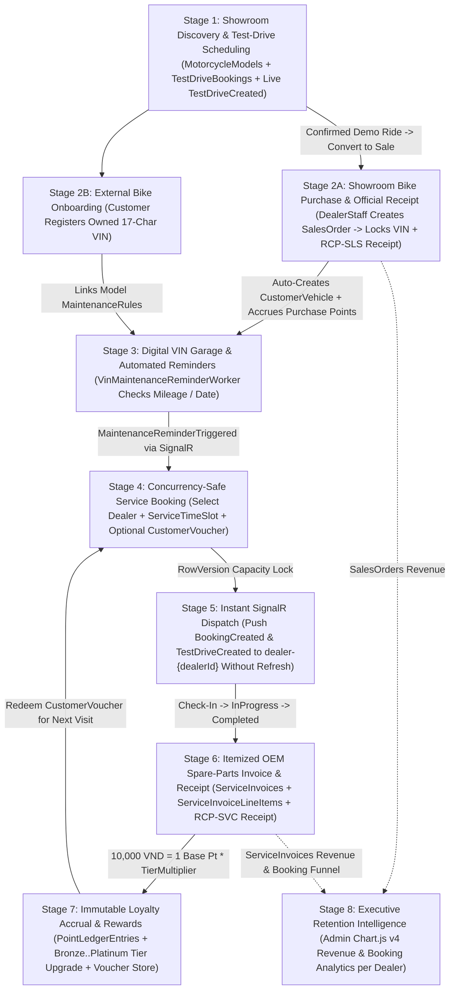

# Product Requirements Document (PRD) — Motorcycle Dealer & Loyalty Management Platform

| Metadata | Details |
| :--- | :--- |
| **Document ID** | `PRD-MDLMP-2026-V1.3` |
| **Version** | `1.3.0` (Phase 10 Feature Expansion — Native C# `.NET 10 MAUI` Android Field App) |
| **Project Name** | Motorcycle Dealer & Loyalty Management Platform |
| **Repository** | [https://github.com/quocanhh86/motorcycle-dealer](https://github.com/quocanhh86/motorcycle-dealer) |
| **Role & Team Size** | Full-Stack Developer — `1 (Solo project)` |
| **Project Timeline** | `02/2026 - 08/2026` |
| **Implementation Status** | **Phases 1–9 Delivered & Phase 10 (`v1.3.0`) Active (`88` WBS Tasks across `10` Phases)** |
| **Related Artifacts** | [REQUIREMENTS.md](../REQUIREMENTS.md) · [AGENTS.md](../AGENTS.md) · [ARCHITECTURE.md](./ARCHITECTURE.md) · [DATABASE_DESIGN.md](./DATABASE_DESIGN.md) · [DESIGN.md](./DESIGN.md) · [MOBILE_MAUI_SCREENS.md](./screens/MOBILE_MAUI_SCREENS.md) · [BD_00_BASIC_DESIGN_MASTER.md](./basic-design/BD_00_BASIC_DESIGN_MASTER.md) · [RELEASE_NOTES_v1.1.0.md](./RELEASE_NOTES_v1.1.0.md) · [RELEASE_NOTES_v1.2.0.md](./RELEASE_NOTES_v1.2.0.md) · [RELEASE_NOTES_v1.3.0.md](./RELEASE_NOTES_v1.3.0.md) · [TASKS.md](../TASKS.md) · [PROGRESS.md](../PROGRESS.md) · [Master Word Specification (.docx)](./Motorcycle_Dealer_Loyalty_Platform_Specification.docx) |

---

## 1. Executive Summary

The **Motorcycle Dealer & Loyalty Management Platform** is an enterprise, multi-dealer retail, showroom test-drive scheduling, workshop service booking, Vehicle Identification Number (`VIN`) lifecycle tracking, itemized OEM spare-parts invoicing, post-service 5-star CSAT review feedback, 36-month / 30,000-km VIN warranty claims management, and customer loyalty web platform engineered for regional motorcycle dealership networks. Built as a decoupled **AngularJS 1.8.3** Single-Page Application (`SPA`, `30` navigable UI-Router routes across `26` primary screens and `4` aliases) backed by **C# / ASP.NET Core Web API (`.NET 10`, `18` C# Controllers / `100+` HTTP bindings)** in 4-layer Clean Architecture, **Entity Framework Core 10**, **SignalR** (`10` strongly-typed real-time events), and **Microsoft SQL Server** (`MotorcycleDealerDb`, **`27` normalized 3NF tables**), the platform unifies showroom vehicle discovery, test rides, sales, post-sale workshop retention, and warranty quality assurance into a single closed-loop digital ecosystem.

In traditional motorcycle retail networks, customer engagement fragments immediately after showroom visits or handover: prospective riders lack online test-drive scheduling, buyers lose paper maintenance booklets, dealerships manage workshop bays on spreadsheets prone to peak-hour double-booking, service advisors miss incoming online bookings without manually refreshing screens, workshop bills lack itemized OEM spare-part traceability or verifiable tax/loyalty receipts, post-service satisfaction goes unmeasured, warranty claims are tracked on disconnected spreadsheets, and loyalty programs fail to connect initial vehicle purchases with recurring workshop maintenance. This platform eliminates those operational silos across three governed user roles (**`48` canonical RBAC permissions**: `Customer = 20`, `DealerStaff = 22`, `Admin = 32`)—**Customer** (`Customer`), **Dealer Staff** (`DealerStaff`, isolated to a single assigned `DealerId`), and **Admin** (`Admin`, cross-dealer oversight).

Prospective buyers schedule concurrency-safe showroom `TestDriveBookings` (`<= 2` active slots per model/dealer window) that push instant `TestDriveCreated` alerts to branch advisors. When a customer purchases a motorcycle from a branch's `DealerInventories` (`SalesOrders`), the 17-character `VIN` is automatically onboarded into their digital garage (`CustomerVehicles`), bound to model-specific `MaintenanceRules`, credited with spending-based loyalty points in an immutable ledger (`PointLedgerEntries`), and issued an official SHA-256 printable receipt (`RCP-SLS-*`). A background worker (`VinMaintenanceReminderWorker`) continuously evaluates mileage and time intervals to dispatch deduplicated `MaintenanceReminders`. Customers book workshop `ServiceTimeSlots` protected by SQL Server `RowVersion` optimistic concurrency while **SignalR** (`/hubs/notifications`) pushes instant alerts (`BookingCreated`, `TestDriveCreated`) to branch staff without page refresh. Upon workshop completion (`ServiceInvoices` + append-only `ServiceInvoiceLineItems` from the master OEM `SpareParts` catalog), redeemed `CustomerVouchers` are settled, net spending accrues tiered points (`Bronze` through `Platinum`), printable `@media print` receipts (`RCP-SVC-*`) are generated, and headquarters executives monitor cross-dealer sales and service performance through interactive **Chart.js v4** dashboards.

### 1.1 Requirement Traceability to Baseline Scope

To maintain strict traceability between the executive portfolio specification ([REQUIREMENTS.md](../REQUIREMENTS.md)) and the delivered `v1.2.0` platform, the five core portfolio pillars plus the Phase 8 (`v1.1.0`) and Phase 9 (`v1.2.0`) expansions map directly to nine functional requirement domains (`FR-01`–`FR-09`):

| Baseline Pillar ([REQUIREMENTS.md](../REQUIREMENTS.md)) | Closed-Loop PRD Requirement ID(s) | Core Architectural & Data Anchor | Delivery Phase |
| :--- | :--- | :--- | :--- |
| **Role-Based Access** (`Customer`, `Dealer Staff`, `Admin` with route guards & granular permissions) | `FR-01`: Role-Based Access Control & Granular Permissions (`48` Policies: `20 / 22 / 32`) | AngularJS UI-Router guards (`30` routes) + `[HasPermission]` policies + `IDealerScoped` filter (`ADR-002`, `ADR-006`) | Phase 4, 8 & 9 |
| **Service Booking System** (Book by dealer & available time slot + automated reminders per vehicle `VIN` & maintenance schedule) | `FR-02`: Showroom Catalog, VIN Inventory & Bike Sales `FR-03`: Customer VIN Garage & Maintenance Tracking `FR-04`: Service Booking & Automated VIN Reminders | `DealerInventories`, `SalesOrders`, `CustomerVehicles`, `MaintenanceRules`, `MaintenanceReminders`, `ServiceTimeSlots`, `ServiceBookings`, `VinMaintenanceReminderWorker` (`ADR-005`) | Phase 5 |
| **Loyalty & Rewards Engine** (Points from spending, membership tiers, voucher redemption) | `FR-05`: Loyalty & Rewards Engine | `LoyaltyTiers`, `LoyaltyAccounts`, append-only `PointLedgerEntries`, `VoucherCatalogs`, `CustomerVouchers`, `ServiceInvoices` (`ADR-003`) | Phase 6 |
| **Real-Time Notifications** (SignalR instant new booking alerts for dealer staff without page refresh) | `FR-06`: Real-Time Notifications (`SignalR` — `10` Events) | `/hubs/notifications` (`NotificationHub`), `dealer-{dealerId}` & `user-{userId}` groups, `Notifications` table (`ADR-004`) | Phase 6, 8 & 9 |
| **Admin Analytics Dashboard** (Revenue & booking statistics per dealer visualized with `Chart.js`) | `FR-07`: Admin Multi-Dealer Analytics Dashboard | `/api/v1/admin/analytics/*` covering projections + `Chart.js v4` visualizations & UTF-8 BOM CSV (`ADR-001`, `ADR-006`) | Phase 7 & 9 |
| **v1.1.0 Commercial & Workshop Expansion** (Test-Drive Scheduling, OEM Spare-Parts Itemized Invoicing & Printable Official Receipts) | `FR-08`: Showroom Test-Drive Scheduling, OEM Spare-Parts Itemized Invoicing & Printable Official Receipts | `TestDriveBookings` (`RowVersion`, `IDealerScoped`), `SpareParts`, immutable `ServiceInvoiceLineItems`, SHA-256 `/receipt` endpoints & `<printable-receipt-modal>` (`ADR-001`..`006`) | Phase 8 (`v1.1.0`) |
| **v1.2.0 Post-Sale Quality & Warranty Expansion** (Post-Service 5-Star CSAT Reviews with `+25` Bonus Loyalty Points & 36-Month / 30,000-km VIN Warranty Claims) | `FR-09`: Post-Service 5-Star CSAT Reviews (`+25` Bonus `AvailablePoints`) & VIN Warranty Claims | `ServiceReviews` (`RowVersion`, `IDealerScoped`, `UQ_ServiceReviews_ServiceInvoiceId`), `WarrantyClaims` (`RowVersion`, `IDealerScoped`), `SERVICE_REVIEW:{InvoiceId}:BONUS`, `ServiceReviewSubmitted`, `WarrantyClaimCreated`, `WarrantyClaimStatusChanged` | Phase 9 (`v1.2.0`) |
| **v1.3.0 Native Android Field Mobility** (`.NET 10 MAUI` 2-Role Super-App, Encrypted `SQLCipher` Offline Cache & Camera2 VIN/QR Scanning) | `FR-10`: Native Android Field Mobile Application (`.NET 10 MAUI`, 2-Role Field Scope, Offline `SQLCipher` Cache & Camera2 VIN/QR) | `mobile/MotorcycleDealer.Mobile.sln` (`Mobile.Core` `net10.0` + `Mobile.App` `net10.0-android`), `16` compiled `x:DataType` screens, `9`-table `SQLCipher` WAL cache, `SingleFlightTokenRefreshHandler`, `ZXing.Net.Maui` Camera2 scanner & `10`-event SignalR (`ADR-007`) | Phase 10 (`v1.3.0`) |

---

## 2. Problem Statement

Regional motorcycle dealership groups operate across multiple urban branches (e.g., Hanoi, Da Nang, Ho Chi Minh City), combining high-ticket showroom vehicle sales with recurring, high-margin workshop maintenance. Without an integrated platform, three systemic problems erode customer retention, workshop utilization, and financial governance:

1. **Broken Post-Sale Ownership & Missed Maintenance Milestones (Customer Pain)**:
   - After purchasing a motorcycle or riding an existing commuter bike, owners rely on physical warranty booklets to remember periodic service intervals (e.g., initial `1,000 km` break-in inspection, `4,000 km` oil service, `12,000 km` belt/valve overhaul, or `6-month` time intervals).
   - Booking a workshop visit requires phone calls without visibility into live bay availability across nearby dealerships, and loyalty rewards earned on showroom purchases cannot be seamlessly tracked or redeemed as workshop service vouchers.
2. **Slot Overbooking, Browser Polling Friction & Cross-Branch Confusion (Dealer Staff Pain)**:
   - Service advisors coordinating busy workshop bays suffer peak-hour double-bookings when multiple customers request the same morning time window concurrently.
   - Without WebSocket push notifications, staff must repeatedly reload management tables to notice newly submitted appointments, delaying customer confirmation and bay preparation.
   - Without strict single-dealer data scoping, staff risk viewing or modifying inventory, time slots, or invoices belonging to another dealership branch.
3. **Opaque Multi-Dealer Performance & Unaudited Loyalty Liability (Enterprise / Admin Pain)**:
   - Network administrators lack a unified, real-time executive view comparing showroom sales revenue (`SalesOrders`) against workshop service revenue (`ServiceInvoices`) and appointment conversion funnels per dealership.
   - Mutable "points balance" columns in naive loyalty databases invite race conditions, duplicate credit on network retries, and irreconcilable point discrepancies during promotional campaigns.

---

## 3. Business Objectives & Key Performance Indicators (KPIs)

| Objective ID | Business Objective | Quantitative KPI / Success Metric | Data Source & Verification Mechanism | Target Threshold |
| :--- | :--- | :--- | :--- | :--- |
| **BO-01** | **Eliminate Workshop & Test-Drive Overbooking** | Concurrent booking over-allocation rate (`BookedCount > MaxCapacity`, Test-Drives `> 2` per window) | `ServiceTimeSlots` & `TestDriveBookings` (`RowVersion` + ACID transactions) + parallel integration tests | **`0` double-bookings** (`100%` capacity enforcement) |
| **BO-02** | **Zero-Refresh Real-Time Staff Responsiveness** | End-to-end latency from `POST /api/v1/bookings` or `POST /api/v1/test-drives` commit to `DealerStaff` live queue DOM update | SignalR `/hubs/notifications` `BookingCreated` & `TestDriveCreated` push to `dealer-{dealerId}` | **`< 500 ms` P95** with **`0` manual page reloads** |
| **BO-03** | **Closed-Loop VIN Onboarding & Proactive Retention** | Percentage of showroom `SalesOrders` automatically provisioned into `CustomerVehicles` with active `MaintenanceRules`, plus duplicate reminder rate | `SalesOrders` -> `CustomerVehicles` transaction + `MaintenanceReminders.DeduplicationKey` | **`100%` auto-onboarding**; **`0%` duplicate reminders** |
| **BO-04** | **Financial-Grade Loyalty, Itemized Invoice & Receipt Integrity** | Ledger reconciliation drift (`LoyaltyAccounts.AvailablePoints` vs. `SUM(PointLedgerEntries.PointsDelta)`) & itemized invoice drift (`SUM(LineTotalVnd)` vs. `GrossAmount`) | SQL Server audit query + `IdempotencyKey` uniqueness + `ServiceInvoiceLineItems` + SHA-256 `ReceiptVerificationHash` | **`0` point or invoice discrepancy** (`100%` parity) |
| **BO-05** | **Actionable Multi-Dealer Executive Visibility** | Query & render latency for cross-dealer Revenue (Sales + Service) and Booking `Chart.js` visualizations | `/api/v1/admin/analytics/*` backed by composite covering indexes | **`< 300 ms` P95** API aggregation across 12-month dataset |
| **BO-06** | **Strict Multi-Branch Tenant Isolation** | Unauthorized cross-role or cross-dealer API/UI access rate | AngularJS UI-Router guards + `[HasPermission]` + EF Core `IDealerScoped` query filters | **`100%` blocked** (`401`/`403`/`404` deterministic rejection) |

---

## 4. User Personas & Role Boundaries

The platform enforces **exactly three canonical roles**. Every authenticated user holds role claims and granular permission claims (`Permissions.<Module>.<Action>`); `DealerStaff` accounts additionally carry a mandatory `DealerId` claim binding all reads and writes to their assigned branch.

### 4.1 Persona 1 — Minh Nguyen (`Customer`)

| Attribute | Profile Specification |
| :--- | :--- |
| **Canonical Role Code** | `Customer` (Customer Portal — `app.customer.*`) |
| **Demographics & Context** | 29-year-old software engineer in Ho Chi Minh City; recently purchased a new sport commuter motorcycle from an authorized dealer and also owns a 2-year-old scooter bought previously outside the network. |
| **Primary Goals** | Browse showroom models, branch stock, and book showroom test drives; view owned motorcycles by `VIN` in one digital garage; receive timely mileage/date service alerts; book guaranteed Saturday morning workshop slots online; earn points from bike purchases and itemized maintenance invoices; redeem points for service discount vouchers; print official SHA-256 verified tax & loyalty receipts (`RCP-SLS-*` / `RCP-SVC-*`). |
| **Key Frustrations** | Waiting on hold to check dealer test-drive or service slot availability; forgetting oil-change intervals; losing paper discount coupons or service receipts; not knowing when workshop staff confirm or finish servicing his bike. |
| **Data & Permission Scope** | Strictly restricted to **`16` granted `Customer` permissions** covering public catalog/dealer/slot endpoints (`Permissions.Showroom.View`, `Permissions.Dealers.ViewPublic`, `Permissions.TimeSlots.ViewAvailable`, `Permissions.Notifications.ViewOwn`) and self-owned records (`ViewOwn`, `RegisterOwn`, `Bookings.Create`, `Bookings.CancelOwn`, `TestDrives.Create`, `TestDrives.CancelOwn`, `TestDrives.ViewOwn`, `Loyalty.RedeemVoucher`) where `CustomerId == currentUser.Id`. |

### 4.2 Persona 2 — Lan Tran (`DealerStaff` / Dealer Staff)

| Attribute | Profile Specification |
| :--- | :--- |
| **Canonical Role Code** | `DealerStaff` (displayed in UI as **Dealer Staff** — `app.staff.*`) |
| **Demographics & Context** | 32-year-old Senior Service Advisor & Showroom Coordinator at the **Saigon District 1 Flagship Dealership** (`DealerId` bound to a single dealership). Keeps the dealer workbench open on a desktop monitor throughout an 8-hour shift. |
| **Primary Goals** | Manage branch `DealerInventories` (`VIN` stock), daily `ServiceTimeSlots`, and showroom `TestDriveBookings`; complete showroom `SalesOrders` that instantly register the buyer's `VIN`; see new online `ServiceBookings` and `TestDriveBookings` appear live on screen with visual toast alerts **without refreshing the page**; assign demo `VIN`s and convert completed test rides into bike sales; issue itemized `ServiceInvoices` using model-compatible OEM `SpareParts` and print official customer receipts upon completion. |
| **Key Frustrations** | Missing urgent same-day service or test-drive bookings because a static table wasn't refreshed; two staff members selling the same `VIN` unit or overbooking a workshop bay; manually pricing OEM parts, tier multipliers, and voucher caps at checkout. |
| **Data & Permission Scope** | Scoped strictly to **one assigned `DealerId`** (**`18` granted `DealerStaff` permissions**) via EF Core Global Query Filters (`IDealerScoped` across all `6` dealer-owned tables) and server-side command validation (`ViewDealer`, `ManageDealer`, `SalesOrders.Create`, `Bookings.UpdateStatus`, `TestDrives.ViewDealer`, `TestDrives.UpdateStatus`, `Invoices.CreateDealer`, `Loyalty.ViewDealerCustomer`). Subscribes automatically to SignalR group `dealer-{dealerId}`. Cannot access other dealers' records or `Admin` configuration/analytics. |

### 4.3 Persona 3 — Quoc Anh Hoang (`Admin`)

| Attribute | Profile Specification |
| :--- | :--- |
| **Canonical Role Code** | `Admin` (Network Administration & Analytics Portal — `app.admin.*`) |
| **Demographics & Context** | 38-year-old Regional Operations & Digital Transformation Director overseeing all authorized dealerships across Hanoi, Da Nang, and Ho Chi Minh City. |
| **Primary Goals** | Onboard and govern `Dealers` and `DealerStaff` accounts; curate the master `MotorcycleModels` catalog, OEM `SpareParts` SKUs, and standard `MaintenanceRules`; calibrate `LoyaltyTiers` (`Bronze`, `Silver`, `Gold`, `Platinum`), `VoucherCatalogs`, and audited point adjustments; compare per-dealer showroom vs. service revenue and booking funnel KPIs through interactive `Chart.js v4` visualizations. |
| **Key Frustrations** | Waiting days for branch managers to email consolidated Excel revenue reports; inability to compare workshop booking completion vs. cancellation rates across dealers; unstandardized spare-parts pricing and unverified promotional voucher redemptions. |
| **Data & Permission Scope** | Cross-dealer platform governance (**`28` granted `Admin` permissions**: `Dealers.ManageAll`, `Users.ManageStaff`, `Showroom.ManageModels`, `Vehicles.ManageRules`, `SpareParts.ManageCatalog`, `Loyalty.ManageTiers`, `Loyalty.ManageVoucherCatalog`, `Loyalty.AdjustPoints`, `Analytics.ViewAllDealers`, `Analytics.ExportReports`, plus cross-dealer operational oversight). Subscribes to SignalR group `role-Admin`. |

---

## 5. MECE End-to-End Customer Lifecycle & Journey

The product architecture is organized into **Mutually Exclusive, Collectively Exhaustive (MECE)** lifecycle stages so every entity among the **25 SQL Server 3NF tables** participates in an unbroken value loop:

---

## 6. Detailed Functional Requirements (`FR-01` – `FR-08`)

### 6.1 `FR-01`: Role-Based Access Control (RBAC) & Granular Permissions

- **Priority**: `P0 (Critical)` | **Delivery Phase**: `Phase 4` & `Phase 8 (v1.1.0)`
- **Mapped Tables**: `Users`, `Roles`, `Permissions`, `UserRoles`, `RolePermissions`, `RefreshTokens`, `Dealers`
- **Mapped Endpoints**: `/api/v1/auth/register`, `/api/v1/auth/login`, `/api/v1/auth/refresh`, `/api/v1/auth/logout`, `/api/v1/auth/me`, `/api/v1/dealers/{dealerId}/staff`
- **Canonical Permission Catalog (`40` Permissions — `Customer = 16`, `DealerStaff = 18`, `Admin = 28`)**:
  - **Showroom & Inventory (`4`)**: `Permissions.Showroom.View`, `Permissions.Showroom.ManageModels`, `Permissions.Inventories.ViewDealer`, `Permissions.Inventories.ManageDealer`
  - **Showroom Sales & Test-Drives (`8`)**: `Permissions.SalesOrders.Create`, `Permissions.SalesOrders.ViewOwn`, `Permissions.SalesOrders.ViewDealer`, `Permissions.TestDrives.Create`, `Permissions.TestDrives.CancelOwn`, `Permissions.TestDrives.ViewOwn`, `Permissions.TestDrives.ViewDealer`, `Permissions.TestDrives.UpdateStatus`
  - **Customer Garage & Rules (`4`)**: `Permissions.Vehicles.ViewOwn`, `Permissions.Vehicles.RegisterOwn`, `Permissions.Vehicles.ViewDealer`, `Permissions.Vehicles.ManageRules`
  - **Time Slots & Bookings (`7`)**: `Permissions.TimeSlots.ViewAvailable`, `Permissions.TimeSlots.ManageDealer`, `Permissions.Bookings.Create`, `Permissions.Bookings.CancelOwn`, `Permissions.Bookings.ViewOwn`, `Permissions.Bookings.ViewDealer`, `Permissions.Bookings.UpdateStatus`
  - **Workshop Invoices & OEM Spare Parts (`4`)**: `Permissions.Invoices.CreateDealer`, `Permissions.Invoices.ViewOwn`, `Permissions.Invoices.ViewDealer`, `Permissions.SpareParts.ManageCatalog`
  - **Loyalty & Vouchers (`6`)**: `Permissions.Loyalty.ViewOwn`, `Permissions.Loyalty.RedeemVoucher`, `Permissions.Loyalty.ViewDealerCustomer`, `Permissions.Loyalty.ManageTiers`, `Permissions.Loyalty.ManageVoucherCatalog`, `Permissions.Loyalty.AdjustPoints`
  - **Notifications, Dealers, Staff & Analytics (`7`)**: `Permissions.Notifications.ViewOwn`, `Permissions.Notifications.ViewDealer`, `Permissions.Dealers.ViewPublic`, `Permissions.Dealers.ManageAll`, `Permissions.Users.ManageStaff`, `Permissions.Analytics.ViewAllDealers`, `Permissions.Analytics.ExportReports`

#### User Stories
- **US-01.1 (`Customer`)**: As a `Customer`, I want to register, sign in, and be routed strictly to customer portal views (`app.customer.*`), so that my garage, bookings, and loyalty wallet remain private.
- **US-01.2 (`DealerStaff`)**: As a `DealerStaff` member, I want my session bound to my assigned `DealerId` and role permissions, so that I only view and operate on my branch's inventory, bookings, and invoices.
- **US-01.3 (`Admin`)**: As an `Admin`, I want granular API permission enforcement and staff provisioning controls, so that operational privileges are governed by least-privilege rules across every dealership.

#### Acceptance Criteria (Given / When / Then)
1. **AC-01.1 — AngularJS Client-Side Route Guard Redirection**:
   - **Given** an authenticated user with role `Customer` and no `Admin` or `DealerStaff` claims,
   - **When** the user navigates to an `app.admin.analytics` or `app.staff.workbench` state via URL or state transition,
   - **Then** the AngularJS UI-Router `transitions.onBefore` hook intercepts the navigation before controller instantiation, blocks view rendering, and redirects the user to `app.public.forbidden` (or `app.public.login` if unauthenticated).
2. **AC-01.2 — Granular Back-End Policy Enforcement**:
   - **Given** an authenticated `DealerStaff` JWT carrying `Permissions.Bookings.ViewDealer` but lacking `Permissions.Loyalty.ManageTiers`,
   - **When** the client sends `PUT /api/v1/loyalty/tiers/{id}`,
   - **Then** ASP.NET Core `PermissionAuthorizationHandler` rejects the request with HTTP `403 Forbidden` in `RFC 7807 ProblemDetails` format without executing application logic.
3. **AC-01.3 — Single-Dealer Tenant Isolation (`IDealerScoped`)**:
   - **Given** `DealerStaff` user A assigned to `DealerId = D1` and a `ServiceBooking` belonging to `DealerId = D2`,
   - **When** user A requests `GET /api/v1/bookings/{d2BookingId}` or `PATCH /api/v1/bookings/{d2BookingId}/status`,
   - **Then** EF Core Global Query Filters (`IDealerScoped`) exclude `D2` rows from `D1` queries and the API returns HTTP `404 Not Found` (preventing cross-dealer identifier enumeration).
4. **AC-01.4 — Silent Refresh Token Rotation**:
   - **Given** an expired short-lived JWT access token and a valid, unrevoked `RefreshTokens` token,
   - **When** multiple concurrent AngularJS `$http` requests receive HTTP `401 Unauthorized`,
   - **Then** the client auth interceptor queues the in-flight requests, executes a single `POST /api/v1/auth/refresh` rotation (revoking the old refresh token and issuing a new pair), and replays all queued requests transparently.

---

### 6.2 `FR-02`: Showroom Catalog, VIN Inventory & Bike Sales

- **Priority**: `P0 (Critical)` | **Delivery Phase**: `Phase 5`
- **Mapped Tables**: `Dealers`, `MotorcycleModels`, `DealerInventories`, `SalesOrders`, `CustomerVehicles`, `MaintenanceRules`, `LoyaltyAccounts`, `PointLedgerEntries`
- **Mapped Endpoints**: `/api/v1/dealers`, `/api/v1/motorcycles`, `/api/v1/inventories`, `/api/v1/sales-orders`

#### User Stories
- **US-02.1 (`Customer`)**: As a `Customer`, I want to browse motorcycle models, specifications, MSRP prices, and live showroom stock across dealerships, so that I know which branch has my preferred model in stock.
- **US-02.2 (`DealerStaff`)**: As a `DealerStaff` advisor, I want to stock motorcycles by unique 17-character `VIN` in my branch's `DealerInventories` and complete `SalesOrders` for customers, so that sold bikes automatically populate the buyer's digital garage and award purchase loyalty points.
- **US-02.3 (`Admin`)**: As an `Admin`, I want to manage the master `MotorcycleModels` catalog and default `MaintenanceRules`, so that all branches sell standardized models with consistent maintenance schedules.

#### Business Rules
- Every `DealerInventories` record carries a globally unique 17-character uppercase alphanumeric **ISO 3779 `VIN`** (`VARCHAR(17)`, characters `A-Z` and `0-9` excluding `I`, `O`, `Q`).
- Completing a `SalesOrders` transaction executes inside a single ACID database transaction that:
  1. Verifies `DealerInventories.StockStatus == 'Available'` and `DealerInventories.DealerId == staff.DealerId` under `RowVersion` optimistic concurrency, transitioning inventory status to `'Sold'`.
  2. Persists `SalesOrders` (`TotalAmount`, `DiscountAmount`, `FinalAmount = TotalAmount - DiscountAmount`, `PointsEarned`, `Status = 'Completed'`).
  3. Automatically inserts a `CustomerVehicles` record for `CustomerId` with the sold `VIN`, `PurchasedSalesOrderId`, `CurrentMileageKm = 0`, `LastServiceMileageKm = 0`, and `LastServiceDateUtc = CreatedAtUtc`.
  4. Credits immutable `PointLedgerEntries` calculated from `FinalAmount` (`10,000 VND = 1 base point * TierMultiplier`) and re-evaluates the customer's `LoyaltyTiers` threshold.

#### Acceptance Criteria (Given / When / Then)
1. **AC-02.1 — Atomic Showroom Sale Onboarding & Loyalty Accrual**:
   - **Given** `DealerInventory` unit `VIN = RLHJF5108RY000123` is `'Available'` at `Dealer D1` with `FinalAmount = 45,000,000 VND` and buyer Minh is in `Bronze` tier (`1.0x`, `0` points),
   - **When** `DealerStaff` at `D1` submits `POST /api/v1/sales-orders` for Minh,
   - **Then** the inventory unit becomes `'Sold'`, a `CustomerVehicles` row for `RLHJF5108RY000123` is created in Minh's garage linked to model `MaintenanceRules`, `4,500` loyalty points (`Floor(45,000,000 / 10,000) * 1.0`) are appended to `PointLedgerEntries`, and Minh's `LoyaltyAccounts` automatically upgrades from `Bronze` to `Gold` (`2,000+` threshold).
2. **AC-02.2 — Concurrent Sale Prevention on Identical VIN**:
   - **Given** two `DealerStaff` sessions at `Dealer D1` simultaneously submit `SalesOrders` for the same `'Available'` `DealerInventoryId`,
   - **When** both transactions reach SQL Server,
   - **Then** exactly one `SalesOrders` commit succeeds with HTTP `201 Created` and the second fails `RowVersion` validation with HTTP `409 Conflict` without creating duplicate `CustomerVehicles` or duplicate loyalty points.

---

### 6.3 `FR-03`: Customer VIN Garage & Maintenance Schedule Tracking

- **Priority**: `P0 (Critical)` | **Delivery Phase**: `Phase 5`
- **Mapped Tables**: `CustomerVehicles`, `MotorcycleModels`, `MaintenanceRules`, `MaintenanceReminders`, `ServiceBookings`, `ServiceInvoices`
- **Mapped Endpoints**: `/api/v1/vehicles/my`, `/api/v1/vehicles` (external registration), `/api/v1/vehicles/{id}/mileage`, `/api/v1/vehicles/{id}/maintenance-history`, `/api/v1/motorcycles/{modelId}/maintenance-rules`

#### User Stories
- **US-03.1 (`Customer`)**: As a `Customer`, I want to view all my motorcycles by `VIN`, update current odometer mileage, and inspect completed workshop service history and upcoming maintenance milestones, so that I keep every bike in peak mechanical condition.
- **US-03.2 (`Customer`)**: As a `Customer` who purchased a motorcycle prior to joining the platform or from an external seller, I want to manually register my 17-character `VIN` against a supported `MotorcycleModel`, so that I can still receive automated maintenance reminders and book dealer workshop slots.

#### Business Rules
- `CustomerVehicles.VIN` is globally unique (`UQ_CustomerVehicles_VIN`) and validated against ISO 3779 (`^[A-HJ-NPR-Z0-9]{17}$`).
- External registrations set `PurchasedSalesOrderId = NULL` (no showroom purchase points awarded, while all subsequent `ServiceInvoices` accrue full loyalty points).
- Odometer updates must be monotonically non-decreasing: `NewMileageKm >= CustomerVehicles.CurrentMileageKm`.
- Next due schedule for each rule is derived deterministically:
  - `NextDueMileageKm` = smallest `MaintenanceRules.IntervalKm` milestone greater than `LastServiceMileageKm` (or recurring interval `LastServiceMileageKm + IntervalKm`).
  - `NextDueDateUtc` = `LastServiceDateUtc + IntervalMonths`.

#### Acceptance Criteria (Given / When / Then)
1. **AC-03.1 — External VIN Registration & Schedule Binding**:
   - **Given** an authenticated `Customer` owns an external motorcycle with valid unowned 17-char `VIN = RLHKF4102PY009876`, `CurrentMileageKm = 3,650`, and selects a `MotorcycleModel` that has a `4,000 km / 6-month` `MaintenanceRule`,
   - **When** the customer submits `POST /api/v1/vehicles`,
   - **Then** `CustomerVehicles` is persisted with `PurchasedSalesOrderId = NULL` and the garage view immediately displays the upcoming `4,000 km` milestone (`350 km` remaining).
2. **AC-03.2 — Odometer Rollback Rejection**:
   - **Given** a `CustomerVehicle` has `CurrentMileageKm = 8,200`,
   - **When** the customer submits `PATCH /api/v1/vehicles/{id}/mileage` with `CurrentMileageKm = 7,900`,
   - **Then** the API rejects the request with HTTP `422 Unprocessable Entity` explaining that odometer readings cannot decrease below the recorded `8,200 km`.

---

### 6.4 `FR-04`: Service Booking System & Automated VIN Maintenance Reminders

- **Priority**: `P0 (Critical)` | **Delivery Phase**: `Phase 5`
- **Mapped Tables**: `ServiceTimeSlots`, `ServiceBookings`, `CustomerVehicles`, `MaintenanceRules`, `MaintenanceReminders`, `CustomerVouchers`, `Notifications`
- **Mapped Endpoints**: `/api/v1/time-slots`, `/api/v1/bookings`, `/api/v1/bookings/{id}/cancel`, `/api/v1/bookings/{id}/status` + Hosted `VinMaintenanceReminderWorker`

#### User Stories
- **US-04.1 (`Customer`)**: As a `Customer`, I want to book a maintenance appointment by choosing a preferred `Dealer`, an available `ServiceTimeSlot`, one of my registered `VIN` vehicles, and an optional `CustomerVoucher`, so that a workshop bay is guaranteed upon my arrival.
- **US-04.2 (`Customer`)**: As a `Customer`, I want automated reminders triggered whenever any of my motorcycles approaches or reaches a `VIN` mileage or calendar maintenance milestone, so that I never miss scheduled servicing.
- **US-04.3 (`DealerStaff`)**: As a `DealerStaff` advisor, I want to configure my branch's `ServiceTimeSlots` (`MaxCapacity`) and progress `ServiceBookings` through workshop statuses (`Pending` -> `Confirmed` -> `InProgress` -> `Completed` / `Cancelled` / `NoShow`), so that daily bay capacity stays accurate.

#### Business Rules
- **Slot Capacity & Concurrency**: A `ServiceTimeSlots` window is bookable only when `SlotDate >= CurrentDate`, `BookedCount < MaxCapacity`, and slot start is in the future. Incrementing `BookedCount` (`BookedCount + 1`) checks `ServiceTimeSlots.RowVersion` in SQL Server; cancellation decrements `BookedCount` (`BookedCount - 1`) and releases any `ReservedOnBooking` voucher if unexpired.
- **Active Booking Guard per VIN/Slot**: A customer cannot create two active (`Pending`, `Confirmed`, `InProgress`) bookings for the same `CustomerVehicleId` in overlapping time slots.
- **Automated VIN Reminder Engine (`VinMaintenanceReminderWorker`)**:
  - Runs as an ASP.NET Core `BackgroundService` on a configurable polling interval (e.g., every `15` minutes in production, triggerable on-demand in integration tests).
  - Evaluates active `CustomerVehicles` joined with `MaintenanceRules` where either:
    - **Mileage Threshold**: `CurrentMileageKm >= (TargetMileageKm - LeadWarningKm)` (default `LeadWarningKm = 200 km`), or
    - **Calendar Threshold**: `UtcNow >= (DueDateUtc - LeadWarningDays)` (default `LeadWarningDays = 7 days`).
  - Generates a deterministic `DeduplicationKey = "{VIN}:{MaintenanceRuleId}:{TargetMileageKm}"` guarded by a `UNIQUE` index on `MaintenanceReminders(DeduplicationKey)` so each milestone alerts the owner **at most once**, inserts a `Notifications` record, and broadcasts `MaintenanceReminderTriggered` via SignalR to `user-{userId}`.

#### Acceptance Criteria (Given / When / Then)
1. **AC-04.1 — Optimistic Concurrency Anti-Double-Booking**:
   - **Given** `ServiceTimeSlot S1` at `Dealer D1` (`09:00–10:00`) has `MaxCapacity = 3` and `BookedCount = 2` (1 spot remaining),
   - **When** Customer A and Customer B concurrently submit `POST /api/v1/bookings` targeting `S1`,
   - **Then** the first transaction increments `BookedCount` to `3` and returns HTTP `201 Created`, while the competing transaction encounters a `RowVersion` concurrency conflict and returns HTTP `409 Conflict` instructing the user to pick another available time slot.
2. **AC-04.2 — Automated Deduplicated VIN Maintenance Reminder**:
   - **Given** Minh's `CustomerVehicle` (`VIN = RLHJF5108RY000123`) is updated to `CurrentMileageKm = 900` (`100 km` before the `1,000 km` break-in `MaintenanceRule`, within the `200 km` lead threshold),
   - **When** `VinMaintenanceReminderWorker` executes two consecutive scan cycles,
   - **Then** cycle 1 inserts exactly one `MaintenanceReminders` row (`DeduplicationKey = "RLHJF5108RY000123:{RuleId}:1000"`), persists one `Notifications` entry, and pushes `MaintenanceReminderTriggered` to `user-{minhId}`, while cycle 2 skips the already-recorded `DeduplicationKey` with zero duplicate notifications.
3. **AC-04.3 — Booking Cancellation Releases Slot & Unexpired Voucher**:
   - **Given** a `Pending` `ServiceBooking` holding `1` unit of `ServiceTimeSlot` capacity and a `CustomerVoucher` in `ReservedOnBooking` status whose `ExpiresAtUtc` is in the future,
   - **When** the owning `Customer` invokes `POST /api/v1/bookings/{id}/cancel`,
   - **Then** booking status becomes `Cancelled`, `ServiceTimeSlots.BookedCount` decrements by `1`, and `CustomerVouchers.Status` reverts atomically to `Available`.

---

### 6.5 `FR-05`: Loyalty & Rewards Engine

- **Priority**: `P0 (Critical)` | **Delivery Phase**: `Phase 6`
- **Mapped Tables**: `LoyaltyTiers`, `LoyaltyAccounts`, `PointLedgerEntries`, `VoucherCatalogs`, `CustomerVouchers`, `SalesOrders`, `ServiceInvoices`
- **Mapped Endpoints**: `/api/v1/service-invoices`, `/api/v1/loyalty/account`, `/api/v1/loyalty/ledger`, `/api/v1/loyalty/tiers`, `/api/v1/vouchers/catalog`, `/api/v1/vouchers/redeem`, `/api/v1/vouchers/my`

#### User Stories
- **US-05.1 (`Customer`)**: As a `Customer`, I want every VND I spend on showroom motorcycle purchases and workshop service invoices to automatically earn loyalty points scaled by my membership tier, so that long-term loyalty is transparently rewarded.
- **US-05.2 (`Customer`)**: As a `Customer`, I want to browse active reward vouchers, redeem `AvailablePoints` for `CustomerVouchers`, and apply them to workshop appointments, so that I lower my maintenance costs.
- **US-05.3 (`DealerStaff`)**: As a `DealerStaff` advisor, I want workshop `ServiceInvoices` to automatically apply any reserved voucher discount, update vehicle mileage, accrue net-spending points, and evaluate tier upgrades atomically upon checkout.
- **US-05.4 (`Admin`)**: As an `Admin`, I want to manage `LoyaltyTiers`, curate `VoucherCatalogs` (`PointsCost`, quotas, minimum tier), and perform audited point adjustments with mandatory reason notes.

#### Canonical Loyalty & Tier Rules
- **Base Conversion Formula**:
  - `10,000 VND` of net paid customer spending = `1` base point.
  - `BasePoints = Floor(NetPaidAmount / 10000m)` (using `SalesOrders.FinalAmount` for bike purchases and `ServiceInvoices.NetPaidAmount = GrossAmount - VoucherDiscountAmount` for workshop invoices).
  - `PointsEarned = Floor(BasePoints * TierMultiplier)` (integer points appended to `PointLedgerEntries`).
- **4 Canonical Membership Tiers (`LoyaltyTiers`)**:

| Tier Code | Minimum Qualifying Points (`LifetimeQualifyingPoints`) | Points Multiplier (`PointsMultiplier`) | Representative Member Perks |
| :--- | :---: | :---: | :--- |
| **`Bronze`** | `0` pts | **`1.0x`** (`1.00`) | Standard loyalty accrual (`1 pt / 10,000 VND`) & automated VIN maintenance alerts |
| **`Silver`** | `500` pts | **`1.2x`** (`1.20`) | `20%` bonus point accrual + Silver-tier oil/filter voucher catalog access |
| **`Gold`** | `2,000` pts | **`1.5x`** (`1.50`) | `50%` bonus point accrual + Gold-tier labor discount vouchers |
| **`Platinum`** | `5,000` pts | **`2.0x`** (`2.00`) | `100%` double point accrual + exclusive Platinum full-service reward vouchers |

- **Qualifying vs. Spendable Balance Separation**:
  - Earning points from `SalesOrders` or `ServiceInvoices` increments **both** `AvailablePoints` and `LifetimeQualifyingPoints`.
  - Redeeming a voucher deducts `PointsCost` from `AvailablePoints` via a negative `PointLedgerEntries` row (`PointsDelta = -PointsCost`) **without** reducing `LifetimeQualifyingPoints`, ensuring customers are never demoted in tier for redeeming rewards.
- **Append-Only Ledger Invariant**: `PointLedgerEntries` rows are **never updated or deleted** (`UPDATE`/`DELETE` prohibited). Every balance change records `PointsDelta`, `BalanceAfter`, `ReferenceType`, `ReferenceId`, and a unique `IdempotencyKey`.

#### Acceptance Criteria (Given / When / Then)
1. **AC-05.1 — Workshop Invoice Voucher Settlement, Point Calculation & Tier Upgrade**:
   - **Given** a `Silver` customer (`1.2x` multiplier, `AvailablePoints = 460`, `LifetimeQualifyingPoints = 1,960`) has an `InProgress` `ServiceBooking` with a `ReservedOnBooking` `CustomerVoucher` worth `100,000 VND` off, and workshop gross charges are `LaborAmount = 250,000 VND` + `PartsAmount = 450,000 VND` (`GrossAmount = 700,000 VND`),
   - **When** `DealerStaff` submits `POST /api/v1/service-invoices` with `OdometerAtCompletionKm = 4,120`,
   - **Then** within one atomic SQL Server transaction:
     1. `VoucherDiscountAmount = 100,000 VND` and `NetPaidAmount = 600,000 VND` are persisted on `ServiceInvoices`;
     2. `CustomerVouchers.Status` transitions to `Used`;
     3. `PointsEarned = Floor(Floor(600,000 / 10,000) * 1.2) = Floor(60 * 1.2) = 72` points are appended to `PointLedgerEntries`;
     4. `AvailablePoints` becomes `532` and `LifetimeQualifyingPoints` becomes `2,032`, automatically upgrading `CurrentTierId` from `Silver` to `Gold` (`2,000+` pts) and firing SignalR `LoyaltyPointsUpdated` and `TierUpgraded` events;
     5. `CustomerVehicles.CurrentMileageKm` and `LastServiceMileageKm` update to `4,120 km` and `LastServiceDateUtc` updates to invoice timestamp.
2. **AC-05.2 — Voucher Redemption Validation & Atomic Point Deduction**:
   - **Given** an active `VoucherCatalogs` item costing `300` points with `QuotaTotal = 100`, `QuotaRedeemed = 42`, and `MinTier = Silver`,
   - **When** a `Silver` customer with `AvailablePoints = 350` calls `POST /api/v1/vouchers/redeem`,
   - **Then** `PointLedgerEntries` records `PointsDelta = -300` (`BalanceAfter = 50`), `LoyaltyAccounts.AvailablePoints` updates to `50`, `QuotaRedeemed` increments to `43`, and a unique `CustomerVouchers` code (`Status = 'Available'`, `ExpiresAtUtc = UtcNow + ValidDays`) is returned.
3. **AC-05.3 — Insufficient Points or Tier Guard on Redemption**:
   - **Given** a `Bronze` customer (`AvailablePoints = 400`) attempts to redeem a `Silver`-minimum voucher costing `300` points (or any customer with `AvailablePoints = 200` attempts a `300`-point voucher),
   - **When** `POST /api/v1/vouchers/redeem` is invoked,
   - **Then** the API returns HTTP `422 Unprocessable Entity` and neither `PointLedgerEntries` nor `CustomerVouchers` is modified.

---

### 6.6 `FR-06`: Real-Time Notifications (`SignalR`)

- **Priority**: `P0 (Critical)` | **Delivery Phase**: `Phase 6` & `Phase 8 (v1.1.0)`
- **Mapped Tables**: `Notifications`, `ServiceBookings`, `TestDriveBookings`, `MaintenanceReminders`, `LoyaltyAccounts`
- **Mapped Endpoints & Hub**: `/hubs/notifications` (`NotificationHub` / `INotificationClient`), `/api/v1/notifications`, `/api/v1/notifications/{id}/read`, `/api/v1/notifications/read-all`

#### User Stories
- **US-06.1 (`DealerStaff`)**: As a `DealerStaff` advisor monitoring the branch workbench, I want new customer workshop booking and showroom test-drive alerts to appear on my screen **instantly without page refresh**, so that I can confirm appointments and prepare workshop bays or demo motorcycles immediately.
- **US-06.2 (`Customer`)**: As a `Customer`, I want live in-app notifications and persistent unread badges whenever my workshop booking or test-drive status changes, a `VIN` maintenance reminder triggers, or my loyalty points/tier upgrades, so that I stay informed in real time and catch up on missed events when logging in later.

#### SignalR Hub Contract (`/hubs/notifications`)
- **Group Routing on Connection**:
  - `user-{userId}`: Joined automatically by every authenticated user (`Customer`, `DealerStaff`, `Admin`).
  - `dealer-{dealerId}`: Joined automatically by `DealerStaff` using the server-verified JWT `dealer_id` claim (never client-supplied parameters, preventing cross-dealer eavesdropping).
  - `role-Admin`: Joined automatically by `Admin` users.
- **Canonical Server-to-Client Events (`INotificationClient` — `10` Events)**:
  1. `BookingCreated`: Pushed to `dealer-{dealerId}` and `role-Admin` immediately after `ServiceBookings` commit.
  2. `BookingStatusChanged`: Pushed to `user-{customerId}` and `dealer-{dealerId}` whenever `DealerStaff` updates booking status or customer cancels.
  3. `MaintenanceReminderTriggered`: Pushed to `user-{customerId}` by `VinMaintenanceReminderWorker`.
  4. `LoyaltyPointsUpdated`: Pushed to `user-{customerId}` on `SalesOrders` / `ServiceInvoices` point accrual, `+25` `ServiceReviewBonus` credit, voucher redemption, or admin adjustment.
  5. `TierUpgraded`: Pushed to `user-{customerId}` whenever `CurrentTierId` advances to a higher `LoyaltyTiers` rank.
  6. `TestDriveCreated` (`v1.1.0`): Pushed to `dealer-{dealerId}` and `role-Admin` immediately after `TestDriveBookings` commit.
  7. `TestDriveStatusChanged` (`v1.1.0`): Pushed to `user-{customerId}` and `dealer-{dealerId}` whenever `DealerStaff` confirms (with optional demo `VIN`), completes, or marks `NoShow`/`Cancelled`, or when the customer cancels.
  8. `ServiceReviewSubmitted` (`v1.2.0`): Pushed to `dealer-{dealerId}` and `role-Admin` immediately after a customer submits a 5-star post-service CSAT `ServiceReview`.
  9. `WarrantyClaimCreated` (`v1.2.0`): Pushed to `dealer-{dealerId}` and `role-Admin` immediately after a customer files a `WarrantyClaim` on an owned `CustomerVehicle`.
  10. `WarrantyClaimStatusChanged` (`v1.2.0`): Pushed to `user-{customerId}` and `dealer-{dealerId}` whenever `DealerStaff` or `Admin` updates warranty claim adjudication (`UnderReview`, `Approved`, `Rejected`, `Completed`).

#### Acceptance Criteria (Given / When / Then)
1. **AC-06.1 — Instant Staff Booking Alert Without Page Refresh**:
   - **Given** `DealerStaff` Lan is logged into `app.staff.workbench` for `Dealer D1` with an active WebSocket connection to `/hubs/notifications` (enrolled in `dealer-{D1}`),
   - **When** `Customer` Minh submits `POST /api/v1/bookings` for `Dealer D1`,
   - **Then** Lan's AngularJS SPA receives `BookingCreated` over WebSockets within `< 500 ms`, prepends the new booking card into the live workbench list via `$rootScope.$applyAsync`, increments the unread notification badge, and displays a toast banner **with zero browser page refresh or manual polling**.
2. **AC-06.2 — Cross-Dealer SignalR Isolation**:
   - **Given** `DealerStaff` at `Dealer D1` and `DealerStaff` at `Dealer D2` both have open `/hubs/notifications` connections,
   - **When** a customer creates a booking at `Dealer D1`,
   - **Then** only `dealer-{D1}` receives `BookingCreated`; `dealer-{D2}` receives zero WebSocket frames for `D1`'s booking.
3. **AC-06.3 — Durable Notification Persistence & Reconnect Catch-Up**:
   - **Given** a `Customer` or `DealerStaff` user is offline when an event fires,
   - **When** the user later signs in or reconnects after a transient network drop,
   - **Then** the persisted unread row in `Notifications` is retrieved via `GET /api/v1/notifications?unreadOnly=true` so zero operational alerts are lost.

---

### 6.7 `FR-07`: Admin Analytics Dashboard (`Chart.js`)

- **Priority**: `P0 (Critical)` | **Delivery Phase**: `Phase 7`
- **Mapped Tables**: `Dealers`, `SalesOrders`, `ServiceInvoices`, `ServiceBookings`, `LoyaltyAccounts`, `LoyaltyTiers`
- **Mapped Endpoints**: `/api/v1/admin/analytics/overview`, `/api/v1/admin/analytics/revenue-by-dealer`, `/api/v1/admin/analytics/bookings-by-dealer`, `/api/v1/admin/analytics/monthly-trends`, `/api/v1/admin/analytics/loyalty-distribution`, `/api/v1/admin/analytics/export`

#### User Stories
- **US-07.1 (`Admin`)**: As an `Admin`, I want an interactive analytics dashboard displaying revenue statistics per dealer (broken down by Showroom Bike Sales vs. Workshop Service Invoices) and booking statistics per dealer visualized with `Chart.js`, so that I can evaluate branch profitability and workshop utilization at a glance.
- **US-07.2 (`Admin`)**: As an `Admin`, I want to filter dashboard metrics by date range (`fromUtc`, `toUtc`) and export tabular dealer summaries to CSV, so that monthly executive reviews are backed by auditable SQL Server aggregations.

#### Required `Chart.js` Visualizations & Metrics
1. **KPI Executive Summary Strip**: Total Network Revenue (`SalesOrders.FinalAmount + ServiceInvoices.NetPaidAmount`), Total Bikes Sold, Total Service Bookings, Workshop Completion Rate (`%`), and Active Loyalty Members.
2. **Chart 1 — Revenue per Dealer (`Chart.js` Stacked / Grouped Bar Chart)**: Compares `Showroom Sales Revenue` (`SUM(SalesOrders.FinalAmount)`) and `Workshop Service Revenue` (`SUM(ServiceInvoices.NetPaidAmount)`) side-by-side across every `Dealer`.
3. **Chart 2 — Bookings per Dealer & Status Breakdown (`Chart.js` Grouped Bar / Doughnut Chart)**: Displays total appointments, `Completed`, `Pending`/`Confirmed`, and `Cancelled`/`NoShow` counts per `Dealer`.
4. **Chart 3 — Monthly Revenue & Booking Velocity (`Chart.js` Dual-Axis Multi-Line Chart)**: Tracks month-over-month revenue (`VND`) and booking volume trends across the selected time window.
5. **Chart 4 — Loyalty Membership Tier Distribution (`Chart.js` Doughnut Chart)**: Visualizes customer population across `Bronze`, `Silver`, `Gold`, and `Platinum`.

#### Acceptance Criteria (Given / When / Then)
1. **AC-07.1 — Accurate Per-Dealer Revenue & Booking Aggregation in `Chart.js`**:
   - **Given** finalized `SalesOrders`, `ServiceInvoices`, and `ServiceBookings` across Hanoi (`D1`), Da Nang (`D2`), and Ho Chi Minh City (`D3`) dealers within date window `[fromUtc, toUtc]`,
   - **When** an `Admin` opens `app.admin.analytics` or updates the date-range picker,
   - **Then** the AngularJS dashboard fetches `/api/v1/admin/analytics/*` and updates all `Chart.js` canvas instances cleanly (destroying or mutating datasets without duplicate canvas listener leaks) with totals matching exact SQL Server `Completed`/`Paid` ledger sums; cancelled bookings and draft/void orders are excluded from realized revenue.
2. **AC-07.2 — Role Protection on Analytics Endpoints**:
   - **Given** a `Customer` or `DealerStaff` user,
   - **When** they call `GET /api/v1/admin/analytics/revenue-by-dealer`,
   - **Then** the endpoint returns HTTP `403 Forbidden`.

---

### 6.8 `FR-08`: Showroom Test-Drive Scheduling, OEM Spare-Parts Itemized Invoicing & Printable Official Receipts (`v1.1.0`)

- **Priority**: `P0 (Critical — Phase 8 Commercial Expansion)` | **Delivery Phase**: `Phase 8 (v1.1.0)`
- **Mapped Tables**: `TestDriveBookings` (`Table 23`, `IDealerScoped`, `RowVersion`), `SpareParts` (`Table 24`, `ISoftDeletable`), `ServiceInvoiceLineItems` (`Table 25`, `IImmutableFinancialEntity`), `SalesOrders`, `ServiceInvoices`, `DealerInventories`, `Notifications`
- **Mapped Endpoints**: `/api/v1/test-drives`, `/api/v1/test-drives/my`, `/api/v1/test-drives/{testDriveId}`, `/api/v1/test-drives/{testDriveId}/cancel`, `/api/v1/test-drives/{testDriveId}/status`, `/api/v1/spare-parts`, `/api/v1/spare-parts/{partId}`, `/api/v1/service-invoices/{invoiceId}/receipt`, `/api/v1/sales-orders/{orderId}/receipt`

#### User Stories
- **US-08.1 (`Customer`)**: As a `Customer` browsing the showroom, I want to click `[Book Test Drive]` on any active `MotorcycleModel`, pick a preferred dealership and time window, and see live confirmation and assigned demo `VIN` updates without refreshing, so that I can test-ride a motorcycle before purchasing.
- **US-08.2 (`DealerStaff`)**: As a `DealerStaff` showroom coordinator, I want incoming `TestDriveBookings` to appear instantly on `/staff/test-drives` via SignalR `TestDriveCreated`, assign an `Available` demo `VIN` under `RowVersion` protection, and convert a `Completed` test drive directly into a Showroom `SalesOrder` with one click.
- **US-08.3 (`DealerStaff` & `Admin`)**: As an `Admin`, I want to curate a master OEM `SpareParts` catalog (`PartCode`, category, model fitment or universal fit, `UnitPriceVnd`), and as `DealerStaff`, I want to pick compatible OEM spare parts and labor line items inside `SCR-STF-02` so `ServiceInvoices` persist immutable itemized `ServiceInvoiceLineItems` whose sum equals `GrossAmount`.
- **US-08.4 (`Customer` & `DealerStaff`)**: As a `Customer` or `DealerStaff` advisor, I want to open and print clean A4/thermal official Dealership Tax & Loyalty Receipts (`RCP-SLS-*` and `RCP-SVC-*`) carrying a deterministic SHA-256 `VerificationCode` via `<printable-receipt-modal>`.

#### Business Rules
- **Test-Drive Window Capacity & Overlap Guard**: Each `(DealerId, MotorcycleModelId, PreferredDate, StartTime)` window permits at most **`2` active (`Requested` or `Confirmed`) `TestDriveBookings`** inside an ACID `CreateExecutionStrategy()` transaction (`409 TEST_DRIVE_SLOT_FULL` on contention), and blocks overlapping active test drives for the same customer (`409 TEST_DRIVE_OVERLAP`).
- **Seamless Demo-to-Sale Progression**: If a demo `DealerInventories` unit assigned during `Confirmed` is subsequently sold via `POST /api/v1/sales-orders` (`StockStatus = 'Sold'`), `PATCH /api/v1/test-drives/{id}/status` cleanly transitions `Confirmed -> Completed` while preserving the historical `AssignedInventoryId` audit reference.
- **Itemized OEM Spare-Parts Compatibility & Immutability**: When `POST /api/v1/service-invoices` includes `LineItems`, every referenced `SparePart` must be active (`422 SPARE_PART_INACTIVE` otherwise) and either universal (`CompatibleModelId == NULL`) or matched to the booked vehicle's `MotorcycleModelId` (`422 SPARE_PART_INCOMPATIBLE`). `ServiceInvoiceLineItems` snapshots `PartCodeSnapshot`, `Description`, `Quantity`, `UnitPriceVnd`, and `LineTotalVnd` as an immutable financial record (`SUM(Part lines) == PartsAmount`, `SUM(Labor lines) == LaborAmount`, `PartsAmount + LaborAmount == GrossAmount`), while keeping legacy summary-only payloads 100% backward-compatible.
- **SHA-256 Printable Receipt Verification**: `GET /api/v1/service-invoices/{id}/receipt` and `GET /api/v1/sales-orders/{id}/receipt` enforce strict `Customer` ownership (`403 FORBIDDEN_RESOURCE_OWNER`) and `DealerStaff` `IDealerScoped` branch isolation (`404`), returning a deterministic 16-character uppercase hex SHA-256 `VerificationCode` (`ReceiptVerificationHash`).

#### Acceptance Criteria (Given / When / Then)
1. **AC-08.1 — Concurrency-Safe Test-Drive Slot Cap & Zero-Refresh SignalR Dispatch**:
   - **Given** a dealership/model test-drive window (`10:00–10:45`) has a maximum active cap of `2` riders and `6` authenticated `Customer` sessions submit `POST /api/v1/test-drives` simultaneously,
   - **When** all `6` transactions execute against SQL Server,
   - **Then** at most `2` requests succeed with HTTP `201 Created` (`TD-YYYYMMDD-XXXXXX`), the remaining `4` fail deterministically with HTTP `409 Conflict` (`TEST_DRIVE_SLOT_FULL`), and connected `DealerStaff` on `app.staff.testDrives` (`dealer-{dealerId}`) receive `TestDriveCreated` cards live with zero page reloads.
2. **AC-08.2 — Demo VIN Assignment & Post-Sale Completion Continuity**:
   - **Given** `DealerStaff` confirms a `Requested` test drive (`PATCH /api/v1/test-drives/{id}/status` with `RowVersion`), assigning an `Available` branch demo `VIN` (`TestDriveStatusChanged` pushed to `user-{customerId}`), and the customer then purchases that exact `VIN` via `POST /api/v1/sales-orders`,
   - **When** `DealerStaff` marks the test drive `Completed`,
   - **Then** the transition succeeds (`200 OK`) preserving `AssignedInventoryId` and `AssignedVin` for historical showroom attribution.
3. **AC-08.3 — OEM Spare-Parts Compatibility Validation & Immutable Line-Item Reconciliation**:
   - **Given** an `InProgress` `ServiceBooking` for a **Honda SH160i** (`Model A`) and an OEM `SparePart` restricted exclusively to **Yamaha Exciter 155** (`Model B`),
   - **When** `DealerStaff` attempts `POST /api/v1/service-invoices` including `Model B`'s part,
   - **Then** the API rejects the request with HTTP `422 Unprocessable Entity` (`SPARE_PART_INCOMPATIBLE`); when settled with compatible/universal `SpareParts` and labor lines, `ServiceInvoiceLineItems` are persisted immutably (`UPDATE`/`DELETE` blocked by `AppendOnlyLedgerInterceptor`) with `SUM(LineTotalVnd) == GrossAmount`.
4. **AC-08.4 — Printable Official Receipt Tenant Isolation & SHA-256 Seal**:
   - **Given** a finalized `ServiceInvoice` (`INV-*`) or `SalesOrder` (`SO-*`) at `Dealer D1` owned by `Customer A`,
   - **When** `Customer A` or `D1` `DealerStaff` requests `GET /api/v1/{service-invoices|sales-orders}/{id}/receipt`,
   - **Then** the API returns `200 OK` with `RCP-SVC-*` / `RCP-SLS-*` and deterministic 16-char SHA-256 `verificationCode`, whereas `Customer B` receives `403 FORBIDDEN_RESOURCE_OWNER` and `Dealer D2` `DealerStaff` receives `404 Not Found`.
5. **AC-08.5 — Clean `@media print` Receipt Modal Layout**:
   - **Given** a user opens `<printable-receipt-modal>` from `SCR-STF-02`, `SCR-STF-03`, `SCR-CUS-04`, or `SCR-CUS-05` and clicks `[Print Official Receipt]`,
   - **When** `$window.print()` invokes the browser `@media print` stylesheet,
   - **Then** `.top-navbar`, `.role-sidebar`, `.breadcrumb-bar`, and `.toast-stack` are hidden while the itemized tax & loyalty receipt renders cleanly on A4/thermal paper.

---

### 6.9 `FR-09`: Post-Service 5-Star CSAT Reviews (`+25` Bonus `AvailablePoints`) & 36-Month / 30,000-km VIN Warranty Claims (`v1.2.0`)

- **Priority**: `P0 (Critical — Phase 9 Quality & Warranty Expansion)` | **Delivery Phase**: `Phase 9 (v1.2.0)`
- **Mapped Tables**: `ServiceReviews` (`Table 26`, `IDealerScoped`, `RowVersion`), `WarrantyClaims` (`Table 27`, `IDealerScoped`, `RowVersion`), `ServiceInvoices`, `PointLedgerEntries`, `LoyaltyAccounts`, `CustomerVehicles`, `MotorcycleModels`, `SpareParts`, `Notifications`
- **Mapped Endpoints**: `/api/v1/service-reviews`, `/api/v1/service-reviews/my`, `/api/v1/service-reviews/by-invoice/{invoiceId}`, `/api/v1/service-reviews/{reviewId}/response`, `/api/v1/warranty-claims`, `/api/v1/warranty-claims/my`, `/api/v1/warranty-claims/{claimId}`, `/api/v1/warranty-claims/{claimId}/status`, `/api/v1/admin/analytics/quality-warranty`

#### User Stories
- **US-09.1 (`Customer`)**: As a `Customer` who paid a finalized workshop `ServiceInvoice`, I want to submit a 1-to-5 star post-service CSAT review (`OverallRating`, `TechnicianQualityRating`, `AdvisorHospitalityRating`, `WouldRecommend`, `Comment`) once per invoice and immediately earn **`+25` flat bonus spendable loyalty points (`AvailablePoints`)**, so my feedback is rewarded and heard by the branch.
- **US-09.2 (`Customer`)**: As a `Customer` owning a motorcycle in `CustomerVehicles` within its factory warranty window (`<= 36 months` and `<= 30,000 km`), I want to submit a `WarrantyClaim` (`DefectCategory`, `SymptomDescription`, `MileageAtClaimKm`) and track adjudication in real time via SignalR `WarrantyClaimStatusChanged`.
- **US-09.3 (`DealerStaff`)**: As a `DealerStaff` quality coordinator, I want incoming `ServiceReviewSubmitted` and `WarrantyClaimCreated` events to appear live on `/staff/warranty-reviews` (`SCR-STF-07`) with zero page reloads, post official branch responses to customer reviews (`RowVersion` guarded), and adjudicate branch warranty claims (`Submitted -> UnderReview -> Approved | Rejected -> Completed`) with optional compatible OEM `CoveredSparePartId` and `ApprovedCoveredAmountVnd`.
- **US-09.4 (`Admin`)**: As an `Admin`, I want an interactive **CSAT & Warranty Quality Dashboard** (`/admin/quality-warranty`, `SCR-ADM-08`) with `Chart.js v4` visualizations comparing per-dealer `AverageCsatRating`, recommendation rates, warranty claim defect categories, and `ApprovedWarrantyCoveredVnd`.

#### Business Rules
- **1:1 Invoice CSAT Review & `+25` Spendable Bonus Invariant**:
  - Only the owning `Customer` (`ServiceInvoice.CustomerId == currentUser.UserId`, else `403 FORBIDDEN_RESOURCE_OWNER`) may submit `POST /api/v1/service-reviews` for a settled `ServiceInvoice` (`Status == 'Paid'`), strictly at most once per invoice (`UQ_ServiceReviews_ServiceInvoiceId` -> `409 REVIEW_ALREADY_SUBMITTED` on duplicate/race).
  - Within a single ACID transaction, submitting a `ServiceReview` (`REV-YYYYMMDD-XXXXXX`) appends an immutable `PointLedgerEntries` row (`TransactionType = 'ServiceReviewBonus'`, `PointsDelta = +25`, `ReferenceType = 'ServiceReview'`, `IdempotencyKey = $"SERVICE_REVIEW:{ServiceInvoiceId}:BONUS"`) that credits **`LoyaltyAccounts.AvailablePoints += 25` ONLY** while keeping **`LifetimeQualifyingPoints` strictly unchanged** (engagement bonuses never inflate spending-based tier progression).
- **Factory Warranty Window & Active Duplicate Claim Guard**:
  - `POST /api/v1/warranty-claims` verifies vehicle ownership (`403 FORBIDDEN_RESOURCE_OWNER`), monotonic mileage (`MileageAtClaimKm >= CurrentMileageKm`, else `422 ODOMETER_REGRESSION`), factory warranty eligibility against `MotorcycleModels.WarrantyMonths` (`36` months from `OwnershipStartDateUtc`) and `WarrantyMileageKm` (`30,000` km) (`422 WARRANTY_COVERAGE_EXPIRED` when exceeded), and blocks duplicate active claims (`Submitted`/`UnderReview`/`Approved`) for the same `(CustomerVehicleId, DefectCategory)` (`409 ACTIVE_WARRANTY_CLAIM_EXISTS`).
  - When `DealerStaff`/`Admin` transitions a claim via `PATCH /api/v1/warranty-claims/{claimId}/status` (`RowVersion` guarded), any `CoveredSparePartId` must be active and universal or matched to the vehicle's `MotorcycleModelId` (`422 SPARE_PART_INCOMPATIBLE`).

#### Acceptance Criteria (Given / When / Then)
1. **AC-09.1 — Concurrency-Safe 1:1 Service Review & `+25` Spendable Bonus Credit**:
   - **Given** `Customer` Minh has a settled `ServiceInvoice` (`INV-*`) and `6` concurrent `POST /api/v1/service-reviews` requests fire simultaneously for that `ServiceInvoiceId`,
   - **When** SQL Server executes all `6` transactions,
   - **Then** exact `1` succeeds (`201 Created`, `BonusPointsAwarded = 25`), `5` fail with `409 REVIEW_ALREADY_SUBMITTED`, `LoyaltyAccounts.AvailablePoints` increases by `+25` (`PointLedgerEntries` `SERVICE_REVIEW:{InvoiceId}:BONUS`) while `LifetimeQualifyingPoints` remains unchanged, and `ServiceReviewSubmitted` + `LoyaltyPointsUpdated` dispatch post-commit.
2. **AC-09.2 — Warranty Coverage Enforcement & Zero-Refresh SignalR Lifecycle**:
   - **Given** an owned `CustomerVehicle` within `<= 36 months` and `<= 30,000 km`,
   - **When** the customer submits `POST /api/v1/warranty-claims`,
   - **Then** `WC-YYYYMMDD-XXXXXX` commits (`201 Created`), `DealerStaff` on `SCR-STF-07` (`dealer-{dealerId}`) receives `WarrantyClaimCreated` with zero page refresh, and vehicles exceeding `WarrantyMonths` or `WarrantyMileageKm` are rejected with `422 WARRANTY_COVERAGE_EXPIRED`.

---

### 6.10 `FR-10`: Native Android Field Mobile Application (`.NET 10 MAUI`, 2-Role Field Scope, Offline `SQLCipher` Cache & Camera2 VIN/QR) (`v1.3.0`)

- **Priority**: `P0 (Critical — Phase 10 Native Field Mobility Expansion)` | **Delivery Phase**: `Phase 10 (v1.3.0)`
- **Mapped Server Contracts**: Reuses `100%` of the existing `27`-table SQL Server schema, `18` REST controllers (`/api/v1/*`), `48` RBAC permissions (`Mobile.Core/Contracts/Permissions.cs`), and `10`-event `/hubs/notifications` SignalR Hub with **zero breaking backend migrations**.
- **Mapped On-Device Tables (`9` Encrypted `SQLCipher` WAL Tables)**: `CacheSyncState`, `CachedDealer`, `CachedMotorcycleModel`, `CachedCustomerVehicle`, `CachedLoyaltyWallet`, `CachedCustomerVoucher`, `CachedActiveAppointment`, `CachedReceiptSnapshot`, `OfflineMutationQueueItem`.
- **Mapped Mobile Screens (`16` Compiled `x:DataType` Views)**: `SCR-MOB-PUB-01..04`, `SCR-MOB-CUS-01..06`, `SCR-MOB-STF-01..06` + modal `CameraBarcodeScannerPage` ([MOBILE_MAUI_SCREENS.md](./screens/MOBILE_MAUI_SCREENS.md)).

#### User Stories
- **US-10.1 (`Customer`)**: As a `Customer` visiting a basement workshop bay with weak cellular signal, I want to view my metallic Loyalty Passbook, present offline QR codes for my redeemed `CustomerVouchers`, `ServiceBookings`, and `RCP-*` receipts, scan my motorcycle's 17-character chassis `VIN` using the Android camera, update my odometer offline, and receive native Android notifications when my service status or loyalty tier changes.
- **US-10.2 (`DealerStaff`)**: As a `DealerStaff` showroom advisor or service bay technician, I want a native Android field workbench (`AppShell` 5-tab bar) to scan customer Booking/Voucher QRs and 17-char VIN stickers via Camera2, swipe bookings to `CheckedIn`/`InProgress`, assemble itemized OEM `SpareParts` invoices with live two-step floor point previews, receive instant SignalR `BookingCreated`/`TestDriveCreated`/`WarrantyClaimCreated` alerts as Android `NotificationChannel` banners, and sign out of my mobile device without terminating my desktop Web SPA session.
- **US-10.3 (`Admin`)**: As an `Admin`, if I sign in on the Android field app, I want a clear `AdminWebConsoleNoticePage` directing me to the AngularJS Web HQ dashboard so complex multi-dealer `Chart.js` analytics and master catalog administration stay on desktop browsers.

#### Business Rules
- **2-Role Field Scope & 48-Permission Parity**: `MobileRoleGuard` routes `Public` (`3` tabs), `Customer` (`20` permissions, `5` tabs + bell), `DealerStaff` (`22` permissions strictly `DealerId`-scoped, `5` tabs + pushed Invoice Builder + bell), and `Admin` (`AdminWebConsoleNoticePage`).
- **Single-Flight `401` Refresh & Device-Safe Multi-Device Logout**: `SingleFlightTokenRefreshHandler` uses a singleton `SemaphoreSlim(1, 1)` double-check to collapse concurrent `401` responses into a single `/api/v1/auth/refresh` rotation; `LogoutCoordinator` defaults to `LogoutRequest { RefreshToken, RevokeAllDevices = false }` so desktop Web SPA sessions remain signed in, while wiping Android Keystore `SecureStorage` and all user/dealer-scoped `SQLCipher` tables (`OwnerScopeKey`).
- **Strict `ADR-003`/`ADR-005` Online-Only Boundary**: `OfflineOutboxSyncService` MUST reject offline queueing of `SalesOrders`, `ServiceInvoices`, `ServiceInvoiceLineItems`, `PointLedgerEntries`, `RowVersion` slot/test-drive reservations, and voucher redemptions. Only `NotificationRead`, `NotificationReadAll`, `VehicleMileageUpdate`, `ServiceReviewSubmit`, and `WarrantyClaimSubmit` are eligible for FIFO offline queueing (dropped cleanly on `409`/`422`).
- **Android Security Hardening**: `AndroidManifest.xml` MUST set `android:allowBackup="false"` with zero global cleartext traffic; `network_security_config.xml` enforces `<base-config cleartextTrafficPermitted="false" />` and restricts cleartext exclusively to `10.0.2.2`, `localhost`, and `127.0.0.1`.

#### Acceptance Criteria (Given / When / Then)
1. **AC-10.1 — Single-Flight Refresh & Device-Scoped Logout**:
   - **Given** an expired mobile access token and `10` concurrent API requests returning `401 Unauthorized`,
   - **When** `SingleFlightTokenRefreshHandler` intercepts all `10` responses,
   - **Then** exact `1` `POST /api/v1/auth/refresh` rotation executes, all `10` buffered requests replay with the new Bearer token, and calling `SignOut` sends `RevokeAllDevices = false`, wiping Android Keystore + user-scoped `SQLCipher` rows while preserving public `CachedDealer`/`CachedMotorcycleModel` tables and keeping the Web SPA session active.
2. **AC-10.2 — Encrypted `SQLCipher` Isolation & Online-Only Financial Guard**:
   - **Given** an authenticated `Customer` or `DealerStaff` session caching offline receipts and vouchers in `MobileOfflineDb`,
   - **When** opening the `.db3` file with an incorrect passphrase or attempting to enqueue a `SalesOrder`/`ServiceInvoice`/`RowVersion` slot reservation into `OfflineOutboxSyncService`,
   - **Then** `SQLCipher` rejects the wrong key (`SQLiteException`) and `OfflineOutboxSyncService` throws an `OnlineOnlyViolation` rejection without persisting prohibited mutations.
3. **AC-10.3 — Camera2 VIN/QR Deep-Link Parsing & Offline Vector QR Display**:
   - **Given** a customer's offline `CachedCustomerVoucher` (`dealer://voucher/v1?code=...&id=...&rv=...`) or 17-character ISO 3779 VIN barcode,
   - **When** displayed via `QrCodeDisplayView` with zero connectivity or scanned via `CameraBarcodeScannerPage` (or its emulator manual fallback),
   - **Then** `QrCodeMatrixEncoder` renders a scannable ISO/IEC 18004 QR code offline and `DealerQrPayloadParser` routes the scanned voucher/booking/VIN directly into the target field ViewModel.
4. **AC-10.4 — Native `10`-Event SignalR Lifecycle & Live `Pixel_8_API_35` Execution**:
   - **Given** `vn.motorcycledealer.mobile` running live on WHPX `Pixel_8_API_35` (`adb reverse tcp:5080 tcp:5080`),
   - **When** navigating Showroom -> Customer Loyalty Wallet QR -> DealerStaff Bay Workbench and toggling `Window.Stopped`/`Window.Resumed`,
   - **Then** live seeded data renders with `0` `AndroidRuntime:E` crashes, SignalR pauses/resumes cleanly with `sinceUtc` delta catch-up, and `AndroidLocalNotificationService` dispatches alerts across `BookingAlerts`, `LoyaltyRewards`, and `WarrantyUpdates` channels.

---

## 7. Edge Cases, Failure Modes & Error Scenarios

| ID | Scenario / Edge Case | Expected Deterministic System Behavior | HTTP / Protocol Outcome |
| :--- | :--- | :--- | :--- |
| **EC-01** | **Last-Slot Booking Race**: Two customers submit a booking for a `ServiceTimeSlot` with `MaxCapacity - BookedCount == 1` at the same millisecond. | EF Core checks `ServiceTimeSlots.RowVersion` during `UPDATE`. First transaction commits; second catches `DbUpdateConcurrencyException`, rolls back, and returns actionable conflict payload. | `409 Conflict` (`ProblemDetails`) |
| **EC-02** | **Duplicate Showroom VIN Sale**: Two `DealerStaff` users try to sell the same `DealerInventories` unit simultaneously. | `DealerInventories.RowVersion` and `StockStatus == 'Available'` predicate reject the second writer before `SalesOrders` or `CustomerVehicles` rows are created. | `409 Conflict` (`ProblemDetails`) |
| **EC-03** | **Duplicate or Malformed VIN Input**: User registers a `VIN` with `16` chars, lowercase/illegal letters (`I`, `O`, `Q`), or a `VIN` already owned in `CustomerVehicles`. | FluentValidation rejects invalid ISO 3779 syntax (`400`); unique constraint `UQ_CustomerVehicles_VIN` blocks duplicate ownership (`409`). | `400 Bad Request` / `409 Conflict` |
| **EC-04** | **Odometer Rollback**: Customer or staff enters mileage lower than `CustomerVehicles.CurrentMileageKm`. | Domain invariant rejects decreasing odometer reading to protect `MaintenanceRules` calculations. | `422 Unprocessable Entity` |
| **EC-05** | **Voucher Discount Exceeds Workshop Invoice**: Customer applies a `200,000 VND` fixed voucher to a `150,000 VND` oil-change `GrossAmount`. | `VoucherDiscountAmount` is capped at `MIN(CalculatedDiscount, MaxDiscountAmount, GrossAmount)` (`150,000 VND`), yielding `NetPaidAmount = 0.00 VND` and `0` points earned (never negative). | `201 Created` (`NetPaidAmount = 0`) |
| **EC-06** | **Booking Cancelled After Voucher Expiry Date**: Customer cancels a booking whose attached `ReservedOnBooking` voucher passed `ExpiresAtUtc` while held. | Booking cancellation checks `UtcNow < CustomerVoucher.ExpiresAtUtc`: if still valid, restores status to `Available`; if past `ExpiresAtUtc`, transitions status directly to `Expired`. | `200 OK` |
| **EC-07** | **Double Submit / Network Retry on Invoice or Redemption**: Client retries `POST /api/v1/service-invoices` or `POST /api/v1/vouchers/redeem` after timeout. | `IdempotencyKey` unique index on `PointLedgerEntries` and `1:1` unique index `UQ_ServiceInvoices_ServiceBookingId` prevent duplicate invoices, duplicate point credits, or double point deductions. | `200 OK` (idempotent replay) or `409 Conflict` |
| **EC-08** | **Reminder Worker Restart Mid-Scan**: `VinMaintenanceReminderWorker` crashes or restarts halfway through scanning `CustomerVehicles`. | Each reminder commits per vehicle milestone with unique `DeduplicationKey`; subsequent scan resumes unprocessed milestones and skips already-recorded keys cleanly. | Zero duplicate reminders |
| **EC-09** | **SignalR WebSocket Drop on Staff Workbench**: Dealership Wi-Fi blips for `20` seconds while bookings arrive. | `@microsoft/signalr` `.withAutomaticReconnect([0, 2000, 5000, 10000, 30000])` reconnects, re-authenticates JWT, rejoins `dealer-{dealerId}`, and triggers background sync of unread `Notifications` and active bookings. | Seamless live queue recovery |
| **EC-10** | **Cross-Dealer Forged Payload**: `DealerStaff` at `D1` sends `DealerId = D2` inside a JSON request body. | Server **ignores** any client-supplied `DealerId` for `DealerStaff` and enforces the authenticated JWT `dealer_id` claim + `IDealerScoped` query filter. | `403 Forbidden` / `404 Not Found` |
| **EC-11** | **Voucher Catalog Quota Exhaustion**: Two customers simultaneously redeem the final remaining unit (`QuotaRedeemed == QuotaTotal - 1`) of a limited promo voucher. | Atomic conditional SQL increment (`WHERE QuotaRedeemed < QuotaTotal`) allows one redemption and rejects the second without deducting points. | `409 Conflict` (`ProblemDetails`) |
| **EC-12** | **AngularJS View Destroy with Active Charts/Listeners**: Admin switches rapidly between routes while `Chart.js` instances and SignalR `$rootScope` listeners are active. | Every controller registers `$onDestroy` to call `chart.destroy()` and deregister SignalR event handlers, preventing memory and digest leaks. | Zero memory/digest leak |
| **EC-13** | **Parallel Showroom Test-Drive Contention or Customer Overlap**: Three riders request the same `(DealerId, MotorcycleModelId, PreferredDate, StartTime)` window (`cap = 2`), or one rider double-books overlapping windows. | ACID transaction rejects the 3rd concurrent request (`TEST_DRIVE_SLOT_FULL`) and rejects overlapping customer windows (`TEST_DRIVE_OVERLAP`). | `409 Conflict` (`ProblemDetails`) |
| **EC-14** | **Incompatible or Inactive OEM Spare Part on Workshop Invoice**: Advisor submits a `ServiceInvoice` containing a deactivated `SparePart` or a SKU restricted to another `MotorcycleModelId`. | Server validates `SpareParts.IsActive` and `CompatibleModelId` against the booked vehicle's `MotorcycleModelId`, aborting transaction cleanly. | `422 Unprocessable Entity` (`ProblemDetails`) |
| **EC-15** | **Parallel Duplicate Post-Service CSAT Review Submission**: Customer double-clicks `[Submit Review]` on a paid `ServiceInvoice` to farm `+25` bonus points. | `UQ_ServiceReviews_ServiceInvoiceId` + `UQ_PointLedgerEntries_IdempotencyKey` (`SERVICE_REVIEW:{InvoiceId}:BONUS`) allow exact `1` review and `+25` `AvailablePoints` grant, rejecting duplicates cleanly. | `409 Conflict` (`REVIEW_ALREADY_SUBMITTED`) |
| **EC-16** | **Expired Factory Warranty or Duplicate Active Claim**: Customer files a `WarrantyClaim` on a vehicle older than `36` months / `> 30,000 km` or with an already open claim in the same `DefectCategory`. | Domain checks `OwnershipStartDateUtc + WarrantyMonths` and `MileageAtClaimKm <= WarrantyMileageKm` (`422 WARRANTY_COVERAGE_EXPIRED`) and rejects duplicate open claims (`409 ACTIVE_WARRANTY_CLAIM_EXISTS`). | `422 Unprocessable Entity` / `409 Conflict` |
| **EC-17** | **Mobile Offline Financial or Slot-Booking Attempt (`v1.3.0`)**: Customer or DealerStaff attempts to finalize a `SalesOrder`, `ServiceInvoice`, `ServiceBooking`, or voucher redemption while device connectivity is offline. | `OfflineOutboxSyncService` enforces strict `ADR-003`/`ADR-005` online-only rules, rejecting queueing and presenting an actionable connectivity banner while keeping offline QR passbook & `CachedReceiptSnapshot` readable. | Local `OnlineOnlyViolation` guard (zero stale writes) |
| **EC-18** | **Mobile Account Lockout or Multi-Device Logout (`v1.3.0`)**: Admin locks a mobile user mid-session, or user signs out on Android while logged into the AngularJS Web SPA. | `403 ACCOUNT_LOCKED`/`STAFF_DEALER_UNASSIGNED` invokes `ForceSignOutAsync()` wiping Keystore + user `SQLCipher` rows; normal mobile logout posts `RevokeAllDevices = false` so the Web SPA `TokenFamilyId` stays active. | `403 Forbidden` force wipe / `200 OK` isolated logout |

---

## 8. Explicit Non-Goals (Out of Scope)

To preserve architectural focus and solo-project engineering quality within the `02/2026 - 08/2026` timeline, the following items are **explicitly out of scope**:

1. **Online Payment Gateway / PCI Card Processing**: Showroom bike sales (`SalesOrders`) and workshop bills (`ServiceInvoices`) are settled physically at the dealership counter/POS (cash, bank transfer, POS terminal) and recorded as finalized financial documents with printable SHA-256 receipts (`RCP-SLS-*`, `RCP-SVC-*`) in the platform.
2. **iOS App Store Distribution & Admin Mobile Console**: Phase 10 (`v1.3.0`) delivers the native **C# `.NET 10 MAUI` Android Field App** (`net10.0-android`, API `26`–`35`) for `Public Showroom`, `Customer`, and `DealerStaff` field workflows, whereas `Admin` executive analytics/catalog management remains exclusively on the **AngularJS 1.8.3 Web HQ SPA** and Apple iOS provisioning/App Store distribution stays out of scope.
3. **OEM Factory Manufacturing & Multi-Warehouse Bin Replenishment ERP**: While `v1.1.0`–`v1.2.0` deliver a governed master OEM `SpareParts` catalog, immutable itemized `ServiceInvoiceLineItems`, and dealership `WarrantyClaims` adjudication, physical factory manufacturing, supplier purchase orders, and warehouse bin-location stock counting remain out of scope.
4. **Multi-Currency Foreign Exchange**: All monetary values are standardized in Vietnamese Dong (`VND`) stored as `DECIMAL(18,2)`.
5. **Peer-to-Peer Used Motorcycle Marketplace**: Customers can register externally acquired motorcycles in their `VIN` garage for maintenance and loyalty accrual, but consumer-to-consumer classified listings are excluded.
6. **Hard Deletion or Mutation of Financial / Loyalty History**: Finalized `SalesOrders`, `ServiceInvoices`, `ServiceInvoiceLineItems`, and `PointLedgerEntries` are immutable audit records; adjustments occur strictly via compensating entries.

---

## 9. Non-Functional Requirements (NFRs)

### 9.1 Security & Access Control (`NFR-SEC`)
- **Authentication**: Stateless JWT Bearer access tokens (`15-minute` expiry) paired with cryptographically random, SHA-256 hashed `RefreshTokens` (`7-day` expiry) supporting rotation, token-family revocation on reuse detection, and immediate lockout enforcement via `ActivePrincipalMiddleware`.
- **Password Storage**: Passwords hashed via adaptive work-factor hashing (`PBKDF2-HMAC-SHA512`, `210,000` iterations, constant-time comparison) — plaintext or reversible encryption is strictly forbidden.
- **Authorization Defense-in-Depth**: Dual-layer enforcement combining AngularJS UI-Router guards (`$transitions.onBefore` across `30` navigable routes) for UX and ASP.NET Core `[HasPermission("Permissions.<Module>.<Action>")]` policy handlers (`48` canonical permissions) + `IDealerScoped` EF Core Global Query Filters (`8` dealer-scoped tables) for authoritative server-side security.
- **Transport & Secrets Hygiene**: HTTPS enforcement in staging/production, strict CORS origin allowlisting (required for credentialed SignalR WebSockets), fixed-window auth rate limiting (`429 RATE_LIMIT_EXCEEDED`), parameterized EF Core LINQ queries (`0` raw string-concatenated SQL), and zero credentials committed to Git.

### 9.2 Concurrency & Transactional Consistency (`NFR-CON`)
- **Optimistic Concurrency (`RowVersion`)**: Mandatory SQL Server `ROWVERSION` columns mapped as concurrency tokens on all `8` high-contention operational tables: `ServiceTimeSlots`, `DealerInventories`, `LoyaltyAccounts`, `CustomerVouchers`, `ServiceBookings`, `TestDriveBookings`, `ServiceReviews`, and `WarrantyClaims`.
- **ACID Multi-Entity Boundaries**: Multi-table domain workflows (`SalesOrders` -> `CustomerVehicles` -> `PointLedgerEntries`; `ServiceBookings` -> `ServiceTimeSlots` -> `CustomerVouchers`; `ServiceInvoices` -> `ServiceInvoiceLineItems` -> `CustomerVouchers` -> `PointLedgerEntries` -> `LoyaltyAccounts`; `ServiceReviews` -> `PointLedgerEntries` -> `LoyaltyAccounts`; `TestDriveBookings` & `WarrantyClaims`) execute inside explicit `CreateExecutionStrategy()` + `BeginTransactionAsync()` SQL Server transactions.

### 9.3 Idempotency & Background Resilience (`NFR-IDEM`)
- **Ledger Idempotency**: `PointLedgerEntries.IdempotencyKey` (`UNIQUE`) guarantees exactly-once point mutation per source business event (`SALES_ORDER:{Id}:EARN`, `SERVICE_INVOICE:{Id}:EARN`, `SERVICE_REVIEW:{InvoiceId}:BONUS`, `VOUCHER_REDEEM:{CustomerVoucherId}:SPEND`).
- **Reminder Idempotency**: `MaintenanceReminders.DeduplicationKey` (`UNIQUE`) guarantees at-most-once alert dispatch per `{VIN}:{MaintenanceRuleId}:{TargetMileageKm}` milestone across worker restarts.

### 9.4 Performance & Scalability (`NFR-PERF`)
- **API Response Targets**: `< 200 ms` P95 for transactional CRUD endpoints and `< 300 ms` P95 for cross-dealer `Admin` analytics queries over `100,000+` bookings/invoices using composite covering indexes and `AsNoTracking()` projections.
- **Real-Time Push Latency**: `< 500 ms` P95 server-to-browser SignalR frame delivery for `BookingCreated`, `TestDriveCreated`, `ServiceReviewSubmitted`, and `WarrantyClaimCreated` under `100` concurrent connected dealer workbenches.
- **Bounded Queries**: All collection endpoints enforce server-side pagination (`pageNumber >= 1`, `pageSize` default `20`, max `100`).

### 9.5 Auditability, Precision & Observability (`NFR-AUD`)
- **Temporal & Monetary Precision**: Every timestamp across all **27** 3NF tables uses `DATETIMEOFFSET(7)` normalized to `UTC`; every monetary column uses `DECIMAL(18,2)`.
- **Immutable Audit Trail**: `PointLedgerEntries` is strictly append-only (`LoyaltyAccounts.AvailablePoints == SUM(PointLedgerEntries.PointsDelta)`), `ServiceInvoiceLineItems` reconciles 100% with `ServiceInvoices.GrossAmount`, and official receipts carry deterministic SHA-256 verification hashes.
- **Standardized Diagnostics**: All API errors conform to `RFC 7807 ProblemDetails` with correlation `traceId`, structured `ILogger` request logging, and `/health` + `/api/v1/health` readiness probes verifying SQL Server connectivity.
