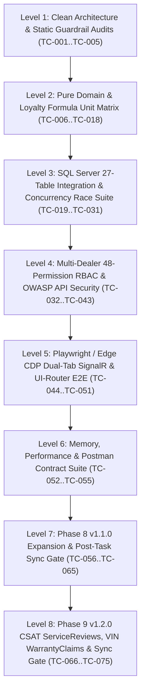

# Master QA & Verification Test Specification (`TC-001`..`TC-075`)

| Metadata | Canonical Value |
| :--- | :--- |
| **Document ID** | `QA-SPEC-001-V1.3` |
| **Project** | Motorcycle Dealer & Loyalty Management Platform ([GitHub Repository](https://github.com/quocanhh86/motorcycle-dealer)) |
| **Author / Role** | Full-Stack Developer (`Solo Project`, `02/2026 - 08/2026`) |
| **Test Case Inventory** | **`85` Canonical Verification Cases (`TC-001`..`TC-085`)** spanning Backend `727 / 727` xUnit (`645` Unit + `82` SQL Server LocalDB Integration), AngularJS `64 / 64` SPA Checks, `10 / 10` `SMK-01..SMK-10`, `30 / 30` Edge CDP Routes, plus Phase 10 (`v1.3.0`) **`MotorcycleDealer.Mobile.UnitTests` (`91+` pure `net10.0` xUnit)**, **`7 / 7` `verify-mobile-maui.mjs`**, and **Live WHPX `Pixel_8_API_35` Android Emulator Smoke** |
| **Target Frameworks** | `xUnit`, `WebApplicationFactory<Program>`, SQL Server `(localdb)\MSSQLLocalDB` / `2022` Docker (`27` 3NF Tables), `.NET 10 MAUI` Android (`net10.0-android` + WHPX `Pixel_8_API_35` ADB / `uiautomator`), `Playwright` / Headless Edge CDP, `Chrome DevTools`, `Postman MCP` |
| **Risk Coverage** | `100%` of Pre-Mortem Risks (`RISK-01`..`RISK-06` in [PROGRESS.md](../PROGRESS.md)) + Post-Task Governance Sync (`verify-post-task-sync.mjs`) |
| **Companion Specifications** | [REQUIREMENTS.md](../REQUIREMENTS.md) · [PRD.md](./PRD.md) · [ARCHITECTURE.md](./ARCHITECTURE.md) · [DATABASE_DESIGN.md](./DATABASE_DESIGN.md) · [DESIGN.md](./DESIGN.md) · [MOBILE_MAUI_SCREENS.md](./screens/MOBILE_MAUI_SCREENS.md) · [openapi.v1.yaml](./openapi.v1.yaml) · [RUNBOOK.md](./RUNBOOK.md) · [RELEASE_NOTES_v1.1.0.md](./RELEASE_NOTES_v1.1.0.md) · [RELEASE_NOTES_v1.2.0.md](./RELEASE_NOTES_v1.2.0.md) · [RELEASE_NOTES_v1.3.0.md](./RELEASE_NOTES_v1.3.0.md) · [TASKS.md](../TASKS.md) |

---

## 1. Verification Strategy & 8-Level Test Pyramid

Every phase exit gate in [TASKS.md](../TASKS.md) (`T-208`, `T-306`, `T-409`, `T-510`, `T-609`, `T-704`..`T-706`, `T-807`..`T-808`, `T-907`..`T-908`) executes deterministic tests against **real runtime boundaries**—never substituting EF Core's `InMemory` provider for relational SQL Server constraints (`ROWVERSION`, `UNIQUE` filtered indexes, `CHECK` expressions, and `TR_PointLedgerEntries_BlockMutation` triggers).



### 1.1 Pre-Mortem Risk-to-Test Traceability (`RISK-01`..`RISK-06`)

| Risk ID | Failure Mode ([PROGRESS.md](../PROGRESS.md)) | Neutralizing Test Cases | Target WBS Gates |
| :--- | :--- | :--- | :--- |
| **`RISK-01`** | Phase-gate boundary violation, scope/docs drift, or Clean Architecture outward dependency leak | `TC-001`, `TC-002`, `TC-003`, `TC-005`, `TC-065` | `T-208`, `T-306`, `T-808` |
| **`RISK-02`** | `ServiceTimeSlots` or `TestDriveBookings` capacity over-booking under parallel customer contention | `TC-016`, `TC-021`, `TC-025`, `TC-049`, `TC-056`, `TC-057` | `T-402`, `T-506`, `T-510`, `T-802`, `T-807` |
| **`RISK-03`** | Loyalty point rounding drift, duplicate invoice credit, ledger/line-item tampering, or tier demotion | `TC-004`, `TC-008`..`TC-014`, `TC-027`..`TC-030`, `TC-061`, `TC-062` | `T-601`..`T-603`, `T-609`, `T-803`, `T-807` |
| **`RISK-04`** | AngularJS 1.8 `$digest` collisions, detached `@microsoft/signalr` handlers, or `Chart.js v4` / modal leaks | `TC-048`, `TC-052`, `TC-053`, `TC-058`, `TC-064` | `T-606`, `T-609`, `T-702`, `T-705`, `T-804`, `T-807` |
| **`RISK-05`** | Cross-dealer `DealerStaff` IDOR / BOLA leakage across REST `/api/v1/*`, `/receipt`, or SignalR `/hubs/notifications` | `TC-034`, `TC-036`, `TC-037`, `TC-038`, `TC-059`, `TC-063` | `T-404`, `T-409`, `T-604`, `T-706`, `T-803`, `T-807` |
| **`RISK-06`** | `VinMaintenanceReminderWorker` emitting duplicate alerts across polling ticks or container restarts | `TC-018`, `TC-031`, `TC-047` | `T-507`, `T-510` |

---

## 2. Level 1 — Clean Architecture & Guardrail Static Tests (`TC-001`..`TC-005`)

Executed via `.agents/scripts/audit-dealer-guardrails.ps1`, `.agents/plugins/motorcycle-dealer-suite/hooks/safety-guard.mjs`, and `MotorcycleDealer.Domain.UnitTests/Architecture/ArchitectureDependencyTests.cs`.

| Test ID | Test Case Title | Traceability | Verification Mechanism & Pass Criteria |
| :--- | :--- | :--- | :--- |
| **`TC-001`** | `MotorcycleDealer.Domain` Zero External & Outward Dependency Invariant | `ADR-001`, `RISK-01`, `T-306` | Reflection inspection of `typeof(BaseEntity).Assembly.GetReferencedAssemblies()` asserts **zero** references to `MotorcycleDealer.Application`, `Infrastructure`, `WebApi`, `Microsoft.EntityFrameworkCore`, `Microsoft.AspNetCore.*`, or `System.Text.Json` transport packages. |
| **`TC-002`** | `MotorcycleDealer.Application` Inward Reference & Thin Controller Audit | `ADR-001`, `RISK-01`, `T-306` | Reflection asserts `Application` references `Domain` only (never `Infrastructure` or `WebApi`), zero `WebApi` controllers inject `MotorcycleDealerDbContext`, and zero controller actions return `MotorcycleDealer.Domain.Entities.*` directly. |
| **`TC-003`** | Phase-Gate File Boundary & Governance Rulebook Audit | `RISK-01`, `T-208` | `audit-dealer-guardrails.ps1` + `motorcycle-dealer-guardrails` MCP `check_phase_gate` confirm `compliant: true`, `AGENTS.md` `< 24,000` bytes with zero YAML frontmatter, and zero duplicate skills inside `.agents/plugins/motorcycle-dealer-suite/`. |
| **`TC-004`** | Immutable Financial & Ledger Mutation Guardrail Enforcement | `ADR-003`, `RISK-03`, `T-202`, `T-801` | `PreToolUse` hook `safety-guard.mjs` + `AppendOnlyLedgerInterceptor` block `DROP DATABASE`, `TRUNCATE TABLE`, `UPDATE`/`DELETE` against `PointLedgerEntries`, and `UPDATE`/`DELETE` against `SalesOrders`, `ServiceInvoices`, and `ServiceInvoiceLineItems`; static C# scan verifies zero `.Remove()` calls on all `4` immutable `DbSet<T>` properties. |
| **`TC-005`** | Zero-Secrets Hygiene, `DECIMAL(18,2)` Money & `DATETIMEOFFSET(7)` UTC Audit | `ADR-001`, `ADR-002`, `T-306`, `T-706` | Static AST/reflection & regex scan confirms zero committed secrets/private keys, zero `float`/`double` properties on monetary fields (`*Amount`, `*Price`, `*Vnd`, `PointsMultiplier`), and `DateTimeOffset` (`*Utc`) on all persisted entity timestamps. |

---

## 3. Level 2 — Domain Unit Test Matrix (`TC-006`..`TC-018`)

Executed in `backend/tests/MotorcycleDealer.Domain.UnitTests` (`dotnet test --filter Category=Unit`) in `< 250 ms` with **zero database or network I/O**.

### 3.1 Master Level 2 Case Inventory (`TC-006`..`TC-018`)

| Test ID | Target Domain Unit | Traceability | Core Domain Invariant Verified |
| :--- | :--- | :--- | :--- |
| **`TC-006`** | `Vin.Create(string)` | `FR-02`, `FR-03` | Accepts valid 17-character uppercase alphanumeric ISO 3779 VINs (`^[A-HJ-NPR-Z0-9]{17}$`) after trimming surrounding whitespace. |
| **`TC-007`** | `Vin.Create(string)` | `FR-02`, `FR-03` | Rejects lengths `!= 17`, lowercase letters, punctuation, and ISO 3779 forbidden characters `'I'`, `'O'`, and `'Q'` with `DomainValidationException`. |
| **`TC-008`** | `LoyaltyTierCalculator` | `FR-05`, `ADR-003`, `RISK-03` | Sub-unit spend (`0 VND`, `9,999.99 VND`) yields `0` `BasePoints` and `0` `PointsEarned` even at `Platinum (2.00x)`. |
| **`TC-009`** | `LoyaltyTierCalculator` | `FR-05`, `ADR-003`, `RISK-03` | Exact two-step floor accrual for `Bronze (1.00x)` and `Silver (1.20x)` across fractional VND and fractional multiplier products. |
| **`TC-010`** | `LoyaltyTierCalculator` | `FR-05`, `ADR-003`, `RISK-03` | Proves two-step floor `Floor(Floor(NetPaidAmount / 10000m) * TierMultiplier)` on `Gold (1.50x)` (`455,000 VND -> 67 pts`, never `68`) and `Platinum (2.00x)`. |
| **`TC-011`** | `LoyaltyAccount.CreditEarn` | `FR-02`, `FR-05`, `ADR-003` | Pre-transaction multiplier rule: `Bronze` buyer paying `101,000,000 VND` earns `10,100` pts at `1.00x`, then upgrades immediately to `Platinum (2.00x)` for subsequent transactions. |
| **`TC-012`** | `LoyaltyTierEvaluator` | `FR-05`, `ADR-003` | Exact boundary transitions across `0`, `499`, `500`, `1,999`, `2,000`, `4,999`, and `5,000` `LifetimeQualifyingPoints`. |
| **`TC-013`** | `LoyaltyAccount.RedeemPoints` | `FR-05`, `ADR-003`, `RISK-03` | Voucher spend deducts `AvailablePoints` ONLY; `LifetimeQualifyingPoints` and `CurrentTierId` never decrease, and insufficient `AvailablePoints` throws `INSUFFICIENT_LOYALTY_POINTS`. |
| **`TC-014`** | `VoucherCatalog.ComputeDiscount` | `FR-04`, `FR-05` | Evaluates `MinTierId`, `MinOrderAmount`, `FixedAmount` clamping (`<= GrossAmount`), and `Percentage` clamping (`<= MaxDiscountAmount`). |
| **`TC-015`** | `CustomerVehicle.UpdateMileage` | `FR-03`, `FR-04` | Enforces monotonic odometer updates (`newKm >= CurrentMileageKm`), throwing `ODOMETER_REGRESSION` (`422`) when `newKm < CurrentMileageKm`. |
| **`TC-016`** | `ServiceTimeSlot.ReserveBay` | `FR-04`, `RISK-02` | Enforces `!IsBlocked` and `BookedCount < MaxCapacity` on reservation and `BookedCount > 0` on cancellation release. |
| **`TC-017`** | `ServiceBooking.TransitionTo` | `FR-04`, `FR-06` | Validates allowed state transitions (`Pending -> Confirmed -> CheckedIn -> InProgress -> Completed | Cancelled | NoShow`) and blocks illegal jumps (e.g., `Completed -> Cancelled`). |
| **`TC-018`** | `MaintenanceDueEvaluator` | `FR-04`, `ADR-005`, `RISK-06` | Computes `NextDueMileageKm`, `NextDueDateUtc`, lead-window trigger (`200 km` / `7 days`), and deterministic `DeduplicationKey` (`{VIN}:{MaintenanceRuleId}:{TargetMileageKm}`). |

### 3.2 Exact Input / Expected Output Data Tables (`xUnit [Theory]`)

#### Table 2A — ISO 3779 17-Character `VIN` Validation Matrix (`TC-006`, `TC-007`)

| Sub-Case | Input `rawVin` | Length | Expected Outcome | Domain Error / Normalized Value |
| :--- | :--- | :---: | :--- | :--- |
| `TC-006a` | `"RLHJF5109RZ104829"` | `17` | **Valid** | `"RLHJF5109RZ104829"` (Honda Vietnam WMI `RLH`) |
| `TC-006b` | `"RLCUG1010PY092341"` | `17` | **Valid** | `"RLCUG1010PY092341"` (Yamaha Vietnam WMI `RLC`) |
| `TC-006c` | `"  MLHNC5904P5200118  "` | `17` *(trimmed)* | **Valid** | `"MLHNC5904P5200118"` |
| `TC-007a` | `"RLHJF5109RZ10482"` | `16` | **Rejected (`400`)** | `INVALID_VIN_LENGTH` (too short) |
| `TC-007b` | `"RLHJF5109RZ1048299"` | `18` | **Rejected (`400`)** | `INVALID_VIN_LENGTH` (too long) |
| `TC-007c` | `"RLHJF510IRZ104829"` | `17` | **Rejected (`400`)** | `INVALID_VIN_CHAR` (contains forbidden `'I'`) |
| `TC-007d` | `"RLHJF510ORZ104829"` | `17` | **Rejected (`400`)** | `INVALID_VIN_CHAR` (contains forbidden `'O'`) |
| `TC-007e` | `"RLHJF510QRZ104829"` | `17` | **Rejected (`400`)** | `INVALID_VIN_CHAR` (contains forbidden `'Q'`) |
| `TC-007f` | `"rlhjf5109rz104829"` | `17` | **Rejected (`400`)** | `INVALID_VIN_FORMAT` (lowercase characters rejected) |
| `TC-007g` | `"RLHJF510-RZ104829"` | `17` | **Rejected (`400`)** | `INVALID_VIN_FORMAT` (non-alphanumeric hyphen) |

#### Table 2B — Canonical Two-Step Floor Loyalty Accrual & Tier Promotion Matrix (`TC-008`..`TC-013`)

Formula: `BasePoints = (int)Math.Floor(NetPaidAmount / 10_000m)` -> `PointsEarned = (int)Math.Floor(BasePoints * ActiveTierMultiplier)`.

| Sub-Case | Transaction Type | `NetPaidAmount` (VND) | Starting `Avail` / `Lifetime` | Active Tier (`Multiplier`) | Step 1 `BasePoints` | Step 2 `PointsEarned` | Post-Tx `Avail` / `Lifetime` | Resulting Tier |
| :--- | :--- | ---: | :---: | :--- | ---: | ---: | :---: | :--- |
| `TC-008a` | `ServiceInvoiceEarn` | `0.00` | `120 / 120` | `Bronze (1.00x)` | `0` | **`0`** | `120 / 120` | `Bronze` |
| `TC-008b` | `ServiceInvoiceEarn` | `9,999.99` | `5,200 / 5,200` | `Platinum (2.00x)` | `0` | **`0`** | `5,200 / 5,200` | `Platinum` |
| `TC-009a` | `ServiceInvoiceEarn` | `159,999.00` | `0 / 0` | `Bronze (1.00x)` | `15` | **`15`** | `15 / 15` | `Bronze` |
| `TC-009b` | `ServiceInvoiceEarn` | `830,000.00` | `550 / 750` | `Silver (1.20x)` | `83` | **`99`** *(Floor(99.6))* | `649 / 849` | `Silver` |
| `TC-010a` | `ServiceInvoiceEarn` | `455,000.00` | `2,100 / 2,400` | `Gold (1.50x)` | `45` | **`67`** *(NOT 68!)* | `2,167 / 2,467` | `Gold` |
| `TC-010b` | `ServiceInvoiceEarn` | `1,250,000.00` | `5,100 / 6,000` | `Platinum (2.00x)` | `125` | **`250`** | `5,350 / 6,250` | `Platinum` |
| `TC-011` | `SalesOrderEarn` | `101,000,000.00` | `0 / 0` | `Bronze (1.00x)` | `10,100` | **`10,100`** | `10,100 / 10,100` | **`Platinum`** *(Multi-tier jump)* |
| `TC-012a` | Boundary Check | `10,000.00` | `498 / 498` | `Bronze (1.00x)` | `1` | **`1`** | `499 / 499` | `Bronze` *(1 pt below Silver)* |
| `TC-012b` | Boundary Check | `10,000.00` | `499 / 499` | `Bronze (1.00x)` | `1` | **`1`** | `500 / 500` | **`Silver`** *(Exact 500 threshold)* |
| `TC-012c` | Boundary Check | `340,000.00` | `1,960 / 1,960` | `Silver (1.20x)` | `34` | **`40`** *(Floor(40.8))* | `2,000 / 2,000` | **`Gold`** *(Exact 2,000 threshold)* |
| `TC-012d` | Boundary Check | `200,000.00` | `4,970 / 4,970` | `Gold (1.50x)` | `20` | **`30`** | `5,000 / 5,000` | **`Platinum`** *(Exact 5,000 threshold)* |
| `TC-013a` | `VoucherRedeem` (`-300`) | *N/A* | `600 / 600` | `Silver (1.20x)` | *N/A* | **`-300`** | **`300 / 600`** | **`Silver`** *(Zero tier demotion!)* |
| `TC-013b` | `VoucherRedeem` (`-500`) | *N/A* | `300 / 5,400` | `Platinum (2.00x)` | *N/A* | **Rejected (`422`)** | `300 / 5,400` | `INSUFFICIENT_LOYALTY_POINTS` |

---

## 4. Level 3 — SQL Server Integration & Concurrency Race Suite (`TC-019`..`TC-031`)

Executed in `backend/tests/MotorcycleDealer.Api.IntegrationTests` against a live SQL Server `MotorcycleDealerDb` instance (`(localdb)\MSSQLLocalDB` locally or `mcr.microsoft.com/mssql/server:2022-latest` in CI).

| Test ID | Test Scenario | Target Tables | Concurrency / ACID Setup & Expected Verification Outcome |
| :--- | :--- | :--- | :--- |
| **`TC-019`** | 25-Table 3NF Migration, `RCSI`, `6` `ROWVERSION` & `27` Indexes Verification | All `25` tables (`sys.tables`, `sys.indexes`) | Apply EF Core migrations on clean DB; assert `COUNT(sys.tables) == 25`, `is_read_committed_snapshot_on == 1`, all `6` `ROWVERSION` columns exist, and all `27` custom non-clustered workload/covering/filtered indexes exist. |
| **`TC-020`** | Idempotent 3-Dealer, 3-Role, 40-Permission, 4-Tier, 8-Part `DatabaseSeeder` | `Dealers`, `Roles`, `Permissions`, `LoyaltyTiers`, `SpareParts`, `Users` | Execute `DatabaseSeeder.SeedAsync()` **twice consecutively**; assert exact counts (`3` Dealers, `3` Roles, `40` Permissions [`Customer=16`, `DealerStaff=18`, `Admin=28`], `4` LoyaltyTiers, `8` OEM `SpareParts`, `8` Demo Users) with zero duplicate key exceptions. |
| **`TC-021`** | **Parallel `ServiceTimeSlots` `RowVersion` Double-Booking Race (`RISK-02`)** | `ServiceTimeSlots`, `ServiceBookings`, `Notifications` | Seed 1 open slot (`MaxCapacity = 2`, `BookedCount = 0`) and `8` authenticated `Customer` clients with distinct owned `VIN`s. Fire `8` simultaneous `POST /api/v1/bookings` via `Task.WhenAll`. Assert **exact `2`** return `201 Created`, **exact `6`** return `409 Conflict` (`SLOT_CAPACITY_EXHAUSTED` / `CONCURRENCY_CONFLICT`), and DB `BookedCount == 2`. |
| **`TC-022`** | Parallel Showroom Same-`VIN` Sale Race (`DealerInventories.RowVersion`) | `DealerInventories`, `SalesOrders`, `CustomerVehicles` | Two `DealerStaff` sessions at Hanoi Flagship submit `POST /api/v1/sales-orders` concurrently for the same `'Available'` `VIN`. Assert exact `1` returns `201 Created`, `1` returns `409 Conflict`, and `SalesOrders` count for that inventory ID is `1`. |
| **`TC-023`** | Atomic Showroom Sale -> Garage -> Ledger Transaction Rollback | `DealerInventories`, `SalesOrders`, `CustomerVehicles`, `PointLedgerEntries` | Inject fault prior to `CommitTransactionAsync` during `CreateSalesOrderCommand`. Assert `DealerInventories.StockStatus` remains `'Available'`, `0` `SalesOrders` persisted, `0` `CustomerVehicles` created, and `0` `PointLedgerEntries` appended. |
| **`TC-024`** | Duplicate External `VIN` Self-Registration Rejection | `CustomerVehicles` | `CustomerB` attempts `POST /api/v1/vehicles` using a 17-char `VIN` already owned in `CustomerVehicles` by `CustomerA`. Assert `409 Conflict` (`errorCode: "DUPLICATE_VIN"`) enforced by `UQ_CustomerVehicles_VIN`. |
| **`TC-025`** | Atomic Booking Cancellation Releasing Slot Bay & Reserved Voucher | `ServiceBookings`, `ServiceTimeSlots`, `CustomerVouchers` | Book slot (`BookedCount: 1 -> 2`) attaching `CustomerVoucher` (`Available -> ReservedOnBooking`), then invoke `POST /api/v1/bookings/{id}/cancel`. Assert `Status == 'Cancelled'`, `BookedCount == 1`, and `CustomerVouchers.Status == 'Available'`. |
| **`TC-026`** | Customer Cancellation vs. Staff Check-In `RowVersion` Race | `ServiceBookings` | Fire `POST /api/v1/bookings/{id}/cancel` (`Customer`) and `PATCH /api/v1/bookings/{id}/status` (`CheckedIn`, `DealerStaff`) concurrently with identical `rowVersion`. Assert `1` succeeds (`200 OK`) and `1` fails (`409 Conflict`). |
| **`TC-027`** | `ServiceInvoices` 1-to-1 Idempotency & Replay Protection (`RISK-03`) | `ServiceInvoices`, `PointLedgerEntries`, `LoyaltyAccounts` | Replay `POST /api/v1/service-invoices` twice for the same `ServiceBookingId`. Assert first call returns `201 Created`, second returns `409 Conflict` (`INVOICE_ALREADY_ISSUED`), and `PointLedgerEntries` contains **exact `1`** `SERVICE_INVOICE:{InvoiceId}:EARN` row. |
| **`TC-028`** | SQL Server `TR_PointLedgerEntries_BlockMutation` Trigger Enforcement (`RISK-03`) | `PointLedgerEntries` | Execute raw `UPDATE dbo.PointLedgerEntries SET PointsDelta = 9999` and `DELETE FROM dbo.PointLedgerEntries` against SQL Server. Assert SQL error `50001` (`PointLedgerEntries is strictly append-only and immutable`) aborts both statements. |
| **`TC-029`** | Global Ledger Balance Mathematical Reconciliation | `LoyaltyAccounts`, `PointLedgerEntries` | After full sales, invoice, voucher redeem, and admin adjustment suite, execute `SELECT la.Id FROM LoyaltyAccounts la LEFT JOIN PointLedgerEntries ple ON ple.LoyaltyAccountId = la.Id GROUP BY la.Id, la.AvailablePoints HAVING ISNULL(SUM(ple.PointsDelta), 0) <> la.AvailablePoints`; assert **`0` mismatched accounts**. |
| **`TC-030`** | Parallel Voucher Double-Redemption & Double-Attachment Contention | `LoyaltyAccounts`, `CustomerVouchers` | Customer with `AvailablePoints = 350` fires `4` concurrent `POST /api/v1/vouchers/redeem` calls for a `300`-point catalog item. Assert exact `1` `201 Created`, `3` `409`/`422` rejections, and `AvailablePoints == 50` (`>= 0`). |
| **`TC-031`** | **`VinMaintenanceReminderWorker` Multi-Sweep Deduplication (`RISK-06`)** | `CustomerVehicles`, `MaintenanceReminders`, `Notifications` | Seed vehicle `RLHJF5109RZ104829` at `CurrentMileageKm = 3850` (`NextDueMileageKm = 4000`, inside `200 km` lead window). Invoke `ReminderEvaluationService.ExecuteBatchScanAsync()` **3 consecutive times**. Assert **exact `1`** `MaintenanceReminders` row (`RLHJF5109RZ104829:{RuleId}:4000`) and `1` `Notifications` row. |

---

## 5. Level 4 — Multi-Dealer RBAC & OWASP API Security Matrix (`TC-032`..`TC-043`)

Validates `FR-01`, `ADR-002`, and OWASP API Security Top 10 (2023) across all 3 roles and competing dealerships (`DLR-HN-01` Hanoi vs. `DLR-DN-01` Da Nang vs. `DLR-HCM-01` Saigon).

| Test ID | Security / Authorization Case | Caller Principal | Target Endpoint / Vector | Expected HTTP / WS Outcome |
| :--- | :--- | :--- | :--- | :--- |
| **`TC-032`** | Anonymous Protected Route Gate & `RFC 7807` Format | Anonymous (No `Authorization` header) | All protected `/api/v1/*` routes (e.g., `GET /api/v1/bookings/my`, `POST /api/v1/sales-orders`) | `401 Unauthorized` (`application/problem+json` with `errorCode: "UNAUTHORIZED"` and valid `traceId`). |
| **`TC-033`** | Rotating `RefreshTokens` Replay Breach Detection (`ADR-006`) | Authenticated `Customer` | Rotate `RT_1 -> RT_2`, then replay consumed `RT_1` on `POST /api/v1/auth/refresh` | `401 Unauthorized` (`INVALID_REFRESH_TOKEN`); entire `TokenFamilyId` (including `RT_2`) immediately marked `RevokedAtUtc != NULL` (`ReuseDetected`). |
| **`TC-034`** | Exhaustive 40-Permission Role Authorization Matrix | `Customer`, `DealerStaff`, `Admin` | Sweep all `40` `Permissions.<Module>.<Action>` endpoints per role (`16 / 18 / 28`) against [DESIGN.md Section 1.2](./DESIGN.md) | `100%` match: unauthorized role receives `403 Forbidden` (`FORBIDDEN_PERMISSION`); authorized role proceeds. |
| **`TC-035`** | Separation-of-Duties Guard on Customer Self-Service Actions | `Admin` & `DealerStaff` JWTs | `POST /api/v1/bookings`, `POST /api/v1/bookings/{id}/cancel`, `POST /api/v1/test-drives`, `POST /api/v1/test-drives/{id}/cancel`, `POST /api/v1/vouchers/redeem`, `POST /api/v1/vehicles` | `403 Forbidden` (`FORBIDDEN_PERMISSION`) — prevents staff/admin impersonating customer actions in audit logs. |
| **`TC-036`** | **Cross-Dealer Read Isolation (`IDealerScoped` Query Filter — `RISK-05`)** | `DealerStaff` (`DLR-HN-01` Hanoi) | `GET /api/v1/inventories`, `/sales-orders`, `/test-drives`, `/time-slots/dealer`, `/bookings/dealer`, `/service-invoices`, and `GET /api/v1/bookings/{daNangBookingId}` | Collection endpoints return **`0`** Da Nang / Saigon rows even if `?dealerId={daNangGuid}` is passed; direct foreign GUID lookup returns `404 Not Found`. |
| **`TC-037`** | **Cross-Dealer Write Tampering Rejection (`RISK-05`)** | `DealerStaff` (`DLR-HN-01` Hanoi) | `POST /api/v1/inventories` with `"dealerId": "{daNangGuid}"`; `PATCH /api/v1/bookings/{daNangBookingId}/status`; `POST /api/v1/service-invoices` for Da Nang booking | `403 Forbidden` (`FORBIDDEN_DEALER_SCOPE`) or `404 Not Found`; Da Nang database records remain `100%` untouched. |
| **`TC-038`** | **Cross-Dealer SignalR WebSocket Group Isolation (`RISK-05`)** | `WS_HN` (`Hanoi Staff`), `WS_DN` (`Da Nang Staff`), `WS_ADM` (`Admin`) | Customer creates booking at `DLR-DN-01` (Da Nang) | `WS_DN` and `WS_ADM` receive `BookingCreated` within `150 ms`; `WS_HN` receives **`0` frames** over a 2-second observation window. |
| **`TC-039`** | Customer Horizontal BOLA / IDOR Protection (OWASP API1) | `Customer A` (`Bronze`) | `PATCH /api/v1/vehicles/{customerBVehicleId}/mileage`, `GET /api/v1/sales-orders/{customerBOrderId}`, `POST /api/v1/bookings/{customerBBookingId}/cancel` | `403 Forbidden` (`FORBIDDEN_RESOURCE_OWNER`) or `404 Not Found`; `Customer B` data unaltered. |
| **`TC-040`** | Mass-Assignment / Over-Posting Immunity (OWASP API3) | `Customer` registering or booking | Inject `"role": "Admin"`, `"dealerId": "..."`, `"availablePoints": 999999`, `"pointsEarned": 50000` in JSON body | Extra fields ignored or rejected; created user strictly receives `Customer` role with `0` initial points. |
| **`TC-041`** | Parameterized LINQ & Input Validation Against SQLi / XSS | Authenticated `DealerStaff` | Pass `' OR 1=1; DROP TABLE Users;--` and `<script>alert(1)</script>` to `/api/v1/vehicles/lookup?vin=` and `reportedNotes` | `vin` rejected by `FluentValidation` (`400 Bad Request`); notes stored as inert literal text and escaped by AngularJS bindings; `Users` table intact. |
| **`TC-042`** | Auth & Booking Rate-Limiter Protection (OWASP API4) | Automated burst client | Exceed configured burst threshold on `POST /api/v1/auth/login` (`> 10 req / min` per IP) | `429 Too Many Requests` (`application/problem+json`, `errorCode: "RATE_LIMIT_EXCEEDED"`, `Retry-After` header present). |
| **`TC-043`** | Production Exception Sanitization (OWASP API8) | Any caller (`ASPNETCORE_ENVIRONMENT=Production`) | Trigger simulated unhandled exception inside test stub | Returns `500 Internal Server Error` `ProblemDetails` with `traceId` and generic message; **zero** C# stack traces, connection strings, or SQL table names leaked. |

---

## 6. Level 5 — Playwright Dual-Tab Real-Time SignalR & UI-Router E2E Suite (`TC-044`..`TC-051`)

Executed via headless Chromium (`playwright` MCP and `.agents/scripts/capture-live-evidence.mjs`) against `http://localhost:4200` (AngularJS `1.8.3` SPA) and `http://localhost:5080` (`.NET 10` API + SignalR).

| Test ID | E2E User Journey | Browser Contexts | Step-by-Step Verification & Assertions |
| :--- | :--- | :--- | :--- |
| **`TC-044`** | UI-Router `$transitions.onBefore` Route Guard & `has-permission` UX | Single Context | 1) Visit `/#!/customer/garage` unauthenticated -> redirects to `/#!/login?returnTo=app.customer.garage`. 2) Log in as `Customer`, navigate to `/#!/admin/analytics` -> redirects immediately to `/#!/403` (`app.public.forbidden`). 3) Verify admin-only action buttons carrying `has-permission` are hidden/disabled. |
| **`TC-045`** | Single-Flight `$http` `401` Refresh-Token Queue (`ADR-006`) | Single Context (`Customer`) | Expire in-memory JWT access token while retaining valid `RefreshToken`; trigger dashboard view firing `5` concurrent `/api/v1/*` requests. Assert network log records **exact `1`** `POST /api/v1/auth/refresh` call and all `5` retried API calls resolve `200 OK` without redirecting to `/login`. |
| **`TC-046`** | Closed-Loop Showroom `VIN` Sale -> Customer Digital Garage Onboarding | Context A (`Hanoi Staff`) + Context B (`Customer`) | Staff completes `POST /api/v1/sales-orders` on `app.staff.salesDesk` for `'Available'` `VIN`. Customer in Context B sees real-time `LoyaltyPointsUpdated` toast and new `CustomerVehicle` card in `app.customer.garage` linked to `1,000 km` / `4,000 km` `MaintenanceRules`. |
| **`TC-047`** | External `VIN` Registration & Proactive Odometer Reminder Banner | Single Context (`Customer`) | Register external motorcycle `VIN` (`RLCUG1010PY092341`), update odometer to `3,850 km` (`PATCH /mileage`), trigger reminder evaluation, and assert `MaintenanceReminderTriggered` banner renders in `app.customer.garage` with `[Book Maintenance Now]` CTA. |
| **`TC-048`** | **Dual-Tab Zero-Refresh SignalR `BookingCreated` Staff Workbench Proof (`FR-06`)** | **Context A (`Customer`)** + **Context B (`Saigon Staff` on `/#!/staff/workbench`)** | Record `window.__navCount` (`performance.getEntriesByType('navigation').length`) in Context B. Submit new booking in Context A for Saigon Center. Without touching or reloading Context B, assert `BookingCreated` flash toast + highlighted card appear at top of `PENDING` column in `< 500 ms` while `window.__navCount` remains unchanged (**zero page reload**). |
| **`TC-049`** | Graceful `409 Conflict` Slot Exhaustion Recovery in Slot Picker | Two `Customer` Contexts | Both customers load `app.customer.bookService` viewing the last open bay (`1 of 4 Bays Left`). Customer 1 submits first (`201 Created`). Customer 2 submits stale `slotRowVersion` -> receives `409 SLOT_CAPACITY_EXHAUSTED` modal, slot grid auto-refreshes preserving selected bike/voucher/notes, and Customer 2 picks next open window (`201 Created`). |
| **`TC-050`** | Workshop Invoice Settlement, Voucher Consumption & Live `TierUpgraded` Celebration | Context A (`Saigon Staff`) + Context B (`Silver Customer` @ `1,960` qualifying pts) | Staff transitions booking `Confirmed -> CheckedIn -> InProgress`, opens `app.staff.invoicing`, verifies live two-step floor preview, and settles `600,000 VND` net invoice (`+72` pts @ `1.20x` -> `2,032` qualifying pts). Context B instantly displays `TierUpgraded` (`Silver -> Gold 1.50x`) modal without page refresh. |
| **`TC-051`** | Admin Multi-Dealer `Chart.js v4` Analytics Dashboard & CSV Export | Single Context (`Admin`) | Load `/#!/admin/analytics`; assert all `4` `<canvas>` charts render non-zero datasets matching SQL totals across Hanoi, Da Nang, and Saigon; switch date filter and verify smooth `chart.update('none')`; click `[Export CSV Report]` and verify downloaded CSV headers and row counts. |

---

## 7. Level 6 — Chrome DevTools Memory/Performance & Postman Contract Suite (`TC-052`..`TC-055`)

Executed via `chrome-devtools-plugin_chrome-devtools`, `sqlserver-localdb-inspector`, and `postman_postman` MCP servers during Phase 6 (`T-609`) and Phase 7 (`T-704`..`T-706`).

| Test ID | Non-Functional / Contract Audit | Tooling / MCP Server | Quantitative SLA & Pass Criteria |
| :--- | :--- | :--- | :--- |
| **`TC-052`** | **AngularJS `$digest`, SignalR Listener & `Chart.js` Heap Leak Audit (`RISK-04`)** | `chrome-devtools-plugin_chrome-devtools` (`take_heapsnapshot`, `evaluate_script`, `list_console_messages`) | Programmatically cycle `20` consecutive UI-Router transitions across `app.admin.analytics` <-> `app.staff.workbench` <-> `app.customer.loyalty`. Assert: 1) `Chart.instances` active count equals `4` when on analytics and **`0`** after leaving (`chart.destroy()` verified); 2) SignalR `BookingCreated` callback fires **exact `1` time** per server push (zero duplicate handler accumulation); 3) JS heap retained delta `< 5 MB`; 4) `0` `$rootScope:inprog` or console errors. |
| **`TC-053`** | SignalR WebSocket Latency & Automatic Reconnect Delta Sync | `chrome-devtools-plugin_chrome-devtools` (`list_network_requests`) | Inspect `/hubs/notifications` `101 Switching Protocols` WebSocket frames (`p95 < 150 ms` local delivery). Simulate brief network drop -> verify `.withAutomaticReconnect([0, 2000, 5000, 10000, 30000])` reconnects and fetches `GET /api/v1/notifications?unreadOnly=true&sinceUtc=...` with zero missed alerts. |
| **`TC-054`** | SQL Server Covering Index Plan & Analytics Latency Benchmark | `sqlserver-localdb-inspector` (`query_readonly_sql`) + HTTP benchmark | Confirm `IX_SalesOrders_Analytics_Covering` and `IX_ServiceInvoices_Analytics_Covering` satisfy `/api/v1/admin/analytics/*` via **Index Seek** (`0` full table scans) and local `p95` HTTP response time `< 200 ms` across 6 months of seeded multi-dealer data. |
| **`TC-055`** | OpenAPI 3.1.0 & Postman MCP Contract Regression Monitor | `postman_postman` (`syncCollectionWithSpec`, `runMonitor`) | Import [docs/openapi.v1.yaml](./openapi.v1.yaml) cleanly with `0` schema lint errors; execute role-scoped Postman monitors asserting JSON schema conformance across `200`/`201` envelopes and `RFC 7807 ProblemDetails` (`400`, `401`, `403`, `404`, `409`, `422`, `429`). |

---

## 8. Level 7 — Phase 8 (`v1.1.0`) Test-Drives, OEM Spare-Parts, Printable Receipts & Post-Task Sync Suite (`TC-056`..`TC-065`)

Executed across `MotorcycleDealer.Domain.UnitTests`, `TestDriveAndSparePartsIntegrationTests.cs`, `frontend/scripts/verify-spa.mjs`, `smoke-fullstack.ps1` (`SMK-09`), Headless Edge CDP, and `verify-post-task-sync.mjs`:

| Test ID | Phase 8 (`v1.1.0`) Verification Case | Traceability | Automated Test Setup & Verified Pass Outcome | Status |
| :--- | :--- | :--- | :--- | :---: |
| **`TC-056`** | **Parallel `TestDriveBookings` Slot Capacity Race (`<= 2` Active Cap)** | `FR-08`, `ADR-005`, `RISK-02`, `T-802` | Dispatch `6` simultaneous `POST /api/v1/test-drives` requests (`Task.WhenAll`) for the same `(DealerId, MotorcycleModelId, PreferredDate, StartTime)` window. Assert **exact `2`** succeed (`201 Created`) and **exact `4`** fail deterministically with `409 Conflict` (`errorCode: "TEST_DRIVE_SLOT_FULL"`). | **`PASS`** |
| **`TC-057`** | **Customer Test-Drive Overlap Guard & Post-Sale Completion Continuity** | `FR-08`, `ADR-002`, `T-802` | 1) Same customer submits overlapping active test-drive window -> rejected with `409 TEST_DRIVE_OVERLAP`. 2) Staff confirms test drive assigning `Available` demo `VIN`, sells that `VIN` via `POST /api/v1/sales-orders`, and calls `PATCH /api/v1/test-drives/{id}/status` (`Completed`) -> succeeds (`200 OK`) preserving historical `AssignedInventoryId`. | **`PASS`** |
| **`TC-058`** | **Dual-Page Zero-Refresh SignalR `TestDriveCreated` & `TestDriveStatusChanged` E2E** | `FR-06`, `FR-08`, `ADR-004`, `T-804`, `T-807` | Customer clicks `[Book Test Drive]` on `/showroom` -> logs in via sanitized `returnUrl` -> submits `TD-*` on `/customer/test-drives`. Connected Saigon `DealerStaff` on `/staff/test-drives` (`SCR-STF-06`) receives `TestDriveCreated` card with **`0` page reloads** (`dealer-{dealerId}` isolated from Hanoi/Da Nang); Staff confirms with demo `VIN` -> Customer `SCR-CUS-06` updates live via `TestDriveStatusChanged`. | **`PASS`** |
| **`TC-059`** | **OEM `SpareParts` Dual-Mode Catalog Visibility & Duplicate SKU Guard** | `FR-01`, `FR-08`, `RISK-05`, `T-803` | Verify anonymous/`DealerStaff` `GET /api/v1/spare-parts` returns active SKUs only and ignores/rejects `?includeInactive=true` unless caller holds `Permissions.SpareParts.ManageCatalog` (`Admin`); verify `POST`/`PUT` duplicate `PartCode` returns `409 DUPLICATE_PART_CODE`. | **`PASS`** |
| **`TC-060`** | **Workshop Invoice OEM `SpareParts` Model-Compatibility & Active Check** | `FR-08`, `T-803`, `T-807` | Attempt `POST /api/v1/service-invoices` for a **Honda SH160i** booking attaching a `SparePart` scoped to **Yamaha Exciter 155** -> rejected with `422 SPARE_PART_INCOMPATIBLE`; attaching an inactive SKU -> rejected with `422 SPARE_PART_INACTIVE`; attaching universal (`CompatibleModelId == NULL`) + matching SH160i SKUs -> succeeds (`201 Created`). | **`PASS`** |
| **`TC-061`** | **Immutable `ServiceInvoiceLineItems` Persistence & Sum Reconciliation** | `FR-05`, `FR-08`, `ADR-003`, `RISK-03`, `T-801`, `T-803` | Assert `AppendOnlyLedgerInterceptor` + `safety-guard.mjs` block `UPDATE`/`DELETE` on `ServiceInvoiceLineItems`; verify `PartCodeSnapshot` & `UnitPriceVnd` remain untouched when `Admin` later edits `SpareParts.UnitPriceVnd`; assert SQL `SUM(LineTotalVnd) == GrossAmount` (`InvoiceLineItemsDriftCount == 0`) and legacy summary-only payloads remain 100% compatible. | **`PASS`** |
| **`TC-062`** | **SHA-256 Printable Official Receipt (`RCP-SVC-*` & `RCP-SLS-*`) Determinism** | `FR-08`, `T-803` | Invoke `GET /api/v1/service-invoices/{id}/receipt` and `GET /api/v1/sales-orders/{id}/receipt`; assert `RCP-SVC-{InvoiceNumber}` / `RCP-SLS-{OrderNumber}` and 16-char uppercase hex SHA-256 `VerificationCode` (`ReceiptVerificationHash`) match exact deterministic input digests across repeated reads. | **`PASS`** |
| **`TC-063`** | **Printable `/receipt` Multi-Dealer `IDealerScoped` & Customer Ownership RBAC** | `FR-01`, `FR-08`, `ADR-002`, `RISK-05`, `T-803`, `T-807` | Foreign `Customer B` calling `/receipt` on `Customer A`'s order/invoice receives `403 FORBIDDEN_RESOURCE_OWNER`; Hanoi `DealerStaff` calling `/receipt` on Saigon's order/invoice receives `404 Not Found`; owning `Customer A`, Saigon `DealerStaff`, and `Admin` receive `200 OK`. | **`PASS`** |
| **`TC-064`** | **AngularJS `<printable-receipt-modal>` `@media print` & `27`-Route CDP Sweep** | `FR-08`, `ADR-006`, `RISK-04`, `T-805`, `T-807` | Execute `npm --prefix frontend test` (`56 / 56` PASS including `normalizePrintableReceipt` & `resolvePostLoginTarget`) + Headless Edge CDP sweep across all `27 / 27` navigable UI-Router routes (`23` primary + `4` aliases) confirming `0` console errors, clean `@media print` CSS rules hiding shell chrome, and `$onDestroy` `Escape` listener cleanup. | **`PASS`** |
| **`TC-065`** | **Automated Post-Task Sync & `183`-Day GitHub Schedule Gate (`verify-post-task-sync.mjs`)** | `RISK-01`, `T-808` | Execute `node .agents/scripts/verify-post-task-sync.mjs` + `daily-git-shipper.mjs --status`; assert `0` unmapped git-trackable files, `0` missing files on disk, `0` empty future days across `Days 001..183`, `25` `DbSet<T>` tables, `40` `Permissions.*` in C# & JS, `72 / 72` WBS sync, and `StopOnIdleEnd = False` Task Scheduler configuration. | **`PASS`** |

---

## 9. Level 8 — Phase 9 (`v1.2.0`) Post-Service 5-Star CSAT `ServiceReviews`, VIN `WarrantyClaims` & Quality Analytics Suite (`TC-066`..`TC-075`)

Executed across `MotorcycleDealer.Domain.UnitTests`, `ServiceReviewAndWarrantyIntegrationTests.cs`, `frontend/scripts/verify-spa.mjs`, `smoke-fullstack.ps1` (`SMK-10`), Headless Edge CDP (`30` routes), and `verify-post-task-sync.mjs`:

| Test ID | Phase 9 (`v1.2.0`) Verification Case | Traceability | Automated Test Setup & Expected Pass Outcome |
| :--- | :--- | :--- | :--- |
| **`TC-066`** | **6-Way Parallel `ServiceReviews` 1:1 Duplicate Race (`UQ_ServiceReviews_ServiceInvoiceId`)** | `FR-09`, `ADR-005`, `RISK-02`, `T-902`, `T-907` | Dispatch `6` simultaneous `POST /api/v1/service-reviews` requests (`Task.WhenAll`) for the same settled `ServiceInvoiceId`. Assert **exact `1`** returns `201 Created` (`BonusPointsAwarded == 25`) and **exact `5`** fail with `409 Conflict` (`REVIEW_ALREADY_SUBMITTED`). |
| **`TC-067`** | **`+25` `ServiceReviewBonus` Spendable-Only Invariant (`LifetimeQualifyingPoints` Unchanged)** | `FR-05`, `FR-09`, `ADR-003`, `RISK-03`, `T-902`, `T-907` | Submit CSAT review for `customer.silver` (`AvailablePoints = 649`, `LifetimeQualifyingPoints = 1,960`); assert `PointLedgerEntries` appends `SERVICE_REVIEW:{InvoiceId}:BONUS` (`+25`), `AvailablePoints == 674`, **`LifetimeQualifyingPoints == 1,960`** (no spurious `Gold` jump!), and `ReviewBonusDriftCount == 0`. |
| **`TC-068`** | **`ServiceReviews` Ownership & Branch Response `RowVersion` / `IDealerScoped` Guard** | `FR-01`, `FR-09`, `ADR-002`, `RISK-05`, `T-902`, `T-907` | Foreign `Customer B` reviewing `Customer A`'s invoice receives `403 FORBIDDEN_RESOURCE_OWNER`; `staff.hn` reading/responding to `DLR-HCM-01` review receives `0` rows / `404 Not Found`; stale `RowVersion` on `PATCH /api/v1/service-reviews/{id}/response` returns `409 CONCURRENCY_CONFLICT`. |
| **`TC-069`** | **Factory `WarrantyClaims` `36`-Month & `30,000`-km Coverage Boundary Validation** | `FR-09`, `T-903`, `T-907` | Verify vehicles within `<= WarrantyMonths` (`36`) and `<= WarrantyMileageKm` (`30,000`) succeed (`201 Created`), while vehicles exceeding `36` months from `OwnershipStartDateUtc` or `> 30,000 km` fail with `422 WARRANTY_COVERAGE_EXPIRED`, and `MileageAtClaimKm < CurrentMileageKm` fails with `422 ODOMETER_REGRESSION`. |
| **`TC-070`** | **Duplicate Active `WarrantyClaims` Guard (`409 ACTIVE_WARRANTY_CLAIM_EXISTS`)** | `FR-09`, `ADR-005`, `T-903`, `T-907` | Submit second `POST /api/v1/warranty-claims` for the same `(CustomerVehicleId, DefectCategory)` while an open (`Submitted`/`UnderReview`/`Approved`) claim exists -> rejected with `409 ACTIVE_WARRANTY_CLAIM_EXISTS`; allowed again once prior claim is `Rejected` or `Completed`. |
| **`TC-071`** | **Warranty Adjudication OEM `CoveredSparePartId` Compatibility & `RowVersion` Guard** | `FR-08`, `FR-09`, `T-903`, `T-907` | `PATCH /api/v1/warranty-claims/{id}/status` with incompatible model `CoveredSparePartId` returns `422 SPARE_PART_INCOMPATIBLE`; inactive part returns `422 SPARE_PART_INACTIVE`; stale `RowVersion` returns `409 CONCURRENCY_CONFLICT`; valid `Approved`/`Completed` transitions update `ApprovedCoveredAmountVnd`. |
| **`TC-072`** | **Dual-Page Zero-Refresh SignalR `ServiceReviewSubmitted`, `WarrantyClaimCreated` & `WarrantyClaimStatusChanged`** | `FR-06`, `FR-09`, `ADR-004`, `T-904`, `T-907` | Customer submits CSAT review & warranty claim in Context A -> Saigon `DealerStaff` on `/staff/warranty-reviews` (`SCR-STF-07`) receives live cards with **`0` page reloads** (`dealer-{dealerId}` isolated from `staff.hn`); Staff adjudicates claim -> Customer `SCR-CUS-07` updates live via `WarrantyClaimStatusChanged`. |
| **`TC-073`** | **Admin Quality & Warranty `Chart.js v4` Analytics (`SCR-ADM-08`) & `chart.destroy()` Teardown** | `FR-07`, `FR-09`, `ADR-006`, `RISK-04`, `T-903`, `T-906`, `T-907` | Verify `GET /api/v1/admin/analytics/quality-warranty` returns accurate per-dealer `AverageCsatRating`, recommendation rates, defect breakdown, and `ApprovedWarrantyCoveredVnd` (`403` for non-Admin), and `SCR-ADM-08` destroys all `Chart.js` instances on `$onDestroy`. |
| **`TC-074`** | **`SMK-10` Full-Stack Smoke & `30`-Route Headless Edge CDP Sweep** | `FR-01`, `FR-09`, `ADR-006`, `T-905`..`T-907` | Execute `smoke-fullstack.ps1 -Phase 9` (`SMK-01`..`SMK-10` `10/10` PASS) and Headless Edge CDP sweep across all `30` navigable UI-Router routes (`+app.customer.warranty`, `+app.staff.warrantyReviews`, `+app.admin.qualityWarranty`) with `0` console errors. |
| **`TC-075`** | **Phase 9 (`v1.2.0`) Post-Task Sync (`27` Tables, `48` Permissions, `80` Tasks, `10` Events, `.docx` & `183`-Day Git Plan)** | `RISK-01`, `T-908` | Execute `node .agents/scripts/verify-post-task-sync.mjs` + `validate.py` on regenerated `Motorcycle_Dealer_Loyalty_Platform_Specification.docx`; assert `27` `DbSet<T>`, `48` `Permissions.*`, `80` WBS tasks, `10` SignalR events, and `100%` git-plan file coverage (`Days 001..002` untouched, `0` unmapped/missing/duplicate/empty days). |

---

## 9A. Level 9 — Phase 10 (`v1.3.0`) Native `.NET 10 MAUI` Android Field App Suite (`TC-076`..`TC-085`)

Executed across `MotorcycleDealer.Mobile.UnitTests` (`net10.0` xUnit), `.agents/scripts/verify-mobile-maui.mjs`, `dotnet build ... -f net10.0-android --warnaserror` (`Debug` & `Release`), `.agents/scripts/ensure-maui-android.ps1`, `.agents/scripts/smoke-mobile-android.ps1`, and live WHPX `Pixel_8_API_35` ADB verification:

| Test ID | Phase 10 (`v1.3.0`) Android Mobile Verification Case | Traceability | Automated Test Setup & Expected Pass Outcome |
| :--- | :--- | :--- | :--- |
| **`TC-076`** | **MAUI Static Guardrails (`verify-mobile-maui.mjs` `7 / 7`)** | `FR-10`, `ADR-007`, `T-1001`, `T-1007` | Verifies `mobile/AGENTS.md` (`< 8,000 B`, zero frontmatter), pure `net10.0` `Mobile.Core` (zero `<UseMaui>` / `Microsoft.Maui.*`), `100%` `x:DataType` + `SourceGen` on all XAML views, `0` legacy `_field` `[ObservableProperty]` patterns, `android:allowBackup="false"`, `network_security_config.xml` HTTPS base-config (`10.0.2.2`/`localhost`/`127.0.0.1` only), and `48 / 48` 3-way RBAC parity. |
| **`TC-077`** | **Mobile `SingleFlightTokenRefreshHandler` 10-Way Concurrent `401` Race** | `FR-01`, `FR-10`, `ADR-006`, `ADR-007`, `T-1002` | Fire `10` concurrent HTTP calls against a fake handler returning `401`; assert `IAuthRefreshClient` executes **exact `1`** refresh call (`SemaphoreSlim(1,1)`), buffered request bodies/headers clone cleanly, and all `10` calls replay to `200 OK`. |
| **`TC-078`** | **Mobile `403 ACCOUNT_LOCKED` Force Wipe & Multi-Device `RevokeAllDevices = false` Logout** | `FR-01`, `FR-10`, `ADR-007`, `T-1002` | Verify `403 ACCOUNT_LOCKED` / `STAFF_DEALER_UNASSIGNED` invokes `ISessionResetCoordinator.ForceSignOutAsync()`, and `LogoutCoordinator` posts `LogoutRequest { RefreshToken, RevokeAllDevices = false }`, wiping `ISecureTokenStore` + user-scoped `SQLCipher` rows while retaining `CachedDealer`/`CachedMotorcycleModel`. |
| **`TC-079`** | **Encrypted `9`-Table `SQLCipher` WAL Store Wrong-Key Rejection & `OwnerScopeKey` Isolation** | `FR-10`, `ADR-002`, `ADR-007`, `T-1002` | Open real on-disk `SQLCipher` DB with key A, store `CachedLoyaltyWallet` / `CachedReceiptSnapshot` under two distinct `OwnerScopeKey` scopes; verify reopening with wrong key B throws `SQLiteException`, cross-scope queries return `0` rows, and receipts persist with infinite TTL until logout. |
| **`TC-080`** | **Offline FIFO Outbox Allow-List vs. `ADR-003`/`ADR-005` Online-Only Rejection** | `FR-10`, `ADR-003`, `ADR-005`, `ADR-007`, `T-1002` | Verify `OfflineOutboxSyncService` replays allowed ops (`NotificationRead`, `NotificationReadAll`, `VehicleMileageUpdate`, `ServiceReviewSubmit`, `WarrantyClaimSubmit`) FIFO, drops `409`/`422` cleanly, and throws on all `6` prohibited online-only ops (`SalesOrders`, `ServiceInvoices`, `ServiceInvoiceLineItems`, `PointLedgerEntries`, `RowVersion` slots/test-drives, voucher redemptions). |
| **`TC-081`** | **Pure C# VIN, Two-Step Floor Loyalty, `dealer://` QR Parser & Offline `QrCodeMatrixEncoder`** | `FR-02`, `FR-05`, `FR-10`, `T-1002`, `T-1004` | Verify `Iso3779VinValidator`, `TwoStepLoyaltyPreviewCalculator` (exact parity with backend `LoyaltyPointsCalculator`), `DealerQrPayloadParser` (`voucher`/`booking`/`receipt`/`VIN`), `VietnamFormatting`, and offline `QrCodeMatrixEncoder` matrix generation. |
| **`TC-082`** | **Mobile `10`-Event `SignalRMobileService`, Window Lifecycle & `17` ViewModel DI Resolution** | `FR-06`, `FR-10`, `ADR-004`, `T-1003` | Verify all `10` SignalR event subscriptions, `OnAppBackgroundedAsync()` / `OnAppResumedAsync()` `sinceUtc` delta catch-up, `Admin` Web HQ redirect (`MobileRoleGuard`), and full DI container resolution of all `17` ViewModels (`AppShellViewModel` + `16` screens). |
| **`TC-083`** | **Android `.NET 10 MAUI` Debug & Release APK Zero-Warning Compilation** | `FR-10`, `ADR-007`, `T-1004`, `T-1005` | Build `MotorcycleDealer.Mobile.App.csproj -f net10.0-android` in both `Debug` and `Release` with `--warnaserror` and explicit `AndroidSdkDirectory`/`JavaSdkDirectory`; assert `0` warnings, `0` errors, and signed APK outputs. |
| **`TC-084`** | **Live WHPX `Pixel_8_API_35` Emulator Smoke & Multi-Role Interactive Walkthrough** | `FR-10`, `T-1006`, `T-1007` | Execute `ensure-maui-android.ps1 -BootEmulator -SetupAdbReverse` (`adb reverse tcp:5080 tcp:5080`) + `smoke-mobile-android.ps1`; verify `pidof vn.motorcycledealer.mobile`, `0` `AndroidRuntime:E` crashes, and live screenshots (`Showroom`, `Login`, `Customer Wallet QR`, `Staff Bay Workbench`) against live `:5080` WebApi. |
| **`TC-085`** | **Phase 10 (`v1.3.0`) Full Post-Task Sync (`88` WBS Tasks, `6` Rule Caps, `.docx v1.3.0` & `183`-Day Git Plan)** | `RISK-01`, `T-1008` | Execute `sync-progress.mjs --check` (`88 / 88`), `verify-post-task-sync.mjs` (`11 / 11 PASS`, `6` `AGENTS.md` files under caps, `Days 001..003` untouched, `0` unmapped/missing/duplicate/empty days), and `validate.py` on `docs/Motorcycle_Dealer_Loyalty_Platform_Specification.docx` (`v1.3.0`). |

---

## 10. Execution Commands & Phase Exit-Gate Mapping

```powershell
# 1. Master Gate, Mobile MAUI Guardrails & Post-Task Sync Verifier
node .agents/scripts/verify-mobile-maui.mjs
node .agents/scripts/verify-post-task-sync.mjs
powershell -NoProfile -ExecutionPolicy Bypass -File .agents/scripts/verify-dealer-platform.ps1 -Phase 10

# 2. Backend & Mobile Pure net10.0 Unit Suites + SQL Server LocalDB Integration Suite
dotnet test backend/MotorcycleDealer.sln --configuration Release
dotnet test mobile/tests/MotorcycleDealer.Mobile.UnitTests/MotorcycleDealer.Mobile.UnitTests.csproj --configuration Release --warnaserror

# 3. AngularJS 1.8.3 SPA Static & Unit Verification Suite (64/64 checks)
npm.cmd --prefix frontend test

# 4. Android WHPX Pixel_8_API_35 Emulator Readiness, ADB Reverse & Live APK Smoke
powershell -NoProfile -ExecutionPolicy Bypass -File .agents/scripts/ensure-maui-android.ps1 -BootEmulator -SetupAdbReverse
powershell -NoProfile -ExecutionPolicy Bypass -File .agents/scripts/smoke-mobile-android.ps1 -Configuration Debug

# 5. Live 10-Probe Full-Stack Smoke (SMK-01..SMK-10) & Phase 10 3-Battery Quality Loop
powershell -NoProfile -ExecutionPolicy Bypass -File .agents/scripts/smoke-fullstack.ps1 -Phase 10
powershell -NoProfile -ExecutionPolicy Bypass -File .agents/scripts/run-phase-quality-loop.ps1 -Phase 10 -Round 3
```

---

## 11. Final `v1.2.1` Execution Verdict Ledger (`TC-001`..`TC-075` & OWASP `API1`..`API10`)

Executed and signed off during the **Phase 9 & Cross-Phase (`P1..P9`, `v1.2.1`) Forensic 7-Stage Quality Loop** against `.NET 10` (`Release --warnaserror`, `0` warnings), real SQL Server `(localdb)\MSSQLLocalDB` (`15.0.4382.1`, **`27` 3NF tables**, `RCSI = ON`), AngularJS `1.8.3` (`ng-strict-di`), and Headless Microsoft Edge (`msedge.exe` CDP):

| Level & Case Range | Automated Test Harness / Suite | Quantitative Execution Count | Final Verdict |
| :--- | :--- | :--- | :---: |
| **Level 1 (`TC-001`..`TC-005`)** | `CleanArchitectureDependencyTests.cs`, `audit-dealer-guardrails.ps1 -Phase 9`, `safety-guard.mjs`, MCP `check_phase_gate(9)` | Arch reflection + `4` immutable financial/ledger tables guarded (`PointLedgerEntries`, `SalesOrders`, `ServiceInvoices`, `ServiceInvoiceLineItems` — `0` violations, `0` `Phase\d+` shims, `0` secrets) | **`5 / 5 PASS`** |
| **Level 2 (`TC-006`..`TC-018`)** | `MotorcycleDealer.Domain.UnitTests` (`VinTests`, `LoyaltyPointsCalculatorTests`, `Phase4..9BoundaryTests`, `ReceiptVerificationHashTests`) | **`645 / 645` Unit Tests** (`< 1s`, two-step floor math, all `7` `LedgerTransactionType` filters, `+25` `ServiceReviewBonus` invariants, `36m/30,000km` warranty rules, `17`-col OWASP CSV, SHA-256 receipt hash) | **`13 / 13 PASS`** |
| **Level 3 (`TC-019`..`TC-031`)** | `MotorcycleDealer.Api.IntegrationTests` (`ShowroomAndGarageIntegrationTests`, `SlotConcurrencyAndReminderTests`, `ServiceInvoicesAndNotificationsTests`, `LoyaltyAndSignalRTests`, `AdminAnalyticsIntegrationTests`) | **Included in `82 / 82` LocalDB Integration Tests** (`27` 3NF tables, `10`-way slot race, `10`-way voucher race, Demo VIN time-overlap & foreign-sale protection, `TR_PointLedgerEntries_BlockMutation` `50001`, 3-sweep reminder dedup) | **`13 / 13 PASS`** |
| **Level 4 (`TC-032`..`TC-043` + OWASP `API1`..`API10`)** | `RbacAndTenancyTests.cs`, `OwaspApiSecurityAuditTests.cs`, `smoke-fullstack.ps1 -Phase 9` (`SMK-01`..`SMK-10`) | **`48`-permission** RBAC sweep (`20 / 22 / 32`) + Phase 8/9 OWASP BOLA/BFLA/`pageSize=999` sweep, `8`-table `IDealerScoped` isolation, `ReuseDetected` cascade, `ActivePrincipalMiddleware` (`403`), `429 RATE_LIMIT_EXCEEDED` | **`12 / 12 PASS`** |
| **Level 5 (`TC-044`..`TC-051`)** | `frontend/scripts/verify-spa.mjs` (`64 / 64`) + Headless Edge CDP Closed-Loop E2E | Dual-Page SignalR `BookingCreated` (`0` reloads) + `Silver -> Gold` live promotion + `36`-route `notificationBell` deep-links + Closed-Loop `Chart.js v4` deltas & `17`-col UTF-8 BOM CSV download | **`8 / 8 PASS`** |
| **Level 6 (`TC-052`..`TC-055`)** | Headless Edge CDP Heap/Instance Audit + MCP `sqlserver-localdb-inspector` | `Chart.instances` teardown (`RISK-04`), single-flight `401` `refreshCalls = 1`, `LedgerDriftCount = 0`, `SlotDriftCount = 0/309`, `VoucherQuotaDriftCount = 0/5`, `ReviewBonusDriftCount = 0`, `StrayTestDbCount = 0` | **`4 / 4 PASS`** |
| **Level 7 (`TC-056`..`TC-065` — `v1.1.0`)** | `TestDriveAndSparePartsIntegrationTests.cs` + `verify-spa.mjs` + `SMK-09` + Edge CDP | `6`-way test-drive slot race (`2x 201 / 4x 409`), Demo VIN `409 DEMO_VIN_TIME_CONFLICT` & `409 INVENTORY_ASSIGNED_TO_TEST_DRIVE`, zero-reload `TestDriveCreated`/`Confirmed`, OEM `SpareParts` compatibility (`422`), `InvoiceLineItemsDriftCount = 0`, SHA-256 `/receipt` RBAC | **`10 / 10 PASS`** |
| **Level 8 (`TC-066`..`TC-075` — `v1.2.1`)** | `ReviewsAndWarrantyIntegrationTests.cs` + `verify-spa.mjs` + `SMK-10` + Edge CDP + `verify-post-task-sync.mjs` | `6`-way CSAT review race (`1x 201 / 5x 409`), `+25` `AvailablePoints` (`LifetimeQualifyingPoints` unchanged), `/quality-warranty` (`9` analytics bindings), `36m/30,000km` & active warranty guards, zero-reload `ServiceReviewSubmitted`/`WarrantyClaim*`, `30/30` routes | **`10 / 10 PASS`** |
| **Level 9 (`TC-076`..`TC-085` — `v1.3.0` MAUI Android)** | `MotorcycleDealer.Mobile.UnitTests` (`103/103`) + `verify-mobile-maui.mjs` (`7/7`) + WHPX `Pixel_8_API_35` (`smoke-mobile-android.ps1`) + `verify-post-task-sync.mjs` (`11/11`) | `103/103` pure `net10.0` Mobile xUnit (`0` warnings), `21/21` `x:DataType` + `SourceGen`, `48/48` 3-way RBAC, Debug (`90.57 MB`) & Release (`67.16 MB`) APKs, live `Pixel_8_API_35` (`PID=6540` Debug / `PID=2656` Release, `0` logcat errors, `4` screenshots), `493/493` Git schedule parity | **`10 / 10 PASS`** |
| **TOTAL (`v1.3.0` Gate)** | **All 9 Verification Levels + Phase 10 `15R + 6T` Quality Loop** | **`830 / 830` xUnit (`727` Backend + `103` Mobile, `0` flaky) · `64 / 64` SPA · `7 / 7` MAUI · `10 / 10` Smoke · `30 / 30` CDP Routes · `4` Live Android Screens** | **`85 / 85 PASS (100%)`** |
