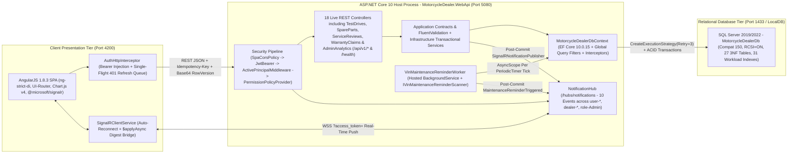
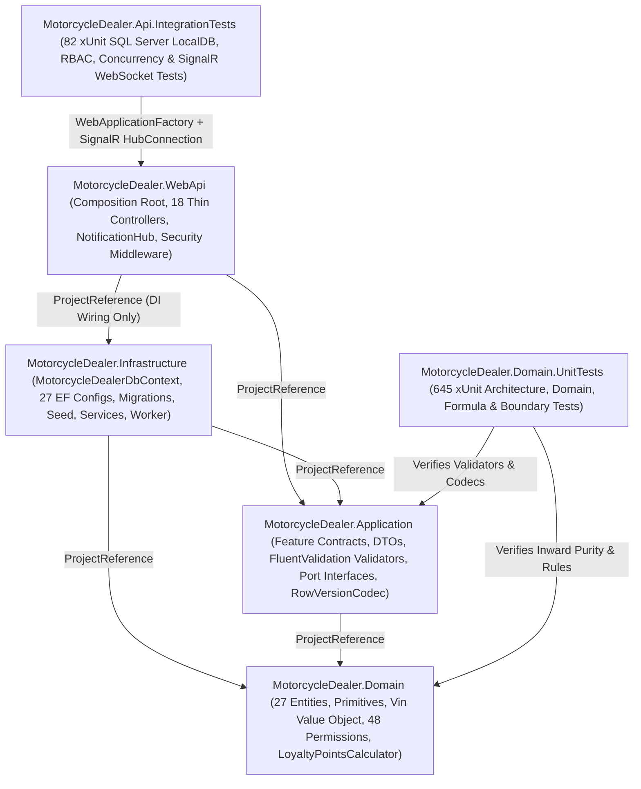
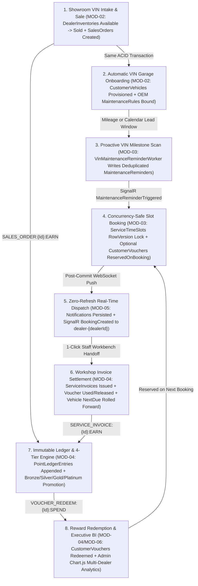

# Basic Design Master Specification (`BD-00`) — Motorcycle Dealer & Loyalty Management Platform

| Metadata | Canonical Value |
| :--- | :--- |
| **Document ID** | `BD-00-MASTER-V1.3` |
| **Document Title** | System Basic Design Master Specification (`Basic Design / Kihon Sekkei`) |
| **Project Name** | Motorcycle Dealer & Loyalty Management Platform |
| **Repository** | [https://github.com/quocanhh86/motorcycle-dealer](https://github.com/quocanhh86/motorcycle-dealer) |
| **Timeline & Team** | `02/2026 - 08/2026` · Solo Full-Stack Engineering Project (`Team Size: 1`) |
| **Backend Runtime** | `C# 13` · `ASP.NET Core Web API` (`.NET 10` / `net10.0`) · `EF Core 10.0.15` · `ASP.NET Core SignalR` |
| **Frontend & Mobile Runtimes** | Decoupled `AngularJS 1.8.3` SPA (`30` Routes, `Chart.js v4`, `@microsoft/signalr`) + Native C# `.NET 10 MAUI` Android Field App (`net10.0-android`, `16` Compiled Screens, `9`-Table `SQLCipher` WAL) |
| **Database Engine** | Microsoft SQL Server 2019 / 2022 (`MotorcycleDealerDb`, Compatibility Level `150`, `READ_COMMITTED_SNAPSHOT = ON`, `27` 3NF Tables) + Android `SQLCipher` (`9` Local Tables) |
| **Implementation Baseline** | **Phases 1–10 (`v1.3.0` — `88` WBS Tasks across `T-101`..`T-1008`)** |

### Canonical Engineering Specification Suite
- **Governance & Tracking**: [README.md](../../README.md) · [REQUIREMENTS.md](../../REQUIREMENTS.md) · [AGENTS.md](../../AGENTS.md) · [TASKS.md](../../TASKS.md) · [PROGRESS.md](../../PROGRESS.md) · [RELEASE_NOTES_v1.0.0.md](../RELEASE_NOTES_v1.0.0.md) · [RELEASE_NOTES_v1.1.0.md](../RELEASE_NOTES_v1.1.0.md) · [RELEASE_NOTES_v1.2.0.md](../RELEASE_NOTES_v1.2.0.md)
- **Phase 1 Core Baseline**: [PRD.md](../PRD.md) · [ARCHITECTURE.md](../ARCHITECTURE.md) · [DATABASE_DESIGN.md](../DATABASE_DESIGN.md) · [DESIGN.md](../DESIGN.md) · [openapi.v1.yaml](../openapi.v1.yaml) · [TEST_PLAN.md](../TEST_PLAN.md) · [RUNBOOK.md](../RUNBOOK.md) · [Master Word Specification (.docx)](../Motorcycle_Dealer_Loyalty_Platform_Specification.docx)
- **Detail Design (`DD`) Suite**:
  - [DD_01_COMMON_SPECIFICATION.md](../detail-design/DD_01_COMMON_SPECIFICATION.md) — Domain Primitives, Security Pipeline (`48` Policies), Transactions, Error Catalog & SPA Core (`v1.2.1`)
  - [DD_02_DATABASE_AND_TABLE_UPDATES.md](../detail-design/DD_02_DATABASE_AND_TABLE_UPDATES.md) — Physical 27-Table 3NF Schema (`+ServiceReviews`, `+WarrantyClaims`), Indexes & `TX-01..TX-31` CRUD Matrix (`v1.2.1`)
  - [DD_03_API_SPECIFICATIONS.md](../detail-design/DD_03_API_SPECIFICATIONS.md) — Endpoint-by-Endpoint REST `/api/v1` (`18` Controllers) & SignalR `/hubs/notifications` (`10` Events) Contracts (`v1.2.1`)
  - [DD_04_SCREEN_SPECIFICATIONS.md](../detail-design/DD_04_SCREEN_SPECIFICATIONS.md) — 26 Primary UI-Router Screens, 4 Route Aliases (`30` Routes), Printable Receipts & Real-Time UX Flows (`v1.2.1`)

---

## 1. System Context, Runtime Topology & Clean Architecture Layers

### 1.1 End-to-End Runtime Topology Diagram

The platform executes as a decoupled **AngularJS 1.8.3 Single-Page Application (`:4200`)** communicating over CORS-governed HTTP/JSON and WebSockets with an **ASP.NET Core 10 Modular Monolith (`:5080`)** backed by **Microsoft SQL Server (`MotorcycleDealerDb`)**.

### 1.2 Supported Execution Profiles

| Profile | Frontend Host (`:4200`) | Backend Host (`:5080`) | SQL Server Data Store | Primary Use Case |
| :--- | :--- | :--- | :--- | :--- |
| **Native Windows Developer Mode** | `node frontend/scripts/dev-server.mjs` (`http://localhost:4200`, HTML5 pushState fallback to `index.html`) | `dotnet run --project backend/src/MotorcycleDealer.WebApi` (`http://localhost:5080`) | `(localdb)\MSSQLLocalDB` (`15.0.4382.1`, Windows Integrated Auth, `MultipleActiveResultSets=true`) | Fast inner-loop development, xUnit LocalDB integration tests (`82` tests), and Dual-Page Headless Edge CDP verification |
| **Containerized Docker Stack (`docker-compose.yml`)** | `motorcycle-dealer-frontend` (`node:22-alpine`, non-root `USER node`, port `4200:4200`) | `motorcycle-dealer-webapi` (`dotnet/aspnet:10.0`, non-root `USER $APP_UID`, port `5080:8080`, `/health` probe) | `motorcycle-dealer-sqlserver` (`mcr.microsoft.com/mssql/server:2022-latest`, port `1433:1433`, named volume `motorcycle_dealer_sqlserver_data`) | Reproducible clean-room deployment (`docker compose up --build -d`) on isolated bridge network `motorcycle_dealer_net` |

### 1.3 Clean Architecture (`ADR-001`) Solution & Inward Dependency Matrix

All six `.NET 10` projects in `backend/MotorcycleDealer.sln` inherit centralized compiler governance from `backend/Directory.Build.props` (`TargetFramework=net10.0`, `LangVersion=latest`, `Nullable=enable`, `ImplicitUsings=enable`, `TreatWarningsAsErrors=true`, `Deterministic=true`, `NeutralLanguage=en-US`).

| Solution Project | Layer Role | Allowed Project References | External NuGet Dependencies | Prohibited Couplings (Enforced by `CleanArchitectureDependencyTests`) |
| :--- | :--- | :--- | :--- | :--- |
| `MotorcycleDealer.Domain` | Enterprise Domain Core | **None (`0`)** | **None (`0`)** | Zero references to `Application`, `Infrastructure`, `WebApi`, `Microsoft.EntityFrameworkCore`, `Microsoft.AspNetCore`, or `Phase\d+` identifiers |
| `MotorcycleDealer.Application` | Use-Case Contracts & Validation | `Domain` | `FluentValidation.DependencyInjectionExtensions` (`11.11.0`), `Microsoft.Extensions.DependencyInjection.Abstractions` (`10.0.15`) | Zero references to `Infrastructure`, `WebApi`, `Microsoft.EntityFrameworkCore`, `Microsoft.Data.SqlClient`, or `Microsoft.AspNetCore` |
| `MotorcycleDealer.Infrastructure` | Persistence, Identity, Services & Worker | `Application`, `Domain` | `Microsoft.EntityFrameworkCore.SqlServer` (`10.0.15`), `Microsoft.EntityFrameworkCore.Design` (`10.0.15`, `PrivateAssets=all`), `Microsoft.Extensions.Hosting.Abstractions` (`10.0.15`), `Microsoft.Extensions.Options.ConfigurationExtensions` (`10.0.15`) | Zero references to `WebApi` or `Microsoft.AspNetCore.Mvc` controllers |
| `MotorcycleDealer.WebApi` | HTTP/SignalR Transport & DI Root | `Application`, `Infrastructure` | `Microsoft.AspNetCore.Authentication.JwtBearer` (`10.0.15`), `Microsoft.AspNetCore.OpenApi` (`10.0.15`) | Controllers never inject `MotorcycleDealerDbContext` directly and never return `BaseEntity` types in any response envelope |
| `MotorcycleDealer.Domain.UnitTests` | Architecture & Unit Verification | `Domain`, `Application`, `Infrastructure`, `WebApi` | `xunit` (`2.9.3`), `xunit.runner.visualstudio` (`3.1.4`), `Microsoft.NET.Test.Sdk` (`17.14.1`), `coverlet.collector` (`6.0.4`) | Zero network or shared mutable database state |
| `MotorcycleDealer.Api.IntegrationTests` | Full-Stack SQL Server & WebSocket QA | `WebApi` | `Microsoft.AspNetCore.Mvc.Testing` (`10.0.15`), `Microsoft.AspNetCore.SignalR.Client` (`10.0.15`), `xunit` (`2.9.3`), `coverlet.collector` (`6.0.4`) | Cleans up isolated per-run test databases (`StrayTestDbCount == 0`) |

---

## 2. Subsystem & Module Architecture (`MOD-01`..`MOD-06`)

### 2.1 Vertical Subsystem Inventory & Implementation Status

| Module ID | Subsystem Name | Requirements & ADRs | Owned Tables (`27` Total) | Backend Controllers & Workers | Primary SPA Screens | Delivery Status |
| :--- | :--- | :--- | :--- | :--- | :--- | :--- |
| **`MOD-01`** | **Identity, JWT Session & Granular RBAC** | `FR-01`, `ADR-001`, `ADR-002`, `ADR-006` | `Users`, `Roles`, `Permissions` (`48`), `UserRoles`, `RolePermissions`, `RefreshTokens`, `Dealers` (`7`) | `AuthController`, `DealersController`, `HealthController` | `SCR-PUB-02A`, `SCR-PUB-02B`, `SCR-PUB-03`, `SCR-ADM-02`, `SCR-ADM-03` | **Implemented & Verified (`Phases 4, 8 & 9`)** |
| **`MOD-02`** | **Showroom Catalog, Test-Drives, VIN Garage & Warranty** | `FR-02`, `FR-03`, `FR-08`, `FR-09`, `ADR-002`, `ADR-003` | `MotorcycleModels`, `DealerInventories`, `SalesOrders`, `TestDriveBookings`, `CustomerVehicles`, `MaintenanceRules`, `WarrantyClaims` (`7`) | `MotorcyclesController`, `InventoriesController`, `SalesOrdersController` (+`/receipt`), `TestDrivesController`, `VehiclesController`, `WarrantyClaimsController` | `SCR-PUB-01`, `SCR-CUS-01`, `SCR-CUS-02`, `SCR-CUS-06`, `SCR-CUS-07`, `SCR-STF-03`, `SCR-STF-05`, `SCR-STF-06`, `SCR-STF-07`, `SCR-ADM-04` | **Implemented & Verified (`Phases 5, 8 & 9`)** |
| **`MOD-03`** | **Concurrency-Safe Workshop Booking, CSAT & VIN Reminders** | `FR-04`, `FR-09`, `ADR-002`, `ADR-005` | `ServiceTimeSlots`, `ServiceBookings`, `ServiceReviews`, `MaintenanceReminders` (`4`) | `TimeSlotsController`, `BookingsController`, `ServiceReviewsController`, `VinMaintenanceReminderWorker` | `SCR-CUS-03`, `SCR-CUS-04`, `SCR-CUS-07`, `SCR-STF-01`, `SCR-STF-04`, `SCR-STF-07` | **Implemented & Verified (`Phases 5 & 9`)** |
| **`MOD-04`** | **Itemized Invoicing, OEM Spare-Parts, 4-Tier Loyalty & Receipts** | `FR-04`, `FR-05`, `FR-08`, `FR-09`, `ADR-003` | `ServiceInvoices`, `ServiceInvoiceLineItems`, `SpareParts`, `LoyaltyTiers`, `LoyaltyAccounts`, `PointLedgerEntries`, `VoucherCatalogs`, `CustomerVouchers` (`8`) | `ServiceInvoicesController` (+`/receipt`), `SparePartsController`, `LoyaltyController`, `VouchersController` | `SCR-CUS-05`, `SCR-STF-02`, `SCR-ADM-05`, `SCR-ADM-06`, `SCR-ADM-07`, `printableReceiptModal` | **Implemented & Verified (`Phases 6, 8 & 9`)** |
| **`MOD-05`** | **Persistent Notifications & SignalR Real-Time Hub** | `FR-06`, `FR-08`, `FR-09`, `ADR-004`, `ADR-006` | `Notifications` (`1`) | `NotificationsController`, `NotificationHub` (`/hubs/notifications`, `10` events) | `appShell`, `notificationBell`, `toastContainer`, `SCR-STF-01`, `SCR-STF-06`, `SCR-STF-07`, `SCR-CUS-04`..`07` | **Implemented & Verified (`Phases 6, 8 & 9`)** |
| **`MOD-06`** | **Executive Multi-Dealer `Chart.js v4` & Quality Analytics** | `FR-07`, `FR-09`, `ADR-001`, `ADR-002`, `ADR-006` | Read-only projections over `Dealers`, `SalesOrders`, `ServiceInvoices`, `ServiceBookings`, `ServiceReviews`, `WarrantyClaims`, `LoyaltyAccounts`, `LoyaltyTiers` | `AdminAnalyticsController` (`9` bindings incl. `/quality-warranty` & `17`-col CSV) | `SCR-ADM-01` (`adminAnalytics`) & `SCR-ADM-08` (`adminQualityWarranty` + `dealerChart`) | **Implemented & Verified (`Phases 7 & 9`)** |

### 2.2 Closed-Loop Cross-Module Value Flow

Every aggregate across all six modules participates in an unbroken retail-to-retention lifecycle where showroom purchases feed digital garage tracking, automated VIN reminders drive workshop bookings, bookings settle into immutable financial invoices and loyalty ledger entries, and points redeem into vouchers for subsequent service visits.

---

## 3. Master Screen Catalog & Screen Transition Diagram

### 3.1 UI-Router State Architecture (`frontend/src/app/app.routes.js`)

The AngularJS 1.8.3 SPA defines **35 registered `@uirouter/angularjs` states** comprising:
- **`5` Abstract Layout/Namespace Parent States**: `app` (`appShell`), `app.public`, `app.customer` (`/customer`), `app.staff` (`/staff`), and `app.admin` (`/admin`).
- **`26` Primary Feature Screens**: `4` Public (`SCR-PUB-01`, `SCR-PUB-02A`, `SCR-PUB-02B`, `SCR-PUB-03`), `7` Customer (`SCR-CUS-01..07`), `7` Dealer Staff (`SCR-STF-01..07`), and `8` Admin (`SCR-ADM-01..08`).
- **`4` Named Route Aliases** (`26 + 4 = 30` navigable concrete UI-Router routes, all verified with `0` console errors in Headless Edge CDP).

### 3.2 Complete 26-Screen + 4-Alias Inventory Table

| # | Screen ID | UI-Router State Name | Full Browser URL Pattern | AngularJS Component | Allowed Role(s) | Required Granular Permissions (`ALL` Mode) | Implementation Status |
| :-: | :--- | :--- | :--- | :--- | :--- | :--- | :--- |
| 1 | `SCR-PUB-01` | `app.public.showroom` | `/showroom` | `publicShowroom` | Public / Any | None (`requiresAuth: false`) | Live (`Phase 5`) |
| 2 | `SCR-PUB-02A` | `app.public.login` | `/login?returnUrl&returnTo&reason` | `publicLogin` | Anonymous Only | None (Redirects authenticated users to `ROLE_HOME`) | Live (`Phase 4`) |
| 3 | `SCR-PUB-02B` | `app.public.register` | `/register` | `publicRegister` | Anonymous Only | None (Redirects authenticated users to `ROLE_HOME`) | Live (`Phase 4`) |
| 4 | `SCR-PUB-03` | `app.public.forbidden` | `/403` | `publicForbidden` | Public / Any | None (`requiresAuth: false`, RBAC denial landing) | Live (`Phase 4`) |
| 5 | `SCR-CUS-01` | `app.customer.dashboard` | `/customer/dashboard` | `customerDashboard` | `Customer` | `Vehicles.ViewOwn`, `Bookings.ViewOwn`, `Loyalty.ViewOwn` | Live (`Phase 5`) |
| 6 | `SCR-CUS-02` | `app.customer.garage` | `/customer/garage` | `customerGarage` | `Customer` | `Vehicles.ViewOwn`, `Vehicles.RegisterOwn` | Live (`Phase 5`) |
| 7 | `SCR-CUS-03` | `app.customer.bookingNew` | `/customer/bookings/new?vehicleId&dealerId&voucherId` | `customerBookingNew` | `Customer` | `Bookings.Create`, `TimeSlots.ViewAvailable` | Live (`Phase 5–6`) |
| 8 | `SCR-CUS-04` | `app.customer.bookings` | `/customer/bookings` | `customerBookings` | `Customer` | `Bookings.ViewOwn`, `Bookings.CancelOwn`, `Invoices.ViewOwn` | Live (`Phase 5–6`) |
| 9 | `SCR-CUS-05` | `app.customer.loyalty` | `/customer/loyalty` | `customerLoyalty` | `Customer` | `Loyalty.ViewOwn`, `Loyalty.RedeemVoucher`, `SalesOrders.ViewOwn` | Live (`Phase 6`) |
| 10 | `SCR-STF-01` | `app.staff.workbench` | `/staff/workbench` | `staffWorkbench` | `DealerStaff` | `Bookings.ViewDealer`, `Bookings.UpdateStatus`, `Vehicles.ViewDealer` | Live (`Phase 5–6`) |
| 11 | `SCR-STF-02` | `app.staff.invoiceBuilder` | `/staff/bookings/:bookingId/invoice` | `staffInvoiceBuilder` | `DealerStaff` | `Invoices.CreateDealer`, `Invoices.ViewDealer`, `Loyalty.ViewDealerCustomer` | Live (`Phase 6`) |
| 12 | `SCR-STF-03` | `app.staff.salesDesk` | `/staff/sales-orders/new` | `staffSalesDesk` | `DealerStaff` | `SalesOrders.Create`, `SalesOrders.ViewDealer`, `Inventories.ViewDealer`, `Inventories.ManageDealer` | Live (`Phase 5`) |
| 13 | `SCR-STF-04` | `app.staff.timeSlots` | `/staff/time-slots` | `staffTimeSlots` | `DealerStaff` | `TimeSlots.ManageDealer`, `TimeSlots.ViewAvailable` | Live (`Phase 5`) |
| 14 | `SCR-STF-05` | `app.staff.customers` | `/staff/customers` | `staffCustomers` | `DealerStaff` | `Vehicles.ViewDealer`, `Loyalty.ViewDealerCustomer` | Live (`Phase 5`) |
| 15 | `SCR-ADM-01` | `app.admin.analytics` | `/admin/analytics` | `adminAnalytics` | `Admin` | `Analytics.ViewAllDealers`, `Analytics.ExportReports` | Implemented & Verified `[Phase 7]` |
| 16 | `SCR-ADM-02` | `app.admin.dealers` | `/admin/dealers` | `adminDealers` | `Admin` | `Dealers.ManageAll`, `Dealers.ViewPublic` | Live (`Phase 4`) |
| 17 | `SCR-ADM-03` | `app.admin.staff` | `/admin/staff?dealerId` | `adminStaff` | `Admin` | `Users.ManageStaff` | Live (`Phase 4`) |
| 18 | `SCR-ADM-04` | `app.admin.models` | `/admin/models` | `adminModels` | `Admin` | `Showroom.ManageModels`, `Vehicles.ManageRules` | Live (`Phase 5`) |
| 19 | `SCR-ADM-05` | `app.admin.loyaltyTiers` | `/admin/loyalty/tiers` | `adminLoyaltyTiers` | `Admin` | `Loyalty.ManageTiers`, `Loyalty.AdjustPoints` | Live (`Phase 6`) |
| 20 | `SCR-ADM-06` | `app.admin.voucherCatalog` | `/admin/loyalty/vouchers` | `adminVoucherCatalog` | `Admin` | `Loyalty.ManageVoucherCatalog` | Live (`Phase 6`) |
| 21 | `SCR-CUS-06` | `app.customer.testDrives` | `/customer/test-drives?modelId&dealerId` | `customerTestDrives` | `Customer` | `TestDrives.ViewOwn`, `TestDrives.Create` | Live (`Phase 8`) |
| 22 | `SCR-STF-06` | `app.staff.testDrives` | `/staff/test-drives` | `staffTestDrives` | `DealerStaff` | `TestDrives.ViewDealer`, `TestDrives.UpdateStatus` | Live (`Phase 8`) |
| 23 | `SCR-ADM-07` | `app.admin.spareParts` | `/admin/spare-parts` | `adminSpareParts` | `Admin` | `SpareParts.ManageCatalog` | Live (`Phase 8`) |
| 24 | `SCR-CUS-07` | `app.customer.warranty` | `/customer/warranty?vehicleId&invoiceId` | `customerWarranty` | `Customer` | `Warranty.ViewOwn`, `Warranty.CreateOwn`, `Reviews.ViewOwn` | Live (`Phase 9`) |
| 25 | `SCR-STF-07` | `app.staff.warrantyReviews` | `/staff/warranty-reviews` | `staffWarrantyReviews` | `DealerStaff` | `Warranty.ViewDealer`, `Warranty.ManageDealer`, `Reviews.ViewDealer`, `Reviews.RespondDealer` | Live (`Phase 9`) |
| 26 | `SCR-ADM-08` | `app.admin.qualityWarranty` | `/admin/quality-warranty` | `adminQualityWarranty` | `Admin` | `Analytics.ViewAllDealers`, `Reviews.ViewDealer`, `Warranty.ViewDealer` | Live (`Phase 9`) |
| A1 | `SCR-CUS-03` *(Alias)* | `app.customer.bookService` | `/customer/book-service?vehicleId&dealerId&voucherId` | `customerBookingNew` | `Customer` | `Bookings.Create`, `TimeSlots.ViewAvailable` | Live (`Phase 5–6`) |
| A2 | `SCR-STF-02` *(Alias)* | `app.staff.invoicing` | `/staff/invoicing/:bookingId` | `staffInvoiceBuilder` | `DealerStaff` | `Invoices.CreateDealer`, `Invoices.ViewDealer`, `Loyalty.ViewDealerCustomer` | Live (`Phase 6`) |
| A3 | `SCR-STF-03` *(Alias)* | `app.staff.salesNew` | `/staff/sales-new` | `staffSalesDesk` | `DealerStaff` | `SalesOrders.Create`, `SalesOrders.ViewDealer`, `Inventories.ViewDealer`, `Inventories.ManageDealer` | Live (`Phase 5`) |
| A4 | `SCR-STF-04` *(Alias)* | `app.staff.slots` | `/staff/slots` | `staffTimeSlots` | `DealerStaff` | `TimeSlots.ManageDealer`, `TimeSlots.ViewAvailable` | Live (`Phase 5`) |

#### URL Normalization Redirects (`$urlRouterProvider`)
In addition to the 24 concrete UI-Router states, `configureRoutes` registers deterministic URL rewrites: `''` and `'/'` -> `/showroom`; `/customer/booking/new` -> `/customer/bookings/new`; `/customer/invoices` -> `/customer/bookings`; `/customer/orders` -> `/customer/loyalty`; `/staff/invoice-builder` -> `/staff/bookings/preview-booking/invoice`; `/staff/invoicing` -> `/staff/invoicing/preview-booking`; `/staff/inventory` and `/staff/sales-orders` -> `/staff/sales-orders/new`; `/admin/loyalty-tiers` and `/admin/loyalty/adjustments` -> `/admin/loyalty/tiers`; `/admin/voucher-catalog` -> `/admin/loyalty/vouchers`; and `otherwise('/showroom')`.

### 3.3 Master Screen Transition & Route Guard State Diagram

```mermaid
stateDiagram-v2
    [*] --> PUB_01_Showroom : "Default Entry (/ or /showroom)"

    state "Public Namespace (app.public.*)" as PublicPortal {
        PUB_01_Showroom : "SCR-PUB-01 Showroom (/showroom)"
        PUB_02A_Login : "SCR-PUB-02A Sign In (/login?returnUrl)"
        PUB_02B_Register : "SCR-PUB-02B Register (/register)"
        PUB_03_Forbidden : "SCR-PUB-03 Access Denied (/403)"

        PUB_01_Showroom --> PUB_02A_Login : "Sign In CTA / Book Service Unauthenticated"
        PUB_01_Showroom --> PUB_02B_Register : "Register CTA"
        PUB_02A_Login --> PUB_02B_Register : "Create Customer Account"
        PUB_03_Forbidden --> PUB_01_Showroom : "Return to Public Showroom"
    }

    state "Customer Portal (app.customer.*)" as CustomerPortal {
        CUS_01_Dash : "SCR-CUS-01 Dashboard (/customer/dashboard)"
        CUS_02_Garage : "SCR-CUS-02 VIN Garage (/customer/garage)"
        CUS_03_BookNew : "SCR-CUS-03 Booking Wizard (/customer/bookings/new)"
        CUS_04_Bookings : "SCR-CUS-04 Appointments & Invoices (/customer/bookings)"
        CUS_05_Loyalty : "SCR-CUS-05 Loyalty & Vouchers (/customer/loyalty)"

        CUS_01_Dash --> CUS_02_Garage : "Inspect Owned VIN"
        CUS_02_Garage --> CUS_03_BookNew : "Book Due Milestone (?vehicleId)"
        CUS_05_Loyalty --> CUS_03_BookNew : "Apply Redeemed Voucher (?voucherId)"
        CUS_03_BookNew --> CUS_04_Bookings : "201 Created Booking"
        CUS_04_Bookings --> CUS_05_Loyalty : "Inspect Points Earned"
    }

    state "Dealer Staff Portal (app.staff.*)" as StaffPortal {
        STF_01_Workbench : "SCR-STF-01 SignalR Workbench (/staff/workbench)"
        STF_02_Invoice : "SCR-STF-02 Invoice Builder (/staff/bookings/:bookingId/invoice)"
        STF_03_Sales : "SCR-STF-03 VIN Stock & Sales Desk (/staff/sales-orders/new)"
        STF_04_Slots : "SCR-STF-04 Time-Slot Manager (/staff/time-slots)"
        STF_05_Customers : "SCR-STF-05 Customer & VIN Lookup (/staff/customers)"

        STF_01_Workbench --> STF_02_Invoice : "Settle & Issue Invoice (:bookingId)"
        STF_02_Invoice --> STF_01_Workbench : "201 ServiceInvoice Settled"
        STF_05_Customers --> STF_03_Sales : "Create Showroom SalesOrder"
        STF_04_Slots --> STF_01_Workbench : "Inspect Slot Queue"
    }

    state "Admin Executive HQ (app.admin.*)" as AdminPortal {
        ADM_01_Analytics : "SCR-ADM-01 Multi-Dealer Analytics (/admin/analytics)"
        ADM_02_Dealers : "SCR-ADM-02 Dealers (/admin/dealers)"
        ADM_03_Staff : "SCR-ADM-03 Staff Access (/admin/staff?dealerId)"
        ADM_04_Models : "SCR-ADM-04 Models & OEM Rules (/admin/models)"
        ADM_05_Tiers : "SCR-ADM-05 Tiers & Adjustments (/admin/loyalty/tiers)"
        ADM_06_Vouchers : "SCR-ADM-06 Voucher Catalog (/admin/loyalty/vouchers)"

        ADM_02_Dealers --> ADM_03_Staff : "Manage Branch Staff (?dealerId)"
        ADM_05_Tiers --> ADM_06_Vouchers : "Configure Tier-Gated Rewards"
    }

    PUB_02A_Login --> CUS_02_Garage : "Customer Login (ROLE_HOME or Sanitized returnUrl)"
    PUB_02B_Register --> CUS_02_Garage : "201 Auto-Login (Bronze Wallet Created)"
    PUB_02A_Login --> STF_01_Workbench : "DealerStaff Login (ROLE_HOME or Sanitized returnUrl)"
    PUB_02A_Login --> ADM_01_Analytics : "Admin Login (ROLE_HOME or Sanitized returnUrl)"

    CustomerPortal --> PUB_02A_Login : "401 Refresh Failed / 403 ACCOUNT_LOCKED (?returnUrl)"
    StaffPortal --> PUB_02A_Login : "401 Refresh Failed / 403 STAFF_DEALER_UNASSIGNED (?returnUrl)"
    AdminPortal --> PUB_02A_Login : "401 Refresh Failed / Explicit Sign Out"

    CustomerPortal --> PUB_03_Forbidden : "$transitions.onBefore Role/Permission Mismatch"
    StaffPortal --> PUB_03_Forbidden : "$transitions.onBefore Role/Permission Mismatch"
    AdminPortal --> PUB_03_Forbidden : "$transitions.onBefore Role/Permission Mismatch"
```

---

## 4. Master API & Real-Time Hub Catalog

The backend exposes **18 live C# REST controller classes** (including `TestDrivesController`, `SparePartsController`, `ServiceReviewsController`, `WarrantyClaimsController`, and `AdminAnalyticsController`) + **`Program.cs` minimal `/health` liveness endpoint** + **strongly-typed SignalR `NotificationHub` (`/hubs/notifications`, `10` events)** (implemented & verified across Phases 3–9).

### 4.1 Complete REST API Endpoint Summary (`API-01`..`API-98`)

| API ID | Method | Route Template | Controller.Action & Status | Auth / Permission Policy | `IDealerScoped` & Ownership Behavior | Concurrency / Idempotency Strategy |
| :--- | :---: | :--- | :--- | :--- | :--- | :--- |
| `API-01` | `GET` | `/health` | `Program.MapHealthChecks` · Live | `[AllowAnonymous]` (Bypasses `ActivePrincipalMiddleware`) | Global liveness check | Read-only Kestrel process probe (`200 Healthy`) |
| `API-02` | `GET` | `/api/v1/health` | `HealthController.GetHealthAsync` · Live | `[AllowAnonymous]` (Bypasses `ActivePrincipalMiddleware`) | Global readiness (`?probeDb=true` runs 2s `CanConnectAsync`) | Read-only (`503 DATABASE_UNAVAILABLE` if unreachable) |
| `API-03` | `POST` | `/api/v1/auth/register` | `AuthController.RegisterAsync` · Live | `[AllowAnonymous]` | Creates `Customer` (`DealerId = null`) + `Bronze` `LoyaltyAccount` | `ExecutionStrategy` + ACID tx + `UQ_Users_Email`/`UQ_Users_PhoneNumber` (`409`) |
| `API-04` | `POST` | `/api/v1/auth/login` | `AuthController.LoginAsync` · Live | `[AllowAnonymous]` | Issues `dealer_id` claim for `DealerStaff`; enforces active branch | Constant-time PBKDF2 dummy verification on miss (`401` / `403`) |
| `API-05` | `POST` | `/api/v1/auth/refresh` | `AuthController.RefreshAsync` · Live | `[AllowAnonymous]` | Re-validates live DB `User` & `Dealer` before rotating JWT | RCSI atomic `ExecuteUpdateAsync` CAS on `RevokedAtUtc IS NULL`; `ReuseDetected` cascade |
| `API-06` | `POST` | `/api/v1/auth/logout` | `AuthController.LogoutAsync` · Live | `[Authorize]` | Scoped strictly to `_currentUserContext.RequireUserId()` | Idempotent `ExecuteUpdateAsync` revoking `TokenFamilyId` or all user devices |
| `API-07` | `GET` | `/api/v1/auth/me` | `AuthController.GetMeAsync` · Live | `[Authorize]` | Self-owned profile, permissions & live `LoyaltyAccount` snapshot | `AsNoTracking()` read |
| `API-08` | `GET` | `/api/v1/dealers` | `DealersController.ListDealersAsync` · Live | `[AllowAnonymous]` *(Dual-mode)* | Public sees active branches; `Admin` / `Dealers.ManageAll` may pass `?includeInactive=true` | `AsNoTracking()` + live `AvailableStockCount` projection |
| `API-09` | `GET` | `/api/v1/dealers/{dealerId}` | `DealersController.GetDealerByIdAsync` · Live | `[AllowAnonymous]` *(Dual-mode)* | Hides inactive branches (`404`) unless caller holds `Dealers.ManageAll` | `AsNoTracking()` read |
| `API-10` | `POST` | `/api/v1/dealers` | `DealersController.CreateDealerAsync` · Live | `[HasPermission(Permissions.Dealers.ManageAll)]` | `Admin` cross-dealer governance | `UQ_Dealers_Code` (`409 DUPLICATE_DEALER_CODE`) |
| `API-11` | `PUT` | `/api/v1/dealers/{dealerId}` | `DealersController.UpdateDealerAsync` · Live | `[HasPermission(Permissions.Dealers.ManageAll)]` | Deactivating branch revokes all branch `DealerStaff` `RefreshTokens` | `ExecutionStrategy` + ACID tx + `UQ_Dealers_Code` (`409`) |
| `API-12` | `GET` | `/api/v1/dealers/{dealerId}/staff` | `DealersController.ListDealerStaffAsync` · Live | `[HasPermission(Permissions.Users.ManageStaff)]` | `Admin` views staff roster for target `dealerId` | `AsNoTracking()` read |
| `API-13` | `POST` | `/api/v1/dealers/{dealerId}/staff` | `DealersController.ProvisionDealerStaffAsync` · Live | `[HasPermission(Permissions.Users.ManageStaff)]` | Binds new `DealerStaff` to active `dealerId` + `StaffEmployeeCode` | `ExecutionStrategy` + ACID tx + `UQ_Users_StaffEmployeeCode` (`409`) |
| `API-14` | `PATCH` | `/api/v1/dealers/{dealerId}/staff/{userId}/status` | `DealersController.UpdateDealerStaffStatusAsync` · Live | `[HasPermission(Permissions.Users.ManageStaff)]` | Deactivation (`IsActive=false`) purges user `RefreshTokens` + blocks JWT immediately | Nullable `bool? IsActive` empty-body guard (`400`) + ACID token purge |
| `API-15` | `GET` | `/api/v1/motorcycles` | `MotorcyclesController.ListMotorcyclesAsync` · Live | `[AllowAnonymous]` *(Dual-mode)* | Global catalog + per-dealer `'Available'` stock counts (`?dealerId=`) | `AsNoTracking()` paged projection |
| `API-16` | `GET` | `/api/v1/motorcycles/{modelId}` | `MotorcyclesController.GetMotorcycleModelByIdAsync` · Live | `[AllowAnonymous]` *(Dual-mode)* | Global catalog + active `MaintenanceRules` & branch stock breakdown | `AsNoTracking()` read |
| `API-17` | `POST` | `/api/v1/motorcycles` | `MotorcyclesController.CreateMotorcycleModelAsync` · Live | `[HasPermission(Permissions.Showroom.ManageModels)]` | `Admin` platform-wide model catalog | `UQ_MotorcycleModels_ModelCode` (`409 DUPLICATE_MODEL_CODE`) |
| `API-18` | `PUT` | `/api/v1/motorcycles/{modelId}` | `MotorcyclesController.UpdateMotorcycleModelAsync` · Live | `[HasPermission(Permissions.Showroom.ManageModels)]` | `Admin` platform-wide model catalog | `UQ_MotorcycleModels_ModelCode` (`409 DUPLICATE_MODEL_CODE`) |
| `API-19` | `GET` | `/api/v1/motorcycles/{modelId}/maintenance-rules` | `MotorcyclesController.ListModelMaintenanceRulesAsync` · Live | `[AllowAnonymous]` *(Dual-mode)* | Public sees active rules; `Vehicles.ManageRules` may pass `?includeInactive=true` | `AsNoTracking()` read |
| `API-20` | `POST` | `/api/v1/motorcycles/{modelId}/maintenance-rules` | `MotorcyclesController.CreateMaintenanceRuleAsync` · Live | `[HasPermission(Permissions.Vehicles.ManageRules)]` | `Admin` OEM schedule configuration | `UQ_MaintenanceRules_Model_Code` (`409 DUPLICATE_MILESTONE_CODE`) |
| `API-21` | `PUT` | `/api/v1/motorcycles/{modelId}/maintenance-rules/{ruleId}` | `MotorcyclesController.UpdateMaintenanceRuleAsync` · Live | `[HasPermission(Permissions.Vehicles.ManageRules)]` | `Admin` OEM schedule configuration | `UQ_MaintenanceRules_Model_Code` (`409 DUPLICATE_MILESTONE_CODE`) |
| `API-22` | `PUT` | `/api/v1/motorcycles/{modelId}/maintenance-rules` | `MotorcyclesController.UpdateMaintenanceRuleFromBodyAsync` · Live | `[HasPermission(Permissions.Vehicles.ManageRules)]` | Body `ruleId`/`id` alias delegating to `UpdateMaintenanceRuleAsync` | `UQ_MaintenanceRules_Model_Code` (`409 DUPLICATE_MILESTONE_CODE`) |
| `API-23` | `GET` | `/api/v1/inventories` | `InventoriesController.ListInventoriesAsync` · Live | `[AllowAnonymous]` *(Dual-mode)* | `?publicOnly=true` returns `Available` stock across active dealers with `EngineNumber=""`; private mode requires `Inventories.ViewDealer` (`DealerStaff` scoped to `DealerId`) | `AsNoTracking()` + `IDealerScoped` filter |
| `API-24` | `GET` | `/api/v1/inventories/{inventoryId}` | `InventoriesController.GetInventoryByIdAsync` · Live | `[HasPermission(Permissions.Inventories.ViewDealer)]` | `DealerStaff` restricted to assigned `DealerId` (`403`/`404`); `Admin` cross-dealer | `AsNoTracking()` + `RowVersion` Base64 returned |
| `API-25` | `POST` | `/api/v1/inventories` | `InventoriesController.CreateInventoryAsync` · Live | `[HasPermission(Permissions.Inventories.ManageDealer)]` | `DealerStaff` bound to assigned `DealerId` (`403 FORBIDDEN_DEALER_SCOPE` on mismatch) | Cross-table `VIN` uniqueness (`DealerInventories` + `CustomerVehicles` -> `409 DUPLICATE_VIN`) |
| `API-26` | `PATCH` | `/api/v1/inventories/{inventoryId}` | `InventoriesController.UpdateInventoryAsync` · Live | `[HasPermission(Permissions.Inventories.ManageDealer)]` | `DealerStaff` scoped to `DealerId`; blocks direct `Sold` transition (`422`) | Mandatory 8-byte Base64 `RowVersion` (`400` / `409 CONCURRENCY_CONFLICT`) |
| `API-27` | `GET` | `/api/v1/sales-orders` | `SalesOrdersController.ListSalesOrdersAsync` · Live | `[Authorize]` (`ViewOwn` or `ViewDealer`) | `Customer` -> own orders; `DealerStaff` -> assigned `DealerId`; `Admin` -> all/filtered | `AsNoTracking()` + `OrderLedgerSnapshot` hydration |
| `API-28` | `GET` | `/api/v1/sales-orders/my` | `SalesOrdersController.ListMySalesOrdersAsync` · Live | `[HasPermission(Permissions.SalesOrders.ViewOwn)]` | Forced `CustomerId == currentUser.UserId` | `AsNoTracking()` paged read |
| `API-29` | `GET` | `/api/v1/sales-orders/{orderId}` | `SalesOrdersController.GetSalesOrderByIdAsync` · Live | `[Authorize]` (`ViewOwn` or `ViewDealer`) | Ownership check for `Customer`; `DealerId` check for `DealerStaff` | `AsNoTracking()` read |
| `API-30` | `POST` | `/api/v1/sales-orders` | `SalesOrdersController.CreateSalesOrderAsync` · Live | `[HasPermission(Permissions.SalesOrders.Create)]` | `DealerStaff` sells strictly from assigned `DealerId` | `ExecutionStrategy` + ACID tx + `DealerInventories.RowVersion` + `LoyaltyAccounts.RowVersion` + `SALES_ORDER:{Id}:EARN` `IdempotencyKey` |
| `API-31` | `GET` | `/api/v1/vehicles` | `VehiclesController.ListVehiclesAsync` · Live | `[Authorize]` (`ViewOwn` or `ViewDealer`) | `Customer` -> own garage only; `DealerStaff`/`Admin` -> network VIN lookup | `AsNoTracking()` read |
| `API-32` | `GET` | `/api/v1/vehicles/my` | `VehiclesController.ListMyVehiclesAsync` · Live | `[HasPermission(Permissions.Vehicles.ViewOwn)]` | Forced `CustomerId == currentUser.UserId` | `AsNoTracking()` read |
| `API-33` | `GET` | `/api/v1/vehicles/lookup` | `VehiclesController.LookupVehiclesForWorkshopAsync` · Live | `[HasPermission(Permissions.Vehicles.ViewDealer)]` | Cross-dealer customer garage lookup by `VIN`/plate/email for workshop service | `AsNoTracking()` read |
| `API-34` | `GET` | `/api/v1/vehicles/{vehicleId}` | `VehiclesController.GetVehicleByIdAsync` · Live | `[Authorize]` (`ViewOwn` or `ViewDealer`) | `Customer` restricted to own `CustomerId` (`403 FORBIDDEN_RESOURCE_OWNER`) | `AsNoTracking()` read |
| `API-35` | `GET` | `/api/v1/vehicles/{vehicleId}/reminders` | `VehiclesController.ListVehicleRemindersAsync` · Live | `[Authorize]` (`ViewOwn` or `ViewDealer`) | `Customer` restricted to own vehicle; `DealerStaff`/`Admin` workshop view | `AsNoTracking()` schedule + reminders + settled invoices |
| `API-36` | `GET` | `/api/v1/vehicles/{vehicleId}/maintenance-history` | `VehiclesController.GetVehicleMaintenanceHistoryAsync` · Live | `[Authorize]` (`ViewOwn` or `ViewDealer`) | Alias returning `VehicleMaintenanceScheduleDto` for vehicle | `AsNoTracking()` read |
| `API-37` | `POST` | `/api/v1/vehicles` | `VehiclesController.RegisterExternalVehicleAsync` · Live | `[HasPermission(Permissions.Vehicles.RegisterOwn)]` | Binds external 17-char `VIN` to authenticated `Customer` | `.IgnoreQueryFilters()` global `VIN` & `LicensePlate` uniqueness (`409`) |
| `API-38` | `PATCH` | `/api/v1/vehicles/{vehicleId}/mileage` | `VehiclesController.UpdateVehicleMileageAsync` · Live | `[HasPermission(Permissions.Vehicles.RegisterOwn)]` | Strictly owner `CustomerId == currentUser.UserId` (`403`) | Monotonic odometer guard (`NewMileage >= CurrentMileageKm` -> `422 ODOMETER_REGRESSION`) |
| `API-39` | `GET` | `/api/v1/time-slots` | `TimeSlotsController.ListTimeSlotsAsync` · Live | `[AllowAnonymous]` *(Dual-mode)* | Public/`Customer` queries active `dealerId`; `DealerStaff` restricted to assigned `DealerId` | Returns Base64 `RowVersion` per slot for optimistic locking |
| `API-40` | `GET` | `/api/v1/time-slots/dealer` | `TimeSlotsController.ListDealerTimeSlotsAsync` · Live | `[HasPermission(Permissions.TimeSlots.ManageDealer)]` | `DealerStaff` scoped to assigned `DealerId`; `Admin` specifies `dealerId` | `AsNoTracking()` + `IDealerScoped` filter |
| `API-41` | `POST` | `/api/v1/time-slots` | `TimeSlotsController.CreateTimeSlotAsync` · Live | `[HasPermission(Permissions.TimeSlots.ManageDealer)]` | `DealerStaff` creates for own `DealerId` only | `UQ_ServiceTimeSlots_Dealer_Window` (`409 DUPLICATE_TIME_SLOT`) |
| `API-42` | `POST` | `/api/v1/time-slots/generate` *(+ `/dealer/generate`)* | `TimeSlotsController.GenerateTimeSlotsAsync` · Live | `[HasPermission(Permissions.TimeSlots.ManageDealer)]` | `DealerStaff` generates for own `DealerId`; skips existing windows idempotently | Idempotent window existence check + `UQ_ServiceTimeSlots_Dealer_Window` |
| `API-43` | `PATCH` | `/api/v1/time-slots/{slotId}` | `TimeSlotsController.UpdateTimeSlotAsync` · Live | `[HasPermission(Permissions.TimeSlots.ManageDealer)]` | `DealerStaff` scoped to own `DealerId` | Mandatory 8-byte `RowVersion` + `MaxCapacity >= BookedCount` (`409 CAPACITY_BELOW_BOOKED`) |
| `API-44` | `POST` | `/api/v1/bookings` | `BookingsController.CreateBookingAsync` · Live | `[HasPermission(Permissions.Bookings.Create)]` | `Customer` books own `CustomerVehicle` at any active `Dealer` | `ExecutionStrategy` + ACID tx + bounded `ServiceTimeSlots.RowVersion` retry (`409 SLOT_CAPACITY_EXHAUSTED`) + `CustomerVouchers.RowVersion` |
| `API-45` | `GET` | `/api/v1/bookings` | `BookingsController.ListBookingsAsync` · Live | `[Authorize]` (`ViewOwn` or `ViewDealer`) | `Customer` -> own; `DealerStaff` -> assigned `DealerId`; `Admin` -> all/filtered | `AsNoTracking()` paged read |
| `API-46` | `GET` | `/api/v1/bookings/my` | `BookingsController.ListMyBookingsAsync` · Live | `[HasPermission(Permissions.Bookings.ViewOwn)]` | Forced `CustomerId == currentUser.UserId` | `AsNoTracking()` paged read |
| `API-47` | `GET` | `/api/v1/bookings/dealer` | `BookingsController.ListDealerBookingsAsync` · Live | `[HasPermission(Permissions.Bookings.ViewDealer)]` | `DealerStaff` -> assigned `DealerId` (`403` on cross-dealer query) | `AsNoTracking()` paged read |
| `API-48` | `GET` | `/api/v1/bookings/{bookingId}` | `BookingsController.GetBookingByIdAsync` · Live | `[Authorize]` (`ViewOwn` or `ViewDealer`) | Ownership check for `Customer`; `DealerId` check for `DealerStaff` | `AsNoTracking()` read |
| `API-49` | `POST` | `/api/v1/bookings/{bookingId}/cancel` | `BookingsController.CancelBookingAsync` · Live | `[Authorize]` (`CancelOwn` or `UpdateStatus`) | `Customer` cancels own `Pending`/`Confirmed`; `DealerStaff` cancels own branch | ACID tx decrementing `BookedCount` + releasing `ReservedOnBooking -> Available` with `RowVersion` |
| `API-50` | `PATCH` | `/api/v1/bookings/{bookingId}/status` | `BookingsController.UpdateBookingStatusAsync` · Live | `[HasPermission(Permissions.Bookings.UpdateStatus)]` | `DealerStaff` scoped to own `DealerId`; blocks direct `Completed` without invoice | `ServiceBookings.RowVersion` + slot/voucher release on `NoShow`/`Cancelled` |
| `API-51` | `GET` | `/api/v1/service-invoices` | `ServiceInvoicesController.ListServiceInvoicesAsync` · Live | `[Authorize]` (`ViewOwn` or `ViewDealer`) | `Customer` -> own; `DealerStaff` -> assigned `DealerId`; `Admin` -> all/filtered | `AsNoTracking()` paged read |
| `API-52` | `GET` | `/api/v1/service-invoices/my` | `ServiceInvoicesController.ListMyServiceInvoicesAsync` · Live | `[HasPermission(Permissions.Invoices.ViewOwn)]` | Forced `CustomerId == currentUser.UserId` | `AsNoTracking()` paged read |
| `API-53` | `GET` | `/api/v1/service-invoices/{invoiceId}` | `ServiceInvoicesController.GetServiceInvoiceByIdAsync` · Live | `[Authorize]` (`ViewOwn` or `ViewDealer`) | Ownership check for `Customer`; `DealerId` check for `DealerStaff` | `AsNoTracking()` read |
| `API-54` | `POST` | `/api/v1/service-invoices` | `ServiceInvoicesController.CreateServiceInvoiceAsync` · Live | `[HasPermission(Permissions.Invoices.CreateDealer)]` | `DealerStaff` settles bookings strictly at assigned `DealerId` | `ExecutionStrategy` + ACID tx + `UQ_ServiceInvoices_BookingId` (`409 INVOICE_ALREADY_ISSUED`) + `SERVICE_INVOICE:{Id}:EARN` + `RowVersion` |
| `API-55` | `GET` | `/api/v1/loyalty/tiers` | `LoyaltyController.ListTiersAsync` · Live | `[AllowAnonymous]` *(Dual-mode)* | Platform-wide 4-tier catalog ordered by `RankOrder ASC` | `AsNoTracking()` + 8-byte timestamp concurrency token |
| `API-56` | `PUT` | `/api/v1/loyalty/tiers/{tierId}` | `LoyaltyController.UpdateTierAsync` · Live | `[HasPermission(Permissions.Loyalty.ManageTiers)]` | `Admin` platform-wide tier calibration (`Bronze == 0`, strict monotonic thresholds) | Optional 8-byte `RowVersion` check (`409`) + `422 INVALID_TIER_THRESHOLD` |
| `API-57` | `GET` | `/api/v1/loyalty/me` *(+ `/account`)* | `LoyaltyController.GetMyLoyaltySummaryAsync` · Live | `[HasPermission(Permissions.Loyalty.ViewOwn)]` | Self-owned `LoyaltyAccount` for authenticated `Customer` (auto-provisions if absent) | Idempotent lazy-init + returns `LoyaltyAccount.RowVersion` |
| `API-58` | `GET` | `/api/v1/loyalty/ledger` | `LoyaltyController.ListMyPointLedgerAsync` · Live | `[HasPermission(Permissions.Loyalty.ViewOwn)]` | Self-owned `PointLedgerEntries` for authenticated `Customer` | Direct SQL `.Select()` `AsNoTracking()` projection |
| `API-59` | `GET` | `/api/v1/loyalty/customers/{customerId}` | `LoyaltyController.InspectCustomerLoyaltyAsync` · Live | `[HasPermission(Permissions.Loyalty.ViewDealerCustomer)]` | `DealerStaff` / `Admin` inspects customer tier, available vouchers & recent ledger | `AsNoTracking()` read |
| `API-60` | `POST` | `/api/v1/loyalty/adjustments` *(+ `/accounts/{accountId}/adjustments`)* | `LoyaltyController.AdjustPointsAsync` · Live | `[HasPermission(Permissions.Loyalty.AdjustPoints)]` | `Admin` audited manual point credit/debit | Mandatory `IdempotencyKey` (`Body` or `Idempotency-Key` header -> `409 DUPLICATE_IDEMPOTENCY_KEY`) + `LoyaltyAccounts.RowVersion` |
| `API-61` | `GET` | `/api/v1/vouchers/catalog` | `VouchersController.ListCatalogAsync` · Live | `[AllowAnonymous]` *(Dual-mode)* | Public/`Customer` sees active catalog; `ManageVoucherCatalog` may pass `?includeInactive=true` | `AsNoTracking()` read |
| `API-62` | `POST` | `/api/v1/vouchers/catalog` | `VouchersController.CreateCatalogItemAsync` · Live | `[HasPermission(Permissions.Loyalty.ManageVoucherCatalog)]` | `Admin` reward catalog governance | `UQ_VoucherCatalogs_CodePrefix` (`409 DUPLICATE_VOUCHER_PREFIX`) |
| `API-63` | `PUT` | `/api/v1/vouchers/catalog/{catalogId}` | `VouchersController.UpdateCatalogItemAsync` · Live | `[HasPermission(Permissions.Loyalty.ManageVoucherCatalog)]` | `Admin` reward catalog governance (`QuotaTotal >= QuotaRedeemed` -> `422`) | `UQ_VoucherCatalogs_CodePrefix` (`409`) |
| `API-64` | `GET` | `/api/v1/vouchers/my` | `VouchersController.ListMyVouchersAsync` · Live | `[HasPermission(Permissions.Loyalty.ViewOwn)]` | Authenticated `Customer` wallet with computed `effectiveStatus` | `AsNoTracking()` read |
| `API-65` | `POST` | `/api/v1/vouchers/redeem` | `VouchersController.RedeemVoucherAsync` · Live | `[HasPermission(Permissions.Loyalty.RedeemVoucher)]` | Authenticated `Customer` deducts `AvailablePoints` ONLY (`LifetimeQualifyingPoints` unchanged) | `ExecutionStrategy` + ACID tx + atomic SQL `QuotaRedeemed` CAS (`409 VOUCHER_QUOTA_EXHAUSTED`) + `LoyaltyAccounts.RowVersion` + `VOUCHER_REDEEM:{Id}:SPEND` |
| `API-66` | `GET` | `/api/v1/notifications` | `NotificationsController.ListNotificationsAsync` · Live | `[Authorize]` (`ViewOwn` or `ViewDealer`) | `Customer` -> `RecipientUserId == me`; `DealerStaff` -> personal + `TargetDealerId == myDealer`; `Admin` -> personal + `role-Admin` + optional `dealerId` | `AsNoTracking()` returning `NotificationFeedEnvelope` (`unreadCount`) |
| `API-67` | `GET` | `/api/v1/notifications/dealer` | `NotificationsController.ListDealerNotificationsAsync` · Live | `[HasPermission(Permissions.Notifications.ViewDealer)]` | `DealerStaff` -> assigned `DealerId` (`403` on foreign `dealerId`); `Admin` -> any/all dealers | `AsNoTracking()` returning `NotificationFeedEnvelope` |
| `API-68` | `PATCH` / `POST` | `/api/v1/notifications/{notificationId}/read` | `NotificationsController.MarkNotificationReadAsync` · Live | `[Authorize]` | Enforces recipient ownership (`403 FORBIDDEN_RESOURCE_OWNER`) or `TargetDealerId` scope | Idempotent `IsRead = true` update returning updated `unreadCount` |
| `API-69` | `POST` | `/api/v1/notifications/read-all` | `NotificationsController.MarkAllNotificationsReadAsync` · Live | `[Authorize]` | Bulk-marks caller's scoped unread notifications (`?dealerId=` supported for `Admin`) | Atomic `ExecuteUpdateAsync` returning `markedReadCount` & `unreadCount` |
| `API-70` | `GET` | `/api/v1/admin/analytics/overview` *(alias `/kpis`)* | `AdminAnalyticsController` · **Implemented & Verified `[Phase 7]`** | `[HasPermission(Permissions.Analytics.ViewAllDealers)]` | `Admin` cross-dealer (`IgnoreQueryFilters()` + runtime `Role == Admin` check) | RCSI `AsNoTracking()` covering-index aggregation |
| `API-71` | `GET` | `/api/v1/admin/analytics/revenue-by-dealer` | `AdminAnalyticsController` · **Implemented & Verified `[Phase 7]`** | `[HasPermission(Permissions.Analytics.ViewAllDealers)]` | `Admin` cross-dealer zero-filled across active `Dealers` | Hits `IX_SalesOrders_Analytics` + `IX_ServiceInvoices_Analytics` |
| `API-72` | `GET` | `/api/v1/admin/analytics/bookings-by-dealer` | `AdminAnalyticsController` · **Implemented & Verified `[Phase 7]`** | `[HasPermission(Permissions.Analytics.ViewAllDealers)]` | `Admin` cross-dealer zero-filled funnel (`CompletionRatePct`, `CancellationRatePct`) | Hits `IX_ServiceBookings_Analytics_Dealer` |
| `API-73` | `GET` | `/api/v1/admin/analytics/monthly-trends` | `AdminAnalyticsController` · **Implemented & Verified `[Phase 7]`** | `[HasPermission(Permissions.Analytics.ViewAllDealers)]` | `Admin` cross-dealer (optional `?dealerId=`) contiguous `YYYY-MM` zero-fill | Bounded `<= 731` day window (`AT TIME ZONE 'UTC'`) |
| `API-74` | `GET` | `/api/v1/admin/analytics/loyalty-distribution` | `AdminAnalyticsController` · **Implemented & Verified `[Phase 7]`** | `[HasPermission(Permissions.Analytics.ViewAllDealers)]` | `Admin` 4-tier member snapshot + `PointsLiabilityVnd` | Hits `IX_LoyaltyAccounts_Tier_Distribution` |
| `API-75` | `GET` | `/api/v1/admin/analytics/export` *(alias `/export-csv`)* | `AdminAnalyticsController` · **Implemented & Verified `[Phases 7 & 9]`** | `[HasPermission(Permissions.Analytics.ExportReports)]` | `Admin` downloadable `17`-column UTF-8 BOM `.csv` report (optional `?dealerId=`) | RFC 4180 + OWASP formula-injection sanitization (`'` prefix on `=,+,-,@,\t,\r`) |
| `API-76` | `GET` | `/api/v1/sales-orders/{orderId}/receipt` | `SalesOrdersController.GetPrintableReceiptAsync` · Live `[Phase 8]` | `[Authorize]` (`SalesOrders.ViewOwn` or `ViewDealer`) | `Customer` owner (`403` on foreign) or `IDealerScoped` `DealerStaff` | Deterministic SHA-256 `ReceiptVerificationHash` (`RCP-SLS-*`) |
| `API-77` | `GET` | `/api/v1/service-invoices/{invoiceId}/receipt` | `ServiceInvoicesController.GetPrintableReceiptAsync` · Live `[Phase 8]` | `[Authorize]` (`Invoices.ViewOwn` or `ViewDealer`) | `Customer` owner (`403` on foreign) or `IDealerScoped` `DealerStaff` | Deterministic SHA-256 `ReceiptVerificationHash` (`RCP-SVC-*`, itemized lines) |
| `API-78` | `GET` | `/api/v1/test-drives/my` | `TestDrivesController.ListMyTestDrivesAsync` · Live `[Phase 8]` | `[HasPermission(Permissions.TestDrives.ViewOwn)]` | Forced `CustomerId == currentUser.UserId` | `AsNoTracking()` paged read (`IX_TestDriveBookings_Customer_CreatedDesc`) |
| `API-79` | `GET` | `/api/v1/test-drives` | `TestDrivesController.ListDealerTestDrivesAsync` · Live `[Phase 8]` | `[HasPermission(Permissions.TestDrives.ViewDealer)]` | `DealerStaff` -> assigned `DealerId`; `Admin` -> cross-dealer | `AsNoTracking()` paged read (`IX_TestDriveBookings_Dealer_Date_Status`) |
| `API-80` | `GET` | `/api/v1/test-drives/{testDriveId}` | `TestDrivesController.GetTestDriveByIdAsync` · Live `[Phase 8]` | `[Authorize]` (`ViewOwn` or `ViewDealer`) | Ownership check for `Customer`; `IDealerScoped` for `DealerStaff` | `AsNoTracking()` read |
| `API-81` | `POST` | `/api/v1/test-drives` | `TestDrivesController.CreateTestDriveAsync` · Live `[Phase 8]` | `[HasPermission(Permissions.TestDrives.Create)]` | `Customer` schedules showroom test drive at active `Dealer` | `ExecutionStrategy` + ACID tx (`<= 2` active cap -> `409 TEST_DRIVE_SLOT_FULL`, `409 TEST_DRIVE_OVERLAP`) |
| `API-82` | `POST` | `/api/v1/test-drives/{testDriveId}/cancel` | `TestDrivesController.CancelTestDriveAsync` · Live `[Phase 8]` | `[Authorize]` (`CancelOwn` or `UpdateStatus`) | `Customer` cancels own `Requested`/`Confirmed`; `DealerStaff` own branch | `TestDriveBookings.RowVersion` (`409 CONCURRENCY_CONFLICT`) |
| `API-83` | `PATCH` | `/api/v1/test-drives/{testDriveId}/status` | `TestDrivesController.UpdateTestDriveStatusAsync` · Live `[Phase 8]` | `[HasPermission(Permissions.TestDrives.UpdateStatus)]` | `DealerStaff` scoped to own `DealerId`; optional demo `AssignedInventoryId` | `TestDriveBookings.RowVersion` + post-sale `Confirmed -> Sold -> Completed` preservation |
| `API-84` | `GET` | `/api/v1/spare-parts` | `SparePartsController.ListSparePartsAsync` · Live `[Phase 8]` | `[AllowAnonymous]` *(Dual-mode)* | Public/Staff sees active SKUs; `SpareParts.ManageCatalog` may pass `?includeInactive=true` | `AsNoTracking()` model-compatibility & universal-fit filter |
| `API-85` | `GET` | `/api/v1/spare-parts/{partId}` | `SparePartsController.GetSparePartByIdAsync` · Live `[Phase 8]` | `[AllowAnonymous]` *(Dual-mode)* | Hides inactive SKUs (`404`) unless caller holds `SpareParts.ManageCatalog` | `AsNoTracking()` read |
| `API-86` | `POST` | `/api/v1/spare-parts` | `SparePartsController.CreateSparePartAsync` · Live `[Phase 8]` | `[HasPermission(Permissions.SpareParts.ManageCatalog)]` | `Admin` master OEM spare-parts catalog | `UQ_SpareParts_PartCode` (`409 DUPLICATE_PART_CODE`) |
| `API-87` | `PUT` | `/api/v1/spare-parts/{partId}` | `SparePartsController.UpdateSparePartAsync` · Live `[Phase 8]` | `[HasPermission(Permissions.SpareParts.ManageCatalog)]` | `Admin` master OEM spare-parts catalog | `UQ_SpareParts_PartCode` (`409 DUPLICATE_PART_CODE`) |
| `API-88` | `GET` | `/api/v1/service-reviews/my` | `ServiceReviewsController.ListMyReviewsAsync` · Live `[Phase 9]` | `[HasPermission(Permissions.Reviews.ViewOwn)]` | Forced `CustomerId == currentUser.UserId` (`?rating=&minRating=`) | `AsNoTracking()` paged read (`IX_ServiceReviews_Customer_CreatedDesc`) |
| `API-89` | `GET` | `/api/v1/service-reviews` | `ServiceReviewsController.ListDealerReviewsAsync` · Live `[Phase 9]` | `[HasPermission(Permissions.Reviews.ViewDealer)]` | `DealerStaff` -> assigned `DealerId`; `Admin` -> cross-dealer (`?rating=&minRating=`) | `AsNoTracking()` paged read (`IX_ServiceReviews_Dealer_CreatedDesc`) |
| `API-90` | `GET` | `/api/v1/service-reviews/by-invoice/{invoiceId}` | `ServiceReviewsController.GetReviewByInvoiceAsync` · Live `[Phase 9]` | `[Authorize]` (`Reviews.ViewOwn` or `ViewDealer`) | `Customer` owner (`403` on foreign) or `IDealerScoped` `DealerStaff` | `AsNoTracking()` 1:1 lookup |
| `API-91` | `POST` | `/api/v1/service-reviews` | `ServiceReviewsController.CreateReviewAsync` · Live `[Phase 9]` | `[HasPermission(Permissions.Reviews.CreateOwn)]` | `Customer` reviews owned `Completed`/`Paid` `ServiceInvoice` (`+25` `AvailablePoints` ONLY) | `ExecutionStrategy` + ACID tx + `UQ_ServiceReviews_ServiceInvoiceId` (`409`) + `SERVICE_REVIEW:{InvoiceId}:BONUS` |
| `API-92` | `PATCH` | `/api/v1/service-reviews/{reviewId}/response` | `ServiceReviewsController.RespondToReviewAsync` · Live `[Phase 9]` | `[HasPermission(Permissions.Reviews.RespondDealer)]` | `DealerStaff` scoped to own `DealerId`; `Admin` cross-dealer | `ServiceReviews.RowVersion` (`409 CONCURRENCY_CONFLICT`) |
| `API-93` | `GET` | `/api/v1/warranty-claims/my` | `WarrantyClaimsController.ListMyClaimsAsync` · Live `[Phase 9]` | `[HasPermission(Permissions.Warranty.ViewOwn)]` | Forced `CustomerId == currentUser.UserId` | `AsNoTracking()` paged read (`IX_WarrantyClaims_Customer_CreatedDesc`) |
| `API-94` | `GET` | `/api/v1/warranty-claims` | `WarrantyClaimsController.ListDealerClaimsAsync` · Live `[Phase 9]` | `[HasPermission(Permissions.Warranty.ViewDealer)]` | `DealerStaff` -> assigned `DealerId`; `Admin` -> cross-dealer | `AsNoTracking()` paged read (`IX_WarrantyClaims_Dealer_Status_Created`) |
| `API-95` | `GET` | `/api/v1/warranty-claims/{claimId}` | `WarrantyClaimsController.GetClaimByIdAsync` · Live `[Phase 9]` | `[Authorize]` (`Warranty.ViewOwn` or `ViewDealer`) | Ownership check for `Customer`; `IDealerScoped` for `DealerStaff` | `AsNoTracking()` read |
| `API-96` | `POST` | `/api/v1/warranty-claims` | `WarrantyClaimsController.CreateClaimAsync` · Live `[Phase 9]` | `[HasPermission(Permissions.Warranty.CreateOwn)]` | `Customer` files OEM warranty claim on owned `CustomerVehicle` (`<= 36m / 30,000km`) | `ExecutionStrategy` + ACID tx (`422 WARRANTY_COVERAGE_EXPIRED`, `409 ACTIVE_WARRANTY_CLAIM_EXISTS`) |
| `API-97` | `PATCH` | `/api/v1/warranty-claims/{claimId}/status` | `WarrantyClaimsController.UpdateClaimStatusAsync` · Live `[Phase 9]` | `[HasPermission(Permissions.Warranty.ManageDealer)]` | `DealerStaff` scoped to own `DealerId`; model-compatible `CoveredSparePartId` | `WarrantyClaims.RowVersion` (`409 CONCURRENCY_CONFLICT`) |
| `API-98` | `GET` | `/api/v1/admin/analytics/quality-warranty` | `AdminAnalyticsController.GetQualityWarrantyAnalyticsAsync` · Live `[Phase 9]` | `[HasPermission(Permissions.Analytics.ViewAllDealers)]` | `Admin` cross-dealer CSAT & Warranty Coverage breakdown (`?dealerId=`) | RCSI `AsNoTracking()` shared `QueryReviewsAndWarrantyByDealerAsync` projection |

### 4.2 Real-Time SignalR Hub Catalog (`NotificationHub` at `/hubs/notifications`)

| Hub ID | Direction & Method | Authentication & Group Enrollment | Target Server Group(s) | Triggering Transactional Workflow |
| :--- | :--- | :--- | :--- | :--- |
| `HUB-00` | Client -> Server `OnConnectedAsync` (`WSS /hubs/notifications?access_token=<jwt>`) | `[Authorize]` + `JwtBearerEvents.OnMessageReceived` + `ActivePrincipalMiddleware.EvaluatePersistedPrincipalAsync` (`Context.Abort()` if locked/unassigned) | Enrolls `user-{userId}`; if `DealerStaff` enrolls `dealer-{dealerId}`; if `Admin` enrolls `role-Admin` (zero client-invokable group join methods) | Authenticated SPA startup (`AuthService.login`, `registerCustomer`, `refreshTokens`, or boot hydration) |
| `HUB-01` | Server -> Client `INotificationClient.BookingCreated` | Post-commit via `SignalRNotificationPublisher` | `dealer-{targetDealerId}`, `role-Admin` | `ServiceBookingService.CreateBookingAsync` (`POST /api/v1/bookings`) |
| `HUB-02` | Server -> Client `INotificationClient.BookingStatusChanged` | Post-commit via `SignalRNotificationPublisher` | `user-{customerId}`, `dealer-{dealerId}` | `ServiceBookingService.UpdateBookingStatusAsync` / `CancelBookingAsync` / `ServiceInvoiceService.CreateServiceInvoiceAsync` |
| `HUB-03` | Server -> Client `INotificationClient.MaintenanceReminderTriggered` | Post-commit via `SignalRNotificationPublisher` | `user-{customerId}` | `VinMaintenanceReminderScanner.ScanAndDispatchDueRemindersAsync` |
| `HUB-04` | Server -> Client `INotificationClient.LoyaltyPointsUpdated` | Post-commit via `SignalRNotificationPublisher` | `user-{customerId}` | `SalesOrderService`, `ServiceInvoiceService`, `ServiceReviewService` (`+25` `ServiceReviewBonus`), `VoucherService.RedeemVoucherAsync`, `LoyaltyService.AdjustCustomerPointsAsync` |
| `HUB-05` | Server -> Client `INotificationClient.TierUpgraded` | Post-commit via `SignalRNotificationPublisher` | `user-{customerId}` | `SalesOrderService`, `ServiceInvoiceService`, or positive qualifying `LoyaltyService` promotion (`Bronze -> Silver -> Gold -> Platinum`) |
| `HUB-06` | Server -> Client `INotificationClient.TestDriveCreated` | Post-commit via `SignalRNotificationPublisher` | `dealer-{targetDealerId}`, `role-Admin` | `TestDriveService.CreateTestDriveAsync` (`POST /api/v1/test-drives`) |
| `HUB-07` | Server -> Client `INotificationClient.TestDriveStatusChanged` | Post-commit via `SignalRNotificationPublisher` | `user-{customerId}`, `dealer-{dealerId}` | `TestDriveService.UpdateTestDriveStatusAsync` / `CancelTestDriveAsync` |
| `HUB-08` | Server -> Client `INotificationClient.ServiceReviewSubmitted` | Post-commit via `SignalRNotificationPublisher` | `dealer-{targetDealerId}`, `role-Admin` | `ServiceReviewService.CreateReviewAsync` (`POST /api/v1/service-reviews`) |
| `HUB-09` | Server -> Client `INotificationClient.WarrantyClaimCreated` | Post-commit via `SignalRNotificationPublisher` | `dealer-{targetDealerId}`, `role-Admin` | `WarrantyClaimService.CreateClaimAsync` (`POST /api/v1/warranty-claims`) |
| `HUB-10` | Server -> Client `INotificationClient.WarrantyClaimStatusChanged` | Post-commit via `SignalRNotificationPublisher` | `user-{customerId}`, `dealer-{dealerId}` | `WarrantyClaimService.UpdateClaimStatusAsync` (`PATCH /api/v1/warranty-claims/{id}/status`) |

---

## 5. Master 27-Table 3NF Database Overview

`MotorcycleDealerDb` implements **27 strictly normalized Third Normal Form (3NF) tables** in the `dbo` schema (`SQL_Latin1_General_CP1_CI_AS`, `CompatibilityLevel = 150`, `READ_COMMITTED_SNAPSHOT = ON`), verified with `DeleteBehavior.Restrict` on all domain aggregates (+ `6` safe leaf/junction `CASCADE` FKs), `31` canonical workload/covering B-tree indexes, `8` `ROWVERSION` concurrency columns, `4` strictly immutable financial/audit tables (`PointLedgerEntries`, `SalesOrders`, `ServiceInvoices`, `ServiceInvoiceLineItems`), and `1` SQL Server `AFTER UPDATE, DELETE` trigger (`TR_PointLedgerEntries_BlockMutation`).

| # | Domain Group | Table Name (`dbo.*`) | C# Entity & Base Class | Primary Key (`PK_*`) | Natural Key / Unique Constraints (`UQ_*`) | `IDealerScoped` | `ISoftDeletable` | `RowVersion` | Immutability & Deletion Policy |
| :-: | :--- | :--- | :--- | :--- | :--- | :-: | :-: | :-: | :--- |
| 1 | **Identity & RBAC `[6]`** | `Users` | `User : AuditableEntity` | `Id` (`Guid v7` / `NEWSEQUENTIALID()`) | `UQ_Users_Email`, `UQ_Users_NormalizedEmail`, `UQ_Users_PhoneNumber` *(filtered)*, `UQ_Users_StaffEmployeeCode` *(filtered)* | Nullable `DealerId` (`CK_Users_DealerStaff_DealerId`) | **Yes** | No | Soft-delete (`IsDeleted`) + `IsActive` lockout |
| 2 | **Identity & RBAC `[6]`** | `Roles` | `Role : AuditableEntity` | `Id` (`Guid v7`) | `UQ_Roles_Name` (`Customer`, `DealerStaff`, `Admin`) | No | No | No | Protected system seed (`DeleteBehavior.Restrict`) |
| 3 | **Identity & RBAC `[6]`** | `Permissions` | `Permission : BaseEntity` | `Id` (`Guid v7`) | `UQ_Permissions_Code` (`48` `Permissions.*` codes) | No | No | No | Protected system seed (`48` canonical rows) |
| 4 | **Identity & RBAC `[6]`** | `UserRoles` | `UserRole` | Composite `(UserId, RoleId)` | Composite PK enforces 1:1 user-role pair | No | No | No | Leaf junction (`ON DELETE CASCADE` from `Users`/`Roles`) |
| 5 | **Identity & RBAC `[6]`** | `RolePermissions` | `RolePermission` | Composite `(RoleId, PermissionId)` | Composite PK enforces unique grant | No | No | No | Leaf junction (`ON DELETE CASCADE` from `Roles`/`Permissions`) |
| 6 | **Identity & RBAC `[6]`** | `RefreshTokens` | `RefreshToken : BaseEntity` | `Id` (`Guid v7`) | `UQ_RefreshTokens_TokenHash` (`SHA-256` hex) | No | No | No | Append + revocation (`RevokedAtUtc`, `RevocationReason`, `TokenFamilyId`) |
| 7 | **Showroom & Garage `[7]`** | `Dealers` | `Dealer : AuditableEntity` | `Id` (`Guid v7`) | `UQ_Dealers_Code` (`DLR-HCM-01`, `DLR-HN-01`, `DLR-DN-01`) | Root Tenant (`Id`) | **Yes** | No | Soft-delete (`IsDeleted`) + `IsActive` branch toggle |
| 8 | **Showroom & Garage `[7]`** | `MotorcycleModels` | `MotorcycleModel : AuditableEntity` | `Id` (`Guid v7`) | `UQ_MotorcycleModels_ModelCode` | No | **Yes** | No | Soft-delete (`IsDeleted`) + `IsActive` catalog toggle |
| 9 | **Showroom & Garage `[7]`** | `DealerInventories` | `DealerInventory : AuditableEntity` | `Id` (`Guid v7`) | `UQ_DealerInventories_VIN`, `UQ_DealerInventories_EngineNumber` | **Yes (`NOT NULL`)** | No | **Yes** | Lifecycle state (`Available -> Reserved -> Sold -> Transferred`) |
| 10 | **Showroom & Garage `[7]`** | `SalesOrders` | `SalesOrder : AuditableEntity` | `Id` (`Guid v7`) | `UQ_SalesOrders_OrderNumber`, `UQ_SalesOrders_ActiveInventory` *(filtered `!= 'Cancelled'`)* | **Yes (`NOT NULL`)** | No | No | **`IImmutableFinancialEntity`** (Never deleted; guarded by `AppendOnlyLedgerInterceptor`) |
| 11 | **Showroom & Garage `[7]`** | `CustomerVehicles` | `CustomerVehicle : AuditableEntity` | `Id` (`Guid v7`) | `UQ_CustomerVehicles_VIN`, `UQ_CustomerVehicles_SalesOrder` *(filtered)*, `UQ_CustomerVehicles_LicensePlate` *(filtered)* | No (Customer-owned) | **Yes** | No | Soft-delete (`IsDeleted`) + monotonic `CurrentMileageKm` |
| 12 | **Showroom & Garage `[7]`** | `MaintenanceRules` | `MaintenanceRule : AuditableEntity` | `Id` (`Guid v7`) | `UQ_MaintenanceRules_Model_Code` (`(MotorcycleModelId, MilestoneCode)`) | No | No | No | Deactivated via `IsActive = 0` (`DeleteBehavior.Restrict`) |
| 13 | **Showroom & Garage `[7]`** | `MaintenanceReminders` | `MaintenanceReminder : AuditableEntity` | `Id` (`Guid v7`) | `UQ_MaintenanceReminders_DedupKey` (`{VIN}:{RuleId}:{TargetKm}`) | No | No | No | Deduplicated audit trail (`Sent -> Booked -> Completed`) |
| 14 | **Workshop & Invoicing `[3]`** | `ServiceTimeSlots` | `ServiceTimeSlot : AuditableEntity` | `Id` (`Guid v7`) | `UQ_ServiceTimeSlots_Dealer_Window` (`(DealerId, SlotDate, StartTime)`) | **Yes (`NOT NULL`)** | No | **Yes** | Capacity lock (`BookedCount <= MaxCapacity`) + `IsBlocked` flag |
| 15 | **Workshop & Invoicing `[3]`** | `ServiceBookings` | `ServiceBooking : AuditableEntity` | `Id` (`Guid v7`) | `UQ_ServiceBookings_BookingNumber`, `UQ_ServiceBookings_ActiveVehicleSlot` *(filtered)*, `UQ_ServiceBookings_ActiveVoucher` *(filtered)* | **Yes (`NOT NULL`)** | No | **Yes** | 7-state machine (`Pending` .. `Completed` / `Cancelled` / `NoShow`) |
| 16 | **Workshop & Invoicing `[3]`** | `ServiceInvoices` | `ServiceInvoice : BaseEntity` | `Id` (`Guid v7`) | `UQ_ServiceInvoices_InvoiceNumber`, `UQ_ServiceInvoices_BookingId` (`1:1`) | **Yes (`NOT NULL`)** | No | No | **`IImmutableFinancialEntity`** (Strictly immutable — zero `Modified` or `Deleted` allowed) |
| 17 | **Loyalty & Vouchers `[5]`** | `LoyaltyTiers` | `LoyaltyTier : AuditableEntity` | `Id` (`Guid v7`) | `UQ_LoyaltyTiers_TierCode`, `UQ_LoyaltyTiers_RankOrder`, `UQ_LoyaltyTiers_MinPoints` | No | No | Computed 8B | Canonical 4-tier seed (`Bronze`, `Silver`, `Gold`, `Platinum`) |
| 18 | **Loyalty & Vouchers `[5]`** | `LoyaltyAccounts` | `LoyaltyAccount : AuditableEntity` | `Id` (`Guid v7`) | `UQ_LoyaltyAccounts_CustomerId` (`1:1` per `Customer`) | No | No | **Yes** | Materialized wallet (`AvailablePoints == SUM(PointLedgerEntries.PointsDelta)`) |
| 19 | **Loyalty & Vouchers `[5]`** | `PointLedgerEntries` | `PointLedgerEntry : BaseEntity` | `Id` (`Guid v7`) | `UQ_PointLedgerEntries_IdempotencyKey` | No | No | No | **`IAppendOnlyEntity` + SQL Trigger `TR_PointLedgerEntries_BlockMutation` (`THROW 50001`)** |
| 20 | **Loyalty & Vouchers `[5]`** | `VoucherCatalogs` | `VoucherCatalog : AuditableEntity` | `Id` (`Guid v7`) | `UQ_VoucherCatalogs_CodePrefix` | No | **Yes** | No | Soft-delete (`IsDeleted`) + atomic `QuotaRedeemed <= QuotaTotal` |
| 21 | **Loyalty & Vouchers `[5]`** | `CustomerVouchers` | `CustomerVoucher : AuditableEntity` | `Id` (`Guid v7`) | `UQ_CustomerVouchers_VoucherCode` (`{Prefix}-{8-char ISO-safe}`) | No | No | **Yes** | 4-state lifecycle (`Available -> ReservedOnBooking -> Used / Expired`) |
| 22 | **Notifications `[1]`** | `Notifications` | `Notification : BaseEntity` | `Id` (`Guid v7`) | Indexed on `(RecipientUserId, IsRead, CreatedAtUtc)` & `(TargetDealerId, CreatedAtUtc)` | Nullable `TargetDealerId` | No | No | Durable inbox outbox-first record (`IsRead`, `ReadAtUtc`) |
| 23 | **Showroom & Garage `[8]`** | `TestDriveBookings` | `TestDriveBooking : AuditableEntity` | `Id` (`Guid v7`) | `UQ_TestDriveBookings_BookingNumber` (`TD-YYYYMMDD-XXXXXX`) | **Yes (`NOT NULL`)** | No | **Yes** | 5-state lifecycle (`Requested -> Confirmed -> Completed / Cancelled / NoShow`) |
| 24 | **Workshop & Invoicing `[5]`** | `SpareParts` | `SparePart : AuditableEntity` | `Id` (`Guid v7`) | `UQ_SpareParts_PartCode` (`PRT-*` OEM SKUs) | No | **Yes** | No | Soft-delete (`IsDeleted`) + `IsActive` workshop picker toggle |
| 25 | **Workshop & Invoicing `[6]`** | `ServiceInvoiceLineItems` | `ServiceInvoiceLineItem : BaseEntity` | `Id` (`Guid v7`) | `UQ_ServiceInvoiceLineItems_Invoice_Line` (`(ServiceInvoiceId, LineNumber)`) | No | No | No | **`IImmutableFinancialEntity`** (Append-only itemized `Part`/`Labor` snapshot) |
| 26 | **Workshop & Invoicing `[6]`** | `ServiceReviews` | `ServiceReview : AuditableEntity` | `Id` (`Guid v7`) | `UQ_ServiceReviews_ReviewNumber`, `UQ_ServiceReviews_ServiceInvoiceId` (`1:1`) | **Yes (`NOT NULL`)** | No | **Yes** | 1:1 Paid `ServiceInvoice` CSAT (`Rating 1..5`, `QualityTags`, `+25` `BonusPointsAwarded`) |
| 27 | **Showroom & Garage `[9]`** | `WarrantyClaims` | `WarrantyClaim : AuditableEntity` | `Id` (`Guid v7`) | `UQ_WarrantyClaims_ClaimNumber` (`WC-YYYYMMDD-XXXXXX`) | **Yes (`NOT NULL`)** | No | **Yes** | 5-state OEM warranty claim (`36m / 30,000km`, `CoveredSparePartId`, `CoveredAmountVnd`) |

---

## 6. Security, 48-Permission RBAC Matrix, Batch Jobs & Non-Functional Standards

### 6.1 Complete 48-Permission RBAC Matrix (`Permissions.cs` & `permissions.constants.js`)

The platform enforces **strict Separation of Duties** across `48` canonical permissions (`RolePermissions = 74` seeded grants):
- **`Customer` (`20` permissions)**: Holds self-service ownership & redemption rights (`SalesOrders.ViewOwn`, `Vehicles.ViewOwn`, `Vehicles.RegisterOwn`, `Bookings.Create`, `Bookings.CancelOwn`, `Bookings.ViewOwn`, `TestDrives.Create`, `TestDrives.CancelOwn`, `TestDrives.ViewOwn`, `Invoices.ViewOwn`, `Reviews.CreateOwn`, `Reviews.ViewOwn`, `Warranty.CreateOwn`, `Warranty.ViewOwn`, `Loyalty.ViewOwn`, `Loyalty.RedeemVoucher`) plus public discovery permissions.
- **`DealerStaff` (`22` permissions)**: Holds branch operational permissions strictly scoped to `currentUser.DealerId` (`IDealerScoped`), including `TestDrives.*`, `Reviews.{ViewDealer,RespondDealer}`, and `Warranty.{ViewDealer,ManageDealer}`. Never holds `*Own` customer self-service permissions or `Admin` catalog/analytics permissions.
- **`Admin` (`32` permissions)**: Holds all `22` operational permissions (cross-dealer unlocked) plus `10` exclusive platform governance & executive analytics permissions (including `SpareParts.ManageCatalog`). `Admin` intentionally excludes the `16` `Customer`-exclusive self-service permissions.

| # | Permission Constant (`Permissions.<Module>.<Action>`) | Bounded Module | `Customer` (`20`) | `DealerStaff` (`22`) | `Admin` (`32`) | Data Scope & Enforcement Rule |
| :-: | :--- | :--- | :-: | :-: | :-: | :--- |
| 1 | `Permissions.Showroom.View` | Showroom | **Yes** | **Yes** | **Yes** | Active `MotorcycleModels` & public stock counts |
| 2 | `Permissions.Showroom.ManageModels` | Showroom | No | No | **Yes** | Create/update `MotorcycleModels` & view inactive models |
| 3 | `Permissions.Inventories.ViewDealer` | Inventories | No | **Yes** | **Yes** | `DealerStaff` scoped to `DealerId`; `Admin` cross-dealer |
| 4 | `Permissions.Inventories.ManageDealer` | Inventories | No | **Yes** | **Yes** | `DealerStaff` intakes/edits own branch `VIN` stock only |
| 5 | `Permissions.SalesOrders.Create` | SalesOrders | No | **Yes** | **Yes** | Complete showroom VIN sale & auto-onboard `CustomerVehicle` |
| 6 | `Permissions.SalesOrders.ViewOwn` | SalesOrders | **Yes** | No | No | `SalesOrders.CustomerId == currentUser.UserId` |
| 7 | `Permissions.SalesOrders.ViewDealer` | SalesOrders | No | **Yes** | **Yes** | `DealerStaff` -> assigned `DealerId`; `Admin` -> all dealers |
| 8 | `Permissions.Vehicles.ViewOwn` | Vehicles | **Yes** | No | No | `CustomerVehicles.CustomerId == currentUser.UserId` |
| 9 | `Permissions.Vehicles.RegisterOwn` | Vehicles | **Yes** | No | No | External 17-char `VIN` onboarding & monotonic mileage update |
| 10 | `Permissions.Vehicles.ViewDealer` | Vehicles | No | **Yes** | **Yes** | Workshop lookup of customer `VIN`, schedule & history |
| 11 | `Permissions.Vehicles.ManageRules` | Vehicles | No | No | **Yes** | Create/update OEM `MaintenanceRules` per model |
| 12 | `Permissions.TimeSlots.ViewAvailable` | TimeSlots | **Yes** | **Yes** | **Yes** | Query open workshop capacity windows |
| 13 | `Permissions.TimeSlots.ManageDealer` | TimeSlots | No | **Yes** | **Yes** | Generate/block/resize `ServiceTimeSlots` (`IDealerScoped`) |
| 14 | `Permissions.Bookings.Create` | Bookings | **Yes** | No | No | Submit `ServiceBookings` for owned `CustomerVehicles` |
| 15 | `Permissions.Bookings.CancelOwn` | Bookings | **Yes** | No | No | Cancel own `Pending`/`Confirmed` booking (`BookedCount - 1`) |
| 16 | `Permissions.Bookings.ViewOwn` | Bookings | **Yes** | No | No | `ServiceBookings.CustomerId == currentUser.UserId` |
| 17 | `Permissions.Bookings.ViewDealer` | Bookings | No | **Yes** | **Yes** | `DealerStaff` -> assigned `DealerId`; `Admin` -> all dealers |
| 18 | `Permissions.Bookings.UpdateStatus` | Bookings | No | **Yes** | **Yes** | Advance workshop status (`Confirmed`, `CheckedIn`, `InProgress`, `Cancelled`, `NoShow`) |
| 19 | `Permissions.Invoices.CreateDealer` | Invoices | No | **Yes** | **Yes** | Settle `ServiceInvoices`, consume voucher & accrue points (`IDealerScoped`) |
| 20 | `Permissions.Invoices.ViewOwn` | Invoices | **Yes** | No | No | `ServiceInvoices.CustomerId == currentUser.UserId` |
| 21 | `Permissions.Invoices.ViewDealer` | Invoices | No | **Yes** | **Yes** | `DealerStaff` -> assigned `DealerId`; `Admin` -> all dealers |
| 22 | `Permissions.Loyalty.ViewOwn` | Loyalty | **Yes** | No | No | Personal `LoyaltyAccount`, `PointLedgerEntries` & `CustomerVouchers` |
| 23 | `Permissions.Loyalty.RedeemVoucher` | Loyalty | **Yes** | No | No | Spend `AvailablePoints` on `VoucherCatalogs` (`CustomerVouchers`) |
| 24 | `Permissions.Loyalty.ViewDealerCustomer` | Loyalty | No | **Yes** | **Yes** | Inspect customer tier, multiplier & available vouchers at counter |
| 25 | `Permissions.Loyalty.ManageTiers` | Loyalty | No | No | **Yes** | Calibrate `LoyaltyTiers` multipliers & monotonic thresholds |
| 26 | `Permissions.Loyalty.ManageVoucherCatalog` | Loyalty | No | No | **Yes** | Create/update `VoucherCatalogs` rules & quotas |
| 27 | `Permissions.Loyalty.AdjustPoints` | Loyalty | No | No | **Yes** | Audited manual `AdminAdjustment` entries with `IdempotencyKey` |
| 28 | `Permissions.Notifications.ViewOwn` | Notifications | **Yes** | **Yes** | **Yes** | Personal `RecipientUserId == currentUser.UserId` inbox |
| 29 | `Permissions.Notifications.ViewDealer` | Notifications | No | **Yes** | **Yes** | Dealership `TargetDealerId` operational notification feed |
| 30 | `Permissions.Dealers.ViewPublic` | Dealers | **Yes** | **Yes** | **Yes** | Active dealership directory & contact details |
| 31 | `Permissions.Dealers.ManageAll` | Dealers | No | No | **Yes** | Create/edit/deactivate `Dealers` across the network |
| 32 | `Permissions.Users.ManageStaff` | Users | No | No | **Yes** | Provision & activate/deactivate branch `DealerStaff` accounts |
| 33 | `Permissions.Analytics.ViewAllDealers` | Analytics | No | No | **Yes** | Cross-dealer `Chart.js v4` revenue, booking & tier analytics (`MOD-06`) |
| 34 | `Permissions.Analytics.ExportReports` | Analytics | No | No | **Yes** | Export sanitized UTF-8 BOM `.csv` executive reports (`MOD-06`) |
| 35 | `Permissions.TestDrives.Create` | TestDrives | **Yes** | No | No | Schedule showroom `TestDriveBookings` (`<= 2` active window cap) |
| 36 | `Permissions.TestDrives.CancelOwn` | TestDrives | **Yes** | No | No | Cancel own `Requested`/`Confirmed` test-drive booking |
| 37 | `Permissions.TestDrives.ViewOwn` | TestDrives | **Yes** | No | No | `TestDriveBookings.CustomerId == currentUser.UserId` |
| 38 | `Permissions.TestDrives.ViewDealer` | TestDrives | No | **Yes** | **Yes** | `DealerStaff` -> assigned `DealerId`; `Admin` -> all dealers |
| 39 | `Permissions.TestDrives.UpdateStatus` | TestDrives | No | **Yes** | **Yes** | Confirm, assign demo `VIN`, complete, or cancel test drives (`IDealerScoped`) |
| 40 | `Permissions.SpareParts.ManageCatalog` | SpareParts | No | No | **Yes** | Create/edit/toggle master OEM `SpareParts` SKUs (`SCR-ADM-07`) |
| 41 | `Permissions.Reviews.CreateOwn` | ServiceReviews | **Yes** | No | No | Submit 1:1 CSAT `ServiceReviews` on owned `Paid` `ServiceInvoices` (`+25` `AvailablePoints`) |
| 42 | `Permissions.Reviews.ViewOwn` | ServiceReviews | **Yes** | No | No | `ServiceReviews.CustomerId == currentUser.UserId` |
| 43 | `Permissions.Reviews.ViewDealer` | ServiceReviews | No | **Yes** | **Yes** | `DealerStaff` -> assigned `DealerId`; `Admin` -> all dealers |
| 44 | `Permissions.Reviews.RespondDealer` | ServiceReviews | No | **Yes** | **Yes** | Post/update branch `StaffResponse` (`IDealerScoped`, `RowVersion`) |
| 45 | `Permissions.Warranty.CreateOwn` | WarrantyClaims | **Yes** | No | No | Submit `WarrantyClaims` on owned `CustomerVehicles` (`<= 36m / 30,000km`) |
| 46 | `Permissions.Warranty.ViewOwn` | WarrantyClaims | **Yes** | No | No | `WarrantyClaims.CustomerId == currentUser.UserId` |
| 47 | `Permissions.Warranty.ViewDealer` | WarrantyClaims | No | **Yes** | **Yes** | `DealerStaff` -> assigned `DealerId`; `Admin` -> all dealers |
| 48 | `Permissions.Warranty.ManageDealer` | WarrantyClaims | No | **Yes** | **Yes** | Adjudicate `WarrantyClaims` (`UnderReview`, `Approved`, `Rejected`, `Completed`) |

### 6.2 Hosted Background Job Specification (`VinMaintenanceReminderWorker`)

| Configuration Key (`MaintenanceReminderWorker:*`) | Default Value | Runtime Clamping & Operational Behavior |
| :--- | :--- | :--- |
| `Enabled` | `true` | Enables `VinMaintenanceReminderWorker : BackgroundService` (`false` cleanly exits `ExecuteAsync` in isolated tests) |
| `InitialDelaySeconds` | `5` (`0..300` clamped) | Startup settle delay before the initial sweep tick runs |
| `SweepIntervalSeconds` | `3600` (`900` in Docker, `>= 5` clamped) | `PeriodicTimer` cadence; each tick creates a fresh `IServiceScope` resolving `IVinMaintenanceReminderScanner` |
| `BatchSize` | `200` (`10..1000` clamped) | Keyset/offset batch cursor ordered by `(NextDueDateUtc ASC, NextDueMileageKm ASC, Id ASC)` hitting covering index `IX_CustomerVehicles_ReminderScan` |
| `MileageLeadKm` | `300` (`effective = Max(Rule.LeadMileageKm, MileageLeadKm)`) | Triggers `"MileageThreshold"` when `CurrentMileageKm >= TargetMileageKm - effectiveLeadKm` (or `"Overdue"` when `>= TargetMileageKm`) |
| `DaysLeadWindow` | `14` (`effective = Max(Rule.LeadTimeDays, DaysLeadWindow)`) | Triggers `"DateThreshold"` when `UtcNow >= DueDateUtc.AddDays(-effectiveLeadDays)` (or `"Overdue"` when `>= DueDateUtc`) |
| **Milestone Tie-Breaker & Deduplication** | Single winning milestone per vehicle | Suppresses vehicles with active `ServiceBookings` (`Pending`/`Confirmed`/`CheckedIn`/`InProgress`). When recurring rules collide at the exact same `TargetMileageKm` (e.g., `4,000 km` periodic and `12,000 km` major overhaul at `12,000 km`), `OrderBy(TargetMileageKm).ThenByDescending(Rule.IntervalKm)` selects `MAJOR_12000`. Enforces `DeduplicationKey = "{VIN}:{RuleId}:{TargetKm}"` (`UQ_MaintenanceReminders_DedupKey`) + SQL `2601/2627` catch so restarts never emit duplicate alerts |

### 6.3 Transport Security, CORS, Rate Limiting & Non-Functional SLAs

1. **CORS Policy (`SpaCorsPolicy` via `CorsOptions`)**:
   - Explicitly allowlists `http://localhost:4200` and `http://127.0.0.1:4200` by default (`Cors:AllowedOrigins`), stripping trailing slashes and rejecting wildcard `"*"` origins so `AllowCredentials()` (required for SignalR WebSocket negotiation) complies strictly with OWASP CORS rules.
2. **JWT Secret Hygiene & Active Revocation**:
   - `JwtOptions.ResolveEffectiveSigningKey` enforces `>= 32` UTF-8 bytes (`256-bit` `HMAC-SHA256`) and throws `InvalidOperationException` at host startup if any placeholder key is used outside `Development` or `Testing` environments.
   - `ActivePrincipalMiddleware` and `NotificationHub.OnConnectedAsync` close the `15-minute` stateless JWT window by rejecting deactivated users (`403 ACCOUNT_LOCKED`) or unassigned/branch-deactivated staff (`403 STAFF_DEALER_UNASSIGNED`) immediately on the next HTTP or WebSocket frame.
3. **API Rate Limiting & Security Headers (`Implemented & Verified [Phase 7]` — `T-706`)**:
   - `AuthRateLimitOptions` (`Microsoft.AspNetCore.RateLimiting` fixed-window IP limiter) protects `/api/v1/auth/{login,register,refresh}`, returning `429 Too Many Requests` (`errorCode: "RATE_LIMIT_EXCEEDED"`, `Retry-After`) in `RFC 7807 ProblemDetails` format alongside `X-Content-Type-Options: nosniff`, `X-Frame-Options: DENY`, `Referrer-Policy: strict-origin-when-cross-origin`, and `WithExposedHeaders("Content-Disposition", "Retry-After", "Location")`.
4. **Non-Functional Service-Level Agreements (SLAs) & Verified Invariants**:

| SLA / Invariant Metric | Architectural Target | Empirical Verification Evidence (`v1.2.1` All 9 Phases) |
| :--- | :--- | :--- |
| **Workshop, Test-Drive & CSAT Concurrency (`BO-01`)** | `0` double-bookings (`BookedCount <= MaxCapacity`, Test-Drives `<= 2`, `1:1` CSAT) | `0 / 309` drifted slots; 10-way slot race (`1x 201`, `9x 409`), 6-way test-drive race (`2x 201`, `4x 409`), demo VIN overlap/sale guards, and 6-way CSAT race (`1x 201`, `5x 409`) |
| **SignalR Staff Push Latency (`BO-02`)** | `< 500 ms` P95 (`0` manual reloads across `10` events) | Zero-reload WebSocket-to-DOM card prepend for `BookingCreated`, `TestDriveCreated`, `ServiceReviewSubmitted`, and `WarrantyClaim*` in Dual-Page Edge CDP |
| **VIN Onboarding & Reminder Deduplication (`BO-03`)** | `100%` atomic VIN onboarding; `0%` duplicate reminders | Verified across 3-run consecutive `VinMaintenanceReminderScanner` sweeps (`remindersCreated == 0` on repeat runs) |
| **Loyalty, CSAT Bonus & Itemized Invoice Reconciliation (`BO-04`)** | `AvailablePoints == SUM(PointsDelta)`, `SUM(LineItems) == GrossAmount`, `4` immutable tables | `LedgerDriftCount = 0`, `VoucherQuotaDriftCount = 0 / 5`, `InvoiceLineItemsDriftCount = 0`, `ReviewBonusDriftCount = 0` (`+25` spendable-only bonus) |
| **Executive Analytics P95 Latency (`BO-05`)** | `< 300 ms` P95 SQL aggregation across 12 months (`9` bindings) | Covering & quality indexes + `AdminAnalyticsService` (`/overview`..`/quality-warranty`) + `Chart.js v4` & `17`-col UTF-8 BOM CSV verified in Closed-Loop Edge CDP |
| **Build & Regression Determinism** | `0` compiler warnings (`--warnaserror`), `0` flaky tests | **`727 / 727` xUnit tests** (`645` Unit + `82` LocalDB Integration, `0` flakes) + **`64 / 64` SPA checks** + `0` console errors across **`30 / 30` routes** |

---

## 7. Phase 10 (`v1.3.0`) Native Android `.NET 10 MAUI` Field Subsystem (`FR-10` · `ADR-007`)

To extend showroom and workshop field mobility without coupling Android SDK toolchains into `backend/MotorcycleDealer.sln`, Phase 10 adds a standalone 3-project mobile solution (`mobile/MotorcycleDealer.Mobile.sln`) consuming the exact existing `/api/v1/*` (`48` RBAC policies) and `/hubs/notifications` (`10` SignalR events) server contracts with **zero SQL Server schema changes**:

| Mobile Project (`mobile/`) | Target Framework | Core Responsibility & Guardrail |
| :--- | :---: | :--- |
| **`src/MotorcycleDealer.Mobile.Core`** | `net10.0` *(Zero `<UseMaui>`)* | Pure C# 13 business logic: `48`-permission `Permissions.cs` parity, AOT `MobileJsonSerializerContext`, `SingleFlightTokenRefreshHandler`, `LogoutCoordinator` (`RevokeAllDevices = false`), `MobileRoleGuard`, `Iso3779VinValidator`, `TwoStepLoyaltyPreviewCalculator`, `DealerQrPayloadParser`, `9`-table encrypted `SQLCipher` WAL `MobileOfflineDb` + `OfflineOutboxSyncService` (`ADR-003`/`ADR-005` online-only law), `DealerMobileApiClient`, `10`-event `SignalRMobileService`, and `17` C# 13 `partial` `[ObservableProperty]` ViewModels. |
| **`src/MotorcycleDealer.Mobile.App`** | `net10.0-android` *(API `26`–`35`)* | Native Android Field App (`vn.motorcycledealer.mobile`, `.NET 10` XAML `SourceGen`, `100%` `x:DataType`), Role-Adaptive `AppShell` (`Public` `3` tabs, `Customer` `5` tabs, `DealerStaff` `5` tabs + pushed Invoice Builder, `Admin` Web HQ notice), Motorsport Adaptive Light/Dark Pit-Lane theme (`>= 48dp` touch), `ZXing.Net.Maui.Controls` Camera2 VIN/QR scanner, pure C# offline `QrCodeMatrixEncoder`, Android Keystore `SecureStorage` (`allowBackup="false"`), and native `NotificationChannel` alerts. |
| **`tests/MotorcycleDealer.Mobile.UnitTests`** | `net10.0` | Headless xUnit suite verifying `10`-way `401` single-flight refresh, `403` lockout wipe, `RevokeAllDevices=false`, real `SQLCipher` encryption & `OwnerScopeKey` isolation, FIFO outbox vs online-only rejection, `48/48` backend permission parity, VIN/Loyalty/QR math, `10` SignalR events, and `17`-ViewModel DI resolution. |
