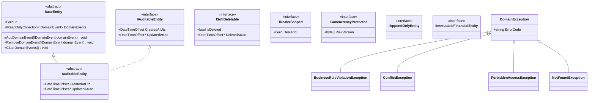
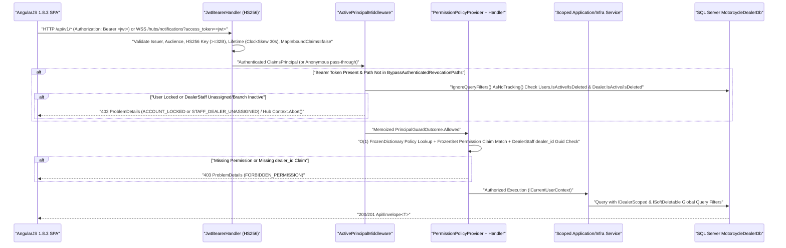
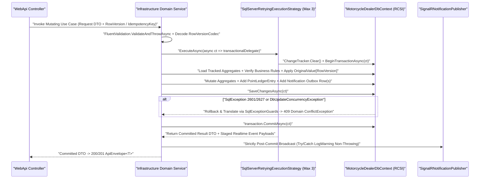

# Detail Design Common Specification (`DD-01`) — Backend & Frontend Cross-Cutting Mechanisms

| Metadata | Canonical Value |
| :--- | :--- |
| **Document ID** | `DD-01-COMMON-V1.2` |
| **Document Title** | Detail Design Specification — Common Primitives, Security (`48` Policies), Persistence, Error Catalog & SPA Core |
| **Project Name** | Motorcycle Dealer & Loyalty Management Platform |
| **Repository** | [https://github.com/quocanhh86/motorcycle-dealer](https://github.com/quocanhh86/motorcycle-dealer) |
| **Backend Assemblies** | `MotorcycleDealer.Domain` · `MotorcycleDealer.Application` · `MotorcycleDealer.Infrastructure` · `MotorcycleDealer.WebApi` (`net10.0`) |
| **Frontend Modules** | `motorcycleDealerApp` · `app.core` · `app.shared` (`AngularJS 1.8.3`, `ng-strict-di`) |
| **Empirical Parity** | Synchronized 1:1 with verified source files through **Phase 9 (`v1.2.0`)** (`48` RBAC policies across `Reviews` & `Warranty`, `27` 3NF tables, `10` SignalR events, `30` UI-Router routes) |

### Related Engineering Specifications
- **Basic Design Master**: [BD_00_BASIC_DESIGN_MASTER.md](../basic-design/BD_00_BASIC_DESIGN_MASTER.md)
- **Peer Detail Design (`DD`) Specs**: [DD_02_DATABASE_AND_TABLE_UPDATES.md](./DD_02_DATABASE_AND_TABLE_UPDATES.md) · [DD_03_API_SPECIFICATIONS.md](./DD_03_API_SPECIFICATIONS.md) · [DD_04_SCREEN_SPECIFICATIONS.md](./DD_04_SCREEN_SPECIFICATIONS.md)
- **Governance & Baseline**: [README.md](../../README.md) · [AGENTS.md](../../AGENTS.md) · [PROGRESS.md](../../PROGRESS.md) · [ARCHITECTURE.md](../ARCHITECTURE.md) · [DATABASE_DESIGN.md](../DATABASE_DESIGN.md) · [DESIGN.md](../DESIGN.md) · [openapi.v1.yaml](../openapi.v1.yaml)

---

## 1. Domain Common Primitives, Value Objects & Pure Engines

All types in `MotorcycleDealer.Domain` (`backend/src/MotorcycleDealer.Domain/`) are pure C# 13 classes, records, structs, and enums with **zero external NuGet or project references** (`ADR-001`).

### 1.1 Entity Base Classes, Marker Contracts & Result/Exception Hierarchy



#### Exact Domain Primitive & Marker Signatures (`MotorcycleDealer.Domain.Common`)

| Type | Source File | Exact Contract & Invariant Enforcement |
| :--- | :--- | :--- |
| `BaseEntity` | `Domain/Common/BaseEntity.cs` | `public Guid Id { get; protected init; } = Guid.CreateVersion7();` — Initializes RFC 9562 time-ordered UUIDv7 keys in C# (paired with SQL Server `DEFAULT NEWSEQUENTIALID()`) to eliminate clustered B-tree page splits. Maintains private `List<IDomainEvent> _domainEvents` with `AddDomainEvent`, `RemoveDomainEvent`, and `ClearDomainEvents`. |
| `IDomainEvent` / `DomainEventBase` | `Domain/Common/IDomainEvent.cs` | `Guid EventId { get; } = Guid.CreateVersion7();` and `DateTimeOffset OccurredAtUtc { get; } = DateTimeOffset.UtcNow;`. |
| `IAuditableEntity` & `AuditableEntity` | `Domain/Common/AuditableEntity.cs` | Adds `DateTimeOffset CreatedAtUtc { get; set; }` and `DateTimeOffset? UpdatedAtUtc { get; set; }`, automatically stamped in UTC by `AuditableEntityInterceptor`. |
| `ISoftDeletable` | `Domain/Common/ISoftDeletable.cs` | `bool IsDeleted { get; set; }` and `DateTimeOffset? DeletedAtUtc { get; set; }`. Implemented on `User`, `Dealer`, `MotorcycleModel`, `CustomerVehicle`, `VoucherCatalog`, and `SparePart` (`6` tables). Filtered globally by `e => !e.IsDeleted`. |
| `IDealerScoped` | `Domain/Common/IDealerScoped.cs` | `Guid DealerId { get; }`. Implemented on all 6 dealer-owned operational tables: `DealerInventory`, `SalesOrder`, `ServiceTimeSlot`, `ServiceBooking`, `ServiceInvoice`, and `TestDriveBooking`. |
| `IConcurrencyProtected` | `Domain/Common/IConcurrencyProtected.cs` | `byte[] RowVersion { get; }`. Automatically configured as `.IsRowVersion()` (`ROWVERSION` / `TIMESTAMP`) on `DealerInventory`, `ServiceTimeSlot`, `ServiceBooking`, `TestDriveBooking`, `LoyaltyAccount`, and `CustomerVoucher` (`6` tables). |
| `IAppendOnlyEntity` | `Domain/Common/IAppendOnlyEntity.cs` | Marker interface on `PointLedgerEntry`. Blocks both `EntityState.Modified` and `EntityState.Deleted` in `AppendOnlyLedgerInterceptor` (`400 IMMUTABLE_LEDGER_VIOLATION`) and `TR_PointLedgerEntries_BlockMutation` (`THROW 50001`). |
| `IImmutableFinancialEntity` | `Domain/Common/IAppendOnlyEntity.cs` | Marker interface on `SalesOrder`, `ServiceInvoice`, and `ServiceInvoiceLineItem`. Blocks `Deleted` on `SalesOrder` and blocks both `Modified` and `Deleted` on `ServiceInvoice` and `ServiceInvoiceLineItem` (`400 IMMUTABLE_FINANCIAL_RECORD_VIOLATION`). |
| `Error` | `Domain/Common/Error.cs` | `public sealed record Error(string Code, string Description)` with `Error.None`, `Error.NullValue` (`VALIDATION_NULL_VALUE`), and factory methods `Validation`, `NotFound`, `Conflict`, `Forbidden`, and `Unprocessable`. |
| `Result` / `Result<TValue>` | `Domain/Common/Result.cs` | Enforces `isSuccess && error != Error.None` -> `InvalidOperationException` and `!isSuccess && error == Error.None` -> `InvalidOperationException`. `Result<TValue>.Value` throws `InvalidOperationException` when `IsFailure` is `true`; supports `implicit operator Result<TValue>(TValue? value)`. |
| `DomainException` & Subtypes | `Domain/Common/*Exception.cs` | `DomainException(string errorCode, string message)` -> `400 Bad Request` (default `"DOMAIN_RULE_VIOLATION"`); `BusinessRuleViolationException` -> `422 Unprocessable Entity`; `ConflictException` -> `409 Conflict` (default `"CONCURRENCY_CONFLICT"`); `ForbiddenAccessException` -> `403 Forbidden` (default `"FORBIDDEN_PERMISSION"`); `NotFoundException` (`ForEntity(entityName, key)`) -> `404 Not Found` (`"RESOURCE_NOT_FOUND"`). |

#### Canonical Domain Enums (`MotorcycleDealer.Domain.Enums`)

| Enum Type | Canonical Members (`1`-based `int` Backing Values, Serialized as Strings via `JsonStringEnumConverter`) |
| :--- | :--- |
| `UserRoleCode` | `Customer = 1`, `DealerStaff = 2`, `Admin = 3` (mirrored as string constants in `Domain.Constants.RoleNames`) |
| `StockStatus` | `Available = 1`, `Reserved = 2`, `Sold = 3`, `Transferred = 4` |
| `SalesOrderStatus` | `Pending = 1`, `Completed = 2`, `Cancelled = 3` |
| `ReminderStatus` | `Pending = 1`, `Sent = 2`, `Booked = 3`, `Completed = 4`, `Dismissed = 5`, `Failed = 6` |
| `BookingStatus` | `Pending = 1`, `Confirmed = 2`, `CheckedIn = 3`, `InProgress = 4`, `Completed = 5`, `Cancelled = 6`, `NoShow = 7` |
| `LoyaltyTierCode` | `Bronze = 1`, `Silver = 2`, `Gold = 3`, `Platinum = 4` |
| `LedgerTransactionType` | `SalesOrderEarn = 1`, `ServiceInvoiceEarn = 2`, `VoucherRedeem = 3`, `VoucherExpireRefund = 4`, `AdminAdjustment = 5`, `WelcomeBonus = 6` |
| `VoucherDiscountType` | `FixedAmount = 1`, `Percentage = 2` |
| `CustomerVoucherStatus` | `Available = 1`, `ReservedOnBooking = 2`, `Used = 3`, `Expired = 4` |
| `NotificationEventType` | `BookingCreated = 1`, `BookingStatusChanged = 2`, `MaintenanceReminderTriggered = 3`, `LoyaltyPointsUpdated = 4`, `TierUpgraded = 5`, `SalesOrderCompleted = 6`, `VoucherRedeemed = 7`, `TestDriveCreated = 8`, `TestDriveStatusChanged = 9` |
| `TestDriveStatus` | `Requested = 1`, `Confirmed = 2`, `Completed = 3`, `Cancelled = 4`, `NoShow = 5` (`v1.1.0`) |
| `SparePartCategory` | `EngineOil = 1`, `Filter = 2`, `Brakes = 3`, `Transmission = 4`, `Tires = 5`, `Electrical = 6`, `Accessory = 7` (`v1.1.0`) |

---

### 1.2 ISO 3779 `Vin` Value Object (`Domain/ValueObjects/Vin.cs`)

`public sealed partial record Vin` encapsulates Vehicle Identification Number validation in strict compliance with ISO 3779:
- **Constants**: `CanonicalLength = 17` and source-generated regex `Pattern = "^[A-HJ-NPR-Z0-9]{17}$"` (`[GeneratedRegex(Pattern, RegexOptions.CultureInvariant)]`).
- **Factory & Parsing Methods**:
  - `public static Result<Vin> CreateResult(string? rawVin)`:
    1. Rejects `null`/whitespace -> `Error.Validation("INVALID_VIN_LENGTH", "VIN must be exactly 17 uppercase alphanumeric characters (ISO 3779).")`.
    2. Trims outer whitespace (`rawVin.Trim()`) and verifies `trimmed.Length == 17` -> `INVALID_VIN_LENGTH`.
    3. Scans character-by-character for `'I'`, `'O'`, or `'Q'`, returning position-specific `Error.Validation("INVALID_VIN_CHAR", $"VIN contains ISO 3779 forbidden character '{ch}' at position {i + 1} (I, O, and Q are prohibited).")`.
    4. Evaluates `Iso3779Regex().IsMatch(trimmed)` -> `INVALID_VIN_FORMAT` (rejecting lowercase, punctuation, or non-ASCII characters).
  - `public static Vin Create(string? rawVin)`: Calls `CreateResult` and throws `DomainException(result.Error.Code, result.Error.Description)` (`400`) on failure.
  - `public static bool TryCreate(string? rawVin, out Vin? vin)`: Non-throwing boolean parser; implicit conversion `public static implicit operator string(Vin vin)` returns `vin.Value`.
- **Application / API Boundary Normalization**: Request validators and intake services (`DealerInventoryService`, `CustomerVehicleService`) normalize incoming user input via `.Trim().ToUpperInvariant()` prior to invoking `Vin.Create(normalizedVin)`, while the AngularJS `vinInput` directive strips whitespace and uppercases keystrokes live in the browser.

---

### 1.3 Pure Loyalty & Voucher Calculation Engine (`Domain/Services/LoyaltyPointsCalculator.cs`)

`public static class LoyaltyPointsCalculator` is the single deterministic domain oracle for loyalty point accrual, 4-tier progression, voucher code generation alphabets, and voucher discount caps (`ADR-003`, `FR-05`):

1. **Canonical Constants**:
   - `BaseUnitVnd = 10_000m` (`10,000 VND = 1 base point`).
   - `VoucherCodeSuffixAlphabet = "ABCDEFGHJKLMNPRSTUVWXYZ0123456789"` — **33-character** uppercase alphanumeric alphabet explicitly excluding `'I'`, `'O'`, and `'Q'` to prevent visual confusion at workshop counters (paired with `RandomNumberGenerator` to generate `{CodePrefix}-{8-char suffix}` in `VoucherService`).
   - **4-Tier Thresholds & Multipliers**:
     - `Bronze`: `0` qualifying points (`1.00m` multiplier)
     - `Silver`: `500` qualifying points (`1.20m` multiplier)
     - `Gold`: `2,000` qualifying points (`1.50m` multiplier)
     - `Platinum`: `5,000` qualifying points (`2.00m` multiplier)

2. **Two-Step Floor Point Accrual (`CalculateBasePoints` & `CalculatePointsEarned`)**:
   ```csharp
   public static int CalculateBasePoints(decimal netPaidAmount)
   {
       if (netPaidAmount < 0m)
           throw new DomainException("INVALID_NET_PAID_AMOUNT", "Net paid amount cannot be negative.");
       return (int)Math.Floor(netPaidAmount / BaseUnitVnd);
   }

   public static int CalculatePointsEarned(decimal netPaidAmount, decimal tierMultiplier)
   {
       if (netPaidAmount < 0m)
           throw new DomainException("INVALID_NET_PAID_AMOUNT", "Net paid amount cannot be negative.");
       if (tierMultiplier < 1.00m || tierMultiplier > 10.00m)
           throw new DomainException("INVALID_TIER_MULTIPLIER", "Tier multiplier must be between 1.00 and 10.00.");

       var basePoints = Math.Floor(netPaidAmount / BaseUnitVnd);
       return (int)Math.Floor(basePoints * tierMultiplier);
   }
   ```
   - **Zero Floating-Point Drift (`RISK-03`)**: Backend C# performs exact base-10 `decimal` arithmetic (`128-bit`), while the AngularJS SPA (`LoyaltyCalculator.calculatePoints` in `permissions.constants.js`) mirrors the exact same result using integer basis-point scaling (`multiplierScaled = Math.round(safeMultiplier * 10000); Math.floor((basePoints * multiplierScaled) / 10000)`), preventing IEEE-754 binary float drift (such as `29 * 1.2` evaluating to `34.800000000000004` or `19.999999999999996` truncating down).
   - **Pre-Transaction Multiplier Rule**: `PointsEarned` on a `SalesOrder` (`FinalAmount`) or `ServiceInvoice` (`NetPaidAmount`) is always computed using the customer's **active tier multiplier prior to the transaction**, and the resulting `LifetimeQualifyingPointsAfter = checked(currentLifetimeQualifyingPoints + pointsEarned)` immediately evaluates whether the account upgrades to a higher tier for subsequent transactions.

3. **Tier Evaluation & Monotonic Ratchet (`EvaluateTier`, `EvaluateAccrualPreview`, `EvaluateVoucherRedemption`)**:
   - `EvaluateTier(int lifetimeQualifyingPoints)` maps `>= 5000 -> Platinum`, `>= 2000 -> Gold`, `>= 500 -> Silver`, `< 500 -> Bronze` (throwing `INVALID_QUALIFYING_POINTS` if `< 0`).
   - In transactional services (`SalesOrderService`, `ServiceInvoiceService`, `LoyaltyService`), live `dbo.LoyaltyTiers` rows (`Where(t => t.IsActive).OrderBy(t => t.RankOrder)`) are evaluated so admin-calibrated thresholds take effect dynamically while enforcing `resultingTier.RankOrder >= currentTier.RankOrder` (tiers never downgrade on voucher spending).
   - `EvaluateVoucherRedemption(pointsCost, currentAvailablePoints, currentLifetimeQualifyingPoints, currentTier)` validates `pointsCost > 0` (`INVALID_POINTS_COST`) and `pointsCost <= currentAvailablePoints` (`422 INSUFFICIENT_LOYALTY_POINTS`), deducting `AvailablePoints` ONLY while keeping `LifetimeQualifyingPointsAfter == currentLifetimeQualifyingPoints`.

4. **Voucher Discount Evaluator (`CalculateVoucherDiscount`)**:
   - Signature: `CalculateVoucherDiscount(string discountType, decimal discountValue, decimal? maxDiscountAmount, decimal grossAmount)`.
   - Validates `grossAmount >= 0m` (`INVALID_GROSS_AMOUNT`) and `discountValue >= 0m` (`INVALID_DISCOUNT_VALUE`).
   - **`Percentage` Mode**: Validates `discountValue <= 100m` (`INVALID_DISCOUNT_PERCENTAGE`), computes `rawDiscount = Math.Round(grossAmount * (discountValue / 100m), 2, MidpointRounding.AwayFromZero)`, caps by `Math.Min(rawDiscount, Math.Max(0m, maxDiscountAmount.Value))` when `maxDiscountAmount.HasValue`, and clamps to `Math.Min(rawDiscount, grossAmount)`.
   - **`FixedAmount` Mode**: Takes `discountValue`, applies optional positive `maxDiscountAmount` cap, and clamps to `Math.Min(rawDiscount, grossAmount)` so net payable never drops below `0.00 VND`.
   - Any other `discountType` throws `DomainException("INVALID_DISCOUNT_TYPE", $"Unsupported voucher discount type '{discountType}'.")`.

---

### 1.4 Zero-Allocation `RowVersionCodec` (`Application/Common/Concurrency/RowVersionCodec.cs`)

SQL Server `ROWVERSION` (`BINARY(8)`) tokens travel over JSON APIs as Base64 strings (e.g., `"AAAAAAAAB9E="`). `RowVersionCodec` validates and decodes tokens without heap buffer allocations on invalid inputs:

```csharp
public static class RowVersionCodec
{
    public const int ByteLength = 8;

    public static string Encode(byte[]? rowVersion) =>
        rowVersion is { Length: > 0 } ? Convert.ToBase64String(rowVersion) : string.Empty;

    public static bool IsValidRequiredBase64(string? rawBase64)
    {
        if (string.IsNullOrWhiteSpace(rawBase64)) return false;
        Span<byte> buffer = stackalloc byte[16];
        return Convert.TryFromBase64Chars(rawBase64.AsSpan().Trim(), buffer, out var bytesWritten) &&
               bytesWritten == ByteLength;
    }

    public static bool IsValidOptionalBase64(string? rawBase64) =>
        string.IsNullOrWhiteSpace(rawBase64) || IsValidRequiredBase64(rawBase64);

    public static byte[] DecodeRequiredOrThrow(string? rawBase64); // Throws 400 INVALID_ROW_VERSION
    public static byte[]? DecodeOptionalOrThrow(string? rawBase64);
}
```

- **`400` vs `409` Concurrency Contract**:
  - Malformed Base64 or decoded byte length `!= 8` fails `FluentValidation` (`RowVersionCodec.IsValidRequiredBase64` -> `400 VALIDATION_FAILED`) or throws `DomainException("INVALID_ROW_VERSION")` (`400 Bad Request`).
  - Valid 8-byte Base64 that differs from the current database `entity.RowVersion` (`!entity.RowVersion.AsSpan().SequenceEqual(expectedBytes)`) or triggers EF Core `DbUpdateConcurrencyException` (`OriginalValue = expectedBytes` on `UPDATE [Table] SET [Columns] WHERE [Id] = @p0 AND [RowVersion] = @p1` returning `0` rows) throws `ConflictException` -> **`409 Conflict` (`CONCURRENCY_CONFLICT` or domain-specific `SLOT_CAPACITY_EXHAUSTED`)**.
- **Synthetic Timestamp Concurrency on `LoyaltyTiers`**: Because `dbo.LoyaltyTiers` is a 4-row reference table without a physical `ROWVERSION` column, `LoyaltyService.ComputeTierConcurrencyBytes` encodes `(tier.UpdatedAtUtc ?? tier.CreatedAtUtc).UtcTicks` via `BinaryPrimitives.WriteInt64BigEndian` into an exact 8-byte buffer compatible with `RowVersionCodec`.

### 1.5 Document Numbering & SHA-256 Printable Receipt Seal (`v1.1.0` – `v1.2.0`)
- **`VoucherAndDocumentNumberHelper` (`Application/Common/Services/VoucherAndDocumentNumberHelper.cs`)**: Centralizes collision-free human-readable document numbers (`SO-yyyyMMdd-XXXXXX`, `INV-yyyyMMdd-XXXXXX`, `TD-yyyyMMdd-XXXXXX`, `REV-yyyyMMdd-XXXXXX`, `WC-yyyyMMdd-XXXXXX`) seeded from `Guid.CreateVersion7()` entropy alongside normalized uppercase voucher code lookup helpers shared across `SalesOrderService`, `ServiceInvoiceService`, `TestDriveService`, `ServiceReviewService` (`Permissions.Reviews.*`), and `WarrantyClaimService` (`Permissions.Warranty.*`).
- **`ReceiptVerificationHash` (`Application/Features/Invoices/ServiceInvoiceContracts.cs`)**: Computes deterministic 16-character uppercase hex SHA-256 verification seals (`Convert.ToHexString(SHA256.HashData(utf8))[..16]`) over canonical invariant strings `SVC|{invoiceId:D}|{invoiceNumber}|{netPaidAmount:0.00}` and `SLS|{salesOrderId:D}|{orderNumber}|{finalAmount:0.00}` for printable receipts (`RCP-SVC-*` and `RCP-SLS-*`).

---

## 2. Authentication, RBAC & Multi-Dealer Security Pipeline

### 2.1 End-to-End Request & WebSocket Security Sequence



### 2.2 Password Hashing (`Pbkdf2PasswordHasher`)

`MotorcycleDealer.Infrastructure.Identity.Pbkdf2PasswordHasher` (`IPasswordHasher`) implements memory-hardened, timing-safe password hashing:
- **Parameters**: `AlgorithmPrefix = "PBKDF2-SHA512"`, `DefaultIterations = 210_000` (accepting `10,000 .. 1,000,000` on verification to reject DoS iteration bombs), `SaltByteLength = 16` (`128-bit`), `SubkeyByteLength = 64` (`512-bit`).
- **Serialized Hash Format**: `PBKDF2-SHA512$210000$<Base64Salt_24chars>$<Base64Subkey_88chars>`.
- **Zero-Heap-Leak Memory Hygiene**: Allocates `Span<byte> salt = stackalloc byte[16]`, `Span<byte> subkey = stackalloc byte[64]`, and `Span<byte> utf8StackBuffer = stackalloc byte[512]` (for passwords `<= 512` UTF-8 bytes), wiping every buffer inside `finally` blocks via `CryptographicOperations.ZeroMemory(buffer)`.
- **Constant-Time Anti-Enumeration**: `VerifyPassword` compares derived subkeys via `CryptographicOperations.FixedTimeEquals`. When a login email does not exist (`AuthService.LoginAsync` line `217`) or a stored hash is malformed, `PerformConstantTimeDummyWork(password)` executes a full `210,000`-iteration `PBKDF2-SHA512` derivation against `DummySalt`/`DummySubkey` so attackers cannot enumerate valid emails via response timing.

### 2.3 JWT Access Tokens (`JwtTokenService`) & Refresh Token Family Rotation (`AuthService`)

1. **JWT Claims Contract (`Domain.Constants.JwtClaimNames`)**:
   - Header: `{"alg":"HS256","typ":"JWT"}`.
   - Payload claims (`MapInboundClaims = false`):
     - `sub`: `UserId.ToString("D")`
     - `email`: User email
     - `full_name`: User display name
     - `role`: Canonical primary role (`Customer`, `DealerStaff`, or `Admin`)
     - `dealer_id`: Included **only** when `subject.DealerId` is a non-empty `Guid` (`DealerStaff`)
     - `permissions`: JSON string array of all granted `Permissions.*` codes loaded from `RolePermissions`
     - `jti`: `Guid.CreateVersion7().ToString("D")`
     - `iat`, `nbf`, `exp` (`AccessTokenMinutes = 15`), `iss` (`"MotorcycleDealer.WebApi"`), `aud` (`"MotorcycleDealer.Spa"`).
2. **Refresh Token Storage & Atomic RCSI Rotation (`RefreshTokenAsync`)**:
   - Raw refresh tokens are `64` CSPRNG bytes (`512-bit` entropy) encoded as Base64Url; **only** the lowercase hex `SHA-256` digest (`ComputeRefreshTokenHash`) is persisted in `dbo.RefreshTokens.TokenHash` (`UQ_RefreshTokens_TokenHash`, `RefreshTokenDays = 7`).
   - **Replay Breach Detection (`MOD-01` Family Cascade)**: Every login/registration starts a new `TokenFamilyId = Guid.CreateVersion7()`. During `POST /api/v1/auth/refresh`:
     - If `existingToken` already has `ReplacedByTokenId != null`, `ReplacedByTokenHash != null`, or `RevocationReason == "Rotated"`, `AuthService` immediately revokes **every** active token sharing `existingToken.TokenFamilyId` (`RevocationReason = "ReuseDetected"`), commits the revocation transaction, logs a security warning, and returns `401 REFRESH_TOKEN_REUSE_DETECTED`.
     - Under concurrent refresh races on Read Committed Snapshot Isolation (`RCSI`), rotation claims the token via an atomic SQL Compare-And-Swap (`CAS`) statement:
       ```csharp
       var claimedRows = await _dbContext.RefreshTokens
           .Where(rt => rt.Id == existingToken.Id && rt.RevokedAtUtc == null)
           .ExecuteUpdateAsync(setters => setters
               .SetProperty(rt => rt.RevokedAtUtc, utcNow)
               .SetProperty(rt => rt.ReplacedByTokenHash, successorTokenHash)
               .SetProperty(rt => rt.RevocationReason, "Rotated"), cancellationToken);
       ```
       SQL Server acquires an `U -> X` row lock and re-evaluates `RevokedAtUtc IS NULL` against the latest committed row version. If `claimedRows == 0`, a concurrent replay occurred: the entire `TokenFamilyId` is revoked (`ReuseDetected`) and `401 REFRESH_TOKEN_REUSE_DETECTED` is returned.

### 2.4 `PermissionPolicyProvider`, `PermissionAuthorizationHandler` & `ActivePrincipalMiddleware`

1. **`PermissionPolicyProvider` (`WebApi/Security/PermissionPolicyProvider.cs`)**:
   - Precomputes a static `FrozenDictionary<string, Task<AuthorizationPolicy?>>` across all `40` `Permissions.All` strings at startup, resolving `[HasPermission(Permissions.<Module>.<Action>)]` in **`O(1)` time with zero per-request allocations**.
2. **`HttpCurrentUserContext` & `PermissionAuthorizationHandler`**:
   - `HttpCurrentUserContext.GetOrExtractPermissions` parses both multi-valued `permissions`/`permission` claims and serialized JSON array claims into an immutable `FrozenSet<string>(StringComparer.Ordinal)`, caching the parsed set inside `HttpContext.Items[CachedPermissionsItemKey]` so policy evaluation and downstream service `HasPermission(permission)` checks parse claims at most once per HTTP request.
   - `PermissionAuthorizationHandler` enforces that any `DealerStaff` principal **must** carry a valid non-empty `Guid` in claim `"dealer_id"` before any permission requirement can succeed.
3. **`ActivePrincipalMiddleware` (`WebApi/Security/ActivePrincipalMiddleware.cs`) & `NotificationHub` Parity**:
   - Placed in `Program.cs` immediately after `app.UseAuthentication()` and **before** `app.UseAuthorization()`.
   - Whenever `httpContext.User.Identity?.IsAuthenticated == true` and the request path is not in `BypassAuthenticatedRevocationPaths` (`/api/v1/auth/login`, `/api/v1/auth/register`, `/api/v1/auth/refresh`, `/health`, `/api/v1/health`), it executes `EvaluatePersistedPrincipalAsync` (memoized in `HttpContext.Items[VerifiedPrincipalOutcomeKey]`):
     - Queries `dbo.Users.IgnoreQueryFilters().AsNoTracking()` projecting `{ IsActive, IsDeleted, DealerId, StaffEmployeeCode, DealerUnavailable }`.
     - If `!state.IsActive || state.IsDeleted`, short-circuits with `403 Forbidden` (`errorCode: "ACCOUNT_LOCKED"`).
     - If the caller is `DealerStaff` and `DealerId` is null/empty, `StaffEmployeeCode` is blank, or the assigned `Dealer` is missing/inactive/deleted, short-circuits with `403 Forbidden` (`errorCode: "STAFF_DEALER_UNASSIGNED"`).
   - **Dual-Mode `[AllowAnonymous]` Protection**: Because `ActivePrincipalMiddleware` runs prior to endpoint authorization, supplying a Bearer token from a locked account to dual-mode `[AllowAnonymous]` endpoints (`/api/v1/dealers`, `/api/v1/motorcycles`, `/api/v1/inventories`, `/api/v1/time-slots`, `/api/v1/loyalty/tiers`, `/api/v1/vouchers/catalog`) still triggers immediate `403 ACCOUNT_LOCKED` rejection.
   - **SignalR Parity**: `NotificationHub.OnConnectedAsync` invokes the exact same `ActivePrincipalMiddleware.EvaluatePersistedPrincipalAsync` inside an `AsyncServiceScope` and calls `Context.Abort()` if `!outcome.IsAllowed`.

---

## 3. Persistence, Concurrency, Transaction & SignalR Post-Commit Pipeline

### 3.1 `MotorcycleDealerDbContext` Global Query Filters & Write Guard (`ADR-002`)

In `MotorcycleDealerDbContext.OnModelCreating`, every root entity type is inspected via reflection to attach precision, concurrency, and tenant/soft-delete filters automatically:
- **Global Monetary Precision**: `ConfigureConventions` binds all `decimal` and `decimal?` properties to `DECIMAL(18,2)`.
- **Automatic Concurrency Mapping**: Every `IConcurrencyProtected` entity maps `Property("RowVersion").IsRowVersion()`.
- **Three Composable Global Query Filter Templates**:
  1. `IDealerScoped` only (`DealerInventory`, `SalesOrder`, `ServiceTimeSlot`, `ServiceBooking`, `ServiceInvoice`, `TestDriveBooking` — `6` tables):
     `!IsDealerStaffScopeActive || (CurrentDealerIdOrEmpty != Guid.Empty && e.DealerId == CurrentDealerIdOrEmpty)`
  2. `ISoftDeletable` only (`User`, `Dealer`, `MotorcycleModel`, `CustomerVehicle`, `VoucherCatalog`, `SparePart` — `6` tables):
     `!e.IsDeleted`
  3. Combined `IDealerScoped + ISoftDeletable` (future-proofed hook): combines both predicates.
- **Defense-in-Depth Write Guard (`EnforceDealerScopeWriteGuard`)**: Overridden on both `SaveChanges` and `SaveChangesAsync`. Whenever `IsDealerStaffScopeActive` is `true`, inspects `ChangeTracker.Entries<IDealerScoped>()` across `Added`, `Modified`, and `Deleted` states; if `assignedDealerId` is missing or `entry.Entity.DealerId != assignedDealerId.Value`, throws `ForbiddenAccessException(message, "FORBIDDEN_DEALER_SCOPE")` before any SQL statement executes.

### 3.2 EF Core SaveChanges Interceptors (`AuditableEntityInterceptor` & `AppendOnlyLedgerInterceptor`)

| Interceptor | Registered Lifetime | Exact `SavingChanges` / `SavingChangesAsync` Behavior |
| :--- | :---: | :--- |
| `AuditableEntityInterceptor` | `Scoped` | Reads `utcNow = _dateTimeProvider.UtcNow`. On `IAuditableEntity`: if `Added` and `CreatedAtUtc == default`, sets `CreatedAtUtc = utcNow`; if `Modified`, locks `Property(CreatedAtUtc).IsModified = false` and stamps `UpdatedAtUtc = utcNow`. On `ISoftDeletable`: if `Modified`, `IsDeleted == true`, and `DeletedAtUtc is null`, stamps `DeletedAtUtc = utcNow`. |
| `AppendOnlyLedgerInterceptor` | `Scoped` | Scans `ChangeTracker.Entries()` in `Modified` or `Deleted` state:<br>1. `IAppendOnlyEntity` / `PointLedgerEntries` (`Modified` or `Deleted`) -> throws `DomainException("IMMUTABLE_LEDGER_VIOLATION", message)` (backed by SQL Server trigger `TR_PointLedgerEntries_BlockMutation` throwing error `50001`).<br>2. `ServiceInvoice` / `ServiceInvoices` and `ServiceInvoiceLineItem` / `ServiceInvoiceLineItems` (`Modified` or `Deleted`) -> throws `DomainException("IMMUTABLE_FINANCIAL_RECORD_VIOLATION", message)`.<br>3. `IImmutableFinancialEntity` / `SalesOrder` (`Deleted`) -> throws `DomainException("IMMUTABLE_FINANCIAL_RECORD_VIOLATION", message)`. |

### 3.3 SQL Server Execution Strategy, ACID Transactions & Post-Commit SignalR Pattern

`Infrastructure/DependencyInjection.cs` configures `UseSqlServer` with `UseCompatibilityLevel(150)` and `EnableRetryOnFailure(maxRetryCount: 3, maxRetryDelay: TimeSpan.FromSeconds(5), errorNumbersToAdd: null)`. Because EF Core's `SqlServerRetryingExecutionStrategy` forbids bare `BeginTransactionAsync()` calls outside a retry delegate, every multi-entity write workflow (`AuthService`, `DealerAdministrationService`, `SalesOrderService`, `ServiceBookingService`, `ServiceInvoiceService`, `LoyaltyService`, `VoucherService`, `DatabaseSeeder`) implements this exact canonical pattern:



- **Key Reliability Guarantees**:
  1. **Zero Phantom Notifications**: `SignalRNotificationPublisher` is **never** awaited inside `BeginTransactionAsync`; clients never receive `BookingCreated`, `LoyaltyPointsUpdated`, or `TierUpgraded` for a transaction that subsequently rolls back on a `RowVersion` or unique constraint failure.
  2. **Durable Inbox Outbox-First**: The `dbo.Notifications` row is inserted and committed **inside** the SQL transaction using the exact same `NotificationId` (`Guid.CreateVersion7()`) carried in the post-commit SignalR payload. Even if a client's WebSocket is temporarily offline during `SignalRNotificationPublisher.Publish*Async`, the notification is durably stored and reconciled on `signalr:reconnected` without duplicate cards (`NotificationStore.prependNotification` deduplicates by `notificationId`).
  3. **`SqlExceptionGuards` (`Infrastructure/Persistence/SqlExceptionGuards.cs`)**: Inspects `DbUpdateException.InnerException is SqlException { Number: 2601 or 2627 }` and inspects the violated unique index name (`UQ_PointLedgerEntries_IdempotencyKey`, `UQ_DealerInventories_VIN`, `UQ_CustomerVehicles_VIN`, `UQ_CustomerVehicles_LicensePlate`, `UQ_ServiceInvoices_BookingId`, `UQ_VoucherCatalogs_CodePrefix`, `UQ_Dealers_Code`, `UQ_MotorcycleModels_ModelCode`, `UQ_MaintenanceRules_Model_Code`) to return deterministic `409 Conflict` `errorCode`s instead of `500 Internal Server Error`.

---

## 4. Standard HTTP Envelopes & Complete `RFC 7807 ProblemDetails` Error Catalog

### 4.1 Success Response Envelopes (`camelCase` JSON + `JsonStringEnumConverter`)

1. **Single-Resource / List Envelope (`ApiEnvelope<T>` in `AuthContracts.cs`)**:
   ```json
   {
     "success": true,
     "data": {
       "tierCode": "Gold",
       "pointsMultiplier": 1.50,
       "availablePoints": 1450
     },
     "meta": {
       "timestampUtc": "2026-11-23T01:00:00.0000000+00:00",
       "traceId": "00-4bf92f3577b34da6a3ce929d0e0e4736-00f067aa0ba902b7-00"
     }
   }
   ```

2. **Paginated Collection Envelope (`PagedApiEnvelope<T>` in `ShowroomContracts.cs` + `PaginationQuery` `DefaultPageNumber=1, DefaultPageSize=20, MaxPageSize=100`)**:
   ```json
   {
     "success": true,
     "data": [],
     "pagination": {
       "pageNumber": 1,
       "pageSize": 20,
       "totalCount": 42,
       "totalPages": 3,
       "hasPreviousPage": false,
       "hasNextPage": true
     },
     "meta": {
       "timestampUtc": "2026-11-23T01:00:00.0000000+00:00",
       "traceId": "00-4bf92f3577b34da6a3ce929d0e0e4736-00f067aa0ba902b7-00"
     }
   }
   ```

3. **Persistent Notification Inbox Envelope (`NotificationFeedEnvelope` in `NotificationContracts.cs`)**:
   ```json
   {
     "success": true,
     "data": [],
     "unreadCount": 3,
     "pagination": {
       "pageNumber": 1,
       "pageSize": 30,
       "totalCount": 12,
       "totalPages": 1,
       "hasPreviousPage": false,
       "hasNextPage": false
     },
     "meta": {
       "timestampUtc": "2026-11-23T01:00:00.0000000+00:00",
       "traceId": "00-4bf92f3577b34da6a3ce929d0e0e4736-00f067aa0ba902b7-00",
       "unreadCount": 3
     }
   }
   ```

### 4.2 Standardized `RFC 7807 ProblemDetails` Wire Contract (`GlobalExceptionHandler.cs`)

Every `4xx` and `5xx` response (whether thrown as an exception or emitted by ASP.NET Core routing/auth middleware via `app.UseStatusCodePages`) is serialized with `Content-Type: application/problem+json`:

```json
{
  "type": "https://httpstatuses.io/400",
  "title": "Validation Failed",
  "status": 400,
  "detail": "One or more request validation rules failed.",
  "instance": "/api/v1/vehicles",
  "errorCode": "VALIDATION_FAILED",
  "traceId": "00-9c81a2b4d5e6f708192a3b4c5d6e7f80-1122334455667788-00",
  "errors": {
    "vin": [
      "VIN contains ISO 3779 forbidden character 'O' at position 5 (I, O, and Q are prohibited)."
    ]
  }
}
```
- **Production Stack-Trace Masking**: For unhandled `500` exceptions, `detail` exposes `exception.Message` **only** when `IHostEnvironment.IsDevelopment()` is `true`; in all other environments it returns `"An unexpected server error occurred. Provide the traceId when contacting support."`.

### 4.3 Complete Empirical `errorCode` Catalog (`Backend + Frontend`)

| `errorCode` | HTTP Status | Exception / Origin | Trigger Condition | SPA Client Handling |
| :--- | :---: | :--- | :--- | :--- |
| `VALIDATION_FAILED` | `400` | `FluentValidation.ValidationException` | Request DTO/query failed `AbstractValidator<T>` rules (`errors` dictionary populated) | `ProblemDetailsMapper.applyToForm` marks fields invalid (`server`) |
| `BAD_REQUEST` | `400` | `UseStatusCodePages` (`400`) | Malformed JSON body or unparseable route/query parameter | Form/toast error banner |
| `DOMAIN_RULE_VIOLATION` | `400` | `DomainException` (default fallback) | Generic domain invariant guard violated | Form/toast error banner |
| `VALIDATION_NULL_VALUE` | `400` | `Error.NullValue` / `Result<T>` | Required domain value was `null` | Form/toast error banner |
| `INVALID_ROW_VERSION` | `400` | `RowVersionCodec.DecodeRequiredOrThrow` | Missing, non-Base64, or non-8-byte `rowVersion` token | Prompt refresh and reload latest entity |
| `INVALID_VIN_LENGTH` | `400` | `Vin.CreateResult` | Trimmed `VIN` is blank or length `!= 17` | Highlight `vin-input` field error |
| `INVALID_VIN_CHAR` | `400` | `Vin.CreateResult` | `VIN` contains ISO 3779 prohibited letter `'I'`, `'O'`, or `'Q'` | Highlight `vin-input` forbidden character warning |
| `INVALID_VIN_FORMAT` | `400` | `Vin.CreateResult` | `VIN` contains non-uppercase ASCII or non-alphanumeric characters | Highlight `vin-input` format error |
| `INVALID_USER_ID` | `400` | `RefreshToken.Create` | Empty `Guid` `UserId` supplied to domain factory | Reject request |
| `INVALID_TOKEN_FAMILY` | `400` | `RefreshToken.Create` | Empty `Guid` `TokenFamilyId` supplied to domain factory | Reject request |
| `INVALID_REFRESH_EXPIRY` | `400` | `RefreshToken.Create` | `ExpiresAtUtc <= CreatedAtUtc` | Reject request |
| `INVALID_NET_PAID_AMOUNT` | `400` | `LoyaltyPointsCalculator` | Negative `netPaidAmount` passed to point calculator | Reject calculation |
| `INVALID_TIER_MULTIPLIER` | `400` | `LoyaltyPointsCalculator` | `tierMultiplier < 1.00m` or `> 10.00m` | Highlight multiplier input |
| `INVALID_QUALIFYING_POINTS` | `400` | `LoyaltyPointsCalculator.EvaluateTier` | Negative `lifetimeQualifyingPoints` | Reject calculation |
| `INVALID_POINT_BALANCE` | `400` | `LoyaltyPointsCalculator` | Negative current point balance | Reject calculation |
| `INVALID_POINTS_COST` | `400` | `LoyaltyPointsCalculator` | `pointsCost <= 0` on voucher redemption | Highlight points cost input |
| `INVALID_GROSS_AMOUNT` | `400` | `LoyaltyPointsCalculator` | Negative `grossAmount` on voucher discount evaluation | Highlight labor/parts input |
| `INVALID_DISCOUNT_VALUE` | `400` | `LoyaltyPointsCalculator` | Negative `discountValue` | Highlight discount input |
| `INVALID_DISCOUNT_PERCENTAGE` | `400` | `LoyaltyPointsCalculator` | Percentage voucher `discountValue > 100m` | Highlight percentage cap |
| `INVALID_DISCOUNT_TYPE` | `400` | `LoyaltyPointsCalculator` | Discount type is neither `FixedAmount` nor `Percentage` | Highlight discount type selector |
| `IMMUTABLE_LEDGER_VIOLATION` | `400` | `AppendOnlyLedgerInterceptor` | Attempted EF Core `UPDATE` or `DELETE` on `PointLedgerEntries` | Blocked by architecture guardrail |
| `IMMUTABLE_FINANCIAL_RECORD_VIOLATION` | `400` | `AppendOnlyLedgerInterceptor` | Attempted `UPDATE`/`DELETE` on `ServiceInvoices` or `DELETE` on `SalesOrders` | Blocked by architecture guardrail |
| `UNAUTHORIZED` | `401` | `JwtBearer` / `UnauthorizedAccessException` | Missing, malformed, or expired Bearer JWT access token | `AuthHttpInterceptor` queues single-flight `/auth/refresh` |
| `INVALID_CREDENTIALS` | `401` | `AuthService.LoginAsync` | Unknown email or wrong password on `/api/v1/auth/login` | Display invalid credentials alert on `SCR-PUB-02A` |
| `INVALID_REFRESH_TOKEN` | `401` | `AuthService.RefreshTokenAsync` | Unknown, revoked, or expired refresh token | Clear session & redirect to `/login?reason=sessionExpired` |
| `REFRESH_TOKEN_REUSE_DETECTED` | `401` | `AuthService.RefreshTokenAsync` | Replay/race on already-rotated token (`TokenFamilyId` revoked) | Clear session & force re-authentication |
| `FORBIDDEN_PERMISSION` | `403` | `PermissionAuthorizationHandler` / `ForbiddenAccessException` | Caller lacks required `Permissions.<Module>.<Action>` policy | Redirect transition to `/403` or show toast |
| `FORBIDDEN_DEALER_SCOPE` | `403` | `MotorcycleDealerDbContext` / Services | `DealerStaff` attempted to read or mutate another dealership's `DealerId` | Show tenant isolation warning toast |
| `FORBIDDEN_RESOURCE_OWNER` | `403` | Ownership Guards in Services | `Customer` attempted to view/cancel/update another customer's vehicle, booking, voucher, invoice, or notification | Show ownership denial warning |
| `ACCOUNT_LOCKED` | `403` | `ActivePrincipalMiddleware` / `AuthService` | `User.IsActive == false` or `User.IsDeleted == true` | `AuthHttpInterceptor` tears down session & SignalR, redirects to `/login` |
| `STAFF_DEALER_UNASSIGNED` | `403` | `ActivePrincipalMiddleware` / `AuthService` | `DealerStaff` lacks `DealerId`/`StaffEmployeeCode` or assigned `Dealer` is inactive/deleted | `AuthHttpInterceptor` tears down session & SignalR, redirects to `/login` |
| `RESOURCE_NOT_FOUND` | `404` | `NotFoundException` / `UseStatusCodePages` | Requested entity ID (or tenant-filtered record) does not exist | Render empty/not-found state |
| `METHOD_NOT_ALLOWED` | `405` | `UseStatusCodePages` (`405`) | Unsupported HTTP verb for matched route | Toast warning |
| `CONCURRENCY_CONFLICT` | `409` | `DbUpdateConcurrencyException` / `ConflictException` | `RowVersion` mismatch on concurrent update | Reload latest entity/wallet `rowVersion` and prompt retry |
| `DUPLICATE_EMAIL` | `409` | `AuthService` / `DealerAdministrationService` | Email already exists in `dbo.Users` | Highlight `email` field conflict |
| `DUPLICATE_PHONE` | `409` | `AuthService` / `DealerAdministrationService` | `PhoneNumber` already exists in `dbo.Users` | Highlight `phoneNumber` field conflict |
| `DUPLICATE_EMPLOYEE_CODE` | `409` | `DealerAdministrationService` | `StaffEmployeeCode` already assigned (`UQ_Users_StaffEmployeeCode`) | Highlight employee badge input |
| `DUPLICATE_ACCOUNT` | `409` | `AuthService` / `DealerAdministrationService` | Concurrent unique index violation on user registration/provisioning | Prompt user to check email/phone/badge |
| `DUPLICATE_DEALER_CODE` | `409` | `DealerAdministrationService` | Dealership `Code` already exists (`UQ_Dealers_Code`) | Highlight branch code input |
| `DUPLICATE_MODEL_CODE` | `409` | `ShowroomCatalogService` | `ModelCode` already exists (`UQ_MotorcycleModels_ModelCode`) | Highlight model code input |
| `DUPLICATE_MILESTONE_CODE` | `409` | `ShowroomCatalogService` | `(MotorcycleModelId, MilestoneCode)` already exists | Highlight milestone code input |
| `DUPLICATE_VIN` | `409` | `DealerInventoryService` / `CustomerVehicleService` / `SalesOrderService` | 17-char `VIN` already exists in `DealerInventories` or `CustomerVehicles` | Highlight `VIN` input conflict |
| `DUPLICATE_ENGINE_NUMBER` | `409` | `DealerInventoryService` | `EngineNumber` already exists (`UQ_DealerInventories_EngineNumber`) | Highlight engine number input |
| `DUPLICATE_LICENSE_PLATE` | `409` | `CustomerVehicleService` / `SalesOrderService` | `LicensePlate` already bound to another vehicle (`UQ_CustomerVehicles_LicensePlate`) | Highlight license plate input |
| `INVENTORY_ALREADY_SOLD` | `409` | `DealerInventoryService` | Attempted edit on an inventory unit already in `Sold` status | Refresh stock table |
| `INVENTORY_NOT_AVAILABLE` | `409` | `SalesOrderService` | Selected `DealerInventory` unit is no longer `Available` | Refresh available showroom stock |
| `DUPLICATE_TIME_SLOT` | `409` | `TimeSlotService` | `(DealerId, SlotDate, StartTime)` already exists | Refresh dealer time-slot grid |
| `CAPACITY_BELOW_BOOKED` | `409` | `TimeSlotService.UpdateTimeSlotAsync` | Requested `MaxCapacity < slot.BookedCount` | Show current `BookedCount` floor |
| `SLOT_CAPACITY_EXHAUSTED` | `409` | `ServiceBookingService.CreateBookingAsync` | Slot is blocked or `BookedCount >= MaxCapacity` after bounded `RowVersion` retry | `SCR-CUS-03` steps back to Step 2 and refreshes live slots |
| `DUPLICATE_VEHICLE_BOOKING` | `409` | `ServiceBookingService.CreateBookingAsync` | Vehicle already holds an active booking in the target slot (`UQ_ServiceBookings_ActiveVehicleSlot`) | Prompt selection of a different slot/vehicle |
| `VOUCHER_NOT_AVAILABLE` | `409` | `ServiceBookingService` / `SalesOrderService` / `ServiceInvoiceService` | `CustomerVoucher` is already `ReservedOnBooking`, `Used`, `Expired`, or modified concurrently | Refresh customer's available vouchers |
| `INVOICE_ALREADY_ISSUED` | `409` | `ServiceInvoiceService` | `ServiceBooking` already has a settled `ServiceInvoice` (`UQ_ServiceInvoices_BookingId`) | Open existing settled invoice receipt |
| `DUPLICATE_IDEMPOTENCY_KEY` | `409` | `LoyaltyService` / `VoucherService` | `IdempotencyKey` already recorded in `dbo.PointLedgerEntries` | Prevent duplicate point adjustment or redemption |
| `DUPLICATE_VOUCHER_PREFIX` | `409` | `VoucherService` | `CodePrefix` already exists in `dbo.VoucherCatalogs` | Highlight `codePrefix` input |
| `VOUCHER_QUOTA_EXHAUSTED` | `409` | `VoucherService.RedeemVoucherAsync` | Atomic SQL increment failed because `QuotaRedeemed >= QuotaTotal` | Refresh catalog availability badge |
| `TEST_DRIVE_SLOT_FULL` | `409` | `TestDriveService.CreateTestDriveAsync` | Active `Requested`/`Confirmed` test drives for `(DealerId, MotorcycleModelId, PreferredDate, StartTime)` already at cap (`>= 2`) | Prompt customer to pick another window on `SCR-CUS-06` |
| `TEST_DRIVE_OVERLAP` | `409` | `TestDriveService.CreateTestDriveAsync` | Customer already holds an overlapping active test-drive window on `PreferredDate` | Show existing appointment conflict |
| `DUPLICATE_PART_CODE` | `409` | `SparePartService` | `PartCode` already exists in `dbo.SpareParts` (`UQ_SpareParts_PartCode`) | Highlight `partCode` field on `SCR-ADM-07` |
| `SPARE_PART_INCOMPATIBLE` | `422` | `ServiceInvoiceService.CreateServiceInvoiceAsync` | Selected `SparePart.CompatibleModelId` is non-null and does not match the booked vehicle's `MotorcycleModelId` | Highlight incompatible line item in `SCR-STF-02` |
| `SPARE_PART_INACTIVE` | `422` | `ServiceInvoiceService.CreateServiceInvoiceAsync` | Selected `SparePart` is inactive (`IsActive == false`) or soft-deleted | Refresh active spare-parts picker |
| `INVALID_DEMO_INVENTORY` | `422` | `TestDriveService.UpdateTestDriveStatusAsync` | `AssignedInventoryId` belongs to another branch/model or is not `Available` when confirming a test drive | Refresh branch demo `VIN` stock |
| `BUSINESS_RULE_VIOLATION` | `422` | `BusinessRuleViolationException` (fallback) | Domain business rule rejected the state change | Actionable warning toast |
| `INVALID_DEALER_STAFF_BINDING` | `422` | `User` domain invariant | `DealerStaff` created without both `DealerId` and `StaffEmployeeCode` | Highlight staff branch binding |
| `DEALER_INACTIVE` | `422` | `DealerAdministrationService` / `SalesOrderService` / `ServiceBookingService` / `TimeSlotService` / `ServiceInvoiceService` | Operation targeted a deactivated dealership branch (`Dealer.IsActive == false`) | Prompt selection of an active dealership |
| `MODEL_INACTIVE` | `422` | `DealerInventoryService` / `CustomerVehicleService` / `SalesOrderService` | Operation targeted an inactive `MotorcycleModel` | Refresh active catalog |
| `VEHICLE_INACTIVE` | `422` | `ServiceBookingService` | Booking requested for an inactive `CustomerVehicle` | Select an active garage vehicle |
| `CUSTOMER_INACTIVE` | `422` | `SalesOrderService` / `ServiceInvoiceService` / `LoyaltyService` | Target `Customer` account is deactivated | Alert staff advisor |
| `DEALER_INVENTORY_MISMATCH` | `422` | `SalesOrderService` | Selected `DealerInventory` unit does not belong to the target dealership branch | Refresh branch stock selection |
| `INVALID_CUSTOMER_ROLE` | `422` | `SalesOrderService` / `LoyaltyService` | Sale or loyalty adjustment targeted a non-`Customer` user (`DealerStaff`/`Admin`) | Select a `Customer` account |
| `ODOMETER_REGRESSION` | `422` | `CustomerVehicleService` / `ServiceBookingService` / `ServiceInvoiceService` | Submitted mileage is less than current recorded vehicle/booking odometer | Show minimum valid odometer km |
| `INVALID_STATUS_TRANSITION` | `422` | `ServiceBookingService` / `DealerInventoryService` | Illegal state transition (e.g., cancelling `Completed` booking or setting stock `Sold` manually) | Refresh current status |
| `INVALID_BOOKING_STATUS` | `422` | `ServiceInvoiceService` | Invoice settlement attempted on `Pending`, `Completed`, `Cancelled`, or `NoShow` booking | Transition booking to `Confirmed`/`CheckedIn`/`InProgress` first |
| `INVALID_INVOICE_AMOUNT` | `422` | `ServiceInvoiceService` | Negative `LaborAmount`/`PartsAmount` or `GrossAmount <= 0` | Highlight labor/parts amounts |
| `VOUCHER_INACTIVE` | `422` | `VoucherService.RedeemVoucherAsync` | Selected `VoucherCatalog` template is paused/inactive (`IsActive == false`) or soft-deleted | Refresh active reward store |
| `VOUCHER_INELIGIBLE` | `422` | `SalesOrderService` / `ServiceBookingService` / `ServiceInvoiceService` | Voucher expired, wrong `ApplicableScope` (`ShowroomOnly` vs `ServiceOnly`), or gross below `MinOrderAmount` | Display exact eligibility reason |
| `DISCOUNT_EXCEEDS_TOTAL` | `422` | `SalesOrderService` | Combined manual + voucher discount exceeds `TotalAmount` | Clamp/adjust manual discount |
| `INVALID_TIER_THRESHOLD` | `422` | `LoyaltyService.UpdateTierAsync` | `Bronze != 0`, negative threshold, duplicate threshold, or non-monotonic `Bronze < Silver < Gold < Platinum` | Highlight threshold input |
| `INVALID_VOUCHER_QUOTA` | `422` | `VoucherService.UpdateCatalogItemAsync` | `QuotaTotal < existing.QuotaRedeemed` | Show current `QuotaRedeemed` floor |
| `TIER_REQUIREMENT_NOT_MET` | `422` | `VoucherService.RedeemVoucherAsync` | Customer's current tier rank is below `VoucherCatalog.MinTierId` | Display required tier badge |
| `INSUFFICIENT_POINTS` / `INSUFFICIENT_LOYALTY_POINTS` | `422` | `VoucherService` / `LoyaltyService` / `LoyaltyPointsCalculator` | Customer `AvailablePoints` cannot cover redemption cost or negative admin adjustment | Display current `AvailablePoints` balance |
| `REVIEW_ALREADY_SUBMITTED` | `409` | `ServiceReviewService` (`v1.2.0`) | `UQ_ServiceReviews_ServiceInvoiceId` 1:1 violation on paid `ServiceInvoice` | Disable review CTA & load existing review |
| `WARRANTY_COVERAGE_EXPIRED` | `422` | `WarrantyClaimService` (`v1.2.0`) | Vehicle exceeds `WarrantyMonths` (`36`) or `WarrantyMileageKm` (`30,000`) | Show factory warranty expiration summary |
| `ACTIVE_WARRANTY_CLAIM_EXISTS` | `409` | `WarrantyClaimService` (`v1.2.0`) | Open (`Submitted`/`UnderReview`/`Approved`) claim already exists for `(CustomerVehicleId, DefectCategory)` | Highlight open warranty claim card |
| `SYSTEM_SEED_MISSING` | `422` | `AuthService` / `SalesOrderService` / `ServiceInvoiceService` / `LoyaltyService` / `VoucherService` | Canonical `Roles` or `LoyaltyTiers` seed rows missing | Run `DatabaseSeeder` |
| `RATE_LIMIT_EXCEEDED` | `429` | `UseStatusCodePages` / RateLimiter (`T-706`) | Request rate exceeded endpoint window | Retry after cooldown |
| `INTERNAL_SERVER_ERROR` | `500` | `GlobalExceptionHandler` | Unhandled server exception | Display generic banner with `traceId` |
| `DATABASE_UNAVAILABLE` | `503` | `HealthController` (`?probeDb=true`) | SQL Server `CanConnectAsync` timed out or failed | Operations readiness alert |
| `NETWORK_OFFLINE` *(Client)* | `0` | `ProblemDetailsMapper.extract` | Browser XHR failed with `status <= 0` (API unreachable/CORS/offline) | Show API offline diagnostic banner |
| `MISSING_REFRESH_TOKEN` *(Client)* | `401` | `AuthService.refreshTokens` | Client attempted silent refresh with no stored refresh token | Redirect to `/login` |

---

## 5. Frontend AngularJS `1.8.3` Common Core & Shared UI Library

### 5.1 Strict-DI Bootstrap & Module Hierarchy (`frontend/src/index.html` & `app.module.js`)

1. **Zero-CDN Self-Contained Vendor Staging**: `frontend/scripts/stage-vendor.mjs` stages `angular.min.js` (`1.8.3`), `angular-ui-router.min.js` (`@uirouter/angularjs` `1.0.30`), `chart.umd.js` (`chart.js` `4.4.x`), and `signalr.min.js` (`@microsoft/signalr` `8.x`) into `frontend/src/vendor/` so the SPA boots deterministically offline or inside air-gapped containers.
2. **Strict Dependency Injection (`ng-strict-di`)**: `<html lang="en" ng-app="motorcycleDealerApp" ng-strict-di>` enforces explicit `$inject = ['depA', 'depB']` annotations on all `44` AngularJS controllers, services, factories, directives, filters, and config/run blocks across `42` `.js` files (verified automatically by `frontend/scripts/verify-spa.mjs` — `56 / 56` checks green).
3. **Provider Hardening (`app.config.js`)**:
   - Defines `APP_CONFIG` (`apiBaseUrl: 'http://localhost:5080/api/v1'`, `hubUrl: 'http://localhost:5080/hubs/notifications'`, `defaultTimeZone: 'Asia/Ho_Chi_Minh'`, `defaultLocale: 'vi-VN'`, `signalrReconnectScheduleMs: [0, 2000, 5000, 10000, 30000]`, overridable via `window.__DEALER_APP_CONFIG__`).
   - Disables legacy DOM attack vectors (`$compileProvider.debugInfoEnabled(false)`, `commentDirectivesEnabled(false)`, `cssClassDirectivesEnabled(false)`), enables HTML5 pushState routing (`$locationProvider.html5Mode({ enabled: true, requireBase: true })`), and registers `AuthHttpInterceptor`.

---

### 5.2 Authentication Core, Single-Flight Refresh Queue & Route Guards (`app/core/auth/`)

| Unit | File | Internal State & Algorithmic Guarantees |
| :--- | :--- | :--- |
| `TokenStorageService` | `auth.service.js` | Keeps `inMemoryAccessToken`, `inMemoryRefreshToken`, and `inMemoryExpiresAtMs` in closure variables while persisting tab-scoped session snapshots (`mdlmp.auth.session`) and refresh tokens (`mdlmp.refresh_token`) in `window.sessionStorage` (with `localStorage` fallback in restricted contexts). `hasValidAccessToken(skewSeconds)` enforces a configurable expiry safety buffer (`5s` for UI checks, `30s` for route transitions). |
| `AuthService` | `auth.service.js` | Hydrates stored tab sessions on startup; stores `_currentUser` via `Object.freeze` alongside an `O(1)` `permissionLookup` hash map.<br>• **`_sessionEpoch` & `_currentUserFlight` Race Guard**: Deduplicates concurrent `GET /api/v1/auth/me` calls and increments `_sessionEpoch` on every login/logout/session change so late-resolving `/auth/me` responses from a prior user can never overwrite the active principal.<br>• **Live SignalR Wallet Sync**: Subscribes to `$rootScope` `'signalr:LoyaltyPointsUpdated'` and `'signalr:TierUpgraded'`, immediately patching `_currentUser.availablePoints`, `lifetimeQualifyingPoints`, `tierCode`, and `tierMultiplier` in memory/storage and refreshing `/auth/me` in the background.<br>• **`resolvePostLoginState` & `resolvePostLoginTarget(candidateTarget, $state)`**: Blocks open-redirect (`https://`, `//`, `javascript:`) and auth-loop (`/login`, `/register`, `/403`) attacks while preserving safe internal path+query deep links (such as `/customer/test-drives?modelId=...&dealerId=...` from Showroom `[Book Test Drive]`) when the authenticated user's role & permissions satisfy the target state's `data` policy (falling back to `ROLE_HOME[role]`). |
| `AuthHttpInterceptor` | `auth.interceptor.js` | • **`request`**: Attaches `Authorization: Bearer <token>` to `/api/v1/*` calls except `/auth/{login,register,refresh}`.<br>• **`responseError` (`403` Lockout)**: When `/api/v1/*` returns `403` with `errorCode === 'ACCOUNT_LOCKED'` or `'STAFF_DEALER_UNASSIGNED'`, immediately invokes `AuthService.clearSessionAndRealtime()` and transitions to `app.public.login` (`?reason=sessionExpired&returnUrl=<activeState>`).<br>• **`responseError` (`401` Single-Flight Refresh Queue)**: Queues concurrent `401` rejections (`!originalConfig._retried`) into `pendingRequests[]` behind a single `refreshInFlight = AuthService.refreshTokens()` promise (`refreshCalls = 1`). On success, replays every queued `$http` config with the rotated Bearer token; on failure, clears the session, redirects to `app.public.login`, and rejects all queued promises cleanly. |
| `registerRouteGuards` | `route-guard.run.js` | Registers two `@uirouter/angularjs` `$transitions.onBefore` hooks:<br>1. Redirects already-authenticated users away from `app.public.login` / `app.public.register` to `ROLE_HOME[role]`.<br>2. Walks `transition.treeChanges('to')` from parent namespace (`app.customer` / `app.staff` / `app.admin`) to leaf state via `mergeEnteringStatePolicies`, awaits `AuthService.ensureValidSession()` (silently refreshing if `< 30s` TTL remains), redirects unauthenticated users to `app.public.login` (`{ returnUrl, returnTo }`), and redirects role/permission mismatches to `app.public.forbidden` (`/403`). |

---

### 5.3 API Client, RFC 7807 Mapper & Loyalty Calculator (`app/core/api/` & `permissions.constants.js`)

1. **`ProblemDetailsMapper` (`problem-details-mapper.service.js`)**:
   - `unwrapData(res)` and `unwrapList(res)` transparently unwrap `ApiEnvelope<T>`, `PagedApiEnvelope<T>`, and `NotificationFeedEnvelope` bodies.
   - `extract(httpRejection)` normalizes network failures (`status <= 0` -> `NETWORK_OFFLINE`), masks `5xx` server details behind a safe `traceId` message, and preserves `status`, `title`, `detail`, `errorCode`, `traceId`, and `errors`.
   - `applyToForm(formController, problem)` converts PascalCase/dotted server property keys (`Request.Vin` -> `vin`) to camelCase, sets `formController[field].$setValidity('server', false)`, and registers a one-time `$viewChangeListeners` hook that automatically restores `$setValidity('server', true)` as soon as the user edits the input.

2. **`DealerApiService` (`dealer-api.service.js`)**:
   - Centralizes all HTTP calls to `/api/v1/*` with `cleanParams` (stripping blank/null query keys), `generateIdempotencyKey(prefix)` (attaching `Idempotency-Key` headers on `SalesOrders`, `Bookings`, `ServiceInvoices`, `Loyalty.adjustPoints`, and `Vouchers.redeem`), `Asia/Ho_Chi_Minh` date helpers (`formatDateVn`, `getTodayDateVn`, `addDaysDateVn`), and defensive entity normalizers (`normalizeDealer`, `normalizeMotorcycleModel`, `normalizeInventory`, `normalizeSalesOrder`, `normalizeVehicle`, `normalizeTimeSlot`, `normalizeBooking`, `normalizeServiceInvoice`, `normalizeLoyaltyTier`, `normalizeLoyaltyAccount`, `normalizeLedgerEntry`, `normalizeVoucherCatalog`, `normalizeCustomerVoucher`, `normalizeNotification`).
   - Exposes both flat resource methods (`listDealers`, `listMotorcycles`, `listInventories`, `createSalesOrder`, `listVehicles`, `listTimeSlots`, `createBooking`, etc.) and domain-grouped namespaces (`DealerApiService.serviceInvoices`, `DealerApiService.loyalty`, `DealerApiService.vouchers`, `DealerApiService.notifications`).

3. **`LoyaltyCalculator` (`permissions.constants.js`)**:
   - Frozen injectable utility exposing:
     - `calculatePoints(netPaidAmountVnd, tierMultiplier)`: Integer basis-point two-step floor math (`multiplierScaled = Math.round(safeMultiplier * 10000)`).
     - `cloneTiers()`: Returns extensible shallow clones of frozen `LOYALTY_TIERS` so AngularJS `ng-repeat` / `ng-options` never throw `TypeError: Cannot add property $$hashKey, object is not extensible`.
     - `determineTier(points, customTiers)`, `determineTierCode(points, customTiers)`, `resolveTierProgress(points, customTiers)`, and `getTierRank(tierCode, customTiers)`: Accept optional live `customTiers` loaded from `GET /api/v1/loyalty/tiers` so admin-updated thresholds/multipliers render accurately in `SCR-STF-02` and `SCR-CUS-05`.
     - `computeVoucherDiscount(voucher, grossAmountVnd)` and `formatDiscountSummary(voucherOrCatalog)`: Exact client-side parity with C# `LoyaltyPointsCalculator.CalculateVoucherDiscount`.

---

### 5.4 Real-Time SignalR Client & Notification Store (`app/core/realtime/signalr-client.service.js`)

1. **Serialized Lifecycle State Machine (`SignalRClientService`)**:
   - Chains every `start()` and `stop()` call onto a private promise queue (`lifecycleChain = lifecycleChain.then(nextStep)`) paired with `desiredMode` (`'started'` vs `'stopped'`) and `activeTokenSnapshot`:
     - Calling `AuthService.logout()` invokes `SignalRClientService.stop()`, which **synchronously** flips `desiredMode = 'stopped'` and broadcasts `connectionStatus = 'Disconnected'` for instant UI feedback while queueing asynchronous `hubConn.stop()` teardown so an in-flight `start()` can never resurrect a stale WebSocket after logout.
   - Configures `HubConnectionBuilder().withUrl(APP_CONFIG.hubUrl, { accessTokenFactory }).withAutomaticReconnect([0, 2000, 5000, 10000, 30000]).configureLogging(LogLevel.None)`.
   - **Digest-Safe Event Dispatch**: Every incoming hub event (`BookingCreated`, `BookingStatusChanged`, `MaintenanceReminderTriggered`, `LoyaltyPointsUpdated`, `TierUpgraded`), status change, and `onreconnected` callback is wrapped inside `$rootScope.$applyAsync(dispatchFn)`, preventing `$digest already in progress` errors.
   - **Reconnect Delta Sync**: `hubConn.onreconnected` broadcasts `$rootScope.$broadcast('signalr:reconnected', { reconnectedAtUtc, sinceUtc })`, triggering `notificationBell` and `staffWorkbench` to reconcile any events missed while disconnected.
   - **Leak-Safe Subscription Disposers (`RISK-04`)**: `SignalRClientService.on(eventName, handlerFn)` returns an idempotent `unsubscribeSignalRListener()` closure invoked inside every feature component's `$ctrl.$onDestroy`.

2. **Unread-Preserving `NotificationStore`**:
   - Caps in-memory notifications at `50` items ordered by `occurredAtUtc DESC` and tracks authoritative server `explicitUnreadCount`.
   - `mergeUnreadFeed(unreadServerItems, serverUnreadCount)` merges an `?unreadOnly=true` API response with previously cached `isRead === true` items (deduplicated by `notificationId`), ensuring that toggling the `notificationBell` drawer filter from **`Unread Only` -> `All`** preserves read history seamlessly before and during background refresh.

---

### 5.5 Shared UI Components, Directives & Presentation Filters (`frontend/src/app/shared/`)

| Shared Unit | Kind & File | Bindings / Signature | Key Engineering & Accessibility Guarantees |
| :--- | :--- | :--- | :--- |
| `appShell` | Component (`app-shell.component.js`) | Root abstract `app` layout (`controllerAs: '$ctrl'`) | Renders top navbar, live SignalR status pill (`Connected` green, `Reconnecting` amber, `Offline`/`Disconnected` red), Customer tier/points badge or `DealerStaff` `dealerCode` badge, `<notification-bell>`, role-scoped sidebar (`NAV_BY_ROLE`), breadcrumb bar with `activeScreenId`, `<ui-view>`, and `<toast-container>`. Deregisters all `$rootScope` and `$transitions.onSuccess` hooks in `$onDestroy`. |
| `notificationBell` | Component (`notification-bell.component.js`) | `<notification-bell>` (`controllerAs: '$ctrl'`) | Modal notification drawer (`role="dialog" aria-modal="true"`), `All` vs `Unread Only` filter, manual `Sync`, per-item `markRead` (`PATCH /api/v1/notifications/{id}/read`), and `markAllRead` (`POST /api/v1/notifications/read-all`). Guards async responses with `fetchEpoch` and `activeUserKey` so switching accounts clears stale notifications immediately. |
| `ToastService` & `toastContainer` | Service + Component (`toast-container.component.js`) | `ToastService.push({ intent, title, message, durationMs })` | Accessible `aria-live="polite"` stack capped at `4` concurrent toasts (`6000 ms` default `$timeout`). `ToastService.clearAll()` cancels all pending `$timeout` handles on logout so timers never fire into a logged-out session. |
| `dealerChart` | Component (`dealer-chart.component.js`) | `config: '<'`, `heightPx: '@?'`, `ariaLabel: '@?'` | Wraps `window.Chart` (`Chart.js v4`). Instantiates on `$postLink`, updates datasets/options in-place via `chartInstance.update('none')` on `$onChanges` without recreating `<canvas>`, and executes `chartInstance.destroy(); chartInstance = null;` in `$onDestroy` to prevent canvas/ResizeObserver memory leaks (`RISK-04`). |
| `hasPermission` | Attribute Directive (`has-permission.directive.js`) | `has-permission="Permissions.X.Y"` + optional `permission-mode="ANY"` | Toggles `ng-hide` and `aria-hidden="true"`. Tracks `disabledByDirective` boolean so elements carrying their own `disabled` / `ng-disabled` state are **never** erroneously enabled when `allowed` evaluates to `true`. Cleans up `auth:changed` and `$observe` listeners on `$destroy`. |
| `vinInput` | Attribute Directive (`vin-input.directive.js`) | `<input vin-input ng-model="$ctrl.vin">` (`require: 'ngModel'`) | Applies `maxlength="17"`, `autocapitalize="characters"`, `spellcheck="false"`, `.font-mono-code`; `$parsers` strips whitespace and uppercases input live; registers `$validators.noForbiddenVinChars` (`!/[IOQ]/i`) and `$validators.isoVin` (`/^[A-HJ-NPR-Z0-9]{17}$/`). |
| `vndCurrency` | Filter (`vnd-currency.filter.js`) | `{{ amount \| vndCurrency[:'code'] }}` | Formats rounded integer VND using `Intl.NumberFormat('vi-VN', { maximumFractionDigits: 0 })`, returning `'450.000 ₫'` by default or `'450.000 VND'` when `suffixStyle === 'code'` (`null`/`NaN` -> `'0 ₫'` / `'0 VND'`). |
| `utcToLocal` *(alias `utcToVnTime`)* | Filter (`utc-to-local.filter.js`) | `{{ isoUtc \| utcToLocal[:mode] }}` | Converts UTC ISO-8601 timestamps to `Asia/Ho_Chi_Minh` (`UTC+07:00`): default mode renders 24h `HH:mm DD/MM/YYYY`; `'date'` renders `DD/MM/YYYY`; `'relative'` renders `'Just now'` (`< 45s`), `'Xm ago'` / `'in Xm'` (`< 60m`), `'Xh ago'` / `'in Xh'` (`< 24h`), `'Xd ago'` / `'in Xd'` (`< 7d`), or `DD/MM/YYYY` (`>= 7d`); falsy input returns `'—'`. |
| `printableReceiptModal` | Component (`printable-receipt-modal.component.js`) | `receipt: '<'`, `isOpen: '<'`, `onClose: '&'` | Renders official Showroom (`RCP-SLS-*`) and itemized Workshop (`RCP-SVC-*`) tax & loyalty receipts with SHA-256 `verificationCode` seal and `$window.print()` trigger (`@media print` isolates `.printable-receipt-sheet` and hides navigation chrome). |

---

## 6. Phase 10 (`v1.3.0`) `MotorcycleDealer.Mobile.Core` Common Helpers & Security Contracts (`ADR-007`)

Pure `net10.0` (`LangVersion=13.0`, zero `<UseMaui>`) primitives shared across all `17` mobile ViewModels and verified by `MotorcycleDealer.Mobile.UnitTests`:

| Mobile Core Unit (`mobile/src/MotorcycleDealer.Mobile.Core/`) | Responsibility & Canonical Parity Contract |
| :--- | :--- |
| **`Contracts/Permissions.cs`** | Verbatim 1-for-1 mirror of all **`48` `Permissions.<Module>.<Action>`** constants (`Customer=20`, `DealerStaff=22`, `Admin=32`), verified automatically by `verify-mobile-maui.mjs` and `verify-post-task-sync.mjs`. |
| **`Contracts/MobileJsonSerializerContext.cs`** | `[JsonSourceGenerationOptions(PropertyNamingPolicy = JsonKnownNamingPolicy.CamelCase, PropertyNameCaseInsensitive = true)]` + `JsonStringEnumConverter` registering all envelopes (`ApiEnvelope<T>`, `PagedApiEnvelope<T>`, `NotificationFeedEnvelope`, `ProblemDetailsPayload`) and DTOs for AOT/trimmer safety. |
| **`Domain/Iso3779VinValidator.cs`** | Client-side ISO 3779 17-char uppercase VIN validator (`^[A-HJ-NPR-Z0-9]{17}$`, rejecting `'I'`, `'O'`, `'Q'`) matching backend `Domain.ValueObjects.Vin`. |
| **`Domain/TwoStepLoyaltyPreviewCalculator.cs`** | Pure `decimal` two-step floor preview `(int)Math.Floor(Math.Floor(netPaidVnd / 10_000m) * tierMultiplier)` + tier upgrade preview matching backend `LoyaltyPointsCalculator`. |
| **`Domain/DealerQrPayloadParser.cs`** | Parses & encodes `dealer://voucher/v1`, `dealer://booking/v1`, `dealer://receipt/v1`, `RCP-*\|<HEX16>`, standalone 16-hex SHA-256 receipt digests (`SVC\|...` / `SLS\|...`), and raw 17-char VIN stickers. |
| **`Domain/VietnamFormatting.cs` & `MobileRoutes.cs`** | Formats `VND` currency, `Asia/Ho_Chi_Minh` (`UTC+07:00`) timestamps, and centralizes all `16` Shell routes (`//public/*`, `//customer/*`, `//staff/*`, `staff-invoice-builder`, `notifications`, `barcode-scanner`) plus `DemoSeedPresets`. |
| **`Security/SingleFlightTokenRefreshHandler.cs`** | `DelegatingHandler` with singleton `SemaphoreSlim(1,1)` double-check (`currentAccessToken != failedBearerToken`), handler-free `"AuthRefreshClient"`, buffered request cloning on retry, and immediate `ForceSignOutAsync()` on `403 ACCOUNT_LOCKED`/`STAFF_DEALER_UNASSIGNED`. |
| **`Security/LogoutCoordinator.cs` & `MobileRoleGuard.cs`** | Device-scoped `LogoutRequest { RefreshToken, RevokeAllDevices = false }` + Android Keystore/`SQLCipher` user-scope wipe; classifies `Public`, `Customer` (`20`), `DealerStaff` (`22` + non-empty `DealerId`), and `Admin` (redirected to `//admin/web-notice`). |
