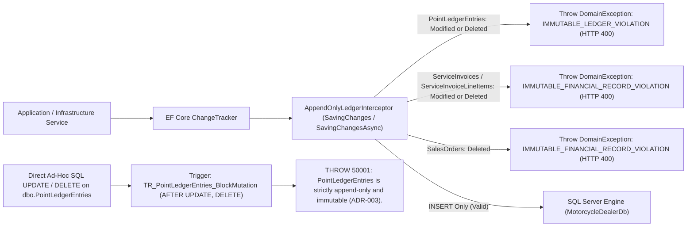

# Detail Design 02 — Database Schema, Indexing & Per-Operation Table Update Specifications (`DD-02`)

| Metadata | Canonical Value |
| :--- | :--- |
| **Document ID** | `DD-DB-002` |
| **Document Title** | Detail Design: SQL Server 3NF Physical Schema, 27-Table Data Dictionary & `TX-01..TX-31` Table Update Specifications |
| **Version** | `1.2.0` (Phase 9 `v1.2.0` Expansion — `+ServiceReviews` & `+WarrantyClaims` on `MotorcycleDealerDb`) |
| **Project** | Motorcycle Dealer & Loyalty Management Platform ([GitHub Repository](https://github.com/quocanhh86/motorcycle-dealer)) |
| **Target DBMS** | Microsoft SQL Server (`(localdb)\MSSQLLocalDB` local development; `mcr.microsoft.com/mssql/server:2022-latest` container) |
| **Database & Schema** | `MotorcycleDealerDb` · Default Schema `dbo` · Collation `SQL_Latin1_General_CP1_CI_AS` · `CompatibilityLevel = 150` · `RCSI = ON` |
| **Persistence Layer** | `MotorcycleDealer.Infrastructure` (`Entity Framework Core 10` / `net10.0`, `27` `IEntityTypeConfiguration<T>` classes) |
| **Canonical Migrations** | `20261121162940_InitialCreate_22Tables_3NF` + `20261123130936_AddTestDriveAndSparePartsV11` + `20261123171402_AddServiceReviewsAndWarrantyClaimsV12` (`Persistence/Migrations/`) |
| **Peer BD/DD Suite** | [BD_00 Basic Design Master](../basic-design/BD_00_BASIC_DESIGN_MASTER.md) · [DD_01 Common Specification](./DD_01_COMMON_SPECIFICATION.md) · [DD_03 API Specifications](./DD_03_API_SPECIFICATIONS.md) · [DD_04 Screen Specifications](./DD_04_SCREEN_SPECIFICATIONS.md) |
| **Related SSOT Docs** | [README.md](../../README.md) · [AGENTS.md](../../AGENTS.md) · [PROGRESS.md](../../PROGRESS.md) · [PRD.md](../PRD.md) · [ARCHITECTURE.md](../ARCHITECTURE.md) · [DATABASE_DESIGN.md](../DATABASE_DESIGN.md) · [DESIGN.md](../DESIGN.md) · [openapi.v1.yaml](../openapi.v1.yaml) · [MOD_06 Analytics](../modules/MOD_06_ADMIN_ANALYTICS_AND_REPORTING.md) |

---

## 1. Database Engine Configuration, Concurrency & Immutability Architecture

### 1.1 SQL Server Engine Settings, Connection Resiliency & Transaction Strategy

`MotorcycleDealerDb` is engineered as a single-database, multi-dealer relational system of record governed by `ADR-001` (4-Layer Clean Architecture), `ADR-002` (`IDealerScoped` Row-Level Isolation), `ADR-003` (Immutable Loyalty Ledger), `ADR-004` (Transactional Notification Outbox + Post-Commit SignalR Fan-Out), and `ADR-005` (`ROWVERSION` Optimistic Concurrency + Deduplicated VIN Maintenance Reminders).

| Engine / EF Core Parameter | Configured Value | Source Location | Architectural Rationale |
| :--- | :--- | :--- | :--- |
| **SQL Server Compatibility Level** | `150` (SQL Server 15.0 / 2019+ Optimizer) | `DependencyInjection.SqlServerCompatibilityLevel = 150` (`sqlOptions.UseCompatibilityLevel(150)`) | Guarantees deterministic query-plan generation, batch-mode rowstore eligibility, and modern `ISJSON` / filtered-index selectivity across LocalDB and SQL Server 2022 Docker. |
| **Read Committed Snapshot Isolation (`RCSI`)** | `READ_COMMITTED_SNAPSHOT = ON` (`is_read_committed_snapshot_on = 1`) | `InitialCreate_22Tables_3NF.cs` (`ALTER DATABASE CURRENT SET READ_COMMITTED_SNAPSHOT ON WITH ROLLBACK IMMEDIATE`, `suppressTransaction: true`) | Eliminates reader-writer lock contention: `SELECT` statements read committed row versions from `tempdb` without acquiring shared (`S`) locks, while concurrent writers acquire row-level `U`/`X` locks. |
| **Database Collation** | `SQL_Latin1_General_CP1_CI_AS` | `sys.databases` (`MotorcycleDealerDb`) | Case-insensitive, accent-sensitive sorting for English/Vietnamese text while ASCII `VARCHAR` codes (`NormalizedEmail`, `VIN`, `Code`) are normalized to uppercase invariant in C#. |
| **Transient Fault Retry Strategy** | `SqlServerRetryingExecutionStrategy` (`maxRetryCount: 3`, `maxRetryDelay: 5s`, `errorNumbersToAdd: null`) | `DependencyInjection.AddInfrastructure` (`sqlOptions.EnableRetryOnFailure(3, TimeSpan.FromSeconds(5), null)`) | Automatically retries transient transport/socket blips (`SqlException` transient numbers) without surfacing `500` errors to SPA callers. |
| **Explicit Multi-Statement ACID Wrapping** | `_dbContext.Database.CreateExecutionStrategy().ExecuteAsync(work, ct)` + `BeginTransactionAsync` | All multi-table write services (`AuthService`, `DealerAdministrationService`, `SalesOrderService`, `TimeSlotService`, `ServiceBookingService`, `ServiceInvoiceService`, `LoyaltyService`, `VoucherService`, `VinMaintenanceReminderScanner`, `DatabaseSeeder`) | EF Core forbids manual `BeginTransactionAsync` under a retrying execution strategy unless the entire unit of work (including `_dbContext.ChangeTracker.Clear()` on retry) runs inside `IExecutionStrategy.ExecuteAsync`. |
| **MARS & Query-Filter Warning Policy** | `MultipleActiveResultSets=true`; suppresses `SavepointsDisabledBecauseOfMARS` & `PossibleIncorrectRequiredNavigationWithQueryFilterInteractionWarning` | `DependencyInjection.DefaultLocalDbConnectionString` & `options.ConfigureWarnings` | Prevents false-positive EF Core 10 warnings under `TreatWarningsAsErrors=true` when combining MARS connections with `IDealerScoped` / `ISoftDeletable` global query filters. |

---

### 1.2 Financial Precision, UTC Temporal Discipline & Sequential Clustered Keys

1. **Exact Decimal Arithmetic (`DECIMAL(18,2)` Default Convention)**:
   - `MotorcycleDealerDbContext.ConfigureConventions` registers `configurationBuilder.Properties<decimal>().HavePrecision(18, 2)` and `Properties<decimal?>().HavePrecision(18, 2)` globally across the model.
   - Every monetary column in Vietnamese Dong (`VND`) — `BaseRetailPrice`, `ListedPrice`, `TotalAmount`, `DiscountAmount`, `FinalAmount`, `LaborAmount`, `PartsAmount`, `GrossAmount`, `VoucherDiscountAmount`, `NetPaidAmount`, `LifetimeSpentVnd`, `DiscountValue`, `MaxDiscountAmount`, `MinOrderAmount` — is stored as `DECIMAL(18,2)`.
   - Explicit domain-specific overrides exist only for geographic coordinates (`Dealers.Latitude` and `Dealers.Longitude` as `DECIMAL(9,6)`) and loyalty point multipliers (`LoyaltyTiers.PointsMultiplier` as `DECIMAL(5,2)`). Binary floating-point types (`FLOAT`, `REAL`, C# `float`/`double`) do not exist anywhere across the 275 columns.
2. **UTC-Only Point-in-Time Timestamps & Local Workshop Calendar Types**:
   - Every point-in-time timestamp column (`CreatedAtUtc`, `UpdatedAtUtc`, `DeletedAtUtc`, `LastLoginAtUtc`, `ExpiresAtUtc`, `RevokedAtUtc`, `ReceivedAtUtc`, `SoldAtUtc`, `CompletedAtUtc`, `OwnershipStartDateUtc`, `LastServiceDateUtc`, `NextDueDateUtc`, `DueDateUtc`, `SentAtUtc`, `CheckedInAtUtc`, `CancelledAtUtc`, `PaidAtUtc`, `TierUpgradedAtUtc`, `RedeemedAtUtc`, `UsedAtUtc`, `ReadAtUtc`, `AssignedAtUtc`, `GrantedAtUtc`) uses `DATETIMEOFFSET(7)` (`100 ns` tick precision matching `datetime2(7)` paired with explicit `+00:00` UTC offset) with SQL Server `DEFAULT (sysutcdatetime())` where applicable.
   - Application code exclusively supplies UTC via `IDateTimeProvider.UtcNow` (`DateTimeOffset.UtcNow`), and `AuditableEntityInterceptor` automatically stamps `CreatedAtUtc = utcNow` on `EntityState.Added`, freezes `CreatedAtUtc` (`IsModified = false`) + updates `UpdatedAtUtc = utcNow` on `EntityState.Modified`, and stamps `DeletedAtUtc = utcNow` when `ISoftDeletable.IsDeleted` transitions to `true`.
   - Dealership bay schedules use `DATE` (`ServiceTimeSlots.SlotDate`) and `TIME(0)` (`Dealers.OpeningTime`, `Dealers.ClosingTime`, `ServiceTimeSlots.StartTime`, `ServiceTimeSlots.EndTime`) representing local Vietnam workshop wall-clock time (`Asia/Ho_Chi_Minh`, `UTC+07:00`).
3. **Time-Ordered UUIDv7 Clustered Key Locality (`Guid.CreateVersion7()` + `NEWSEQUENTIALID()`)**:
   - Twenty primary entity tables define `Id UNIQUEIDENTIFIER NOT NULL DEFAULT (newsequentialid())` as their `PRIMARY KEY CLUSTERED` (`ValueGeneratedNever().HasDefaultValueSql("NEWSEQUENTIALID()")` in EF Core).
   - Domain entities (`BaseEntity`) initialize `Id = Guid.CreateVersion7()` (RFC 9562 48-bit Unix millisecond timestamp prefix), ensuring strictly sequential tail-end B-Tree insertions with near-zero page fragmentation during high-throughput booking, ledger, and notification writes.
   - Two many-to-many RBAC junction tables (`UserRoles(UserId, RoleId)` and `RolePermissions(RoleId, PermissionId)`) use composite `CLUSTERED` primary keys.

---

### 1.3 Multi-Dealer Tenant Isolation (`IDealerScoped`) & Soft-Delete (`ISoftDeletable`) Filters

`MotorcycleDealerDbContext.OnModelCreating` inspects every root entity CLR type via reflection and registers composite or standalone global query filters alongside a mandatory `SaveChanges` write guard:

| Marker Interface | Implementing Tables (`Count`) | Automatic EF Core `HasQueryFilter` Predicate | `SaveChanges` Write / Interceptor Enforcement |
| :--- | :--- | :--- | :--- |
| **`IDealerScoped`** | `DealerInventories`, `SalesOrders`, `ServiceTimeSlots`, `ServiceBookings`, `ServiceInvoices`, `TestDriveBookings`, `ServiceReviews`, `WarrantyClaims` (`8` tables) | `!IsDealerStaffScopeActive \|\| (CurrentDealerIdOrEmpty != Guid.Empty && e.DealerId == CurrentDealerIdOrEmpty)` | `EnforceDealerScopeWriteGuard()` inspects `ChangeTracker.Entries<IDealerScoped>()` before every `SaveChanges`/`SaveChangesAsync`; if caller role is `DealerStaff` and any `Added`/`Modified`/`Deleted` entity has `DealerId != assignedDealerId`, throws `ForbiddenAccessException("FORBIDDEN_DEALER_SCOPE")` (`403`). |
| **`ISoftDeletable`** | `Users`, `Dealers`, `MotorcycleModels`, `CustomerVehicles`, `VoucherCatalogs`, `SpareParts` (`6` tables) | `!e.IsDeleted` | `AuditableEntityInterceptor` stamps `DeletedAtUtc = utcNow` whenever `IsDeleted` becomes `true` and `DeletedAtUtc is null`. Uniqueness checks (`Email`, `PhoneNumber`, `VIN`, `Code`, `ModelCode`, `CodePrefix`, `PartCode`) explicitly call `.IgnoreQueryFilters()` where global historical uniqueness is required. |

> [!IMPORTANT]
> **Controlled `.IgnoreQueryFilters()` Usage**: Public unauthenticated catalog/inventory queries, cross-table global `VIN` uniqueness checks, background `VinMaintenanceReminderScanner` sweeps, `DatabaseSeeder` reconciliation, and `Admin`-only Phase 7 `AnalyticsReadService` queries invoke `.IgnoreQueryFilters()` intentionally—always pairing it with explicit `!IsDeleted` / `IsActive` predicates and strict `[HasPermission]` + runtime role assertions.

---

### 1.4 Optimistic Concurrency Control (`8` Physical `ROWVERSION` Tables + `1` Synthetic Tick Token)

To prevent double-selling showroom motorcycles, double-booking workshop bays or showroom test drives, double-applying vouchers, concurrent CSAT response/warranty adjudication overwrites, or lost updates on customer point wallets (`ADR-005`, `RISK-02`), every high-contention mutable aggregate implements `IConcurrencyProtected` mapped to a SQL Server `ROWVERSION` (`timestamp` in `sys.types`, `8` bytes `NOT NULL`, auto-incremented by the storage engine on every `INSERT`/`UPDATE`):

| # | Table Name | Column | Wire Encoding (`RowVersionCodec`) | Guarded Contention / Race Condition | Conflict HTTP Response |
| :-: | :--- | :--- | :--- | :--- | :--- |
| 1 | `dbo.DealerInventories` | `RowVersion` (`ROWVERSION NOT NULL`) | 8-byte Base64 string (e.g., `"AAAAAAAAB9E="`) | Two `DealerStaff` advisors attempting to sell (`Available -> Sold`) or re-price the same `VIN` simultaneously (`TX-07`, `TX-08`). | `409 Conflict` (`CONCURRENCY_CONFLICT` / `INVENTORY_NOT_AVAILABLE`) |
| 2 | `dbo.ServiceTimeSlots` | `RowVersion` (`ROWVERSION NOT NULL`) | 8-byte Base64 string | Concurrent customers claiming the final bay (`BookedCount < MaxCapacity -> BookedCount + 1`) or staff reducing `MaxCapacity` (`TX-10`, `TX-11`, `TX-12`, `TX-13`). `TX-11` runs up to `2` bounded retries (`3` total attempts) if capacity remains open before failing. | `409 Conflict` (`SLOT_CAPACITY_EXHAUSTED` / `CONCURRENCY_CONFLICT`) |
| 3 | `dbo.ServiceBookings` | `RowVersion` (`ROWVERSION NOT NULL`) | 8-byte Base64 string | Customer cancelling a booking at the exact instant workshop staff transitions status to `CheckedIn`/`InProgress` or issues a `ServiceInvoice` (`TX-12`, `TX-13`, `TX-14`). | `409 Conflict` (`CONCURRENCY_CONFLICT`) |
| 4 | `dbo.LoyaltyAccounts` | `RowVersion` (`ROWVERSION NOT NULL`) | 8-byte Base64 string | Parallel point accruals (`TX-08`, `TX-14`, `TX-29`), manual admin adjustments (`TX-16`), and 10-way concurrent voucher redemptions (`TX-18`) mutating `AvailablePoints` / `LifetimeQualifyingPoints`. | `409 Conflict` (`CONCURRENCY_CONFLICT`) |
| 5 | `dbo.CustomerVouchers` | `RowVersion` (`ROWVERSION NOT NULL`) | 8-byte Base64 string | Simultaneous reservation/settlement of the same `CustomerVoucher` across two browser tabs (`TX-08`, `TX-11`, `TX-12`, `TX-14`). | `409 Conflict` (`CONCURRENCY_CONFLICT` / `VOUCHER_NOT_AVAILABLE`) |
| 6 | `dbo.TestDriveBookings` | `RowVersion` (`ROWVERSION NOT NULL`) | 8-byte Base64 string | Concurrent customer cancellation vs. `DealerStaff` demo `VIN` assignment / confirmation / completion (`TX-26`). | `409 Conflict` (`CONCURRENCY_CONFLICT`) |
| 7 | `dbo.ServiceReviews` | `RowVersion` (`ROWVERSION NOT NULL`) | 8-byte Base64 string | Concurrent branch advisors posting/editing `StaffResponse` (`TX-29`). | `409 Conflict` (`CONCURRENCY_CONFLICT`) |
| 8 | `dbo.WarrantyClaims` | `RowVersion` (`ROWVERSION NOT NULL`) | 8-byte Base64 string | Concurrent quality coordinators adjudicating `Status`, `CoveredSparePartId`, or `ApprovedCoveredAmountVnd` (`TX-30`). | `409 Conflict` (`CONCURRENCY_CONFLICT`) |

- **Additional Synthetic Concurrency Guard on `dbo.LoyaltyTiers`**: Although `LoyaltyTiers` is a low-write configuration table without a physical `ROWVERSION` column, `LoyaltyService.ComputeTierConcurrencyBytes` serializes `(tier.UpdatedAtUtc ?? tier.CreatedAtUtc).UtcTicks` into a big-endian 8-byte Base64 token and validates it on `PUT /api/v1/loyalty/tiers/{tierId}` (`TX-15`), rejecting stale admin edits with `409 CONCURRENCY_CONFLICT`.
- **Additional Set-Based Atomic CAS Guards (`ExecuteUpdateAsync`)**: `RefreshTokens` rotation (`WHERE Id = @id AND RevokedAtUtc IS NULL`, `TX-02`) and `VoucherCatalogs` quota claims (`WHERE Id = @id AND QuotaRedeemed < QuotaTotal`, `TX-18`) execute single-statement SQL `UPDATE` predicates that acquire row-level exclusive (`X`) locks under `RCSI` and inspect the affected row count (`0` rows -> race lost).

---

### 1.5 Defense-in-Depth Financial & Ledger Immutability (`4` Protected Tables)

In compliance with `ADR-003` and `FR-05`, closed financial settlements, itemized line breakdowns, and loyalty ledger entries are protected across **both** the EF Core persistence pipeline and the SQL Server database engine:

| Protected Table | Domain Marker / Interceptor Rule | Database Engine Enforcement | Permitted Correction Mechanism |
| :--- | :--- | :--- | :--- |
| **`dbo.PointLedgerEntries`** | Implements `IAppendOnlyEntity`. `AppendOnlyLedgerInterceptor` blocks both `EntityState.Modified` and `EntityState.Deleted` (`IMMUTABLE_LEDGER_VIOLATION`). Zero `UpdatedAtUtc` or `IsDeleted` columns exist. | `CREATE OR ALTER TRIGGER [dbo].[TR_PointLedgerEntries_BlockMutation] ON [dbo].[PointLedgerEntries] AFTER UPDATE, DELETE AS BEGIN SET NOCOUNT ON; THROW 50001, 'PointLedgerEntries is strictly append-only and immutable (ADR-003).', 1; END;` (registered via `t.HasTrigger("TR_PointLedgerEntries_BlockMutation")`). | Insert a new compensating row (`TransactionType = 'AdminAdjustment'` or `'VoucherExpireRefund'`) carrying a signed `PointsDelta` and unique `IdempotencyKey` (`TX-16`). |
| **`dbo.ServiceInvoices`** | Matched in `AppendOnlyLedgerInterceptor`. Blocks both `EntityState.Modified` and `EntityState.Deleted` (`IMMUTABLE_FINANCIAL_RECORD_VIOLATION`). Zero mutable columns (`UpdatedAtUtc` and `IsDeleted` omitted by design). | `CK_ServiceInvoices_Amounts` enforces `GrossAmount = LaborAmount + PartsAmount` and `NetPaidAmount = GrossAmount - VoucherDiscountAmount`; `UQ_ServiceInvoices_BookingId` enforces strict 1:1 settlement per booking; all 5 FKs use `ON DELETE NO ACTION`. | Issue an auditable administrative point adjustment (`TX-16`) or external accounting credit memo; settled workshop invoices are never altered or deleted. |
| **`dbo.ServiceInvoiceLineItems`** | Implements `IImmutableFinancialEntity` (`v1.1.0`). `AppendOnlyLedgerInterceptor` and `audit-dealer-guardrails` block both `EntityState.Modified` and `EntityState.Deleted`. | `CK_ServiceInvoiceLineItems_LineTotal` enforces `LineTotalVnd = Quantity * UnitPriceVnd`; `UQ_ServiceInvoiceLineItems_Invoice_Line` enforces unique `(ServiceInvoiceId, LineNumber)`; `FK_ServiceInvoiceLineItems_Invoices` & `FK_ServiceInvoiceLineItems_SpareParts` use `ON DELETE NO ACTION`. | Snapshots `PartCodeSnapshot` and `UnitPriceVnd` at settlement (`TX-14`); never updated or deleted after invoice issuance. |
| **`dbo.SalesOrders`** | Implements `IImmutableFinancialEntity` (`NonDeletableFinancialNames`). `AppendOnlyLedgerInterceptor` blocks `EntityState.Deleted` (`IMMUTABLE_FINANCIAL_RECORD_VIOLATION`). `SalesOrderService` inserts orders atomically as `'Completed'` and exposes zero update/delete endpoints. | `CK_SalesOrders_Amounts` enforces `FinalAmount = TotalAmount - DiscountAmount`; `UQ_SalesOrders_ActiveInventory` prevents duplicate active sales per `DealerInventoryId`; all 5 FKs use `ON DELETE NO ACTION`. | Never physically or soft-deleted; financial reversals use compensating `PointLedgerEntries` (`TX-16`). |

---

## 2. Complete Physical Specification of All 25 Normalized (3NF) Tables

### 2.1 Empirical Schema Verification Summary & Seeded Baseline Inventory

Live metadata inspection of `(localdb)\MSSQLLocalDB` (`MotorcycleDealerDb`) confirms 100% structural parity with `InitialCreate_22Tables_3NF` + `AddTestDriveAndSparePartsV11`:
- **Tables**: `25` normalized Third Normal Form (`3NF`) tables in schema `dbo` (`320` total columns).
- **Primary Keys**: `25` `CLUSTERED` primary keys (`23` single-column `UNIQUEIDENTIFIER` + `2` composite junction PKs).
- **Foreign Keys**: `49` foreign key constraints (`43` `ON DELETE NO ACTION` preventing diamond cascade `Msg 1785` cycles + `6` leaf security/inbox `ON DELETE CASCADE` constraints).
- **Check Constraints**: `68` domain, range, state-machine, ISO 3779 `VIN`, arithmetic balance, and `ISJSON` `CHECK` constraints (`CK_*`).
- **Non-PK Indexes**: `27` composite workload/covering/filtered `IX_*` + `34` unique `UQ_*` + FK support `IX_*` indexes.
- **`ROWVERSION` Columns**: `6` (`DealerInventories`, `ServiceTimeSlots`, `ServiceBookings`, `LoyaltyAccounts`, `CustomerVouchers`, `TestDriveBookings`).
- **DML Triggers**: `1` (`dbo.TR_PointLedgerEntries_BlockMutation`).

| # | Table Name | Bounded Context | Cols | PK (`CLUSTERED`) | FKs | `CK_*` | Non-PK Idx | `IDealerScoped` | `ISoftDeletable` | `RowVersion` | `DatabaseSeeder` Baseline Rows | Observed Live LocalDB Rows |
| :-: | :--- | :--- | :-: | :--- | :-: | :-: | :-: | :-: | :-: | :-: | ---: | ---: |
| 1 | `Users` | Identity & RBAC | 14 | `PK_Users (Id)` | 1 | 1 | 5 | Nullable (`Staff`) | Yes | No | `10` (`1` Admin, `4` Staff, `5` Cust) | `10` |
| 2 | `Roles` | Identity & RBAC | 7 | `PK_Roles (Id)` | 0 | 1 | 1 | No | No | No | `3` | `3` |
| 3 | `Permissions` | Identity & RBAC | 6 | `PK_Permissions (Id)` | 0 | 1 | 1 | No | No | No | `40` | `40` |
| 4 | `UserRoles` | Identity & RBAC | 4 | `PK_UserRoles (UserId, RoleId)` | 3 | 0 | 2 | No | No | No | `10` | `10` |
| 5 | `RolePermissions` | Identity & RBAC | 3 | `PK_RolePermissions (RoleId, PermissionId)` | 2 | 0 | 1 | No | No | No | `62` (`16`/`18`/`28`) | `62` |
| 6 | `RefreshTokens` | Identity & RBAC | 11 | `PK_RefreshTokens (Id)` | 2 | 1 | 3 | No | No | No | `0` (issued at runtime) | `172` |
| 7 | `Dealers` | Showroom & Sales | 17 | `PK_Dealers (Id)` | 0 | 3 | 1 | Root Tenant (`Id`) | Yes | No | `3` (`HN`, `DN`, `HCM`) | `3` |
| 8 | `MotorcycleModels` | Showroom & Sales | 16 | `PK_MotorcycleModels (Id)` | 0 | 5 | 2 | No | Yes | No | `6` | `6` |
| 9 | `DealerInventories` | Showroom & Sales | 14 | `PK_DealerInventories (Id)` | 2 | 4 | 4 | **Yes** (`NOT NULL`) | No | **Yes** | `18` (`14` Avail, `4` Sold) | `18` |
| 10 | `SalesOrders` | Showroom & Sales | 17 | `PK_SalesOrders (Id)` | 5 | 4 | 7 | **Yes** (`NOT NULL`) | No (Immutable) | No | `4` | `4` |
| 11 | `CustomerVehicles` | Garage & Reminders | 19 | `PK_CustomerVehicles (Id)` | 3 | 3 | 6 | No | Yes | No | `6` (`4` Sale, `2` External) | `6` |
| 12 | `MaintenanceRules` | Garage & Reminders | 14 | `PK_MaintenanceRules (Id)` | 1 | 1 | 1 | No | No | No | `18` (`6` models x `3` rules) | `18` |
| 13 | `MaintenanceReminders` | Garage & Reminders | 12 | `PK_MaintenanceReminders (Id)` | 3 | 3 | 5 | No | No | No | `1` (`+2` on initial worker tick) | `3` |
| 14 | `ServiceTimeSlots` | Workshop & Invoicing | 11 | `PK_ServiceTimeSlots (Id)` | 1 | 2 | 2 | **Yes** (`NOT NULL`) | No | **Yes** | `255` (`252` rolling + `3` hist) | `291` |
| 15 | `ServiceBookings` | Workshop & Invoicing | 18 | `PK_ServiceBookings (Id)` | 5 | 3 | 7 | **Yes** (`NOT NULL`) | No | **Yes** | `3` | `8` |
| 16 | `ServiceInvoices` | Workshop & Invoicing | 19 | `PK_ServiceInvoices (Id)` | 5 | 5 | 6 | **Yes** (`NOT NULL`) | No (Immutable) | No | `3` | `3` |
| 17 | `LoyaltyTiers` | Loyalty & Vouchers | 10 | `PK_LoyaltyTiers (Id)` | 0 | 4 | 3 | No | No | Synthetic | `4` (`Bronze`..`Platinum`) | `4` |
| 18 | `LoyaltyAccounts` | Loyalty & Vouchers | 10 | `PK_LoyaltyAccounts (Id)` | 2 | 1 | 2 | No | No | **Yes** | `5` (`1:1` per Customer) | `5` |
| 19 | `PointLedgerEntries` | Loyalty & Vouchers | 11 | `PK_PointLedgerEntries (Id)` | 2 | 4 | 3 | No | No (Append-Only) | No | `11` | `11` |
| 20 | `VoucherCatalogs` | Loyalty & Vouchers | 19 | `PK_VoucherCatalogs (Id)` | 1 | 6 | 2 | No | Yes | No | `5` | `5` |
| 21 | `CustomerVouchers` | Loyalty & Vouchers | 12 | `PK_CustomerVouchers (Id)` | 2 | 3 | 3 | No | No | **Yes** | `5` (`2` Avail, `3` Used) | `5` |
| 22 | `Notifications` | Real-Time Inbox | 11 | `PK_Notifications (Id)` | 2 | 4 | 2 | Nullable (`TargetDealerId`) | No | No | `2` (`+` worker/runtime alerts) | `16` |
| 23 | `TestDriveBookings` | Showroom & Sales | 21 | `PK_TestDriveBookings (Id)` | 4 | 2 | 5 | **Yes** (`NOT NULL`) | No | **Yes** | `4` (`TD-SEED-*`) | `4` |
| 24 | `SpareParts` | Workshop & Invoicing | 13 | `PK_SpareParts (Id)` | 1 | 2 | 3 | No | Yes | No | `8` (`PRT-*`) | `8` |
| 25 | `ServiceInvoiceLineItems` | Workshop & Invoicing | 10 | `PK_ServiceInvoiceLineItems (Id)` | 2 | 5 | 3 | No | No (Immutable) | No | `13` (`0` drift) | `13` |
| **Total** | **25 Tables** | **6 Contexts** | **319** | **25 Clustered PKs** | **49** | **68** | **80** | **6 Required** | **6 Tables** | **6 Physical** | **Deterministic Seed** | **Live Verified** |

---

### 2.2 Complete 22-Table Entity-Relationship Diagram (`3NF`)

```mermaid
erDiagram
    Dealers ||--o{ Users : "FK_Users_Dealers_DealerId"
    Users ||--o{ UserRoles : "FK_UserRoles_Users"
    Users |o--o{ UserRoles : "FK_UserRoles_AssignedBy"
    Roles ||--o{ UserRoles : "FK_UserRoles_Roles"
    Roles ||--o{ RolePermissions : "FK_RolePermissions_Roles"
    Permissions ||--o{ RolePermissions : "FK_RolePermissions_Permissions"
    Users ||--o{ RefreshTokens : "FK_RefreshTokens_Users"
    RefreshTokens |o--o{ RefreshTokens : "FK_RefreshTokens_ReplacedBy"

    Dealers ||--o{ DealerInventories : "FK_DealerInventories_Dealers"
    MotorcycleModels ||--o{ DealerInventories : "FK_DealerInventories_Models"
    Dealers ||--o{ SalesOrders : "FK_SalesOrders_Dealers"
    Users ||--o{ SalesOrders : "FK_SalesOrders_Customer"
    Users ||--o{ SalesOrders : "FK_SalesOrders_Staff"
    DealerInventories ||--o{ SalesOrders : "FK_SalesOrders_Inventory"
    CustomerVouchers |o--o{ SalesOrders : "FK_SalesOrders_Voucher"

    SalesOrders |o--o| CustomerVehicles : "FK_CustomerVehicles_SalesOrders"
    Users ||--o{ CustomerVehicles : "FK_CustomerVehicles_Users"
    MotorcycleModels ||--o{ CustomerVehicles : "FK_CustomerVehicles_Models"
    MotorcycleModels ||--o{ MaintenanceRules : "FK_MaintenanceRules_Models"
    CustomerVehicles ||--o{ MaintenanceReminders : "FK_MaintenanceReminders_Vehicles"
    MaintenanceRules ||--o{ MaintenanceReminders : "FK_MaintenanceReminders_Rules"
    ServiceBookings |o--o{ MaintenanceReminders : "FK_MaintenanceReminders_Bookings"

    Dealers ||--o{ ServiceTimeSlots : "FK_ServiceTimeSlots_Dealers"
    ServiceTimeSlots ||--o{ ServiceBookings : "FK_ServiceBookings_Slots"
    Dealers ||--o{ ServiceBookings : "FK_ServiceBookings_Dealers"
    Users ||--o{ ServiceBookings : "FK_ServiceBookings_Customer"
    CustomerVehicles ||--o{ ServiceBookings : "FK_ServiceBookings_Vehicles"
    CustomerVouchers |o--o{ ServiceBookings : "FK_ServiceBookings_Vouchers"

    ServiceBookings ||--o| ServiceInvoices : "FK_ServiceInvoices_Bookings"
    Dealers ||--o{ ServiceInvoices : "FK_ServiceInvoices_Dealers"
    Users ||--o{ ServiceInvoices : "FK_ServiceInvoices_Customer"
    Users ||--o{ ServiceInvoices : "FK_ServiceInvoices_Staff"
    CustomerVouchers |o--o{ ServiceInvoices : "FK_ServiceInvoices_Vouchers"

    Users ||--o| LoyaltyAccounts : "FK_LoyaltyAccounts_Users"
    LoyaltyTiers ||--o{ LoyaltyAccounts : "FK_LoyaltyAccounts_Tiers"
    LoyaltyAccounts ||--o{ PointLedgerEntries : "FK_PointLedgerEntries_Accounts"
    Users |o--o{ PointLedgerEntries : "FK_PointLedgerEntries_Users"
    LoyaltyTiers ||--o{ VoucherCatalogs : "FK_VoucherCatalogs_Tiers"
    LoyaltyAccounts ||--o{ CustomerVouchers : "FK_CustomerVouchers_Accounts"
    VoucherCatalogs ||--o{ CustomerVouchers : "FK_CustomerVouchers_Catalogs"

    Users |o--o{ Notifications : "FK_Notifications_Users"
    Dealers |o--o{ Notifications : "FK_Notifications_Dealers"
```

---

### 2.3 Table-by-Table Physical Schema Specifications (`Tables 1 to 22`)

#### 2.3.1 Table 1: `dbo.Users` (`14` Columns · `ISoftDeletable` · Seeded: `10` Rows)
Stores platform principals (`Customer`, `DealerStaff`, `Admin`), salted `PBKDF2-HMAC-SHA512` password digests, and mandatory branch binding (`DealerId` + `StaffEmployeeCode`) for `DealerStaff` personnel.

| # | Column Name | SQL Data Type | Nullability | Default Definition | Keys & Indexes |
| :-: | :--- | :--- | :-: | :--- | :--- |
| 1 | `Id` | `UNIQUEIDENTIFIER` | `NOT NULL` | `NEWSEQUENTIALID()` | `PK_Users` (`CLUSTERED`) |
| 2 | `Email` | `VARCHAR(256)` | `NOT NULL` | — | `UQ_Users_Email`, `INCLUDE` in `IX_Users_DealerId_Active` |
| 3 | `NormalizedEmail` | `VARCHAR(256)` | `NOT NULL` | — | `UQ_Users_NormalizedEmail` |
| 4 | `PasswordHash` | `VARCHAR(512)` | `NOT NULL` | — | — |
| 5 | `FullName` | `NVARCHAR(150)` | `NOT NULL` | — | `INCLUDE` in `IX_Users_DealerId_Active` |
| 6 | `PhoneNumber` | `VARCHAR(20)` | `NOT NULL` | — | `UQ_Users_PhoneNumber` (filtered) |
| 7 | `DealerId` | `UNIQUEIDENTIFIER` | `NULL` | — | `FK_Users_Dealers_DealerId`, `IX_Users_DealerId_Active` |
| 8 | `StaffEmployeeCode` | `VARCHAR(30)` | `NULL` | — | `UQ_Users_StaffEmployeeCode` (filtered), `INCLUDE` in `IX_Users_DealerId_Active` |
| 9 | `IsActive` | `BIT` | `NOT NULL` | `CONVERT([bit],(1))` | `IX_Users_DealerId_Active` |
| 10 | `LastLoginAtUtc` | `DATETIMEOFFSET(7)` | `NULL` | — | — |
| 11 | `IsDeleted` | `BIT` | `NOT NULL` | `CONVERT([bit],(0))` | Filter column in `UQ_Users_PhoneNumber`, `UQ_Users_StaffEmployeeCode`, `IX_Users_DealerId_Active` |
| 12 | `DeletedAtUtc` | `DATETIMEOFFSET(7)` | `NULL` | — | — |
| 13 | `CreatedAtUtc` | `DATETIMEOFFSET(7)` | `NOT NULL` | `SYSUTCDATETIME()` | — |
| 14 | `UpdatedAtUtc` | `DATETIMEOFFSET(7)` | `NULL` | — | — |

- **Primary Key**: `PK_Users PRIMARY KEY CLUSTERED (Id)`
- **Foreign Keys (`1`)**:
  - `FK_Users_Dealers_DealerId`: `(DealerId) -> dbo.Dealers(Id) ON DELETE NO ACTION`
- **Unique Indexes (`4`)**:
  - `UQ_Users_Email`: `UNIQUE (Email ASC)`
  - `UQ_Users_NormalizedEmail`: `UNIQUE (NormalizedEmail ASC)`
  - `UQ_Users_PhoneNumber`: `UNIQUE (PhoneNumber ASC) WHERE ([IsDeleted]=(0))`
  - `UQ_Users_StaffEmployeeCode`: `UNIQUE (StaffEmployeeCode ASC) WHERE ([StaffEmployeeCode] IS NOT NULL AND [IsDeleted]=(0))`
- **Check Constraints (`1`)**:
  - `CK_Users_DealerStaff_DealerId`: `(([StaffEmployeeCode] IS NULL AND [DealerId] IS NULL) OR ([StaffEmployeeCode] IS NOT NULL AND [DealerId] IS NOT NULL))`

---

#### 2.3.2 Table 2: `dbo.Roles` (`7` Columns · System Seed · Seeded: `3` Rows)
Defines the three canonical platform RBAC roles (`Customer`, `DealerStaff`, `Admin`).

| # | Column Name | SQL Data Type | Nullability | Default Definition | Keys & Indexes |
| :-: | :--- | :--- | :-: | :--- | :--- |
| 1 | `Id` | `UNIQUEIDENTIFIER` | `NOT NULL` | `NEWSEQUENTIALID()` | `PK_Roles` (`CLUSTERED`) |
| 2 | `Name` | `VARCHAR(50)` | `NOT NULL` | — | `UQ_Roles_Name` |
| 3 | `DisplayName` | `NVARCHAR(100)` | `NOT NULL` | — | — |
| 4 | `Description` | `NVARCHAR(300)` | `NOT NULL` | — | — |
| 5 | `IsSystemRole` | `BIT` | `NOT NULL` | `CONVERT([bit],(1))` | — |
| 6 | `CreatedAtUtc` | `DATETIMEOFFSET(7)` | `NOT NULL` | `SYSUTCDATETIME()` | — |
| 7 | `UpdatedAtUtc` | `DATETIMEOFFSET(7)` | `NULL` | — | — |

- **Primary Key**: `PK_Roles PRIMARY KEY CLUSTERED (Id)`
- **Foreign Keys (`0`)**: None.
- **Unique Indexes (`1`)**: `UQ_Roles_Name`: `UNIQUE (Name ASC)`
- **Check Constraints (`1`)**: `CK_Roles_Name`: `([Name]='Admin' OR [Name]='DealerStaff' OR [Name]='Customer')`

---

#### 2.3.3 Table 3: `dbo.Permissions` (`6` Columns · System Seed · Seeded: `34` Rows)
Master catalog of all 34 granular policy claim codes (`Permissions.<Module>.<Action>`).

| # | Column Name | SQL Data Type | Nullability | Default Definition | Keys & Indexes |
| :-: | :--- | :--- | :-: | :--- | :--- |
| 1 | `Id` | `UNIQUEIDENTIFIER` | `NOT NULL` | `NEWSEQUENTIALID()` | `PK_Permissions` (`CLUSTERED`) |
| 2 | `Code` | `VARCHAR(100)` | `NOT NULL` | — | `UQ_Permissions_Code` |
| 3 | `Module` | `VARCHAR(50)` | `NOT NULL` | — | — |
| 4 | `DisplayName` | `NVARCHAR(150)` | `NOT NULL` | — | — |
| 5 | `Description` | `NVARCHAR(300)` | `NOT NULL` | — | — |
| 6 | `CreatedAtUtc` | `DATETIMEOFFSET(7)` | `NOT NULL` | `SYSUTCDATETIME()` | — |

- **Primary Key**: `PK_Permissions PRIMARY KEY CLUSTERED (Id)`
- **Foreign Keys (`0`)**: None.
- **Unique Indexes (`1`)**: `UQ_Permissions_Code`: `UNIQUE (Code ASC)`
- **Check Constraints (`1`)**: `CK_Permissions_CodePrefix`: `([Code] LIKE 'Permissions.%._%')`

---

#### 2.3.4 Table 4: `dbo.UserRoles` (`4` Columns · Composite Junction · Seeded: `10` Rows)
Maps principals in `dbo.Users` to security roles in `dbo.Roles` with optional administrative attribution.

| # | Column Name | SQL Data Type | Nullability | Default Definition | Keys & Indexes |
| :-: | :--- | :--- | :-: | :--- | :--- |
| 1 | `UserId` | `UNIQUEIDENTIFIER` | `NOT NULL` | — | `PK_UserRoles` (Key 1), `FK_UserRoles_Users` |
| 2 | `RoleId` | `UNIQUEIDENTIFIER` | `NOT NULL` | — | `PK_UserRoles` (Key 2), `FK_UserRoles_Roles`, `IX_UserRoles_RoleId` |
| 3 | `AssignedAtUtc` | `DATETIMEOFFSET(7)` | `NOT NULL` | `SYSUTCDATETIME()` | — |
| 4 | `AssignedByUserId` | `UNIQUEIDENTIFIER` | `NULL` | — | `FK_UserRoles_AssignedBy`, `IX_UserRoles_AssignedByUserId` |

- **Primary Key**: `PK_UserRoles PRIMARY KEY CLUSTERED (UserId, RoleId)`
- **Foreign Keys (`3`)**:
  - `FK_UserRoles_Users`: `(UserId) -> dbo.Users(Id) ON DELETE CASCADE`
  - `FK_UserRoles_Roles`: `(RoleId) -> dbo.Roles(Id) ON DELETE CASCADE`
  - `FK_UserRoles_AssignedBy`: `(AssignedByUserId) -> dbo.Users(Id) ON DELETE NO ACTION`
- **Unique Indexes (`0`)**: Enforced by composite `PK_UserRoles`.
- **Check Constraints (`0`)**: None.

---

#### 2.3.5 Table 5: `dbo.RolePermissions` (`3` Columns · Composite Junction · Seeded: `54` Rows)
Maps security roles to granular `Permissions.<Module>.<Action>` claims (`Customer`: `13`, `DealerStaff`: `16`, `Admin`: `25` -> `54` mappings).

| # | Column Name | SQL Data Type | Nullability | Default Definition | Keys & Indexes |
| :-: | :--- | :--- | :-: | :--- | :--- |
| 1 | `RoleId` | `UNIQUEIDENTIFIER` | `NOT NULL` | — | `PK_RolePermissions` (Key 1), `FK_RolePermissions_Roles` |
| 2 | `PermissionId` | `UNIQUEIDENTIFIER` | `NOT NULL` | — | `PK_RolePermissions` (Key 2), `FK_RolePermissions_Permissions`, `IX_RolePermissions_PermissionId` |
| 3 | `GrantedAtUtc` | `DATETIMEOFFSET(7)` | `NOT NULL` | `SYSUTCDATETIME()` | — |

- **Primary Key**: `PK_RolePermissions PRIMARY KEY CLUSTERED (RoleId, PermissionId)`
- **Foreign Keys (`2`)**:
  - `FK_RolePermissions_Roles`: `(RoleId) -> dbo.Roles(Id) ON DELETE CASCADE`
  - `FK_RolePermissions_Permissions`: `(PermissionId) -> dbo.Permissions(Id) ON DELETE CASCADE`
- **Unique Indexes (`0`)**: Enforced by composite `PK_RolePermissions`.
- **Check Constraints (`0`)**: None.

---

#### 2.3.6 Table 6: `dbo.RefreshTokens` (`11` Columns · Rotating Token Family Store · Seeded: `0` / Live: `172` Rows)
Persists SHA-256 hex digests of opaque refresh tokens, rotation successor links (`ReplacedByTokenId` + `ReplacedByTokenHash`), and `TokenFamilyId` chains for replay-breach cascade revocation (`ADR-006`).

| # | Column Name | SQL Data Type | Nullability | Default Definition | Keys & Indexes |
| :-: | :--- | :--- | :-: | :--- | :--- |
| 1 | `Id` | `UNIQUEIDENTIFIER` | `NOT NULL` | `NEWSEQUENTIALID()` | `PK_RefreshTokens` (`CLUSTERED`) |
| 2 | `UserId` | `UNIQUEIDENTIFIER` | `NOT NULL` | — | `FK_RefreshTokens_Users`, `IX_RefreshTokens_UserId_Active` |
| 3 | `TokenHash` | `VARCHAR(128)` | `NOT NULL` | — | `UQ_RefreshTokens_TokenHash`, `INCLUDE` in `IX_RefreshTokens_UserId_Active` |
| 4 | `TokenFamilyId` | `UNIQUEIDENTIFIER` | `NOT NULL` | — | `INCLUDE` in `IX_RefreshTokens_UserId_Active` |
| 5 | `ExpiresAtUtc` | `DATETIMEOFFSET(7)` | `NOT NULL` | — | `IX_RefreshTokens_UserId_Active` (`DESC`), `CK_RefreshTokens_Expiry` |
| 6 | `RevokedAtUtc` | `DATETIMEOFFSET(7)` | `NULL` | — | Filter column in `IX_RefreshTokens_UserId_Active` |
| 7 | `ReplacedByTokenId` | `UNIQUEIDENTIFIER` | `NULL` | — | `FK_RefreshTokens_ReplacedBy`, `IX_RefreshTokens_ReplacedByTokenId` |
| 8 | `ReplacedByTokenHash` | `VARCHAR(128)` | `NULL` | — | — |
| 9 | `RevocationReason` | `VARCHAR(100)` | `NULL` | — | `'Rotated'`, `'ReuseDetected'`, `'UserLogout'`, `'AccountDisabled'`, `'DealerDeactivated'` |
| 10 | `CreatedByIp` | `VARCHAR(45)` | `NULL` | — | — |
| 11 | `CreatedAtUtc` | `DATETIMEOFFSET(7)` | `NOT NULL` | `SYSUTCDATETIME()` | `CK_RefreshTokens_Expiry` |

- **Primary Key**: `PK_RefreshTokens PRIMARY KEY CLUSTERED (Id)`
- **Foreign Keys (`2`)**:
  - `FK_RefreshTokens_Users`: `(UserId) -> dbo.Users(Id) ON DELETE CASCADE`
  - `FK_RefreshTokens_ReplacedBy`: `(ReplacedByTokenId) -> dbo.RefreshTokens(Id) ON DELETE NO ACTION`
- **Unique Indexes (`1`)**: `UQ_RefreshTokens_TokenHash`: `UNIQUE (TokenHash ASC)`
- **Check Constraints (`1`)**: `CK_RefreshTokens_Expiry`: `([ExpiresAtUtc]>[CreatedAtUtc])`

---

#### 2.3.7 Table 7: `dbo.Dealers` (`17` Columns · Root Tenant · `ISoftDeletable` · Seeded: `3` Rows)
Authorized dealership showrooms and workshop branches (`DLR-HN-01` Hanoi, `DLR-DN-01` Da Nang, `DLR-HCM-01` Ho Chi Minh City).

| # | Column Name | SQL Data Type | Nullability | Default Definition | Keys & Indexes |
| :-: | :--- | :--- | :-: | :--- | :--- |
| 1 | `Id` | `UNIQUEIDENTIFIER` | `NOT NULL` | `NEWSEQUENTIALID()` | `PK_Dealers` (`CLUSTERED`) |
| 2 | `Code` | `VARCHAR(20)` | `NOT NULL` | — | `UQ_Dealers_Code` |
| 3 | `Name` | `NVARCHAR(150)` | `NOT NULL` | — | — |
| 4 | `City` | `NVARCHAR(80)` | `NOT NULL` | — | — |
| 5 | `Address` | `NVARCHAR(300)` | `NOT NULL` | — | — |
| 6 | `PhoneNumber` | `VARCHAR(20)` | `NOT NULL` | — | — |
| 7 | `ContactEmail` | `VARCHAR(256)` | `NOT NULL` | — | — |
| 8 | `Latitude` | `DECIMAL(9,6)` | `NULL` | — | `CK_Dealers_Coordinates` |
| 9 | `Longitude` | `DECIMAL(9,6)` | `NULL` | — | `CK_Dealers_Coordinates` |
| 10 | `OpeningTime` | `TIME(0)` | `NOT NULL` | `'08:00:00'` | `CK_Dealers_Hours` |
| 11 | `ClosingTime` | `TIME(0)` | `NOT NULL` | `'18:00:00'` | `CK_Dealers_Hours` |
| 12 | `DefaultSlotCapacity` | `INT` | `NOT NULL` | `((4))` | `CK_Dealers_Capacity` |
| 13 | `IsActive` | `BIT` | `NOT NULL` | `CONVERT([bit],(1))` | — |
| 14 | `IsDeleted` | `BIT` | `NOT NULL` | `CONVERT([bit],(0))` | — |
| 15 | `DeletedAtUtc` | `DATETIMEOFFSET(7)` | `NULL` | — | — |
| 16 | `CreatedAtUtc` | `DATETIMEOFFSET(7)` | `NOT NULL` | `SYSUTCDATETIME()` | — |
| 17 | `UpdatedAtUtc` | `DATETIMEOFFSET(7)` | `NULL` | — | — |

- **Primary Key**: `PK_Dealers PRIMARY KEY CLUSTERED (Id)`
- **Foreign Keys (`0`)**: Root tenant referenced by `Users`, `DealerInventories`, `SalesOrders`, `ServiceTimeSlots`, `ServiceBookings`, `ServiceInvoices`, and `Notifications`.
- **Unique Indexes (`1`)**: `UQ_Dealers_Code`: `UNIQUE (Code ASC)`
- **Check Constraints (`3`)**:
  - `CK_Dealers_Capacity`: `([DefaultSlotCapacity]>=(1) AND [DefaultSlotCapacity]<=(50))`
  - `CK_Dealers_Coordinates`: `([Latitude] IS NULL AND [Longitude] IS NULL OR [Latitude]>=(-90) AND [Latitude]<=(90) AND ([Longitude]>=(-180) AND [Longitude]<=(180)))`
  - `CK_Dealers_Hours`: `([ClosingTime]>[OpeningTime])`

---

#### 2.3.8 Table 8: `dbo.MotorcycleModels` (`16` Columns · `ISoftDeletable` · Seeded: `6` Rows)
Platform-wide catalog of OEM motorcycle models, retail MSRP baselines, factory warranty limits, and JSON technical specs.

| # | Column Name | SQL Data Type | Nullability | Default Definition | Keys & Indexes |
| :-: | :--- | :--- | :-: | :--- | :--- |
| 1 | `Id` | `UNIQUEIDENTIFIER` | `NOT NULL` | `NEWSEQUENTIALID()` | `PK_MotorcycleModels` (`CLUSTERED`) |
| 2 | `ModelCode` | `VARCHAR(30)` | `NOT NULL` | — | `UQ_MotorcycleModels_ModelCode` |
| 3 | `Brand` | `NVARCHAR(80)` | `NOT NULL` | — | `INCLUDE` in `IX_MotorcycleModels_Category_Active` |
| 4 | `ModelName` | `NVARCHAR(150)` | `NOT NULL` | — | `INCLUDE` in `IX_MotorcycleModels_Category_Active` |
| 5 | `Category` | `VARCHAR(30)` | `NOT NULL` | — | `IX_MotorcycleModels_Category_Active`, `CK_MotorcycleModels_Category` |
| 6 | `EngineDisplacementCc` | `INT` | `NOT NULL` | — | `INCLUDE` in `IX_MotorcycleModels_Category_Active`, `CK_MotorcycleModels_EngineCc` |
| 7 | `BaseRetailPrice` | `DECIMAL(18,2)` | `NOT NULL` | — | `IX_MotorcycleModels_Category_Active`, `CK_MotorcycleModels_Price` |
| 8 | `WarrantyMonths` | `INT` | `NOT NULL` | `((36))` | `CK_MotorcycleModels_Warranty` |
| 9 | `WarrantyMileageKm` | `INT` | `NOT NULL` | `((30000))` | `CK_MotorcycleModels_Warranty` |
| 10 | `ImageUrl` | `VARCHAR(500)` | `NULL` | — | `INCLUDE` in `IX_MotorcycleModels_Category_Active` |
| 11 | `SpecificationsJson` | `NVARCHAR(MAX)` | `NULL` | — | `CK_MotorcycleModels_SpecsJson` |
| 12 | `IsActive` | `BIT` | `NOT NULL` | `CONVERT([bit],(1))` | Filter column in `IX_MotorcycleModels_Category_Active` |
| 13 | `IsDeleted` | `BIT` | `NOT NULL` | `CONVERT([bit],(0))` | Filter column in `IX_MotorcycleModels_Category_Active` |
| 14 | `DeletedAtUtc` | `DATETIMEOFFSET(7)` | `NULL` | — | — |
| 15 | `CreatedAtUtc` | `DATETIMEOFFSET(7)` | `NOT NULL` | `SYSUTCDATETIME()` | — |
| 16 | `UpdatedAtUtc` | `DATETIMEOFFSET(7)` | `NULL` | — | — |

- **Primary Key**: `PK_MotorcycleModels PRIMARY KEY CLUSTERED (Id)`
- **Foreign Keys (`0`)**: Referenced by `DealerInventories`, `CustomerVehicles`, and `MaintenanceRules`.
- **Unique Indexes (`1`)**: `UQ_MotorcycleModels_ModelCode`: `UNIQUE (ModelCode ASC)`
- **Check Constraints (`5`)**:
  - `CK_MotorcycleModels_Category`: `([Category]='Cruiser' OR [Category]='Adventure' OR [Category]='Naked' OR [Category]='Sport' OR [Category]='Underbone' OR [Category]='Scooter')`
  - `CK_MotorcycleModels_EngineCc`: `([EngineDisplacementCc]>=(49) AND [EngineDisplacementCc]<=(2500))`
  - `CK_MotorcycleModels_Price`: `([BaseRetailPrice]>(0))`
  - `CK_MotorcycleModels_SpecsJson`: `([SpecificationsJson] IS NULL OR isjson([SpecificationsJson])=(1))`
  - `CK_MotorcycleModels_Warranty`: `([WarrantyMonths]>(0) AND [WarrantyMileageKm]>(0))`

---

#### 2.3.9 Table 9: `dbo.DealerInventories` (`14` Columns · `IDealerScoped` · `RowVersion` · Seeded: `18` Rows)
Physical showroom motorcycle stock tracked per dealership branch at individual 17-character ISO 3779 `VIN` and `EngineNumber` granularity.

| # | Column Name | SQL Data Type | Nullability | Default Definition | Keys & Indexes |
| :-: | :--- | :--- | :-: | :--- | :--- |
| 1 | `Id` | `UNIQUEIDENTIFIER` | `NOT NULL` | `NEWSEQUENTIALID()` | `PK_DealerInventories` (`CLUSTERED`) |
| 2 | `DealerId` | `UNIQUEIDENTIFIER` | `NOT NULL` | — | `FK_DealerInventories_Dealers`, `IX_DealerInventories_Dealer_Status_Model` |
| 3 | `MotorcycleModelId` | `UNIQUEIDENTIFIER` | `NOT NULL` | — | `FK_DealerInventories_Models`, `IX_DealerInventories_MotorcycleModelId`, `IX_DealerInventories_Dealer_Status_Model` |
| 4 | `VIN` | `VARCHAR(17)` | `NOT NULL` | — | `UQ_DealerInventories_VIN`, `CK_DealerInventories_VIN`, `INCLUDE` in `IX_DealerInventories_Dealer_Status_Model` |
| 5 | `EngineNumber` | `VARCHAR(30)` | `NOT NULL` | — | `UQ_DealerInventories_EngineNumber` |
| 6 | `ColorName` | `NVARCHAR(60)` | `NOT NULL` | — | `INCLUDE` in `IX_DealerInventories_Dealer_Status_Model` |
| 7 | `ManufactureYear` | `SMALLINT` | `NOT NULL` | — | `CK_DealerInventories_Year`, `INCLUDE` in `IX_DealerInventories_Dealer_Status_Model` |
| 8 | `ListedPrice` | `DECIMAL(18,2)` | `NOT NULL` | — | `CK_DealerInventories_Price`, `INCLUDE` in `IX_DealerInventories_Dealer_Status_Model` |
| 9 | `StockStatus` | `VARCHAR(20)` | `NOT NULL` | `'Available'` | `CK_DealerInventories_Status`, `IX_DealerInventories_Dealer_Status_Model` |
| 10 | `ReceivedAtUtc` | `DATETIMEOFFSET(7)` | `NOT NULL` | `SYSUTCDATETIME()` | — |
| 11 | `SoldAtUtc` | `DATETIMEOFFSET(7)` | `NULL` | — | — |
| 12 | `RowVersion` | `ROWVERSION` (`TIMESTAMP`) | `NOT NULL` | Engine auto-generated | Optimistic concurrency token (`8` bytes) |
| 13 | `CreatedAtUtc` | `DATETIMEOFFSET(7)` | `NOT NULL` | `SYSUTCDATETIME()` | — |
| 14 | `UpdatedAtUtc` | `DATETIMEOFFSET(7)` | `NULL` | — | — |

- **Primary Key**: `PK_DealerInventories PRIMARY KEY CLUSTERED (Id)`
- **Foreign Keys (`2`)**:
  - `FK_DealerInventories_Dealers`: `(DealerId) -> dbo.Dealers(Id) ON DELETE NO ACTION`
  - `FK_DealerInventories_Models`: `(MotorcycleModelId) -> dbo.MotorcycleModels(Id) ON DELETE NO ACTION`
- **Unique Indexes (`2`)**:
  - `UQ_DealerInventories_VIN`: `UNIQUE (VIN ASC)`
  - `UQ_DealerInventories_EngineNumber`: `UNIQUE (EngineNumber ASC)`
- **Check Constraints (`4`)**:
  - `CK_DealerInventories_Price`: `([ListedPrice]>=(0))`
  - `CK_DealerInventories_Status`: `([StockStatus]='Transferred' OR [StockStatus]='Sold' OR [StockStatus]='Reserved' OR [StockStatus]='Available')`
  - `CK_DealerInventories_VIN`: `(len([VIN])=(17) AND NOT [VIN] like '%[^A-HJ-NPR-Z0-9]%')`
  - `CK_DealerInventories_Year`: `([ManufactureYear]>=(2000) AND [ManufactureYear]<=(2100))`

---

#### 2.3.10 Table 10: `dbo.SalesOrders` (`17` Columns · `IDealerScoped` · Immutable Financial Record · Seeded: `4` Rows)
Immutable showroom purchase settlements linking a sold `DealerInventory` unit to its purchasing `Customer`, closing `DealerStaff`, optional `CustomerVoucher`, and accrued loyalty points.

| # | Column Name | SQL Data Type | Nullability | Default Definition | Keys & Indexes |
| :-: | :--- | :--- | :-: | :--- | :--- |
| 1 | `Id` | `UNIQUEIDENTIFIER` | `NOT NULL` | `NEWSEQUENTIALID()` | `PK_SalesOrders` (`CLUSTERED`) |
| 2 | `OrderNumber` | `VARCHAR(30)` | `NOT NULL` | — | `UQ_SalesOrders_OrderNumber`, `INCLUDE` in `Customer_CreatedDesc` & `Dealer_CreatedDesc` |
| 3 | `DealerId` | `UNIQUEIDENTIFIER` | `NOT NULL` | — | `FK_SalesOrders_Dealers`, `IX_SalesOrders_Dealer_CreatedDesc`, `IX_SalesOrders_Analytics_Covering` |
| 4 | `CustomerId` | `UNIQUEIDENTIFIER` | `NOT NULL` | — | `FK_SalesOrders_Customer`, `IX_SalesOrders_Customer_CreatedDesc` |
| 5 | `DealerInventoryId` | `UNIQUEIDENTIFIER` | `NOT NULL` | — | `FK_SalesOrders_Inventory`, `UQ_SalesOrders_ActiveInventory` (filtered) |
| 6 | `AppliedCustomerVoucherId` | `UNIQUEIDENTIFIER` | `NULL` | — | `FK_SalesOrders_Voucher`, `IX_SalesOrders_AppliedCustomerVoucherId` |
| 7 | `SoldByStaffId` | `UNIQUEIDENTIFIER` | `NOT NULL` | — | `FK_SalesOrders_Staff`, `IX_SalesOrders_SoldByStaffId` |
| 8 | `TotalAmount` | `DECIMAL(18,2)` | `NOT NULL` | — | `CK_SalesOrders_Amounts`, `INCLUDE` in `IX_SalesOrders_Analytics_Covering` |
| 9 | `DiscountAmount` | `DECIMAL(18,2)` | `NOT NULL` | `((0.0))` | `CK_SalesOrders_Amounts`, `INCLUDE` in `IX_SalesOrders_Analytics_Covering` |
| 10 | `FinalAmount` | `DECIMAL(18,2)` | `NOT NULL` | — | `CK_SalesOrders_Amounts`, `INCLUDE` in `Analytics_Covering`, `Customer_CreatedDesc`, `Dealer_CreatedDesc` |
| 11 | `PointsEarned` | `INT` | `NOT NULL` | `((0))` | `CK_SalesOrders_Points`, `INCLUDE` in `Analytics_Covering`, `Customer_CreatedDesc` |
| 12 | `PaymentMethod` | `VARCHAR(30)` | `NOT NULL` | `'BankTransfer'` | `CK_SalesOrders_PaymentMethod` |
| 13 | `Status` | `VARCHAR(20)` | `NOT NULL` | `'Completed'` | `CK_SalesOrders_Status`, filter in `UQ_SalesOrders_ActiveInventory` & `IX_SalesOrders_Analytics_Covering` |
| 14 | `Notes` | `NVARCHAR(500)` | `NULL` | — | — |
| 15 | `CompletedAtUtc` | `DATETIMEOFFSET(7)` | `NULL` | — | `IX_SalesOrders_Analytics_Covering` |
| 16 | `CreatedAtUtc` | `DATETIMEOFFSET(7)` | `NOT NULL` | `SYSUTCDATETIME()` | `IX_SalesOrders_Customer_CreatedDesc` (`DESC`), `IX_SalesOrders_Dealer_CreatedDesc` (`DESC`) |
| 17 | `UpdatedAtUtc` | `DATETIMEOFFSET(7)` | `NULL` | — | — |

- **Primary Key**: `PK_SalesOrders PRIMARY KEY CLUSTERED (Id)`
- **Foreign Keys (`5`)**:
  - `FK_SalesOrders_Dealers`: `(DealerId) -> dbo.Dealers(Id) ON DELETE NO ACTION`
  - `FK_SalesOrders_Customer`: `(CustomerId) -> dbo.Users(Id) ON DELETE NO ACTION`
  - `FK_SalesOrders_Inventory`: `(DealerInventoryId) -> dbo.DealerInventories(Id) ON DELETE NO ACTION`
  - `FK_SalesOrders_Voucher`: `(AppliedCustomerVoucherId) -> dbo.CustomerVouchers(Id) ON DELETE NO ACTION`
  - `FK_SalesOrders_Staff`: `(SoldByStaffId) -> dbo.Users(Id) ON DELETE NO ACTION`
- **Unique Indexes (`2`)**:
  - `UQ_SalesOrders_OrderNumber`: `UNIQUE (OrderNumber ASC)`
  - `UQ_SalesOrders_ActiveInventory`: `UNIQUE (DealerInventoryId ASC) WHERE ([Status]<>'Cancelled')`
- **Check Constraints (`4`)**:
  - `CK_SalesOrders_Amounts`: `([TotalAmount]>=(0) AND [DiscountAmount]>=(0) AND [DiscountAmount]<=[TotalAmount] AND [FinalAmount]=([TotalAmount]-[DiscountAmount]))`
  - `CK_SalesOrders_PaymentMethod`: `([PaymentMethod]='Installment' OR [PaymentMethod]='Card' OR [PaymentMethod]='BankTransfer' OR [PaymentMethod]='Cash')`
  - `CK_SalesOrders_Points`: `([PointsEarned]>=(0))`
  - `CK_SalesOrders_Status`: `([Status]='Cancelled' OR [Status]='Completed' OR [Status]='Pending')`

---

#### 2.3.11 Table 11: `dbo.CustomerVehicles` (`19` Columns · `ISoftDeletable` · Seeded: `6` Rows)
Digital VIN Garage storing motorcycles owned by customers (`ShowroomSale` auto-onboarded via `TX-08` or `ExternalManual` registered via `TX-09`) along with monotonic odometer state and rolling `NextDueMileageKm` / `NextDueDateUtc` maintenance pointers.

| # | Column Name | SQL Data Type | Nullability | Default Definition | Keys & Indexes |
| :-: | :--- | :--- | :-: | :--- | :--- |
| 1 | `Id` | `UNIQUEIDENTIFIER` | `NOT NULL` | `NEWSEQUENTIALID()` | `PK_CustomerVehicles` (`CLUSTERED`) |
| 2 | `VIN` | `VARCHAR(17)` | `NOT NULL` | — | `UQ_CustomerVehicles_VIN`, `CK_CustomerVehicles_VIN`, `INCLUDE` in `Customer_Active` & `ReminderScan` |
| 3 | `CustomerId` | `UNIQUEIDENTIFIER` | `NOT NULL` | — | `FK_CustomerVehicles_Users`, `IX_CustomerVehicles_Customer_Active`, `INCLUDE` in `ReminderScan` |
| 4 | `MotorcycleModelId` | `UNIQUEIDENTIFIER` | `NOT NULL` | — | `FK_CustomerVehicles_Models`, `IX_CustomerVehicles_MotorcycleModelId`, `INCLUDE` in `Customer_Active` & `ReminderScan` |
| 5 | `PurchasedSalesOrderId` | `UNIQUEIDENTIFIER` | `NULL` | — | `FK_CustomerVehicles_SalesOrders`, `UQ_CustomerVehicles_SalesOrder` (filtered) |
| 6 | `LicensePlate` | `VARCHAR(20)` | `NULL` | — | `UQ_CustomerVehicles_LicensePlate` (filtered), `INCLUDE` in `Customer_Active` |
| 7 | `ColorName` | `NVARCHAR(60)` | `NULL` | — | — |
| 8 | `RegistrationSource` | `VARCHAR(20)` | `NOT NULL` | `'ShowroomSale'` | `CK_CustomerVehicles_Source` |
| 9 | `OwnershipStartDateUtc` | `DATETIMEOFFSET(7)` | `NOT NULL` | `SYSUTCDATETIME()` | — |
| 10 | `CurrentMileageKm` | `INT` | `NOT NULL` | `((0))` | `CK_CustomerVehicles_Mileage`, `INCLUDE` in `Customer_Active` & `ReminderScan` |
| 11 | `LastServiceDateUtc` | `DATETIMEOFFSET(7)` | `NULL` | — | — |
| 12 | `LastServiceMileageKm` | `INT` | `NOT NULL` | `((0))` | `CK_CustomerVehicles_Mileage`, `INCLUDE` in `ReminderScan` |
| 13 | `NextDueMileageKm` | `INT` | `NOT NULL` | — | `CK_CustomerVehicles_Mileage`, `IX_CustomerVehicles_ReminderScan`, `INCLUDE` in `Customer_Active` |
| 14 | `NextDueDateUtc` | `DATETIMEOFFSET(7)` | `NOT NULL` | — | `IX_CustomerVehicles_ReminderScan`, `INCLUDE` in `Customer_Active` |
| 15 | `IsActive` | `BIT` | `NOT NULL` | `CONVERT([bit],(1))` | Filter column in `IX_CustomerVehicles_ReminderScan` |
| 16 | `IsDeleted` | `BIT` | `NOT NULL` | `CONVERT([bit],(0))` | Filter column in `Customer_Active`, `ReminderScan`, `UQ_CustomerVehicles_LicensePlate` |
| 17 | `DeletedAtUtc` | `DATETIMEOFFSET(7)` | `NULL` | — | — |
| 18 | `CreatedAtUtc` | `DATETIMEOFFSET(7)` | `NOT NULL` | `SYSUTCDATETIME()` | `IX_CustomerVehicles_Customer_Active` (`DESC`) |
| 19 | `UpdatedAtUtc` | `DATETIMEOFFSET(7)` | `NULL` | — | — |

- **Primary Key**: `PK_CustomerVehicles PRIMARY KEY CLUSTERED (Id)`
- **Foreign Keys (`3`)**:
  - `FK_CustomerVehicles_Users`: `(CustomerId) -> dbo.Users(Id) ON DELETE NO ACTION`
  - `FK_CustomerVehicles_Models`: `(MotorcycleModelId) -> dbo.MotorcycleModels(Id) ON DELETE NO ACTION`
  - `FK_CustomerVehicles_SalesOrders`: `(PurchasedSalesOrderId) -> dbo.SalesOrders(Id) ON DELETE NO ACTION`
- **Unique Indexes (`3`)**:
  - `UQ_CustomerVehicles_VIN`: `UNIQUE (VIN ASC)`
  - `UQ_CustomerVehicles_SalesOrder`: `UNIQUE (PurchasedSalesOrderId ASC) WHERE ([PurchasedSalesOrderId] IS NOT NULL)`
  - `UQ_CustomerVehicles_LicensePlate`: `UNIQUE (LicensePlate ASC) WHERE ([LicensePlate] IS NOT NULL AND [IsDeleted]=(0))`
- **Check Constraints (`3`)**:
  - `CK_CustomerVehicles_Mileage`: `([CurrentMileageKm]>=(0) AND [LastServiceMileageKm]>=(0) AND [CurrentMileageKm]>=[LastServiceMileageKm] AND [NextDueMileageKm]>[LastServiceMileageKm])`
  - `CK_CustomerVehicles_Source`: `([RegistrationSource]='ExternalManual' OR [RegistrationSource]='ShowroomSale')`
  - `CK_CustomerVehicles_VIN`: `(len([VIN])=(17) AND NOT [VIN] like '%[^A-HJ-NPR-Z0-9]%')`

---

#### 2.3.12 Table 12: `dbo.MaintenanceRules` (`14` Columns · Model Schedule Catalog · Seeded: `18` Rows)
Defines OEM mileage and calendar service intervals (`BREAKIN_1000`, `PERIODIC_4000`, `MAJOR_12000`), lead windows, and technician checklists per `MotorcycleModel`.

| # | Column Name | SQL Data Type | Nullability | Default Definition | Keys & Indexes |
| :-: | :--- | :--- | :-: | :--- | :--- |
| 1 | `Id` | `UNIQUEIDENTIFIER` | `NOT NULL` | `NEWSEQUENTIALID()` | `PK_MaintenanceRules` (`CLUSTERED`) |
| 2 | `MotorcycleModelId` | `UNIQUEIDENTIFIER` | `NOT NULL` | — | `FK_MaintenanceRules_Models`, `UQ_MaintenanceRules_Model_Code` (Key 1) |
| 3 | `MilestoneCode` | `VARCHAR(30)` | `NOT NULL` | — | `UQ_MaintenanceRules_Model_Code` (Key 2) |
| 4 | `MilestoneName` | `NVARCHAR(120)` | `NOT NULL` | — | — |
| 5 | `IntervalKm` | `INT` | `NOT NULL` | — | `CK_MaintenanceRules_Intervals` |
| 6 | `IntervalMonths` | `INT` | `NOT NULL` | — | `CK_MaintenanceRules_Intervals` |
| 7 | `IsRecurring` | `BIT` | `NOT NULL` | `CONVERT([bit],(1))` | — |
| 8 | `LeadTimeDays` | `INT` | `NOT NULL` | `((7))` | `CK_MaintenanceRules_Intervals` |
| 9 | `LeadMileageKm` | `INT` | `NOT NULL` | `((250))` | `CK_MaintenanceRules_Intervals` |
| 10 | `EstimatedDurationMinutes` | `INT` | `NOT NULL` | `((60))` | `CK_MaintenanceRules_Intervals` |
| 11 | `ChecklistSummary` | `NVARCHAR(1000)` | `NOT NULL` | — | — |
| 12 | `IsActive` | `BIT` | `NOT NULL` | `CONVERT([bit],(1))` | — |
| 13 | `CreatedAtUtc` | `DATETIMEOFFSET(7)` | `NOT NULL` | `SYSUTCDATETIME()` | — |
| 14 | `UpdatedAtUtc` | `DATETIMEOFFSET(7)` | `NULL` | — | — |

- **Primary Key**: `PK_MaintenanceRules PRIMARY KEY CLUSTERED (Id)`
- **Foreign Keys (`1`)**: `FK_MaintenanceRules_Models`: `(MotorcycleModelId) -> dbo.MotorcycleModels(Id) ON DELETE NO ACTION`
- **Unique Indexes (`1`)**: `UQ_MaintenanceRules_Model_Code`: `UNIQUE (MotorcycleModelId ASC, MilestoneCode ASC)`
- **Check Constraints (`1`)**: `CK_MaintenanceRules_Intervals`: `([IntervalKm]>(0) AND [IntervalMonths]>(0) AND [LeadTimeDays]>=(0) AND [LeadMileageKm]>=(0) AND [EstimatedDurationMinutes]>(0))`

---

#### 2.3.13 Table 13: `dbo.MaintenanceReminders` (`12` Columns · Deduplicated VIN Alert Log · Seeded: `1` / Live: `3` Rows)
Persists automated VIN maintenance alerts generated by `VinMaintenanceReminderScanner` (`TX-21`) with idempotent `{VIN}:{MaintenanceRuleId}:{TargetMileageKm}` deduplication keys and booking/invoice lifecycle tracking (`Pending`/`Sent` -> `Booked` -> `Completed`).

| # | Column Name | SQL Data Type | Nullability | Default Definition | Keys & Indexes |
| :-: | :--- | :--- | :-: | :--- | :--- |
| 1 | `Id` | `UNIQUEIDENTIFIER` | `NOT NULL` | `NEWSEQUENTIALID()` | `PK_MaintenanceReminders` (`CLUSTERED`) |
| 2 | `CustomerVehicleId` | `UNIQUEIDENTIFIER` | `NOT NULL` | — | `FK_MaintenanceReminders_Vehicles`, `IX_MaintenanceReminders_Vehicle_History`, `INCLUDE` in `PendingDispatch` |
| 3 | `MaintenanceRuleId` | `UNIQUEIDENTIFIER` | `NOT NULL` | — | `FK_MaintenanceReminders_Rules`, `IX_MaintenanceReminders_MaintenanceRuleId`, `INCLUDE` in `PendingDispatch` & `Vehicle_History` |
| 4 | `TargetMileageKm` | `INT` | `NOT NULL` | — | `CK_MaintenanceReminders_TargetKm`, `INCLUDE` in `PendingDispatch` & `Vehicle_History` |
| 5 | `DueDateUtc` | `DATETIMEOFFSET(7)` | `NOT NULL` | — | `IX_MaintenanceReminders_PendingDispatch` |
| 6 | `TriggerReason` | `VARCHAR(20)` | `NOT NULL` | — | `CK_MaintenanceReminders_Reason` |
| 7 | `DeduplicationKey` | `VARCHAR(120)` | `NOT NULL` | — | `UQ_MaintenanceReminders_DedupKey`, `INCLUDE` in `PendingDispatch` |
| 8 | `Status` | `VARCHAR(20)` | `NOT NULL` | `'Pending'` | `CK_MaintenanceReminders_Status`, `IX_MaintenanceReminders_PendingDispatch`, `INCLUDE` in `Vehicle_History` |
| 9 | `ResolvedBookingId` | `UNIQUEIDENTIFIER` | `NULL` | — | `FK_MaintenanceReminders_Bookings`, `IX_MaintenanceReminders_ResolvedBookingId` |
| 10 | `SentAtUtc` | `DATETIMEOFFSET(7)` | `NULL` | — | `INCLUDE` in `IX_MaintenanceReminders_Vehicle_History` |
| 11 | `CreatedAtUtc` | `DATETIMEOFFSET(7)` | `NOT NULL` | `SYSUTCDATETIME()` | `IX_MaintenanceReminders_Vehicle_History` (`DESC`) |
| 12 | `UpdatedAtUtc` | `DATETIMEOFFSET(7)` | `NULL` | — | — |

- **Primary Key**: `PK_MaintenanceReminders PRIMARY KEY CLUSTERED (Id)`
- **Foreign Keys (`3`)**:
  - `FK_MaintenanceReminders_Vehicles`: `(CustomerVehicleId) -> dbo.CustomerVehicles(Id) ON DELETE NO ACTION`
  - `FK_MaintenanceReminders_Rules`: `(MaintenanceRuleId) -> dbo.MaintenanceRules(Id) ON DELETE NO ACTION`
  - `FK_MaintenanceReminders_Bookings`: `(ResolvedBookingId) -> dbo.ServiceBookings(Id) ON DELETE NO ACTION`
- **Unique Indexes (`1`)**: `UQ_MaintenanceReminders_DedupKey`: `UNIQUE (DeduplicationKey ASC)`
- **Check Constraints (`3`)**:
  - `CK_MaintenanceReminders_Reason`: `([TriggerReason]='Overdue' OR [TriggerReason]='DateThreshold' OR [TriggerReason]='MileageThreshold')`
  - `CK_MaintenanceReminders_Status`: `([Status]='Failed' OR [Status]='Dismissed' OR [Status]='Completed' OR [Status]='Booked' OR [Status]='Sent' OR [Status]='Pending')`
  - `CK_MaintenanceReminders_TargetKm`: `([TargetMileageKm]>(0))`

---

#### 2.3.14 Table 14: `dbo.ServiceTimeSlots` (`11` Columns · `IDealerScoped` · `RowVersion` · Seeded: `255` / Live: `291` Rows)
Defines workshop bay capacity windows per dealership date and start/end time, enforcing `BookedCount <= MaxCapacity` via both `ROWVERSION` optimistic concurrency and SQL Server `CK_ServiceTimeSlots_Capacity`.

| # | Column Name | SQL Data Type | Nullability | Default Definition | Keys & Indexes |
| :-: | :--- | :--- | :-: | :--- | :--- |
| 1 | `Id` | `UNIQUEIDENTIFIER` | `NOT NULL` | `NEWSEQUENTIALID()` | `PK_ServiceTimeSlots` (`CLUSTERED`) |
| 2 | `DealerId` | `UNIQUEIDENTIFIER` | `NOT NULL` | — | `FK_ServiceTimeSlots_Dealers`, `UQ_ServiceTimeSlots_Dealer_Window`, `IX_ServiceTimeSlots_Dealer_Date_Open` |
| 3 | `SlotDate` | `DATE` | `NOT NULL` | — | `UQ_ServiceTimeSlots_Dealer_Window`, `IX_ServiceTimeSlots_Dealer_Date_Open` |
| 4 | `StartTime` | `TIME(0)` | `NOT NULL` | — | `UQ_ServiceTimeSlots_Dealer_Window`, `IX_ServiceTimeSlots_Dealer_Date_Open`, `CK_ServiceTimeSlots_TimeRange` |
| 5 | `EndTime` | `TIME(0)` | `NOT NULL` | — | `UQ_ServiceTimeSlots_Dealer_Window`, `INCLUDE` in `Dealer_Date_Open`, `CK_ServiceTimeSlots_TimeRange` |
| 6 | `MaxCapacity` | `INT` | `NOT NULL` | `((4))` | `CK_ServiceTimeSlots_Capacity`, `INCLUDE` in `Dealer_Date_Open` |
| 7 | `BookedCount` | `INT` | `NOT NULL` | `((0))` | `CK_ServiceTimeSlots_Capacity`, `INCLUDE` in `Dealer_Date_Open` |
| 8 | `IsBlocked` | `BIT` | `NOT NULL` | `CONVERT([bit],(0))` | Filter column in `IX_ServiceTimeSlots_Dealer_Date_Open` |
| 9 | `RowVersion` | `ROWVERSION` (`TIMESTAMP`) | `NOT NULL` | Engine auto-generated | Optimistic concurrency token (`INCLUDE` in `Dealer_Date_Open`) |
| 10 | `CreatedAtUtc` | `DATETIMEOFFSET(7)` | `NOT NULL` | `SYSUTCDATETIME()` | — |
| 11 | `UpdatedAtUtc` | `DATETIMEOFFSET(7)` | `NULL` | — | — |

- **Primary Key**: `PK_ServiceTimeSlots PRIMARY KEY CLUSTERED (Id)`
- **Foreign Keys (`1`)**: `FK_ServiceTimeSlots_Dealers`: `(DealerId) -> dbo.Dealers(Id) ON DELETE NO ACTION`
- **Unique Indexes (`1`)**: `UQ_ServiceTimeSlots_Dealer_Window`: `UNIQUE (DealerId ASC, SlotDate ASC, StartTime ASC, EndTime ASC)`
- **Check Constraints (`2`)**:
  - `CK_ServiceTimeSlots_Capacity`: `([MaxCapacity]>=(1) AND [BookedCount]>=(0) AND [BookedCount]<=[MaxCapacity])`
  - `CK_ServiceTimeSlots_TimeRange`: `([EndTime]>[StartTime])`

---

#### 2.3.15 Table 15: `dbo.ServiceBookings` (`18` Columns · `IDealerScoped` · `RowVersion` · Seeded: `3` / Live: `8` Rows)
Tracks customer workshop service appointments across the 7-state workshop lifecycle (`Pending`, `Confirmed`, `CheckedIn`, `InProgress`, `Completed`, `Cancelled`, `NoShow`), guarding against duplicate active vehicle-slot bookings and duplicate voucher reservations.

| # | Column Name | SQL Data Type | Nullability | Default Definition | Keys & Indexes |
| :-: | :--- | :--- | :-: | :--- | :--- |
| 1 | `Id` | `UNIQUEIDENTIFIER` | `NOT NULL` | `NEWSEQUENTIALID()` | `PK_ServiceBookings` (`CLUSTERED`) |
| 2 | `BookingNumber` | `VARCHAR(30)` | `NOT NULL` | — | `UQ_ServiceBookings_BookingNumber`, `INCLUDE` in 3 `IX_ServiceBookings_*` indexes |
| 3 | `CustomerId` | `UNIQUEIDENTIFIER` | `NOT NULL` | — | `FK_ServiceBookings_Customer`, `IX_ServiceBookings_Customer_CreatedDesc`, `INCLUDE` in `Dealer_Status_Created` & `Slot_Active` |
| 4 | `DealerId` | `UNIQUEIDENTIFIER` | `NOT NULL` | — | `FK_ServiceBookings_Dealers`, `IX_ServiceBookings_Dealer_Status_Created`, `IX_ServiceBookings_Analytics_Dealer` |
| 5 | `CustomerVehicleId` | `UNIQUEIDENTIFIER` | `NOT NULL` | — | `FK_ServiceBookings_Vehicles`, `UQ_ServiceBookings_ActiveVehicleSlot` (Key 1) |
| 6 | `ServiceTimeSlotId` | `UNIQUEIDENTIFIER` | `NOT NULL` | — | `FK_ServiceBookings_Slots`, `UQ_ServiceBookings_ActiveVehicleSlot` (Key 2), `IX_ServiceBookings_Slot_Active` |
| 7 | `AppliedCustomerVoucherId` | `UNIQUEIDENTIFIER` | `NULL` | — | `FK_ServiceBookings_Vouchers`, `UQ_ServiceBookings_ActiveVoucher` (filtered) |
| 8 | `ServiceType` | `VARCHAR(30)` | `NOT NULL` | — | `CK_ServiceBookings_ServiceType`, `INCLUDE` in `Dealer_Status_Created` & `Analytics_Dealer` |
| 9 | `ReportedNotes` | `NVARCHAR(1000)` | `NULL` | — | — |
| 10 | `OdometerAtBookingKm` | `INT` | `NOT NULL` | — | `CK_ServiceBookings_Odometer` |
| 11 | `Status` | `VARCHAR(20)` | `NOT NULL` | `'Pending'` | `CK_ServiceBookings_Status`, key/filter in `Dealer_Status_Created`, `Slot_Active`, `Analytics_Dealer`, `ActiveVehicleSlot`, `ActiveVoucher` |
| 12 | `CancellationReason` | `NVARCHAR(300)` | `NULL` | — | — |
| 13 | `CheckedInAtUtc` | `DATETIMEOFFSET(7)` | `NULL` | — | — |
| 14 | `CompletedAtUtc` | `DATETIMEOFFSET(7)` | `NULL` | — | — |
| 15 | `CancelledAtUtc` | `DATETIMEOFFSET(7)` | `NULL` | — | — |
| 16 | `RowVersion` | `ROWVERSION` (`TIMESTAMP`) | `NOT NULL` | Engine auto-generated | Optimistic concurrency token (`8` bytes) |
| 17 | `CreatedAtUtc` | `DATETIMEOFFSET(7)` | `NOT NULL` | `SYSUTCDATETIME()` | `Dealer_Status_Created` (`DESC`), `Customer_CreatedDesc` (`DESC`), `Analytics_Dealer` (`ASC`) |
| 18 | `UpdatedAtUtc` | `DATETIMEOFFSET(7)` | `NULL` | — | — |

- **Primary Key**: `PK_ServiceBookings PRIMARY KEY CLUSTERED (Id)`
- **Foreign Keys (`5`)**:
  - `FK_ServiceBookings_Customer`: `(CustomerId) -> dbo.Users(Id) ON DELETE NO ACTION`
  - `FK_ServiceBookings_Dealers`: `(DealerId) -> dbo.Dealers(Id) ON DELETE NO ACTION`
  - `FK_ServiceBookings_Vehicles`: `(CustomerVehicleId) -> dbo.CustomerVehicles(Id) ON DELETE NO ACTION`
  - `FK_ServiceBookings_Slots`: `(ServiceTimeSlotId) -> dbo.ServiceTimeSlots(Id) ON DELETE NO ACTION`
  - `FK_ServiceBookings_Vouchers`: `(AppliedCustomerVoucherId) -> dbo.CustomerVouchers(Id) ON DELETE NO ACTION`
- **Unique Indexes (`3`)**:
  - `UQ_ServiceBookings_BookingNumber`: `UNIQUE (BookingNumber ASC)`
  - `UQ_ServiceBookings_ActiveVehicleSlot`: `UNIQUE (CustomerVehicleId ASC, ServiceTimeSlotId ASC) WHERE ([Status]<>'Cancelled' AND [Status]<>'NoShow')`
  - `UQ_ServiceBookings_ActiveVoucher`: `UNIQUE (AppliedCustomerVoucherId ASC) WHERE ([AppliedCustomerVoucherId] IS NOT NULL AND [Status]<>'Cancelled' AND [Status]<>'NoShow')`
- **Check Constraints (`3`)**:
  - `CK_ServiceBookings_Odometer`: `([OdometerAtBookingKm]>=(0))`
  - `CK_ServiceBookings_ServiceType`: `([ServiceType]='OilAndTire' OR [ServiceType]='Inspection' OR [ServiceType]='GeneralRepair' OR [ServiceType]='WarrantyRepair' OR [ServiceType]='PeriodicMaintenance')`
  - `CK_ServiceBookings_Status`: `([Status]='NoShow' OR [Status]='Cancelled' OR [Status]='Completed' OR [Status]='InProgress' OR [Status]='CheckedIn' OR [Status]='Confirmed' OR [Status]='Pending')`

---

#### 2.3.16 Table 16: `dbo.ServiceInvoices` (`19` Columns · `IDealerScoped` · Strictly Immutable Financial Record · Seeded: `3` Rows)
Immutable 1:1 workshop settlement record (`UQ_ServiceInvoices_BookingId`) capturing labor, genuine parts, voucher discount, net cash paid, completion odometer, JSON line items, and accrued loyalty points. Contains zero mutable columns (`UpdatedAtUtc` and `IsDeleted` omitted).

| # | Column Name | SQL Data Type | Nullability | Default Definition | Keys & Indexes |
| :-: | :--- | :--- | :-: | :--- | :--- |
| 1 | `Id` | `UNIQUEIDENTIFIER` | `NOT NULL` | `NEWSEQUENTIALID()` | `PK_ServiceInvoices` (`CLUSTERED`) |
| 2 | `InvoiceNumber` | `VARCHAR(30)` | `NOT NULL` | — | `UQ_ServiceInvoices_InvoiceNumber`, `INCLUDE` in `IX_ServiceInvoices_Customer_PaidDesc` |
| 3 | `ServiceBookingId` | `UNIQUEIDENTIFIER` | `NOT NULL` | — | `FK_ServiceInvoices_Bookings`, `UQ_ServiceInvoices_BookingId` (`1:1`), `INCLUDE` in `Customer_PaidDesc` |
| 4 | `DealerId` | `UNIQUEIDENTIFIER` | `NOT NULL` | — | `FK_ServiceInvoices_Dealers`, `IX_ServiceInvoices_Analytics_Covering`, `INCLUDE` in `Customer_PaidDesc` |
| 5 | `CustomerId` | `UNIQUEIDENTIFIER` | `NOT NULL` | — | `FK_ServiceInvoices_Customer`, `IX_ServiceInvoices_Customer_PaidDesc` |
| 6 | `AppliedCustomerVoucherId` | `UNIQUEIDENTIFIER` | `NULL` | — | `FK_ServiceInvoices_Vouchers`, `IX_ServiceInvoices_AppliedCustomerVoucherId` |
| 7 | `IssuedByStaffId` | `UNIQUEIDENTIFIER` | `NOT NULL` | — | `FK_ServiceInvoices_Staff`, `IX_ServiceInvoices_IssuedByStaffId` |
| 8 | `LaborAmount` | `DECIMAL(18,2)` | `NOT NULL` | `((0.0))` | `CK_ServiceInvoices_Amounts`, `INCLUDE` in `IX_ServiceInvoices_Analytics_Covering` |
| 9 | `PartsAmount` | `DECIMAL(18,2)` | `NOT NULL` | `((0.0))` | `CK_ServiceInvoices_Amounts`, `INCLUDE` in `IX_ServiceInvoices_Analytics_Covering` |
| 10 | `GrossAmount` | `DECIMAL(18,2)` | `NOT NULL` | — | `CK_ServiceInvoices_Amounts`, `INCLUDE` in `IX_ServiceInvoices_Analytics_Covering` |
| 11 | `VoucherDiscountAmount` | `DECIMAL(18,2)` | `NOT NULL` | `((0.0))` | `CK_ServiceInvoices_Amounts`, `INCLUDE` in `IX_ServiceInvoices_Analytics_Covering` |
| 12 | `NetPaidAmount` | `DECIMAL(18,2)` | `NOT NULL` | — | `CK_ServiceInvoices_Amounts`, `INCLUDE` in `Analytics_Covering` & `Customer_PaidDesc` |
| 13 | `OdometerAtCompletionKm` | `INT` | `NOT NULL` | — | `CK_ServiceInvoices_Odometer` |
| 14 | `PointsEarned` | `INT` | `NOT NULL` | `((0))` | `CK_ServiceInvoices_Points`, `INCLUDE` in `Analytics_Covering` & `Customer_PaidDesc` |
| 15 | `WorkSummaryNotes` | `NVARCHAR(1500)` | `NULL` | — | — |
| 16 | `LineItemsJson` | `NVARCHAR(MAX)` | `NULL` | — | `CK_ServiceInvoices_LineItemsJson` |
| 17 | `PaymentMethod` | `VARCHAR(30)` | `NOT NULL` | `'BankTransfer'` | `CK_ServiceInvoices_PaymentMethod` |
| 18 | `PaidAtUtc` | `DATETIMEOFFSET(7)` | `NOT NULL` | `SYSUTCDATETIME()` | `IX_ServiceInvoices_Customer_PaidDesc` (`DESC`), `IX_ServiceInvoices_Analytics_Covering` (`ASC`) |
| 19 | `CreatedAtUtc` | `DATETIMEOFFSET(7)` | `NOT NULL` | `SYSUTCDATETIME()` | — |

- **Primary Key**: `PK_ServiceInvoices PRIMARY KEY CLUSTERED (Id)`
- **Foreign Keys (`5`)**:
  - `FK_ServiceInvoices_Bookings`: `(ServiceBookingId) -> dbo.ServiceBookings(Id) ON DELETE NO ACTION`
  - `FK_ServiceInvoices_Dealers`: `(DealerId) -> dbo.Dealers(Id) ON DELETE NO ACTION`
  - `FK_ServiceInvoices_Customer`: `(CustomerId) -> dbo.Users(Id) ON DELETE NO ACTION`
  - `FK_ServiceInvoices_Vouchers`: `(AppliedCustomerVoucherId) -> dbo.CustomerVouchers(Id) ON DELETE NO ACTION`
  - `FK_ServiceInvoices_Staff`: `(IssuedByStaffId) -> dbo.Users(Id) ON DELETE NO ACTION`
- **Unique Indexes (`2`)**:
  - `UQ_ServiceInvoices_InvoiceNumber`: `UNIQUE (InvoiceNumber ASC)`
  - `UQ_ServiceInvoices_BookingId`: `UNIQUE (ServiceBookingId ASC)`
- **Check Constraints (`5`)**:
  - `CK_ServiceInvoices_Amounts`: `([LaborAmount]>=(0) AND [PartsAmount]>=(0) AND [GrossAmount]=([LaborAmount]+[PartsAmount]) AND [VoucherDiscountAmount]>=(0) AND [VoucherDiscountAmount]<=[GrossAmount] AND [NetPaidAmount]=([GrossAmount]-[VoucherDiscountAmount]))`
  - `CK_ServiceInvoices_LineItemsJson`: `([LineItemsJson] IS NULL OR isjson([LineItemsJson])=(1))`
  - `CK_ServiceInvoices_Odometer`: `([OdometerAtCompletionKm]>=(0))`
  - `CK_ServiceInvoices_PaymentMethod`: `([PaymentMethod]='EWallet' OR [PaymentMethod]='Card' OR [PaymentMethod]='BankTransfer' OR [PaymentMethod]='Cash')`
  - `CK_ServiceInvoices_Points`: `([PointsEarned]>=(0))`

---

#### 2.3.17 Table 17: `dbo.LoyaltyTiers` (`10` Columns · 4-Tier Rules Engine · Seeded: `4` Rows)
Defines the four canonical loyalty tiers (`Bronze`: `0+` pts `1.00x`, `Silver`: `500+` pts `1.20x`, `Gold`: `2,000+` pts `1.50x`, `Platinum`: `5,000+` pts `2.00x`).

| # | Column Name | SQL Data Type | Nullability | Default Definition | Keys & Indexes |
| :-: | :--- | :--- | :-: | :--- | :--- |
| 1 | `Id` | `UNIQUEIDENTIFIER` | `NOT NULL` | `NEWSEQUENTIALID()` | `PK_LoyaltyTiers` (`CLUSTERED`) |
| 2 | `TierCode` | `VARCHAR(20)` | `NOT NULL` | — | `UQ_LoyaltyTiers_TierCode`, `CK_LoyaltyTiers_Code` |
| 3 | `DisplayName` | `NVARCHAR(60)` | `NOT NULL` | — | — |
| 4 | `RankOrder` | `TINYINT` | `NOT NULL` | — | `UQ_LoyaltyTiers_RankOrder` |
| 5 | `MinQualifyingPoints` | `INT` | `NOT NULL` | — | `UQ_LoyaltyTiers_MinPoints`, `CK_LoyaltyTiers_MinPoints` |
| 6 | `PointsMultiplier` | `DECIMAL(5,2)` | `NOT NULL` | — | `CK_LoyaltyTiers_Multiplier` |
| 7 | `BenefitsJson` | `NVARCHAR(MAX)` | `NOT NULL` | — | `CK_LoyaltyTiers_BenefitsJson` |
| 8 | `IsActive` | `BIT` | `NOT NULL` | `CONVERT([bit],(1))` | — |
| 9 | `CreatedAtUtc` | `DATETIMEOFFSET(7)` | `NOT NULL` | `SYSUTCDATETIME()` | — |
| 10 | `UpdatedAtUtc` | `DATETIMEOFFSET(7)` | `NULL` | — | — |

- **Primary Key**: `PK_LoyaltyTiers PRIMARY KEY CLUSTERED (Id)`
- **Foreign Keys (`0`)**: Referenced by `LoyaltyAccounts.CurrentTierId` and `VoucherCatalogs.MinTierId`.
- **Unique Indexes (`3`)**:
  - `UQ_LoyaltyTiers_TierCode`: `UNIQUE (TierCode ASC)`
  - `UQ_LoyaltyTiers_RankOrder`: `UNIQUE (RankOrder ASC)`
  - `UQ_LoyaltyTiers_MinPoints`: `UNIQUE (MinQualifyingPoints ASC)`
- **Check Constraints (`4`)**:
  - `CK_LoyaltyTiers_BenefitsJson`: `(isjson([BenefitsJson])=(1))`
  - `CK_LoyaltyTiers_Code`: `([TierCode]='Platinum' OR [TierCode]='Gold' OR [TierCode]='Silver' OR [TierCode]='Bronze')`
  - `CK_LoyaltyTiers_MinPoints`: `([MinQualifyingPoints]>=(0))`
  - `CK_LoyaltyTiers_Multiplier`: `([PointsMultiplier]>=(1.00) AND [PointsMultiplier]<=(10.00))`

---

#### 2.3.18 Table 18: `dbo.LoyaltyAccounts` (`10` Columns · `1:1` Customer Wallet · `RowVersion` · Seeded: `5` Rows)
Concurrency-protected (`RowVersion`) materialized customer wallet separating spendable `AvailablePoints` (`SUM(PointLedgerEntries.PointsDelta)`) from monotonically non-decreasing `LifetimeQualifyingPoints` (`ADR-003`).

| # | Column Name | SQL Data Type | Nullability | Default Definition | Keys & Indexes |
| :-: | :--- | :--- | :-: | :--- | :--- |
| 1 | `Id` | `UNIQUEIDENTIFIER` | `NOT NULL` | `NEWSEQUENTIALID()` | `PK_LoyaltyAccounts` (`CLUSTERED`) |
| 2 | `CustomerId` | `UNIQUEIDENTIFIER` | `NOT NULL` | — | `FK_LoyaltyAccounts_Users`, `UQ_LoyaltyAccounts_CustomerId` (`1:1`) |
| 3 | `CurrentTierId` | `UNIQUEIDENTIFIER` | `NOT NULL` | — | `FK_LoyaltyAccounts_Tiers`, `IX_LoyaltyAccounts_Tier_Distribution` |
| 4 | `AvailablePoints` | `INT` | `NOT NULL` | `((0))` | `CK_LoyaltyAccounts_Balances`, `INCLUDE` in `IX_LoyaltyAccounts_Tier_Distribution` |
| 5 | `LifetimeQualifyingPoints` | `INT` | `NOT NULL` | `((0))` | `CK_LoyaltyAccounts_Balances`, `INCLUDE` in `IX_LoyaltyAccounts_Tier_Distribution` |
| 6 | `LifetimeSpentVnd` | `DECIMAL(18,2)` | `NOT NULL` | `((0.0))` | `CK_LoyaltyAccounts_Balances`, `INCLUDE` in `IX_LoyaltyAccounts_Tier_Distribution` |
| 7 | `TierUpgradedAtUtc` | `DATETIMEOFFSET(7)` | `NULL` | — | — |
| 8 | `RowVersion` | `ROWVERSION` (`TIMESTAMP`) | `NOT NULL` | Engine auto-generated | Optimistic concurrency token (`8` bytes) |
| 9 | `CreatedAtUtc` | `DATETIMEOFFSET(7)` | `NOT NULL` | `SYSUTCDATETIME()` | — |
| 10 | `UpdatedAtUtc` | `DATETIMEOFFSET(7)` | `NULL` | — | — |

- **Primary Key**: `PK_LoyaltyAccounts PRIMARY KEY CLUSTERED (Id)`
- **Foreign Keys (`2`)**:
  - `FK_LoyaltyAccounts_Users`: `(CustomerId) -> dbo.Users(Id) ON DELETE NO ACTION`
  - `FK_LoyaltyAccounts_Tiers`: `(CurrentTierId) -> dbo.LoyaltyTiers(Id) ON DELETE NO ACTION`
- **Unique Indexes (`1`)**: `UQ_LoyaltyAccounts_CustomerId`: `UNIQUE (CustomerId ASC)`
- **Check Constraints (`1`)**: `CK_LoyaltyAccounts_Balances`: `([AvailablePoints]>=(0) AND [LifetimeQualifyingPoints]>=(0) AND [LifetimeSpentVnd]>=(0))`

---

#### 2.3.19 Table 19: `dbo.PointLedgerEntries` (`11` Columns · Strictly Append-Only Audit Ledger · Seeded: `11` Rows)
Immutable financial point ledger (`IAppendOnlyEntity` + `TR_PointLedgerEntries_BlockMutation` `THROW 50001`). Every credit (`SalesOrderEarn`, `ServiceInvoiceEarn`, `WelcomeBonus`), debit (`VoucherRedeem`), refund (`VoucherExpireRefund`), or manual adjustment (`AdminAdjustment`) appends a new row guarded by `UQ_PointLedgerEntries_IdempotencyKey`.

| # | Column Name | SQL Data Type | Nullability | Default Definition | Keys & Indexes |
| :-: | :--- | :--- | :-: | :--- | :--- |
| 1 | `Id` | `UNIQUEIDENTIFIER` | `NOT NULL` | `NEWSEQUENTIALID()` | `PK_PointLedgerEntries` (`CLUSTERED`) |
| 2 | `LoyaltyAccountId` | `UNIQUEIDENTIFIER` | `NOT NULL` | — | `FK_PointLedgerEntries_Accounts`, `IX_PointLedgerEntries_Account_CreatedDesc` |
| 3 | `TransactionType` | `VARCHAR(30)` | `NOT NULL` | — | `CK_PointLedgerEntries_TxType`, `INCLUDE` in `Account_CreatedDesc` |
| 4 | `PointsDelta` | `INT` | `NOT NULL` | — | `CK_PointLedgerEntries_NonZero`, `INCLUDE` in `Account_CreatedDesc` |
| 5 | `BalanceAfter` | `INT` | `NOT NULL` | — | `CK_PointLedgerEntries_Balance`, `INCLUDE` in `Account_CreatedDesc` |
| 6 | `ReferenceType` | `VARCHAR(30)` | `NOT NULL` | — | `CK_PointLedgerEntries_RefType`, `INCLUDE` in `Account_CreatedDesc` |
| 7 | `ReferenceId` | `UNIQUEIDENTIFIER` | `NOT NULL` | — | `INCLUDE` in `Account_CreatedDesc` |
| 8 | `IdempotencyKey` | `VARCHAR(120)` | `NOT NULL` | — | `UQ_PointLedgerEntries_IdempotencyKey` |
| 9 | `Notes` | `NVARCHAR(500)` | `NULL` | — | `INCLUDE` in `Account_CreatedDesc` |
| 10 | `CreatedByUserId` | `UNIQUEIDENTIFIER` | `NULL` | — | `FK_PointLedgerEntries_Users`, `IX_PointLedgerEntries_CreatedByUserId` |
| 11 | `CreatedAtUtc` | `DATETIMEOFFSET(7)` | `NOT NULL` | `SYSUTCDATETIME()` | `IX_PointLedgerEntries_Account_CreatedDesc` (`DESC`) |

- **Primary Key**: `PK_PointLedgerEntries PRIMARY KEY CLUSTERED (Id)`
- **Foreign Keys (`2`)**:
  - `FK_PointLedgerEntries_Accounts`: `(LoyaltyAccountId) -> dbo.LoyaltyAccounts(Id) ON DELETE NO ACTION`
  - `FK_PointLedgerEntries_Users`: `(CreatedByUserId) -> dbo.Users(Id) ON DELETE NO ACTION`
- **Unique Indexes (`1`)**: `UQ_PointLedgerEntries_IdempotencyKey`: `UNIQUE (IdempotencyKey ASC)`
- **Check Constraints (`4`)**:
  - `CK_PointLedgerEntries_Balance`: `([BalanceAfter]>=(0))`
  - `CK_PointLedgerEntries_NonZero`: `([PointsDelta]<>(0))`
  - `CK_PointLedgerEntries_RefType`: `([ReferenceType]='AccountOnboarding' OR [ReferenceType]='AdminManual' OR [ReferenceType]='CustomerVoucher' OR [ReferenceType]='ServiceInvoice' OR [ReferenceType]='SalesOrder')`
  - `CK_PointLedgerEntries_TxType`: `([TransactionType]='WelcomeBonus' OR [TransactionType]='AdminAdjustment' OR [TransactionType]='VoucherExpireRefund' OR [TransactionType]='VoucherRedeem' OR [TransactionType]='ServiceInvoiceEarn' OR [TransactionType]='SalesOrderEarn')`
- **Database Trigger (`1`)**: `dbo.TR_PointLedgerEntries_BlockMutation` (`AFTER UPDATE, DELETE` -> `THROW 50001`).

---

#### 2.3.20 Table 20: `dbo.VoucherCatalogs` (`19` Columns · `ISoftDeletable` · Seeded: `5` Rows)
Platform-wide reward voucher catalog defining point cost, minimum loyalty tier gate (`MinTierId`), scope (`ServiceOnly`, `ShowroomOnly`, `All`), fixed or capped-percentage discount rules, validity days, and atomic quota counters (`QuotaRedeemed <= QuotaTotal`).

| # | Column Name | SQL Data Type | Nullability | Default Definition | Keys & Indexes |
| :-: | :--- | :--- | :-: | :--- | :--- |
| 1 | `Id` | `UNIQUEIDENTIFIER` | `NOT NULL` | `NEWSEQUENTIALID()` | `PK_VoucherCatalogs` (`CLUSTERED`) |
| 2 | `CodePrefix` | `VARCHAR(15)` | `NOT NULL` | — | `UQ_VoucherCatalogs_CodePrefix` |
| 3 | `Title` | `NVARCHAR(150)` | `NOT NULL` | — | — |
| 4 | `Description` | `NVARCHAR(500)` | `NOT NULL` | — | — |
| 5 | `ApplicableScope` | `VARCHAR(20)` | `NOT NULL` | `'ServiceOnly'` | `CK_VoucherCatalogs_Scope` |
| 6 | `PointsCost` | `INT` | `NOT NULL` | — | `CK_VoucherCatalogs_PointsCost` |
| 7 | `DiscountType` | `VARCHAR(20)` | `NOT NULL` | — | `CK_VoucherCatalogs_DiscountRules` |
| 8 | `DiscountValue` | `DECIMAL(18,2)` | `NOT NULL` | — | `CK_VoucherCatalogs_DiscountRules` |
| 9 | `MaxDiscountAmount` | `DECIMAL(18,2)` | `NULL` | — | `CK_VoucherCatalogs_DiscountRules` |
| 10 | `MinOrderAmount` | `DECIMAL(18,2)` | `NOT NULL` | `((0.0))` | `CK_VoucherCatalogs_MinOrder` |
| 11 | `ValidDays` | `INT` | `NOT NULL` | `((90))` | `CK_VoucherCatalogs_ValidDays` |
| 12 | `QuotaTotal` | `INT` | `NULL` | — | `CK_VoucherCatalogs_Quota` |
| 13 | `QuotaRedeemed` | `INT` | `NOT NULL` | `((0))` | `CK_VoucherCatalogs_Quota` |
| 14 | `MinTierId` | `UNIQUEIDENTIFIER` | `NOT NULL` | — | `FK_VoucherCatalogs_Tiers`, `IX_VoucherCatalogs_MinTierId` |
| 15 | `IsActive` | `BIT` | `NOT NULL` | `CONVERT([bit],(1))` | — |
| 16 | `IsDeleted` | `BIT` | `NOT NULL` | `CONVERT([bit],(0))` | — |
| 17 | `DeletedAtUtc` | `DATETIMEOFFSET(7)` | `NULL` | — | — |
| 18 | `CreatedAtUtc` | `DATETIMEOFFSET(7)` | `NOT NULL` | `SYSUTCDATETIME()` | — |
| 19 | `UpdatedAtUtc` | `DATETIMEOFFSET(7)` | `NULL` | — | — |

- **Primary Key**: `PK_VoucherCatalogs PRIMARY KEY CLUSTERED (Id)`
- **Foreign Keys (`1`)**: `FK_VoucherCatalogs_Tiers`: `(MinTierId) -> dbo.LoyaltyTiers(Id) ON DELETE NO ACTION`
- **Unique Indexes (`1`)**: `UQ_VoucherCatalogs_CodePrefix`: `UNIQUE (CodePrefix ASC)`
- **Check Constraints (`6`)**:
  - `CK_VoucherCatalogs_DiscountRules`: `(([DiscountType]='FixedAmount' AND [DiscountValue]>(0)) OR ([DiscountType]='Percentage' AND [DiscountValue]>(0) AND [DiscountValue]<=(100) AND [MaxDiscountAmount] IS NOT NULL AND [MaxDiscountAmount]>(0)))`
  - `CK_VoucherCatalogs_MinOrder`: `([MinOrderAmount]>=(0))`
  - `CK_VoucherCatalogs_PointsCost`: `([PointsCost]>(0))`
  - `CK_VoucherCatalogs_Quota`: `([QuotaRedeemed]>=(0) AND ([QuotaTotal] IS NULL OR ([QuotaTotal]>=(1) AND [QuotaRedeemed]<=[QuotaTotal])))`
  - `CK_VoucherCatalogs_Scope`: `([ApplicableScope]='All' OR [ApplicableScope]='ShowroomOnly' OR [ApplicableScope]='ServiceOnly')`
  - `CK_VoucherCatalogs_ValidDays`: `([ValidDays]>=(1) AND [ValidDays]<=(3650))`

---

#### 2.3.21 Table 21: `dbo.CustomerVouchers` (`12` Columns · `RowVersion` · Seeded: `5` Rows)
Instantiated customer reward vouchers redeemed from `VoucherCatalogs`, tracking point cost snapshot (`PointsSpent`), unique `{CodePrefix}-{8CharUpperAlnumNoIOQ}` code, reservation/consumption state (`Available`, `ReservedOnBooking`, `Used`, `Expired`), and `RowVersion` concurrency state.

| # | Column Name | SQL Data Type | Nullability | Default Definition | Keys & Indexes |
| :-: | :--- | :--- | :-: | :--- | :--- |
| 1 | `Id` | `UNIQUEIDENTIFIER` | `NOT NULL` | `NEWSEQUENTIALID()` | `PK_CustomerVouchers` (`CLUSTERED`) |
| 2 | `VoucherCode` | `VARCHAR(32)` | `NOT NULL` | — | `UQ_CustomerVouchers_VoucherCode`, `INCLUDE` in `IX_CustomerVouchers_Account_Usable` |
| 3 | `LoyaltyAccountId` | `UNIQUEIDENTIFIER` | `NOT NULL` | — | `FK_CustomerVouchers_Accounts`, `IX_CustomerVouchers_Account_Usable` |
| 4 | `VoucherCatalogId` | `UNIQUEIDENTIFIER` | `NOT NULL` | — | `FK_CustomerVouchers_Catalogs`, `IX_CustomerVouchers_VoucherCatalogId`, `INCLUDE` in `Account_Usable` |
| 5 | `PointsSpent` | `INT` | `NOT NULL` | — | `CK_CustomerVouchers_PointsSpent`, `INCLUDE` in `Account_Usable` |
| 6 | `Status` | `VARCHAR(25)` | `NOT NULL` | `'Available'` | `CK_CustomerVouchers_Status`, key & filter in `IX_CustomerVouchers_Account_Usable` |
| 7 | `RedeemedAtUtc` | `DATETIMEOFFSET(7)` | `NOT NULL` | `SYSUTCDATETIME()` | `CK_CustomerVouchers_Dates` |
| 8 | `ExpiresAtUtc` | `DATETIMEOFFSET(7)` | `NOT NULL` | — | `CK_CustomerVouchers_Dates`, `IX_CustomerVouchers_Account_Usable` |
| 9 | `UsedAtUtc` | `DATETIMEOFFSET(7)` | `NULL` | — | — |
| 10 | `RowVersion` | `ROWVERSION` (`TIMESTAMP`) | `NOT NULL` | Engine auto-generated | Optimistic concurrency token (`8` bytes) |
| 11 | `CreatedAtUtc` | `DATETIMEOFFSET(7)` | `NOT NULL` | `SYSUTCDATETIME()` | — |
| 12 | `UpdatedAtUtc` | `DATETIMEOFFSET(7)` | `NULL` | — | — |

- **Primary Key**: `PK_CustomerVouchers PRIMARY KEY CLUSTERED (Id)`
- **Foreign Keys (`2`)**:
  - `FK_CustomerVouchers_Accounts`: `(LoyaltyAccountId) -> dbo.LoyaltyAccounts(Id) ON DELETE NO ACTION`
  - `FK_CustomerVouchers_Catalogs`: `(VoucherCatalogId) -> dbo.VoucherCatalogs(Id) ON DELETE NO ACTION`
- **Unique Indexes (`1`)**: `UQ_CustomerVouchers_VoucherCode`: `UNIQUE (VoucherCode ASC)`
- **Check Constraints (`3`)**:
  - `CK_CustomerVouchers_Dates`: `([ExpiresAtUtc]>[RedeemedAtUtc])`
  - `CK_CustomerVouchers_PointsSpent`: `([PointsSpent]>(0))`
  - `CK_CustomerVouchers_Status`: `([Status]='Expired' OR [Status]='Used' OR [Status]='ReservedOnBooking' OR [Status]='Available')`

---

#### 2.3.22 Table 22: `dbo.Notifications` (`11` Columns · Persistent Outbox & Audience Inbox · Seeded: `2` / Live: `16` Rows)
Durable notification store persisted inside the same SQL transaction as business mutations (`ADR-004`) before post-commit SignalR WebSocket dispatch, supporting personal (`RecipientUserId`), dealership-group (`TargetDealerId`), and role-broadcast (`TargetRole`) audiences.

| # | Column Name | SQL Data Type | Nullability | Default Definition | Keys & Indexes |
| :-: | :--- | :--- | :-: | :--- | :--- |
| 1 | `Id` | `UNIQUEIDENTIFIER` | `NOT NULL` | `NEWSEQUENTIALID()` | `PK_Notifications` (`CLUSTERED`) |
| 2 | `RecipientUserId` | `UNIQUEIDENTIFIER` | `NULL` | — | `FK_Notifications_Users` (`CASCADE`), `IX_Notifications_Recipient_Unread`, `CK_Notifications_Audience` |
| 3 | `TargetDealerId` | `UNIQUEIDENTIFIER` | `NULL` | — | `FK_Notifications_Dealers` (`NO ACTION`), `IX_Notifications_Dealer_Unread`, `CK_Notifications_Audience` |
| 4 | `TargetRole` | `VARCHAR(30)` | `NULL` | — | `CK_Notifications_Audience`, `CK_Notifications_TargetRole` |
| 5 | `EventType` | `VARCHAR(50)` | `NOT NULL` | — | `CK_Notifications_EventType`, `INCLUDE` in `Recipient_Unread` & `Dealer_Unread` |
| 6 | `Title` | `NVARCHAR(200)` | `NOT NULL` | — | `INCLUDE` in `Recipient_Unread` & `Dealer_Unread` |
| 7 | `Message` | `NVARCHAR(1000)` | `NOT NULL` | — | `INCLUDE` in `Recipient_Unread` & `Dealer_Unread` |
| 8 | `PayloadJson` | `NVARCHAR(MAX)` | `NULL` | — | `CK_Notifications_PayloadJson`, `INCLUDE` in `Recipient_Unread` & `Dealer_Unread` |
| 9 | `IsRead` | `BIT` | `NOT NULL` | `CONVERT([bit],(0))` | Filter column in `IX_Notifications_Recipient_Unread` & `IX_Notifications_Dealer_Unread` |
| 10 | `ReadAtUtc` | `DATETIMEOFFSET(7)` | `NULL` | — | — |
| 11 | `CreatedAtUtc` | `DATETIMEOFFSET(7)` | `NOT NULL` | `SYSUTCDATETIME()` | `IX_Notifications_Recipient_Unread` (`DESC`), `IX_Notifications_Dealer_Unread` (`DESC`) |

- **Primary Key**: `PK_Notifications PRIMARY KEY CLUSTERED (Id)`
- **Foreign Keys (`2`)**:
  - `FK_Notifications_Users`: `(RecipientUserId) -> dbo.Users(Id) ON DELETE CASCADE`
  - `FK_Notifications_Dealers`: `(TargetDealerId) -> dbo.Dealers(Id) ON DELETE NO ACTION`
- **Unique Indexes (`0`)**: None.
- **Check Constraints (`4`)**:
  - `CK_Notifications_Audience`: `([RecipientUserId] IS NOT NULL OR [TargetDealerId] IS NOT NULL OR [TargetRole] IS NOT NULL)`
  - `CK_Notifications_EventType`: `([EventType] IN ('BookingCreated', 'BookingStatusChanged', 'MaintenanceReminderTriggered', 'LoyaltyPointsUpdated', 'TierUpgraded', 'SalesOrderCompleted', 'VoucherRedeemed', 'TestDriveCreated', 'TestDriveStatusChanged'))`
  - `CK_Notifications_PayloadJson`: `([PayloadJson] IS NULL OR isjson([PayloadJson])=(1))`
  - `CK_Notifications_TargetRole`: `([TargetRole] IS NULL OR ([TargetRole]='Admin' OR [TargetRole]='DealerStaff' OR [TargetRole]='Customer'))`

---

#### 2.3.23 Table 23: `dbo.TestDriveBookings` (`21` Columns · `IDealerScoped` · `RowVersion` · Seeded: `4` Rows)
Showroom test-drive appointments per branch, model, and local preferred time window (`<= 2` active `Requested`/`Confirmed` cap), with optional demo `AssignedInventoryId` (`VIN`) and `RowVersion` optimistic concurrency (`Migration: 20261123130936_AddTestDriveAndSparePartsV11`).
- **Primary Key**: `PK_TestDriveBookings PRIMARY KEY CLUSTERED (Id)` (`NEWSEQUENTIALID()` / `Guid.CreateVersion7()`).
- **Columns**: `Id`, `BookingNumber VARCHAR(32) NOT NULL`, `CustomerId UNIQUEIDENTIFIER NOT NULL`, `DealerId UNIQUEIDENTIFIER NOT NULL`, `MotorcycleModelId UNIQUEIDENTIFIER NOT NULL`, `AssignedInventoryId UNIQUEIDENTIFIER NULL`, `PreferredDate DATE NOT NULL`, `StartTime TIME(0) NOT NULL`, `EndTime TIME(0) NOT NULL`, `DriverLicenseNumber VARCHAR(32) NOT NULL`, `ContactPhone VARCHAR(20) NOT NULL`, `Status VARCHAR(24) NOT NULL DEFAULT 'Requested'`, `CustomerNotes NVARCHAR(500) NULL`, `StaffNotes NVARCHAR(500) NULL`, `CancellationReason NVARCHAR(300) NULL`, `ConfirmedAtUtc DATETIMEOFFSET(7) NULL`, `CompletedAtUtc DATETIMEOFFSET(7) NULL`, `CancelledAtUtc DATETIMEOFFSET(7) NULL`, `CreatedAtUtc DATETIMEOFFSET(7) NOT NULL DEFAULT SYSUTCDATETIME()`, `UpdatedAtUtc DATETIMEOFFSET(7) NULL`, `RowVersion ROWVERSION NOT NULL`.
- **Foreign Keys (`4`, all `ON DELETE NO ACTION`)**: `FK_TestDriveBookings_Customer`, `FK_TestDriveBookings_Dealers`, `FK_TestDriveBookings_Models`, `FK_TestDriveBookings_Inventories`.
- **Unique & Check Constraints**: `UQ_TestDriveBookings_BookingNumber`, `CK_TestDriveBookings_TimeWindow ([EndTime] > [StartTime])`, `CK_TestDriveBookings_Status ([Status] IN ('Requested', 'Confirmed', 'Completed', 'Cancelled', 'NoShow'))`.

---

#### 2.3.24 Table 24: `dbo.SpareParts` (`13` Columns · `ISoftDeletable` · Seeded: `8` Rows)
Platform-wide OEM replacement spare-parts and consumables catalog (`CompatibleModelId IS NULL` denotes universal fit across all motorcycle models).
- **Primary Key**: `PK_SpareParts PRIMARY KEY CLUSTERED (Id)`.
- **Columns**: `Id`, `PartCode VARCHAR(32) NOT NULL`, `Name NVARCHAR(150) NOT NULL`, `Category VARCHAR(32) NOT NULL`, `CompatibleModelId UNIQUEIDENTIFIER NULL`, `UnitLabel NVARCHAR(24) NOT NULL`, `UnitPriceVnd DECIMAL(18,2) NOT NULL`, `IsActive BIT NOT NULL DEFAULT 1`, `IsDeleted BIT NOT NULL DEFAULT 0`, `DeletedAtUtc DATETIMEOFFSET(7) NULL`, `CreatedAtUtc DATETIMEOFFSET(7) NOT NULL DEFAULT SYSUTCDATETIME()`, `UpdatedAtUtc DATETIMEOFFSET(7) NULL`.
- **Foreign Keys (`1`)**: `FK_SpareParts_Models (CompatibleModelId -> dbo.MotorcycleModels(Id) ON DELETE NO ACTION)`.
- **Unique & Check Constraints**: `UQ_SpareParts_PartCode`, `CK_SpareParts_Category ([Category] IN ('EngineOil', 'Filter', 'Brakes', 'Transmission', 'Tires', 'Electrical', 'Accessory'))`, `CK_SpareParts_UnitPrice ([UnitPriceVnd] > 0)`.

---

#### 2.3.25 Table 25: `dbo.ServiceInvoiceLineItems` (`10` Columns · `IImmutableFinancialEntity` · Seeded: `13` Rows)
Append-only itemized `Part` and `Labor` charge breakdown snapshotted at `ServiceInvoice` settlement (`InvoiceLineItemsDriftCount == 0`).
- **Primary Key**: `PK_ServiceInvoiceLineItems PRIMARY KEY CLUSTERED (Id)`.
- **Columns**: `Id`, `ServiceInvoiceId UNIQUEIDENTIFIER NOT NULL`, `LineNumber INT NOT NULL`, `SparePartId UNIQUEIDENTIFIER NULL`, `PartCodeSnapshot VARCHAR(32) NULL`, `Description NVARCHAR(200) NOT NULL`, `ItemType VARCHAR(20) NOT NULL DEFAULT 'Part'`, `Quantity INT NOT NULL DEFAULT 1`, `UnitPriceVnd DECIMAL(18,2) NOT NULL`, `LineTotalVnd DECIMAL(18,2) NOT NULL`.
- **Foreign Keys (`2`, `ON DELETE NO ACTION`)**: `FK_ServiceInvoiceLineItems_Invoices`, `FK_ServiceInvoiceLineItems_SpareParts`.
- **Unique & Check Constraints**: `UQ_ServiceInvoiceLineItems_Invoice_Line (ServiceInvoiceId, LineNumber)`, `CK_ServiceInvoiceLineItems_LineNumber ([LineNumber] >= 1)`, `CK_ServiceInvoiceLineItems_ItemType ([ItemType] IN ('Part', 'Labor'))`, `CK_ServiceInvoiceLineItems_Quantity ([Quantity] >= 1)`, `CK_ServiceInvoiceLineItems_UnitPrice ([UnitPriceVnd] >= 0)`, `CK_ServiceInvoiceLineItems_LineTotal ([LineTotalVnd] = ([Quantity] * [UnitPriceVnd]))`.

---

## 3. Complete Indexing Catalog (`69` Non-PK Indexes + `22` Clustered PKs)

`MotorcycleDealerDb` maintains exactly **`69` non-primary-key B-Tree indexes** alongside its **`22` clustered primary keys**, partitioned into three purpose-engineered tiers:
1. **`23` Composite Workload, Covering & Filtered Indexes (`IX_*`)** — eliminating clustered key lookups (`Key Lookup = 0`) across hot OLTP queues, background `VinMaintenanceReminderScanner` sweeps, SignalR unread badges, and Phase 7 `Chart.js` analytics aggregations.
2. **`31` Unique Constraint & Filtered Business-Invariant Indexes (`UQ_*`)** — enforcing 3NF candidate keys, 1:1 relationships, idempotency keys, and active-state uniqueness in the storage engine.
3. **`15` Single-Column Foreign-Key Support Indexes (`IX_*`)** — accelerating join predicates and `ON DELETE NO ACTION` / `CASCADE` referential checks on non-leading FK columns.

### 3.1 Tier 1 — Workload, Covering & Filtered Indexes (`23` Indexes)

| # | Index Name | Table | Key Columns (`ASC`/`DESC`) | `INCLUDE` Columns | `WHERE` Filter Predicate | Accelerated API / Worker / Analytics SQL Query |
| :-: | :--- | :--- | :--- | :--- | :--- | :--- |
| 1 | `IX_Users_DealerId_Active` | `dbo.Users` | `(DealerId ASC, IsActive ASC)` | `FullName, Email, StaffEmployeeCode` | `[DealerId] IS NOT NULL AND [IsDeleted]=(0)` | `GET /api/v1/dealers/{dealerId}/staff` (`DealerAdministrationService.ListDealerStaffAsync`) & `TX-04` dealer deactivation token-purge join. |
| 2 | `IX_RefreshTokens_UserId_Active` | `dbo.RefreshTokens` | `(UserId ASC, ExpiresAtUtc DESC)` | `TokenHash, TokenFamilyId` | `[RevokedAtUtc] IS NULL` | Active session family lookups and bulk revocations on logout (`TX-03`), account lock (`TX-05`), and disabled-login guard (`TX-02`). |
| 3 | `IX_MotorcycleModels_Category_Active` | `dbo.MotorcycleModels` | `(Category ASC, BaseRetailPrice ASC)` | `Brand, ModelName, EngineDisplacementCc, ImageUrl` | `[IsActive]=(1) AND [IsDeleted]=(0)` | Public showroom catalog filtering & price-ordered browsing (`GET /api/v1/motorcycles?category=`). |
| 4 | `IX_DealerInventories_Dealer_Status_Model` | `dbo.DealerInventories` | `(DealerId ASC, StockStatus ASC, MotorcycleModelId ASC)` | `VIN, ColorName, ListedPrice, ManufactureYear` | *(Unfiltered)* | Branch stock workbench (`GET /api/v1/inventories`), public `Available` stock breakdown per dealer (`ShowroomCatalogService`), and `DealersController` `AvailableVinCount` `GROUP BY DealerId`. |
| 5 | `IX_SalesOrders_Customer_CreatedDesc` | `dbo.SalesOrders` | `(CustomerId ASC, CreatedAtUtc DESC)` | `OrderNumber, DealerId, FinalAmount, PointsEarned, Status` | *(Unfiltered)* | Customer purchase history (`GET /api/v1/sales-orders/my`). |
| 6 | `IX_SalesOrders_Dealer_CreatedDesc` | `dbo.SalesOrders` | `(DealerId ASC, CreatedAtUtc DESC)` | `OrderNumber, CustomerId, DealerInventoryId, FinalAmount, Status` | *(Unfiltered)* | `DealerStaff` / `Admin` showroom order ledger (`GET /api/v1/sales-orders`). |
| 7 | `IX_SalesOrders_Analytics_Covering` | `dbo.SalesOrders` | `(DealerId ASC, CompletedAtUtc ASC)` | `TotalAmount, DiscountAmount, FinalAmount, PointsEarned` | `[Status]='Completed'` | **Phase 7 Analytics (`TX-23`)**: Zero-lookup `SUM(FinalAmount)`, `SUM(DiscountAmount)`, `COUNT(*)` per dealer and `YYYY-MM` month (`GET /api/v1/admin/analytics/{overview,revenue-by-dealer,monthly-trends,export}`). |
| 8 | `IX_CustomerVehicles_Customer_Active` | `dbo.CustomerVehicles` | `(CustomerId ASC, CreatedAtUtc DESC)` | `VIN, MotorcycleModelId, LicensePlate, CurrentMileageKm, NextDueMileageKm, NextDueDateUtc` | `[IsDeleted]=(0)` | Customer digital VIN Garage list (`GET /api/v1/vehicles/my`). |
| 9 | `IX_CustomerVehicles_ReminderScan` | `dbo.CustomerVehicles` | `(NextDueDateUtc ASC, NextDueMileageKm ASC)` | `CustomerId, MotorcycleModelId, VIN, CurrentMileageKm, LastServiceMileageKm` | `[IsActive]=(1) AND [IsDeleted]=(0)` | **Background Worker (`TX-21`)**: `VinMaintenanceReminderScanner` batch scan (`WHERE IsActive = 1 AND IsDeleted = 0 ORDER BY NextDueDateUtc, NextDueMileageKm`). |
| 10 | `IX_MaintenanceReminders_PendingDispatch` | `dbo.MaintenanceReminders` | `(Status ASC, DueDateUtc ASC)` | `CustomerVehicleId, MaintenanceRuleId, TargetMileageKm, DeduplicationKey` | `[Status] IN ('Pending', 'Sent')` | Active open reminder count & booking-link queries (`CustomerVehicleService` & `ServiceBookingService` `TX-11`). |
| 11 | `IX_MaintenanceReminders_Vehicle_History` | `dbo.MaintenanceReminders` | `(CustomerVehicleId ASC, CreatedAtUtc DESC)` | `MaintenanceRuleId, TargetMileageKm, Status, SentAtUtc` | *(Unfiltered)* | Vehicle maintenance schedule & reminder timeline (`GET /api/v1/vehicles/{vehicleId}/reminders` & `/maintenance-history`). |
| 12 | `IX_ServiceTimeSlots_Dealer_Date_Open` | `dbo.ServiceTimeSlots` | `(DealerId ASC, SlotDate ASC, StartTime ASC)` | `EndTime, MaxCapacity, BookedCount, RowVersion` | `[IsBlocked]=(0)` | Public & customer booking slot picker (`GET /api/v1/time-slots?dealerId=&fromDate=&toDate=&availableOnly=true`), returning `RowVersion` directly from index leaf pages. |
| 13 | `IX_ServiceBookings_Dealer_Status_Created` | `dbo.ServiceBookings` | `(DealerId ASC, Status ASC, CreatedAtUtc DESC)` | `BookingNumber, CustomerId, CustomerVehicleId, ServiceTimeSlotId, ServiceType` | *(Unfiltered)* | `DealerStaff` live workshop queue (`GET /api/v1/bookings/dealer?status=`). |
| 14 | `IX_ServiceBookings_Slot_Active` | `dbo.ServiceBookings` | `(ServiceTimeSlotId ASC, Status ASC)` | `CustomerId, CustomerVehicleId, BookingNumber` | `[Status]<>'Cancelled' AND [Status]<>'NoShow'` | Active bay roster per time slot excluding cancelled/no-show appointments. |
| 15 | `IX_ServiceBookings_Customer_CreatedDesc` | `dbo.ServiceBookings` | `(CustomerId ASC, CreatedAtUtc DESC)` | `BookingNumber, DealerId, CustomerVehicleId, ServiceTimeSlotId, Status` | *(Unfiltered)* | Customer booking history (`GET /api/v1/bookings/my`). |
| 16 | `IX_ServiceBookings_Analytics_Dealer` | `dbo.ServiceBookings` | `(DealerId ASC, CreatedAtUtc ASC, Status ASC)` | `ServiceType` | *(Unfiltered)* | **Phase 7 Analytics (`TX-24` & `TX-23`)**: Per-dealer booking funnel (`Completed`, `Cancelled`, `NoShow` rates) & monthly booking volume (`GET /api/v1/admin/analytics/{bookings-by-dealer,monthly-trends}`). |
| 17 | `IX_ServiceInvoices_Customer_PaidDesc` | `dbo.ServiceInvoices` | `(CustomerId ASC, PaidAtUtc DESC)` | `InvoiceNumber, DealerId, ServiceBookingId, NetPaidAmount, PointsEarned` | *(Unfiltered)* | Customer workshop invoice receipts (`GET /api/v1/service-invoices/my`). |
| 18 | `IX_ServiceInvoices_Analytics_Covering` | `dbo.ServiceInvoices` | `(DealerId ASC, PaidAtUtc ASC)` | `LaborAmount, PartsAmount, GrossAmount, VoucherDiscountAmount, NetPaidAmount, PointsEarned` | *(Unfiltered)* | **Phase 7 Analytics (`TX-23`)**: Zero-lookup `SUM(NetPaidAmount)`, `SUM(VoucherDiscountAmount)`, `COUNT(*)` per dealer & calendar month (`GET /api/v1/admin/analytics/{overview,revenue-by-dealer,monthly-trends,export}`). |
| 19 | `IX_LoyaltyAccounts_Tier_Distribution` | `dbo.LoyaltyAccounts` | `(CurrentTierId ASC)` | `AvailablePoints, LifetimeQualifyingPoints, LifetimeSpentVnd` | *(Unfiltered)* | **Phase 7 Analytics (`TX-24`)**: 4-tier member population doughnut & `SUM(AvailablePoints)` liability KPI (`GET /api/v1/admin/analytics/loyalty-distribution`). |
| 20 | `IX_PointLedgerEntries_Account_CreatedDesc` | `dbo.PointLedgerEntries` | `(LoyaltyAccountId ASC, CreatedAtUtc DESC)` | `TransactionType, PointsDelta, BalanceAfter, ReferenceType, ReferenceId, Notes` | *(Unfiltered)* | Paginated append-only customer point ledger (`GET /api/v1/loyalty/ledger`) & staff customer inspection (`GET /api/v1/loyalty/customers/{customerId}`). |
| 21 | `IX_CustomerVouchers_Account_Usable` | `dbo.CustomerVouchers` | `(LoyaltyAccountId ASC, Status ASC, ExpiresAtUtc ASC)` | `VoucherCode, VoucherCatalogId, PointsSpent` | `[Status] IN ('Available', 'ReservedOnBooking')` | Customer usable voucher wallet (`GET /api/v1/vouchers/my?status=Available`) & staff invoice/booking voucher picker. |
| 22 | `IX_Notifications_Recipient_Unread` | `dbo.Notifications` | `(RecipientUserId ASC, CreatedAtUtc DESC)` | `EventType, Title, Message, PayloadJson` | `[IsRead]=(0) AND [RecipientUserId] IS NOT NULL` | Personal unread badge count, feed, and bulk `read-all` (`GET /api/v1/notifications?unreadOnly=true`, `TX-20`). |
| 23 | `IX_Notifications_Dealer_Unread` | `dbo.Notifications` | `(TargetDealerId ASC, CreatedAtUtc DESC)` | `EventType, Title, Message, PayloadJson` | `[IsRead]=(0) AND [TargetDealerId] IS NOT NULL` | `DealerStaff` branch unread booking alert feed & bulk `read-all` (`GET /api/v1/notifications/dealer`, `TX-20`). |
| 24 | `IX_TestDriveBookings_Dealer_Date_Status` | `dbo.TestDriveBookings` | `(DealerId ASC, PreferredDate ASC, Status ASC)` | `BookingNumber, CustomerId, MotorcycleModelId, StartTime, EndTime, AssignedInventoryId` | *(Unfiltered)* | `DealerStaff` Test-Drive Workbench (`GET /api/v1/test-drives`) & `<= 2` active window concurrency check (`TX-25`). |
| 25 | `IX_TestDriveBookings_Customer_CreatedDesc` | `dbo.TestDriveBookings` | `(CustomerId ASC, CreatedAtUtc DESC)` | `BookingNumber, DealerId, MotorcycleModelId, PreferredDate, StartTime, EndTime, Status` | *(Unfiltered)* | Customer Test-Drives portal (`GET /api/v1/test-drives/my`). |
| 26 | `IX_SpareParts_Category_Active` | `dbo.SpareParts` | `(Category ASC, IsActive ASC)` | `PartCode, Name, CompatibleModelId, UnitLabel, UnitPriceVnd` | `[IsDeleted]=(0)` | OEM Spare-Parts catalog & model-compatible workshop picker (`GET /api/v1/spare-parts`). |
| 27 | `IX_ServiceInvoiceLineItems_Invoice` | `dbo.ServiceInvoiceLineItems` | `(ServiceInvoiceId ASC, LineNumber ASC)` | `SparePartId, PartCodeSnapshot, Description, ItemType, Quantity, UnitPriceVnd, LineTotalVnd` | *(Unfiltered)* | Covering retrieval of itemized `ServiceInvoice` lines & printable receipt (`RCP-SVC-*`, `TX-28`). |

---

### 3.2 Tier 2 — Unique Constraint & Filtered Business-Invariant Indexes (`31` Indexes)

| # | Unique Index Name | Table | Key Columns | `WHERE` Filter Predicate | Business Invariant & Mapped C# Violation Code (`SqlException 2601/2627`) |
| :-: | :--- | :--- | :--- | :--- | :--- |
| 1 | `UQ_Users_Email` | `dbo.Users` | `(Email ASC)` | *(Unfiltered)* | Global unique login email -> `409 DUPLICATE_EMAIL` / `DUPLICATE_ACCOUNT`. |
| 2 | `UQ_Users_NormalizedEmail` | `dbo.Users` | `(NormalizedEmail ASC)` | *(Unfiltered)* | Case-insensitive auth lookup (`GET/POST /api/v1/auth/login`) -> `409 DUPLICATE_EMAIL`. |
| 3 | `UQ_Users_PhoneNumber` | `dbo.Users` | `(PhoneNumber ASC)` | `[IsDeleted]=(0)` | Unique phone number among non-deleted principals -> `409 DUPLICATE_PHONE`. |
| 4 | `UQ_Users_StaffEmployeeCode` | `dbo.Users` | `(StaffEmployeeCode ASC)` | `[StaffEmployeeCode] IS NOT NULL AND [IsDeleted]=(0)` | Unique staff badge ID (`EMP-HN-001`) while allowing `NULL` for Customers/Admins -> `409 DUPLICATE_EMPLOYEE_CODE`. |
| 5 | `UQ_Roles_Name` | `dbo.Roles` | `(Name ASC)` | *(Unfiltered)* | Unique role identifier (`Customer`, `DealerStaff`, `Admin`). |
| 6 | `UQ_Permissions_Code` | `dbo.Permissions` | `(Code ASC)` | *(Unfiltered)* | Unique policy code across all 34 permissions (`Permissions.<Module>.<Action>`). |
| 7 | `UQ_RefreshTokens_TokenHash` | `dbo.RefreshTokens` | `(TokenHash ASC)` | *(Unfiltered)* | O(log N) point lookup by SHA-256 digest during `POST /api/v1/auth/refresh` (`TX-02`). |
| 8 | `UQ_Dealers_Code` | `dbo.Dealers` | `(Code ASC)` | *(Unfiltered)* | Unique branch code (`DLR-HN-01`) -> `409 DUPLICATE_DEALER_CODE`. |
| 9 | `UQ_MotorcycleModels_ModelCode` | `dbo.MotorcycleModels` | `(ModelCode ASC)` | *(Unfiltered)* | Unique manufacturer SKU (`HND-SH160I-2026`) -> `409 DUPLICATE_MODEL_CODE`. |
| 10 | `UQ_DealerInventories_VIN` | `dbo.DealerInventories` | `(VIN ASC)` | *(Unfiltered)* | Prevents duplicate showroom intake of the same 17-char ISO 3779 `VIN` -> `409 DUPLICATE_VIN`. |
| 11 | `UQ_DealerInventories_EngineNumber` | `dbo.DealerInventories` | `(EngineNumber ASC)` | *(Unfiltered)* | Unique stamped engine serial across all dealer stock -> `409 DUPLICATE_ENGINE_NUMBER`. |
| 12 | `UQ_SalesOrders_OrderNumber` | `dbo.SalesOrders` | `(OrderNumber ASC)` | *(Unfiltered)* | Unique human-readable showroom receipt number (`SO-yyyyMMdd-XXXXXX`). |
| 13 | `UQ_SalesOrders_ActiveInventory` | `dbo.SalesOrders` | `(DealerInventoryId ASC)` | `[Status]<>'Cancelled'` | Guarantees a physical `VIN` stock row has at most one non-cancelled `SalesOrder` -> `409 INVENTORY_NOT_AVAILABLE`. |
| 14 | `UQ_CustomerVehicles_VIN` | `dbo.CustomerVehicles` | `(VIN ASC)` | *(Unfiltered)* | Global single-owner VIN invariant across Customer Garage -> `409 DUPLICATE_VIN`. |
| 15 | `UQ_CustomerVehicles_SalesOrder` | `dbo.CustomerVehicles` | `(PurchasedSalesOrderId ASC)` | `[PurchasedSalesOrderId] IS NOT NULL` | Strict `1:1` link when onboarded from `SalesOrders` while permitting multiple `NULL` external VINs. |
| 16 | `UQ_CustomerVehicles_LicensePlate` | `dbo.CustomerVehicles` | `(LicensePlate ASC)` | `[LicensePlate] IS NOT NULL AND [IsDeleted]=(0)` | Unique active license plate while allowing `NULL` (unplated new bikes) -> `409 DUPLICATE_LICENSE_PLATE`. |
| 17 | `UQ_MaintenanceRules_Model_Code` | `dbo.MaintenanceRules` | `(MotorcycleModelId ASC, MilestoneCode ASC)` | *(Unfiltered)* | Unique milestone code (`BREAKIN_1000`, `PERIODIC_4000`, `MAJOR_12000`) per model -> `409 DUPLICATE_MILESTONE_CODE`. |
| 18 | `UQ_MaintenanceReminders_DedupKey` | `dbo.MaintenanceReminders` | `(DeduplicationKey ASC)` | *(Unfiltered)* | **Anti-Spam Worker Guard (`ADR-005`)**: `{VIN}:{RuleId}:{TargetKm}` prevents duplicate reminders across worker restarts (`TX-21`). |
| 19 | `UQ_ServiceTimeSlots_Dealer_Window` | `dbo.ServiceTimeSlots` | `(DealerId ASC, SlotDate ASC, StartTime ASC, EndTime ASC)` | *(Unfiltered)* | Prevents duplicate workshop time-slot windows per branch (`TX-10`). |
| 20 | `UQ_ServiceBookings_BookingNumber` | `dbo.ServiceBookings` | `(BookingNumber ASC)` | *(Unfiltered)* | Unique appointment number (`BK-yyyyMMdd-XXXXXX`). |
| 21 | `UQ_ServiceBookings_ActiveVehicleSlot` | `dbo.ServiceBookings` | `(CustomerVehicleId ASC, ServiceTimeSlotId ASC)` | `[Status]<>'Cancelled' AND [Status]<>'NoShow'` | Prevents booking the same motorcycle twice in the same time slot while permitting re-booking after cancellation -> `409 DUPLICATE_VEHICLE_BOOKING`. |
| 22 | `UQ_ServiceBookings_ActiveVoucher` | `dbo.ServiceBookings` | `(AppliedCustomerVoucherId ASC)` | `[AppliedCustomerVoucherId] IS NOT NULL AND [Status]<>'Cancelled' AND [Status]<>'NoShow'` | Prevents attaching one `CustomerVoucher` to two active bookings concurrently -> `409 VOUCHER_NOT_AVAILABLE`. |
| 23 | `UQ_ServiceInvoices_InvoiceNumber` | `dbo.ServiceInvoices` | `(InvoiceNumber ASC)` | *(Unfiltered)* | Unique workshop settlement receipt code (`INV-yyyyMMdd-XXXXXX`). |
| 24 | `UQ_ServiceInvoices_BookingId` | `dbo.ServiceInvoices` | `(ServiceBookingId ASC)` | *(Unfiltered)* | Enforces strict `1:1` settlement per `ServiceBooking` -> `409 INVOICE_ALREADY_ISSUED`. |
| 25 | `UQ_LoyaltyTiers_TierCode` | `dbo.LoyaltyTiers` | `(TierCode ASC)` | *(Unfiltered)* | Unique canonical tier code (`Bronze`, `Silver`, `Gold`, `Platinum`). |
| 26 | `UQ_LoyaltyTiers_RankOrder` | `dbo.LoyaltyTiers` | `(RankOrder ASC)` | *(Unfiltered)* | Unique ordinal rank (`1..4`). |
| 27 | `UQ_LoyaltyTiers_MinPoints` | `dbo.LoyaltyTiers` | `(MinQualifyingPoints ASC)` | *(Unfiltered)* | Prevents two tiers sharing the same qualifying threshold -> `422 INVALID_TIER_THRESHOLD`. |
| 28 | `UQ_LoyaltyAccounts_CustomerId` | `dbo.LoyaltyAccounts` | `(CustomerId ASC)` | *(Unfiltered)* | Enforces strict `1:1` loyalty wallet per `Customer` principal (`TX-01`, `TX-22`). |
| 29 | `UQ_PointLedgerEntries_IdempotencyKey` | `dbo.PointLedgerEntries` | `(IdempotencyKey ASC)` | *(Unfiltered)* | **Ledger Idempotency Guard (`ADR-003`)**: Rejects duplicate point credits/debits (`SALES_ORDER:*`, `SERVICE_INVOICE:*`, `VOUCHER_REDEEM:*`, `ADMIN_ADJUST:*`) -> `409 DUPLICATE_IDEMPOTENCY_KEY` / `INVOICE_ALREADY_ISSUED`. |
| 30 | `UQ_VoucherCatalogs_CodePrefix` | `dbo.VoucherCatalogs` | `(CodePrefix ASC)` | *(Unfiltered)* | Unique reward template prefix (`SVC50K`, `OIL100K`, `PLATVIP300K`) -> `409 DUPLICATE_VOUCHER_PREFIX`. |
| 31 | `UQ_CustomerVouchers_VoucherCode` | `dbo.CustomerVouchers` | `(VoucherCode ASC)` | *(Unfiltered)* | Globally unique redeemed voucher code (`{CodePrefix}-{8CharSuffix}`). |
| 32 | `UQ_TestDriveBookings_BookingNumber` | `dbo.TestDriveBookings` | `(BookingNumber ASC)` | *(Unfiltered)* | Unique showroom test-drive reference (`TD-yyyyMMdd-XXXXXX`, `TX-25`). |
| 33 | `UQ_SpareParts_PartCode` | `dbo.SpareParts` | `(PartCode ASC)` | *(Unfiltered)* | Unique OEM spare-part SKU (`PRT-*`) -> `409 DUPLICATE_PART_CODE` (`TX-27`). |
| 34 | `UQ_ServiceInvoiceLineItems_Invoice_Line` | `dbo.ServiceInvoiceLineItems` | `(ServiceInvoiceId ASC, LineNumber ASC)` | *(Unfiltered)* | Unique 1-based line ordinal per `ServiceInvoice` (`TX-14`). |

---

### 3.3 Tier 3 — Single-Column Foreign-Key Support Indexes (`15` Indexes)

*(Note: The remaining `27` of the `42` foreign keys are already covered as the leading key column of a composite `PK_*`, `UQ_*`, or Tier-1 `IX_*` index, so SQL Server requires zero redundant duplicate indexes on those columns.)*

| # | Index Name | Table | Key Column | Backed Foreign Key Constraint | Join / Referential Integrity Acceleration |
| :-: | :--- | :--- | :--- | :--- | :--- |
| 1 | `IX_UserRoles_RoleId` | `dbo.UserRoles` | `(RoleId ASC)` | `FK_UserRoles_Roles` (`CASCADE`) | Role-to-principal reverse lookup (`ListDealerStaffAsync` `UserRoles.Any(Role.Name == 'DealerStaff')`) & role cascade checks. |
| 2 | `IX_UserRoles_AssignedByUserId` | `dbo.UserRoles` | `(AssignedByUserId ASC)` | `FK_UserRoles_AssignedBy` (`NO ACTION`) | Admin audit trail lookup & `Users` `NO ACTION` delete-check avoidance of table scans. |
| 3 | `IX_RolePermissions_PermissionId` | `dbo.RolePermissions` | `(PermissionId ASC)` | `FK_RolePermissions_Permissions` (`CASCADE`) | Permission-to-role reverse joins during JWT/RBAC claim hydration (`AuthService`). |
| 4 | `IX_RefreshTokens_ReplacedByTokenId` | `dbo.RefreshTokens` | `(ReplacedByTokenId ASC)` | `FK_RefreshTokens_ReplacedBy` (`NO ACTION`) | Self-referential rotation lineage traversal (`TX-02`). |
| 5 | `IX_DealerInventories_MotorcycleModelId` | `dbo.DealerInventories` | `(MotorcycleModelId ASC)` | `FK_DealerInventories_Models` (`NO ACTION`) | Cross-dealer stock aggregation per `MotorcycleModelId` (`ShowroomCatalogService.HydrateModelDtosAsync`). |
| 6 | `IX_SalesOrders_AppliedCustomerVoucherId` | `dbo.SalesOrders` | `(AppliedCustomerVoucherId ASC)` | `FK_SalesOrders_Voucher` (`NO ACTION`) | Voucher-to-order audit join & `CustomerVouchers` FK verification. |
| 7 | `IX_SalesOrders_SoldByStaffId` | `dbo.SalesOrders` | `(SoldByStaffId ASC)` | `FK_SalesOrders_Staff` (`NO ACTION`) | Advisor sales attribution lookup & `Users` FK verification. |
| 8 | `IX_CustomerVehicles_MotorcycleModelId` | `dbo.CustomerVehicles` | `(MotorcycleModelId ASC)` | `FK_CustomerVehicles_Models` (`NO ACTION`) | Model-based garage joins (`Include(v => v.MotorcycleModel)`). |
| 9 | `IX_MaintenanceReminders_MaintenanceRuleId` | `dbo.MaintenanceReminders` | `(MaintenanceRuleId ASC)` | `FK_MaintenanceReminders_Rules` (`NO ACTION`) | Rule-to-reminder join (`Include(r => r.MaintenanceRule)`). |
| 10 | `IX_MaintenanceReminders_ResolvedBookingId` | `dbo.MaintenanceReminders` | `(ResolvedBookingId ASC)` | `FK_MaintenanceReminders_Bookings` (`NO ACTION`) | Fast lookup of reminders linked to a `ServiceBooking` during cancellation (`TX-12`), status update (`TX-13`), and invoice settlement (`TX-14`). |
| 11 | `IX_ServiceInvoices_AppliedCustomerVoucherId` | `dbo.ServiceInvoices` | `(AppliedCustomerVoucherId ASC)` | `FK_ServiceInvoices_Vouchers` (`NO ACTION`) | Voucher-to-invoice audit join (`Include(i => i.AppliedCustomerVoucher)`). |
| 12 | `IX_ServiceInvoices_IssuedByStaffId` | `dbo.ServiceInvoices` | `(IssuedByStaffId ASC)` | `FK_ServiceInvoices_Staff` (`NO ACTION`) | Workshop staff invoice attribution join (`Include(i => i.IssuedByStaff)`). |
| 13 | `IX_PointLedgerEntries_CreatedByUserId` | `dbo.PointLedgerEntries` | `(CreatedByUserId ASC)` | `FK_PointLedgerEntries_Users` (`NO ACTION`) | Actor audit lookup across staff/admin/customer-initiated ledger rows. |
| 14 | `IX_VoucherCatalogs_MinTierId` | `dbo.VoucherCatalogs` | `(MinTierId ASC)` | `FK_VoucherCatalogs_Tiers` (`NO ACTION`) | Minimum tier eligibility join (`Include(c => c.MinTier)` in `VoucherService.ListCatalogAsync`). |
| 15 | `IX_CustomerVouchers_VoucherCatalogId` | `dbo.CustomerVouchers` | `(VoucherCatalogId ASC)` | `FK_CustomerVouchers_Catalogs` (`NO ACTION`) | `DatabaseSeeder` startup quota drift reconciliation (`GROUP BY VoucherCatalogId`, `TX-22`) & catalog hydration joins. |

---
## 4. Master `Transaction x 22-Table` CRUD & Concurrency Matrix (`TX-01..TX-24`)

### 4.1 Matrix Notation & Guardrail Legend

| Symbol | Database DML & Concurrency Semantics |
| :---: | :--- |
| **`C`** | **`INSERT`** — Appends one or more new rows (`Guid.CreateVersion7()` / `NEWSEQUENTIALID()`, `CreatedAtUtc = utcNow`). |
| **`R`** | **`SELECT`** — Read-only lookup, foreign-key existence check, idempotency pre-check, or `AsNoTracking()` covering-index projection under `RCSI`. |
| **`U`** | **`UPDATE`** — Tracked entity state mutation (`AuditableEntityInterceptor` stamps `UpdatedAtUtc = utcNow`). |
| **`U(lock)`** | **Concurrency-Guarded `UPDATE`** — Enforces either physical `ROWVERSION` optimistic concurrency (`WHERE Id = @id AND RowVersion = @rv`), synthetic tick `RowVersion` (`LoyaltyTiers`), or atomic single-statement `ExecuteUpdateAsync` acquiring row-level `U -> X` locks (`RefreshTokens`, `VoucherCatalogs`, `Notifications`). |
| **`C/U(lock)`** | **Self-Healing Upsert + Concurrency Lock** — Auto-provisions a missing `Bronze` `LoyaltyAccount` (`INSERT`) or mutates an existing wallet under `RowVersion` protection (`UPDATE`). |
| **`R, C [X]`** | **Insert-Only Financial / Audit Record** — Rows may be queried (`R`) and inserted (`C`), while `UPDATE` and `DELETE` are strictly forbidden (`X`) by `AppendOnlyLedgerInterceptor` and/or SQL trigger `TR_PointLedgerEntries_BlockMutation` (`THROW 50001`). |
| **`—`** | **Untouched** — Table is not read or mutated during this operation. |

### 4.2 Cross-Reference Matrix: Part A — Identity, Showroom & Garage Tables (`Tables 1 to 11`)

| TX ID | Operation Summary | `Users` | `Roles` | `Permissions` | `UserRoles` | `RolePermissions` | `RefreshTokens` | `Dealers` | `MotorcycleModels` | `DealerInventories` | `SalesOrders` | `CustomerVehicles` |
| :--- | :--- | :-: | :-: | :-: | :-: | :-: | :-: | :-: | :-: | :-: | :-: | :-: |
| **`TX-01`** | Customer Self-Registration (`POST /auth/register`) | `R, C` | `R` | `R` | `C` | `R` | `C` | `—` | `—` | `—` | `—` | `—` |
| **`TX-02`** | Login & Refresh Token CAS Rotation (`POST /auth/{login,refresh}`) | `R, U` | `R` | `R` | `R` | `R` | `R, C, U(lock)` | `R` | `—` | `—` | `—` | `—` |
| **`TX-03`** | Authenticated Logout (`POST /auth/logout`) | `—` | `—` | `—` | `—` | `—` | `R, U(lock)` | `—` | `—` | `—` | `—` | `—` |
| **`TX-04`** | Dealer Upsert & Deactivation Token Purge (`POST/PUT /dealers`) | `R` | `—` | `—` | `—` | `—` | `U(lock)` | `R, C, U` | `—` | `R` | `—` | `—` |
| **`TX-05`** | Staff Provisioning & Lock/Unlock (`POST/PATCH /dealers/{id}/staff*`) | `R, C, U` | `R` | `—` | `R, C` | `—` | `U(lock)` | `R` | `—` | `—` | `—` | `—` |
| **`TX-06`** | Motorcycle Model & Maintenance Rule Upsert (`POST/PUT /motorcycles*`) | `—` | `—` | `—` | `—` | `—` | `—` | `R` | `R, C, U` | `R` | `—` | `—` |
| **`TX-07`** | Dealer VIN Stock Intake & Patch (`POST/PATCH /inventories*`) | `—` | `—` | `—` | `—` | `—` | `—` | `R` | `R` | `R, C, U(lock)` | `—` | `R` |
| **`TX-08`** | Atomic Showroom VIN Sale & Garage Onboarding (`POST /sales-orders`) | `R` | `R` | `—` | `R` | `—` | `—` | `R` | `R` | `R, U(lock)` | `C [X]` | `R, C` |
| **`TX-09`** | External VIN Registration & Odometer Patch (`POST/PATCH /vehicles*`) | `R` | `—` | `—` | `—` | `—` | `—` | `—` | `R` | `R` | `—` | `R, C, U` |
| **`TX-10`** | Time-Slot Create, Bulk Generate & Patch (`POST/PATCH /time-slots*`) | `—` | `—` | `—` | `—` | `—` | `—` | `R` | `—` | `—` | `—` | `—` |
| **`TX-11`** | Concurrency-Safe Service Booking (`POST /bookings`) | `R` | `—` | `—` | `—` | `—` | `—` | `R` | `R` | `—` | `—` | `R, U` |
| **`TX-12`** | Booking Cancellation & Release (`POST /bookings/{id}/cancel`) | `R` | `—` | `—` | `—` | `—` | `—` | `R` | `R` | `—` | `—` | `R` |
| **`TX-13`** | Workshop Booking Status Progression (`PATCH /bookings/{id}/status`) | `R` | `—` | `—` | `—` | `—` | `—` | `R` | `R` | `—` | `—` | `R` |
| **`TX-14`** | Atomic Workshop `ServiceInvoice` Settlement (`POST /service-invoices`) | `R` | `—` | `—` | `—` | `—` | `—` | `R` | `R` | `—` | `—` | `R, U` |
| **`TX-15`** | Admin Loyalty Tier Update (`PUT /loyalty/tiers/{tierId}`) | `—` | `—` | `—` | `—` | `—` | `—` | `—` | `—` | `—` | `—` | `—` |
| **`TX-16`** | Idempotent Manual Point Adjustment (`POST /loyalty/adjustments`) | `R` | `R` | `—` | `R` | `—` | `—` | `—` | `—` | `—` | `—` | `—` |
| **`TX-17`** | Admin Voucher Catalog Authoring (`POST/PUT /vouchers/catalog*`) | `—` | `—` | `—` | `—` | `—` | `—` | `—` | `—` | `—` | `—` | `—` |
| **`TX-18`** | 10-Way Concurrency-Safe Voucher Redemption (`POST /vouchers/redeem`) | `R` | `—` | `—` | `—` | `—` | `—` | `—` | `—` | `—` | `—` | `—` |
| **`TX-19`** | Notification Single Mark-Read (`PATCH\|POST /notifications/{id}/read`) | `—` | `—` | `—` | `—` | `—` | `—` | `—` | `—` | `—` | `—` | `—` |
| **`TX-20`** | Audience-Scoped Bulk Mark-All-Read (`POST /notifications/read-all`) | `—` | `—` | `—` | `—` | `—` | `—` | `—` | `—` | `—` | `—` | `—` |
| **`TX-21`** | `VinMaintenanceReminderScanner` Batch Sweep (`BackgroundService`) | `—` | `—` | `—` | `—` | `—` | `—` | `—` | `R` | `—` | `—` | `R` |
| **`TX-22`** | Idempotent `DatabaseSeeder` & Quota Drift Reconciliation | `R, C` | `R, C` | `R, C` | `R, C` | `R, C` | `—` | `R, C` | `R, C` | `R, C` | `R, C [X]` | `R, C` |
| **`TX-23`** | Phase 7 Revenue, Monthly Trends & CSV Analytics (`MOD-06` Read-Only) | `—` | `—` | `—` | `—` | `—` | `—` | `R` | `—` | `—` | `R` | `—` |
| **`TX-24`** | Phase 7 Booking Funnel & Loyalty Tier Analytics (`MOD-06` Read-Only) | `—` | `—` | `—` | `—` | `—` | `—` | `R` | `—` | `—` | `—` | `—` |

### 4.3 Cross-Reference Matrix: Part B — Maintenance, Workshop, Loyalty & Notification Tables (`Tables 12 to 22`)

| TX ID | Operation Summary | `MaintenanceRules` | `MaintenanceReminders` | `ServiceTimeSlots` | `ServiceBookings` | `ServiceInvoices` | `LoyaltyTiers` | `LoyaltyAccounts` | `PointLedgerEntries` | `VoucherCatalogs` | `CustomerVouchers` | `Notifications` |
| :--- | :--- | :-: | :-: | :-: | :-: | :-: | :-: | :-: | :-: | :-: | :-: | :-: |
| **`TX-01`** | Customer Self-Registration (`POST /auth/register`) | `—` | `—` | `—` | `—` | `—` | `R` | `C` | `—` | `—` | `—` | `—` |
| **`TX-02`** | Login & Refresh Token CAS Rotation (`POST /auth/{login,refresh}`) | `—` | `—` | `—` | `—` | `—` | `R` | `R` | `—` | `—` | `—` | `—` |
| **`TX-03`** | Authenticated Logout (`POST /auth/logout`) | `—` | `—` | `—` | `—` | `—` | `—` | `—` | `—` | `—` | `—` | `—` |
| **`TX-04`** | Dealer Upsert & Deactivation Token Purge (`POST/PUT /dealers`) | `—` | `—` | `—` | `—` | `—` | `—` | `—` | `—` | `—` | `—` | `—` |
| **`TX-05`** | Staff Provisioning & Lock/Unlock (`POST/PATCH /dealers/{id}/staff*`) | `—` | `—` | `—` | `—` | `—` | `—` | `—` | `—` | `—` | `—` | `—` |
| **`TX-06`** | Motorcycle Model & Maintenance Rule Upsert (`POST/PUT /motorcycles*`) | `R, C, U` | `—` | `—` | `—` | `—` | `—` | `—` | `—` | `—` | `—` | `—` |
| **`TX-07`** | Dealer VIN Stock Intake & Patch (`POST/PATCH /inventories*`) | `—` | `—` | `—` | `—` | `—` | `—` | `—` | `—` | `—` | `—` | `—` |
| **`TX-08`** | Atomic Showroom VIN Sale & Garage Onboarding (`POST /sales-orders`) | `R` | `—` | `—` | `—` | `—` | `R` | `R, C/U(lock)` | `C [X]` | `R` | `R, U(lock)` | `C` |
| **`TX-09`** | External VIN Registration & Odometer Patch (`POST/PATCH /vehicles*`) | `R` | `R` | `—` | `R` | `R` | `—` | `—` | `—` | `—` | `—` | `—` |
| **`TX-10`** | Time-Slot Create, Bulk Generate & Patch (`POST/PATCH /time-slots*`) | `—` | `—` | `R, C, U(lock)` | `—` | `—` | `—` | `—` | `—` | `—` | `—` | `—` |
| **`TX-11`** | Concurrency-Safe Service Booking (`POST /bookings`) | `—` | `R, U` | `R, U(lock)` | `R, C` | `—` | `—` | `R` | `—` | `R` | `R, U(lock)` | `C` |
| **`TX-12`** | Booking Cancellation & Release (`POST /bookings/{id}/cancel`) | `—` | `R, U` | `R, U(lock)` | `R, U(lock)` | `—` | `—` | `—` | `—` | `—` | `R, U(lock)` | `C` |
| **`TX-13`** | Workshop Booking Status Progression (`PATCH /bookings/{id}/status`) | `—` | `R, U` | `R, U(lock)` | `R, U(lock)` | `—` | `—` | `—` | `—` | `—` | `R, U(lock)` | `C` |
| **`TX-14`** | Atomic Workshop `ServiceInvoice` Settlement (`POST /service-invoices`) | `R` | `R, U` | `—` | `R, U(lock)` | `R, C [X]` | `R` | `R, C/U(lock)` | `C [X]` | `R` | `R, U(lock)` | `C` |
| **`TX-15`** | Admin Loyalty Tier Update (`PUT /loyalty/tiers/{tierId}`) | `—` | `—` | `—` | `—` | `—` | `R, U(lock)` | `—` | `—` | `—` | `—` | `—` |
| **`TX-16`** | Idempotent Manual Point Adjustment (`POST /loyalty/adjustments`) | `—` | `—` | `—` | `—` | `—` | `R` | `R, C/U(lock)` | `R, C [X]` | `—` | `—` | `C` |
| **`TX-17`** | Admin Voucher Catalog Authoring (`POST/PUT /vouchers/catalog*`) | `—` | `—` | `—` | `—` | `—` | `R` | `—` | `—` | `R, C, U` | `—` | `—` |
| **`TX-18`** | 10-Way Concurrency-Safe Voucher Redemption (`POST /vouchers/redeem`) | `—` | `—` | `—` | `—` | `—` | `R` | `R, C/U(lock)` | `R, C [X]` | `R, U(lock)` | `R, C` | `C` |
| **`TX-19`** | Notification Single Mark-Read (`PATCH\|POST /notifications/{id}/read`) | `—` | `—` | `—` | `—` | `—` | `—` | `—` | `—` | `—` | `—` | `R, U` |
| **`TX-20`** | Audience-Scoped Bulk Mark-All-Read (`POST /notifications/read-all`) | `—` | `—` | `—` | `—` | `—` | `—` | `—` | `—` | `—` | `—` | `R, U(lock)` |
| **`TX-21`** | `VinMaintenanceReminderScanner` Batch Sweep (`BackgroundService`) | `R` | `R, C` | `—` | `R` | `—` | `—` | `—` | `—` | `—` | `—` | `C` |
| **`TX-22`** | Idempotent `DatabaseSeeder` & Quota Drift Reconciliation | `R, C` | `R, C` | `R, C` | `R, C` | `R, C [X]` | `R, C` | `R, C` | `R, C [X]` | `R, C, U` | `R, C` | `R, C` |
| **`TX-23`** | Phase 7 Revenue, Monthly Trends & CSV Analytics (`MOD-06` Read-Only) | `—` | `—` | `—` | `R` | `R` | `—` | `—` | `—` | `—` | `—` | `—` |
| **`TX-24`** | Phase 7 Booking Funnel & Loyalty Tier Analytics (`MOD-06` Read-Only) | `—` | `—` | `—` | `R` | `—` | `R` | `R` | `—` | `—` | `—` | `—` |

---

## 5. Per-Operation Detailed Table Update Specifications (`TX-01` to `TX-24`)

Every specification below is verified line-by-line against the production C# service implementations in `MotorcycleDealer.Infrastructure` and `MotorcycleDealer.WebApi`.

---

### `TX-01` — Customer Self-Registration & Bronze Loyalty Wallet Provisioning

- **Triggering Endpoint**: `POST /api/v1/auth/register` (`[AllowAnonymous]`, `AuthController.RegisterAsync`)
- **Service Implementation**: `AuthService.RegisterCustomerAsync` (`backend/src/MotorcycleDealer.Infrastructure/Identity/AuthService.cs`)
- **Transaction & Isolation**: `CreateExecutionStrategy().ExecuteAsync` + `BeginTransactionAsync` (`READ COMMITTED` with `RCSI = ON`)
- **Pre-Transaction Reads**:
  1. `dbo.Users` (`.IgnoreQueryFilters()`): verifies neither `NormalizedEmail`/`Email` (`409 DUPLICATE_EMAIL`) nor `PhoneNumber` (`409 DUPLICATE_PHONE`) exists.
  2. `dbo.Roles` (`AsNoTracking()`): resolves canonical `Name == 'Customer'` (`422 SYSTEM_SEED_MISSING` if absent).
  3. `dbo.LoyaltyTiers` (`AsNoTracking()`): resolves canonical `TierCode == 'Bronze'` (`422 SYSTEM_SEED_MISSING` if absent).
  4. `dbo.RolePermissions` joined with `dbo.Permissions` (`AsNoTracking()`): loads granted `Customer` permission codes (`13` claims) for JWT minting.

| Step | Target Table | DML | Columns Written | Before -> After State / Value Formula | Concurrency & Constraint Guards |
| :-: | :--- | :-: | :--- | :--- | :--- |
| 1 | `dbo.Users` | `INSERT` | `Id`, `Email`, `NormalizedEmail`, `PasswordHash`, `FullName`, `PhoneNumber`, `DealerId`, `StaffEmployeeCode`, `IsActive`, `LastLoginAtUtc`, `IsDeleted`, `DeletedAtUtc`, `CreatedAtUtc`, `UpdatedAtUtc` | New row: `Id = Guid.CreateVersion7()`, `NormalizedEmail = Email.Trim().ToUpperInvariant()`, `PasswordHash = PBKDF2_SHA512(Password)`, `DealerId = NULL`, `StaffEmployeeCode = NULL`, `IsActive = 1`, `LastLoginAtUtc = utcNow`, `IsDeleted = 0`, `CreatedAtUtc = utcNow` | `UQ_Users_Email`, `UQ_Users_NormalizedEmail`, `UQ_Users_PhoneNumber`, `CK_Users_DealerStaff_DealerId` |
| 2 | `dbo.UserRoles` | `INSERT` | `UserId`, `RoleId`, `AssignedAtUtc`, `AssignedByUserId` | New row: `UserId = user.Id`, `RoleId = customerRole.Id`, `AssignedAtUtc = utcNow`, `AssignedByUserId = NULL` | `PK_UserRoles`, `FK_UserRoles_Users`, `FK_UserRoles_Roles` |
| 3 | `dbo.LoyaltyAccounts` | `INSERT` | `Id`, `CustomerId`, `CurrentTierId`, `AvailablePoints`, `LifetimeQualifyingPoints`, `LifetimeSpentVnd`, `TierUpgradedAtUtc`, `CreatedAtUtc`, `RowVersion` | New row: `Id = Guid.CreateVersion7()`, `CustomerId = user.Id`, `CurrentTierId = bronzeTier.Id`, `AvailablePoints = 0`, `LifetimeQualifyingPoints = 0`, `LifetimeSpentVnd = 0.00m`, `TierUpgradedAtUtc = NULL`, `CreatedAtUtc = utcNow`, `RowVersion` initialized by SQL Server | `UQ_LoyaltyAccounts_CustomerId` (`1:1`), `CK_LoyaltyAccounts_Balances` |
| 4 | `dbo.RefreshTokens` | `INSERT` | `Id`, `UserId`, `TokenHash`, `TokenFamilyId`, `ExpiresAtUtc`, `RevokedAtUtc`, `ReplacedByTokenId`, `ReplacedByTokenHash`, `RevocationReason`, `CreatedByIp`, `CreatedAtUtc` | New row: `Id = Guid.CreateVersion7()`, `UserId = user.Id`, `TokenHash = SHA256Hex(rawRefreshToken)`, `TokenFamilyId = Guid.CreateVersion7()`, `ExpiresAtUtc = utcNow.AddDays(Max(1, RefreshTokenDays))`, `CreatedByIp = clientIp[..45]`, `CreatedAtUtc = utcNow` | `UQ_RefreshTokens_TokenHash`, `CK_RefreshTokens_Expiry` |

- **Failure / Rollback Mapping**: Concurrent `SqlException 2601/2627` rolls back all 4 inserts and returns `409 Conflict` (`DUPLICATE_ACCOUNT`).
- **Post-Commit SignalR Events**: None.

---

### `TX-02` — Login & Atomic Refresh Token Rotation + Reuse Breach Cascade

- **Triggering Endpoints**:
  - **`TX-02A` (Credential Login)**: `POST /api/v1/auth/login` (`[AllowAnonymous]`, `AuthService.LoginAsync`)
  - **`TX-02B` (Token Rotation & Replay Guard)**: `POST /api/v1/auth/refresh` (`[AllowAnonymous]`, `AuthService.RefreshTokenAsync`)
- **Transaction & Isolation**:
  - `TX-02A`: Single `SaveChangesAsync` unit of work (or immediate `ExecuteUpdateAsync` token purge when `!user.IsActive`).
  - `TX-02B`: Explicit `CreateExecutionStrategy().ExecuteAsync` + `BeginTransactionAsync` (`READ COMMITTED` + `RCSI`), committing security revocations even when returning `401`/`403` failure outcomes.

#### `TX-02A` — Credential Login (`AuthService.LoginAsync`)

| Step | Target Table | DML | Columns Written | Before -> After State / Value Formula | Concurrency & Constraint Guards |
| :-: | :--- | :-: | :--- | :--- | :--- |
| 1a *(Locked Branch)* | `dbo.RefreshTokens` | `UPDATE` (`ExecuteUpdateAsync`) | `RevokedAtUtc`, `RevocationReason` | Executed **only** when `user.IsActive == false`: `WHERE UserId = @uid AND RevokedAtUtc IS NULL` -> `RevokedAtUtc = utcNow`, `RevocationReason = 'AccountDisabled'`, then throws `403 ACCOUNT_LOCKED` | `IX_RefreshTokens_UserId_Active` filtered index + row-level `X` lock |
| 1b *(Active Path)* | `dbo.Users` | `UPDATE` | `LastLoginAtUtc`, `UpdatedAtUtc` | `LastLoginAtUtc`: `prev -> utcNow`, `UpdatedAtUtc`: `prev -> utcNow` (`AuditableEntityInterceptor`) | `PK_Users` |
| 2 *(Active Path)* | `dbo.RefreshTokens` | `INSERT` | `Id`, `UserId`, `TokenHash`, `TokenFamilyId`, `ExpiresAtUtc`, `CreatedByIp`, `CreatedAtUtc` | Mints new session chain: `TokenFamilyId = Guid.CreateVersion7()`, `TokenHash = SHA256Hex(rawToken)`, `ExpiresAtUtc = utcNow + RefreshTokenDays` | `UQ_RefreshTokens_TokenHash`, `CK_RefreshTokens_Expiry` |

#### `TX-02B` — Atomic CAS Refresh Token Rotation & Replay Breach Cascade (`AuthService.RefreshTokenAsync`)

| Step | Target Table | DML | Columns Written | Before -> After State / Value Formula | Concurrency & Constraint Guards |
| :-: | :--- | :-: | :--- | :--- | :--- |
| 1 *(Replay Breach Path)* | `dbo.RefreshTokens` | `UPDATE` (`ExecuteUpdateAsync`) | `RevokedAtUtc`, `RevocationReason` | Triggered if `ReplacedByTokenId != null \|\| ReplacedByTokenHash != null \|\| RevocationReason == 'Rotated'`: revokes **entire session family** `WHERE TokenFamilyId = @familyId AND RevokedAtUtc IS NULL` -> `RevokedAtUtc = utcNow`, `RevocationReason = 'ReuseDetected'`, **commits transaction**, and throws `401 REFRESH_TOKEN_REUSE_DETECTED` | Row-level `X` locks across active family tokens |
| 2 *(Disabled Principal Path)* | `dbo.RefreshTokens` | `UPDATE` (`ExecuteUpdateAsync`) | `RevokedAtUtc`, `RevocationReason` | Triggered if `user` is deleted/inactive or `DealerStaff` branch is inactive: `WHERE Id = @tokenId AND RevokedAtUtc IS NULL` -> `RevokedAtUtc = utcNow`, `RevocationReason = 'AccountDisabled'`, **commits transaction**, and throws `403 ACCOUNT_LOCKED` or `403 STAFF_DEALER_UNASSIGNED` | `PK_RefreshTokens` `X` lock |
| 3 *(Normal Path — Atomic CAS Claim)* | `dbo.RefreshTokens` | `UPDATE` (`ExecuteUpdateAsync`) | `RevokedAtUtc`, `ReplacedByTokenHash`, `RevocationReason` | `WHERE Id = @existingId AND RevokedAtUtc IS NULL` -> `RevokedAtUtc`: `NULL -> utcNow`, `ReplacedByTokenHash`: `NULL -> successorHash`, `RevocationReason`: `NULL -> 'Rotated'`. If `claimedRows == 0` (lost concurrent race), cascades `'ReuseDetected'` across `TokenFamilyId`, commits, and throws `401 REFRESH_TOKEN_REUSE_DETECTED` | Atomic SQL Server `U -> X` lock re-checking `RevokedAtUtc IS NULL` under `RCSI` |
| 4 *(Normal Path — Successor Insert)* | `dbo.RefreshTokens` | `INSERT` | `Id`, `UserId`, `TokenHash`, `TokenFamilyId`, `ExpiresAtUtc`, `CreatedByIp`, `CreatedAtUtc` | Preserves `TokenFamilyId = existingToken.TokenFamilyId`; inserts new `TokenHash = successorHash`, `ExpiresAtUtc = utcNow + RefreshTokenDays` | `UQ_RefreshTokens_TokenHash`, `CK_RefreshTokens_Expiry` |
| 5 *(Normal Path — Lineage Link)* | `dbo.RefreshTokens` | `UPDATE` (`ExecuteUpdateAsync`) | `ReplacedByTokenId` | `WHERE Id = @existingId` -> `ReplacedByTokenId`: `NULL -> successorEntity.Id` | `FK_RefreshTokens_ReplacedBy` |

- **Failure Codes**: `401 INVALID_CREDENTIALS`, `401 INVALID_REFRESH_TOKEN`, `401 REFRESH_TOKEN_REUSE_DETECTED`, `403 ACCOUNT_LOCKED`, `403 STAFF_DEALER_UNASSIGNED`.
- **Post-Commit SignalR Events**: None.

---

### `TX-03` — Authenticated Logout & Session Family Revocation

- **Triggering Endpoint**: `POST /api/v1/auth/logout` (`[Authorize]`, `AuthService.LogoutAsync`)
- **Transaction & Isolation**: Single atomic SQL `UPDATE` via `ExecuteUpdateAsync`.
- **Table Mutations**:
  1. **Optional Family Lookup (`SELECT`)**: If `RevokeAllDevices != true` and `request.RefreshToken` is non-empty, queries `dbo.RefreshTokens` (`AsNoTracking()`) by `UserId == currentUserId AND TokenHash == SHA256Hex(RefreshToken)` to extract `targetFamilyId`.
  2. **Bulk Revocation (`UPDATE dbo.RefreshTokens`)**:
     - Predicate: `WHERE UserId = @currentUserId AND RevokedAtUtc IS NULL` (narrowed by `AND TokenFamilyId = @targetFamilyId` when matched; revokes all active user sessions when `RevokeAllDevices == true` or no matching token is supplied).
     - Columns Modified: `RevokedAtUtc`: `NULL -> utcNow`, `RevocationReason`: `NULL -> 'UserLogout'`.
- **Post-Commit SignalR Events**: None.

---

### `TX-04` — Dealer Branch Creation, Update & Deactivation Token Purge

- **Triggering Endpoints**:
  - `POST /api/v1/dealers` (`[HasPermission(Permissions.Dealers.ManageAll)]`, `DealerAdministrationService.CreateDealerAsync`)
  - `PUT /api/v1/dealers/{dealerId:guid}` (`[HasPermission(Permissions.Dealers.ManageAll)]`, `DealerAdministrationService.UpdateDealerAsync`)
- **Transaction & Isolation**: `SaveChangesAsync` on `Dealers` followed by set-based `ExecuteUpdateAsync` on `RefreshTokens` when `IsActive` transitions `true -> false`.

| Step | Target Table | DML | Columns Written | Before -> After State / Value Formula | Concurrency & Constraint Guards |
| :-: | :--- | :-: | :--- | :--- | :--- |
| 1a *(Create)* | `dbo.Dealers` | `INSERT` | `Id`, `Code`, `Name`, `City`, `Address`, `PhoneNumber`, `ContactEmail`, `Latitude`, `Longitude`, `OpeningTime`, `ClosingTime`, `DefaultSlotCapacity`, `IsActive`, `IsDeleted`, `CreatedAtUtc` | `Id = Guid.CreateVersion7()`, `Code = Code.Trim().ToUpperInvariant()`, `IsDeleted = 0`, `CreatedAtUtc = utcNow` | `UQ_Dealers_Code`, `CK_Dealers_Hours`, `CK_Dealers_Capacity`, `CK_Dealers_Coordinates` |
| 1b *(Update)* | `dbo.Dealers` | `UPDATE` | `Code`, `Name`, `City`, `Address`, `PhoneNumber`, `ContactEmail`, `Latitude`, `Longitude`, `OpeningTime`, `ClosingTime`, `DefaultSlotCapacity`, `IsActive`, `UpdatedAtUtc` | Updates mutable branch profile fields; `UpdatedAtUtc = utcNow` stamped by `AuditableEntityInterceptor` | `UQ_Dealers_Code`, `CK_Dealers_*` |
| 2 *(Deactivation Cascade)* | `dbo.RefreshTokens` | `UPDATE` (`ExecuteUpdateAsync`) | `RevokedAtUtc`, `RevocationReason` | Executed **only** when `wasActive == true && dealer.IsActive == false`: `WHERE RevokedAtUtc IS NULL AND User.DealerId == @dealerId` -> `RevokedAtUtc = utcNow`, `RevocationReason = 'DealerDeactivated'` | Joins `RefreshTokens -> Users` via `IX_Users_DealerId_Active` & `IX_RefreshTokens_UserId_Active` |

- **Failure Codes**: `404 RESOURCE_NOT_FOUND` (`Dealer`), `409 DUPLICATE_DEALER_CODE`. *(Active HTTP/SignalR tokens of staff at a deactivated branch are also rejected immediately on their very next request by `ActivePrincipalMiddleware`.)*
- **Post-Commit SignalR Events**: None.

---

### `TX-05` — Dealer Staff Provisioning & Account Status Lock/Unlock

- **Triggering Endpoints**:
  - **`TX-05A` (Provision Staff)**: `POST /api/v1/dealers/{dealerId:guid}/staff` (`[HasPermission(Permissions.Users.ManageStaff)]`, `DealerAdministrationService.ProvisionDealerStaffAsync`)
  - **`TX-05B` (Lock / Unlock Staff)**: `PATCH /api/v1/dealers/{dealerId:guid}/staff/{userId:guid}/status` (`[HasPermission(Permissions.Users.ManageStaff)]`, `DealerAdministrationService.UpdateDealerStaffStatusAsync`)
- **Transaction & Isolation**: `TX-05A` uses `CreateExecutionStrategy().ExecuteAsync` + `BeginTransactionAsync`; `TX-05B` executes `ExecuteUpdateAsync` token purge (when locking) + `SaveChangesAsync`.

| Variant / Step | Target Table | DML | Columns Written | Before -> After State / Value Formula | Concurrency & Constraint Guards |
| :-: | :--- | :-: | :--- | :--- | :--- |
| `TX-05A` Step 1 | `dbo.Users` | `INSERT` | `Id`, `Email`, `NormalizedEmail`, `PasswordHash`, `FullName`, `PhoneNumber`, `DealerId`, `StaffEmployeeCode`, `IsActive`, `IsDeleted`, `CreatedAtUtc` | `User.CreateDealerStaff(email, passwordHash, fullName, phone, dealerId, empCode)`: `DealerId = dealer.Id` (`NOT NULL`), `StaffEmployeeCode = Code.Trim().ToUpperInvariant()` (`NOT NULL`), `IsActive = 1`, `IsDeleted = 0`, `CreatedAtUtc = utcNow` | `UQ_Users_Email`, `UQ_Users_NormalizedEmail`, `UQ_Users_PhoneNumber`, `UQ_Users_StaffEmployeeCode`, `CK_Users_DealerStaff_DealerId` |
| `TX-05A` Step 2 | `dbo.UserRoles` | `INSERT` | `UserId`, `RoleId`, `AssignedAtUtc`, `AssignedByUserId` | `UserId = staffUser.Id`, `RoleId = dealerStaffRole.Id`, `AssignedAtUtc = utcNow`, `AssignedByUserId = assignedByAdminUserId` | `PK_UserRoles`, `FK_UserRoles_AssignedBy` (`NO ACTION`) |
| `TX-05B` Step 1 *(Lock)* | `dbo.RefreshTokens` | `UPDATE` (`ExecuteUpdateAsync`) | `RevokedAtUtc`, `RevocationReason` | Executed when `request.IsActive == false`: `WHERE UserId = @staffUserId AND RevokedAtUtc IS NULL` -> `RevokedAtUtc = utcNow`, `RevocationReason = 'AccountDisabled'` | `IX_RefreshTokens_UserId_Active` |
| `TX-05B` Step 2 | `dbo.Users` | `UPDATE` | `IsActive`, `UpdatedAtUtc` | `IsActive`: `prev -> request.IsActive` (`true` requires `dealer.IsActive == true`), `UpdatedAtUtc = utcNow` | `PK_Users` |

- **Failure Codes**: `404 RESOURCE_NOT_FOUND`, `409 DUPLICATE_EMAIL` / `DUPLICATE_PHONE` / `DUPLICATE_EMPLOYEE_CODE` / `DUPLICATE_ACCOUNT`, `422 DEALER_INACTIVE`, `422 SYSTEM_SEED_MISSING`.
- **Post-Commit SignalR Events**: None.

---

### `TX-06` — Motorcycle Model & OEM Maintenance Rule Authoring

- **Triggering Endpoints** (`MotorcyclesController` -> `ShowroomCatalogService`):
  - `POST /api/v1/motorcycles` & `PUT /api/v1/motorcycles/{modelId:guid}` (`[HasPermission(Permissions.Showroom.ManageModels)]`)
  - `POST /api/v1/motorcycles/{modelId:guid}/maintenance-rules`, `PUT /api/v1/motorcycles/{modelId:guid}/maintenance-rules/{ruleId:guid}`, & `PUT /api/v1/motorcycles/{modelId:guid}/maintenance-rules` (`[HasPermission(Permissions.Vehicles.ManageRules)]`)
- **Transaction & Isolation**: Tracked `SaveChangesAsync` under `SqlServerRetryingExecutionStrategy`.

| Operation | Target Table | DML | Columns Written | Before -> After State / Value Formula | Concurrency & Constraint Guards |
| :--- | :--- | :-: | :--- | :--- | :--- |
| Create / Update Model | `dbo.MotorcycleModels` | `INSERT` / `UPDATE` | `Id` *(insert)*, `ModelCode`, `Brand`, `ModelName`, `Category`, `EngineDisplacementCc`, `BaseRetailPrice`, `WarrantyMonths`, `WarrantyMileageKm`, `ImageUrl`, `SpecificationsJson`, `IsActive`, `CreatedAtUtc` / `UpdatedAtUtc` | Normalizes `ModelCode = Trim().ToUpperInvariant()` and canonical `Category` (`Scooter`, `Underbone`, `Sport`, `Naked`, `Adventure`, `Cruiser`); validates JSON specs | `UQ_MotorcycleModels_ModelCode`, `CK_MotorcycleModels_Category`, `CK_MotorcycleModels_EngineCc`, `CK_MotorcycleModels_Price`, `CK_MotorcycleModels_Warranty`, `CK_MotorcycleModels_SpecsJson` |
| Create / Update Rule | `dbo.MaintenanceRules` | `INSERT` / `UPDATE` | `Id` *(insert)*, `MotorcycleModelId`, `MilestoneCode`, `MilestoneName`, `IntervalKm`, `IntervalMonths`, `IsRecurring`, `LeadTimeDays`, `LeadMileageKm`, `EstimatedDurationMinutes`, `ChecklistSummary`, `IsActive`, `CreatedAtUtc` / `UpdatedAtUtc` | Normalizes `MilestoneCode = Trim().ToUpperInvariant()`; defaults blank `ChecklistSummary` to `MilestoneName` | `UQ_MaintenanceRules_Model_Code` `(MotorcycleModelId, MilestoneCode)`, `CK_MaintenanceRules_Intervals`, `FK_MaintenanceRules_Models` |

- **Failure Codes**: `404 RESOURCE_NOT_FOUND`, `409 DUPLICATE_MODEL_CODE`, `409 DUPLICATE_MILESTONE_CODE`.
- **Post-Commit SignalR Events**: None.

---

### `TX-07` — Dealer VIN Stock Intake & Optimistic-Concurrency Stock/Price Update

- **Triggering Endpoints** (`InventoriesController` -> `DealerInventoryService`):
  - **`TX-07A` (Stock Intake)**: `POST /api/v1/inventories` (`[HasPermission(Permissions.Inventories.ManageDealer)]`, `CreateInventoryAsync`)
  - **`TX-07B` (Stock / Price / Color Patch)**: `PATCH /api/v1/inventories/{inventoryId:guid}` (`[HasPermission(Permissions.Inventories.ManageDealer)]`, `UpdateInventoryAsync`)
- **Pre-Mutation Guards**:
  - `DealerStaff` callers are strictly bound to their JWT `DealerId` (`403 FORBIDDEN_DEALER_SCOPE` on mismatch + `MotorcycleDealerDbContext.EnforceDealerScopeWriteGuard()`).
  - `TX-07A` performs a **cross-table global VIN uniqueness check** across **both** `dbo.DealerInventories.IgnoreQueryFilters()` and `dbo.CustomerVehicles.IgnoreQueryFilters()` (`409 DUPLICATE_VIN`), plus `EngineNumber` uniqueness (`409 DUPLICATE_ENGINE_NUMBER`), active `Dealer` (`422 DEALER_INACTIVE`), and active `MotorcycleModel` (`422 MODEL_INACTIVE`).
  - `TX-07B` rejects updates if `StockStatus == 'Sold'` (`409 INVENTORY_ALREADY_SOLD`), **blocks manual status transition to `'Sold'`** (`422 INVALID_STATUS_TRANSITION` — units can only become `'Sold'` via `TX-08`), and requires a matching Base64 `RowVersion` (`409 CONCURRENCY_CONFLICT`).

| Variant | Target Table | DML | Columns Written | Before -> After State / Value Formula | Concurrency & Constraint Guards |
| :---: | :--- | :-: | :--- | :--- | :--- |
| `TX-07A` | `dbo.DealerInventories` | `INSERT` | `Id`, `DealerId`, `MotorcycleModelId`, `VIN`, `EngineNumber`, `ColorName`, `ManufactureYear`, `ListedPrice`, `StockStatus`, `ReceivedAtUtc`, `SoldAtUtc`, `CreatedAtUtc`, `RowVersion` | `Id = Guid.CreateVersion7()`, `VIN = Vin.Create(raw).Value` (`17`-char ISO 3779), `StockStatus = 'Available'`, `ReceivedAtUtc = utcNow`, `SoldAtUtc = NULL`, `RowVersion` auto-generated | `UQ_DealerInventories_VIN`, `UQ_DealerInventories_EngineNumber`, `CK_DealerInventories_VIN`, `CK_DealerInventories_Year`, `CK_DealerInventories_Price`, `CK_DealerInventories_Status` |
| `TX-07B` | `dbo.DealerInventories` | `UPDATE` (`RowVersion`) | `StockStatus`, `ListedPrice`, `ColorName`, `UpdatedAtUtc`, `RowVersion` *(engine-bumped)* | `StockStatus`: `'Available'\|'Reserved'\|'Transferred' -> target` (`'Sold'` forbidden), `ListedPrice`: `prev -> req`, `ColorName`: `prev -> req`, `UpdatedAtUtc = utcNow` | `WHERE Id = @id AND RowVersion = @expectedRowVersion` (`DbUpdateConcurrencyException` -> `409 CONCURRENCY_CONFLICT`) |

- **Failure Codes**: `400 VALIDATION_FAILED`, `403 FORBIDDEN_DEALER_SCOPE`, `404 RESOURCE_NOT_FOUND`, `409 DUPLICATE_VIN`, `409 DUPLICATE_ENGINE_NUMBER`, `409 INVENTORY_ALREADY_SOLD`, `409 CONCURRENCY_CONFLICT`, `422 DEALER_INACTIVE`, `422 MODEL_INACTIVE`, `422 INVALID_STATUS_TRANSITION`.
- **Post-Commit SignalR Events**: None.

---

### `TX-08` — Atomic Showroom VIN Sale, Garage Auto-Onboarding & Loyalty Accrual

- **Triggering Endpoint**: `POST /api/v1/sales-orders` (`[HasPermission(Permissions.SalesOrders.Create)]`, `SalesOrdersController.CreateSalesOrderAsync`)
- **Service Implementation**: `SalesOrderService.CreateSalesOrderAsync` (`backend/src/MotorcycleDealer.Infrastructure/Services/Showroom/SalesOrderService.cs`)
- **Transaction & Isolation**: `CreateExecutionStrategy().ExecuteAsync` + `BeginTransactionAsync` (`READ COMMITTED` + `RCSI`), committing **7 table writes** in a single `SaveChangesAsync` + `CommitAsync` boundary before dispatching SignalR events.
- **Financial & Loyalty Formulas**:
  - `TotalAmount = inventory.ListedPrice`
  - `VoucherDiscount = Percentage ? Min(Round(TotalAmount * DiscountValue / 100m, 2, AwayFromZero), MaxDiscountAmount ?? TotalAmount, TotalAmount) : Min(DiscountValue, TotalAmount)`
  - `DiscountAmount = (request.DiscountAmount ?? 0.00m) + VoucherDiscount` (`DiscountAmount <= TotalAmount`, else `422 DISCOUNT_EXCEEDS_TOTAL`)
  - `FinalAmount = TotalAmount - DiscountAmount`
  - `PointsEarned = (int)Math.Floor(Math.Floor(FinalAmount / 10_000m) * previousTier.PointsMultiplier)` (`LoyaltyPointsCalculator.CalculatePointsEarned`)

| Step | Target Table | DML | Columns Written | Before -> After State / Value Formula | Concurrency & Constraint Guards |
| :-: | :--- | :-: | :--- | :--- | :--- |
| 1 *(Optional)* | `dbo.CustomerVouchers` | `UPDATE` (`RowVersion`) | `Status`, `UsedAtUtc`, `UpdatedAtUtc`, `RowVersion` | Executed when a showroom-eligible voucher (`ShowroomOnly` or `All`, `ExpiresAtUtc > utcNow`, `TotalAmount >= MinOrderAmount`) is applied: `Status`: `'Available' -> 'Used'`, `UsedAtUtc`: `NULL -> utcNow`, `UpdatedAtUtc = utcNow` | `RowVersion` check (`CustomerVoucherRowVersion`), `CK_CustomerVouchers_Status` |
| 2 | `dbo.DealerInventories` | `UPDATE` (`RowVersion`) | `StockStatus`, `SoldAtUtc`, `UpdatedAtUtc`, `RowVersion` | `inventory.MarkSold(utcNow)`: `StockStatus`: `'Available' -> 'Sold'`, `SoldAtUtc`: `NULL -> utcNow`, `UpdatedAtUtc = utcNow` | `RowVersion` check + `StockStatus == 'Available'` guard |
| 3 | `dbo.SalesOrders` | `INSERT` *(Immutable)* | `Id`, `OrderNumber`, `DealerId`, `CustomerId`, `DealerInventoryId`, `AppliedCustomerVoucherId`, `SoldByStaffId`, `TotalAmount`, `DiscountAmount`, `FinalAmount`, `PointsEarned`, `PaymentMethod`, `Status`, `Notes`, `CompletedAtUtc`, `CreatedAtUtc` | `Id = Guid.CreateVersion7()`, `OrderNumber = "SO-{yyyyMMdd}-{6Hex}"`, `SoldByStaffId = actorUserId`, `Status = 'Completed'`, `CompletedAtUtc = utcNow`, `CreatedAtUtc = utcNow` | `UQ_SalesOrders_ActiveInventory` (`WHERE Status <> 'Cancelled'`), `UQ_SalesOrders_OrderNumber`, `CK_SalesOrders_Amounts` |
| 4 | `dbo.CustomerVehicles` | `INSERT` | `Id`, `VIN`, `CustomerId`, `MotorcycleModelId`, `PurchasedSalesOrderId`, `LicensePlate`, `ColorName`, `RegistrationSource`, `OwnershipStartDateUtc`, `CurrentMileageKm`, `LastServiceMileageKm`, `LastServiceDateUtc`, `NextDueMileageKm`, `NextDueDateUtc`, `IsActive`, `IsDeleted`, `CreatedAtUtc` | Auto-onboards sold bike into Customer Garage: `VIN = inventory.VIN`, `PurchasedSalesOrderId = salesOrder.Id`, `RegistrationSource = 'ShowroomSale'`, `CurrentMileageKm = 0`, `LastServiceMileageKm = 0`, `LastServiceDateUtc = NULL`, `NextDueMileageKm = firstRule?.IntervalKm ?? 1000`, `NextDueDateUtc = utcNow.AddMonths(firstRule?.IntervalMonths ?? 1)`, `IsActive = 1`, `IsDeleted = 0` | `UQ_CustomerVehicles_VIN`, `UQ_CustomerVehicles_SalesOrder`, `UQ_CustomerVehicles_LicensePlate`, `CK_CustomerVehicles_Mileage` |
| 5 | `dbo.LoyaltyAccounts` | `INSERT` or `UPDATE` (`RowVersion`) | `LifetimeSpentVnd`, `AvailablePoints`, `LifetimeQualifyingPoints`, `CurrentTierId`, `TierUpgradedAtUtc`, `UpdatedAtUtc`, `RowVersion` | Auto-creates `Bronze` wallet if absent; `LifetimeSpentVnd += FinalAmount`, `UpdatedAtUtc = utcNow`. When `PointsEarned > 0`: `AvailablePoints += PointsEarned`, `LifetimeQualifyingPoints += PointsEarned`; if `candidateTier.RankOrder > previousTier.RankOrder`: `CurrentTierId = resultingTier.Id`, `TierUpgradedAtUtc = utcNow` | `RowVersion` optimistic concurrency + `CK_LoyaltyAccounts_Balances` |
| 6 *(When `PointsEarned > 0`)* | `dbo.PointLedgerEntries` | `INSERT` *(Append-Only)* | `Id`, `LoyaltyAccountId`, `TransactionType`, `PointsDelta`, `BalanceAfter`, `ReferenceType`, `ReferenceId`, `IdempotencyKey`, `Notes`, `CreatedByUserId`, `CreatedAtUtc` | `TransactionType = 'SalesOrderEarn'`, `PointsDelta = +PointsEarned`, `BalanceAfter = loyaltyAccount.AvailablePoints`, `ReferenceType = 'SalesOrder'`, `ReferenceId = salesOrder.Id`, `IdempotencyKey = "SALES_ORDER:{salesOrder.Id}:EARN"`, `CreatedByUserId = actorUserId` | `UQ_PointLedgerEntries_IdempotencyKey`, `CK_PointLedgerEntries_*`, `TR_PointLedgerEntries_BlockMutation` |
| 7 | `dbo.Notifications` | `INSERT` (`1..3` rows) | `Id`, `RecipientUserId`, `TargetDealerId`, `TargetRole`, `EventType`, `Title`, `Message`, `PayloadJson`, `IsRead`, `CreatedAtUtc` | Always inserts `'SalesOrderCompleted'` (`RecipientUserId = customer.Id`, `IsRead = 0`); when `PointsEarned > 0` inserts `'LoyaltyPointsUpdated'`; when `tierUpgraded == true` inserts `'TierUpgraded'` | `CK_Notifications_Audience`, `CK_Notifications_EventType`, `CK_Notifications_PayloadJson` |

- **Failure / Rollback Mapping**: Any concurrency or unique violation rolls back all 7 steps cleanly: `DbUpdateConcurrencyException` -> `409 CONCURRENCY_CONFLICT`; `UQ_SalesOrders_ActiveInventory` -> `409 INVENTORY_NOT_AVAILABLE`; `UQ_CustomerVehicles_VIN` -> `409 DUPLICATE_VIN`; `UQ_CustomerVehicles_LicensePlate` -> `409 DUPLICATE_LICENSE_PLATE`; business checks -> `403 FORBIDDEN_DEALER_SCOPE` / `FORBIDDEN_RESOURCE_OWNER`, `409 VOUCHER_NOT_AVAILABLE`, `422 DEALER_INVENTORY_MISMATCH` / `DEALER_INACTIVE` / `MODEL_INACTIVE` / `CUSTOMER_INACTIVE` / `INVALID_CUSTOMER_ROLE` / `VOUCHER_INELIGIBLE` / `DISCOUNT_EXCEEDS_TOTAL`.
- **Post-Commit SignalR Events** *(dispatched strictly after `tx.CommitAsync`)*:
  - `LoyaltyPointsUpdated` -> SignalR group `user-{customerId}` (when `PointsEarned > 0`).
  - `TierUpgraded` -> SignalR group `user-{customerId}` (when `tierUpgraded == true`).

---

### `TX-09` — External VIN Registration & Monotonic Odometer Update

- **Triggering Endpoints** (`VehiclesController` -> `CustomerVehicleService`):
  - **`TX-09A` (Register External VIN)**: `POST /api/v1/vehicles` (`[HasPermission(Permissions.Vehicles.RegisterOwn)]`, `RegisterExternalVehicleAsync`)
  - **`TX-09B` (Update Odometer)**: `PATCH /api/v1/vehicles/{vehicleId:guid}/mileage` (`[HasPermission(Permissions.Vehicles.RegisterOwn)]`, `UpdateVehicleMileageAsync`)
- **Schedule Formula (`TX-09A` `ComputeNextDueSchedule`)**:
  - `baselineKm = Math.Max(CurrentMileageKm, LastServiceMileageKm)`, `refDate = LastServiceDateUtc ?? utcNow`.
  - Selects lowest active `MaintenanceRule` with `IntervalKm > baselineKm` (`NextDueMileageKm = rule.IntervalKm`, `NextDueDateUtc = refDate.AddMonths(rule.IntervalMonths)`); if all fixed intervals are passed, rolls forward using recurring step `((baselineKm / stepKm) + 1) * stepKm`.

| Variant | Target Table | DML | Columns Written | Before -> After State / Value Formula | Concurrency & Constraint Guards |
| :---: | :--- | :-: | :--- | :--- | :--- |
| `TX-09A` | `dbo.CustomerVehicles` | `INSERT` | `Id`, `VIN`, `CustomerId`, `MotorcycleModelId`, `PurchasedSalesOrderId`, `LicensePlate`, `ColorName`, `RegistrationSource`, `OwnershipStartDateUtc`, `CurrentMileageKm`, `LastServiceMileageKm`, `LastServiceDateUtc`, `NextDueMileageKm`, `NextDueDateUtc`, `IsActive`, `IsDeleted`, `CreatedAtUtc` | Verifies `VIN` is absent from `CustomerVehicles` **and** absent from `Available`/`Reserved` `DealerInventories` (`409 DUPLICATE_VIN`). Inserts `PurchasedSalesOrderId = NULL`, `RegistrationSource = 'ExternalManual'`, `IsActive = 1`, `IsDeleted = 0` | `UQ_CustomerVehicles_VIN`, `UQ_CustomerVehicles_LicensePlate`, `CK_CustomerVehicles_VIN`, `CK_CustomerVehicles_Mileage`, `CK_CustomerVehicles_Source` |
| `TX-09B` | `dbo.CustomerVehicles` | `UPDATE` | `CurrentMileageKm`, `UpdatedAtUtc` | Enforces `vehicle.CustomerId == callerUserId` (`403 FORBIDDEN_RESOURCE_OWNER`) and `requestedMileageKm >= vehicle.CurrentMileageKm` (`422 ODOMETER_REGRESSION`). Sets `CurrentMileageKm = requestedMileageKm`, `UpdatedAtUtc = utcNow` *(retaining `NextDueMileageKm` so `TX-21` reminder scanner detects threshold crossing)* | `CK_CustomerVehicles_Mileage` (`CurrentMileageKm >= LastServiceMileageKm`) |

- **Failure Codes**: `400 VALIDATION_FAILED`, `403 FORBIDDEN_RESOURCE_OWNER`, `404 RESOURCE_NOT_FOUND`, `409 DUPLICATE_VIN`, `409 DUPLICATE_LICENSE_PLATE`, `422 MODEL_INACTIVE`, `422 ODOMETER_REGRESSION`.
- **Post-Commit SignalR Events**: None.

---

### `TX-10` — Workshop Time-Slot Creation, Bulk Generation & Capacity Adjustment

- **Triggering Endpoints** (`TimeSlotsController` -> `TimeSlotService`, all requiring `[HasPermission(Permissions.TimeSlots.ManageDealer)]`):
  - **`TX-10A` (Single Create)**: `POST /api/v1/time-slots` (`CreateTimeSlotAsync`)
  - **`TX-10B` (Bulk Window Generator)**: `POST /api/v1/time-slots/generate` & alias `POST /api/v1/time-slots/dealer/generate` (`GenerateTimeSlotsAsync`)
  - **`TX-10C` (Capacity / Block Patch)**: `PATCH /api/v1/time-slots/{slotId:guid}` (`UpdateTimeSlotAsync`)

| Variant | Target Table | DML | Columns Written | Before -> After State / Value Formula | Concurrency & Constraint Guards |
| :---: | :--- | :-: | :--- | :--- | :--- |
| `TX-10A` | `dbo.ServiceTimeSlots` | `INSERT` *(Idempotent)* | `Id`, `DealerId`, `SlotDate`, `StartTime`, `EndTime`, `MaxCapacity`, `BookedCount`, `IsBlocked`, `CreatedAtUtc`, `RowVersion` | Returns existing slot idempotently if `(DealerId, SlotDate, StartTime)` already exists; otherwise inserts `BookedCount = 0`, `MaxCapacity = request.MaxCapacity`, `IsBlocked = request.IsBlocked` | `UQ_ServiceTimeSlots_Dealer_Window`, `CK_ServiceTimeSlots_TimeRange`, `CK_ServiceTimeSlots_Capacity` |
| `TX-10B` | `dbo.ServiceTimeSlots` | `INSERT` *(Batch)* | `Id`, `DealerId`, `SlotDate`, `StartTime`, `EndTime`, `MaxCapacity`, `BookedCount`, `IsBlocked`, `CreatedAtUtc`, `RowVersion` | Inside `CreateExecutionStrategy` + `BeginTransactionAsync`: slices `[OpeningTime, ClosingTime]` into `SlotDurationMinutes` windows across `[FromDate..ToDate]` and inserts only missing `(SlotDate, StartTime)` pairs with `MaxCapacity = req ?? dealer.DefaultSlotCapacity`, `BookedCount = 0`, `IsBlocked = 0` | `UQ_ServiceTimeSlots_Dealer_Window`, `EnforceDealerScopeWriteGuard()` |
| `TX-10C` | `dbo.ServiceTimeSlots` | `UPDATE` (`RowVersion`) | `MaxCapacity`, `IsBlocked`, `UpdatedAtUtc`, `RowVersion` | Requires `MaxCapacity >= slot.BookedCount` (`409 CAPACITY_BELOW_BOOKED`); updates `MaxCapacity` and/or `IsBlocked`, `UpdatedAtUtc = utcNow` | Optional `RowVersion` check (`409 CONCURRENCY_CONFLICT`) + SQL `CK_ServiceTimeSlots_Capacity` (`SqlException 547` -> `409 CAPACITY_BELOW_BOOKED`) |

- **Failure Codes**: `400 VALIDATION_FAILED`, `403 FORBIDDEN_DEALER_SCOPE`, `404 RESOURCE_NOT_FOUND`, `409 DUPLICATE_TIME_SLOT`, `409 CAPACITY_BELOW_BOOKED`, `409 CONCURRENCY_CONFLICT`, `422 DEALER_INACTIVE`.
- **Post-Commit SignalR Events**: None.

---

### `TX-11` — Concurrency-Safe Service Booking, Voucher Reservation & Reminder Linking

- **Triggering Endpoint**: `POST /api/v1/bookings` (`[HasPermission(Permissions.Bookings.Create)]`, `BookingsController.CreateBookingAsync`)
- **Service Implementation**: `ServiceBookingService.CreateBookingAsync` (`backend/src/MotorcycleDealer.Infrastructure/Services/Booking/ServiceBookingService.cs`)
- **Bounded `RowVersion` Retry & Transaction Architecture**:
  - Wraps `CreateExecutionStrategy().ExecuteAsync` + `BeginTransactionAsync` inside a bounded outer loop `for (attempt = 0; attempt <= MaxSlotConcurrencyRetries (2); attempt++)` (`max 3 attempts`).
  - On `attempt == 0`, applies the client-supplied `SlotRowVersion` and `VoucherRowVersion` (`OriginalValue`) if provided. If another customer concurrently claims one bay on a multi-bay slot (`DbUpdateConcurrencyException`), the catch handler clears `ChangeTracker`, re-reads `ServiceTimeSlots` (`AsNoTracking()`), and—if `!IsBlocked && BookedCount < MaxCapacity` still holds—sleeps `25 * (attempt + 1) + Random(5..20) ms` and retries seamlessly with the fresh `slot.RowVersion`. If `BookedCount >= MaxCapacity`, it fails immediately with `409 SLOT_CAPACITY_EXHAUSTED`.

| Step | Target Table | DML | Columns Written | Before -> After State / Value Formula | Concurrency & Constraint Guards |
| :-: | :--- | :-: | :--- | :--- | :--- |
| 1 *(Conditional)* | `dbo.CustomerVehicles` | `UPDATE` | `CurrentMileageKm`, `UpdatedAtUtc` | Executed when `request.OdometerAtBookingKm > vehicle.CurrentMileageKm` (rejecting `< CurrentMileageKm` with `422 ODOMETER_REGRESSION`): advances `CurrentMileageKm = OdometerAtBookingKm`, `UpdatedAtUtc = utcNow` | `CK_CustomerVehicles_Mileage` |
| 2 *(Optional)* | `dbo.CustomerVouchers` | `UPDATE` (`RowVersion`) | `Status`, `UpdatedAtUtc`, `RowVersion` | `LockOptionalCustomerVoucherAsync`: validates ownership (`403 FORBIDDEN_RESOURCE_OWNER`), `ApplicableScope != 'ShowroomOnly'` (`422 VOUCHER_INELIGIBLE`), `Status == 'Available' && ExpiresAtUtc > utcNow` (`409 VOUCHER_NOT_AVAILABLE`); sets `Status`: `'Available' -> 'ReservedOnBooking'`, `UpdatedAtUtc = utcNow` | `RowVersion` optimistic concurrency + `UQ_ServiceBookings_ActiveVoucher` |
| 3 | `dbo.ServiceTimeSlots` | `UPDATE` (`RowVersion`) | `BookedCount`, `UpdatedAtUtc`, `RowVersion` | Verifies `!slot.IsBlocked && slot.BookedCount < slot.MaxCapacity`; increments `BookedCount`: `N -> N + 1`, `UpdatedAtUtc = utcNow` | `WHERE Id = @slotId AND RowVersion = @rv` + `CK_ServiceTimeSlots_Capacity` (`BookedCount <= MaxCapacity`) |
| 4 | `dbo.ServiceBookings` | `INSERT` | `Id`, `BookingNumber`, `CustomerId`, `DealerId`, `CustomerVehicleId`, `ServiceTimeSlotId`, `AppliedCustomerVoucherId`, `ServiceType`, `ReportedNotes`, `OdometerAtBookingKm`, `Status`, `CreatedAtUtc`, `RowVersion` | `Id = Guid.CreateVersion7()`, `BookingNumber = "BK-{yyyyMMdd}-{6Hex}"`, `DealerId = slot.DealerId`, `Status = 'Pending'`, `CreatedAtUtc = utcNow`, `RowVersion` auto-generated | `UQ_ServiceBookings_BookingNumber`, `UQ_ServiceBookings_ActiveVehicleSlot`, `UQ_ServiceBookings_ActiveVoucher`, `CK_ServiceBookings_*` |
| 5 *(Conditional)* | `dbo.MaintenanceReminders` | `UPDATE` | `ResolvedBookingId`, `Status`, `UpdatedAtUtc` | Links all open reminders on `vehicle.Id` (`WHERE ResolvedBookingId IS NULL AND Status IN ('Pending', 'Sent')`): `Status`: `'Pending'\|'Sent' -> 'Booked'`, `ResolvedBookingId`: `NULL -> booking.Id`, `UpdatedAtUtc = utcNow` | `FK_MaintenanceReminders_Bookings`, `CK_MaintenanceReminders_Status` |
| 6 | `dbo.Notifications` | `INSERT` | `Id`, `RecipientUserId`, `TargetDealerId`, `TargetRole`, `EventType`, `Title`, `Message`, `PayloadJson`, `IsRead`, `CreatedAtUtc` | Outbox row targeting branch workbench: `TargetDealerId = slot.DealerId`, `RecipientUserId = NULL`, `EventType = 'BookingCreated'`, `IsRead = 0`, `CreatedAtUtc = utcNow` | `CK_Notifications_Audience`, `CK_Notifications_EventType`, `CK_Notifications_PayloadJson` |

- **Failure / Rollback Mapping**: `403 FORBIDDEN_PERMISSION` / `FORBIDDEN_RESOURCE_OWNER`, `404 RESOURCE_NOT_FOUND`, `409 SLOT_CAPACITY_EXHAUSTED` (slot full/blocked, `CK_ServiceTimeSlots_Capacity` `SqlException 547`, or retry budget exhausted), `409 DUPLICATE_VEHICLE_BOOKING` (`UQ_ServiceBookings_ActiveVehicleSlot`), `409 VOUCHER_NOT_AVAILABLE` (`UQ_ServiceBookings_ActiveVoucher` or stale voucher), `422 VEHICLE_INACTIVE` / `DEALER_INACTIVE` / `ODOMETER_REGRESSION` / `VOUCHER_INELIGIBLE`.
- **Post-Commit SignalR Events**:
  - `BookingCreated` (`PublishBookingCreatedAsync`) -> SignalR groups `dealer-{dealerId}` **and** `role-Admin` (zero-refresh `DealerStaff` workbench update, `FR-06`).

---

### `TX-12` — Service Booking Cancellation & Atomic Slot / Voucher / Reminder Release

- **Triggering Endpoint**: `POST /api/v1/bookings/{bookingId:guid}/cancel` (`[Authorize]`, `BookingsController.CancelBookingAsync` -> `ServiceBookingService.CancelBookingAsync`)
- **Authorization & Guard Rules**: Permitted for `Customer` (`Bookings.CancelOwn` + `booking.CustomerId == callerUserId`, else `403 FORBIDDEN_RESOURCE_OWNER`) or `DealerStaff`/`Admin` (`Bookings.UpdateStatus` + automatic `IDealerScoped` query filter on `ServiceBookings`). Only `Pending` or `Confirmed` bookings may be cancelled (`422 INVALID_STATUS_TRANSITION`).
- **Transaction & Isolation**: `CreateExecutionStrategy().ExecuteAsync` + `BeginTransactionAsync`.

| Step | Target Table | DML | Columns Written | Before -> After State / Value Formula | Concurrency & Constraint Guards |
| :-: | :--- | :-: | :--- | :--- | :--- |
| 1 | `dbo.ServiceBookings` | `UPDATE` (`RowVersion`) | `Status`, `CancelledAtUtc`, `CancellationReason`, `UpdatedAtUtc`, `RowVersion` | `Status`: `'Pending'\|'Confirmed' -> 'Cancelled'`, `CancelledAtUtc = utcNow`, `CancellationReason = effectiveReason`, `UpdatedAtUtc = utcNow` | Optional `RowVersion` check (`409 CONCURRENCY_CONFLICT`) + `IDealerScoped` filter |
| 2 | `dbo.ServiceTimeSlots` | `UPDATE` (`RowVersion`) | `BookedCount`, `UpdatedAtUtc`, `RowVersion` | Releases workshop bay: `BookedCount = Math.Max(0, slot.BookedCount - 1)`, `UpdatedAtUtc = utcNow` | `RowVersion` token + `CK_ServiceTimeSlots_Capacity` (`BookedCount >= 0`) |
| 3 *(Conditional)* | `dbo.CustomerVouchers` | `UPDATE` (`RowVersion`) | `Status`, `UpdatedAtUtc`, `RowVersion` | Executed when `voucher.Status == 'ReservedOnBooking'`: `Status -> (voucher.ExpiresAtUtc > utcNow ? 'Available' : 'Expired')`, `UpdatedAtUtc = utcNow` | `RowVersion` token + `CK_CustomerVouchers_Status` |
| 4 *(Conditional)* | `dbo.MaintenanceReminders` | `UPDATE` | `ResolvedBookingId`, `Status`, `UpdatedAtUtc` | Re-opens reminders linked to `bookingId` (`WHERE ResolvedBookingId == bookingId AND Status == 'Booked'`): `ResolvedBookingId`: `bookingId -> NULL`, `Status`: `'Booked' -> (SentAtUtc.HasValue ? 'Sent' : 'Pending')`, `UpdatedAtUtc = utcNow` | `IX_MaintenanceReminders_ResolvedBookingId` |
| 5 | `dbo.Notifications` | `INSERT` | `Id`, `RecipientUserId`, `TargetDealerId`, `EventType`, `Title`, `Message`, `PayloadJson`, `IsRead`, `CreatedAtUtc` | Dual-audience record: `RecipientUserId = booking.CustomerId`, `TargetDealerId = booking.DealerId`, `EventType = 'BookingStatusChanged'`, `IsRead = 0` | `CK_Notifications_Audience`, `CK_Notifications_EventType` |

- **Failure Codes**: `403 FORBIDDEN_PERMISSION` / `FORBIDDEN_RESOURCE_OWNER` / `FORBIDDEN_DEALER_SCOPE`, `404 RESOURCE_NOT_FOUND`, `409 CONCURRENCY_CONFLICT`, `422 INVALID_STATUS_TRANSITION`.
- **Post-Commit SignalR Events**:
  - `BookingStatusChanged` (`PublishBookingStatusChangedAsync`) -> SignalR groups `user-{customerId}` **and** `dealer-{dealerId}`.

---
### `TX-13` — Workshop Booking Status Progression (`Confirmed`, `CheckedIn`, `InProgress`, `Completed`, `Cancelled`, `NoShow`)

- **Triggering Endpoint**: `PATCH /api/v1/bookings/{bookingId:guid}/status` (`[HasPermission(Permissions.Bookings.UpdateStatus)]`, `BookingsController.UpdateBookingStatusAsync` -> `ServiceBookingService.UpdateBookingStatusAsync`)
- **Finite-State Machine Guard (`IsAllowedStatusTransition`)**:
  - `Pending -> Confirmed | CheckedIn | Cancelled`
  - `Confirmed -> CheckedIn | InProgress | Cancelled | NoShow`
  - `CheckedIn -> InProgress | Completed`
  - `InProgress -> Completed`
  - Any unlisted transition (including exiting terminal states `Completed`, `Cancelled`, `NoShow`) throws `422 INVALID_STATUS_TRANSITION`.
- **Transaction & Isolation**: `CreateExecutionStrategy().ExecuteAsync` + `BeginTransactionAsync` (`IDealerScoped` query filter enforces `DealerStaff` isolation on `ServiceBookings`).

| Step | Target Table | DML | Columns Written | Before -> After State / Value Formula | Concurrency & Constraint Guards |
| :-: | :--- | :-: | :--- | :--- | :--- |
| 1 | `dbo.ServiceBookings` | `UPDATE` (`RowVersion`) | `Status`, `CheckedInAtUtc`, `CompletedAtUtc`, `CancelledAtUtc`, `CancellationReason`, `UpdatedAtUtc`, `RowVersion` | `Status`: `prev -> targetStatus`, `UpdatedAtUtc = utcNow`. Additionally: - `CheckedIn` / `InProgress`: `CheckedInAtUtc ??= utcNow` - `Completed`: `CheckedInAtUtc ??= utcNow`, `CompletedAtUtc = utcNow` - `Cancelled`: `CancelledAtUtc = utcNow`, `CancellationReason = notes ?? "Cancelled by dealership workshop staff."` - `NoShow`: `CancellationReason = notes ?? "Marked as NoShow by dealership workshop staff."` | Optional `RowVersion` check (`409 CONCURRENCY_CONFLICT`) + `CK_ServiceBookings_Status` |
| 2a *(On `Cancelled` or `NoShow`)* | `dbo.ServiceTimeSlots` | `UPDATE` (`RowVersion`) | `BookedCount`, `UpdatedAtUtc`, `RowVersion` | `BookedCount = Math.Max(0, slot.BookedCount - 1)`, `UpdatedAtUtc = utcNow` | `RowVersion` + `CK_ServiceTimeSlots_Capacity` |
| 2b *(On `Cancelled` or `NoShow`)* | `dbo.CustomerVouchers` | `UPDATE` (`RowVersion`) | `Status`, `UpdatedAtUtc`, `RowVersion` | When `voucher.Status == 'ReservedOnBooking'`: `Status -> (ExpiresAtUtc > utcNow ? 'Available' : 'Expired')`, `UpdatedAtUtc = utcNow` | `RowVersion` + `CK_CustomerVouchers_Status` |
| 2c *(On `Cancelled` or `NoShow`)* | `dbo.MaintenanceReminders` | `UPDATE` | `ResolvedBookingId`, `Status`, `UpdatedAtUtc` | `WHERE ResolvedBookingId == bookingId AND Status == 'Booked'`: `ResolvedBookingId = NULL`, `Status = (SentAtUtc.HasValue ? 'Sent' : 'Pending')`, `UpdatedAtUtc = utcNow` | `IX_MaintenanceReminders_ResolvedBookingId` |
| 2d *(On `Completed`)* | `dbo.MaintenanceReminders` | `UPDATE` | `Status`, `UpdatedAtUtc` | `WHERE ResolvedBookingId == bookingId AND Status == 'Booked'`: `Status = 'Completed'`, `UpdatedAtUtc = utcNow` | `IX_MaintenanceReminders_ResolvedBookingId` |
| 3 | `dbo.Notifications` | `INSERT` | `Id`, `RecipientUserId`, `TargetDealerId`, `EventType`, `Title`, `Message`, `PayloadJson`, `IsRead`, `CreatedAtUtc` | `RecipientUserId = booking.CustomerId`, `TargetDealerId = booking.DealerId`, `EventType = 'BookingStatusChanged'`, `IsRead = 0` | `CK_Notifications_Audience`, `CK_Notifications_EventType` |

- **Failure Codes**: `403 FORBIDDEN_PERMISSION` / `FORBIDDEN_DEALER_SCOPE`, `404 RESOURCE_NOT_FOUND`, `409 CONCURRENCY_CONFLICT`, `422 INVALID_STATUS_TRANSITION`.
- **Post-Commit SignalR Events**:
  - `BookingStatusChanged` (`PublishBookingStatusChangedAsync`) -> SignalR groups `user-{customerId}` **and** `dealer-{dealerId}`.

---

### `TX-14` — Atomic Workshop `ServiceInvoice` Settlement, Garage Rollforward & Loyalty Accrual

- **Triggering Endpoint**: `POST /api/v1/service-invoices` (`[HasPermission(Permissions.Invoices.CreateDealer)]`, `ServiceInvoicesController.CreateServiceInvoiceAsync`)
- **Service Implementation**: `ServiceInvoiceService.CreateServiceInvoiceAsync` (`backend/src/MotorcycleDealer.Infrastructure/Services/Invoices/ServiceInvoiceService.cs`)
- **Transaction & Isolation**: `CreateExecutionStrategy().ExecuteAsync` + `BeginTransactionAsync` (`READ COMMITTED` + `RCSI`), committing **up to 9 coordinated table mutations** atomically before broadcasting up to 3 SignalR events.
- **Pre-Settlement Invariants & Formulas**:
  - `DealerStaff` caller must own `booking.DealerId` (`403 FORBIDDEN_DEALER_SCOPE`), and `Dealer` (`422 DEALER_INACTIVE`) + `Customer` (`422 CUSTOMER_INACTIVE`) must be active.
  - Booking must have zero prior `ServiceInvoices` (`409 INVOICE_ALREADY_ISSUED`) and `booking.Status IN ('Confirmed', 'CheckedIn', 'InProgress')` (`422 INVALID_BOOKING_STATUS`).
  - `OdometerAtCompletionKm >= Math.Max(vehicle.CurrentMileageKm, booking.OdometerAtBookingKm)` (`422 ODOMETER_REGRESSION`).
  - `GrossAmount = Round(LaborAmount, 2) + Round(PartsAmount, 2)` (`GrossAmount > 0`, else `422 INVALID_INVOICE_AMOUNT`).
  - `NetPaidAmount = GrossAmount - VoucherDiscountAmount`; `PointsEarned = LoyaltyPointsCalculator.CalculatePointsEarned(NetPaidAmount, previousTier.PointsMultiplier)`.
  - **Next-Due Schedule Rollforward (`ComputeNextMaintenanceSchedule`)**: Evaluates active `MaintenanceRules` for `vehicle.MotorcycleModelId` against `completionMileageKm` and `paidAtUtc`. For recurring intervals (`stepKm = Max(500, IntervalKm)`), computes `targetKm = ((completionMileageKm / stepKm) + 1) * stepKm`; if `targetKm - completionMileageKm <= rule.LeadMileageKm` (early workshop visit inside the upcoming lead window, e.g., `3,935 km` for a `4,000 km` service), rolls `targetKm += stepKm` so the customer is not immediately re-spammed for the just-completed milestone. Selects `.OrderBy(TargetMileageKm).ThenByDescending(IntervalKm).First()`.

| Step | Target Table | DML | Columns Written | Before -> After State / Value Formula | Concurrency & Constraint Guards |
| :-: | :--- | :-: | :--- | :--- | :--- |
| 1 *(Conditional)* | `dbo.CustomerVouchers` *(Unused Reserved)* | `UPDATE` (`RowVersion`) | `Status`, `UpdatedAtUtc`, `RowVersion` | Executed when `booking.AppliedCustomerVoucherId` held a `ReservedOnBooking` voucher that was removed (`RemoveReservedVoucher` / `UseBookingReservedVoucher == false`) or replaced by another voucher: `Status`: `'ReservedOnBooking' -> (ExpiresAtUtc > utcNow ? 'Available' : 'Expired')`, `UpdatedAtUtc = utcNow` | `RowVersion` token + `CK_CustomerVouchers_Status` |
| 2 *(Conditional)* | `dbo.CustomerVouchers` *(Applied Voucher)* | `UPDATE` (`RowVersion`) | `Status`, `UsedAtUtc`, `UpdatedAtUtc`, `RowVersion` | Validates ownership (`403 FORBIDDEN_RESOURCE_OWNER`), `ApplicableScope IN ('ServiceOnly', 'All')`, `ExpiresAtUtc > utcNow`, `GrossAmount >= MinOrderAmount` (`422 VOUCHER_INELIGIBLE`), and `Status == 'Available'` or matching `'ReservedOnBooking'` (`409 VOUCHER_NOT_AVAILABLE`): `Status -> 'Used'`, `UsedAtUtc = utcNow`, `UpdatedAtUtc = utcNow` | `CustomerVoucherRowVersion` check (`409 CONCURRENCY_CONFLICT`) |
| 3 | `dbo.LoyaltyAccounts` | `INSERT` or `UPDATE` (`RowVersion`) | `LifetimeSpentVnd`, `AvailablePoints`, `LifetimeQualifyingPoints`, `CurrentTierId`, `TierUpgradedAtUtc`, `UpdatedAtUtc`, `RowVersion` | Auto-provisions `Bronze` wallet if absent; `LifetimeSpentVnd += NetPaidAmount`, `UpdatedAtUtc = utcNow`. When `PointsEarned > 0`: `AvailablePoints += PointsEarned`, `LifetimeQualifyingPoints += PointsEarned`; if `candidateTier.RankOrder > previousTier.RankOrder`: `CurrentTierId = resultingTier.Id`, `TierUpgradedAtUtc = utcNow` | `RowVersion` optimistic concurrency + `CK_LoyaltyAccounts_Balances` |
| 4 | `dbo.ServiceInvoices` | `INSERT` *(Strictly Immutable)* | `Id`, `InvoiceNumber`, `ServiceBookingId`, `DealerId`, `CustomerId`, `AppliedCustomerVoucherId`, `IssuedByStaffId`, `LaborAmount`, `PartsAmount`, `GrossAmount`, `VoucherDiscountAmount`, `NetPaidAmount`, `OdometerAtCompletionKm`, `PointsEarned`, `WorkSummaryNotes`, `LineItemsJson`, `PaymentMethod`, `PaidAtUtc`, `CreatedAtUtc` | `Id = Guid.CreateVersion7()`, `InvoiceNumber = "INV-{yyyyMMdd}-{6Hex}"`, `IssuedByStaffId = staffUserId`, `PaidAtUtc = utcNow`, `CreatedAtUtc = utcNow` | `UQ_ServiceInvoices_BookingId` (`1:1`), `UQ_ServiceInvoices_InvoiceNumber`, `CK_ServiceInvoices_Amounts`, `CK_ServiceInvoices_LineItemsJson`, `AppendOnlyLedgerInterceptor` |
| 4b *(Itemized `v1.1.0`)* | `dbo.ServiceInvoiceLineItems` | `INSERT` *(Strictly Immutable)* | `Id`, `ServiceInvoiceId`, `LineNumber`, `SparePartId`, `PartCodeSnapshot`, `Description`, `ItemType`, `Quantity`, `UnitPriceVnd`, `LineTotalVnd` | Validates active `SparePart` (`422 SPARE_PART_INACTIVE`) and model compatibility (`CompatibleModelId == null \|\| CompatibleModelId == vehicle.MotorcycleModelId`, else `422 SPARE_PART_INCOMPATIBLE`), snapshots `PartCodeSnapshot` & `UnitPriceVnd`, and reconciles `SUM(Part lines) == PartsAmount` & `SUM(Labor lines) == LaborAmount` | `UQ_ServiceInvoiceLineItems_Invoice_Line`, `CK_ServiceInvoiceLineItems_LineTotal`, `AppendOnlyLedgerInterceptor` |
| 5 *(When `PointsEarned > 0`)* | `dbo.PointLedgerEntries` | `INSERT` *(Append-Only)* | `Id`, `LoyaltyAccountId`, `TransactionType`, `PointsDelta`, `BalanceAfter`, `ReferenceType`, `ReferenceId`, `IdempotencyKey`, `Notes`, `CreatedByUserId`, `CreatedAtUtc` | `TransactionType = 'ServiceInvoiceEarn'`, `PointsDelta = +PointsEarned`, `BalanceAfter = loyaltyAccount.AvailablePoints`, `ReferenceType = 'ServiceInvoice'`, `ReferenceId = invoice.Id`, `IdempotencyKey = "SERVICE_INVOICE:{invoice.Id}:EARN"`, `CreatedByUserId = staffUserId` | `UQ_PointLedgerEntries_IdempotencyKey`, `TR_PointLedgerEntries_BlockMutation` |
| 6 | `dbo.ServiceBookings` | `UPDATE` (`RowVersion`) | `Status`, `CompletedAtUtc`, `CheckedInAtUtc`, `AppliedCustomerVoucherId`, `UpdatedAtUtc`, `RowVersion` | `Status`: `'Confirmed'\|'CheckedIn'\|'InProgress' -> 'Completed'`, `CompletedAtUtc = utcNow`, `CheckedInAtUtc ??= utcNow`, `AppliedCustomerVoucherId = appliedVoucher?.Id`, `UpdatedAtUtc = utcNow` *(Note: `ServiceTimeSlots.BookedCount` stays unchanged as the bay appointment was fulfilled)* | `BookingRowVersion` check (`409 CONCURRENCY_CONFLICT`) + `UQ_ServiceBookings_ActiveVoucher` |
| 7 *(Conditional)* | `dbo.MaintenanceReminders` | `UPDATE` | `Status`, `ResolvedBookingId`, `UpdatedAtUtc` | Resolves due reminders on `vehicle.Id` (`WHERE Status IN ('Pending', 'Sent', 'Booked', 'Scheduled') AND (ResolvedBookingId == booking.Id OR TargetMileageKm <= OdometerAtCompletionKm)`): `Status -> 'Completed'`, `ResolvedBookingId = booking.Id`, `UpdatedAtUtc = utcNow` | `FK_MaintenanceReminders_Bookings`, `CK_MaintenanceReminders_Status` |
| 8 | `dbo.CustomerVehicles` | `UPDATE` | `CurrentMileageKm`, `LastServiceMileageKm`, `LastServiceDateUtc`, `NextDueMileageKm`, `NextDueDateUtc`, `UpdatedAtUtc` | `CurrentMileageKm = OdometerAtCompletionKm`, `LastServiceMileageKm = OdometerAtCompletionKm`, `LastServiceDateUtc = utcNow`, `NextDueMileageKm = nextDueMileageKm`, `NextDueDateUtc = nextDueDateUtc`, `UpdatedAtUtc = utcNow` | `CK_CustomerVehicles_Mileage` (`NextDueMileageKm > LastServiceMileageKm`) |
| 9 | `dbo.Notifications` | `INSERT` (`1..3` rows) | `Id`, `RecipientUserId`, `EventType`, `Title`, `Message`, `PayloadJson`, `IsRead`, `CreatedAtUtc` | Inserts `'BookingStatusChanged'` (`RecipientUserId = booking.CustomerId`); when `PointsEarned > 0` inserts `'LoyaltyPointsUpdated'`; when `tierUpgraded == true` inserts `'TierUpgraded'` | `CK_Notifications_Audience`, `CK_Notifications_EventType`, `CK_Notifications_PayloadJson` |

- **Failure / Rollback Mapping**: `403 FORBIDDEN_PERMISSION` / `FORBIDDEN_DEALER_SCOPE` / `FORBIDDEN_RESOURCE_OWNER`, `404 RESOURCE_NOT_FOUND`, `409 INVOICE_ALREADY_ISSUED` (`UQ_ServiceInvoices_BookingId`), `409 VOUCHER_NOT_AVAILABLE`, `409 CONCURRENCY_CONFLICT` (`DbUpdateConcurrencyException`), `422 DEALER_INACTIVE` / `CUSTOMER_INACTIVE` / `INVALID_BOOKING_STATUS` / `ODOMETER_REGRESSION` / `INVALID_INVOICE_AMOUNT` / `VOUCHER_INELIGIBLE`.
- **Post-Commit SignalR Events** *(dispatched strictly after `tx.CommitAsync`)*:
  - `BookingStatusChanged` -> SignalR groups `user-{customerId}` **and** `dealer-{dealerId}`.
  - `LoyaltyPointsUpdated` -> SignalR group `user-{customerId}` (when `PointsEarned > 0`).
  - `TierUpgraded` -> SignalR group `user-{customerId}` (when `tierUpgraded == true`).

---

### `TX-15` — Admin Loyalty Tier Threshold & Multiplier Update

- **Triggering Endpoint**: `PUT /api/v1/loyalty/tiers/{tierId:guid}` (`[HasPermission(Permissions.Loyalty.ManageTiers)]`, `LoyaltyController.UpdateTierAsync` -> `LoyaltyService.UpdateTierAsync`)
- **Transaction & Isolation**: `CreateExecutionStrategy().ExecuteAsync` + `BeginTransactionAsync`, loading all 4 `LoyaltyTiers` ordered by `RankOrder` to validate cross-row monotonic threshold invariants before committing.

| Step | Target Table | DML | Columns Written | Before -> After State / Value Formula | Concurrency & Constraint Guards |
| :-: | :--- | :-: | :--- | :--- | :--- |
| 1 | `dbo.LoyaltyTiers` | `UPDATE` *(Synthetic Tick Lock)* | `DisplayName`, `MinQualifyingPoints`, `PointsMultiplier`, `BenefitsJson`, `UpdatedAtUtc` | Enforces `Bronze` (`RankOrder == 1`) `MinQualifyingPoints == 0` and strict monotonic order `Tier[0].MinPoints < Tier[1].MinPoints < Tier[2].MinPoints < Tier[3].MinPoints` (`422 INVALID_TIER_THRESHOLD`). Updates `DisplayName`, `MinQualifyingPoints`, `PointsMultiplier = Round(val, 2, AwayFromZero)`, `BenefitsJson`, `UpdatedAtUtc = utcNow` | Synthetic 8-byte big-endian `(UpdatedAtUtc ?? CreatedAtUtc).UtcTicks` Base64 token (`409 CONCURRENCY_CONFLICT`), `UQ_LoyaltyTiers_MinPoints`, `CK_LoyaltyTiers_Multiplier`, `CK_LoyaltyTiers_BenefitsJson` |

- **Failure Codes**: `400 VALIDATION_FAILED`, `403 FORBIDDEN_PERMISSION`, `404 RESOURCE_NOT_FOUND`, `409 CONCURRENCY_CONFLICT`, `422 INVALID_TIER_THRESHOLD`.
- **Post-Commit SignalR Events**: None.

---

### `TX-16` — Idempotent Manual Point Ledger Adjustment (`AdminAdjustment`)

- **Triggering Endpoints** (`LoyaltyController` -> `LoyaltyService.AdjustCustomerPointsAsync`, requiring `[HasPermission(Permissions.Loyalty.AdjustPoints)]`):
  - `POST /api/v1/loyalty/adjustments`
  - `POST /api/v1/loyalty/accounts/{accountId:guid}/adjustments`
- **Transaction & Isolation**: `CreateExecutionStrategy().ExecuteAsync` + `BeginTransactionAsync`.
- **`AvailablePoints` vs. `LifetimeQualifyingPoints` Invariant (`ADR-003`)**:
  - Requires `PointsDelta != 0` and `account.AvailablePoints + PointsDelta >= 0` (`422 INSUFFICIENT_POINTS`).
  - **Default Goodwill / Reversal Behavior (`QualifiesForTier == false` or `PointsDelta < 0`)**: Mutates **`AvailablePoints` ONLY** (`AvailablePoints += PointsDelta`); **`LifetimeQualifyingPoints` and `CurrentTierId` remain strictly unchanged** (deductions and goodwill credits never demote or inflate lifetime tier rank unless the administrator explicitly passes `QualifiesForTier = true` on a positive credit `PointsDelta > 0`).

| Step | Target Table | DML | Columns Written | Before -> After State / Value Formula | Concurrency & Constraint Guards |
| :-: | :--- | :-: | :--- | :--- | :--- |
| 1 | `dbo.LoyaltyAccounts` | `INSERT` or `UPDATE` (`RowVersion`) | `AvailablePoints`, `LifetimeQualifyingPoints` *(conditional)*, `CurrentTierId` *(conditional)*, `TierUpgradedAtUtc` *(conditional)*, `UpdatedAtUtc`, `RowVersion` | `AvailablePoints`: `prev -> checked(prev + PointsDelta)` (`>= 0`), `UpdatedAtUtc = utcNow`. Only when `PointsDelta > 0 && QualifiesForTier == true`: `LifetimeQualifyingPoints += PointsDelta` and promotes `CurrentTierId` if a higher tier threshold is reached | Optional Base64 `RowVersion` check (`409 CONCURRENCY_CONFLICT`) + `CK_LoyaltyAccounts_Balances` |
| 2 | `dbo.PointLedgerEntries` | `INSERT` *(Append-Only)* | `Id`, `LoyaltyAccountId`, `TransactionType`, `PointsDelta`, `BalanceAfter`, `ReferenceType`, `ReferenceId`, `IdempotencyKey`, `Notes`, `CreatedByUserId`, `CreatedAtUtc` | `Id = Guid.CreateVersion7()`, `TransactionType = 'AdminAdjustment'`, `PointsDelta = request.PointsDelta`, `BalanceAfter = account.AvailablePoints`, `ReferenceType = 'AdminManual'`, `ReferenceId = ledgerEntry.Id`, `IdempotencyKey = request.IdempotencyKey ?? "ADMIN_ADJUST:{ledgerEntry.Id:D}"`, `Notes = effectiveNotes`, `CreatedByUserId = adminUserId` | `UQ_PointLedgerEntries_IdempotencyKey` (`409 DUPLICATE_IDEMPOTENCY_KEY`), `CK_PointLedgerEntries_NonZero`, `CK_PointLedgerEntries_Balance`, `TR_PointLedgerEntries_BlockMutation` |
| 3 | `dbo.Notifications` | `INSERT` (`1..2` rows) | `Id`, `RecipientUserId`, `EventType`, `Title`, `Message`, `PayloadJson`, `IsRead`, `CreatedAtUtc` | Inserts `'LoyaltyPointsUpdated'` (`RecipientUserId = customer.Id`); if `tierUpgraded == true`, also inserts `'TierUpgraded'` | `CK_Notifications_Audience`, `CK_Notifications_EventType` |

- **Failure Codes**: `400 VALIDATION_FAILED`, `403 FORBIDDEN_PERMISSION`, `404 RESOURCE_NOT_FOUND`, `409 DUPLICATE_IDEMPOTENCY_KEY`, `409 CONCURRENCY_CONFLICT`, `422 CUSTOMER_INACTIVE` / `INVALID_CUSTOMER_ROLE` / `INSUFFICIENT_POINTS`.
- **Post-Commit SignalR Events**:
  - `LoyaltyPointsUpdated` -> SignalR group `user-{customerId}`.
  - `TierUpgraded` -> SignalR group `user-{customerId}` (when `tierUpgraded == true`).

---

### `TX-17` — Admin Voucher Catalog Authoring & Quota-Safe Update

- **Triggering Endpoints** (`VouchersController` -> `VoucherService`, requiring `[HasPermission(Permissions.Loyalty.ManageVoucherCatalog)]`):
  - `POST /api/v1/vouchers/catalog` (`CreateCatalogItemAsync`)
  - `PUT /api/v1/vouchers/catalog/{catalogId:guid}` (`UpdateCatalogItemAsync`)
- **Transaction & Isolation**: `CreateExecutionStrategy().ExecuteAsync` + `BeginTransactionAsync`.

| Variant | Target Table | DML | Columns Written | Before -> After State / Value Formula | Concurrency & Constraint Guards |
| :---: | :--- | :-: | :--- | :--- | :--- |
| Create | `dbo.VoucherCatalogs` | `INSERT` | `Id`, `CodePrefix`, `Title`, `Description`, `ApplicableScope`, `PointsCost`, `DiscountType`, `DiscountValue`, `MaxDiscountAmount`, `MinOrderAmount`, `ValidDays`, `QuotaTotal`, `QuotaRedeemed`, `MinTierId`, `IsActive`, `IsDeleted`, `CreatedAtUtc` | `CodePrefix = Trim().ToUpperInvariant()`, `QuotaRedeemed = 0`, `IsDeleted = 0`, `CreatedAtUtc = utcNow` | `UQ_VoucherCatalogs_CodePrefix`, `CK_VoucherCatalogs_DiscountRules`, `CK_VoucherCatalogs_Quota`, `CK_VoucherCatalogs_Scope`, `CK_VoucherCatalogs_ValidDays` |
| Update | `dbo.VoucherCatalogs` | `UPDATE` | `CodePrefix`, `Title`, `Description`, `ApplicableScope`, `PointsCost`, `DiscountType`, `DiscountValue`, `MaxDiscountAmount`, `MinOrderAmount`, `ValidDays`, `QuotaTotal`, `MinTierId`, `IsActive`, `UpdatedAtUtc` | Enforces `!QuotaTotal.HasValue \|\| QuotaTotal.Value >= existing.QuotaRedeemed` (`422 INVALID_VOUCHER_QUOTA`); leaves `QuotaRedeemed` untouched; sets `UpdatedAtUtc = utcNow` | `UQ_VoucherCatalogs_CodePrefix`, `CK_VoucherCatalogs_Quota` (`QuotaRedeemed <= QuotaTotal`) |

- **Failure Codes**: `400 VALIDATION_FAILED`, `403 FORBIDDEN_PERMISSION`, `404 RESOURCE_NOT_FOUND`, `409 DUPLICATE_VOUCHER_PREFIX`, `422 INVALID_VOUCHER_QUOTA`.
- **Post-Commit SignalR Events**: None.

---

### `TX-18` — 10-Way Concurrency-Safe Customer Voucher Redemption

- **Triggering Endpoint**: `POST /api/v1/vouchers/redeem` (`[HasPermission(Permissions.Loyalty.RedeemVoucher)]`, `VouchersController.RedeemVoucherAsync` -> `VoucherService.RedeemVoucherAsync`)
- **Two-Layer Concurrency & Ledger Architecture (`ADR-003`, `ADR-005`)**:
  1. **Wallet Concurrency (`LoyaltyAccounts.RowVersion`)**: Deducts `AvailablePoints -= catalog.PointsCost` while keeping **`LifetimeQualifyingPoints` and `CurrentTierId` strictly untouched** (`ADR-003`). Parallel redemptions from the same customer wallet trigger `DbUpdateConcurrencyException` -> `409 CONCURRENCY_CONFLICT`.
  2. **Catalog Quota Concurrency (Atomic Conditional `UPDATE`)**: Executes `ExecuteUpdateAsync` with `WHERE Id = @catalogId AND IsDeleted = 0 AND IsActive = 1 AND (QuotaTotal IS NULL OR QuotaRedeemed < QuotaTotal)` inside the open SQL transaction **after** `SaveChangesAsync()`. Under `RCSI`, SQL Server acquires an exclusive (`U -> X`) row lock on `dbo.VoucherCatalogs` and re-evaluates `QuotaRedeemed < QuotaTotal` against the latest committed count; if `quotaUpdated == 0` (e.g., 10 concurrent callers racing for the last 2 quota slots), `VoucherService` throws `409 VOUCHER_QUOTA_EXHAUSTED`, rolling back the entire transaction (wallet debit, voucher row, ledger entry, and notification) with zero orphaned data.
  3. **Voucher Code Format**: Generates `{CodePrefix}-{8CharSuffix}` drawn via `RandomNumberGenerator.GetInt32(33)` from `LoyaltyPointsCalculator.VoucherCodeSuffixAlphabet` (`"ABCDEFGHJKLMNPRSTUVWXYZ0123456789"` — `33` unambiguous uppercase alphanumeric characters excluding `I`, `O`, `Q`).

| Step | Target Table | DML | Columns Written | Before -> After State / Value Formula | Concurrency & Constraint Guards |
| :-: | :--- | :-: | :--- | :--- | :--- |
| 1 | `dbo.LoyaltyAccounts` | `UPDATE` (`RowVersion`) | `AvailablePoints`, `UpdatedAtUtc`, `RowVersion` | Validates `currentTier.RankOrder >= minTier.RankOrder` (`422 TIER_REQUIREMENT_NOT_MET`) and `AvailablePoints >= PointsCost` (`422 INSUFFICIENT_POINTS`). Sets `AvailablePoints`: `prev -> prev - catalog.PointsCost`, `UpdatedAtUtc = utcNow` (**`LifetimeQualifyingPoints` unchanged**) | `RowVersion` optimistic concurrency + `CK_LoyaltyAccounts_Balances` (`AvailablePoints >= 0`) |
| 2 | `dbo.CustomerVouchers` | `INSERT` | `Id`, `VoucherCode`, `LoyaltyAccountId`, `VoucherCatalogId`, `PointsSpent`, `Status`, `RedeemedAtUtc`, `ExpiresAtUtc`, `UsedAtUtc`, `CreatedAtUtc`, `RowVersion` | `Id = Guid.CreateVersion7()`, `VoucherCode = "{CodePrefix}-{8CharUpperAlnumNoIOQ}"`, `PointsSpent = catalog.PointsCost`, `Status = 'Available'`, `RedeemedAtUtc = utcNow`, `ExpiresAtUtc = utcNow.AddDays(catalog.ValidDays)`, `UsedAtUtc = NULL` | `UQ_CustomerVouchers_VoucherCode`, `CK_CustomerVouchers_PointsSpent`, `CK_CustomerVouchers_Dates`, `CK_CustomerVouchers_Status` |
| 3 | `dbo.PointLedgerEntries` | `INSERT` *(Append-Only)* | `Id`, `LoyaltyAccountId`, `TransactionType`, `PointsDelta`, `BalanceAfter`, `ReferenceType`, `ReferenceId`, `IdempotencyKey`, `Notes`, `CreatedByUserId`, `CreatedAtUtc` | `TransactionType = 'VoucherRedeem'`, `PointsDelta = -catalog.PointsCost`, `BalanceAfter = account.AvailablePoints`, `ReferenceType = 'CustomerVoucher'`, `ReferenceId = customerVoucher.Id`, `IdempotencyKey = explicitKey ?? "VOUCHER_REDEEM:{customerVoucher.Id}:SPEND"`, `CreatedByUserId = customerId` | `UQ_PointLedgerEntries_IdempotencyKey`, `CK_PointLedgerEntries_Balance`, `TR_PointLedgerEntries_BlockMutation` |
| 4 | `dbo.Notifications` | `INSERT` | `Id`, `RecipientUserId`, `EventType`, `Title`, `Message`, `PayloadJson`, `IsRead`, `CreatedAtUtc` | `RecipientUserId = customerId`, `EventType = 'LoyaltyPointsUpdated'`, `IsRead = 0`, `CreatedAtUtc = utcNow` | `CK_Notifications_Audience`, `CK_Notifications_EventType` |
| 5 | `dbo.VoucherCatalogs` | `UPDATE` (`ExecuteUpdateAsync` `X`-Lock) | `QuotaRedeemed`, `UpdatedAtUtc` | `WHERE Id = @catalogId AND IsDeleted = 0 AND IsActive = 1 AND (QuotaTotal IS NULL OR QuotaRedeemed < QuotaTotal)` -> `QuotaRedeemed`: `N -> N + 1`, `UpdatedAtUtc = utcNow`. `0` affected rows throws `409 VOUCHER_QUOTA_EXHAUSTED` (rolling back Steps 1–4) | Row-level `U -> X` lock under `RCSI` + `CK_VoucherCatalogs_Quota` |

- **Failure Codes**: `401 UNAUTHORIZED`, `403 FORBIDDEN_PERMISSION`, `404 RESOURCE_NOT_FOUND`, `409 VOUCHER_QUOTA_EXHAUSTED`, `409 DUPLICATE_IDEMPOTENCY_KEY`, `409 CONCURRENCY_CONFLICT`, `422 VOUCHER_INACTIVE`, `422 TIER_REQUIREMENT_NOT_MET`, `422 INSUFFICIENT_POINTS`.
- **Post-Commit SignalR Events**:
  - `LoyaltyPointsUpdated` (`PublishLoyaltyPointsUpdatedAsync`) -> SignalR group `user-{customerId}`.

---

### `TX-19` — Notification Single Mark-Read

- **Triggering Endpoints**: `PATCH /api/v1/notifications/{notificationId:guid}/read` & `POST /api/v1/notifications/{notificationId:guid}/read` (`[Authorize]`, `NotificationsController.MarkNotificationReadAsync` -> `NotificationInboxService.MarkNotificationReadAsync`)
- **Audience Ownership Guard (`EnsureCallerCanMutateNotification`)**:
  - `Customer`: `notification.RecipientUserId == callerUserId` (`403 FORBIDDEN_RESOURCE_OWNER` otherwise).
  - `DealerStaff`: `RecipientUserId == callerUserId` OR `(TargetDealerId == staffDealerId && RecipientUserId == null)` (`403 FORBIDDEN_DEALER_SCOPE` if `TargetDealerId != staffDealerId`, `403 FORBIDDEN_RESOURCE_OWNER` otherwise).
  - `Admin`: `RecipientUserId == callerUserId`, `TargetRole == 'Admin'`, or `(TargetDealerId != null && RecipientUserId == null)` (`403 FORBIDDEN_RESOURCE_OWNER` on another user's private notification).
- **Table Mutation (`CreateExecutionStrategy().ExecuteAsync`)**:
  - When `notification.IsRead == false`: executes `UPDATE dbo.Notifications SET IsRead = 1, ReadAtUtc = @utcNow WHERE Id = @notificationId` via `SaveChangesAsync` (idempotent no-op write when already `IsRead == true`), then queries remaining caller-scoped `unreadCount`.
- **Post-Commit SignalR Events**: None.

---

### `TX-20` — Audience-Scoped Notification Bulk Mark-All-Read

- **Triggering Endpoint**: `POST /api/v1/notifications/read-all?dealerId=` (`[Authorize]`, `NotificationsController.MarkAllNotificationsReadAsync` -> `NotificationInboxService.MarkAllNotificationsReadAsync`)
- **Audience Scoping Predicate (`BuildCallerScopedQuery`)**:
  - `Customer`: `RecipientUserId == callerUserId` (passing `dealerId` throws `403 FORBIDDEN_DEALER_SCOPE`).
  - `DealerStaff`: `RecipientUserId == callerUserId || (TargetDealerId == staffDealerId && RecipientUserId == null)` (cross-branch `dealerId` throws `403 FORBIDDEN_DEALER_SCOPE`).
  - `Admin`: when `dealerId` supplied -> `TargetDealerId == dealerId && RecipientUserId == null`; otherwise -> `RecipientUserId == callerUserId || TargetRole == 'Admin'`.
- **Table Mutation (`CreateExecutionStrategy().ExecuteAsync`)**:
  - Single set-based `ExecuteUpdateAsync` accelerated by filtered indexes `IX_Notifications_Recipient_Unread` and `IX_Notifications_Dealer_Unread`:
    `UPDATE dbo.Notifications SET IsRead = 1, ReadAtUtc = @utcNow WHERE (<CallerAudiencePredicate>) AND IsRead = 0`
  - Returns `(MarkedReadCount, UnreadCount, ReadAtUtc)`.
- **Post-Commit SignalR Events**: None.

---

### `TX-21` — Background `VinMaintenanceReminderScanner` Batch Sweep (`ADR-005`)

- **Triggering Host**: `VinMaintenanceReminderWorker` (`BackgroundService` periodic timer) -> `VinMaintenanceReminderScanner.ScanAndDispatchDueRemindersAsync` (`backend/src/MotorcycleDealer.Infrastructure/BackgroundJobs/VinMaintenanceReminderScanner.cs`)
- **Batch Read & Winner-Selection Algorithm**:
  1. Loads active `dbo.MaintenanceRules` (`IsActive = 1 AND IntervalKm > 0 AND IntervalMonths > 0`, grouped by `MotorcycleModelId`) and `dbo.MotorcycleModels` (`AsNoTracking().IgnoreQueryFilters()`).
  2. Pages `dbo.CustomerVehicles` (`BatchSize` clamped `10..1000`) via **`IX_CustomerVehicles_ReminderScan`**:
     `WHERE IsActive = 1 AND IsDeleted = 0 ORDER BY NextDueDateUtc ASC, NextDueMileageKm ASC, Id ASC OFFSET @offset ROWS FETCH NEXT @batchSize ROWS ONLY`.
  3. Queries `dbo.ServiceBookings` (`Status NOT IN ('Completed', 'Cancelled', 'NoShow')`) to skip vehicles already holding an active workshop appointment, and preloads existing `dbo.MaintenanceReminders.DeduplicationKey` values for the batch.
  4. **Single Winning Milestone Selection (`SelectNextDueMilestoneForVehicle`)**: Computes candidate `(Rule, TargetMileageKm, DueDateUtc)` from `baselineKm = Max(0, LastServiceMileageKm)` and `baselineDateUtc = LastServiceDateUtc ?? OwnershipStartDateUtc`. Selects `.OrderBy(c => c.TargetMileageKm).ThenByDescending(c => c.Rule.IntervalKm).First()`—so when `PERIODIC_4000` (`4,000 km`) and `MAJOR_12000` (`12,000 km`) collide at `12,000 km`, **`MAJOR_12000` deterministically wins** without emitting duplicate alerts.
  5. Evaluates `TriggerReason`: `'Overdue'` (`CurrentMileageKm >= TargetKm || utcNow >= DueDateUtc`), `'MileageThreshold'` (`CurrentMileageKm >= TargetKm - Max(Rule.LeadMileageKm, MileageLeadKm)`), or `'DateThreshold'` (`utcNow >= DueDateUtc.AddDays(-Max(Rule.LeadTimeDays, DaysLeadWindow))`). Builds `DeduplicationKey = "{VIN}:{Rule.Id}:{TargetMileageKm}"`.

| Step | Target Table | DML | Columns Written | Before -> After State / Value Formula | Concurrency & Constraint Guards |
| :-: | :--- | :-: | :--- | :--- | :--- |
| 1 | `dbo.MaintenanceReminders` | `INSERT` *(Per-Vehicle Isolated TX)* | `Id`, `CustomerVehicleId`, `MaintenanceRuleId`, `TargetMileageKm`, `DueDateUtc`, `TriggerReason`, `DeduplicationKey`, `Status`, `ResolvedBookingId`, `SentAtUtc`, `CreatedAtUtc` | Inside `PersistSingleReminderIdempotentlyAsync` (`CreateExecutionStrategy` + `BeginTransactionAsync`): `Id = Guid.CreateVersion7()`, `DeduplicationKey = "{VIN}:{RuleId}:{TargetKm}"`, `Status = 'Sent'`, `ResolvedBookingId = NULL`, `SentAtUtc = utcNow`, `CreatedAtUtc = utcNow` | `UQ_MaintenanceReminders_DedupKey` (`SqlException 2601/2627` caught & skipped cleanly without aborting batch) |
| 2 | `dbo.Notifications` | `INSERT` *(Same TX)* | `Id`, `RecipientUserId`, `EventType`, `Title`, `Message`, `PayloadJson`, `IsRead`, `CreatedAtUtc` | `RecipientUserId = vehicle.CustomerId`, `EventType = 'MaintenanceReminderTriggered'`, `IsRead = 0`, `CreatedAtUtc = utcNow` | `CK_Notifications_Audience`, `CK_Notifications_EventType`, `CK_Notifications_PayloadJson` |

- **Post-Commit SignalR Events**:
  - `MaintenanceReminderTriggered` (`PublishMaintenanceReminderAsync`) -> SignalR group `user-{customerId}`.

---

### `TX-22` — Idempotent `DatabaseSeeder` Startup Reconciliation & Wallet Self-Healing

- **Triggering Entrypoint**: `DatabaseSeeder.InitializeDatabaseAsync` -> `MigrateAndSeedAsync` / `SeedAsync` (`backend/src/MotorcycleDealer.Infrastructure/Persistence/Seed/DatabaseSeeder.cs`), plus lazy runtime self-healing in `LoyaltyService.EnsureLoyaltyAccountExistsAsync`.
- **Transaction & Isolation**: Runs `Database.MigrateAsync()` (applying `20261121162940_InitialCreate_22Tables_3NF` if pending), then executes the entire 21-table reconciliation inside `CreateExecutionStrategy().ExecuteAsync` + `BeginTransactionAsync`.
- **Topological Idempotent Seeding & Drift-Zero Reconciliation Steps**:

| Phase | Target Tables | DML | Idempotency Natural Key & Reconciliation Invariant |
| :-: | :--- | :-: | :--- |
| 1 | `Dealers` (`3`), `Roles` (`3`), `Permissions` (`34`), `RolePermissions` (`54`), `LoyaltyTiers` (`4`) | `SELECT` + `INSERT` | Keyed by `Dealers.Code`, `Roles.Name`, `Permissions.Code`, `(RoleId, PermissionId)`, and `LoyaltyTiers.TierCode`. Inserts missing rows only. |
| 2 | `Users` (`10`), `UserRoles` (`10`), `MotorcycleModels` (`6`), `MaintenanceRules` (`18`), `VoucherCatalogs` (`5`) | `SELECT` + `INSERT` | Keyed by `NormalizedEmail`, `(UserId, RoleId)`, `ModelCode`, `(MotorcycleModelId, MilestoneCode)`, and `CodePrefix`. |
| 3 | `ServiceTimeSlots` (`252` rolling + `3` historical) | `SELECT` + `INSERT` | Generates rolling `14`-day local Vietnam schedule (`6` windows/day x `3` dealers = `252` slots) keyed by `(DealerId, SlotDate, StartTime, EndTime)` with `MaxCapacity = dealer.DefaultSlotCapacity`, `BookedCount = 0`. |
| 4 | `DealerInventories` (`18`), `LoyaltyAccounts` (`5`), `SalesOrders` (`4`), `CustomerVehicles` (`6`), `CustomerVouchers` (`5`) | `SELECT` + `INSERT` | Keyed by `VIN`, `CustomerId`, `OrderNumber`, and `VoucherCode`. **Never** mutates or deletes existing `SalesOrders`. |
| 5 | **`VoucherCatalogs` Quota Drift Sync** | `SELECT` + `UPDATE` | Groups `dbo.CustomerVouchers` by `VoucherCatalogId` (`COUNT(*)` via `IX_CustomerVouchers_VoucherCatalogId`) and updates `VoucherCatalogs.QuotaRedeemed = expectedRedeemed` (expanding `QuotaTotal` if `< expectedRedeemed`) whenever `QuotaRedeemed != expectedRedeemed`, guaranteeing **`VoucherQuotaDriftCount == 0`**. |
| 6 | `ServiceBookings` (`3`), `ServiceInvoices` (`3`), `PointLedgerEntries` (`11`), `MaintenanceReminders` (`1`), `Notifications` (`2`) | `SELECT` + `INSERT` | Keyed by `BookingNumber`, `InvoiceNumber`, `IdempotencyKey`, `DeduplicationKey`, and deterministic `Notification.Id`. Guarantees **`LedgerDriftCount == 0`** (`SUM(PointsDelta) == LoyaltyAccounts.AvailablePoints`) and **`SlotDriftCount == 0`** (`BookedCount == active bookings`). |
| Runtime | `LoyaltyAccounts` (`EnsureLoyaltyAccountExistsAsync`) | `SELECT` + `INSERT` | On `GET /api/v1/loyalty/me` or `/customers/{id}`, auto-inserts a missing `Bronze` `LoyaltyAccount` (`AvailablePoints = 0`, `LifetimeQualifyingPoints = 0`) catching concurrent `UQ_LoyaltyAccounts_CustomerId` `2601/2627` races cleanly. |

---

### `TX-23` — Phase 7 Multi-Dealer Financial Revenue, Monthly Trends & CSV Analytics (`MOD-06`)

- **Triggering Endpoints** (`AdminAnalyticsController` -> `AnalyticsReadService`, `docs/modules/MOD_06_ADMIN_ANALYTICS_AND_REPORTING.md`):
  - `GET /api/v1/admin/analytics/overview` (`[HasPermission(Permissions.Analytics.ViewAllDealers)]`)
  - `GET /api/v1/admin/analytics/revenue-by-dealer` (`[HasPermission(Permissions.Analytics.ViewAllDealers)]`)
  - `GET /api/v1/admin/analytics/monthly-trends` (`[HasPermission(Permissions.Analytics.ViewAllDealers)]`)
  - `GET /api/v1/admin/analytics/export` (`[HasPermission(Permissions.Analytics.ExportReports)]` — UTF-8 BOM RFC 4180 CSV with OWASP `=,+,-,@,\t,\r` formula-injection quoting)
- **Isolation & Security Boundary**: Strictly read-only (`0` `INSERT`/`UPDATE`/`DELETE` statements) running under SQL Server `READ_COMMITTED_SNAPSHOT = ON` (`RCSI`, zero shared locks). Invokes `.AsNoTracking().IgnoreQueryFilters()` paired with runtime assertion `ICurrentUserContext.Role == "Admin"` (`403 FORBIDDEN_PERMISSION` for non-Admin principals).
- **Covering-Index Access Path & Zero-Fill Rules**:

| Step | Queried Table | DML | Covering Index Used | SQL Projection & Zero-Fill Invariant |
| :-: | :--- | :-: | :--- | :--- |
| 1 | `dbo.Dealers` | `SELECT` | `PK_Dealers` / `UQ_Dealers_Code` | Loads master active dealership spine (`WHERE IsDeleted = 0`, optional `DealerId` filter) so branches with `0` sales/invoices in `[fromUtc, toUtc]` still emit `0.00m` bars in `Chart.js`. |
| 2 | `dbo.SalesOrders` | `SELECT` | `IX_SalesOrders_Analytics_Covering` | Separate server-side `GROUP BY DealerId` (and `GROUP BY YEAR(CompletedAtUtc), MONTH(CompletedAtUtc)` for trends) where `Status = 'Completed' AND CompletedAtUtc BETWEEN @fromUtc AND @toUtc`: computes `ShowroomRevenueVnd = COALESCE(SUM(FinalAmount), 0.00m)`, `SalesDiscountVnd = COALESCE(SUM(DiscountAmount), 0.00m)`, `UnitsSoldCount = COUNT(*)`. Excludes `Pending` and `Cancelled` orders. |
| 3 | `dbo.ServiceInvoices` | `SELECT` | `IX_ServiceInvoices_Analytics_Covering` | Separate server-side `GROUP BY DealerId` (avoiding Cartesian join explosion against `SalesOrders`) where `PaidAtUtc BETWEEN @fromUtc AND @toUtc`: computes `ServiceRevenueVnd = COALESCE(SUM(NetPaidAmount), 0.00m)` (post-voucher net cash, never `GrossAmount`), `ServiceVoucherDiscountVnd = COALESCE(SUM(VoucherDiscountAmount), 0.00m)`, `InvoicesCount = COUNT(*)`. |
| 4 | `dbo.ServiceBookings` | `SELECT` | `IX_ServiceBookings_Analytics_Dealer` | Aggregates monthly/overview appointment counts (`WHERE CreatedAtUtc BETWEEN @fromUtc AND @toUtc`) merged onto the contiguous `YYYY-MM` calendar spine (`0` for quiet months). |

---

### `TX-24` — Phase 7 Workshop Booking Funnel & 4-Tier Loyalty Liability Analytics (`MOD-06`)

- **Triggering Endpoints** (`AdminAnalyticsController` -> `AnalyticsReadService`, requiring `[HasPermission(Permissions.Analytics.ViewAllDealers)]`):
  - `GET /api/v1/admin/analytics/bookings-by-dealer` (`GetDealerBookingStatsQuery`)
  - `GET /api/v1/admin/analytics/loyalty-distribution` (`GetLoyaltyTierDistributionQuery`)
- **Isolation & Security Boundary**: Strictly read-only (`AsNoTracking().IgnoreQueryFilters()` under `RCSI`), gated exclusively to `Admin` (`403 FORBIDDEN_PERMISSION` for `Customer` and `DealerStaff`).
- **Covering-Index Access Path & Aggregation Formulas**:

| Step | Queried Table | DML | Covering Index Used | SQL Projection & Mathematical Formula |
| :-: | :--- | :-: | :--- | :--- |
| 1 | `dbo.Dealers` + `dbo.ServiceBookings` | `SELECT` | `IX_ServiceBookings_Analytics_Dealer` | Groups `ServiceBookings` (`WHERE CreatedAtUtc BETWEEN @fromUtc AND @toUtc`) by `(DealerId, Status)` and left-merges onto non-deleted `Dealers`: - `TotalBookings = COUNT(*)` - `CompletedBookings = COUNT(Status == 'Completed')` - `CancelledAndNoShowBookings = COUNT(Status IN ('Cancelled', 'NoShow'))` - `CompletionRatePct = TotalBookings == 0 ? 0.00m : Round(CompletedBookings * 100m / TotalBookings, 2, AwayFromZero)` - `CancellationRatePct = TotalBookings == 0 ? 0.00m : Round(CancelledAndNoShowBookings * 100m / TotalBookings, 2, AwayFromZero)` |
| 2 | `dbo.LoyaltyTiers` + `dbo.LoyaltyAccounts` | `SELECT` | `UQ_LoyaltyTiers_RankOrder` + `IX_LoyaltyAccounts_Tier_Distribution` | Loads all 4 canonical tiers (`Bronze`, `Silver`, `Gold`, `Platinum` ordered by `RankOrder ASC`) and left-merges `LoyaltyAccounts` grouped by `CurrentTierId` (zero-filling any empty tier slice to `0` members): - `MemberCount = COUNT(la.Id)` per tier - `UnredeemedPointsPool = COALESCE(SUM(la.AvailablePoints), 0)` - `PointsLiabilityVnd = UnredeemedPointsPool * 500.00m` (`500 VND / pt` catalog parity baseline) |

---

### `TX-25` — Phase 8 Concurrency-Capped Showroom Test-Drive Creation (`v1.1.0`)
- **Triggering Endpoint**: `POST /api/v1/test-drives` (`[HasPermission(Permissions.TestDrives.Create)]`, `TestDrivesController.CreateTestDriveAsync` -> `TestDriveService.CreateTestDriveAsync`)
- **Transaction & Isolation**: `CreateExecutionStrategy().ExecuteAsync` + `BeginTransactionAsync(IsolationLevel.Serializable)` enforcing `<= 2` active (`Requested` / `Confirmed`) test drives per `(DealerId, MotorcycleModelId, PreferredDate, StartTime)` (`409 TEST_DRIVE_SLOT_FULL`) and rejecting overlapping customer windows on `PreferredDate` (`409 TEST_DRIVE_OVERLAP`).
- **Table Mutations**:
  1. `INSERT dbo.TestDriveBookings` (`BookingNumber = "TD-{yyyyMMdd}-{6Hex}"`, `Status = 'Requested'`, `RowVersion` auto-generated).
  2. `INSERT dbo.Notifications` (`TargetDealerId = DealerId`, `EventType = 'TestDriveCreated'`, `IsRead = 0`).
- **Post-Commit SignalR Events**: `TestDriveCreated` -> `dealer-{dealerId}` and `role-Admin`.

---

### `TX-26` — Phase 8 Showroom Test-Drive Status Progression, Demo VIN Assignment & Cancellation (`v1.1.0`)
- **Triggering Endpoints**: `PATCH /api/v1/test-drives/{testDriveId:guid}/status` (`Permissions.TestDrives.UpdateStatus`) & `POST /api/v1/test-drives/{testDriveId:guid}/cancel` (`Permissions.TestDrives.CancelOwn` / `UpdateStatus`).
- **Concurrency & Post-Sale Demo VIN Invariant**: Validates optional Base64 `RowVersion` (`409 CONCURRENCY_CONFLICT`), `IDealerScoped` branch isolation, and demo `AssignedInventoryId` (`DealerId` & `MotorcycleModelId` match, `Available` when confirming; if the assigned demo unit was subsequently sold via `TX-08` `SalesOrders`, transitioning `Confirmed -> Completed` preserves `AssignedInventoryId` cleanly).
- **Table Mutations**: `UPDATE dbo.TestDriveBookings` (`Status`, `AssignedInventoryId`, `StaffNotes`, `ConfirmedAtUtc` / `CompletedAtUtc` / `CancelledAtUtc`, `CancellationReason`, `UpdatedAtUtc`, `RowVersion`) + `INSERT dbo.Notifications` (`RecipientUserId = CustomerId`, `TargetDealerId = DealerId`, `EventType = 'TestDriveStatusChanged'`).
- **Post-Commit SignalR Events**: `TestDriveStatusChanged` -> `user-{customerId}` and `dealer-{dealerId}`.

---

### `TX-27` — Phase 8 Admin OEM Spare-Parts Master Catalog Upsert (`v1.1.0`)
- **Triggering Endpoints**: `POST /api/v1/spare-parts` & `PUT /api/v1/spare-parts/{partId:guid}` (`[HasPermission(Permissions.SpareParts.ManageCatalog)]`, `SparePartsController` -> `SparePartService`).
- **Table Mutations**: Verifies optional `CompatibleModelId` exists in `dbo.MotorcycleModels` (`404 RESOURCE_NOT_FOUND`), checks `.IgnoreQueryFilters()` `PartCode` uniqueness (`409 DUPLICATE_PART_CODE`), and executes `INSERT` / `UPDATE dbo.SpareParts` (`PartCode`, `Name`, `Category`, `CompatibleModelId`, `UnitLabel`, `UnitPriceVnd`, `IsActive`, `UpdatedAtUtc`).

---

### `TX-28` — Phase 8 SHA-256 Verified Printable Receipt Projection (`v1.1.0`)
- **Triggering Endpoints**: `GET /api/v1/service-invoices/{invoiceId:guid}/receipt` (`RCP-SVC-*`) & `GET /api/v1/sales-orders/{orderId:guid}/receipt` (`RCP-SLS-*`).
- **Isolation & Security Boundary**: Strictly read-only (`AsNoTracking()` under `RCSI`), enforcing Customer ownership (`403 FORBIDDEN_RESOURCE_OWNER`) and `IDealerScoped` `DealerStaff` branch isolation (`404`/`403`). Joins `Dealers`, `Users`, `CustomerVehicles`, `MotorcycleModels`, `CustomerVouchers`, `PointLedgerEntries`, and covering index `IX_ServiceInvoiceLineItems_Invoice`, computing deterministic 16-hex SHA-256 `ReceiptVerificationHash`.

---

### `TX-29` — Phase 9 Post-Service 5-Star CSAT `ServiceReviews` Creation, `+25` `ServiceReviewBonus` & Branch Response (`v1.2.0`)
- **Triggering Endpoints**: `POST /api/v1/service-reviews` (`Permissions.Reviews.CreateOwn`) & `PATCH /api/v1/service-reviews/{reviewId:guid}/response` (`Permissions.Reviews.RespondDealer`).
- **Table Mutations**:
  1. `INSERT dbo.ServiceReviews` (`ReviewNumber = "REV-{yyyyMMdd}-{6Hex}"`, `BonusPointsAwarded = 25`, guarded by `UQ_ServiceReviews_ServiceInvoiceId` -> `409 REVIEW_ALREADY_SUBMITTED`).
  2. `INSERT dbo.PointLedgerEntries` (`TransactionType = 'ServiceReviewBonus'`, `PointsDelta = +25`, `ReferenceType = 'ServiceReview'`, `IdempotencyKey = "SERVICE_REVIEW:{ServiceInvoiceId}:BONUS"`).
  3. `UPDATE dbo.LoyaltyAccounts` (`AvailablePoints += 25` ONLY; `LifetimeQualifyingPoints` strictly unchanged, `RowVersion` checked).
  4. `INSERT dbo.Notifications` (`ServiceReviewSubmitted` -> `dealer-{dealerId}`, `LoyaltyPointsUpdated` -> `user-{customerId}`).
  5. On `PATCH /response`: `UPDATE dbo.ServiceReviews` (`StaffResponse`, `RespondedByStaffId`, `RespondedAtUtc`, `RowVersion` checked -> `409 CONCURRENCY_CONFLICT`).

---

### `TX-30` — Phase 9 Factory VIN `WarrantyClaims` Creation & Adjudication (`v1.2.0`)
- **Triggering Endpoints**: `POST /api/v1/warranty-claims` (`Permissions.Warranty.CreateOwn`) & `PATCH /api/v1/warranty-claims/{claimId:guid}/status` (`Permissions.Warranty.ManageDealer`).
- **Domain & Concurrency Guards**: Verifies `OwnershipStartDateUtc + WarrantyMonths [36]` and `MileageAtClaimKm <= WarrantyMileageKm [30,000]` (`422 WARRANTY_COVERAGE_EXPIRED`), monotonic mileage (`422 ODOMETER_REGRESSION`), active `(CustomerVehicleId, DefectCategory)` uniqueness (`409 ACTIVE_WARRANTY_CLAIM_EXISTS`), OEM `CoveredSparePartId` compatibility (`422 SPARE_PART_INCOMPATIBLE`), and `WarrantyClaims.RowVersion` (`409 CONCURRENCY_CONFLICT`).
- **Table Mutations**: `INSERT` / `UPDATE dbo.WarrantyClaims` + `INSERT dbo.Notifications` (`WarrantyClaimCreated` / `WarrantyClaimStatusChanged`).

---

### `TX-31` — Phase 9 Admin CSAT & Warranty Quality Analytics Projection (`v1.2.0`)
- **Triggering Endpoint**: `GET /api/v1/admin/analytics/quality-warranty` (`Permissions.Analytics.ViewAllDealers`, `Admin` only).
- **Covering Access Path**: Read-only `AsNoTracking().IgnoreQueryFilters()` scans over `IX_ServiceReviews_Dealer_CreatedDesc` and `IX_WarrantyClaims_Dealer_Status_Created`, computing per-dealer `AverageCsatRating`, `WouldRecommendRatePercent`, defect category distribution, and `ApprovedWarrantyCoveredVnd`.

---

## Section 4: Phase 10 (`v1.3.0`) On-Device Encrypted `9`-Table Android `SQLCipher` WAL Cache (`MobileOfflineDb`)

Phase 10 introduces **zero breaking SQL Server schema changes** (`MotorcycleDealerDb` remains at exact **`27` 3NF tables**). On Android devices, `MotorcycleDealer.Mobile.Core.Persistence.MobileOfflineDb` stores a read-optimized offline cache inside `motorcycle_dealer_mobile_v1.db3` encrypted via `SQLitePCLRaw.bundle_e_sqlcipher` (256-bit passphrase stored in Android Keystore `SecureStorage`, `PRAGMA journal_mode=WAL;`):

| # | Local SQLite Table (`OfflineEntities.cs`) | Primary Key & Indexes | Scope & Logout Retention Policy | Purpose & TTL Contract |
| :-: | :--- | :--- | :--- | :--- |
| 1 | **`CacheSyncState`** | PK `ScopeKey`; IX `OwnerScopeKey` | Mixed (`public` preserved; user-scoped wiped on logout/`403`) | Stores `ResourceKey`, `LastSyncedUtc`, and `CursorToken` watermarks for delta sync. |
| 2 | **`CachedDealer`** | PK `Id`; IX `Code` | **Public** *(Preserved across logout)* | Offline cache of regional dealerships (`Dealers`) for `DealerLocatorPage`. |
| 3 | **`CachedMotorcycleModel`** | PK `Id`; IX `ModelCode` | **Public** *(Preserved across logout)* | Offline showroom catalog (`MotorcycleModels`, rules & stock JSON) for `ShowroomCatalogPage`. |
| 4 | **`CachedCustomerVehicle`** | PK `Key`; IX `OwnerScopeKey` | **Tenant/User-Scoped** *(Wiped on logout/`403`)* | Offline digital VIN garage snapshot (`CustomerVehicles`) partitioned by `OwnerScopeKey = "{UserId}:{Role}:{DealerId ?? 'global'}"`. |
| 5 | **`CachedLoyaltyWallet`** | PK `OwnerScopeKey` | **Tenant/User-Scoped** *(Wiped on logout/`403`)* | Offline metallic tier passbook (`TierCode`, `PointsMultiplier`, `AvailablePoints`, `LifetimeQualifyingPoints`). |
| 6 | **`CachedCustomerVoucher`** | PK `Key`; IX `OwnerScopeKey` | **Tenant/User-Scoped** *(Wiped on logout/`403`)* | Enables offline `QrCodeDisplayView` (`dealer://voucher/v1`) rendering in basement service bays. |
| 7 | **`CachedActiveAppointment`** | PK `Key`; IX `OwnerScopeKey` | **Tenant/User-Scoped** *(Wiped on logout/`403`)* | Caches active Customer or `DealerId`-scoped Staff service bookings & test drives (`dealer://booking/v1` QR). |
| 8 | **`CachedReceiptSnapshot`** | PK `Key`; IX `OwnerScopeKey` | **Tenant/User-Scoped** *(Infinite TTL until logout/`403`)* | Immutable offline copy of `RCP-SVC-*` and `RCP-SLS-*` receipts + 16-char SHA-256 `VerificationCode`. |
| 9 | **`OfflineMutationQueueItem`** | PK `Id`; IX `OwnerScopeKey` | **Tenant/User-Scoped** *(Wiped on logout/`403`)* | Strictly allow-listed FIFO outbox (`NotificationRead`, `NotificationReadAll`, `VehicleMileageUpdate`, `ServiceReviewSubmit`, `WarrantyClaimSubmit`). Explicitly rejects `SalesOrders`, `ServiceInvoices`, `ServiceInvoiceLineItems`, `PointLedgerEntries`, `RowVersion` slot/test-drive reservations, and voucher redemptions (`ADR-003`/`ADR-005`). |
