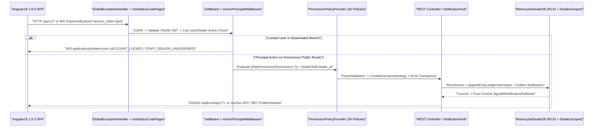

# Detail Design 03 — REST API v1 & Real-Time SignalR Hub Specifications (`DD-03`)

| Document Attribute | Canonical Engineering Specification |
| :--- | :--- |
| **Document ID** | `DD-03` |
| **Document Title** | Complete REST API (`/api/v1/*`, `/health`) & SignalR Real-Time Hub (`/hubs/notifications`) Detail Design |
| **Platform** | Motorcycle Dealer & Loyalty Management Platform (`https://github.com/quocanhh86/motorcycle-dealer`) |
| **Runtime & Stack** | C# 13 / `.NET 10` (`net10.0`), ASP.NET Core 10 Web API, Entity Framework Core 10, ASP.NET Core SignalR, FluentValidation |
| **Clean Architecture Scope** | `MotorcycleDealer.WebApi` (Controllers, Hub, Middleware, Security) $\rightarrow$ `MotorcycleDealer.Application` (Contracts, Validators, Ports) $\rightarrow$ `MotorcycleDealer.Infrastructure` (EF Core Services, JWT/PBKDF2, SQL Server `MotorcycleDealerDb`) |
| **Coverage** | **19 Module Sections** · **97 Canonical Endpoints** (`104+` HTTP Route/Verb Bindings including Aliases) + **SignalR Hub (`10` Strongly-Typed Real-Time Events)** |
| **Empirical Baseline** | **Sections 1–19 (`v1.2.0`)**: Synchronized across `18` C# Controllers (`+ServiceReviewsController`, `+WarrantyClaimsController`) & `SMK-01..10` |
| **Companion BD/DD Suite** | [BD_00_BASIC_DESIGN_MASTER.md](../basic-design/BD_00_BASIC_DESIGN_MASTER.md) · [DD_01_COMMON_SPECIFICATION.md](./DD_01_COMMON_SPECIFICATION.md) · [DD_02_DATABASE_AND_TABLE_UPDATES.md](./DD_02_DATABASE_AND_TABLE_UPDATES.md) · [DD_04_SCREEN_SPECIFICATIONS.md](./DD_04_SCREEN_SPECIFICATIONS.md) |
| **Related Documents** | [README.md](../../README.md) · [PROGRESS.md](../../PROGRESS.md) · [PRD.md](../PRD.md) · [ARCHITECTURE.md](../ARCHITECTURE.md) · [DATABASE_DESIGN.md](../DATABASE_DESIGN.md) · [DESIGN.md](../DESIGN.md) · [openapi.v1.yaml](../openapi.v1.yaml) · [MOD_01](../modules/MOD_01_AUTH_AND_RBAC.md)–[MOD_06](../modules/MOD_06_ADMIN_ANALYTICS_AND_REPORTING.md) |

---

## 0. Cross-Cutting HTTP Pipeline, Envelopes, Security & Error Architecture

### 0.1 ASP.NET Core 10 Request & Middleware Pipeline (`Program.cs`)

Every incoming HTTP request and WebSocket upgrade traverses the deterministic middleware pipeline configured in `backend/src/MotorcycleDealer.WebApi/Program.cs`:

1. **`UseExceptionHandler()` (`GlobalExceptionHandler : IExceptionHandler`)**: Intercepts all unhandled `ValidationException`, `UnauthorizedAccessException`, `ForbiddenAccessException`, `NotFoundException`, `ConflictException`, `DbUpdateConcurrencyException`, `BusinessRuleViolationException`, `DomainException`, and unexpected `500` server exceptions, formatting responses strictly as `RFC 7807 ProblemDetails` (`Content-Type: application/problem+json`).
2. **`UseStatusCodePages(...)`**: Formats bare framework status responses (`401`, `403`, `404`, `405`, `429`) that have not started writing a body into canonical `application/problem+json` envelopes via `GlobalExceptionHandler.CreateStatusCodeProblemDetails`.
3. **`MapOpenApi()`**: Exposed in `Development` environment only.
4. **`UseRouting()`**: Resolves endpoint metadata (`[AllowAnonymous]`, `[Authorize]`, `[HasPermission(...)]`, route constraints).
5. **`UseCors(CorsOptions.PolicyName)`**: Enforces explicit origin whitelist (`Cors:AllowedOrigins` with `AllowAnyHeader()`, `AllowAnyMethod()`, and `AllowCredentials()` required for SignalR negotiation).
6. **`UseAuthentication()` (`JwtBearerDefaults.AuthenticationScheme`)**:
   - `MapInboundClaims = false` (preserves canonical JWT claim names `sub`, `email`, `full_name`, `role`, `dealer_id`, `permissions`, `jti` per `Domain.Constants.JwtClaimNames`).
   - Validates `Issuer` (`MotorcycleDealer.WebApi`), `Audience` (`MotorcycleDealer.Spa`), `IssuerSigningKey` (`HMAC-SHA256`, minimum `256-bit` / `32` UTF-8 bytes), and `ValidateLifetime = true` (`ClockSkew = 30s`).
   - `JwtBearerEvents.OnMessageReceived`: Extracts `?access_token={jwt}` strictly when `Request.Path.StartsWithSegments("/hubs/notifications")`.
7. **`UseMiddleware<ActivePrincipalMiddleware>()`**: Closes the 15-minute stateless JWT revocation window. For every authenticated request (`User.Identity.IsAuthenticated == true`) except bypass paths (`/api/v1/auth/login`, `/api/v1/auth/register`, `/api/v1/auth/refresh`, `/health`, `/api/v1/health`), executes a lightweight `AsNoTracking().IgnoreQueryFilters()` projection on `dbo.Users` (cached per-request in `HttpContext.Items`):
   - If `!user.IsActive || user.IsDeleted` $\rightarrow$ short-circuits immediately with **`403 Forbidden`** (`errorCode: "ACCOUNT_LOCKED"`).
   - If caller holds `DealerStaff` role and `user.DealerId == null || string.IsNullOrWhiteSpace(user.StaffEmployeeCode) || user.Dealer == null || !user.Dealer.IsActive || user.Dealer.IsDeleted` $\rightarrow$ short-circuits immediately with **`403 Forbidden`** (`errorCode: "STAFF_DEALER_UNASSIGNED"`).
   - Note: Even on `[AllowAnonymous]` dual-mode endpoints (`/api/v1/dealers`, `/api/v1/motorcycles`, `/api/v1/inventories?publicOnly=true`, `/api/v1/time-slots`, `/api/v1/loyalty/tiers`, `/api/v1/vouchers/catalog`), if a caller sends a valid JWT belonging to a newly locked user or deactivated branch, `ActivePrincipalMiddleware` rejects the request with `403` before controller execution.
8. **`UseAuthorization()` (`PermissionPolicyProvider` + `PermissionAuthorizationHandler`)**:
   - `PermissionPolicyProvider` pre-builds an immutable `FrozenDictionary<string, Task<AuthorizationPolicy?>>` for all **48** canonical `Permissions.<Module>.<Action>` strings in $O(1)$ lookup time with zero per-request allocations.
   - `PermissionAuthorizationHandler` verifies: (a) `User.Identity.IsAuthenticated == true`, (b) if role is `DealerStaff`, JWT claim `dealer_id` parses to a non-empty `Guid`, and (c) `HttpCurrentUserContext.GetOrExtractPermissions` (`FrozenSet<string>`) contains `requirement.Permission`.
9. **Endpoint Terminal Dispatch**: `MapHealthChecks("/health")`, `MapControllers()`, and `MapHub<NotificationHub>("/hubs/notifications")`.



---

### 0.2 Serialization, Data Type & Multi-Dealer Tenancy Conventions

| Concern | Canonical Implementation Rule |
| :--- | :--- |
| **JSON Property & Dictionary Naming** | `JsonNamingPolicy.CamelCase` across both MVC Controllers and SignalR JSON Hub Protocol. |
| **Enum Wire Format** | `JsonStringEnumConverter` (all enums serialize and deserialize as exact PascalCase strings, e.g., `"PeriodicMaintenance"`, `"ReservedOnBooking"`). |
| **Monetary Precision** | C# `decimal` $\leftrightarrow$ SQL Server `DECIMAL(18,2) NOT NULL` (`HavePrecision(18, 2)` convention in `MotorcycleDealerDbContext`). Never `float` or `double`. |
| **Timestamps & Dates** | Timestamps use `DateTimeOffset` in **UTC** (`DATETIMEOFFSET(7)`), serialized as ISO-8601 UTC strings (`2026-05-16T09:15:30+00:00` / `Z`). Workshop calendar dates use `DateOnly` (`YYYY-MM-DD`); shift times use `HH:mm:ss` (`TimeOnly`). |
| **Primary Keys** | Time-ordered UUIDv7 generated in C# via `Guid.CreateVersion7()` backed by SQL Server `UNIQUEIDENTIFIER DEFAULT NEWSEQUENTIALID()`. |
| **ISO 3779 VIN Value Object** | `Vin` (`Domain/ValueObjects/Vin.cs`): Trimmed uppercase 17-character ASCII string matching `^[A-HJ-NPR-Z0-9]{17}$` (explicitly rejecting `I`, `O`, `Q` with `INVALID_VIN_CHAR`, wrong length with `INVALID_VIN_LENGTH`, or invalid characters with `INVALID_VIN_FORMAT`). |
| **Optimistic Concurrency (`RowVersion`)** | `RowVersionCodec` encodes/decodes 8-byte SQL Server `ROWVERSION` (`byte[8]`) values as 12-character Base64 strings (e.g., `"AAAAAAAAD4E="`). Enforced on `DealerInventories`, `ServiceTimeSlots`, `ServiceBookings`, `TestDriveBookings`, `LoyaltyAccounts`, and `CustomerVouchers` (plus deterministic tick-based concurrency bytes on `LoyaltyTiers`). |
| **`IDealerScoped` Read & Write Isolation** | `MotorcycleDealerDbContext` registers global EF Core query filters (`!IsDealerStaffScopeActive \|\| e.DealerId == CurrentDealerIdOrEmpty`) AND `EnforceDealerScopeWriteGuard()` inside `SaveChanges` / `SaveChangesAsync` on all 6 dealer-owned aggregates (`DealerInventories`, `ServiceTimeSlots`, `SalesOrders`, `ServiceBookings`, `ServiceInvoices`, `TestDriveBookings`). Any `DealerStaff` attempt to pass a foreign `dealerId` or mutate a foreign branch's row throws `403 FORBIDDEN_DEALER_SCOPE`. |
| **Append-Only Financial Audit Guard** | `AppendOnlyLedgerInterceptor` (`SaveChangesInterceptor`) blocks `EntityState.Modified` and `EntityState.Deleted` on `PointLedgerEntries`, `SalesOrders`, `ServiceInvoices`, and `ServiceInvoiceLineItems` at runtime. |

---

### 0.3 Standard Response Envelopes & RFC 7807 Error Schema

#### A. Single-Resource Envelope (`ApiEnvelope<T>`)
```json
{
  "success": true,
  "data": { },
  "meta": {
    "timestampUtc": "2026-05-16T09:15:30.1245000+00:00",
    "traceId": "00-4bf92f3577b34da6a3ce929d0e0e4736-00f067aa0ba902b7-01"
  }
}
```

#### B. Paginated Collection Envelope (`PagedApiEnvelope<T>`)
Returned by paginated list endpoints (`/motorcycles`, `/inventories`, `/sales-orders*`, `/bookings*`, `/service-invoices*`, `/loyalty/ledger`). `PaginationQuery` defaults to `pageNumber = 1`, `pageSize = 20`, with `MaxPageSize = 100`.
```json
{
  "success": true,
  "data": [ ],
  "pagination": {
    "pageNumber": 1,
    "pageSize": 20,
    "totalCount": 42,
    "totalPages": 3,
    "hasPreviousPage": false,
    "hasNextPage": true
  },
  "meta": {
    "timestampUtc": "2026-05-16T09:15:30.1245000+00:00",
    "traceId": "00-4bf92f3577b34da6a3ce929d0e0e4736-00f067aa0ba902b7-01"
  }
}
```

#### C. Notification Feed Envelope (`NotificationFeedEnvelope`)
Returned by `GET /api/v1/notifications` and `GET /api/v1/notifications/dealer`, surfacing `unreadCount` both at the top level and inside `meta`:
```json
{
  "success": true,
  "data": [ ],
  "unreadCount": 3,
  "pagination": {
    "pageNumber": 1,
    "pageSize": 20,
    "totalCount": 14,
    "totalPages": 1,
    "hasPreviousPage": false,
    "hasNextPage": false
  },
  "meta": {
    "timestampUtc": "2026-05-16T09:15:30.1245000+00:00",
    "traceId": "00-4bf92f3577b34da6a3ce929d0e0e4736-00f067aa0ba902b7-01",
    "unreadCount": 3
  }
}
```

#### D. RFC 7807 `ProblemDetails` Error Envelope (`application/problem+json`)
Every `4xx`/`5xx` error returns `Content-Type: application/problem+json` enriched by `GlobalExceptionHandler`:
```json
{
  "type": "https://httpstatuses.io/400",
  "title": "Validation Failed",
  "status": 400,
  "detail": "One or more request validation rules failed.",
  "instance": "/api/v1/inventories",
  "errorCode": "VALIDATION_FAILED",
  "traceId": "00-71a82f3577b34da6a3ce929d0e0e9912-11a067aa0ba902c4-01",
  "errors": {
    "vin": [
      "VIN contains ISO 3779 forbidden character 'O' at position 10 (I, O, and Q are prohibited)."
    ]
  }
}
```

| Exception / Pipeline Source | HTTP Status | Default `title` | Canonical `errorCode` Values |
| :--- | :---: | :--- | :--- |
| `FluentValidation.ValidationException` / MVC ModelBinding | `400 Bad Request` | `"Validation Failed"` | `VALIDATION_FAILED`, `BAD_REQUEST`, `VALIDATION_NULL_VALUE` |
| `DomainException` (base, e.g., `Vin.Create`, `RowVersionCodec`, `AppendOnlyLedgerInterceptor`) | `400 Bad Request` | `"Domain Validation Error"` | `INVALID_VIN_LENGTH`, `INVALID_VIN_CHAR`, `INVALID_VIN_FORMAT`, `INVALID_ROW_VERSION`, `DOMAIN_RULE_VIOLATION`, `IMMUTABLE_LEDGER_VIOLATION`, `IMMUTABLE_FINANCIAL_RECORD_VIOLATION`, `INVALID_NET_PAID_AMOUNT`, `INVALID_TIER_MULTIPLIER`, `INVALID_QUALIFYING_POINTS`, `INVALID_POINT_BALANCE`, `INVALID_POINTS_COST`, `INVALID_GROSS_AMOUNT`, `INVALID_DISCOUNT_VALUE`, `INVALID_DISCOUNT_PERCENTAGE`, `INVALID_DISCOUNT_TYPE`, `INVALID_USER_ID`, `INVALID_TOKEN_FAMILY`, `INVALID_REFRESH_EXPIRY` |
| `UnauthorizedAccessException` / `AuthAuthenticationException` / JWT Challenge | `401 Unauthorized` | `"Unauthorized"` *(or specific auth title)* | `UNAUTHORIZED`, `INVALID_CREDENTIALS`, `INVALID_REFRESH_TOKEN`, `REFRESH_TOKEN_REUSE_DETECTED` |
| `ForbiddenAccessException` / `ActivePrincipalMiddleware` / `PermissionAuthorizationHandler` | `403 Forbidden` | `"Forbidden"` | `FORBIDDEN_PERMISSION`, `FORBIDDEN_DEALER_SCOPE`, `FORBIDDEN_RESOURCE_OWNER`, `ACCOUNT_LOCKED`, `STAFF_DEALER_UNASSIGNED` |
| `NotFoundException` / Unmatched Route | `404 Not Found` | `"Resource Not Found"` | `RESOURCE_NOT_FOUND` |
| Unsupported HTTP Verb (`UseStatusCodePages`) | `405 Method Not Allowed` | `"Method Not Allowed"` | `METHOD_NOT_ALLOWED` |
| `ConflictException` / `DbUpdateConcurrencyException` | `409 Conflict` | `"Conflict"` / `"Concurrency Conflict"` | `CONCURRENCY_CONFLICT`, `DUPLICATE_EMAIL`, `DUPLICATE_PHONE`, `DUPLICATE_ACCOUNT`, `DUPLICATE_DEALER_CODE`, `DUPLICATE_EMPLOYEE_CODE`, `DUPLICATE_MODEL_CODE`, `DUPLICATE_MILESTONE_CODE`, `DUPLICATE_VIN`, `DUPLICATE_ENGINE_NUMBER`, `DUPLICATE_LICENSE_PLATE`, `INVENTORY_ALREADY_SOLD`, `INVENTORY_NOT_AVAILABLE`, `VOUCHER_NOT_AVAILABLE`, `DUPLICATE_TIME_SLOT`, `CAPACITY_BELOW_BOOKED`, `SLOT_CAPACITY_EXHAUSTED`, `DUPLICATE_VEHICLE_BOOKING`, `INVOICE_ALREADY_ISSUED`, `DUPLICATE_IDEMPOTENCY_KEY`, `DUPLICATE_VOUCHER_PREFIX`, `VOUCHER_QUOTA_EXHAUSTED` |
| `BusinessRuleViolationException` | `422 Unprocessable Entity` | `"Business Rule Violation"` | `BUSINESS_RULE_VIOLATION`, `INVALID_DEALER_STAFF_BINDING`, `DEALER_INACTIVE`, `MODEL_INACTIVE`, `CUSTOMER_INACTIVE`, `VEHICLE_INACTIVE`, `INVALID_CUSTOMER_ROLE`, `DEALER_INVENTORY_MISMATCH`, `VOUCHER_INELIGIBLE`, `VOUCHER_INACTIVE`, `DISCOUNT_EXCEEDS_TOTAL`, `ODOMETER_REGRESSION`, `INVALID_STATUS_TRANSITION`, `INVALID_BOOKING_STATUS`, `INVALID_INVOICE_AMOUNT`, `INVALID_TIER_THRESHOLD`, `INSUFFICIENT_POINTS`, `INSUFFICIENT_LOYALTY_POINTS`, `INVALID_VOUCHER_QUOTA`, `TIER_REQUIREMENT_NOT_MET`, `SYSTEM_SEED_MISSING` |
| Rate Limiter (`UseStatusCodePages`) | `429 Too Many Requests` | `"Too Many Requests"` | `RATE_LIMIT_EXCEEDED` |
| `HealthController` SQL Probe Timeout / Failure | `503 Service Unavailable` | `"Database Unavailable"` | `DATABASE_UNAVAILABLE` |
| Unhandled `Exception` (stack trace hidden outside `Development`) | `500 Internal Server Error` | `"Internal Server Error"` | `INTERNAL_SERVER_ERROR` |

---

### 0.4 Master Endpoint & Real-Time Hub Catalog (`15` Sections)

| Sec | Endpoint / Event ID | HTTP Method & Route (with Aliases) | Controller / Hub Target | Auth / Policy Guard | Status |
| :---: | :--- | :--- | :--- | :--- | :---: |
| **1** | `API-HLT-01` | `GET /health` | `Program.cs` (`MapHealthChecks`) | `[AllowAnonymous]` (Bypass) | Live `[P3]` |
| **1** | `API-HLT-02` | `GET /api/v1/health` | `HealthController.GetHealthAsync` | `[AllowAnonymous]` (Bypass) | Live `[P3]` |
| **2** | `API-AUT-01` | `POST /api/v1/auth/register` | `AuthController.RegisterAsync` | `[AllowAnonymous]` (Bypass) | Live `[P4]` |
| **2** | `API-AUT-02` | `POST /api/v1/auth/login` | `AuthController.LoginAsync` | `[AllowAnonymous]` (Bypass) | Live `[P4]` |
| **2** | `API-AUT-03` | `POST /api/v1/auth/refresh` | `AuthController.RefreshAsync` | `[AllowAnonymous]` (Bypass) | Live `[P4]` |
| **2** | `API-AUT-04` | `POST /api/v1/auth/logout` | `AuthController.LogoutAsync` | `[Authorize]` | Live `[P4]` |
| **2** | `API-AUT-05` | `GET /api/v1/auth/me` | `AuthController.GetMeAsync` | `[Authorize]` | Live `[P4]` |
| **3** | `API-DLR-01` | `GET /api/v1/dealers` | `DealersController.ListDealersAsync` | `[AllowAnonymous]` (Dual-Mode) | Live `[P4]` |
| **3** | `API-DLR-02` | `GET /api/v1/dealers/{dealerId}` | `DealersController.GetDealerByIdAsync` | `[AllowAnonymous]` (Dual-Mode) | Live `[P4]` |
| **3** | `API-DLR-03` | `POST /api/v1/dealers` | `DealersController.CreateDealerAsync` | `Permissions.Dealers.ManageAll` | Live `[P4]` |
| **3** | `API-DLR-04` | `PUT /api/v1/dealers/{dealerId}` | `DealersController.UpdateDealerAsync` | `Permissions.Dealers.ManageAll` | Live `[P4]` |
| **3** | `API-DLR-05` | `GET /api/v1/dealers/{dealerId}/staff` | `DealersController.ListDealerStaffAsync` | `Permissions.Users.ManageStaff` | Live `[P4]` |
| **3** | `API-DLR-06` | `POST /api/v1/dealers/{dealerId}/staff` | `DealersController.ProvisionDealerStaffAsync` | `Permissions.Users.ManageStaff` | Live `[P4]` |
| **3** | `API-DLR-07` | `PATCH /api/v1/dealers/{dealerId}/staff/{userId}/status` | `DealersController.UpdateDealerStaffStatusAsync` | `Permissions.Users.ManageStaff` | Live `[P4]` |
| **4** | `API-MTR-01` | `GET /api/v1/motorcycles` | `MotorcyclesController.ListMotorcyclesAsync` | `[AllowAnonymous]` (Dual-Mode) | Live `[P5]` |
| **4** | `API-MTR-02` | `GET /api/v1/motorcycles/{modelId}` | `MotorcyclesController.GetMotorcycleModelByIdAsync` | `[AllowAnonymous]` (Dual-Mode) | Live `[P5]` |
| **4** | `API-MTR-03` | `POST /api/v1/motorcycles` | `MotorcyclesController.CreateMotorcycleModelAsync` | `Permissions.Showroom.ManageModels` | Live `[P5]` |
| **4** | `API-MTR-04` | `PUT /api/v1/motorcycles/{modelId}` | `MotorcyclesController.UpdateMotorcycleModelAsync` | `Permissions.Showroom.ManageModels` | Live `[P5]` |
| **4** | `API-MTR-05` | `GET /api/v1/motorcycles/{modelId}/maintenance-rules` | `MotorcyclesController.ListModelMaintenanceRulesAsync` | `[AllowAnonymous]` (Dual-Mode) | Live `[P5]` |
| **4** | `API-MTR-06` | `POST /api/v1/motorcycles/{modelId}/maintenance-rules` | `MotorcyclesController.CreateMaintenanceRuleAsync` | `Permissions.Vehicles.ManageRules` | Live `[P5]` |
| **4** | `API-MTR-07` | `PUT /api/v1/motorcycles/{modelId}/maintenance-rules/{ruleId}`<br>*(Alias: `PUT /api/v1/motorcycles/{modelId}/maintenance-rules`)* | `MotorcyclesController.UpdateMaintenanceRuleAsync`<br>`UpdateMaintenanceRuleFromBodyAsync` | `Permissions.Vehicles.ManageRules` | Live `[P5]` |
| **5** | `API-INV-01` | `GET /api/v1/inventories` | `InventoriesController.ListInventoriesAsync` | `[AllowAnonymous]` (`publicOnly=true`) / `Permissions.Inventories.ViewDealer` | Live `[P5]` |
| **5** | `API-INV-02` | `GET /api/v1/inventories/{inventoryId}` | `InventoriesController.GetInventoryByIdAsync` | `Permissions.Inventories.ViewDealer` | Live `[P5]` |
| **5** | `API-INV-03` | `POST /api/v1/inventories` | `InventoriesController.CreateInventoryAsync` | `Permissions.Inventories.ManageDealer` | Live `[P5]` |
| **5** | `API-INV-04` | `PATCH /api/v1/inventories/{inventoryId}` | `InventoriesController.UpdateInventoryAsync` | `Permissions.Inventories.ManageDealer` | Live `[P5]` |
| **6** | `API-SAL-01` | `GET /api/v1/sales-orders` | `SalesOrdersController.ListSalesOrdersAsync` | `[Authorize]` (`ViewDealer` \| `ViewOwn`) | Live `[P5]` |
| **6** | `API-SAL-02` | `GET /api/v1/sales-orders/my` | `SalesOrdersController.ListMySalesOrdersAsync` | `Permissions.SalesOrders.ViewOwn` | Live `[P5]` |
| **6** | `API-SAL-03` | `GET /api/v1/sales-orders/{orderId}` | `SalesOrdersController.GetSalesOrderByIdAsync` | `[Authorize]` (`ViewDealer` \| `ViewOwn`) | Live `[P5]` |
| **6** | `API-SAL-04` | `POST /api/v1/sales-orders` | `SalesOrdersController.CreateSalesOrderAsync` | `Permissions.SalesOrders.Create` | Live `[P5]` |
| **7** | `API-VEH-01` | `GET /api/v1/vehicles/my` | `VehiclesController.ListMyVehiclesAsync` | `Permissions.Vehicles.ViewOwn` | Live `[P5]` |
| **7** | `API-VEH-02` | `GET /api/v1/vehicles` | `VehiclesController.ListVehiclesAsync` | `[Authorize]` (`ViewDealer` \| `ViewOwn`) | Live `[P5]` |
| **7** | `API-VEH-03` | `GET /api/v1/vehicles/lookup` | `VehiclesController.LookupVehiclesForWorkshopAsync` | `Permissions.Vehicles.ViewDealer` | Live `[P5]` |
| **7** | `API-VEH-04` | `GET /api/v1/vehicles/{vehicleId}` | `VehiclesController.GetVehicleByIdAsync` | `[Authorize]` (`ViewDealer` \| `ViewOwn`) | Live `[P5]` |
| **7** | `API-VEH-05` | `POST /api/v1/vehicles` | `VehiclesController.RegisterExternalVehicleAsync` | `Permissions.Vehicles.RegisterOwn` | Live `[P5]` |
| **7** | `API-VEH-06` | `PATCH /api/v1/vehicles/{vehicleId}/mileage` | `VehiclesController.UpdateVehicleMileageAsync` | `Permissions.Vehicles.RegisterOwn` | Live `[P5]` |
| **7** | `API-VEH-07` | `GET /api/v1/vehicles/{vehicleId}/reminders` | `VehiclesController.ListVehicleRemindersAsync` | `[Authorize]` (`ViewDealer` \| `ViewOwn`) | Live `[P5]` |
| **7** | `API-VEH-08` | `GET /api/v1/vehicles/{vehicleId}/maintenance-history` | `VehiclesController.GetVehicleMaintenanceHistoryAsync` | `[Authorize]` (`ViewDealer` \| `ViewOwn`) | Live `[P5]` |
| **8** | `API-SLT-01` | `GET /api/v1/time-slots` | `TimeSlotsController.ListTimeSlotsAsync` | `[AllowAnonymous]` (Dual-Mode) | Live `[P5]` |
| **8** | `API-SLT-02` | `GET /api/v1/time-slots/dealer` | `TimeSlotsController.ListDealerTimeSlotsAsync` | `Permissions.TimeSlots.ManageDealer` | Live `[P5]` |
| **8** | `API-SLT-03` | `POST /api/v1/time-slots` | `TimeSlotsController.CreateTimeSlotAsync` | `Permissions.TimeSlots.ManageDealer` | Live `[P5]` |
| **8** | `API-SLT-04` | `POST /api/v1/time-slots/generate`<br>*(Alias: `POST /api/v1/time-slots/dealer/generate`)* | `TimeSlotsController.GenerateTimeSlotsAsync` | `Permissions.TimeSlots.ManageDealer` | Live `[P5]` |
| **8** | `API-SLT-05` | `PATCH /api/v1/time-slots/{slotId}` | `TimeSlotsController.UpdateTimeSlotAsync` | `Permissions.TimeSlots.ManageDealer` | Live `[P5]` |
| **9** | `API-BKG-01` | `GET /api/v1/bookings/my` | `BookingsController.ListMyBookingsAsync` | `Permissions.Bookings.ViewOwn` | Live `[P5]` |
| **9** | `API-BKG-02` | `GET /api/v1/bookings` | `BookingsController.ListBookingsAsync` | `[Authorize]` (`ViewOwn` \| `ViewDealer`) | Live `[P5]` |
| **9** | `API-BKG-03` | `GET /api/v1/bookings/dealer` | `BookingsController.ListDealerBookingsAsync` | `Permissions.Bookings.ViewDealer` | Live `[P5]` |
| **9** | `API-BKG-04` | `GET /api/v1/bookings/{bookingId}` | `BookingsController.GetBookingByIdAsync` | `[Authorize]` (`ViewOwn` \| `ViewDealer`) | Live `[P5]` |
| **9** | `API-BKG-05` | `POST /api/v1/bookings` | `BookingsController.CreateBookingAsync` | `Permissions.Bookings.Create` | Live `[P5]` |
| **9** | `API-BKG-06` | `POST /api/v1/bookings/{bookingId}/cancel` | `BookingsController.CancelBookingAsync` | `[Authorize]` (`CancelOwn` \| `UpdateStatus`) | Live `[P5]` |
| **9** | `API-BKG-07` | `PATCH /api/v1/bookings/{bookingId}/status` | `BookingsController.UpdateBookingStatusAsync` | `Permissions.Bookings.UpdateStatus` | Live `[P5]` |
| **10** | `API-SIV-01` | `GET /api/v1/service-invoices` | `ServiceInvoicesController.ListServiceInvoicesAsync` | `[Authorize]` (`ViewDealer` \| `ViewOwn`) | Live `[P6]` |
| **10** | `API-SIV-02` | `GET /api/v1/service-invoices/my` | `ServiceInvoicesController.ListMyServiceInvoicesAsync` | `Permissions.Invoices.ViewOwn` | Live `[P6]` |
| **10** | `API-SIV-03` | `GET /api/v1/service-invoices/{invoiceId}` | `ServiceInvoicesController.GetServiceInvoiceByIdAsync` | `[Authorize]` (`ViewDealer` \| `ViewOwn`) | Live `[P6]` |
| **10** | `API-SIV-04` | `POST /api/v1/service-invoices` | `ServiceInvoicesController.CreateServiceInvoiceAsync` | `Permissions.Invoices.CreateDealer` | Live `[P6]` |
| **11** | `API-LOY-01` | `GET /api/v1/loyalty/tiers` | `LoyaltyController.ListTiersAsync` | `[AllowAnonymous]` (Dual-Mode) | Live `[P6]` |
| **11** | `API-LOY-02` | `PUT /api/v1/loyalty/tiers/{tierId}` | `LoyaltyController.UpdateTierAsync` | `Permissions.Loyalty.ManageTiers` | Live `[P6]` |
| **11** | `API-LOY-03` | `GET /api/v1/loyalty/me`<br>*(Alias: `GET /api/v1/loyalty/account`)* | `LoyaltyController.GetMyLoyaltySummaryAsync` | `Permissions.Loyalty.ViewOwn` | Live `[P6]` |
| **11** | `API-LOY-04` | `GET /api/v1/loyalty/ledger` | `LoyaltyController.ListMyPointLedgerAsync` | `Permissions.Loyalty.ViewOwn` | Live `[P6]` |
| **11** | `API-LOY-05` | `GET /api/v1/loyalty/customers/{customerId}` | `LoyaltyController.InspectCustomerLoyaltyAsync` | `Permissions.Loyalty.ViewDealerCustomer` | Live `[P6]` |
| **11** | `API-LOY-06` | `POST /api/v1/loyalty/adjustments`<br>*(Alias: `POST /api/v1/loyalty/accounts/{accountId}/adjustments`)* | `LoyaltyController.AdjustPointsAsync`<br>`AdjustAccountPointsAsync` | `Permissions.Loyalty.AdjustPoints` | Live `[P6]` |
| **12** | `API-VCH-01` | `GET /api/v1/vouchers/catalog` | `VouchersController.ListCatalogAsync` | `[AllowAnonymous]` (Dual-Mode) | Live `[P6]` |
| **12** | `API-VCH-02` | `POST /api/v1/vouchers/catalog` | `VouchersController.CreateCatalogItemAsync` | `Permissions.Loyalty.ManageVoucherCatalog` | Live `[P6]` |
| **12** | `API-VCH-03` | `PUT /api/v1/vouchers/catalog/{catalogId}` | `VouchersController.UpdateCatalogItemAsync` | `Permissions.Loyalty.ManageVoucherCatalog` | Live `[P6]` |
| **12** | `API-VCH-04` | `GET /api/v1/vouchers/my` | `VouchersController.ListMyVouchersAsync` | `Permissions.Loyalty.ViewOwn` | Live `[P6]` |
| **12** | `API-VCH-05` | `POST /api/v1/vouchers/redeem` | `VouchersController.RedeemVoucherAsync` | `Permissions.Loyalty.RedeemVoucher` | Live `[P6]` |
| **13** | `API-NTF-01` | `GET /api/v1/notifications` | `NotificationsController.ListNotificationsAsync` | `[Authorize]` (`ViewOwn` \| `ViewDealer`) | Live `[P6]` |
| **13** | `API-NTF-02` | `GET /api/v1/notifications/dealer` | `NotificationsController.ListDealerNotificationsAsync` | `Permissions.Notifications.ViewDealer` | Live `[P6]` |
| **13** | `API-NTF-03` | `PATCH /api/v1/notifications/{notificationId}/read`<br>*(Alias: `POST /api/v1/notifications/{notificationId}/read`)* | `NotificationsController.MarkNotificationReadAsync` | `[Authorize]` (`ViewOwn` \| `ViewDealer`) | Live `[P6]` |
| **13** | `API-NTF-04` | `POST /api/v1/notifications/read-all` | `NotificationsController.MarkAllNotificationsReadAsync` | `[Authorize]` (`ViewOwn` \| `ViewDealer`) | Live `[P6]` |
| **14** | `API-ANL-01` | `GET /api/v1/admin/analytics/kpis`<br>*(Alias: `GET /api/v1/admin/analytics/overview`)* | `AdminAnalyticsController.GetKpisOverviewAsync` | `Permissions.Analytics.ViewAllDealers` | Implemented & Verified `[Phase 7]` |
| **14** | `API-ANL-02` | `GET /api/v1/admin/analytics/revenue-by-dealer` | `AdminAnalyticsController.GetRevenueByDealerAsync` | `Permissions.Analytics.ViewAllDealers` | Implemented & Verified `[Phase 7]` |
| **14** | `API-ANL-03` | `GET /api/v1/admin/analytics/bookings-by-dealer` | `AdminAnalyticsController.GetBookingsByDealerAsync` | `Permissions.Analytics.ViewAllDealers` | Implemented & Verified `[Phase 7]` |
| **14** | `API-ANL-04` | `GET /api/v1/admin/analytics/monthly-trends` | `AdminAnalyticsController.GetMonthlyTrendsAsync` | `Permissions.Analytics.ViewAllDealers` | Implemented & Verified `[Phase 7]` |
| **14** | `API-ANL-05` | `GET /api/v1/admin/analytics/loyalty-distribution` | `AdminAnalyticsController.GetLoyaltyDistributionAsync` | `Permissions.Analytics.ViewAllDealers` | Implemented & Verified `[Phase 7]` |
| **14** | `API-ANL-06` | `GET /api/v1/admin/analytics/export-csv`<br>*(Alias: `GET /api/v1/admin/analytics/export`)* | `AdminAnalyticsController.ExportCsvAsync` | `Permissions.Analytics.ExportReports` | Implemented & Verified `[Phase 7]` |
| **15** | `HUB-EVT-01`..`05` | `WS /hubs/notifications?access_token={jwt}` | `NotificationHub : Hub<INotificationClient>` | `[Authorize]` + Persisted Principal Guard | Live `[P6]` |

---

## Section 1: System Health & Readiness (`Program.cs` & `HealthController`)

### `API-HLT-01` — `GET /health`

| Attribute | Specification |
| :--- | :--- |
| **Endpoint ID** | `API-HLT-01` |
| **HTTP Method & Route** | `GET /health` |
| **Pipeline Mapping** | `app.MapHealthChecks("/health").AllowAnonymous()` (`backend/src/MotorcycleDealer.WebApi/Program.cs` line 167) |
| **Implementation Status** | `Implemented & Verified [Phase 3–6]` (`T-305`) |
| **Traceability** | `ADR-001` · Container & Reverse-Proxy Process Liveness Probe |

- **Authentication, Policy & Tenancy Rules**:
  - Decorated with `.AllowAnonymous()`.
  - Explicitly listed in `ActivePrincipalMiddleware.BypassAuthenticatedRevocationPaths` (`"/health"`), so liveness checks never query `dbo.Users` even if an `Authorization` header is accidentally forwarded by an ingress proxy.
  - Tenancy: Platform-wide (`N/A`).
- **Request Specification**:
  - **Path Parameters**: None.
  - **Query Parameters**: None.
  - **Request Body**: None.
- **Internal Processing Algorithm & Database Updates**:
  1. Invokes ASP.NET Core `HealthCheckService` registered via `builder.Services.AddHealthChecks()`.
  2. Evaluates host process readiness in-memory with zero SQL Server I/O (`0` tables read, `0` tables mutated).
  3. Writes plain-text health status (`text/plain`) directly to HTTP response stream.
  4. Post-commit SignalR events: None.
- **Response Specification**:
  - **Success Status**: `200 OK` (`Content-Type: text/plain`).
  - **Response Body**: Literal string `"Healthy"`.
  - **Error Matrix**:
    | HTTP Status | `errorCode` | Trigger Condition |
    | :---: | :--- | :--- |
    | `503 Service Unavailable` | `Unhealthy` *(plain text)* | Host health check pipeline reports degraded/unhealthy process state. |

---

### `API-HLT-02` — `GET /api/v1/health`

| Attribute | Specification |
| :--- | :--- |
| **Endpoint ID** | `API-HLT-02` |
| **HTTP Method & Route** | `GET /api/v1/health` |
| **Controller & Service** | `HealthController.GetHealthAsync` $\rightarrow$ `IApplicationDbContext.CanConnectAsync` (`HealthController.cs` lines 27–72) |
| **Implementation Status** | `Implemented & Verified [Phase 3–6]` (`T-305`) |
| **Traceability** | `ADR-001` · Versioned API & SQL Server `MotorcycleDealerDb` Readiness Probe |

- **Authentication, Policy & Tenancy Rules**:
  - `[AllowAnonymous]` and explicitly listed in `ActivePrincipalMiddleware.BypassAuthenticatedRevocationPaths` (`"/api/v1/health"`).
  - Tenancy: Platform-wide (`N/A`).
- **Request Specification**:
  - **Path Parameters**: None.
  - **Query Parameters**:
    | Parameter | Type | Default | Constraints & Behavior |
    | :--- | :--- | :--- | :--- |
    | `probeDb` | `bool` | `false` | When `false`, returns `"MotorcycleDealerDb (Configured)"` without opening a SQL connection. When `true`, executes a live 2-second bounded SQL Server connectivity check. |
  - **Request Body**: None.
- **Internal Processing Algorithm & Database Updates**:
  1. Initializes `databaseState = "MotorcycleDealerDb (Configured)"`.
  2. If `probeDb == true`:
     - Creates a linked `CancellationTokenSource` with a strict `2,000 ms` timeout (`probeCts.CancelAfter(TimeSpan.FromSeconds(2))`).
     - Calls `await _dbContext.CanConnectAsync(probeCts.Token)` against SQL Server `MotorcycleDealerDb`.
     - If `connected == false` (timeout or SQL unreachable), builds a custom `ProblemDetails` (`503 Service Unavailable`, `errorCode: "DATABASE_UNAVAILABLE"`) via `GlobalExceptionHandler.CreateCustomProblemDetails` and returns `application/problem+json`.
     - If `connected == true`, sets `databaseState = "MotorcycleDealerDb (Connected)"`.
  3. Constructs and returns `SystemHealthDto` (`0` tables mutated).
  4. Post-commit SignalR events: None.
- **Response Specification**:
  - **Success Status**: `200 OK` (`Content-Type: application/json`, direct `SystemHealthDto` payload).
  - **Response DTO (`SystemHealthDto`)**:
    | Field | JSON Type | Nullable | Description / Canonical Value |
    | :--- | :--- | :---: | :--- |
    | `status` | `string` | No | `"Healthy"` |
    | `service` | `string` | No | `"MotorcycleDealer.WebApi"` |
    | `version` | `string` | No | `"1.0.0"` |
    | `environment` | `string` | No | Active `IHostEnvironment.EnvironmentName` (e.g., `"Development"`, `"Production"`). |
    | `database` | `string` | No | `"MotorcycleDealerDb (Configured)"` (`probeDb=false`) or `"MotorcycleDealerDb (Connected)"` (`probeDb=true`). |
    | `timestampUtc` | `string (date-time)` | No | Current UTC server timestamp from `IDateTimeProvider.UtcNow`. |
    | `traceId` | `string` | No | W3C `Activity.Current.Id` or `HttpContext.TraceIdentifier`. |
  - **Error Matrix**:
    | HTTP Status | `errorCode` | Trigger Condition |
    | :---: | :--- | :--- |
    | `400 Bad Request` | `VALIDATION_FAILED` | Query parameter `probeDb` cannot be parsed as a boolean. |
    | `503 Service Unavailable` | `DATABASE_UNAVAILABLE` | `probeDb=true` and SQL Server `MotorcycleDealerDb` fails `CanConnectAsync` or exceeds the 2-second timeout. |

---

## Section 2: Authentication & Session Management (`AuthController`)

### `API-AUT-01` — `POST /api/v1/auth/register`

| Attribute | Specification |
| :--- | :--- |
| **Endpoint ID** | `API-AUT-01` |
| **HTTP Method & Route** | `POST /api/v1/auth/register` |
| **Controller & Service** | `AuthController.RegisterAsync` $\rightarrow$ `IAuthService.RegisterCustomerAsync` (`AuthService.cs` lines 52–193) |
| **Implementation Status** | `Implemented & Verified [Phase 3–6]` (`T-405`, `MOD-01`) |
| **Traceability** | `FR-01`, `FR-05`, `ADR-002`, `ADR-003`, `ADR-006` |

- **Authentication, Policy & Tenancy Rules**:
  - `[AllowAnonymous]` (bypassed in `ActivePrincipalMiddleware`).
  - Self-registration strictly provisions **`Customer`** principals (`DealerId = null`, `StaffEmployeeCode = null`). `DealerStaff` and `Admin` accounts can never be created through this endpoint.
- **Request Specification**:
  - **Path / Query Parameters**: None.
  - **Request Body (`RegisterCustomerRequest`) & `FluentValidation` Rules (`RegisterCustomerRequestValidator`, `CascadeMode.Stop`)**:
    | JSON Field | C# Type | Required | Exact `FluentValidation` Constraints & Error Messages |
    | :--- | :--- | :---: | :--- |
    | `email` | `string` | Yes | `NotEmpty` (*"Email address is required."*), `MaximumLength(256)` (*"Email address must not exceed 256 characters."*), matches `^[^@\s]+@[^@\s]+\.[^@\s]+$` on `email.Trim()` (*"Email address must be a valid RFC 5322 email."*). |
    | `password` | `string` | Yes | `NotEmpty` (*"Password is required."*), `MinimumLength(8)`, `MaximumLength(128)`, `HasRequiredPasswordComplexity` requiring $\ge 1$ uppercase, $\ge 1$ lowercase, $\ge 1$ digit, and $\ge 1$ non-whitespace special char (*"Password must contain at least one uppercase letter, one lowercase letter, one digit, and one special character."*). |
    | `fullName` | `string` | Yes | `NotEmpty` (*"Full name is required."*), `name.Trim().Length >= 2` (*"Full name must be at least 2 characters long."*), `MaximumLength(150)`. |
    | `phoneNumber` | `string` | Yes | `NotEmpty` (*"Phone number is required."*), `MaximumLength(20)`, matches `^\+?[0-9]{9,15}$` on `phone.Trim()` (*"Phone number must contain 9 to 15 digits (optional leading '+')."*). |
- **Internal Processing Algorithm & Database Updates**:
  1. Validates `request` via `RegisterCustomerRequestValidator.ValidateAndThrowAsync`.
  2. Normalizes `trimmedEmail = request.Email.Trim()`, `normalizedEmail = User.NormalizeEmailValue(trimmedEmail)` (`ToUpperInvariant`), `trimmedPhone`, and `trimmedFullName`.
  3. Checks `dbo.Users.IgnoreQueryFilters()` for duplicate `NormalizedEmail` / `Email` ($\rightarrow$ `409 DUPLICATE_EMAIL`) and duplicate `PhoneNumber` ($\rightarrow$ `409 DUPLICATE_PHONE`).
  4. Loads seeded `Customer` row from `dbo.Roles` and `Bronze` row from `dbo.LoyaltyTiers` ($\rightarrow$ `422 SYSTEM_SEED_MISSING` if absent), plus the 13 `Customer` permission codes from `dbo.RolePermissions` $\bowtie$ `dbo.Permissions` (falling back to `Permissions.CustomerDefaults`).
  5. Hashes `request.Password` via `Pbkdf2PasswordHasher` (`PBKDF2-HMAC-SHA256`, random salt).
  6. Executes atomic SQL transaction inside `_dbContext.Database.CreateExecutionStrategy()`:
     - **`INSERT dbo.Users`**: `User.CreateCustomer(...)` (`Id = Guid.CreateVersion7()`, `IsActive = true`, `DealerId = null`, `LastLoginAtUtc = utcNow`).
     - **`INSERT dbo.UserRoles`**: Maps `(UserId, RoleId = CustomerRole.Id, AssignedAtUtc = utcNow)`.
     - **`INSERT dbo.LoyaltyAccounts`**: Initializes wallet (`CustomerId = user.Id`, `CurrentTierId = bronzeTier.Id`, `AvailablePoints = 0`, `LifetimeQualifyingPoints = 0`, `LifetimeSpentVnd = 0.00m`).
     - Issues `15`-minute HS256 JWT (`JwtTokenService.GenerateAccessToken`) and `64`-byte CSPRNG Base64Url refresh token, computing lowercase hex SHA-256 `TokenHash`.
     - **`INSERT dbo.RefreshTokens`**: Stores hashed token (`TokenFamilyId = Guid.CreateVersion7()`, `ExpiresAtUtc = utcNow + RefreshTokenDays [7d]`, `CreatedByIp` truncated to 45 chars).
     - Commits transaction (catching concurrent unique constraint race `DbUpdateException` $\rightarrow$ `409 DUPLICATE_ACCOUNT`).
  7. Post-commit SignalR events: None.
- **Response Specification**:
  - **Success Status**: `201 Created` with HTTP header `Location: /api/v1/auth/me`.
  - **Response Envelope**: `ApiEnvelope<AuthTokenData>`.
  - **Response DTO (`AuthTokenData` + nested `CurrentUserDto`)**:
    | Field | Type | Nullable | Description |
    | :--- | :--- | :---: | :--- |
    | `accessToken` | `string` | No | Signed HS256 JWT carrying `sub`, `email`, `name`, `role` (`"Customer"`), `permissions` (`string[13]`), `jti`, `iat`, `nbf`, `exp`, `iss`, `aud`. |
    | `refreshToken` | `string` | No | 64-byte Base64Url opaque token (plaintext returned once; only SHA-256 hex stored in SQL). |
    | `expiresAtUtc` | `string (date-time)` | No | Access token expiration UTC (`utcNow + 15 minutes`). |
    | `expiresInSeconds` | `integer` | No | Access token TTL in seconds (`900`). |
    | `user.userId` | `string (uuid)` | No | Newly created `Users.Id`. |
    | `user.email` | `string` | No | Registered email address. |
    | `user.fullName` | `string` | No | Customer full name. |
    | `user.phoneNumber` | `string` | No | Customer phone number. |
    | `user.role` | `string` | No | `"Customer"`. |
    | `user.dealerId` | `string (uuid)` | Yes | `null` for `Customer`. |
    | `user.dealerCode` | `string` | Yes | `null` for `Customer`. |
    | `user.dealerName` | `string` | Yes | `null` for `Customer`. |
    | `user.staffEmployeeCode` | `string` | Yes | `null` for `Customer`. |
    | `user.tierCode` | `string` | Yes | `"Bronze"`. |
    | `user.tierMultiplier` | `number (decimal)` | Yes | `1.00`. |
    | `user.pointsMultiplier` | `number (decimal)` | Yes | `1.00` (alias of `tierMultiplier`). |
    | `user.availablePoints` | `integer` | Yes | `0`. |
    | `user.lifetimeQualifyingPoints` | `integer` | Yes | `0`. |
    | `user.lifetimeSpentVnd` | `number (decimal)` | Yes | `0.00`. |
    | `user.permissions` | `string[]` | No | Ordered 13 `Customer` permissions (`Permissions.Bookings.CancelOwn` .. `Permissions.Vehicles.ViewOwn`). |
  - **Error Matrix**:
    | HTTP Status | `errorCode` | Trigger Condition |
    | :---: | :--- | :--- |
    | `400 Bad Request` | `VALIDATION_FAILED` | Invalid email, weak password, short name, or malformed phone number. |
    | `409 Conflict` | `DUPLICATE_EMAIL` | Email already exists in `dbo.Users` (including soft-deleted/inactive rows). |
    | `409 Conflict` | `DUPLICATE_PHONE` | Phone number already exists in `dbo.Users`. |
    | `409 Conflict` | `DUPLICATE_ACCOUNT` | Concurrent SQL unique index race on `UQ_Users_Email` or `UQ_Users_PhoneNumber`. |
    | `422 Unprocessable Entity` | `SYSTEM_SEED_MISSING` | Seeded `Customer` role or `Bronze` tier missing from database. |

---

### `API-AUT-02` — `POST /api/v1/auth/login`

| Attribute | Specification |
| :--- | :--- |
| **Endpoint ID** | `API-AUT-02` |
| **HTTP Method & Route** | `POST /api/v1/auth/login` |
| **Controller & Service** | `AuthController.LoginAsync` $\rightarrow$ `IAuthService.LoginAsync` (`AuthService.cs` lines 195–272) |
| **Implementation Status** | `Implemented & Verified [Phase 3–6]` (`T-405`, `MOD-01`) |
| **Traceability** | `FR-01`, `ADR-002`, `ADR-006` |

- **Authentication, Policy & Tenancy Rules**:
  - `[AllowAnonymous]` (bypassed in `ActivePrincipalMiddleware`).
  - Supports all 3 canonical roles (`Customer`, `DealerStaff`, `Admin`). For `DealerStaff`, enforces mandatory active branch binding (`user.DealerId != null`, non-empty `StaffEmployeeCode`, and `user.Dealer.IsActive && !user.Dealer.IsDeleted`), embedding `dealer_id` in the issued JWT.
- **Request Specification**:
  - **Path / Query Parameters**: None.
  - **Request Body (`LoginRequest`) & `FluentValidation` Rules (`LoginRequestValidator`, `CascadeMode.Stop`)**:
    | JSON Field | C# Type | Required | Exact `FluentValidation` Constraints & Error Messages |
    | :--- | :--- | :---: | :--- |
    | `email` | `string` | Yes | `NotEmpty` (*"Email address is required."*), `MaximumLength(256)`, matches `AuthValidationPatterns.EmailRegex()` (*"Email address format is invalid."*). |
    | `password` | `string` | Yes | `NotEmpty` (*"Password is required."*), `MaximumLength(128)` (*"Password must not exceed 128 characters."*). |
- **Internal Processing Algorithm & Database Updates**:
  1. Validates `request` via `LoginRequestValidator.ValidateAndThrowAsync`.
  2. Queries `dbo.Users` (`NormalizedEmail == User.NormalizeEmailValue(request.Email)`) eager-loading `Dealer`, `UserRoles.Role.RolePermissions.Permission`, and `LoyaltyAccount.CurrentTier`.
  3. **Timing-Attack Mitigation**: If `user is null`, still executes `_passwordHasher.VerifyPassword(request.Password, string.Empty)` before throwing `AuthAuthenticationException("INVALID_CREDENTIALS")` (`401`).
  4. Verifies PBKDF2 password hash; if mismatched, throws `AuthAuthenticationException("INVALID_CREDENTIALS")` (`401`).
  5. If `!user.IsActive`: executes set-based `ExecuteUpdateAsync` on `dbo.RefreshTokens` revoking any active tokens (`RevocationReason = "AccountDisabled"`) and throws `ForbiddenAccessException("ACCOUNT_LOCKED")` (`403`).
  6. Extracts primary role (`Admin` > `DealerStaff` > `Customer`) and distinct sorted permission codes; runs `EnforceStaffDealerBinding` (throwing `403 STAFF_DEALER_UNASSIGNED` if `DealerStaff` lacks an active `Dealer`).
  7. **`UPDATE dbo.Users`**: Sets `user.LastLoginAtUtc = utcNow`.
  8. **`INSERT dbo.RefreshTokens`**: Creates new session family (`TokenFamilyId = Guid.CreateVersion7()`, SHA-256 `TokenHash`, `ExpiresAtUtc = utcNow + 7d`) and saves changes.
  9. Post-commit SignalR events: None.
- **Response Specification**:
  - **Success Status**: `200 OK`.
  - **Response Envelope**: `ApiEnvelope<AuthTokenData>` (same schema as `API-AUT-01`; for `DealerStaff`, populates `user.dealerId`, `user.dealerCode`, `user.dealerName`, `user.staffEmployeeCode` and sets loyalty fields to `null`; for `Admin`, sets both dealer and loyalty fields to `null` and populates all 25 `Admin` permissions).
  - **Error Matrix**:
    | HTTP Status | `errorCode` | Trigger Condition |
    | :---: | :--- | :--- |
    | `400 Bad Request` | `VALIDATION_FAILED` | Blank/malformed email or blank/>128-char password. |
    | `401 Unauthorized` | `INVALID_CREDENTIALS` | Unknown email address or incorrect password (`AuthController.CreateUnauthorizedProblemResult`). |
    | `403 Forbidden` | `ACCOUNT_LOCKED` | User account `IsActive == false`. |
    | `403 Forbidden` | `STAFF_DEALER_UNASSIGNED` | `DealerStaff` user lacks `DealerId`/`StaffEmployeeCode` or assigned `Dealer` is inactive/deleted. |

---

### `API-AUT-03` — `POST /api/v1/auth/refresh`

| Attribute | Specification |
| :--- | :--- |
| **Endpoint ID** | `API-AUT-03` |
| **HTTP Method & Route** | `POST /api/v1/auth/refresh` |
| **Controller & Service** | `AuthController.RefreshAsync` $\rightarrow$ `IAuthService.RefreshTokenAsync` (`AuthService.cs` lines 274–483) |
| **Implementation Status** | `Implemented & Verified [Phase 3–6]` (`T-405`, `MOD-01`, `ADR-006`) |
| **Traceability** | `FR-01`, `ADR-002`, `ADR-006` |

- **Authentication, Policy & Tenancy Rules**:
  - `[AllowAnonymous]` (accepts expired/absent JWT because authentication is proven via the rotating `refreshToken` secret; bypassed in `ActivePrincipalMiddleware`).
  - Re-queries persisted `dbo.Users`, `dbo.Dealers`, `dbo.RolePermissions`, and `dbo.LoyaltyAccounts` on every rotation so permission updates, staff locks, or branch deactivations take effect immediately.
- **Request Specification**:
  - **Path / Query Parameters**: None.
  - **Request Body (`RefreshTokenRequest`) & `FluentValidation` Rules (`RefreshTokenRequestValidator`, `CascadeMode.Stop`)**:
    | JSON Field | C# Type | Required | Exact `FluentValidation` Constraints & Error Messages |
    | :--- | :--- | :---: | :--- |
    | `refreshToken` | `string` | Yes | `NotEmpty` (*"Refresh token is required."*), `MinimumLength(32)` (*"Refresh token must be at least 32 characters long."*). |
- **Internal Processing Algorithm & Database Updates**:
  1. Validates `request` via `RefreshTokenRequestValidator.ValidateAndThrowAsync` and computes lowercase hex SHA-256 `incomingHash`.
  2. Opens an explicit SQL transaction under `_dbContext.Database.CreateExecutionStrategy()`:
     - Reads `existingToken` from `dbo.RefreshTokens` (`TokenHash == incomingHash`); if missing, returns `401 INVALID_REFRESH_TOKEN`.
     - **Replay Breach Detection (`MOD-01`)**: If `existingToken.ReplacedByTokenId != null || !string.IsNullOrWhiteSpace(existingToken.ReplacedByTokenHash) || existingToken.RevocationReason == "Rotated"`, executes **`UPDATE dbo.RefreshTokens`** across the **entire `TokenFamilyId`** (`WHERE TokenFamilyId == existingToken.TokenFamilyId AND RevokedAtUtc IS NULL` $\rightarrow$ `RevokedAtUtc = utcNow`, `RevocationReason = "ReuseDetected"`), commits the revocation transaction, logs a security warning, and returns `401 REFRESH_TOKEN_REUSE_DETECTED`.
     - If `RevocationReason == "AccountDisabled"` $\rightarrow$ returns `403 ACCOUNT_LOCKED`.
     - If otherwise revoked (`RevokedAtUtc != null`) or expired (`ExpiresAtUtc <= utcNow`) $\rightarrow$ returns `401 INVALID_REFRESH_TOKEN`.
     - Loads `user` (`IgnoreQueryFilters().AsNoTracking()`) with `Dealer`, `UserRoles.Role.RolePermissions.Permission`, and `LoyaltyAccount.CurrentTier`:
       - If `user` is null/deleted/inactive $\rightarrow$ revokes `existingToken` (`"AccountDisabled"`), commits, and returns `403 ACCOUNT_LOCKED`.
       - If `role == DealerStaff` and branch binding is invalid/inactive $\rightarrow$ revokes `existingToken` (`"AccountDisabled"`), commits, and returns `403 STAFF_DEALER_UNASSIGNED`.
     - **Atomic CAS Rotation Claim under RCSI**: Executes `ExecuteUpdateAsync` on `dbo.RefreshTokens` (`WHERE Id == existingToken.Id AND RevokedAtUtc IS NULL` $\rightarrow$ `RevokedAtUtc = utcNow`, `ReplacedByTokenHash = successorTokenHash`, `RevocationReason = "Rotated"`).
       - If `claimedRows == 0` (lost concurrent refresh race), cascades `ReuseDetected` across the entire `TokenFamilyId`, commits, and returns `401 REFRESH_TOKEN_REUSE_DETECTED`.
     - **`INSERT dbo.RefreshTokens`**: Inserts `successorEntity` sharing the same `TokenFamilyId`, then updates `existingToken.ReplacedByTokenId = successorEntity.Id`, and commits.
  3. Post-commit SignalR events: None.
- **Response Specification**:
  - **Success Status**: `200 OK`.
  - **Response Envelope**: `ApiEnvelope<AuthTokenData>` (fresh 15-minute `accessToken` + rotated `refreshToken` + refreshed `CurrentUserDto`).
  - **Error Matrix**:
    | HTTP Status | `errorCode` | Trigger Condition |
    | :---: | :--- | :--- |
    | `400 Bad Request` | `VALIDATION_FAILED` | Missing or `< 32`-character `refreshToken`. |
    | `401 Unauthorized` | `INVALID_REFRESH_TOKEN` | Unknown hash, logged-out token (`UserLogout`), or expired token (`ExpiresAtUtc <= UtcNow`). |
    | `401 Unauthorized` | `REFRESH_TOKEN_REUSE_DETECTED` | Replay or concurrent race on an already-rotated token (entire `TokenFamilyId` revoked). |
    | `403 Forbidden` | `ACCOUNT_LOCKED` | Owning user account was deactivated/deleted. |
    | `403 Forbidden` | `STAFF_DEALER_UNASSIGNED` | `DealerStaff` user's assigned dealership was deactivated/deleted. |

---

### `API-AUT-04` — `POST /api/v1/auth/logout`

| Attribute | Specification |
| :--- | :--- |
| **Endpoint ID** | `API-AUT-04` |
| **HTTP Method & Route** | `POST /api/v1/auth/logout` |
| **Controller & Service** | `AuthController.LogoutAsync` $\rightarrow$ `IAuthService.LogoutAsync` (`AuthService.cs` lines 485–529) |
| **Implementation Status** | `Implemented & Verified [Phase 3–6]` (`T-405`, `MOD-01`) |
| **Traceability** | `FR-01`, `ADR-006` |

- **Authentication, Policy & Tenancy Rules**:
  - `[Authorize]` + `ActivePrincipalMiddleware` verification. Accessible to any authenticated principal (`Customer`, `DealerStaff`, `Admin`).
  - Strictly scoped to `_currentUserContext.RequireUserId()` (a caller can never revoke another user's refresh tokens).
- **Request Specification**:
  - **Path / Query Parameters**: None.
  - **Request Body (`LogoutRequest?`, Optional — body may be omitted or `{}`)**:
    | JSON Field | C# Type | Required | Constraints & Behavior |
    | :--- | :--- | :---: | :--- |
    | `refreshToken` | `string?` | No | When supplied and `revokeAllDevices == false`, resolves the matching token owned by `currentUserId` and revokes its `TokenFamilyId`. When omitted or unmatched, revokes all active `RefreshTokens` for `currentUserId`. |
    | `revokeAllDevices` | `bool` | No (`false`) | When `true`, revokes all unrevoked `RefreshTokens` across every device/session family owned by `currentUserId`. |
- **Internal Processing Algorithm & Database Updates**:
  1. Extracts `userId = _currentUserContext.RequireUserId()`.
  2. If `!revokeAll && !string.IsNullOrWhiteSpace(request?.RefreshToken)`, hashes `request.RefreshToken` (SHA-256) and reads `dbo.RefreshTokens` (`UserId == currentUserId && TokenHash == tokenHash`) to isolate `targetFamilyId`.
  3. **`UPDATE dbo.RefreshTokens`**: Executes set-based `ExecuteUpdateAsync` on `WHERE UserId == currentUserId AND RevokedAtUtc IS NULL` (filtered by `TokenFamilyId == targetFamilyId` when resolved), setting `RevokedAtUtc = utcNow` and `RevocationReason = "UserLogout"`.
  4. Returns `LogoutResultDto(Revoked: true, RevokedTokenCount: revokedCount)`.
  5. Post-commit SignalR events: None.
- **Response Specification**:
  - **Success Status**: `200 OK`.
  - **Response Envelope**: `ApiEnvelope<LogoutResultDto>`.
  - **Response DTO (`LogoutResultDto`)**:
    | Field | Type | Nullable | Description |
    | :--- | :--- | :---: | :--- |
    | `revoked` | `boolean` | No | Always `true` (idempotent logout). |
    | `revokedTokenCount` | `integer` | No | Number of active `dbo.RefreshTokens` rows transitioned to revoked. |
  - **Error Matrix**:
    | HTTP Status | `errorCode` | Trigger Condition |
    | :---: | :--- | :--- |
    | `401 Unauthorized` | `UNAUTHORIZED` | Missing, malformed, or expired Bearer JWT. |
    | `403 Forbidden` | `ACCOUNT_LOCKED` / `STAFF_DEALER_UNASSIGNED` | Rejected by `ActivePrincipalMiddleware`. |

---

### `API-AUT-05` — `GET /api/v1/auth/me`

| Attribute | Specification |
| :--- | :--- |
| **Endpoint ID** | `API-AUT-05` |
| **HTTP Method & Route** | `GET /api/v1/auth/me` |
| **Controller & Service** | `AuthController.GetMeAsync` $\rightarrow$ `IAuthService.GetCurrentUserProfileAsync` (`AuthService.cs` lines 531–563) |
| **Implementation Status** | `Implemented & Verified [Phase 3–6]` (`T-405`, `MOD-01`) |
| **Traceability** | `FR-01`, `ADR-002`, `ADR-006` |

- **Authentication, Policy & Tenancy Rules**:
  - `[Authorize]` + `ActivePrincipalMiddleware`. Accessible to `Customer`, `DealerStaff`, and `Admin`.
  - Owner-scoped strictly to `_currentUserContext.RequireUserId()`.
- **Request Specification**:
  - **Path / Query / Body**: None.
- **Internal Processing Algorithm & Database Updates**:
  1. Resolves `userId = _currentUserContext.RequireUserId()`.
  2. Executes read-only `AsNoTracking()` query on `dbo.Users` (`Id == userId`) including `Dealer`, `UserRoles.Role.RolePermissions.Permission`, and `LoyaltyAccount.CurrentTier` (`0` tables mutated).
  3. Throws `404 RESOURCE_NOT_FOUND` if `user` is absent, `403 ACCOUNT_LOCKED` if `!user.IsActive`, or `403 STAFF_DEALER_UNASSIGNED` via `EnforceStaffDealerBinding`.
  4. Maps live database state to `CurrentUserDto` (hydrating live `AvailablePoints`, `LifetimeQualifyingPoints`, `TierCode`, and `TierMultiplier` for `Customer`, or `DealerCode`/`DealerName` for `DealerStaff`).
  5. Post-commit SignalR events: None.
- **Response Specification**:
  - **Success Status**: `200 OK`.
  - **Response Envelope**: `ApiEnvelope<CurrentUserDto>` (identical `CurrentUserDto` fields documented in `API-AUT-01`).
  - **Error Matrix**:
    | HTTP Status | `errorCode` | Trigger Condition |
    | :---: | :--- | :--- |
    | `401 Unauthorized` | `UNAUTHORIZED` | Missing, invalid, or expired Bearer JWT. |
    | `403 Forbidden` | `ACCOUNT_LOCKED` | Persisted user account is deactivated (`IsActive == false`). |
    | `403 Forbidden` | `STAFF_DEALER_UNASSIGNED` | `DealerStaff` lacks valid active dealership assignment. |
    | `404 Not Found` | `RESOURCE_NOT_FOUND` | Authenticated `sub` claim references a soft-deleted or non-existent user row. |

---

## Section 3: Dealer Network & Staff Administration (`DealersController`)

### `API-DLR-01` — `GET /api/v1/dealers`

| Attribute | Specification |
| :--- | :--- |
| **Endpoint ID** | `API-DLR-01` |
| **HTTP Method & Route** | `GET /api/v1/dealers` |
| **Controller & Service** | `DealersController.ListDealersAsync` $\rightarrow$ `IDealerAdministrationService.ListDealersAsync` (`DealerAdministrationService.cs` lines 39–78) |
| **Implementation Status** | `Implemented & Verified [Phase 3–6]` (`T-406`, `MOD-01`, `MOD-02`) |
| **Traceability** | `FR-01`, `FR-02`, `ADR-002` |

- **Authentication, Policy & Dual-Mode Rules**:
  - Decorated with `[AllowAnonymous]` for public Showroom & Customer booking branch selection (`Permissions.Dealers.ViewPublic` baseline).
  - **Dual-Mode Inactive Visibility**: `canIncludeInactive` evaluates to `true` ONLY when `includeInactive == true` AND caller is authenticated with `IsAdmin` or `Permissions.Dealers.ManageAll`. Anonymous, `Customer`, and `DealerStaff` callers are strictly filtered to `d.IsActive == true` even if `?includeInactive=true` is passed.
  - Guarded by `ActivePrincipalMiddleware` when an `Authorization` Bearer token is supplied.
- **Request Specification**:
  - **Path Parameters**: None.
  - **Query Parameters**:
    | Parameter | Type | Default | Constraints & Behavior |
    | :--- | :--- | :--- | :--- |
    | `city` | `string?` | `null` | Exact trimmed match on `Dealers.City` (e.g., `"Hanoi"`, `"Da Nang"`, `"Ho Chi Minh City"`). |
    | `includeInactive` | `bool` | `false` | Honored only for authenticated `Admin` / `Permissions.Dealers.ManageAll`; otherwise forced to `false`. |
- **Internal Processing Algorithm & Database Updates**:
  1. Queries `dbo.Dealers.AsNoTracking()` (soft-deleted rows excluded by global `!IsDeleted` filter), applying `d.IsActive` (when `!canIncludeInactive`) and `d.City == city.Trim()`, ordered deterministically by `d.Code ASC`.
  2. Executes a single `AsNoTracking().IgnoreQueryFilters()` `GROUP BY inv.DealerId` count query over `dbo.DealerInventories` (`StockStatus == "Available"`) to hydrate `AvailableVinCount` per branch (`0` N+1 queries, `0` tables mutated).
  3. Post-commit SignalR events: None.
- **Response Specification**:
  - **Success Status**: `200 OK`.
  - **Response Envelope**: `ApiEnvelope<IReadOnlyList<DealerDto>>`.
  - **Response DTO (`DealerDto`)**:
    | Field | Type | Nullable | Description |
    | :--- | :--- | :---: | :--- |
    | `id` | `string (uuid)` | No | `Dealers.Id`. |
    | `code` | `string` | No | Canonical branch code (e.g., `"DLR-HCM-01"`). |
    | `name` | `string` | No | Dealership display name. |
    | `city` | `string` | No | Municipality name. |
    | `address` | `string` | No | Street address. |
    | `phoneNumber` | `string` | No | Branch contact phone number. |
    | `contactEmail` | `string` | No | Branch contact email. |
    | `latitude` | `number (decimal)` | Yes | Optional GPS latitude (`-90..90`). |
    | `longitude` | `number (decimal)` | Yes | Optional GPS longitude (`-180..180`). |
    | `openingTime` | `string` | No | Formatted `HH:mm:ss` (e.g., `"08:00:00"`). |
    | `closingTime` | `string` | No | Formatted `HH:mm:ss` (e.g., `"18:00:00"`). |
    | `defaultSlotCapacity` | `integer` | No | Default workshop bays per time slot (`1..50`). |
    | `availableVinCount` | `integer` | No | Count of `Available` units in `dbo.DealerInventories` for this branch. |
    | `isActive` | `boolean` | No | Branch operational status. |
    | `createdAtUtc` | `string (date-time)` | No | Branch creation UTC timestamp. |
  - **Error Matrix**:
    | HTTP Status | `errorCode` | Trigger Condition |
    | :---: | :--- | :--- |
    | `400 Bad Request` | `VALIDATION_FAILED` | Non-boolean `includeInactive` query string. |
    | `403 Forbidden` | `ACCOUNT_LOCKED` / `STAFF_DEALER_UNASSIGNED` | Authenticated caller holds a revoked/locked principal (`ActivePrincipalMiddleware`). |

---

### `API-DLR-02` — `GET /api/v1/dealers/{dealerId}`

| Attribute | Specification |
| :--- | :--- |
| **Endpoint ID** | `API-DLR-02` |
| **HTTP Method & Route** | `GET /api/v1/dealers/{dealerId:guid}` |
| **Controller & Service** | `DealersController.GetDealerByIdAsync` $\rightarrow$ `IDealerAdministrationService.GetDealerByIdAsync` (`DealerAdministrationService.cs` lines 80–100) |
| **Implementation Status** | `Implemented & Verified [Phase 3–6]` (`T-406`, `MOD-01`) |
| **Traceability** | `FR-01`, `FR-02`, `ADR-002` |

- **Authentication, Policy & Dual-Mode Rules**:
  - `[AllowAnonymous]` dual-mode: inactive branches are visible ONLY when caller is authenticated with `IsAdmin` or `Permissions.Dealers.ManageAll`; otherwise inactive branches return `404 RESOURCE_NOT_FOUND`.
- **Request Specification**:
  - **Path Parameters**: `dealerId` (`Guid`, required route constraint `:guid`).
  - **Query / Body**: None.
- **Internal Processing Algorithm & Database Updates**:
  1. Queries `dbo.Dealers.AsNoTracking().FirstOrDefaultAsync(d => d.Id == dealerId)`.
  2. If `dealer is null || (!allowInactive && !dealer.IsActive)` $\rightarrow$ throws `NotFoundException.ForEntity("Dealer", dealerId)` (`404 RESOURCE_NOT_FOUND`).
  3. Counts `Available` units in `dbo.DealerInventories.IgnoreQueryFilters().AsNoTracking()` for `dealerId` and maps `DealerDto`.
- **Response Specification**:
  - **Success Status**: `200 OK`, `ApiEnvelope<DealerDto>` (same `DealerDto` schema as `API-DLR-01`).
  - **Error Matrix**:
    | HTTP Status | `errorCode` | Trigger Condition |
    | :---: | :--- | :--- |
    | `403 Forbidden` | `ACCOUNT_LOCKED` / `STAFF_DEALER_UNASSIGNED` | Locked authenticated caller (`ActivePrincipalMiddleware`). |
    | `404 Not Found` | `RESOURCE_NOT_FOUND` | `dealerId` does not exist, is soft-deleted, or is inactive for a non-Admin caller. |

---

### `API-DLR-03` — `POST /api/v1/dealers`

| Attribute | Specification |
| :--- | :--- |
| **Endpoint ID** | `API-DLR-03` |
| **HTTP Method & Route** | `POST /api/v1/dealers` |
| **Controller & Service** | `DealersController.CreateDealerAsync` $\rightarrow$ `IDealerAdministrationService.CreateDealerAsync` (`DealerAdministrationService.cs` lines 102–154) |
| **Implementation Status** | `Implemented & Verified [Phase 3–6]` (`T-406`, `MOD-01`) |
| **Traceability** | `FR-01`, `FR-02`, `ADR-002` |

- **Authentication, Policy & Tenancy Rules**:
  - `[HasPermission(Permissions.Dealers.ManageAll)]` (`Admin`-only). `Customer` and `DealerStaff` receive `403 FORBIDDEN_PERMISSION`.
- **Request Specification**:
  - **Path / Query Parameters**: None.
  - **Request Body (`UpsertDealerRequest`) & `FluentValidation` Rules (`UpsertDealerRequestValidator`, `CascadeMode.Stop`)**:
    | JSON Field | C# Type | Default | Exact `FluentValidation` Constraints & Error Messages |
    | :--- | :--- | :---: | :--- |
    | `code` | `string` | `""` | `NotEmpty`, `MaximumLength(20)`, uppercase match `^DLR-[A-Z0-9-]{2,16}$` (*"Dealership code must match format 'DLR-...' (uppercase alphanumeric/hyphens, up to 20 chars)."*). |
    | `name` | `string` | `""` | `NotEmpty`, `name.Trim().Length >= 2`, `MaximumLength(150)`. |
    | `city` | `string` | `""` | `NotEmpty`, `city.Trim().Length >= 2`, `MaximumLength(80)`. |
    | `address` | `string` | `""` | `NotEmpty`, `address.Trim().Length >= 5`, `MaximumLength(300)`. |
    | `phoneNumber` | `string` | `""` | `NotEmpty`, `MaximumLength(20)`, matches `^\+?[0-9]{8,15}$` (*"Phone number must contain 8 to 15 digits (optional leading '+')."*). |
    | `contactEmail` | `string` | `""` | `NotEmpty`, `MaximumLength(256)`, matches `AuthValidationPatterns.EmailRegex()`. |
    | `latitude` | `decimal?` | `null` | Cross-field rule (`coordinates`): `(Latitude is null && Longitude is null) \|\| (Latitude in [-90, 90] && Longitude in [-180, 180])`. |
    | `longitude` | `decimal?` | `null` | Paired with `latitude` (`-180..180` or both `null`). |
    | `openingTime` | `string` | `"08:00:00"` | `NotEmpty`, exact format `HH:mm`, `HH:mm:ss`, `H:mm`, or `H:mm:ss`. |
    | `closingTime` | `string` | `"18:00:00"` | `NotEmpty`, valid time format, and strictly `closingTime > openingTime` (*"Closing time must be strictly later than opening time."*). |
    | `defaultSlotCapacity` | `int` | `4` | `InclusiveBetween(1, 50)` (*"Default slot capacity must be between 1 and 50 bays."*). |
    | `isActive` | `bool` | `true` | Initial active flag. |
- **Internal Processing Algorithm & Database Updates**:
  1. Validates `request` via `UpsertDealerRequestValidator.ValidateAndThrowAsync`.
  2. Normalizes `normalizedCode = request.Code.Trim().ToUpperInvariant()` and checks `dbo.Dealers.IgnoreQueryFilters()` for existing `Code` ($\rightarrow$ `409 DUPLICATE_DEALER_CODE`).
  3. Parses `OpeningTime` and `ClosingTime` to `TimeOnly`.
  4. **`INSERT dbo.Dealers`**: Inserts new `Dealer` row (`SaveChangesAsync`), catching unique constraint race on `UQ_Dealers_Code` ($\rightarrow$ `409 DUPLICATE_DEALER_CODE`).
  5. Post-commit SignalR events: None.
- **Response Specification**:
  - **Success Status**: `201 Created` with `Location: /api/v1/dealers/{created.Id}`.
  - **Response Envelope**: `ApiEnvelope<DealerDto>` (`availableVinCount: 0`).
  - **Error Matrix**:
    | HTTP Status | `errorCode` | Trigger Condition |
    | :---: | :--- | :--- |
    | `400 Bad Request` | `VALIDATION_FAILED` | Invalid `DLR-...` code, `closingTime <= openingTime`, half-populated GPS coordinates, or capacity outside `1..50`. |
    | `401 Unauthorized` | `UNAUTHORIZED` | Missing or invalid JWT. |
    | `403 Forbidden` | `FORBIDDEN_PERMISSION` | Caller lacks `Permissions.Dealers.ManageAll`. |
    | `409 Conflict` | `DUPLICATE_DEALER_CODE` | `Dealers.Code` already exists (`UQ_Dealers_Code`). |

---

### `API-DLR-04` — `PUT /api/v1/dealers/{dealerId}`

| Attribute | Specification |
| :--- | :--- |
| **Endpoint ID** | `API-DLR-04` |
| **HTTP Method & Route** | `PUT /api/v1/dealers/{dealerId:guid}` |
| **Controller & Service** | `DealersController.UpdateDealerAsync` $\rightarrow$ `IDealerAdministrationService.UpdateDealerAsync` (`DealerAdministrationService.cs` lines 156–231) |
| **Implementation Status** | `Implemented & Verified [Phase 3–6]` (`T-406`, `MOD-01`) |
| **Traceability** | `FR-01`, `FR-02`, `ADR-002`, `ADR-006` |

- **Authentication, Policy & Tenancy Rules**:
  - `[HasPermission(Permissions.Dealers.ManageAll)]` (`Admin`-only).
- **Request Specification**:
  - **Path Parameters**: `dealerId` (`Guid`, required).
  - **Request Body (`UpsertDealerRequest`)**: Same schema and `UpsertDealerRequestValidator` rules as `API-DLR-03`.
- **Internal Processing Algorithm & Database Updates**:
  1. Validates `request` via `UpsertDealerRequestValidator.ValidateAndThrowAsync`.
  2. Loads tracked `Dealer` from `dbo.Dealers` (`Id == dealerId`); if missing, throws `404 RESOURCE_NOT_FOUND`.
  3. If `normalizedCode` changed, checks `dbo.Dealers.IgnoreQueryFilters().AnyAsync(d => d.Id != dealerId && d.Code == normalizedCode)` ($\rightarrow$ `409 DUPLICATE_DEALER_CODE`).
  4. Captures `wasActive = dealer.IsActive`, updates mutable columns on `dbo.Dealers`, and calls `SaveChangesAsync`.
  5. **Cascading Branch Deactivation Session Purge**: If `wasActive == true && !dealer.IsActive`, executes set-based **`UPDATE dbo.RefreshTokens`** (`WHERE RevokedAtUtc IS NULL AND User.DealerId == dealerId` $\rightarrow$ `RevokedAtUtc = utcNow`, `RevocationReason = "DealerDeactivated"`), while `ActivePrincipalMiddleware` simultaneously blocks all active 15-minute JWTs for staff of that branch with `403 STAFF_DEALER_UNASSIGNED`.
  6. Counts `Available` `dbo.DealerInventories` and returns `DealerDto`.
- **Response Specification**:
  - **Success Status**: `200 OK`, `ApiEnvelope<DealerDto>`.
  - **Error Matrix**:
    | HTTP Status | `errorCode` | Trigger Condition |
    | :---: | :--- | :--- |
    | `400 Bad Request` | `VALIDATION_FAILED` | Request payload violates `UpsertDealerRequestValidator`. |
    | `401 Unauthorized` | `UNAUTHORIZED` | Missing or expired JWT. |
    | `403 Forbidden` | `FORBIDDEN_PERMISSION` | Caller lacks `Permissions.Dealers.ManageAll`. |
    | `404 Not Found` | `RESOURCE_NOT_FOUND` | `dealerId` does not exist. |
    | `409 Conflict` | `DUPLICATE_DEALER_CODE` | Updated `code` collides with another branch. |

---

### `API-DLR-05` — `GET /api/v1/dealers/{dealerId}/staff`

| Attribute | Specification |
| :--- | :--- |
| **Endpoint ID** | `API-DLR-05` |
| **HTTP Method & Route** | `GET /api/v1/dealers/{dealerId:guid}/staff` |
| **Controller & Service** | `DealersController.ListDealerStaffAsync` $\rightarrow$ `IDealerAdministrationService.ListDealerStaffAsync` (`DealerAdministrationService.cs` lines 233–261) |
| **Implementation Status** | `Implemented & Verified [Phase 3–6]` (`T-406`, `MOD-01`) |
| **Traceability** | `FR-01`, `ADR-002` |

- **Authentication, Policy & Tenancy Rules**:
  - `[HasPermission(Permissions.Users.ManageStaff)]` (`Admin`-only).
- **Request Specification**:
  - **Path Parameters**: `dealerId` (`Guid`, required).
  - **Query Parameters**:
    | Parameter | Type | Default | Constraints & Behavior |
    | :--- | :--- | :--- | :--- |
    | `includeInactive` | `bool` | `true` | Defaults to `true` so `Admin` sees both active and locked `DealerStaff` accounts for governance; pass `false` to filter `u.IsActive == true`. |
- **Internal Processing Algorithm & Database Updates**:
  1. Verifies `dealerId` exists in `dbo.Dealers.AsNoTracking()` ($\rightarrow$ `404 RESOURCE_NOT_FOUND`).
  2. Queries `dbo.Users.AsNoTracking()` where `u.DealerId == dealerId && u.StaffEmployeeCode != null && u.UserRoles.Any(ur => ur.Role.Name == "DealerStaff")`, optionally filtering `u.IsActive`, ordered by `u.StaffEmployeeCode ASC` (`0` tables mutated).
- **Response Specification**:
  - **Success Status**: `200 OK`, `ApiEnvelope<IReadOnlyList<DealerStaffDto>>`.
  - **Response DTO (`DealerStaffDto`)**:
    | Field | Type | Nullable | Description |
    | :--- | :--- | :---: | :--- |
    | `userId` | `string (uuid)` | No | `Users.Id`. |
    | `email` | `string` | No | Staff login email. |
    | `fullName` | `string` | No | Staff full name. |
    | `phoneNumber` | `string` | No | Staff phone number. |
    | `dealerId` | `string (uuid)` | No | Bound `Dealers.Id`. |
    | `dealerCode` | `string` | No | Bound `Dealers.Code`. |
    | `dealerName` | `string` | No | Bound `Dealers.Name`. |
    | `staffEmployeeCode` | `string` | No | Unique employee badge (`EMP-...`). |
    | `isActive` | `boolean` | No | Account active (`true`) or locked (`false`). |
    | `createdAtUtc` | `string (date-time)` | No | Account creation UTC timestamp. |
    | `lastLoginAtUtc` | `string (date-time)` | Yes | Most recent login UTC timestamp (`null` if never logged in). |
  - **Error Matrix**:
    | HTTP Status | `errorCode` | Trigger Condition |
    | :---: | :--- | :--- |
    | `401 Unauthorized` | `UNAUTHORIZED` | Unauthenticated request. |
    | `403 Forbidden` | `FORBIDDEN_PERMISSION` | Caller lacks `Permissions.Users.ManageStaff`. |
    | `404 Not Found` | `RESOURCE_NOT_FOUND` | `dealerId` does not exist. |

---

### `API-DLR-06` — `POST /api/v1/dealers/{dealerId}/staff`

| Attribute | Specification |
| :--- | :--- |
| **Endpoint ID** | `API-DLR-06` |
| **HTTP Method & Route** | `POST /api/v1/dealers/{dealerId:guid}/staff` |
| **Controller & Service** | `DealersController.ProvisionDealerStaffAsync` $\rightarrow$ `IDealerAdministrationService.ProvisionDealerStaffAsync` (`DealerAdministrationService.cs` lines 263–370) |
| **Implementation Status** | `Implemented & Verified [Phase 3–6]` (`T-406`, `MOD-01`) |
| **Traceability** | `FR-01`, `ADR-002` |

- **Authentication, Policy & Tenancy Rules**:
  - `[HasPermission(Permissions.Users.ManageStaff)]` (`Admin`-only). Binds the newly created `DealerStaff` user strictly to route `dealerId` (`CK_Users_DealerStaff_DealerId`).
- **Request Specification**:
  - **Path Parameters**: `dealerId` (`Guid`, required).
  - **Request Body (`CreateDealerStaffRequest`) & `FluentValidation` Rules (`CreateDealerStaffRequestValidator`, `CascadeMode.Stop`)**:
    | JSON Field | C# Type | Required | Exact `FluentValidation` Constraints & Error Messages |
    | :--- | :--- | :---: | :--- |
    | `email` | `string` | Yes | `NotEmpty`, `MaximumLength(256)`, matches `AuthValidationPatterns.EmailRegex()`. |
    | `password` *(or alias `temporaryPassword`)* | `string?` | Yes (one of) | Validated via `ResolveEffectivePassword()` (`Password ?? TemporaryPassword`), reported on property `"password"`: `NotEmpty`, `8..128` chars, `HasRequiredPasswordComplexity` (upper + lower + digit + special). |
    | `fullName` | `string` | Yes | `NotEmpty`, `name.Trim().Length >= 2`, `MaximumLength(150)`. |
    | `phoneNumber` | `string` | Yes | `NotEmpty`, `MaximumLength(20)`, matches `^\+?[0-9]{9,15}$`. |
    | `staffEmployeeCode` | `string` | Yes | `NotEmpty`, `MaximumLength(30)`, uppercase match `^EMP-[A-Z0-9-]{3,25}$` (*"Staff employee code must match format 'EMP-...' (3 to 25 uppercase alphanumeric/hyphen characters after prefix)."*). |
- **Internal Processing Algorithm & Database Updates**:
  1. Validates `request` via `CreateDealerStaffRequestValidator.ValidateAndThrowAsync`.
  2. Loads `dealer` (`dbo.Dealers.AsNoTracking()`); throws `404 RESOURCE_NOT_FOUND` if missing or `422 DEALER_INACTIVE` if `!dealer.IsActive`.
  3. Checks global uniqueness in `dbo.Users.IgnoreQueryFilters()` for `NormalizedEmail`/`Email` ($\rightarrow$ `409 DUPLICATE_EMAIL`), `PhoneNumber` ($\rightarrow$ `409 DUPLICATE_PHONE`), and `StaffEmployeeCode` ($\rightarrow$ `409 DUPLICATE_EMPLOYEE_CODE`).
  4. Loads `DealerStaff` role from `dbo.Roles` ($\rightarrow$ `422 SYSTEM_SEED_MISSING` if missing) and hashes effective password via `Pbkdf2PasswordHasher`.
  5. Inside an explicit SQL transaction (`CreateExecutionStrategy()`):
     - **`INSERT dbo.Users`**: `User.CreateDealerStaff(..., dealerId: dealer.Id, staffEmployeeCode: normalizedEmployeeCode)`.
     - **`INSERT dbo.UserRoles`**: Maps `(UserId, RoleId = staffRole.Id, AssignedByUserId = adminUserId, AssignedAtUtc = utcNow)`.
     - Commits transaction (catching unique index races $\rightarrow$ `409 DUPLICATE_ACCOUNT`). Does **not** create a `LoyaltyAccount` (separation of duties: staff accounts are non-loyalty principals).
  6. Post-commit SignalR events: None.
- **Response Specification**:
  - **Success Status**: `201 Created` with `Location: /api/v1/dealers/{dealerId}/staff`.
  - **Response Envelope**: `ApiEnvelope<DealerStaffDto>`.
  - **Error Matrix**:
    | HTTP Status | `errorCode` | Trigger Condition |
    | :---: | :--- | :--- |
    | `400 Bad Request` | `VALIDATION_FAILED` | Invalid email, weak password, invalid `EMP-...` badge, or malformed phone. |
    | `401 Unauthorized` | `UNAUTHORIZED` | Unauthenticated request. |
    | `403 Forbidden` | `FORBIDDEN_PERMISSION` | Caller lacks `Permissions.Users.ManageStaff`. |
    | `404 Not Found` | `RESOURCE_NOT_FOUND` | `dealerId` does not exist. |
    | `409 Conflict` | `DUPLICATE_EMAIL` / `DUPLICATE_PHONE` / `DUPLICATE_EMPLOYEE_CODE` / `DUPLICATE_ACCOUNT` | Unique constraint collision in `dbo.Users`. |
    | `422 Unprocessable Entity` | `DEALER_INACTIVE` / `SYSTEM_SEED_MISSING` | Target dealership branch is inactive (`!dealer.IsActive`) or `DealerStaff` role seed missing. |

---

### `API-DLR-07` — `PATCH /api/v1/dealers/{dealerId}/staff/{userId}/status`

| Attribute | Specification |
| :--- | :--- |
| **Endpoint ID** | `API-DLR-07` |
| **HTTP Method & Route** | `PATCH /api/v1/dealers/{dealerId:guid}/staff/{userId:guid}/status` |
| **Controller & Service** | `DealersController.UpdateDealerStaffStatusAsync` $\rightarrow$ `IDealerAdministrationService.UpdateDealerStaffStatusAsync` (`DealerAdministrationService.cs` lines 372–428) |
| **Implementation Status** | `Implemented & Verified [Phase 3–6]` (`T-406`, `MOD-01`) |
| **Traceability** | `FR-01`, `ADR-002`, `ADR-006` |

- **Authentication, Policy & Tenancy Rules**:
  - `[HasPermission(Permissions.Users.ManageStaff)]` (`Admin`-only). Verifies `userId` belongs to `dealerId` and holds `DealerStaff`.
- **Request Specification**:
  - **Path Parameters**: `dealerId` (`Guid`, required), `userId` (`Guid`, required).
  - **Request Body (`UpdateStaffStatusRequest`) & `FluentValidation` Rules (`UpdateStaffStatusRequestValidator`, `CascadeMode.Stop`)**:
    | JSON Field | C# Type | Required | Exact `FluentValidation` Constraints & Error Messages |
    | :--- | :--- | :---: | :--- |
    | `isActive` | `bool?` | Yes | `NotNull` (*"Account active status (isActive) is required."*). |
    | `reason` | `string?` | No | `MaximumLength(300)` when non-empty (*"Reason must not exceed 300 characters."*). |
- **Internal Processing Algorithm & Database Updates**:
  1. Validates `request` via `UpdateStaffStatusRequestValidator.ValidateAndThrowAsync`.
  2. Verifies `dealerId` exists in `dbo.Dealers.AsNoTracking()` ($\rightarrow$ `404 RESOURCE_NOT_FOUND`).
  3. Loads tracked `staffUser` from `dbo.Users` (`Id == userId && DealerId == dealerId`) including `UserRoles.Role`; if missing, lacks `StaffEmployeeCode`, or lacks `DealerStaff` role $\rightarrow$ throws `404 RESOURCE_NOT_FOUND`.
  4. If `request.IsActive == true`:
     - Verifies `dealer.IsActive == true` ($\rightarrow$ `422 DEALER_INACTIVE` if branch is deactivated).
     - **`UPDATE dbo.Users`**: Calls `staffUser.Activate(utcNow)` (`IsActive = true`, `UpdatedAtUtc = utcNow`).
  5. If `request.IsActive == false`:
     - **`UPDATE dbo.Users`**: Calls `staffUser.Deactivate(utcNow)` (`IsActive = false`, `UpdatedAtUtc = utcNow`).
     - **`UPDATE dbo.RefreshTokens`**: Immediately executes `ExecuteUpdateAsync` (`WHERE UserId == staffUser.Id AND RevokedAtUtc IS NULL` $\rightarrow$ `RevokedAtUtc = utcNow`, `RevocationReason = "AccountDisabled"`), while `ActivePrincipalMiddleware` and `NotificationHub.OnConnectedAsync` block any remaining JWT access tokens.
  6. Calls `SaveChangesAsync` and returns updated `DealerStaffDto`.
- **Response Specification**:
  - **Success Status**: `200 OK`, `ApiEnvelope<DealerStaffDto>`.
  - **Error Matrix**:
    | HTTP Status | `errorCode` | Trigger Condition |
    | :---: | :--- | :--- |
    | `400 Bad Request` | `VALIDATION_FAILED` | `isActive` is `null` or `reason` exceeds 300 characters. |
    | `401 Unauthorized` | `UNAUTHORIZED` | Unauthenticated request. |
    | `403 Forbidden` | `FORBIDDEN_PERMISSION` | Caller lacks `Permissions.Users.ManageStaff`. |
    | `404 Not Found` | `RESOURCE_NOT_FOUND` | `dealerId` not found, or `userId` is not a `DealerStaff` member bound to `dealerId`. |
    | `422 Unprocessable Entity` | `DEALER_INACTIVE` | Attempting to re-activate (`isActive: true`) a staff account while its assigned `Dealer` is inactive. |

---

## Section 4: Motorcycle Catalog & OEM Maintenance Rules (`MotorcyclesController`)

### `API-MTR-01` — `GET /api/v1/motorcycles`

| Attribute | Specification |
| :--- | :--- |
| **Endpoint ID** | `API-MTR-01` |
| **HTTP Method & Route** | `GET /api/v1/motorcycles` |
| **Controller & Service** | `MotorcyclesController.ListMotorcyclesAsync` $\rightarrow$ `IShowroomCatalogService.ListModelsAsync` (`ShowroomCatalogService.cs` lines 31–106) |
| **Implementation Status** | `Implemented & Verified [Phase 3–6]` (`T-501`, `MOD-02`) |
| **Traceability** | `FR-02`, `FR-03`, `ADR-002` |

- **Authentication, Policy & Dual-Mode Rules**:
  - `[AllowAnonymous]` dual-mode (paired with `Permissions.Showroom.View` for authenticated RBAC discovery): public visitors, `Customer`, and `DealerStaff` see strictly `m.IsActive == true` models and active `MaintenanceRules`. Authenticated callers holding `IsAdmin` or `Permissions.Showroom.ManageModels` (`canManageModels == true`) can set `?includeInactive=true` to inspect inactive models and inactive maintenance rules.
  - Guarded by `ActivePrincipalMiddleware` whenever a Bearer JWT is present.
- **Request Specification**:
  - **Path Parameters**: None.
  - **Query Parameters (`ShowroomCatalogQuery : PaginationQuery`)**:
    | Parameter | Type | Default | Constraints & Validation (`PaginationQueryValidator`) |
    | :--- | :--- | :--- | :--- |
    | `pageNumber` | `int` | `1` | `GreaterThanOrEqualTo(1)` (*"PageNumber must be greater than or equal to 1."*). |
    | `pageSize` | `int` | `20` | `InclusiveBetween(1, 100)` (*"PageSize must be between 1 and 100."*). |
    | `category` | `string?` | `null` | Case-insensitive match against `Scooter`, `Underbone`, `Sport`, `Naked`, `Adventure`, `Cruiser`; unrecognized non-empty value returns empty page (`totalCount: 0`). |
    | `brand` | `string?` | `null` | Trimmed exact match on `MotorcycleModels.Brand` (e.g., `"Honda"`, `"Yamaha"`). |
    | `search` | `string?` | `null` | Escaped SQL `LIKE '%pattern%'` across `ModelCode`, `Brand`, `ModelName`, and `Category`. |
    | `dealerId` | `Guid?` | `null` | When non-empty, scopes top-level `availableStockCount` to that `dealerId` while keeping all active branches in `dealerStockBreakdown`. |
    | `includeInactive` | `bool` | `false` | Effective only when caller has `IsAdmin` or `Permissions.Showroom.ManageModels`. |
- **Internal Processing Algorithm & Database Updates**:
  1. Validates pagination bounds via `PaginationQueryValidator.ValidateAndThrowAsync`.
  2. Queries `dbo.MotorcycleModels.AsNoTracking()` with active/category/brand/search predicates, counts matching rows, and fetches the page ordered by `Brand ASC, BaseRetailPrice ASC, ModelCode ASC`.
  3. Batch-hydrates (`HydrateModelDtosAsync`) in two set-based `AsNoTracking()` queries (zero N+1):
     - `dbo.MaintenanceRules` for `modelIds` ordered by `IntervalKm ASC, IntervalMonths ASC`.
     - `dbo.DealerInventories.IgnoreQueryFilters()` (`StockStatus == "Available"` and owning `Dealer` active & non-deleted) grouped by `(MotorcycleModelId, DealerId, DealerCode, DealerName, DealerCity)`.
  4. Post-commit SignalR events: None (`0` tables mutated).
- **Response Specification**:
  - **Success Status**: `200 OK`, `PagedApiEnvelope<MotorcycleModelDto>`.
  - **Response DTO (`MotorcycleModelDto`, `MaintenanceRuleDto`, `DealerModelStockSummaryDto`)**:
    | Field | Type | Nullable | Description |
    | :--- | :--- | :---: | :--- |
    | `id` | `string (uuid)` | No | `MotorcycleModels.Id`. |
    | `modelCode` | `string` | No | Unique SKU (e.g., `"HND-SH160I-2026"`). |
    | `brand` | `string` | No | Manufacturer brand. |
    | `modelName` | `string` | No | Commercial model name. |
    | `category` | `string` | No | `Scooter` \| `Underbone` \| `Sport` \| `Naked` \| `Adventure` \| `Cruiser`. |
    | `engineDisplacementCc` | `integer` | No | Engine displacement (`49..2500` cc). |
    | `baseRetailPrice` | `number (decimal)` | No | MSRP in VND (`DECIMAL(18,2)`). |
    | `warrantyMonths` | `integer` | No | OEM warranty duration in months. |
    | `warrantyMileageKm` | `integer` | No | OEM warranty mileage cap in km. |
    | `imageUrl` | `string` | Yes | Hero image path/URL. |
    | `specificationsJson` | `string` | Yes | Serialized JSON technical specs object/array. |
    | `availableStockCount` | `integer` | No | Available VIN count (filtered to `dealerId` if query parameter supplied, else nationwide sum). |
    | `isActive` | `boolean` | No | Catalog active flag. |
    | `createdAtUtc` | `string (date-time)` | No | Creation UTC timestamp. |
    | `maintenanceRules` | `MaintenanceRuleDto[]` | No | Ordered OEM milestones (`id`, `motorcycleModelId`, `milestoneCode`, `milestoneName`, `intervalKm`, `intervalMonths`, `isRecurring`, `leadTimeDays`, `leadMileageKm`, `estimatedDurationMinutes`, `checklistSummary`, `isActive`, `createdAtUtc`). |
    | `dealerStockBreakdown` | `DealerModelStockSummaryDto[]` | No | Per-branch stock summary (`dealerId`, `dealerCode`, `dealerName`, `city`, `availableCount`). |
  - **Error Matrix**:
    | HTTP Status | `errorCode` | Trigger Condition |
    | :---: | :--- | :--- |
    | `400 Bad Request` | `VALIDATION_FAILED` | `pageNumber < 1`, `pageSize < 1`, `pageSize > 100`, or malformed `dealerId` UUID. |
    | `403 Forbidden` | `ACCOUNT_LOCKED` / `STAFF_DEALER_UNASSIGNED` | Revoked authenticated caller (`ActivePrincipalMiddleware`). |

---

### `API-MTR-02` — `GET /api/v1/motorcycles/{modelId}`

| Attribute | Specification |
| :--- | :--- |
| **Endpoint ID** | `API-MTR-02` |
| **HTTP Method & Route** | `GET /api/v1/motorcycles/{modelId:guid}` |
| **Controller & Service** | `MotorcyclesController.GetMotorcycleModelByIdAsync` $\rightarrow$ `IShowroomCatalogService.GetModelByIdAsync` (`ShowroomCatalogService.cs` lines 108–129) |
| **Implementation Status** | `Implemented & Verified [Phase 3–6]` (`T-501`, `MOD-02`) |
| **Traceability** | `FR-02`, `FR-03` |

- **Authentication, Policy & Dual-Mode Rules**:
  - `[AllowAnonymous]` dual-mode: inactive models return `200 OK` only when caller holds `IsAdmin` or `Permissions.Showroom.ManageModels`; otherwise returns `404 RESOURCE_NOT_FOUND`.
- **Request Specification**:
  - **Path Parameters**: `modelId` (`Guid`, required).
  - **Query / Body**: None.
- **Internal Processing Algorithm & Database Updates**:
  1. Queries `dbo.MotorcycleModels.AsNoTracking().FirstOrDefaultAsync(m => m.Id == modelId)`.
  2. Throws `404 RESOURCE_NOT_FOUND` if null or `(!canViewInactive && !model.IsActive)`.
  3. Hydrates `MaintenanceRules` and nationwide `DealerStockBreakdown` via `HydrateModelDtosAsync`.
- **Response Specification**:
  - **Success Status**: `200 OK`, `ApiEnvelope<MotorcycleModelDto>` (same schema as `API-MTR-01`).
  - **Error Matrix**:
    | HTTP Status | `errorCode` | Trigger Condition |
    | :---: | :--- | :--- |
    | `403 Forbidden` | `ACCOUNT_LOCKED` / `STAFF_DEALER_UNASSIGNED` | Locked authenticated caller (`ActivePrincipalMiddleware`). |
    | `404 Not Found` | `RESOURCE_NOT_FOUND` | `modelId` does not exist, is soft-deleted, or is inactive for a public/non-Admin caller. |

---

### `API-MTR-03` — `POST /api/v1/motorcycles`

| Attribute | Specification |
| :--- | :--- |
| **Endpoint ID** | `API-MTR-03` |
| **HTTP Method & Route** | `POST /api/v1/motorcycles` |
| **Controller & Service** | `MotorcyclesController.CreateMotorcycleModelAsync` $\rightarrow$ `IShowroomCatalogService.CreateModelAsync` (`ShowroomCatalogService.cs` lines 131–197) |
| **Implementation Status** | `Implemented & Verified [Phase 3–6]` (`T-501`, `MOD-02`) |
| **Traceability** | `FR-02`, `ADR-002` |

- **Authentication, Policy & Tenancy Rules**:
  - `[HasPermission(Permissions.Showroom.ManageModels)]` (`Admin`-only).
- **Request Specification**:
  - **Path / Query Parameters**: None.
  - **Request Body (`UpsertMotorcycleModelRequest`) & `FluentValidation` Rules (`UpsertMotorcycleModelRequestValidator`, `CascadeMode.Stop`)**:
    | JSON Field | C# Type | Default | Exact `FluentValidation` Constraints & Error Messages |
    | :--- | :--- | :---: | :--- |
    | `modelCode` | `string` | `""` | `NotEmpty`, `MaximumLength(30)`, uppercase match `^[A-Z0-9_-]{3,30}$` (*"Model code must contain 3 to 30 uppercase alphanumeric, hyphen, or underscore characters."*). |
    | `brand` | `string` | `""` | `NotEmpty`, `brand.Trim().Length >= 2`, `MaximumLength(80)`. |
    | `modelName` | `string` | `""` | `NotEmpty`, `modelName.Trim().Length >= 2`, `MaximumLength(150)`. |
    | `category` | `string` | `""` | `NotEmpty`, case-insensitive match to `Scooter`, `Underbone`, `Sport`, `Naked`, `Adventure`, `Cruiser`. |
    | `engineDisplacementCc` | `int` | `0` | `InclusiveBetween(49, 2500)` (*"Engine displacement (cc) must be between 49 and 2500."*). |
    | `baseRetailPrice` | `decimal` | `0` | `GreaterThan(0m)` (*"Base retail price must be strictly greater than 0 VND."*). |
    | `warrantyMonths` | `int` | `36` | `GreaterThan(0)`, `LessThanOrEqualTo(120)` (*"Warranty months must be between 1 and 120."*). |
    | `warrantyMileageKm` | `int` | `30000` | `GreaterThan(0)`, `LessThanOrEqualTo(500_000)` (*"Warranty mileage (km) must be between 1 and 500,000."*). |
    | `imageUrl` | `string?` | `null` | `MaximumLength(500)` when non-empty. |
    | `specificationsJson` | `string?` | `null` | Null, whitespace, or valid JSON object/array (`JsonDocument.Parse` root `Object` or `Array`). |
    | `isActive` | `bool` | `true` | Catalog active status. |
- **Internal Processing Algorithm & Database Updates**:
  1. Validates `request` via `UpsertMotorcycleModelRequestValidator.ValidateAndThrowAsync`.
  2. Normalizes `ModelCode` (`ToUpperInvariant`) and `Category` (canonical PascalCase); checks `dbo.MotorcycleModels.IgnoreQueryFilters()` for duplicate `ModelCode` ($\rightarrow$ `409 DUPLICATE_MODEL_CODE`).
  3. **`INSERT dbo.MotorcycleModels`**: Inserts `MotorcycleModel(Guid.CreateVersion7())` and saves changes, catching SQL unique violation on `UQ_MotorcycleModels_ModelCode` ($\rightarrow$ `409 DUPLICATE_MODEL_CODE`).
  4. Post-commit SignalR events: None.
- **Response Specification**:
  - **Success Status**: `201 Created` with `Location: /api/v1/motorcycles/{created.Id}`.
  - **Response Envelope**: `ApiEnvelope<MotorcycleModelDto>` (`availableStockCount: 0`, `maintenanceRules: []`, `dealerStockBreakdown: []`).
  - **Error Matrix**:
    | HTTP Status | `errorCode` | Trigger Condition |
    | :---: | :--- | :--- |
    | `400 Bad Request` | `VALIDATION_FAILED` | Invalid SKU, unsupported category, `engineDisplacementCc` outside `49..2500`, `baseRetailPrice <= 0`, or invalid `specificationsJson`. |
    | `401 Unauthorized` | `UNAUTHORIZED` | Missing or invalid JWT. |
    | `403 Forbidden` | `FORBIDDEN_PERMISSION` | Caller lacks `Permissions.Showroom.ManageModels`. |
    | `409 Conflict` | `DUPLICATE_MODEL_CODE` | `ModelCode` already exists in `dbo.MotorcycleModels`. |

---

### `API-MTR-04` — `PUT /api/v1/motorcycles/{modelId}`

| Attribute | Specification |
| :--- | :--- |
| **Endpoint ID** | `API-MTR-04` |
| **HTTP Method & Route** | `PUT /api/v1/motorcycles/{modelId:guid}` |
| **Controller & Service** | `MotorcyclesController.UpdateMotorcycleModelAsync` $\rightarrow$ `IShowroomCatalogService.UpdateModelAsync` (`ShowroomCatalogService.cs` lines 199–252) |
| **Implementation Status** | `Implemented & Verified [Phase 3–6]` (`T-501`, `MOD-02`) |
| **Traceability** | `FR-02`, `ADR-002` |

- **Authentication, Policy & Tenancy Rules**:
  - `[HasPermission(Permissions.Showroom.ManageModels)]` (`Admin`-only).
- **Request Specification**:
  - **Path Parameters**: `modelId` (`Guid`, required).
  - **Request Body (`UpsertMotorcycleModelRequest`)**: Identical schema and `UpsertMotorcycleModelRequestValidator` rules as `API-MTR-03`.
- **Internal Processing Algorithm & Database Updates**:
  1. Validates `request` via `UpsertMotorcycleModelRequestValidator.ValidateAndThrowAsync`.
  2. Loads tracked `model` from `dbo.MotorcycleModels` (`Id == modelId` $\rightarrow$ `404 RESOURCE_NOT_FOUND` if missing).
  3. If `ModelCode` changed, verifies uniqueness across `dbo.MotorcycleModels.IgnoreQueryFilters()` (`Id != modelId` $\rightarrow$ `409 DUPLICATE_MODEL_CODE`).
  4. **`UPDATE dbo.MotorcycleModels`**: Updates catalog properties (`UpdatedAtUtc` stamped by `AuditableEntityInterceptor`) and calls `SaveChangesAsync`.
  5. Reloads full `MotorcycleModelDto` (`canViewInactive: true`) including `MaintenanceRules` and `DealerStockBreakdown`.
- **Response Specification**:
  - **Success Status**: `200 OK`, `ApiEnvelope<MotorcycleModelDto>`.
  - **Error Matrix**:
    | HTTP Status | `errorCode` | Trigger Condition |
    | :---: | :--- | :--- |
    | `400 Bad Request` | `VALIDATION_FAILED` | Payload violates `UpsertMotorcycleModelRequestValidator`. |
    | `401 Unauthorized` | `UNAUTHORIZED` | Unauthenticated request. |
    | `403 Forbidden` | `FORBIDDEN_PERMISSION` | Caller lacks `Permissions.Showroom.ManageModels`. |
    | `404 Not Found` | `RESOURCE_NOT_FOUND` | `modelId` does not exist. |
    | `409 Conflict` | `DUPLICATE_MODEL_CODE` | Updated `modelCode` collides with another model. |

---

### `API-MTR-05` — `GET /api/v1/motorcycles/{modelId}/maintenance-rules`

| Attribute | Specification |
| :--- | :--- |
| **Endpoint ID** | `API-MTR-05` |
| **HTTP Method & Route** | `GET /api/v1/motorcycles/{modelId:guid}/maintenance-rules` |
| **Controller & Service** | `MotorcyclesController.ListModelMaintenanceRulesAsync` $\rightarrow$ `IShowroomCatalogService.ListMaintenanceRulesAsync` (`ShowroomCatalogService.cs` lines 254–283) |
| **Implementation Status** | `Implemented & Verified [Phase 3–6]` (`T-501`, `MOD-02`) |
| **Traceability** | `FR-03`, `FR-04` |

- **Authentication, Policy & Dual-Mode Rules**:
  - `[AllowAnonymous]` dual-mode: `canManageRules` is `true` ONLY when `includeInactive == true` AND caller is authenticated with `IsAdmin` or `Permissions.Vehicles.ManageRules`. Otherwise returns active rules only for active models.
- **Request Specification**:
  - **Path Parameters**: `modelId` (`Guid`, required).
  - **Query Parameters**: `includeInactive` (`bool`, default `false`).
- **Internal Processing Algorithm & Database Updates**:
  1. Verifies `modelId` exists in `dbo.MotorcycleModels.AsNoTracking()` and is active (unless `canManageRules == true`), else throws `404 RESOURCE_NOT_FOUND`.
  2. Queries `dbo.MaintenanceRules.AsNoTracking().Where(r => r.MotorcycleModelId == modelId)` (filtering `r.IsActive` unless `canManageRules`), ordered by `IntervalKm ASC, IntervalMonths ASC` (`0` tables mutated).
- **Response Specification**:
  - **Success Status**: `200 OK`, `ApiEnvelope<IReadOnlyList<MaintenanceRuleDto>>`.
  - **Response DTO (`MaintenanceRuleDto`)**:
    | Field | Type | Nullable | Description |
    | :--- | :--- | :---: | :--- |
    | `id` | `string (uuid)` | No | `MaintenanceRules.Id`. |
    | `motorcycleModelId` | `string (uuid)` | No | Parent `MotorcycleModels.Id`. |
    | `milestoneCode` | `string` | No | Unique per-model code (e.g., `"PERIODIC_4000"`). |
    | `milestoneName` | `string` | No | Human-readable milestone title. |
    | `intervalKm` | `integer` | No | Mileage interval (`1..200000` km). |
    | `intervalMonths` | `integer` | No | Time interval (`1..120` months). |
    | `isRecurring` | `boolean` | No | `false` for one-time break-in; `true` for repeating periodic/major intervals. |
    | `leadTimeDays` | `integer` | No | Proactive reminder lead window in days (`0..90`). |
    | `leadMileageKm` | `integer` | No | Proactive reminder lead window in km (`0..5000`). |
    | `estimatedDurationMinutes` | `integer` | No | Workshop bay duration estimate (`15..720` min). |
    | `checklistSummary` | `string` | Yes | Technician inspection checklist text. |
    | `isActive` | `boolean` | No | Rule evaluation active status. |
    | `createdAtUtc` | `string (date-time)` | No | Creation UTC timestamp. |
  - **Error Matrix**:
    | HTTP Status | `errorCode` | Trigger Condition |
    | :---: | :--- | :--- |
    | `403 Forbidden` | `ACCOUNT_LOCKED` / `STAFF_DEALER_UNASSIGNED` | Locked authenticated caller (`ActivePrincipalMiddleware`). |
    | `404 Not Found` | `RESOURCE_NOT_FOUND` | `modelId` not found or inactive for non-privileged caller. |

---

### `API-MTR-06` — `POST /api/v1/motorcycles/{modelId}/maintenance-rules`

| Attribute | Specification |
| :--- | :--- |
| **Endpoint ID** | `API-MTR-06` |
| **HTTP Method & Route** | `POST /api/v1/motorcycles/{modelId:guid}/maintenance-rules` |
| **Controller & Service** | `MotorcyclesController.CreateMaintenanceRuleAsync` $\rightarrow$ `IShowroomCatalogService.CreateMaintenanceRuleAsync` (`ShowroomCatalogService.cs` lines 285–347) |
| **Implementation Status** | `Implemented & Verified [Phase 3–6]` (`T-501`, `MOD-02`) |
| **Traceability** | `FR-03`, `FR-04`, `ADR-005` |

- **Authentication, Policy & Tenancy Rules**:
  - `[HasPermission(Permissions.Vehicles.ManageRules)]` (`Admin`-only).
- **Request Specification**:
  - **Path Parameters**: `modelId` (`Guid`, required).
  - **Request Body (`UpsertMaintenanceRuleRequest`) & `FluentValidation` Rules (`UpsertMaintenanceRuleRequestValidator`, `CascadeMode.Stop`)**:
    | JSON Field | C# Type | Default | Exact `FluentValidation` Constraints & Error Messages |
    | :--- | :--- | :---: | :--- |
    | `milestoneCode` | `string` | `""` | `NotEmpty`, `MaximumLength(30)`, uppercase match `^[A-Z0-9_-]{3,30}$` (*"Milestone code must contain 3 to 30 uppercase alphanumeric, hyphen, or underscore characters."*). |
    | `milestoneName` | `string` | `""` | `NotEmpty`, `name.Trim().Length >= 2`, `MaximumLength(120)`. |
    | `intervalKm` | `int` | `0` | `GreaterThan(0)`, `LessThanOrEqualTo(200_000)` (*"IntervalKm must be strictly greater than 0 km."*). |
    | `intervalMonths` | `int` | `0` | `GreaterThan(0)`, `LessThanOrEqualTo(120)` (*"IntervalMonths must be strictly greater than 0 months."*). |
    | `isRecurring` | `bool` | `true` | One-time vs. repeating milestone. |
    | `leadTimeDays` | `int` | `7` | `InclusiveBetween(0, 90)` (*"LeadTimeDays must be between 0 and 90 days."*). |
    | `leadMileageKm` | `int` | `250` | `InclusiveBetween(0, 5_000)` (*"LeadMileageKm must be between 0 and 5,000 km."*). |
    | `estimatedDurationMinutes` | `int` | `60` | `InclusiveBetween(15, 720)` (*"EstimatedDurationMinutes must be between 15 and 720 minutes."*). |
    | `checklistSummary` | `string?` | `null` | `MaximumLength(1000)` when non-empty (defaults to `milestoneName.Trim()` if blank). |
    | `isActive` | `bool` | `true` | Rule active flag. |
- **Internal Processing Algorithm & Database Updates**:
  1. Validates `request` via `UpsertMaintenanceRuleRequestValidator.ValidateAndThrowAsync`.
  2. Verifies `modelId` exists in `dbo.MotorcycleModels.AsNoTracking()` ($\rightarrow$ `404 RESOURCE_NOT_FOUND`).
  3. Checks `(MotorcycleModelId == modelId && MilestoneCode == normalizedCode)` in `dbo.MaintenanceRules` ($\rightarrow$ `409 DUPLICATE_MILESTONE_CODE`).
  4. **`INSERT dbo.MaintenanceRules`**: Inserts `MaintenanceRule(Guid.CreateVersion7())` and saves changes, catching SQL unique violation on `UQ_MaintenanceRules_Model_Code` ($\rightarrow$ `409 DUPLICATE_MILESTONE_CODE`).
- **Response Specification**:
  - **Success Status**: `201 Created` with `Location: /api/v1/motorcycles/{modelId}/maintenance-rules/{created.Id}`.
  - **Response Envelope**: `ApiEnvelope<MaintenanceRuleDto>`.
  - **Error Matrix**:
    | HTTP Status | `errorCode` | Trigger Condition |
    | :---: | :--- | :--- |
    | `400 Bad Request` | `VALIDATION_FAILED` | Invalid `milestoneCode`, non-positive `intervalKm`/`intervalMonths`, or out-of-range lead/duration fields. |
    | `401 Unauthorized` | `UNAUTHORIZED` | Unauthenticated request. |
    | `403 Forbidden` | `FORBIDDEN_PERMISSION` | Caller lacks `Permissions.Vehicles.ManageRules`. |
    | `404 Not Found` | `RESOURCE_NOT_FOUND` | `modelId` does not exist. |
    | `409 Conflict` | `DUPLICATE_MILESTONE_CODE` | `MilestoneCode` already exists for `modelId`. |

---

### `API-MTR-07` — `PUT /api/v1/motorcycles/{modelId}/maintenance-rules/{ruleId}` *(+ Body-ID Alias)*

| Attribute | Specification |
| :--- | :--- |
| **Endpoint ID** | `API-MTR-07` |
| **Primary Route** | `PUT /api/v1/motorcycles/{modelId:guid}/maintenance-rules/{ruleId:guid}` (`UpdateMaintenanceRuleAsync`) |
| **Implemented Route Alias** | `PUT /api/v1/motorcycles/{modelId:guid}/maintenance-rules` (`UpdateMaintenanceRuleFromBodyAsync`, resolves `request.RuleId ?? request.Id`) |
| **Controller & Service** | `MotorcyclesController` (lines 148–190) $\rightarrow$ `IShowroomCatalogService.UpdateMaintenanceRuleAsync` (`ShowroomCatalogService.cs` lines 349–406) |
| **Implementation Status** | `Implemented & Verified [Phase 3–6]` (`T-501`, `MOD-02`) |
| **Traceability** | `FR-03`, `FR-04`, `ADR-005` |

- **Authentication, Policy & Tenancy Rules**:
  - `[HasPermission(Permissions.Vehicles.ManageRules)]` (`Admin`-only) on both primary and body-scoped alias routes.
- **Request Specification**:
  - **Path Parameters**:
    - Primary route: `modelId` (`Guid`, required), `ruleId` (`Guid`, required).
    - Alias route (`/maintenance-rules`): `modelId` (`Guid`, required); body MUST include non-empty `ruleId` or `id` (`Guid?`), else throws `400 VALIDATION_FAILED` (*"ruleId is required when updating a maintenance rule without a route parameter."*).
  - **Request Body (`UpsertMaintenanceRuleRequest`)**: Same fields and `UpsertMaintenanceRuleRequestValidator` rules as `API-MTR-06`, plus optional `ruleId` (`Guid?`) and `id` (`Guid?`) for alias resolution.
- **Internal Processing Algorithm & Database Updates**:
  1. On alias route, extracts `bodyRuleId = request.ResolveBodyRuleId()` (`RuleId ?? Id`); throws `ValidationException` (`400`) if null or `Guid.Empty`.
  2. Validates `request` via `UpsertMaintenanceRuleRequestValidator.ValidateAndThrowAsync`.
  3. Loads tracked `rule` from `dbo.MaintenanceRules` (`Id == effectiveRuleId && MotorcycleModelId == modelId`); throws `404 RESOURCE_NOT_FOUND` if missing.
  4. If `MilestoneCode` changed, checks `dbo.MaintenanceRules` (`MotorcycleModelId == modelId && Id != ruleId && MilestoneCode == normalizedCode`) ($\rightarrow$ `409 DUPLICATE_MILESTONE_CODE`).
  5. **`UPDATE dbo.MaintenanceRules`**: Updates interval, lead window, duration, checklist, and `IsActive` fields (`SaveChangesAsync`).
- **Response Specification**:
  - **Success Status**: `200 OK`, `ApiEnvelope<MaintenanceRuleDto>`.
  - **Error Matrix**:
    | HTTP Status | `errorCode` | Trigger Condition |
    | :---: | :--- | :--- |
    | `400 Bad Request` | `VALIDATION_FAILED` | Missing `ruleId` on body-scoped alias route, or `UpsertMaintenanceRuleRequestValidator` failure. |
    | `401 Unauthorized` | `UNAUTHORIZED` | Unauthenticated request. |
    | `403 Forbidden` | `FORBIDDEN_PERMISSION` | Caller lacks `Permissions.Vehicles.ManageRules`. |
    | `404 Not Found` | `RESOURCE_NOT_FOUND` | `ruleId` does not exist under `modelId`. |
    | `409 Conflict` | `DUPLICATE_MILESTONE_CODE` | Updated `milestoneCode` collides with another rule on the same `modelId`. |

---

## Section 5: Showroom VIN Inventory (`InventoriesController`)

### `API-INV-01` — `GET /api/v1/inventories`

| Attribute | Specification |
| :--- | :--- |
| **Endpoint ID** | `API-INV-01` |
| **HTTP Method & Route** | `GET /api/v1/inventories` |
| **Controller & Service** | `InventoriesController.ListInventoriesAsync` $\rightarrow$ `IDealerInventoryService.ListInventoriesAsync` (`DealerInventoryService.cs` lines 41–176) |
| **Implementation Status** | `Implemented & Verified [Phase 3–6]` (`T-502`, `MOD-02`) |
| **Traceability** | `FR-01`, `FR-02`, `ADR-002` |

- **Authentication, Policy & Dual-Mode `IDealerScoped` Rules**:
  - Controller action carries `[AllowAnonymous]` to support `?publicOnly=true` showroom stock browsing, while enforcing strict two-mode access inside `DealerInventoryService`:
    1. **Public Showroom Mode (`publicOnly == true`)**: Accessible anonymously or authenticated (`ActivePrincipalMiddleware` enforced if JWT present). Queries strictly `StockStatus == "Available"` units belonging to active `Dealers` and active `MotorcycleModels`. Masks `engineNumber` to `""` unless caller is authenticated with `Permissions.Inventories.ViewDealer`.
    2. **Dealer Management Mode (`publicOnly == false`, default)**: Requires authenticated caller (`401 UNAUTHORIZED` if anonymous) AND `Permissions.Inventories.ViewDealer` (`403 FORBIDDEN_PERMISSION` for `Customer`). For `DealerStaff`, both `MotorcycleDealerDbContext` global `IDealerScoped` query filter AND explicit service filter lock results to `inv.DealerId == staffDealerId` (ignoring any query `dealerId`); for `Admin`, optional `dealerId` filters a specific branch or returns cross-dealer stock.
- **Request Specification**:
  - **Path Parameters**: None.
  - **Query Parameters (`DealerInventoryQuery : PaginationQuery`)**:
    | Parameter | Type | Default | Constraints & Behavior |
    | :--- | :--- | :--- | :--- |
    | `pageNumber` | `int` | `1` | `>= 1` (`PaginationQueryValidator`). |
    | `pageSize` | `int` | `20` | `1..100` (`PaginationQueryValidator`). |
    | `dealerId` | `Guid?` | `null` | Honored in `publicOnly=true` or for `Admin`; overridden by `CurrentUser.DealerId` for `DealerStaff`. |
    | `modelId` *(alias `motorcycleModelId`)* | `Guid?` | `null` | Resolved via `modelId ?? motorcycleModelId`; filters `inv.MotorcycleModelId`. |
    | `stockStatus` | `string?` | `null` | Management mode (`publicOnly=false`) only: `Available`, `Reserved`, `Sold`, `Transferred` (unrecognized value returns empty page). |
    | `vin` | `string?` | `null` | Uppercase trimmed: exact match when length is `17`, escaped `LIKE '%vin%'` when `< 17`. |
    | `search` | `string?` | `null` | Escaped `LIKE` across `VIN`, `EngineNumber`, `ColorName`, `ModelCode`, and `ModelName`. |
    | `publicOnly` | `bool` | `false` | Switches between public `Available`-only mode (`true`) and `Permissions.Inventories.ViewDealer` mode (`false`). |
- **Internal Processing Algorithm & Database Updates**:
  1. Validates `pageNumber` and `pageSize` via `PaginationQueryValidator.ValidateAndThrowAsync`.
  2. Evaluates `publicOnly` vs `Permissions.Inventories.ViewDealer` authorization and builds scoped `IQueryable<DealerInventory>` (`AsNoTracking()`).
  3. Counts matching rows and fetches page including `Dealer` and `MotorcycleModel`, ordered by `ReceivedAtUtc DESC, VIN ASC`.
  4. Encodes `RowVersion` via `RowVersionCodec.Encode` and masks `EngineNumber` when `publicOnly && !hasDealerInventoryPermission` (`0` tables mutated).
- **Response Specification**:
  - **Success Status**: `200 OK`, `PagedApiEnvelope<DealerInventoryDto>`.
  - **Response DTO (`DealerInventoryDto`)**:
    | Field | Type | Nullable | Description |
    | :--- | :--- | :---: | :--- |
    | `id` | `string (uuid)` | No | `DealerInventories.Id`. |
    | `dealerId` | `string (uuid)` | No | Owning `Dealers.Id`. |
    | `dealerCode` | `string` | No | Owning `Dealers.Code`. |
    | `dealerName` | `string` | No | Owning `Dealers.Name`. |
    | `dealerCity` | `string` | No | Owning `Dealers.City`. |
    | `motorcycleModelId` | `string (uuid)` | No | `MotorcycleModels.Id`. |
    | `modelCode` | `string` | No | `MotorcycleModels.ModelCode`. |
    | `brand` | `string` | No | `MotorcycleModels.Brand`. |
    | `motorcycleModelName` | `string` | No | `MotorcycleModels.ModelName`. |
    | `category` | `string` | No | `MotorcycleModels.Category`. |
    | `vin` | `string` | No | 17-character ISO 3779 uppercase VIN. |
    | `engineNumber` | `string` | No | Physical engine serial (or `""` when masked in `publicOnly=true` for public/Customer callers). |
    | `colorName` | `string` | No | Exterior paint color. |
    | `manufactureYear` | `integer (short)` | No | Production year (`2000..2100`). |
    | `listedPrice` | `number (decimal)` | No | Branch showroom price in VND (`DECIMAL(18,2)`). |
    | `stockStatus` | `string` | No | `Available` \| `Reserved` \| `Sold` \| `Transferred`. |
    | `receivedAtUtc` | `string (date-time)` | No | Showroom intake UTC timestamp. |
    | `soldAtUtc` | `string (date-time)` | Yes | Sale completion UTC timestamp (`null` until sold). |
    | `rowVersion` | `string (base64)` | No | 8-byte SQL `ROWVERSION` concurrency token. |
  - **Error Matrix**:
    | HTTP Status | `errorCode` | Trigger Condition |
    | :---: | :--- | :--- |
    | `400 Bad Request` | `VALIDATION_FAILED` | Invalid `pageNumber` / `pageSize` or malformed UUID query parameter. |
    | `401 Unauthorized` | `UNAUTHORIZED` | `publicOnly=false` called without valid JWT. |
    | `403 Forbidden` | `FORBIDDEN_PERMISSION` / `FORBIDDEN_DEALER_SCOPE` / `ACCOUNT_LOCKED` | `publicOnly=false` called by `Customer`, unassigned `DealerStaff`, or locked principal. |

---

### `API-INV-02` — `GET /api/v1/inventories/{inventoryId}`

| Attribute | Specification |
| :--- | :--- |
| **Endpoint ID** | `API-INV-02` |
| **HTTP Method & Route** | `GET /api/v1/inventories/{inventoryId:guid}` |
| **Controller & Service** | `InventoriesController.GetInventoryByIdAsync` $\rightarrow$ `IDealerInventoryService.GetInventoryByIdAsync` (`DealerInventoryService.cs` lines 178–202) |
| **Implementation Status** | `Implemented & Verified [Phase 3–6]` (`T-502`, `MOD-02`) |
| **Traceability** | `FR-01`, `FR-02`, `ADR-002` |

- **Authentication, Policy & `IDealerScoped` Rules**:
  - `[HasPermission(Permissions.Inventories.ViewDealer)]` (`DealerStaff`, `Admin`).
  - Queries `IgnoreQueryFilters().AsNoTracking()` first so existence vs cross-dealer access is distinguished deterministically: if `DealerStaff` requests an `inventoryId` belonging to another `DealerId`, throws explicit `403 FORBIDDEN_DEALER_SCOPE`.
- **Request Specification**:
  - **Path Parameters**: `inventoryId` (`Guid`, required).
  - **Query / Body**: None.
- **Internal Processing Algorithm & Database Updates**:
  1. Loads `inventory` from `dbo.DealerInventories` (`Id == inventoryId`) including `Dealer` and `MotorcycleModel`; throws `404 RESOURCE_NOT_FOUND` if missing.
  2. If `_currentUserContext.IsDealerStaff` and `inventory.DealerId != staffDealerId` $\rightarrow$ throws `403 FORBIDDEN_DEALER_SCOPE`.
  3. Maps `DealerInventoryDto` (`0` tables mutated).
- **Response Specification**:
  - **Success Status**: `200 OK`, `ApiEnvelope<DealerInventoryDto>`.
  - **Error Matrix**:
    | HTTP Status | `errorCode` | Trigger Condition |
    | :---: | :--- | :--- |
    | `401 Unauthorized` | `UNAUTHORIZED` | Missing or invalid JWT. |
    | `403 Forbidden` | `FORBIDDEN_PERMISSION` | Caller lacks `Permissions.Inventories.ViewDealer`. |
    | `403 Forbidden` | `FORBIDDEN_DEALER_SCOPE` | `DealerStaff` attempts to read another branch's inventory unit. |
    | `404 Not Found` | `RESOURCE_NOT_FOUND` | `inventoryId` does not exist. |

---

### `API-INV-03` — `POST /api/v1/inventories`

| Attribute | Specification |
| :--- | :--- |
| **Endpoint ID** | `API-INV-03` |
| **HTTP Method & Route** | `POST /api/v1/inventories` |
| **Controller & Service** | `InventoriesController.CreateInventoryAsync` $\rightarrow$ `IDealerInventoryService.CreateInventoryAsync` (`DealerInventoryService.cs` lines 204–333) |
| **Implementation Status** | `Implemented & Verified [Phase 3–6]` (`T-502`, `MOD-02`) |
| **Traceability** | `FR-02`, `FR-03`, `ADR-002`, `ADR-005` |

- **Authentication, Policy & `IDealerScoped` Rules**:
  - `[HasPermission(Permissions.Inventories.ManageDealer)]` (`DealerStaff`, `Admin`).
  - **Strict Tenant Assignment**:
    - `DealerStaff`: `effectiveDealerId` is bound from JWT `CurrentUser.DealerId`; if `request.DealerId` is non-empty and `!= staffDealerId`, throws `403 FORBIDDEN_DEALER_SCOPE`.
    - `Admin`: `request.DealerId` MUST be provided and non-empty, else throws `400 VALIDATION_FAILED` (*"dealerId is required when creating inventory as Admin."*).
- **Request Specification**:
  - **Path / Query Parameters**: None.
  - **Request Body (`CreateDealerInventoryRequest`) & `FluentValidation` Rules (`CreateDealerInventoryRequestValidator`, `CascadeMode.Stop`)**:
    | JSON Field | C# Type | Default | Exact `FluentValidation` Constraints & Error Messages |
    | :--- | :--- | :---: | :--- |
    | `dealerId` | `Guid?` | `null` | Optional/validated against own branch for `DealerStaff`; required non-empty for `Admin`. |
    | `motorcycleModelId` | `Guid` | — | `NotEmpty` (*"MotorcycleModelId is required."*). |
    | `vin` | `string` | `""` | `NotEmpty`, validated via `Vin.CreateResult(vin.Trim().ToUpperInvariant())`: exact 17 chars, `^[A-HJ-NPR-Z0-9]{17}$`, prohibiting `I`, `O`, `Q` (ISO 3779). |
    | `engineNumber` | `string` | `""` | `NotEmpty`, `MaximumLength(30)`, uppercase match `^[A-Z0-9-]{4,30}$` (*"Engine number must contain 4 to 30 uppercase alphanumeric or hyphen characters."*). |
    | `colorName` | `string` | `""` | `NotEmpty`, `color.Trim().Length >= 2`, `MaximumLength(60)`. |
    | `manufactureYear` | `int` | `2026` | `InclusiveBetween(2000, 2100)` (*"ManufactureYear must be between 2000 and 2100."*). |
    | `listedPrice` | `decimal` | `0` | `GreaterThan(0m)` (*"ListedPrice must be strictly greater than 0 VND."*). |
- **Internal Processing Algorithm & Database Updates**:
  1. Validates `request` via `CreateDealerInventoryRequestValidator.ValidateAndThrowAsync` and resolves `effectiveDealerId`.
  2. Verifies `Dealer` exists (`404 RESOURCE_NOT_FOUND`) and `dealer.IsActive` (`422 DEALER_INACTIVE`).
  3. Verifies `MotorcycleModel` exists (`404 RESOURCE_NOT_FOUND`) and `model.IsActive` (`422 MODEL_INACTIVE`).
  4. **Cross-Aggregate Global VIN & Engine Check**: Queries both `dbo.DealerInventories.IgnoreQueryFilters()` AND `dbo.CustomerVehicles.IgnoreQueryFilters()` for `VIN == normalizedVin` ($\rightarrow$ `409 DUPLICATE_VIN`), and `dbo.DealerInventories.IgnoreQueryFilters()` for `EngineNumber == normalizedEngine` ($\rightarrow$ `409 DUPLICATE_ENGINE_NUMBER`).
  5. **`INSERT dbo.DealerInventories`**: Inserts new unit with `StockStatus = "Available"`, `ReceivedAtUtc = utcNow`, `SoldAtUtc = null`, generating initial SQL `ROWVERSION` (`SaveChangesAsync` + `EnforceDealerScopeWriteGuard()`).
  6. Post-commit SignalR events: None.
- **Response Specification**:
  - **Success Status**: `201 Created` with `Location: /api/v1/inventories/{created.Id}`.
  - **Response Envelope**: `ApiEnvelope<DealerInventoryDto>`.
  - **Error Matrix**:
    | HTTP Status | `errorCode` | Trigger Condition |
    | :---: | :--- | :--- |
    | `400 Bad Request` | `VALIDATION_FAILED` | Invalid 17-char ISO 3779 `vin` (wrong length or `I`/`O`/`Q`), invalid `engineNumber`, `listedPrice <= 0`, or missing `dealerId` for `Admin`. |
    | `401 Unauthorized` | `UNAUTHORIZED` | Unauthenticated request. |
    | `403 Forbidden` | `FORBIDDEN_PERMISSION` / `FORBIDDEN_DEALER_SCOPE` | Caller lacks `Permissions.Inventories.ManageDealer`, or `DealerStaff` supplies another branch's `dealerId`. |
    | `404 Not Found` | `RESOURCE_NOT_FOUND` | `dealerId` or `motorcycleModelId` does not exist. |
    | `409 Conflict` | `DUPLICATE_VIN` | `VIN` already exists in `dbo.DealerInventories` or `dbo.CustomerVehicles`. |
    | `409 Conflict` | `DUPLICATE_ENGINE_NUMBER` | `EngineNumber` already exists in `dbo.DealerInventories` (`UQ_DealerInventories_EngineNumber`). |
    | `422 Unprocessable Entity` | `DEALER_INACTIVE` / `MODEL_INACTIVE` | Target dealership or motorcycle model is inactive. |

---

### `API-INV-04` — `PATCH /api/v1/inventories/{inventoryId}`

| Attribute | Specification |
| :--- | :--- |
| **Endpoint ID** | `API-INV-04` |
| **HTTP Method & Route** | `PATCH /api/v1/inventories/{inventoryId:guid}` |
| **Controller & Service** | `InventoriesController.UpdateInventoryAsync` $\rightarrow$ `IDealerInventoryService.UpdateInventoryAsync` (`DealerInventoryService.cs` lines 335–425) |
| **Implementation Status** | `Implemented & Verified [Phase 3–6]` (`T-502`, `MOD-02`, `ADR-005`) |
| **Traceability** | `FR-02`, `ADR-002`, `ADR-005` |

- **Authentication, Policy & `IDealerScoped` Rules**:
  - `[HasPermission(Permissions.Inventories.ManageDealer)]` (`DealerStaff`, `Admin`).
  - `DealerStaff` callers are restricted to units where `inventory.DealerId == staffDealerId` (else `403 FORBIDDEN_DEALER_SCOPE`).
- **Request Specification**:
  - **Path Parameters**: `inventoryId` (`Guid`, required).
  - **Request Body (`UpdateDealerInventoryRequest`) & `FluentValidation` Rules (`UpdateDealerInventoryRequestValidator`, `CascadeMode.Stop`)**:
    | JSON Field | C# Type | Required | Exact `FluentValidation` Constraints & Error Messages |
    | :--- | :--- | :---: | :--- |
    | `rowVersion` | `string` | Yes | `NotEmpty` (*"RowVersion concurrency token is required."*), valid 8-byte Base64 (`RowVersionCodec.IsValidRequiredBase64`). |
    | `stockStatus` | `string?` | Conditional | When supplied, must match `Available`, `Reserved`, `Sold`, or `Transferred` (note: `"Sold"` is then rejected by domain invariant `422 INVALID_STATUS_TRANSITION`). |
    | `listedPrice` | `decimal?` | Conditional | `GreaterThan(0m)` when supplied. |
    | `colorName` | `string?` | Conditional | `2..60` trimmed chars when supplied. |
    | `dealerId` | `Guid?` | No | Validated against `staffDealerId` if caller is `DealerStaff`. |
    | *(Cross-field)* | `request` | Yes | At least one of `stockStatus`, `listedPrice`, or `colorName` must be supplied (*"At least one mutable field (stockStatus, listedPrice, or colorName) must be supplied."*). |
- **Internal Processing Algorithm & Database Updates**:
  1. Validates `request` via `UpdateDealerInventoryRequestValidator.ValidateAndThrowAsync`.
  2. Loads tracked `inventory` (`IgnoreQueryFilters()`, including `Dealer` and `MotorcycleModel`); throws `404 RESOURCE_NOT_FOUND` if missing.
  3. Enforces `DealerStaff` branch ownership ($\rightarrow$ `403 FORBIDDEN_DEALER_SCOPE`) and active `Dealer` ($\rightarrow$ `422 DEALER_INACTIVE`).
  4. If `inventory.StockStatus == "Sold"`, throws `409 INVENTORY_ALREADY_SOLD` (sold units are immutable).
  5. **Optimistic Concurrency Guard**: Decodes `request.RowVersion`, compares byte-for-byte with `inventory.RowVersion`, and binds `OriginalValue = expectedRowVersion` ($\rightarrow$ `409 CONCURRENCY_CONFLICT` on mismatch or `DbUpdateConcurrencyException`).
  6. If `request.StockStatus` normalizes to `"Sold"`, throws `422 INVALID_STATUS_TRANSITION` (*"Inventory units can only be transitioned to Sold via an atomic SalesOrder."*).
  7. **`UPDATE dbo.DealerInventories`**: Updates supplied fields + `UpdatedAtUtc`, advancing SQL `ROWVERSION` on `SaveChangesAsync`.
- **Response Specification**:
  - **Success Status**: `200 OK`, `ApiEnvelope<DealerInventoryDto>` (with newly incremented `rowVersion`).
  - **Error Matrix**:
    | HTTP Status | `errorCode` | Trigger Condition |
    | :---: | :--- | :--- |
    | `400 Bad Request` | `VALIDATION_FAILED` | Missing/malformed `rowVersion`, `listedPrice <= 0`, or zero mutable fields provided. |
    | `401 Unauthorized` | `UNAUTHORIZED` | Unauthenticated request. |
    | `403 Forbidden` | `FORBIDDEN_PERMISSION` / `FORBIDDEN_DEALER_SCOPE` | Caller lacks `ManageDealer` or targets another dealer's stock. |
    | `404 Not Found` | `RESOURCE_NOT_FOUND` | `inventoryId` not found. |
    | `409 Conflict` | `INVENTORY_ALREADY_SOLD` | Unit is already `Sold`. |
    | `409 Conflict` | `CONCURRENCY_CONFLICT` | `RowVersion` token is stale due to concurrent modification. |
    | `422 Unprocessable Entity` | `INVALID_STATUS_TRANSITION` / `DEALER_INACTIVE` | Attempted manual transition to `"Sold"` without a `SalesOrder`, or owning branch is inactive. |

---

## Section 6: Showroom Sales Orders & Atomic VIN Onboarding (`SalesOrdersController`)

### `API-SAL-01` — `GET /api/v1/sales-orders`

| Attribute | Specification |
| :--- | :--- |
| **Endpoint ID** | `API-SAL-01` |
| **HTTP Method & Route** | `GET /api/v1/sales-orders` |
| **Controller & Service** | `SalesOrdersController.ListSalesOrdersAsync` $\rightarrow$ `ISalesOrderService.ListSalesOrdersAsync(forceOwnCustomerOnly: false)` (`SalesOrderService.cs` lines 624–713) |
| **Implementation Status** | `Implemented & Verified [Phase 3–6]` (`T-503`, `MOD-02`) |
| **Traceability** | `FR-01`, `FR-02`, `FR-05`, `ADR-002` |

- **Authentication, Policy & `IDealerScoped` / Ownership Rules**:
  - `[Authorize]` + service-level RBAC dispatch:
    - Callers with `Permissions.SalesOrders.ViewDealer`: `DealerStaff` is strictly scoped to `o.DealerId == staffDealerId` (both EF global `IDealerScoped` filter and explicit predicate); `Admin` sees all branches or filters by `dealerId` / `customerId`.
    - Callers with `Permissions.SalesOrders.ViewOwn` only (`Customer`): automatically locked to `o.CustomerId == currentUser.UserId` (ignoring `dealerId` / `customerId` filters).
    - Callers holding neither permission receive `403 FORBIDDEN_PERMISSION`.
- **Request Specification**:
  - **Path Parameters**: None.
  - **Query Parameters (`SalesOrderListQuery : PaginationQuery`)**:
    | Parameter | Type | Default | Constraints & Behavior |
    | :--- | :--- | :--- | :--- |
    | `pageNumber` | `int` | `1` | `>= 1` (`PaginationQueryValidator`). |
    | `pageSize` | `int` | `20` | `1..100` (`PaginationQueryValidator`). |
    | `dealerId` | `Guid?` | `null` | Honored for `Admin` only. |
    | `customerId` | `Guid?` | `null` | Honored for `DealerStaff` (within own branch) and `Admin`. |
    | `search` | `string?` | `null` | Escaped `LIKE` across `OrderNumber`, `DealerInventory.VIN`, `Customer.FullName`, and `Customer.Email`. |
- **Internal Processing Algorithm & Database Updates**:
  1. Validates pagination via `PaginationQueryValidator.ValidateAndThrowAsync`.
  2. Resolves caller role/permission scope and queries `dbo.SalesOrders.AsNoTracking()` ordered by `CreatedAtUtc DESC`.
  3. Eager-loads `Dealer`, `Customer.LoyaltyAccount.CurrentTier`, `DealerInventory.MotorcycleModel`, and `OnboardedCustomerVehicle`, then calls `HydrateExistingOrderDtosAsync` (reconstructing historical `AppliedTierCode`, `AppliedMultiplier`, `NewTierCode`, `TierUpgraded`, `AvailablePointsAfter`, and `LifetimeQualifyingPointsAfter` from `dbo.PointLedgerEntries` where `ReferenceType == "SalesOrder"`).
- **Response Specification**:
  - **Success Status**: `200 OK`, `PagedApiEnvelope<SalesOrderDto>`.
  - **Response DTO (`SalesOrderDto`)**:
    | Field | Type | Nullable | Description |
    | :--- | :--- | :---: | :--- |
    | `id` / `salesOrderId` | `string (uuid)` | No | `SalesOrders.Id` (both fields populated identically). |
    | `orderNumber` | `string` | No | Unique receipt number (`SO-yyyyMMdd-XXXXXX`). |
    | `dealerId` | `string (uuid)` | No | Selling `Dealers.Id`. |
    | `dealerCode` / `dealerName` | `string` | No | Selling dealership code and name. |
    | `customerId` | `string (uuid)` | No | Buyer `Users.Id`. |
    | `customerFullName` / `customerEmail` | `string` | No | Buyer identity. |
    | `dealerInventoryId` | `string (uuid)` | No | Sold `DealerInventories.Id`. |
    | `vin` | `string` | No | 17-character ISO 3779 VIN. |
    | `motorcycleModelId` / `motorcycleModelName` | `uuid` / `string` | No | Sold motorcycle model. |
    | `colorName` | `string` | No | Sold unit color. |
    | `appliedCustomerVoucherId` | `string (uuid)` | Yes | Redeemed `ShowroomOnly`/`All` `CustomerVouchers.Id`, if applied. |
    | `totalAmount` | `number (decimal)` | No | Pre-discount `ListedPrice` (`DECIMAL(18,2)`). |
    | `discountAmount` | `number (decimal)` | No | Combined manual + voucher discount (`DECIMAL(18,2)`). |
    | `finalAmount` | `number (decimal)` | No | Net paid `totalAmount - discountAmount` (`DECIMAL(18,2)`). |
    | `paymentMethod` | `string` | No | `Cash` \| `BankTransfer` \| `Card` \| `Installment`. |
    | `appliedTierCode` | `string` | No | Customer tier prior to purchase (`Bronze`..`Platinum`). |
    | `appliedMultiplier` | `number (decimal)` | No | Multiplier applied (`1.00`..`2.00`). |
    | `pointsEarned` | `integer` | No | `Floor(Floor(finalAmount / 10000) * appliedMultiplier)`. |
    | `newTierCode` | `string` | No | Resulting tier after purchase. |
    | `tierUpgraded` | `boolean` | No | `true` if purchase promoted customer to a higher `RankOrder`. |
    | `availablePointsAfter` | `integer` | No | Wallet spendable balance after accrual. |
    | `lifetimeQualifyingPointsAfter` | `integer` | No | Cumulative qualifying points after accrual. |
    | `onboardedCustomerVehicleId` | `string (uuid)` | Yes | Auto-created `CustomerVehicles.Id` in buyer's digital garage. |
    | `licensePlate` | `string` | Yes | Optional license plate assigned at delivery. |
    | `status` | `string` | No | `"Completed"`. |
    | `notes` | `string` | Yes | Optional advisor sales notes. |
    | `completedAtUtc` / `createdAtUtc` | `string (date-time)` | Yes / No | Sale completion and creation UTC timestamps. |
  - **Error Matrix**:
    | HTTP Status | `errorCode` | Trigger Condition |
    | :---: | :--- | :--- |
    | `400 Bad Request` | `VALIDATION_FAILED` | Invalid `pageNumber` or `pageSize`. |
    | `401 Unauthorized` | `UNAUTHORIZED` | Missing or invalid JWT. |
    | `403 Forbidden` | `FORBIDDEN_PERMISSION` / `FORBIDDEN_DEALER_SCOPE` | Caller lacks `SalesOrders.ViewDealer` & `SalesOrders.ViewOwn`, or `DealerStaff` lacks assigned dealer. |

---

### `API-SAL-02` — `GET /api/v1/sales-orders/my`

| Attribute | Specification |
| :--- | :--- |
| **Endpoint ID** | `API-SAL-02` |
| **HTTP Method & Route** | `GET /api/v1/sales-orders/my` |
| **Controller & Service** | `SalesOrdersController.ListMySalesOrdersAsync` $\rightarrow$ `ISalesOrderService.ListSalesOrdersAsync(forceOwnCustomerOnly: true)` (`SalesOrdersController.cs` lines 57–79) |
| **Implementation Status** | `Implemented & Verified [Phase 3–6]` (`T-503`, `MOD-02`) |
| **Traceability** | `FR-01`, `FR-02`, `ADR-002` |

- **Authentication, Policy & Ownership Rules**:
  - `[HasPermission(Permissions.SalesOrders.ViewOwn)]` (`Customer`-only; `DealerStaff` and `Admin` do not hold `ViewOwn` by default and receive `403 FORBIDDEN_PERMISSION`).
  - Forces `forceOwnCustomerOnly: true`, filtering strictly `o.CustomerId == currentUser.UserId`.
- **Request Specification**:
  - **Path Parameters**: None.
  - **Query Parameters**: `pageNumber` (`int`, default `1`), `pageSize` (`int`, default `20`, `1..100`), `search` (`string?`, default `null`).
- **Internal Processing Algorithm & Database Updates**:
  1. Delegates to `SalesOrderService.ListSalesOrdersAsync` with `forceOwnCustomerOnly = true`, executing read-only `AsNoTracking()` queries on `dbo.SalesOrders` (`CustomerId == callerId`) and `dbo.PointLedgerEntries` (`0` tables mutated).
- **Response Specification**:
  - **Success Status**: `200 OK`, `PagedApiEnvelope<SalesOrderDto>` (same DTO as `API-SAL-01`).
  - **Error Matrix**:
    | HTTP Status | `errorCode` | Trigger Condition |
    | :---: | :--- | :--- |
    | `400 Bad Request` | `VALIDATION_FAILED` | `pageNumber < 1` or `pageSize` outside `1..100`. |
    | `401 Unauthorized` | `UNAUTHORIZED` | Missing or invalid JWT. |
    | `403 Forbidden` | `FORBIDDEN_PERMISSION` | Caller lacks `Permissions.SalesOrders.ViewOwn`. |

---

### `API-SAL-03` — `GET /api/v1/sales-orders/{orderId}`

| Attribute | Specification |
| :--- | :--- |
| **Endpoint ID** | `API-SAL-03` |
| **HTTP Method & Route** | `GET /api/v1/sales-orders/{orderId:guid}` |
| **Controller & Service** | `SalesOrdersController.GetSalesOrderByIdAsync` $\rightarrow$ `ISalesOrderService.GetSalesOrderByIdAsync` (`SalesOrderService.cs` lines 715–765) |
| **Implementation Status** | `Implemented & Verified [Phase 3–6]` (`T-503`, `MOD-02`) |
| **Traceability** | `FR-01`, `FR-02`, `ADR-002` |

- **Authentication, Policy & Tenancy/Ownership Rules**:
  - `[Authorize]`: requires `Permissions.SalesOrders.ViewDealer` OR `Permissions.SalesOrders.ViewOwn` ($\rightarrow$ `403 FORBIDDEN_PERMISSION` if neither).
  - Loads order via `IgnoreQueryFilters()` to enforce exact error semantics:
    - `Customer` (`!canViewDealer`) accessing `order.CustomerId != currentUser.UserId` $\rightarrow$ `403 FORBIDDEN_RESOURCE_OWNER`.
    - `DealerStaff` accessing `order.DealerId != staffDealerId` $\rightarrow$ `403 FORBIDDEN_DEALER_SCOPE`.
    - `Admin` can inspect any `SalesOrder` platform-wide.
- **Request Specification**:
  - **Path Parameters**: `orderId` (`Guid`, required).
  - **Query / Body**: None.
- **Internal Processing Algorithm & Database Updates**:
  1. Verifies permission, loads `SalesOrder` with `Dealer`, `Customer`, `DealerInventory.MotorcycleModel`, and `OnboardedCustomerVehicle` ($\rightarrow$ `404 RESOURCE_NOT_FOUND` if missing).
  2. Verifies ownership (`Customer`) or branch scope (`DealerStaff`).
  3. Hydrates historical ledger/tier snapshot via `HydrateExistingOrderDtosAsync` (`0` tables mutated).
- **Response Specification**:
  - **Success Status**: `200 OK`, `ApiEnvelope<SalesOrderDto>`.
  - **Error Matrix**:
    | HTTP Status | `errorCode` | Trigger Condition |
    | :---: | :--- | :--- |
    | `401 Unauthorized` | `UNAUTHORIZED` | Missing or invalid JWT. |
    | `403 Forbidden` | `FORBIDDEN_PERMISSION` | Caller holds neither `ViewDealer` nor `ViewOwn`. |
    | `403 Forbidden` | `FORBIDDEN_RESOURCE_OWNER` | `Customer` requests another customer's `SalesOrder`. |
    | `403 Forbidden` | `FORBIDDEN_DEALER_SCOPE` | `DealerStaff` requests another dealership's `SalesOrder`. |
    | `404 Not Found` | `RESOURCE_NOT_FOUND` | `orderId` does not exist. |

---

### `API-SAL-04` — `POST /api/v1/sales-orders`

| Attribute | Specification |
| :--- | :--- |
| **Endpoint ID** | `API-SAL-04` |
| **HTTP Method & Route** | `POST /api/v1/sales-orders` |
| **Controller & Service** | `SalesOrdersController.CreateSalesOrderAsync` $\rightarrow$ `ISalesOrderService.CreateSalesOrderAsync` (`SalesOrderService.cs` lines 45–622) |
| **Implementation Status** | `Implemented & Verified [Phase 3–6]` (`T-503`, `MOD-02`, `MOD-04`) |
| **Traceability** | `FR-02`, `FR-03`, `FR-05`, `FR-06`, `ADR-002`, `ADR-003`, `ADR-004`, `ADR-005` |

- **Authentication, Policy & `IDealerScoped` Rules**:
  - `[HasPermission(Permissions.SalesOrders.Create)]` (`DealerStaff`, `Admin`; `Customer` receives `403 FORBIDDEN_PERMISSION`).
  - `DealerStaff` can sell ONLY `DealerInventories` belonging to `CurrentUser.DealerId`; supplying a mismatched `request.DealerId` or targeting a foreign branch's `dealerInventoryId` throws `403 FORBIDDEN_DEALER_SCOPE`.
- **Request Specification**:
  - **Path / Query Parameters**: None (optional `Idempotency-Key` HTTP header accepted by clients).
  - **Request Body (`CreateSalesOrderRequest`) & `FluentValidation` Rules (`CreateSalesOrderRequestValidator`, `CascadeMode.Stop`)**:
    | JSON Field | C# Type | Default | Exact `FluentValidation` Constraints & Error Messages |
    | :--- | :--- | :---: | :--- |
    | `dealerInventoryId` | `Guid` | — | `NotEmpty` (*"DealerInventoryId is required."*). |
    | `customerId` | `Guid?` | `null` | Cross-field rule (`customerId`): `(CustomerId.HasValue && CustomerId != Guid.Empty) \|\| !string.IsNullOrWhiteSpace(CustomerEmail)` (*"Either a valid customerId or customerEmail must be provided."*). |
    | `customerEmail` | `string?` | `null` | `MaximumLength(256)`, valid `AuthValidationPatterns.EmailRegex()` when supplied. |
    | `dealerId` | `Guid?` | `null` | Optional; if supplied, must match `inventory.DealerId` (`422 DEALER_INVENTORY_MISMATCH`) and `staffDealerId` (`403 FORBIDDEN_DEALER_SCOPE`). |
    | `inventoryRowVersion` *(alias `rowVersion`)* | `string?` | `null` | Resolved via `ResolveEffectiveRowVersion()`; when provided, must be valid 8-byte Base64 (`RowVersionCodec.IsValidRequiredBase64`). |
    | `appliedCustomerVoucherId` | `Guid?` | `null` | Optional `CustomerVouchers.Id` to redeem against showroom sale. |
    | `voucherCode` | `string?` | `null` | Optional voucher code lookup (`MaximumLength(32)`). |
    | `customerVoucherRowVersion` | `string?` | `null` | Optional 8-byte Base64 `RowVersion` for attached `CustomerVoucher`. |
    | `licensePlate` | `string?` | `null` | `MaximumLength(20)` when non-empty (trimmed uppercase). |
    | `discountAmount` | `decimal?` | `null` (`0`) | `GreaterThanOrEqualTo(0m)` (*"DiscountAmount cannot be negative."*). |
    | `paymentMethod` | `string?` | `"BankTransfer"` | Case-insensitive match to `Cash`, `BankTransfer`, `Card`, or `Installment`. |
    | `notes` | `string?` | `null` | `MaximumLength(500)` when non-empty. |
- **Internal Processing Algorithm & Database Updates (`TX-08`)**:
  1. Validates `request` via `CreateSalesOrderRequestValidator.ValidateAndThrowAsync` and decodes optional `RowVersion` tokens.
  2. Executes atomic multi-aggregate SQL transaction inside `_dbContext.Database.CreateExecutionStrategy()`:
     - **Step A (`SELECT` + Lock `dbo.DealerInventories`)**: Loads `inventory` (`Dealer` + `MotorcycleModel`). Verifies `staffDealerId` scope ($\rightarrow$ `403 FORBIDDEN_DEALER_SCOPE`), optional `request.DealerId` match ($\rightarrow$ `422 DEALER_INVENTORY_MISMATCH`), active `Dealer` ($\rightarrow$ `422 DEALER_INACTIVE`), active `MotorcycleModel` ($\rightarrow$ `422 MODEL_INACTIVE`), `RowVersion` match ($\rightarrow$ `409 CONCURRENCY_CONFLICT`), `StockStatus == "Available"` ($\rightarrow$ `409 INVENTORY_NOT_AVAILABLE`), global `CustomerVehicles` VIN absence ($\rightarrow$ `409 DUPLICATE_VIN`), and unique `LicensePlate` ($\rightarrow$ `409 DUPLICATE_LICENSE_PLATE`).
     - **Step B (`SELECT dbo.Users`)**: Resolves buyer by `CustomerId` or `NormalizedEmail` ($\rightarrow$ `404 RESOURCE_NOT_FOUND`), verifying `customer.IsActive` ($\rightarrow$ `422 CUSTOMER_INACTIVE`) and `Customer` role membership ($\rightarrow$ `422 INVALID_CUSTOMER_ROLE`).
     - **Step C (`SELECT` / `INSERT dbo.LoyaltyAccounts`)**: Loads active `dbo.LoyaltyTiers` and customer's `LoyaltyAccount` (auto-initializing `Bronze` if missing).
     - **Step D (`UPDATE dbo.CustomerVouchers`, Optional)**: If `appliedCustomerVoucherId` or `voucherCode` supplied, verifies ownership ($\rightarrow$ `403 FORBIDDEN_RESOURCE_OWNER`), `Status == "Available"` ($\rightarrow$ `409 VOUCHER_NOT_AVAILABLE`), optional `RowVersion` ($\rightarrow$ `409 CONCURRENCY_CONFLICT`), `ExpiresAtUtc > utcNow`, `ApplicableScope IN ("ShowroomOnly", "All")`, and `totalAmount >= MinOrderAmount` ($\rightarrow$ `422 VOUCHER_INELIGIBLE`); adds computed voucher discount to `discountAmount` and sets `Status = "Used"`, `UsedAtUtc = utcNow`.
     - **Step E (Price & Two-Step Floor Loyalty Math)**: Verifies `discountAmount <= totalAmount` ($\rightarrow$ `422 DISCOUNT_EXCEEDS_TOTAL`), computes `finalAmount = totalAmount - discountAmount`, and computes `pointsEarned = (int)Math.Floor(Math.Floor(finalAmount / 10000m) * previousTier.PointsMultiplier)`.
     - **Step F (`UPDATE dbo.DealerInventories`)**: Calls `inventory.MarkSold(utcNow)` (`StockStatus = "Sold"`, `SoldAtUtc = utcNow`, increments `RowVersion`).
     - **Step G (`INSERT dbo.SalesOrders`)**: Inserts immutable `SalesOrder` (`OrderNumber = "SO-yyyyMMdd-XXXXXX"`, `Status = "Completed"`, `SoldByStaffId = actorUserId`, `CompletedAtUtc = utcNow`).
     - **Step H (`INSERT dbo.CustomerVehicles`)**: Reads first active `dbo.MaintenanceRules` for `inventory.MotorcycleModelId` (fallback `1,000 km` / `1 month`) and auto-onboards `CustomerVehicle` (`RegistrationSource = "ShowroomSale"`, `PurchasedSalesOrderId = salesOrder.Id`, `CurrentMileageKm = 0`, `NextDueMileageKm = initialIntervalKm`, `NextDueDateUtc = utcNow.AddMonths(initialIntervalMonths)`).
     - **Step I (`UPDATE dbo.LoyaltyAccounts` + `INSERT dbo.PointLedgerEntries` + `INSERT dbo.Notifications`)**: Increments `LifetimeSpentVnd += finalAmount`. When `pointsEarned > 0`, increments both `AvailablePoints` and `LifetimeQualifyingPoints`, evaluates monotonic tier promotion (`RankOrder > previousTier.RankOrder` $\rightarrow$ updates `CurrentTierId` and `TierUpgradedAtUtc`), inserts append-only `PointLedgerEntry` (`TransactionType = "SalesOrderEarn"`, `ReferenceType = "SalesOrder"`, `IdempotencyKey = "SALES_ORDER:{salesOrder.Id}:EARN"`), and inserts persistent `dbo.Notifications` rows for `LoyaltyPointsUpdated`, optional `TierUpgraded`, and `SalesOrderCompleted`.
     - Commits SQL transaction (mapping `DbUpdateConcurrencyException` $\rightarrow$ `409 CONCURRENCY_CONFLICT`, `UQ_SalesOrders_ActiveInventory` $\rightarrow$ `409 INVENTORY_NOT_AVAILABLE`, `UQ_CustomerVehicles_LicensePlate` $\rightarrow$ `409 DUPLICATE_LICENSE_PLATE`, `UQ_CustomerVehicles_VIN` $\rightarrow$ `409 DUPLICATE_VIN`).
  3. **Post-Commit SignalR Dispatch**: Strictly after `tx.CommitAsync` succeeds, dispatches `INotificationClient.LoyaltyPointsUpdated` (and `INotificationClient.TierUpgraded` when `tierUpgraded == true`) to SignalR group `user-{customerId:D}`.
- **Response Specification**:
  - **Success Status**: `201 Created` with `Location: /api/v1/sales-orders/{created.SalesOrderId}`.
  - **Response Envelope**: `ApiEnvelope<SalesOrderDto>` (all fields documented in `API-SAL-01`).
  - **Error Matrix**:
    | HTTP Status | `errorCode` | Trigger Condition |
    | :---: | :--- | :--- |
    | `400 Bad Request` | `VALIDATION_FAILED` | Missing `dealerInventoryId`, missing `customerId` & `customerEmail`, negative `discountAmount`, invalid `paymentMethod`, or malformed `RowVersion`. |
    | `401 Unauthorized` | `UNAUTHORIZED` | Unauthenticated request. |
    | `403 Forbidden` | `FORBIDDEN_PERMISSION` | Caller lacks `Permissions.SalesOrders.Create`. |
    | `403 Forbidden` | `FORBIDDEN_DEALER_SCOPE` | `DealerStaff` attempts to sell another branch's inventory unit. |
    | `403 Forbidden` | `FORBIDDEN_RESOURCE_OWNER` | Attached `CustomerVoucher` belongs to a different customer. |
    | `404 Not Found` | `RESOURCE_NOT_FOUND` | `dealerInventoryId`, target `Customer`, or `appliedCustomerVoucherId` not found. |
    | `409 Conflict` | `CONCURRENCY_CONFLICT` | Stale `inventoryRowVersion` / `customerVoucherRowVersion` or concurrent `LoyaltyAccounts` `RowVersion` contention. |
    | `409 Conflict` | `INVENTORY_NOT_AVAILABLE` | Unit `StockStatus != "Available"` or concurrently sold (`UQ_SalesOrders_ActiveInventory`). |
    | `409 Conflict` | `DUPLICATE_VIN` / `DUPLICATE_LICENSE_PLATE` | VIN or license plate already exists in `dbo.CustomerVehicles`. |
    | `409 Conflict` | `VOUCHER_NOT_AVAILABLE` | Voucher status is not `"Available"`. |
    | `422 Unprocessable Entity` | `DEALER_INVENTORY_MISMATCH` / `DEALER_INACTIVE` / `MODEL_INACTIVE` / `CUSTOMER_INACTIVE` / `INVALID_CUSTOMER_ROLE` / `VOUCHER_INELIGIBLE` / `DISCOUNT_EXCEEDS_TOTAL` / `SYSTEM_SEED_MISSING` | Domain invariant violation (e.g., `ServiceOnly` or expired voucher, order below `MinOrderAmount`, or `discountAmount > totalAmount`). |

---

### `API-SAL-05` — `GET /api/v1/sales-orders/{orderId}/receipt` (`v1.1.0`)

| Attribute | Specification |
| :--- | :--- |
| **Endpoint ID** | `API-SAL-05` |
| **HTTP Method & Route** | `GET /api/v1/sales-orders/{orderId:guid}/receipt` |
| **Controller & Service** | `SalesOrdersController.GetPrintableReceiptAsync` $\rightarrow$ `ISalesOrderService.GetPrintableReceiptAsync` |
| **Implementation Status** | `Implemented & Verified [Phase 8]` (`T-803`, `TX-28`) |

- **Authorization & Isolation**: `[Authorize]` requiring `Permissions.SalesOrders.ViewDealer` (`DealerStaff` `IDealerScoped` to assigned `DealerId`; `Admin` cross-dealer) or `Permissions.SalesOrders.ViewOwn` (`Customer` restricted to `order.CustomerId == callerId`, else `403 FORBIDDEN_RESOURCE_OWNER`).
- **Response (`200 OK`, `ApiEnvelope<PrintableSalesOrderReceiptDto>`)**: Returns `receiptNumber` (`RCP-SLS-{OrderNumber}`), `receiptType` (`"SalesOrder"`), `verificationCode` (16-hex SHA-256 `ReceiptVerificationHash.ComputeForSalesOrder`), `dealer`, `customer`, `vehicle` (17-char `vin`, `engineNumber`, `licensePlate`, initial `nextDueMileageKm`/`nextDueDateUtc`), `unitPrice`, `totalAmount`, `appliedVoucherCode`, `discountAmount`, `finalAmount`, and `loyalty` summary.

---

## Section 7: Customer Digital VIN Garage (`VehiclesController`)

### `API-VEH-01` — `GET /api/v1/vehicles/my`

| Attribute | Specification |
| :--- | :--- |
| **Endpoint ID** | `API-VEH-01` |
| **HTTP Method & Route** | `GET /api/v1/vehicles/my` |
| **Controller & Service** | `VehiclesController.ListMyVehiclesAsync` $\rightarrow$ `ICustomerVehicleService.ListVehiclesAsync(forceOwnCustomerOnly: true)` (`CustomerVehicleService.cs` lines 40–125) |
| **Implementation Status** | `Implemented & Verified [Phase 3–6]` (`T-504`, `MOD-02`) |
| **Traceability** | `FR-01`, `FR-03`, `ADR-002` |

- **Authentication, Policy & Ownership Rules**:
  - `[HasPermission(Permissions.Vehicles.ViewOwn)]` (`Customer`-only).
  - Enforces `forceOwnCustomerOnly: true`, restricting results strictly to active `CustomerVehicles` where `v.CustomerId == currentUser.UserId`.
- **Request Specification**:
  - **Path Parameters**: None.
  - **Query Parameters**:
    | Parameter | Type | Default | Constraints & Behavior |
    | :--- | :--- | :--- | :--- |
    | `vin` | `string?` | `null` | Exact match when trimmed uppercase length is `17`; escaped `LIKE '%vin%'` when `< 17`. |
    | `search` | `string?` | `null` | Escaped `LIKE` across `VIN`, `LicensePlate`, `Customer.FullName/Email/PhoneNumber`, and `MotorcycleModel.ModelName`. |
- **Internal Processing Algorithm & Database Updates**:
  1. Queries `dbo.CustomerVehicles.AsNoTracking()` (`v.IsActive && v.CustomerId == customerId`), including `Customer` and `MotorcycleModel`, ordered by `CreatedAtUtc DESC` (capped at `50` items).
  2. Batch-hydrates (`HydrateVehicleDtosAsync`) in 4 `AsNoTracking()` queries (zero N+1, `0` tables mutated):
     - Active `dbo.MaintenanceRules` for `modelIds` to compute `NextMilestoneName` and `MaintenanceStatus` (`Overdue` if `CurrentMileageKm >= NextDueMileageKm || UtcNow >= NextDueDateUtc`; `DueSoon` within `Max(300 km, rule.LeadMileageKm)` or `Max(14 days, rule.LeadTimeDays)`; else `Upcoming`).
     - Open `dbo.MaintenanceReminders` (`Status IN ("Pending", "Sent")`) grouped by `CustomerVehicleId` $\rightarrow$ `ActiveReminderCount`.
     - Up to 5 most recent `dbo.ServiceBookings` per vehicle $\rightarrow$ `RecentBookings`.
     - Up to 5 most recent `dbo.ServiceInvoices` per vehicle $\rightarrow$ `RecentInvoices`.
- **Response Specification**:
  - **Success Status**: `200 OK`, `ApiEnvelope<IReadOnlyList<CustomerVehicleDto>>`.
  - **Response DTO (`CustomerVehicleDto`)**:
    | Field | Type | Nullable | Description |
    | :--- | :--- | :---: | :--- |
    | `id` | `string (uuid)` | No | `CustomerVehicles.Id`. |
    | `vin` | `string` | No | 17-character ISO 3779 VIN. |
    | `customerId` | `string (uuid)` | No | Owner `Users.Id`. |
    | `customerFullName` / `customerEmail` / `customerPhoneNumber` | `string` | No | Owner contact profile. |
    | `motorcycleModelId` / `modelCode` / `brand` / `motorcycleModelName` / `category` | `string` | No | Linked `MotorcycleModels` metadata. |
    | `engineDisplacementCc` | `integer` | No | Engine displacement in cc. |
    | `imageUrl` / `specificationsJson` | `string` | Yes | Model visual & technical specs. |
    | `purchasedSalesOrderId` | `string (uuid)` | Yes | `SalesOrders.Id` when `RegistrationSource == "ShowroomSale"`, else `null`. |
    | `licensePlate` / `colorName` | `string` | Yes | Plate number and paint color. |
    | `registrationSource` | `string` | No | `"ShowroomSale"` or `"ExternalManual"`. |
    | `ownershipStartDateUtc` | `string (date-time)` | No | Ownership onboarding UTC timestamp. |
    | `currentMileageKm` | `integer` | No | Current recorded odometer reading (km). |
    | `lastServiceMileageKm` | `integer` | No | Odometer at last completed workshop service (km). |
    | `lastServiceDateUtc` | `string (date-time)` | Yes | UTC timestamp of last completed workshop service. |
    | `nextDueMileageKm` | `integer` | No | Next due maintenance milestone odometer target (km). |
    | `nextDueDateUtc` | `string (date-time)` | No | Next due maintenance milestone UTC deadline. |
    | `nextMilestoneName` | `string` | Yes | Matched OEM `MaintenanceRules.MilestoneName`. |
    | `maintenanceStatus` | `string` | No | `"Upcoming"` \| `"DueSoon"` \| `"Overdue"`. |
    | `isDueSoonOrOverdue` | `boolean` | No | `true` when `maintenanceStatus != "Upcoming"`. |
    | `activeReminderCount` | `integer` | No | Count of `Pending` + `Sent` `MaintenanceReminders`. |
    | `recentBookings` | `VehicleRecentBookingSummaryDto[]` | No | Top 5 recent bookings (`bookingId`, `bookingNumber`, `dealerId`, `dealerName`, `slotDate`, `serviceType`, `status`, `odometerAtBookingKm`, `createdAtUtc`). |
    | `recentInvoices` | `VehicleRecentInvoiceSummaryDto[]` | No | Top 5 recent invoices (`invoiceId`, `invoiceNumber`, `serviceBookingId`, `dealerId`, `dealerName`, `grossAmount`, `voucherDiscountAmount`, `netPaidAmount`, `odometerAtCompletionKm`, `pointsEarned`, `paidAtUtc`). |
  - **Error Matrix**:
    | HTTP Status | `errorCode` | Trigger Condition |
    | :---: | :--- | :--- |
    | `401 Unauthorized` | `UNAUTHORIZED` | Missing or invalid JWT. |
    | `403 Forbidden` | `FORBIDDEN_PERMISSION` | Caller lacks `Permissions.Vehicles.ViewOwn`. |

---

### `API-VEH-02` — `GET /api/v1/vehicles`

| Attribute | Specification |
| :--- | :--- |
| **Endpoint ID** | `API-VEH-02` |
| **HTTP Method & Route** | `GET /api/v1/vehicles` |
| **Controller & Service** | `VehiclesController.ListVehiclesAsync` $\rightarrow$ `ICustomerVehicleService.ListVehiclesAsync(forceOwnCustomerOnly: false)` (`VehiclesController.cs` lines 27–53) |
| **Implementation Status** | `Implemented & Verified [Phase 3–6]` (`T-504`, `MOD-02`) |
| **Traceability** | `FR-01`, `FR-03`, `ADR-002` |

- **Authentication, Policy & Role-Aware Scoping Rules**:
  - `[Authorize]`:
    - Callers with `Permissions.Vehicles.ViewDealer` (`DealerStaff`, `Admin`): searches active `CustomerVehicles` across customers (because a customer may visit any authorized dealership nationwide for workshop service); note that `RecentBookings` and `RecentInvoices` inside each `CustomerVehicleDto` remain automatically filtered to the caller's `DealerId` for `DealerStaff` via `MotorcycleDealerDbContext` `IDealerScoped` query filters.
    - Callers with `Permissions.Vehicles.ViewOwn` only (`Customer`): locked to `v.CustomerId == currentUser.UserId`; passing another user's `customerId` throws `403 FORBIDDEN_RESOURCE_OWNER`.
- **Request Specification**:
  - **Path Parameters**: None.
  - **Query Parameters (`VehicleLookupQuery`)**: `vin` (`string?`), `customerId` (`Guid?`), `licensePlate` (`string?`), `email` (`string?`), `search` (`string?`).
- **Internal Processing Algorithm & Database Updates**:
  1. Evaluates `ViewDealer` vs `ViewOwn` scope, applies `VehicleLookupQuery` filters on `dbo.CustomerVehicles.AsNoTracking()`, takes up to `50` records ordered by `CreatedAtUtc DESC`, and hydrates via `HydrateVehicleDtosAsync` (`0` tables mutated).
- **Response Specification**:
  - **Success Status**: `200 OK`, `ApiEnvelope<IReadOnlyList<CustomerVehicleDto>>`.
  - **Error Matrix**:
    | HTTP Status | `errorCode` | Trigger Condition |
    | :---: | :--- | :--- |
    | `401 Unauthorized` | `UNAUTHORIZED` | Missing or invalid JWT. |
    | `403 Forbidden` | `FORBIDDEN_PERMISSION` | Caller holds neither `Vehicles.ViewDealer` nor `Vehicles.ViewOwn`. |
    | `403 Forbidden` | `FORBIDDEN_RESOURCE_OWNER` | `Customer` passes another user's `customerId`. |

---

### `API-VEH-03` — `GET /api/v1/vehicles/lookup`

| Attribute | Specification |
| :--- | :--- |
| **Endpoint ID** | `API-VEH-03` |
| **HTTP Method & Route** | `GET /api/v1/vehicles/lookup` |
| **Controller & Service** | `VehiclesController.LookupVehiclesForWorkshopAsync` $\rightarrow$ `ICustomerVehicleService.ListVehiclesAsync(forceOwnCustomerOnly: false)` (`VehiclesController.cs` lines 74–100) |
| **Implementation Status** | `Implemented & Verified [Phase 3–6]` (`T-504`, `MOD-02`) |
| **Traceability** | `FR-01`, `FR-03`, `ADR-002` |

- **Authentication, Policy & Tenancy Rules**:
  - `[HasPermission(Permissions.Vehicles.ViewDealer)]` (`DealerStaff`, `Admin`; `Customer` receives `403 FORBIDDEN_PERMISSION`).
  - Dedicated workshop reception lookup endpoint (`SCR-STF-05`, `SCR-STF-03`); embedded `RecentBookings` and `RecentInvoices` are `IDealerScoped` for `DealerStaff`.
- **Request Specification**:
  - **Path Parameters**: None.
  - **Query Parameters (`VehicleLookupQuery`)**: `vin` (`string?`), `customerId` (`Guid?`), `licensePlate` (`string?`), `email` (`string?`), `search` (`string?`).
- **Internal Processing Algorithm & Database Updates**:
  1. Executes `ListVehiclesAsync(query, forceOwnCustomerOnly: false)` returning up to `50` matching active `CustomerVehicleDto` projections (`0` tables mutated).
- **Response Specification**:
  - **Success Status**: `200 OK`, `ApiEnvelope<IReadOnlyList<CustomerVehicleDto>>`.
  - **Error Matrix**:
    | HTTP Status | `errorCode` | Trigger Condition |
    | :---: | :--- | :--- |
    | `401 Unauthorized` | `UNAUTHORIZED` | Missing or invalid JWT. |
    | `403 Forbidden` | `FORBIDDEN_PERMISSION` | Caller lacks `Permissions.Vehicles.ViewDealer`. |

---

### `API-VEH-04` — `GET /api/v1/vehicles/{vehicleId}`

| Attribute | Specification |
| :--- | :--- |
| **Endpoint ID** | `API-VEH-04` |
| **HTTP Method & Route** | `GET /api/v1/vehicles/{vehicleId:guid}` |
| **Controller & Service** | `VehiclesController.GetVehicleByIdAsync` $\rightarrow$ `ICustomerVehicleService.GetVehicleByIdAsync` (`CustomerVehicleService.cs` lines 127–134, 385–418) |
| **Implementation Status** | `Implemented & Verified [Phase 3–6]` (`T-504`, `MOD-02`) |
| **Traceability** | `FR-01`, `FR-03`, `ADR-002` |

- **Authentication, Policy & Ownership Rules**:
  - `[Authorize]`: requires `Permissions.Vehicles.ViewDealer` (`DealerStaff`, `Admin`) OR `Permissions.Vehicles.ViewOwn` (`Customer`, restricted to `vehicle.CustomerId == currentUser.UserId` $\rightarrow$ `403 FORBIDDEN_RESOURCE_OWNER`).
- **Request Specification**:
  - **Path Parameters**: `vehicleId` (`Guid`, required).
  - **Query / Body**: None.
- **Internal Processing Algorithm & Database Updates**:
  1. `LoadAuthorizedVehicleAsync` queries `dbo.CustomerVehicles.AsNoTracking()` (`Id == vehicleId && IsActive`) with `Customer` and `MotorcycleModel` ($\rightarrow$ `404 RESOURCE_NOT_FOUND` if missing), enforces ownership if `!canViewDealer`, and hydrates `CustomerVehicleDto` (`0` tables mutated).
- **Response Specification**:
  - **Success Status**: `200 OK`, `ApiEnvelope<CustomerVehicleDto>`.
  - **Error Matrix**:
    | HTTP Status | `errorCode` | Trigger Condition |
    | :---: | :--- | :--- |
    | `401 Unauthorized` | `UNAUTHORIZED` | Unauthenticated request. |
    | `403 Forbidden` | `FORBIDDEN_PERMISSION` / `FORBIDDEN_RESOURCE_OWNER` | Lacks vehicle view permission, or `Customer` requests another user's vehicle. |
    | `404 Not Found` | `RESOURCE_NOT_FOUND` | `vehicleId` does not exist or is inactive/deleted. |

---

### `API-VEH-05` — `POST /api/v1/vehicles`

| Attribute | Specification |
| :--- | :--- |
| **Endpoint ID** | `API-VEH-05` |
| **HTTP Method & Route** | `POST /api/v1/vehicles` |
| **Controller & Service** | `VehiclesController.RegisterExternalVehicleAsync` $\rightarrow$ `ICustomerVehicleService.RegisterExternalVehicleAsync` (`CustomerVehicleService.cs` lines 207–343) |
| **Implementation Status** | `Implemented & Verified [Phase 3–6]` (`T-504`, `MOD-02`) |
| **Traceability** | `FR-03`, `FR-04`, `ADR-002`, `ADR-005` |

- **Authentication, Policy & Ownership Rules**:
  - `[HasPermission(Permissions.Vehicles.RegisterOwn)]` (`Customer`-only; `DealerStaff` and `Admin` receive `403 FORBIDDEN_PERMISSION`).
  - Automatically binds `CustomerId = currentUser.UserId` and `RegistrationSource = "ExternalManual"`.
- **Request Specification**:
  - **Path / Query Parameters**: None.
  - **Request Body (`RegisterExternalVehicleRequest`) & `FluentValidation` Rules (`RegisterExternalVehicleRequestValidator`, `CascadeMode.Stop`)**:
    | JSON Field | C# Type | Default | Exact `FluentValidation` Constraints & Error Messages |
    | :--- | :--- | :---: | :--- |
    | `vin` | `string` | `""` | `NotEmpty`, ISO 3779 `Vin.CreateResult(vin.Trim().ToUpperInvariant())` (`17` chars, `^[A-HJ-NPR-Z0-9]{17}$`, no `I`, `O`, `Q`). |
    | `motorcycleModelId` | `Guid` | — | `NotEmpty` (*"MotorcycleModelId is required."*). |
    | `currentMileageKm` | `int` | `0` | `InclusiveBetween(0, 1_000_000)` (*"CurrentMileageKm must be between 0 and 1,000,000 km."*). |
    | `lastServiceMileageKm` | `int` | `0` | `GreaterThanOrEqualTo(0)` and `LessThanOrEqualTo(x => x.CurrentMileageKm)` (*"LastServiceMileageKm cannot exceed CurrentMileageKm."*). |
    | `lastServiceDateUtc` | `DateTimeOffset?` | `null` | Service check: cannot exceed `utcNow.AddMinutes(5)` (*"LastServiceDateUtc cannot be in the future."*, `400 VALIDATION_FAILED`). |
    | `licensePlate` | `string?` | `null` | When non-empty: trimmed length `4..20` characters. |
    | `colorName` | `string?` | `null` | `MaximumLength(60)` when non-empty. |
- **Internal Processing Algorithm & Database Updates (`TX-09`)**:
  1. Validates `request` via `RegisterExternalVehicleRequestValidator.ValidateAndThrowAsync` and verifies `LastServiceDateUtc` is not in the future.
  2. Verifies `Customer` exists (`404 RESOURCE_NOT_FOUND`) and `MotorcycleModel` exists (`404 RESOURCE_NOT_FOUND`) and is active (`422 MODEL_INACTIVE`).
  3. **Global VIN & Unsold Showroom Stock Guard**:
     - Checks `dbo.CustomerVehicles.IgnoreQueryFilters().AnyAsync(v => v.VIN == normalizedVin)` ($\rightarrow$ `409 DUPLICATE_VIN`).
     - Checks `dbo.DealerInventories.IgnoreQueryFilters().AnyAsync(inv => inv.VIN == normalizedVin && (inv.StockStatus == "Available" || inv.StockStatus == "Reserved"))` ($\rightarrow$ `409 DUPLICATE_VIN` — unsold showroom bikes must be onboarded via `SalesOrders`, never claimed manually).
     - Checks `dbo.CustomerVehicles.IgnoreQueryFilters()` for duplicate `LicensePlate` ($\rightarrow$ `409 DUPLICATE_LICENSE_PLATE`).
  4. Loads ordered active `dbo.MaintenanceRules` for `model.Id` and computes `(nextDueMileageKm, nextDueDateUtc)` via `ComputeNextDueSchedule(currentMileageKm, lastServiceMileageKm, lastServiceDateUtc ?? utcNow, rules)`.
  5. **`INSERT dbo.CustomerVehicles`**: Inserts `CustomerVehicle(Guid.CreateVersion7())` (`RegistrationSource = "ExternalManual"`, `PurchasedSalesOrderId = null`) and saves changes.
  6. Post-commit SignalR events: None (due milestones are picked up on the next `VinMaintenanceReminderScanner` cycle).
- **Response Specification**:
  - **Success Status**: `201 Created` with `Location: /api/v1/vehicles/{created.Id}`.
  - **Response Envelope**: `ApiEnvelope<CustomerVehicleDto>`.
  - **Error Matrix**:
    | HTTP Status | `errorCode` | Trigger Condition |
    | :---: | :--- | :--- |
    | `400 Bad Request` | `VALIDATION_FAILED` | Invalid 17-char ISO 3779 `vin`, `lastServiceMileageKm > currentMileageKm`, future `lastServiceDateUtc`, or invalid `licensePlate`. |
    | `401 Unauthorized` | `UNAUTHORIZED` | Unauthenticated request. |
    | `403 Forbidden` | `FORBIDDEN_PERMISSION` | Caller lacks `Permissions.Vehicles.RegisterOwn`. |
    | `404 Not Found` | `RESOURCE_NOT_FOUND` | `motorcycleModelId` does not exist. |
    | `409 Conflict` | `DUPLICATE_VIN` | VIN already registered in `CustomerVehicles` or sits unsold in `DealerInventories`. |
    | `409 Conflict` | `DUPLICATE_LICENSE_PLATE` | License plate already bound to another active vehicle (`UQ_CustomerVehicles_LicensePlate`). |
    | `422 Unprocessable Entity` | `MODEL_INACTIVE` | Selected `MotorcycleModel` is inactive. |

---

### `API-VEH-06` — `PATCH /api/v1/vehicles/{vehicleId}/mileage`

| Attribute | Specification |
| :--- | :--- |
| **Endpoint ID** | `API-VEH-06` |
| **HTTP Method & Route** | `PATCH /api/v1/vehicles/{vehicleId:guid}/mileage` |
| **Controller & Service** | `VehiclesController.UpdateVehicleMileageAsync` $\rightarrow$ `ICustomerVehicleService.UpdateVehicleMileageAsync` (`CustomerVehicleService.cs` lines 345–383) |
| **Implementation Status** | `Implemented & Verified [Phase 3–6]` (`T-504`, `MOD-02`) |
| **Traceability** | `FR-03`, `FR-04`, `ADR-005` |

- **Authentication, Policy & Ownership Rules**:
  - `[HasPermission(Permissions.Vehicles.RegisterOwn)]` (`Customer`-only).
  - Enforces `vehicle.CustomerId == currentUser.UserId` ($\rightarrow$ `403 FORBIDDEN_RESOURCE_OWNER`).
- **Request Specification**:
  - **Path Parameters**: `vehicleId` (`Guid`, required).
  - **Request Body (`UpdateVehicleMileageRequest`) & `FluentValidation` Rules (`UpdateVehicleMileageRequestValidator`, `CascadeMode.Stop`)**:
    | JSON Field | C# Type | Required | Exact `FluentValidation` Constraints & Error Messages |
    | :--- | :--- | :---: | :--- |
    | `currentMileageKm` *(or alias `newMileageKm`)* | `int?` | Yes (one of) | Resolved via `ResolveMileageKm()` (`CurrentMileageKm ?? NewMileageKm`), validated under `"currentMileageKm"`: `NotNull` (*"currentMileageKm is required."*), `GreaterThanOrEqualTo(0)`, `LessThanOrEqualTo(1_000_000)`. |
- **Internal Processing Algorithm & Database Updates (`TX-09`)**:
  1. Validates `request` via `UpdateVehicleMileageRequestValidator.ValidateAndThrowAsync`.
  2. Loads tracked active `vehicle` from `dbo.CustomerVehicles` (`Id == vehicleId && IsActive` $\rightarrow$ `404 RESOURCE_NOT_FOUND` if missing).
  3. Verifies `vehicle.CustomerId == customerId` ($\rightarrow$ `403 FORBIDDEN_RESOURCE_OWNER`).
  4. **Monotonic Odometer Guard**: If `requestedMileageKm < vehicle.CurrentMileageKm`, throws `422 ODOMETER_REGRESSION`.
  5. **`UPDATE dbo.CustomerVehicles`**: Sets `CurrentMileageKm = requestedMileageKm`, `UpdatedAtUtc = utcNow`, calls `SaveChangesAsync`, and returns re-evaluated `CustomerVehicleDto` (`maintenanceStatus` flips immediately to `"DueSoon"` or `"Overdue"` when crossing the lead/due threshold).
- **Response Specification**:
  - **Success Status**: `200 OK`, `ApiEnvelope<CustomerVehicleDto>`.
  - **Error Matrix**:
    | HTTP Status | `errorCode` | Trigger Condition |
    | :---: | :--- | :--- |
    | `400 Bad Request` | `VALIDATION_FAILED` | Missing mileage field, `< 0`, or `> 1,000,000`. |
    | `401 Unauthorized` | `UNAUTHORIZED` | Unauthenticated request. |
    | `403 Forbidden` | `FORBIDDEN_PERMISSION` / `FORBIDDEN_RESOURCE_OWNER` | Caller lacks `RegisterOwn`, or `vehicleId` belongs to another customer. |
    | `404 Not Found` | `RESOURCE_NOT_FOUND` | `vehicleId` does not exist or is inactive. |
    | `422 Unprocessable Entity` | `ODOMETER_REGRESSION` | `requestedMileageKm < vehicle.CurrentMileageKm`. |

---

### `API-VEH-07` — `GET /api/v1/vehicles/{vehicleId}/reminders`

| Attribute | Specification |
| :--- | :--- |
| **Endpoint ID** | `API-VEH-07` |
| **HTTP Method & Route** | `GET /api/v1/vehicles/{vehicleId:guid}/reminders` |
| **Controller & Service** | `VehiclesController.ListVehicleRemindersAsync` $\rightarrow$ `ICustomerVehicleService.GetVehicleMaintenanceScheduleAsync` (`CustomerVehicleService.cs` lines 136–205) |
| **Implementation Status** | `Implemented & Verified [Phase 3–6]` (`T-504`, `T-507`, `MOD-03`) |
| **Traceability** | `FR-03`, `FR-04`, `ADR-005` |

- **Authentication, Policy & Tenancy/Ownership Rules**:
  - `[Authorize]`: requires `Permissions.Vehicles.ViewDealer` (`DealerStaff`, `Admin`) OR `Permissions.Vehicles.ViewOwn` (`Customer` owner check $\rightarrow$ `403 FORBIDDEN_RESOURCE_OWNER`).
  - Embedded `serviceInvoices` list is automatically `IDealerScoped` when called by `DealerStaff`.
- **Request Specification**:
  - **Path Parameters**: `vehicleId` (`Guid`, required).
  - **Query / Body**: None.
- **Internal Processing Algorithm & Database Updates**:
  1. Authorizes and loads `vehicle` via `LoadAuthorizedVehicleAsync`.
  2. Queries active `dbo.MaintenanceRules` (`OrderBy IntervalKm, IntervalMonths`), `dbo.MaintenanceReminders` (`CustomerVehicleId == vehicle.Id`, `OrderByDescending CreatedAtUtc`), and up to `25` `dbo.ServiceInvoices` (`OrderByDescending PaidAtUtc`) (`0` tables mutated).
- **Response Specification**:
  - **Success Status**: `200 OK`, `ApiEnvelope<VehicleMaintenanceScheduleDto>`.
  - **Response DTO (`VehicleMaintenanceScheduleDto` + `MaintenanceReminderDto`)**:
    | Field | Type | Nullable | Description |
    | :--- | :--- | :---: | :--- |
    | `vehicle` | `CustomerVehicleDto` | No | Full hydrated vehicle projection (`API-VEH-01`). |
    | `reminders` | `MaintenanceReminderDto[]` | No | Deduplicated reminders (`id`, `customerVehicleId`, `maintenanceRuleId`, `milestoneCode`, `milestoneName`, `targetMileageKm`, `dueDateUtc`, `triggerReason`, `deduplicationKey`, `status`, `resolvedBookingId`, `sentAtUtc`, `createdAtUtc`). |
    | `maintenanceRules` | `MaintenanceRuleDto[]` | No | Active OEM maintenance milestones for the vehicle's model. |
    | `serviceInvoices` | `VehicleRecentInvoiceSummaryDto[]` | No | Up to 25 past settled workshop invoices (`IDealerScoped` for `DealerStaff`). |
  - **Error Matrix**:
    | HTTP Status | `errorCode` | Trigger Condition |
    | :---: | :--- | :--- |
    | `401 Unauthorized` | `UNAUTHORIZED` | Unauthenticated request. |
    | `403 Forbidden` | `FORBIDDEN_PERMISSION` / `FORBIDDEN_RESOURCE_OWNER` | Lacks vehicle permission, or `Customer` accesses another user's vehicle. |
    | `404 Not Found` | `RESOURCE_NOT_FOUND` | `vehicleId` does not exist. |

---

### `API-VEH-08` — `GET /api/v1/vehicles/{vehicleId}/maintenance-history`

| Attribute | Specification |
| :--- | :--- |
| **Endpoint ID** | `API-VEH-08` |
| **HTTP Method & Route** | `GET /api/v1/vehicles/{vehicleId:guid}/maintenance-history` |
| **Controller & Service** | `VehiclesController.GetVehicleMaintenanceHistoryAsync` $\rightarrow$ `ICustomerVehicleService.GetVehicleMaintenanceScheduleAsync` (`VehiclesController.cs` lines 130–142) |
| **Implementation Status** | `Implemented & Verified [Phase 3–6]` (`T-504`, `MOD-03`) |
| **Traceability** | `FR-03`, `FR-04`, `ADR-002` |

- **Authentication, Policy & Tenancy/Ownership Rules**:
  - `[Authorize]`: identical authorization and `IDealerScoped` `serviceInvoices` filtering as `API-VEH-07` (`Permissions.Vehicles.ViewDealer` or owner-scoped `Permissions.Vehicles.ViewOwn`).
- **Request Specification**:
  - **Path Parameters**: `vehicleId` (`Guid`, required).
  - **Query / Body**: None.
- **Internal Processing Algorithm & Database Updates**:
  1. Invokes `GetVehicleMaintenanceScheduleAsync(vehicleId, cancellationToken)`, returning the unified `VehicleMaintenanceScheduleDto` (`vehicle`, `reminders`, `maintenanceRules`, and `serviceInvoices`) (`0` tables mutated).
- **Response Specification**:
  - **Success Status**: `200 OK`, `ApiEnvelope<VehicleMaintenanceScheduleDto>` (identical schema to `API-VEH-07`).
  - **Error Matrix**:
    | HTTP Status | `errorCode` | Trigger Condition |
    | :---: | :--- | :--- |
    | `401 Unauthorized` | `UNAUTHORIZED` | Unauthenticated request. |
    | `403 Forbidden` | `FORBIDDEN_PERMISSION` / `FORBIDDEN_RESOURCE_OWNER` | Lacks `ViewDealer`/`ViewOwn` or non-owner `Customer`. |
    | `404 Not Found` | `RESOURCE_NOT_FOUND` | `vehicleId` does not exist. |

---

## Section 8: Workshop Service Time-Slots (`TimeSlotsController`)

### `API-SLT-01` — `GET /api/v1/time-slots`

| Attribute | Specification |
| :--- | :--- |
| **Endpoint ID** | `API-SLT-01` |
| **HTTP Method & Route** | `GET /api/v1/time-slots` |
| **Controller & Service** | `TimeSlotsController.ListTimeSlotsAsync` $\rightarrow$ `ITimeSlotService.ListTimeSlotsAsync` (`TimeSlotService.cs` lines 44–117) |
| **Implementation Status** | `Implemented & Verified [Phase 3–6]` (`T-505`, `MOD-03`) |
| **Traceability** | `FR-01`, `FR-04`, `ADR-002`, `ADR-005` |

- **Authentication, Policy & Dual-Mode `IDealerScoped` Rules**:
  - `[AllowAnonymous]` dual-mode (paired with `Permissions.TimeSlots.ViewAvailable` on `SCR-CUS-03` & `SCR-STF-04` UI-Router guards, and guarded by `ActivePrincipalMiddleware` if JWT present):
    - **`DealerStaff` Caller**: `effectiveDealerId` is locked to `CurrentUser.DealerId`; passing a foreign `dealerId` throws `403 FORBIDDEN_DEALER_SCOPE`.
    - **`Admin` Caller**: `dealerId` is optional (`null` returns slots across all branches).
    - **Anonymous / `Customer` Caller**: `dealerId` query parameter is **mandatory** (`400 VALIDATION_FAILED` if missing/empty), and an inactive `Dealer` returns `404 RESOURCE_NOT_FOUND`.
- **Request Specification**:
  - **Path Parameters**: None.
  - **Query Parameters (`TimeSlotQuery`)**:
    | Parameter | Type | Default | Constraints & Date-Window Resolution (`VietnamOffset = +07:00`) |
    | :--- | :--- | :--- | :--- |
    | `dealerId` | `Guid?` | `null` | **Required** for anonymous/`Customer` callers; validated against `staffDealerId` for `DealerStaff`; optional for `Admin`. |
    | `fromDate` | `DateOnly?` | `vietnamToday` | `YYYY-MM-DD`; when supplied without `toDate`, window defaults to `[fromDate, fromDate + 6 days]`. When both `fromDate` and `slotDate` are omitted, defaults to `[vietnamToday, vietnamToday + 13 days]`. |
    | `toDate` | `DateOnly?` | `fromDate + 6d` / `+13d` | Must satisfy `toDate >= fromDate` (*"Query parameter 'toDate' must be on or after 'fromDate'."*, `400 VALIDATION_FAILED`). |
    | `slotDate` *(alias `date`)* | `DateOnly?` | `null` | Resolved via `slotDate ?? date`; when supplied, overrides `fromDate` and `toDate` to `[effectiveSlotDate, effectiveSlotDate]`. |
    | `availableOnly` | `bool?` | `null` | When `true`, filters `!s.IsBlocked && s.BookedCount < s.MaxCapacity`. |
- **Internal Processing Algorithm & Database Updates**:
  1. Resolves `effectiveDealerId` per caller role, verifies `dbo.Dealers` existence/active status, and resolves `(fromDate, toDate)` in `UTC+07:00`.
  2. Queries `dbo.ServiceTimeSlots.AsNoTracking().Include(s => s.Dealer)` within `[fromDate, toDate]`, ordered by `SlotDate ASC, StartTime ASC` (`0` tables mutated).
- **Response Specification**:
  - **Success Status**: `200 OK`, `ApiEnvelope<IReadOnlyList<ServiceTimeSlotDto>>`.
  - **Response DTO (`ServiceTimeSlotDto`)**:
    | Field | Type | Nullable | Description |
    | :--- | :--- | :---: | :--- |
    | `id` / `slotId` | `string (uuid)` | No | `ServiceTimeSlots.Id` (both fields populated). |
    | `dealerId` | `string (uuid)` | No | `Dealers.Id`. |
    | `dealerCode` / `dealerName` | `string` | No | Branch code and name. |
    | `slotDate` | `string (date)` | No | `YYYY-MM-DD`. |
    | `startTime` / `endTime` | `string` | No | `HH:mm:ss` window boundaries. |
    | `maxCapacity` | `integer` | No | Total configured workshop bays (`1..50`). |
    | `bookedCount` | `integer` | No | Currently occupied bays (`0..maxCapacity`). |
    | `remainingCapacity` / `availableBays` | `integer` | No | `Max(0, MaxCapacity - BookedCount)`. |
    | `isBlocked` | `boolean` | No | Manual workshop holiday/equipment lock flag. |
    | `isAvailable` | `boolean` | No | `!isBlocked && bookedCount < maxCapacity`. |
    | `rowVersion` | `string (base64)` | No | 8-byte SQL `ROWVERSION` token passed to `POST /api/v1/bookings` or `PATCH /api/v1/time-slots/{slotId}`. |
  - **Error Matrix**:
    | HTTP Status | `errorCode` | Trigger Condition |
    | :---: | :--- | :--- |
    | `400 Bad Request` | `VALIDATION_FAILED` | Missing `dealerId` (for anonymous/`Customer`), malformed date, or `toDate < fromDate`. |
    | `403 Forbidden` | `FORBIDDEN_DEALER_SCOPE` / `ACCOUNT_LOCKED` | `DealerStaff` passes foreign `dealerId`, or locked principal. |
    | `404 Not Found` | `RESOURCE_NOT_FOUND` | `dealerId` does not exist or is inactive for public/`Customer` caller. |

---

### `API-SLT-02` — `GET /api/v1/time-slots/dealer`

| Attribute | Specification |
| :--- | :--- |
| **Endpoint ID** | `API-SLT-02` |
| **HTTP Method & Route** | `GET /api/v1/time-slots/dealer` |
| **Controller & Service** | `TimeSlotsController.ListDealerTimeSlotsAsync` $\rightarrow$ `ITimeSlotService.ListDealerTimeSlotsAsync` (`TimeSlotService.cs` lines 119–140) |
| **Implementation Status** | `Implemented & Verified [Phase 3–6]` (`T-505`, `MOD-03`) |
| **Traceability** | `FR-01`, `FR-04`, `ADR-002` |

- **Authentication, Policy & `IDealerScoped` Rules**:
  - `[HasPermission(Permissions.TimeSlots.ManageDealer)]` (`DealerStaff`, `Admin`).
  - Forces `AvailableOnly: false` so full and blocked bay windows are included for `SCR-STF-04`; `DealerStaff` is strictly isolated to `CurrentUser.DealerId` (`403 FORBIDDEN_DEALER_SCOPE` if foreign `dealerId` supplied).
- **Request Specification**:
  - **Path Parameters**: None.
  - **Query Parameters**: `dealerId` (`Guid?`, optional for `Admin`), `fromDate` (`DateOnly?`), `toDate` (`DateOnly?`).
- **Internal Processing Algorithm & Database Updates**:
  1. Asserts caller is `DealerStaff` or `Admin` and delegates to `ListTimeSlotsAsync(..., AvailableOnly: false)` (`0` tables mutated).
- **Response Specification**:
  - **Success Status**: `200 OK`, `ApiEnvelope<IReadOnlyList<ServiceTimeSlotDto>>`.
  - **Error Matrix**:
    | HTTP Status | `errorCode` | Trigger Condition |
    | :---: | :--- | :--- |
    | `400 Bad Request` | `VALIDATION_FAILED` | `toDate < fromDate`. |
    | `401 Unauthorized` | `UNAUTHORIZED` | Unauthenticated request. |
    | `403 Forbidden` | `FORBIDDEN_PERMISSION` / `FORBIDDEN_DEALER_SCOPE` | Caller lacks `TimeSlots.ManageDealer` or `DealerStaff` passes foreign `dealerId`. |
    | `404 Not Found` | `RESOURCE_NOT_FOUND` | `dealerId` not found. |

---

### `API-SLT-03` — `POST /api/v1/time-slots`

| Attribute | Specification |
| :--- | :--- |
| **Endpoint ID** | `API-SLT-03` |
| **HTTP Method & Route** | `POST /api/v1/time-slots` |
| **Controller & Service** | `TimeSlotsController.CreateTimeSlotAsync` $\rightarrow$ `ITimeSlotService.CreateTimeSlotAsync` (`TimeSlotService.cs` lines 142–208) |
| **Implementation Status** | `Implemented & Verified [Phase 3–6]` (`T-505`, `MOD-03`) |
| **Traceability** | `FR-04`, `ADR-002`, `ADR-005` |

- **Authentication, Policy & `IDealerScoped` Rules**:
  - `[HasPermission(Permissions.TimeSlots.ManageDealer)]` (`DealerStaff`, `Admin`).
  - `ResolveManagedDealerId`: `DealerStaff` uses `CurrentUser.DealerId` (`403 FORBIDDEN_DEALER_SCOPE` if foreign `dealerId` passed); `Admin` MUST supply `request.DealerId` (`400 VALIDATION_FAILED` if missing).
- **Request Specification**:
  - **Path / Query Parameters**: None.
  - **Request Body (`CreateTimeSlotRequest`) & `FluentValidation` Rules (`CreateTimeSlotRequestValidator`, `CascadeMode.Stop`)**:
    | JSON Field | C# Type | Default | Exact `FluentValidation` Constraints & Error Messages |
    | :--- | :--- | :---: | :--- |
    | `dealerId` | `Guid?` | `null` | Required for `Admin`; optional/validated for `DealerStaff`. |
    | `slotDate` | `DateOnly` | — | `Must(date => date != default)` (*"SlotDate is required."*). |
    | `startTime` | `string` | `"08:00:00"` | `NotEmpty`, valid `HH:mm` or `HH:mm:ss`. |
    | `endTime` | `string` | `"09:00:00"` | `NotEmpty`, valid `HH:mm` or `HH:mm:ss`, strictly `endTime > startTime` (*"EndTime must be strictly later than StartTime."*). |
    | `maxCapacity` | `int` | `4` | `InclusiveBetween(1, 50)` (*"MaxCapacity must be between 1 and 50 bays."*). |
    | `isBlocked` | `bool` | `false` | Initial blocked flag. |
- **Internal Processing Algorithm & Database Updates**:
  1. Validates `request` via `CreateTimeSlotRequestValidator.ValidateAndThrowAsync`, resolves `targetDealerId`, and verifies `Dealer` exists (`404`) and is active (`422 DEALER_INACTIVE`).
  2. **Idempotent Lookup**: Queries `dbo.ServiceTimeSlots.AsNoTracking()` for `(DealerId, SlotDate, StartTime)`; if already present, returns the existing `ServiceTimeSlotDto` immediately without error.
  3. **`INSERT dbo.ServiceTimeSlots`**: Inserts new slot (`BookedCount = 0`) and calls `SaveChangesAsync` (gracefully returning concurrent row if `UQ_ServiceTimeSlots_Dealer_Window` won a race, or `409 DUPLICATE_TIME_SLOT`).
- **Response Specification**:
  - **Success Status**: `201 Created` with `Location: /api/v1/time-slots/{created.Id}`, `ApiEnvelope<ServiceTimeSlotDto>`.
  - **Error Matrix**:
    | HTTP Status | `errorCode` | Trigger Condition |
    | :---: | :--- | :--- |
    | `400 Bad Request` | `VALIDATION_FAILED` | Missing `slotDate`, `endTime <= startTime`, `maxCapacity` outside `1..50`, or missing `dealerId` for `Admin`. |
    | `401 Unauthorized` | `UNAUTHORIZED` | Unauthenticated request. |
    | `403 Forbidden` | `FORBIDDEN_PERMISSION` / `FORBIDDEN_DEALER_SCOPE` | Lacks `ManageDealer`, or `DealerStaff` targets foreign branch. |
    | `404 Not Found` | `RESOURCE_NOT_FOUND` | `dealerId` does not exist. |
    | `409 Conflict` | `DUPLICATE_TIME_SLOT` | Unresolvable unique constraint race on `(DealerId, SlotDate, StartTime)`. |
    | `422 Unprocessable Entity` | `DEALER_INACTIVE` | Target dealership branch is inactive. |

---

### `API-SLT-04` — `POST /api/v1/time-slots/generate` *(+ Alias `POST /api/v1/time-slots/dealer/generate`)*

| Attribute | Specification |
| :--- | :--- |
| **Endpoint ID** | `API-SLT-04` |
| **Primary & Alias Routes** | `POST /api/v1/time-slots/generate` **AND** `POST /api/v1/time-slots/dealer/generate` (both bound on `TimeSlotsController.GenerateTimeSlotsAsync`, lines 91–92) |
| **Controller & Service** | `TimeSlotsController.GenerateTimeSlotsAsync` $\rightarrow$ `ITimeSlotService.GenerateTimeSlotsAsync` (`TimeSlotService.cs` lines 210–308) |
| **Implementation Status** | `Implemented & Verified [Phase 3–6]` (`T-505`, `MOD-03`) |
| **Traceability** | `FR-04`, `ADR-002`, `ADR-005` |

- **Authentication, Policy & `IDealerScoped` Rules**:
  - `[HasPermission(Permissions.TimeSlots.ManageDealer)]` (`DealerStaff`, `Admin`).
  - `DealerStaff` generates strictly for `CurrentUser.DealerId` (`403 FORBIDDEN_DEALER_SCOPE` on foreign `dealerId`); `Admin` MUST provide `dealerId` (`400 VALIDATION_FAILED` if omitted).
- **Request Specification**:
  - **Path / Query Parameters**: None.
  - **Request Body (`GenerateTimeSlotsRequest`) & `FluentValidation` Rules (`GenerateTimeSlotsRequestValidator`, `CascadeMode.Stop`)**:
    | JSON Field | C# Type | Default | Exact `FluentValidation` Constraints & Error Messages |
    | :--- | :--- | :---: | :--- |
    | `dealerId` | `Guid?` | `null` | Required for `Admin`; optional/validated for `DealerStaff`. |
    | `fromDate` | `DateOnly` | — | `Must(date => date != default)` (*"FromDate is required."*). |
    | `toDate` | `DateOnly?` | `fromDate` | Resolved via `ToDate ?? FromDate`: `toDate >= fromDate` and `toDate.DayNumber - fromDate.DayNumber <= 60` (*"ToDate must be on or after FromDate and span at most 60 days."*). |
    | `slotDurationMinutes` | `int` | `60` | `InclusiveBetween(15, 240)` (*"SlotDurationMinutes must be between 15 and 240 minutes."*). |
    | `maxCapacityPerSlot` *(alias `maxCapacity`)* | `int?` | `dealer.DefaultSlotCapacity` | Resolved via `MaxCapacityPerSlot ?? MaxCapacity`: `null` or `1..50` (*"MaxCapacityPerSlot must be between 1 and 50 bays."*). |
    | `openingTime` | `string?` | `dealer.OpeningTime` | Optional `HH:mm` / `HH:mm:ss` override. |
    | `closingTime` | `string?` | `dealer.ClosingTime` | Optional `HH:mm` / `HH:mm:ss` override; effective `closeTime > openTime` and must fit $\ge 1$ complete window of `slotDurationMinutes`. |
- **Internal Processing Algorithm & Database Updates (`TX-10`)**:
  1. Validates `request` via `GenerateTimeSlotsRequestValidator.ValidateAndThrowAsync`, resolves `dealerId`, and verifies active `Dealer` (`404` / `422 DEALER_INACTIVE`).
  2. Computes daily `(Start, End)` `TimeOnly` windows (`BuildDailyWindows`); throws `400 VALIDATION_FAILED` if `closeTime <= openTime` or `windows.Count == 0`.
  3. Inside an explicit SQL transaction (`CreateExecutionStrategy()`):
     - Queries existing `(SlotDate, StartTime)` keys in `dbo.ServiceTimeSlots.IgnoreQueryFilters()` for `dealer.Id` across `[fromDate, toDate]`.
     - **`INSERT dbo.ServiceTimeSlots`**: Inserts only missing `(date, start)` windows (`BookedCount = 0`, `IsBlocked = false`, `MaxCapacity = capacity`), preserving existing booked/blocked slots untouched (100% idempotent).
     - Commits transaction.
  4. Returns ordered `IReadOnlyList<ServiceTimeSlotDto>` across `[fromDate, toDate]`.
- **Response Specification**:
  - **Success Status**: `201 Created` with `Location: /api/v1/time-slots/dealer`, `ApiEnvelope<IReadOnlyList<ServiceTimeSlotDto>>`.
  - **Error Matrix**:
    | HTTP Status | `errorCode` | Trigger Condition |
    | :---: | :--- | :--- |
    | `400 Bad Request` | `VALIDATION_FAILED` | Date span `> 60` days, `toDate < fromDate`, `slotDurationMinutes` outside `15..240`, zero windows fit in hours, or missing `dealerId` for `Admin`. |
    | `401 Unauthorized` | `UNAUTHORIZED` | Unauthenticated request. |
    | `403 Forbidden` | `FORBIDDEN_PERMISSION` / `FORBIDDEN_DEALER_SCOPE` | Lacks `ManageDealer`, or `DealerStaff` supplies foreign `dealerId`. |
    | `404 Not Found` | `RESOURCE_NOT_FOUND` | `dealerId` not found. |
    | `422 Unprocessable Entity` | `DEALER_INACTIVE` | Dealership branch is inactive. |

---

### `API-SLT-05` — `PATCH /api/v1/time-slots/{slotId}`

| Attribute | Specification |
| :--- | :--- |
| **Endpoint ID** | `API-SLT-05` |
| **HTTP Method & Route** | `PATCH /api/v1/time-slots/{slotId:guid}` |
| **Controller & Service** | `TimeSlotsController.UpdateTimeSlotAsync` $\rightarrow$ `ITimeSlotService.UpdateTimeSlotAsync` (`TimeSlotService.cs` lines 310–390) |
| **Implementation Status** | `Implemented & Verified [Phase 3–6]` (`T-505`, `MOD-03`, `ADR-005`) |
| **Traceability** | `FR-04`, `ADR-002`, `ADR-005` |

- **Authentication, Policy & `IDealerScoped` Rules**:
  - `[HasPermission(Permissions.TimeSlots.ManageDealer)]` (`DealerStaff`, `Admin`).
  - Queries `_dbContext.ServiceTimeSlots` **with** the active `IDealerScoped` global query filter so a `DealerStaff` attempting to mutate another branch's `slotId` receives `404 RESOURCE_NOT_FOUND` (masked) while `EnforceDealerScopeWriteGuard()` enforces write isolation.
- **Request Specification**:
  - **Path Parameters**: `slotId` (`Guid`, required).
  - **Request Body (`UpdateTimeSlotRequest`) & `FluentValidation` Rules (`UpdateTimeSlotRequestValidator`, `CascadeMode.Stop`)**:
    | JSON Field | C# Type | Required | Exact `FluentValidation` Constraints & Error Messages |
    | :--- | :--- | :---: | :--- |
    | `maxCapacity` | `int?` | Conditional | `InclusiveBetween(1, 50)` when supplied. |
    | `isBlocked` | `bool?` | Conditional | Boolean lock toggle when supplied. |
    | `rowVersion` | `string?` | Optional | Valid 8-byte Base64 token when non-empty (`RowVersionCodec.IsValidOptionalBase64`). |
    | *(Cross-field)* | `request` | Yes | `MaxCapacity.HasValue \|\| IsBlocked.HasValue` (*"At least one of maxCapacity or isBlocked must be provided."*). |
- **Internal Processing Algorithm & Database Updates (`TX-10`)**:
  1. Validates `request` via `UpdateTimeSlotRequestValidator.ValidateAndThrowAsync`.
  2. Loads tracked `slot` from `dbo.ServiceTimeSlots` (`Id == slotId` $\rightarrow$ `404 RESOURCE_NOT_FOUND`), verifying owning `Dealer` is active ($\rightarrow$ `422 DEALER_INACTIVE`).
  3. Verifies optional `RowVersion` byte equality and sets `OriginalValue` ($\rightarrow$ `409 CONCURRENCY_CONFLICT`).
  4. **Capacity Floor Invariant**: If `request.MaxCapacity < slot.BookedCount`, throws `409 CAPACITY_BELOW_BOOKED` (backed by SQL `CK_ServiceTimeSlots_Capacity` / SQL error `547`).
  5. **`UPDATE dbo.ServiceTimeSlots`**: Updates `MaxCapacity`, `IsBlocked`, and `UpdatedAtUtc`, advancing `RowVersion` on `SaveChangesAsync`.
- **Response Specification**:
  - **Success Status**: `200 OK`, `ApiEnvelope<ServiceTimeSlotDto>`.
  - **Error Matrix**:
    | HTTP Status | `errorCode` | Trigger Condition |
    | :---: | :--- | :--- |
    | `400 Bad Request` | `VALIDATION_FAILED` | Neither `maxCapacity` nor `isBlocked` provided, `maxCapacity` outside `1..50`, or malformed Base64 `rowVersion`. |
    | `401 Unauthorized` | `UNAUTHORIZED` | Unauthenticated request. |
    | `403 Forbidden` | `FORBIDDEN_PERMISSION` / `FORBIDDEN_DEALER_SCOPE` | Caller lacks `ManageDealer` or `DealerStaff` lacks assigned dealer. |
    | `404 Not Found` | `RESOURCE_NOT_FOUND` | `slotId` not found (or masked by `IDealerScoped` filter for `DealerStaff`). |
    | `409 Conflict` | `CAPACITY_BELOW_BOOKED` | `maxCapacity < slot.BookedCount`. |
    | `409 Conflict` | `CONCURRENCY_CONFLICT` | Stale `rowVersion` due to concurrent booking or edit. |
    | `422 Unprocessable Entity` | `DEALER_INACTIVE` | Owning dealership branch is inactive. |

---

## Section 9: Workshop Service Bookings (`BookingsController`)

### `API-BKG-01` — `GET /api/v1/bookings/my`

| Attribute | Specification |
| :--- | :--- |
| **Endpoint ID** | `API-BKG-01` |
| **HTTP Method & Route** | `GET /api/v1/bookings/my` |
| **Controller & Service** | `BookingsController.ListMyBookingsAsync` $\rightarrow$ `IServiceBookingService.ListBookingsAsync(forceCustomerOwnScope: true)` (`ServiceBookingService.cs` lines 342–482) |
| **Implementation Status** | `Implemented & Verified [Phase 3–6]` (`T-506`, `MOD-03`) |
| **Traceability** | `FR-01`, `FR-04`, `ADR-002` |

- **Authentication, Policy & Ownership Rules**:
  - `[HasPermission(Permissions.Bookings.ViewOwn)]` (`Customer`-only).
  - Forces `b.CustomerId == callerUserId`.
- **Request Specification**:
  - **Path Parameters**: None.
  - **Query Parameters**:
    | Parameter | Type | Default | Constraints & Validation |
    | :--- | :--- | :--- | :--- |
    | `status` | `string?` | `null` | Case-insensitive match against `Pending`, `Confirmed`, `CheckedIn`, `InProgress`, `Completed`, `Cancelled`, `NoShow`; invalid string throws `400 VALIDATION_FAILED`. |
    | `pageNumber` | `int` | `1` | `>= 1` (`400 VALIDATION_FAILED` if `< 1`). |
    | `pageSize` | `int` | `20` | `1..100` (`400 VALIDATION_FAILED` if outside `1..100`). |
- **Internal Processing Algorithm & Database Updates**:
  1. Validates pagination and optional `status` filter.
  2. Queries `dbo.ServiceBookings.AsNoTracking()` (`CustomerId == callerUserId`), eager-loading `Customer`, `Dealer`, `CustomerVehicle.MotorcycleModel`, `ServiceTimeSlot`, and `AppliedCustomerVoucher`, ordered by `CreatedAtUtc DESC` (`0` tables mutated).
- **Response Specification**:
  - **Success Status**: `200 OK`, `PagedApiEnvelope<BookingDto>`.
  - **Response DTO (`BookingDto`)**:
    | Field | Type | Nullable | Description |
    | :--- | :--- | :---: | :--- |
    | `id` / `bookingId` | `string (uuid)` | No | `ServiceBookings.Id` (both fields populated). |
    | `bookingNumber` | `string` | No | Unique appointment code (`BK-yyyyMMdd-XXXXXX`). |
    | `status` | `string` | No | `Pending` \| `Confirmed` \| `CheckedIn` \| `InProgress` \| `Completed` \| `Cancelled` \| `NoShow`. |
    | `customerId` | `string (uuid)` | No | `Users.Id`. |
    | `customerFullName` / `customerEmail` / `customerPhoneNumber` | `string` | No | Customer contact summary. |
    | `dealerId` / `dealerCode` / `dealerName` | `uuid` / `string` | No | Target dealership branch. |
    | `customerVehicleId` / `vin` / `motorcycleModelName` | `uuid` / `string` | No | Serviced motorcycle identity. |
    | `licensePlate` | `string` | Yes | Vehicle license plate. |
    | `serviceTimeSlotId` | `string (uuid)` | No | Booked `ServiceTimeSlots.Id`. |
    | `slotDate` | `string (date)` | No | `YYYY-MM-DD`. |
    | `startTime` / `endTime` | `string` | No | `HH:mm:ss` window. |
    | `serviceType` | `string` | No | `PeriodicMaintenance` \| `WarrantyRepair` \| `GeneralRepair` \| `Inspection` \| `OilAndTire`. |
    | `odometerAtBookingKm` | `integer` | No | Declared odometer at booking time (km). |
    | `appliedCustomerVoucherId` / `reservedVoucherCode` | `uuid` / `string` | Yes | Attached `CustomerVoucher` (`ReservedOnBooking` / `Used`). |
    | `reportedNotes` | `string` | Yes | Customer symptom/request notes. |
    | `cancellationReason` | `string` | Yes | Populated when `Cancelled` or `NoShow`. |
    | `checkedInAtUtc` / `completedAtUtc` / `cancelledAtUtc` | `string (date-time)` | Yes | Lifecycle milestone UTC timestamps. |
    | `rowVersion` | `string (base64)` | No | 8-byte SQL `ROWVERSION` token. |
    | `createdAtUtc` / `updatedAtUtc` | `string (date-time)` | No / Yes | Creation and last mutation UTC timestamps. |
  - **Error Matrix**:
    | HTTP Status | `errorCode` | Trigger Condition |
    | :---: | :--- | :--- |
    | `400 Bad Request` | `VALIDATION_FAILED` | Unsupported `status` filter or invalid `pageNumber`/`pageSize`. |
    | `401 Unauthorized` | `UNAUTHORIZED` | Missing or invalid JWT. |
    | `403 Forbidden` | `FORBIDDEN_PERMISSION` | Caller lacks `Permissions.Bookings.ViewOwn`. |

---

### `API-BKG-02` — `GET /api/v1/bookings`

| Attribute | Specification |
| :--- | :--- |
| **Endpoint ID** | `API-BKG-02` |
| **HTTP Method & Route** | `GET /api/v1/bookings` |
| **Controller & Service** | `BookingsController.ListBookingsAsync` $\rightarrow$ `IServiceBookingService.ListBookingsAsync(false, false)` (`BookingsController.cs` lines 46–66) |
| **Implementation Status** | `Implemented & Verified [Phase 3–6]` (`T-506`, `MOD-03`) |
| **Traceability** | `FR-01`, `FR-04`, `ADR-002` |

- **Authentication, Policy & Role-Aware `IDealerScoped` Rules**:
  - `[Authorize]` dispatching by authenticated role:
    - **`Customer`**: Requires `Permissions.Bookings.ViewOwn`; restricts to `b.CustomerId == callerUserId` (optional `dealerId` filters customer's own bookings at that branch).
    - **`DealerStaff`**: Requires `Permissions.Bookings.ViewDealer`; strictly locked to `b.DealerId == assignedDealerId` (passing another branch's `dealerId` throws `403 FORBIDDEN_DEALER_SCOPE`).
    - **`Admin`**: Requires `Permissions.Bookings.ViewDealer`; cross-dealer visibility with optional `dealerId` filter.
- **Request Specification**:
  - **Path Parameters**: None.
  - **Query Parameters (`BookingQuery`)**: `dealerId` (`Guid?`), `status` (`string?`), `slotDate` (`DateOnly?`), `pageNumber` (`int`, `1`), `pageSize` (`int`, `20`, `1..100`).
- **Internal Processing Algorithm & Database Updates**:
  1. Validates pagination and `status`, enforces role-specific query predicates on `dbo.ServiceBookings.AsNoTracking()`, filters optional `ServiceTimeSlot.SlotDate == slotDate`, and returns `PagedResult<BookingDto>` ordered by `CreatedAtUtc DESC` (`0` tables mutated).
- **Response Specification**:
  - **Success Status**: `200 OK`, `PagedApiEnvelope<BookingDto>` (same schema as `API-BKG-01`).
  - **Error Matrix**:
    | HTTP Status | `errorCode` | Trigger Condition |
    | :---: | :--- | :--- |
    | `400 Bad Request` | `VALIDATION_FAILED` | Unsupported `status` or invalid pagination/date parameters. |
    | `401 Unauthorized` | `UNAUTHORIZED` | Unauthenticated request. |
    | `403 Forbidden` | `FORBIDDEN_PERMISSION` / `FORBIDDEN_DEALER_SCOPE` | Missing view permission, or `DealerStaff` passes foreign `dealerId`. |

---

### `API-BKG-03` — `GET /api/v1/bookings/dealer`

| Attribute | Specification |
| :--- | :--- |
| **Endpoint ID** | `API-BKG-03` |
| **HTTP Method & Route** | `GET /api/v1/bookings/dealer` |
| **Controller & Service** | `BookingsController.ListDealerBookingsAsync` $\rightarrow$ `IServiceBookingService.ListBookingsAsync(false, forceDealerQueueScope: true)` (`BookingsController.cs` lines 88–108) |
| **Implementation Status** | `Implemented & Verified [Phase 3–6]` (`T-506`, `MOD-03`) |
| **Traceability** | `FR-01`, `FR-04`, `ADR-002` |

- **Authentication, Policy & `IDealerScoped` Rules**:
  - `[HasPermission(Permissions.Bookings.ViewDealer)]` (`DealerStaff`, `Admin`; `Customer` receives `403 FORBIDDEN_PERMISSION`).
  - Forces `forceDealerQueueScope: true`; `DealerStaff` is isolated to `assignedDealerId` (`403 FORBIDDEN_DEALER_SCOPE` on foreign `dealerId`).
- **Request Specification**:
  - **Query Parameters**: `dealerId` (`Guid?`), `status` (`string?`), `slotDate` (`DateOnly?`), `pageNumber` (`int`, `1`), `pageSize` (`int`, `20`, `1..100`).
- **Internal Processing Algorithm & Database Updates**:
  1. Executes `ListBookingsAsync` in dealer queue mode (`0` tables mutated).
- **Response Specification**:
  - **Success Status**: `200 OK`, `PagedApiEnvelope<BookingDto>`.
  - **Error Matrix**:
    | HTTP Status | `errorCode` | Trigger Condition |
    | :---: | :--- | :--- |
    | `400 Bad Request` | `VALIDATION_FAILED` | Invalid `status`, `slotDate`, or pagination bounds. |
    | `401 Unauthorized` | `UNAUTHORIZED` | Unauthenticated request. |
    | `403 Forbidden` | `FORBIDDEN_PERMISSION` / `FORBIDDEN_DEALER_SCOPE` | Lacks `Bookings.ViewDealer`, or `DealerStaff` passes foreign `dealerId`. |

---

### `API-BKG-04` — `GET /api/v1/bookings/{bookingId}`

| Attribute | Specification |
| :--- | :--- |
| **Endpoint ID** | `API-BKG-04` |
| **HTTP Method & Route** | `GET /api/v1/bookings/{bookingId:guid}` |
| **Controller & Service** | `BookingsController.GetBookingByIdAsync` $\rightarrow$ `IServiceBookingService.GetBookingByIdAsync` (`ServiceBookingService.cs` lines 484–529) |
| **Implementation Status** | `Implemented & Verified [Phase 3–6]` (`T-506`, `MOD-03`) |
| **Traceability** | `FR-01`, `FR-04`, `ADR-002` |

- **Authentication, Policy & `IDealerScoped` / Ownership Rules**:
  - `[Authorize]`: requires `Permissions.Bookings.ViewOwn` OR `Permissions.Bookings.ViewDealer`.
  - Queries `_dbContext.ServiceBookings.AsNoTracking()` (with active `IDealerScoped` global filter masking foreign-branch bookings as `404 RESOURCE_NOT_FOUND` for `DealerStaff`), while explicitly throwing `403 FORBIDDEN_RESOURCE_OWNER` if `Customer` accesses `booking.CustomerId != callerUserId`.
- **Request Specification**:
  - **Path Parameters**: `bookingId` (`Guid`, required).
- **Internal Processing Algorithm & Database Updates**:
  1. Loads `ServiceBooking` with `Customer`, `Dealer`, `CustomerVehicle.MotorcycleModel`, `ServiceTimeSlot`, and `AppliedCustomerVoucher` ($\rightarrow$ `404 RESOURCE_NOT_FOUND` if missing or masked), enforces `Customer` ownership, and maps `BookingDto` (`0` tables mutated).
- **Response Specification**:
  - **Success Status**: `200 OK`, `ApiEnvelope<BookingDto>`.
  - **Error Matrix**:
    | HTTP Status | `errorCode` | Trigger Condition |
    | :---: | :--- | :--- |
    | `401 Unauthorized` | `UNAUTHORIZED` | Unauthenticated request. |
    | `403 Forbidden` | `FORBIDDEN_PERMISSION` / `FORBIDDEN_RESOURCE_OWNER` / `FORBIDDEN_DEALER_SCOPE` | Missing permission, non-owner `Customer`, or unassigned `DealerStaff`. |
    | `404 Not Found` | `RESOURCE_NOT_FOUND` | `bookingId` does not exist or belongs to another branch (`DealerStaff` `IDealerScoped` mask). |

---

### `API-BKG-05` — `POST /api/v1/bookings`

| Attribute | Specification |
| :--- | :--- |
| **Endpoint ID** | `API-BKG-05` |
| **HTTP Method & Route** | `POST /api/v1/bookings` |
| **Controller & Service** | `BookingsController.CreateBookingAsync` $\rightarrow$ `IServiceBookingService.CreateBookingAsync` (`ServiceBookingService.cs` lines 55–340) |
| **Implementation Status** | `Implemented & Verified [Phase 3–6]` (`T-506`, `MOD-03`, `MOD-05`) |
| **Traceability** | `FR-04`, `FR-05`, `FR-06`, `ADR-002`, `ADR-004`, `ADR-005` |

- **Authentication, Policy & Ownership Rules**:
  - `[HasPermission(Permissions.Bookings.Create)]` AND `_currentUserContext.IsCustomer` (`Customer`-only; `DealerStaff` and `Admin` receive `403 FORBIDDEN_PERMISSION`).
  - Strictly enforces `vehicle.CustomerId == customerId` (`403 FORBIDDEN_RESOURCE_OWNER`) and voucher ownership (`403 FORBIDDEN_RESOURCE_OWNER`).
- **Request Specification**:
  - **Path / Query Parameters**: None (optional `Idempotency-Key` header supported by SPA).
  - **Request Body (`CreateServiceBookingRequest`) & `FluentValidation` Rules (`CreateServiceBookingRequestValidator`, `CascadeMode.Stop`)**:
    | JSON Field | C# Type | Default | Exact `FluentValidation` Constraints & Error Messages |
    | :--- | :--- | :---: | :--- |
    | `dealerId` | `Guid` | — | `NotEmpty` (*"DealerId is required."*). |
    | `serviceTimeSlotId` *(alias `slotId`)* | `Guid` | — | Resolved via `ResolveEffectiveSlotId()`: `NotEmpty` (*"ServiceTimeSlotId is required."*). |
    | `slotRowVersion` | `string?` | `null` | Optional 8-byte Base64 `RowVersion` (`IsValidOptionalBase64RowVersion`). |
    | `customerVehicleId` | `Guid` | — | `NotEmpty` (*"CustomerVehicleId is required."*). |
    | `serviceType` | `string` | `"PeriodicMaintenance"` | `NotEmpty`, case-insensitive match to `PeriodicMaintenance`, `WarrantyRepair`, `GeneralRepair`, `Inspection`, or `OilAndTire`. |
    | `odometerAtBookingKm` | `int` | `0` | `InclusiveBetween(0, 1_000_000)` (*"OdometerAtBookingKm must be between 0 and 1,000,000 km."*). |
    | `appliedCustomerVoucherId` | `Guid?` | `null` | Optional `CustomerVouchers.Id` to lock as `ReservedOnBooking`. |
    | `voucherCode` | `string?` | `null` | Optional voucher code lookup (`MaximumLength(32)`). |
    | `voucherRowVersion` | `string?` | `null` | Optional 8-byte Base64 `RowVersion` for attached `CustomerVoucher`. |
    | `reportedNotes` | `string?` | `null` | `MaximumLength(1000)` when non-empty. |
- **Internal Processing Algorithm & Database Updates (`TX-11`)**:
  1. Validates `request` via `CreateServiceBookingRequestValidator.ValidateAndThrowAsync`.
  2. **Bounded Concurrency Retry Loop (`attempt = 0..MaxSlotConcurrencyRetries [2]`)**: When multiple customers race for a multi-bay slot (e.g., `BookedCount = 1, MaxCapacity = 4`), a losing `RowVersion` write retries up to 2 times with jittered backoff (`25 * (attempt + 1) + Random(5..20) ms`) as long as `freshSlot.BookedCount < freshSlot.MaxCapacity && !freshSlot.IsBlocked`, while rejecting immediately with **`409 SLOT_CAPACITY_EXHAUSTED`** the instant `BookedCount >= MaxCapacity`!
  3. Inside each transaction attempt (`CreateExecutionStrategy()`):
     - **Step A (`SELECT` / `UPDATE dbo.CustomerVehicles`)**: Verifies `vehicle` exists (`404`), `vehicle.CustomerId == customerId` (`403 FORBIDDEN_RESOURCE_OWNER`), `vehicle.IsActive` (`422 VEHICLE_INACTIVE`), and `OdometerAtBookingKm >= vehicle.CurrentMileageKm` (`422 ODOMETER_REGRESSION`); advances `vehicle.CurrentMileageKm = OdometerAtBookingKm` when higher.
     - **Step B (`SELECT dbo.Dealers` + Lock `dbo.ServiceTimeSlots`)**: Verifies `Dealer` exists (`404`) and is active (`422 DEALER_INACTIVE`). Loads `ServiceTimeSlot` (`Id == targetSlotId && DealerId == dealer.Id` $\rightarrow$ `404`). If `slot.IsBlocked || slot.BookedCount >= slot.MaxCapacity` $\rightarrow$ throws `409 SLOT_CAPACITY_EXHAUSTED`. On `attempt == 0` when `slotRowVersion` supplied, binds `OriginalValue = decodedSlotRowVersion`.
     - **Step C (Duplicate Vehicle-Slot Check)**: Checks `dbo.ServiceBookings.IgnoreQueryFilters()` for active (`Status NOT IN ("Cancelled", "NoShow")`) booking on `(CustomerVehicleId, ServiceTimeSlotId)` $\rightarrow$ `409 DUPLICATE_VEHICLE_BOOKING` (backed by filtered unique index `UQ_ServiceBookings_ActiveVehicleSlot`).
     - **Step D (`UPDATE dbo.CustomerVouchers`, Optional)**: `LockOptionalCustomerVoucherAsync` verifies ownership (`403 FORBIDDEN_RESOURCE_OWNER`), `ApplicableScope != "ShowroomOnly"` (`422 VOUCHER_INELIGIBLE`), `Status == "Available" && ExpiresAtUtc > utcNow` (`409 VOUCHER_NOT_AVAILABLE`), and optional `voucherRowVersion`, transitioning `voucher.Status = "ReservedOnBooking"`.
     - **Step E (`UPDATE dbo.ServiceTimeSlots` + `INSERT dbo.ServiceBookings`)**: Increments `slot.BookedCount += 1` (checked by `RowVersion` and `CK_ServiceTimeSlots_Capacity`) and inserts `ServiceBooking` (`BookingNumber = "BK-yyyyMMdd-XXXXXX"`, `Status = "Pending"`).
     - **Step F (`UPDATE dbo.MaintenanceReminders`)**: Links any open `Pending`/`Sent` reminders for `vehicle.Id` (`ResolvedBookingId = booking.Id`, `Status = "Booked"`).
     - **Step G (`INSERT dbo.Notifications`)**: Persists dealer-targeted outbox notification (`TargetDealerId = slot.DealerId`, `EventType = "BookingCreated"`, `IsRead = false`).
     - Commits SQL transaction.
  4. **Post-Commit Real-Time SignalR Push**: Calls `_notificationPublisher.PublishBookingCreatedAsync(realtimePayload, targetDealerId)`, broadcasting `INotificationClient.BookingCreated` instantly to SignalR groups **`dealer-{targetDealerId:D}`** and **`role-Admin`** (zero cross-dealer leakage to other branches!).
- **Response Specification**:
  - **Success Status**: `201 Created` with `Location: /api/v1/bookings/{created.BookingId}`, `ApiEnvelope<BookingDto>`.
  - **Error Matrix**:
    | HTTP Status | `errorCode` | Trigger Condition |
    | :---: | :--- | :--- |
    | `400 Bad Request` | `VALIDATION_FAILED` | Missing required IDs, unsupported `serviceType`, `odometerAtBookingKm` outside `0..1,000,000`, or malformed Base64 `RowVersion`. |
    | `401 Unauthorized` | `UNAUTHORIZED` | Unauthenticated request or deactivated customer. |
    | `403 Forbidden` | `FORBIDDEN_PERMISSION` | Caller is not a `Customer` holding `Permissions.Bookings.Create`. |
    | `403 Forbidden` | `FORBIDDEN_RESOURCE_OWNER` | Vehicle or voucher belongs to another customer. |
    | `404 Not Found` | `RESOURCE_NOT_FOUND` | `customerVehicleId`, `dealerId`, or `serviceTimeSlotId` (for that dealer) not found. |
    | `409 Conflict` | `SLOT_CAPACITY_EXHAUSTED` | Slot is blocked, full (`BookedCount >= MaxCapacity`), or claimed by a competing concurrent booking. |
    | `409 Conflict` | `DUPLICATE_VEHICLE_BOOKING` | Same `CustomerVehicle` already has an active booking in the same time slot (`UQ_ServiceBookings_ActiveVehicleSlot`). |
    | `409 Conflict` | `VOUCHER_NOT_AVAILABLE` | Voucher not found, expired, already used/reserved (`UQ_ServiceBookings_ActiveVoucher`), or modified concurrently. |
    | `422 Unprocessable Entity` | `ODOMETER_REGRESSION` / `VEHICLE_INACTIVE` / `DEALER_INACTIVE` / `VOUCHER_INELIGIBLE` | Declared odometer `< CurrentMileageKm`, inactive vehicle/dealer, or `ShowroomOnly` voucher attached. |

---

### `API-BKG-06` — `POST /api/v1/bookings/{bookingId}/cancel`

| Attribute | Specification |
| :--- | :--- |
| **Endpoint ID** | `API-BKG-06` |
| **HTTP Method & Route** | `POST /api/v1/bookings/{bookingId:guid}/cancel` |
| **Controller & Service** | `BookingsController.CancelBookingAsync` $\rightarrow$ `IServiceBookingService.CancelBookingAsync` (`ServiceBookingService.cs` lines 531–655) |
| **Implementation Status** | `Implemented & Verified [Phase 3–6]` (`T-506`, `MOD-03`, `MOD-05`) |
| **Traceability** | `FR-04`, `FR-05`, `FR-06`, `ADR-004`, `ADR-005` |

- **Authentication, Policy & `IDealerScoped` / Ownership Rules**:
  - `[Authorize]`: requires `Permissions.Bookings.CancelOwn` (`Customer` cancelling own booking; `booking.CustomerId != callerUserId` $\rightarrow$ `403 FORBIDDEN_RESOURCE_OWNER`) OR `Permissions.Bookings.UpdateStatus` (`DealerStaff` isolated to `assignedDealerId` via `IDealerScoped` query filter; `Admin` cross-dealer).
- **Request Specification**:
  - **Path Parameters**: `bookingId` (`Guid`, required).
  - **Request Body (`CancelBookingRequest?`, Optional — defaults to `"Cancelled by user."` if omitted)** & `CancelBookingRequestValidator`:
    | JSON Field | C# Type | Required | Exact `FluentValidation` Constraints & Error Messages |
    | :--- | :--- | :---: | :--- |
    | `cancellationReason` *(or alias `reason`)* | `string?` | No | When non-whitespace, trimmed length `3..300` characters (*"CancellationReason must be at least 3 characters long."* / *"must not exceed 300 characters."*). |
    | `rowVersion` | `string?` | No | Valid 8-byte Base64 concurrency token when supplied. |
- **Internal Processing Algorithm & Database Updates (`TX-12`)**:
  1. Validates `request` via `CancelBookingRequestValidator.ValidateAndThrowAsync`.
  2. Inside an explicit SQL transaction (`CreateExecutionStrategy()`):
     - Loads `booking` via `LoadBookingAggregateForMutationAsync` (honoring `IDealerScoped` filter $\rightarrow$ `404 RESOURCE_NOT_FOUND` if missing/masked), enforces `Customer` ownership ($\rightarrow$ `403 FORBIDDEN_RESOURCE_OWNER`), and verifies optional `RowVersion` ($\rightarrow$ `409 CONCURRENCY_CONFLICT`).
     - **State Machine Guard**: Verifies `booking.Status` is `"Pending"` or `"Confirmed"`; if `"CheckedIn"`, `"InProgress"`, `"Completed"`, `"Cancelled"`, or `"NoShow"`, throws `422 INVALID_STATUS_TRANSITION`.
     - **`UPDATE dbo.ServiceBookings`**: Sets `Status = "Cancelled"`, `CancelledAtUtc = utcNow`, `CancellationReason`, `UpdatedAtUtc = utcNow`.
     - **`UPDATE dbo.ServiceTimeSlots`**: Decrements `slot.BookedCount = Math.Max(0, slot.BookedCount - 1)`.
     - **`UPDATE dbo.CustomerVouchers`**: If attached voucher is `"ReservedOnBooking"`, restores `Status = (voucher.ExpiresAtUtc > utcNow ? "Available" : "Expired")`.
     - **`UPDATE dbo.MaintenanceReminders`**: Reverts linked `"Booked"` reminders (`ResolvedBookingId = null`, `Status = SentAtUtc.HasValue ? "Sent" : "Pending"`).
     - **`INSERT dbo.Notifications`**: Persists `BookingStatusChanged` notification (`RecipientUserId = booking.CustomerId`, `TargetDealerId = booking.DealerId`).
     - Commits transaction.
  3. **Post-Commit SignalR Dispatch**: Broadcasts `INotificationClient.BookingStatusChanged` (`PreviousStatus -> "Cancelled"`) to SignalR groups `user-{customerId:D}` and `dealer-{dealerId:D}`.
- **Response Specification**:
  - **Success Status**: `200 OK`, `ApiEnvelope<BookingDto>`.
  - **Error Matrix**:
    | HTTP Status | `errorCode` | Trigger Condition |
    | :---: | :--- | :--- |
    | `400 Bad Request` | `VALIDATION_FAILED` | `cancellationReason` is 1–2 chars, `> 300` chars, or malformed Base64 `rowVersion`. |
    | `401 Unauthorized` | `UNAUTHORIZED` | Unauthenticated request. |
    | `403 Forbidden` | `FORBIDDEN_PERMISSION` / `FORBIDDEN_RESOURCE_OWNER` | Caller lacks `CancelOwn`/`UpdateStatus`, or `Customer` targets another user's booking. |
    | `404 Not Found` | `RESOURCE_NOT_FOUND` | `bookingId` not found (or masked by `IDealerScoped` for `DealerStaff`). |
    | `409 Conflict` | `CONCURRENCY_CONFLICT` | Stale `rowVersion` or concurrent mutation. |
    | `422 Unprocessable Entity` | `INVALID_STATUS_TRANSITION` | Booking status is not `Pending` or `Confirmed`. |

---

### `API-BKG-07` — `PATCH /api/v1/bookings/{bookingId}/status`

| Attribute | Specification |
| :--- | :--- |
| **Endpoint ID** | `API-BKG-07` |
| **HTTP Method & Route** | `PATCH /api/v1/bookings/{bookingId:guid}/status` |
| **Controller & Service** | `BookingsController.UpdateBookingStatusAsync` $\rightarrow$ `IServiceBookingService.UpdateBookingStatusAsync` (`ServiceBookingService.cs` lines 657–803) |
| **Implementation Status** | `Implemented & Verified [Phase 3–6]` (`T-506`, `MOD-03`, `MOD-05`) |
| **Traceability** | `FR-04`, `FR-06`, `ADR-002`, `ADR-004`, `ADR-005` |

- **Authentication, Policy & `IDealerScoped` Rules**:
  - `[HasPermission(Permissions.Bookings.UpdateStatus)]` (`DealerStaff`, `Admin`; `Customer` receives `403 FORBIDDEN_PERMISSION`).
  - `LoadBookingAggregateForMutationAsync` queries `_dbContext.ServiceBookings` with `IDealerScoped` active so `DealerStaff` cannot transition bookings belonging to another dealership (`404 RESOURCE_NOT_FOUND` / `403 FORBIDDEN_DEALER_SCOPE`).
- **Request Specification**:
  - **Path Parameters**: `bookingId` (`Guid`, required).
  - **Request Body (`UpdateBookingStatusRequest`) & `FluentValidation` Rules (`UpdateBookingStatusRequestValidator`, `CascadeMode.Stop`)**:
    | JSON Field | C# Type | Required | Exact `FluentValidation` Constraints & Error Messages |
    | :--- | :--- | :---: | :--- |
    | `newStatus` *(or alias `status`)* | `string?` | Yes (one of) | Resolved via `ResolveEffectiveStatus()` under `"newStatus"`: `NotEmpty`, case-insensitive match to `Pending`, `Confirmed`, `CheckedIn`, `InProgress`, `Completed`, `Cancelled`, `NoShow`. |
    | `rowVersion` | `string?` | No | Optional 8-byte Base64 `RowVersion` token. |
    | `cancellationReason` | `string?` | No | `MaximumLength(300)` when non-empty. |
    | `notes` | `string?` | No | `MaximumLength(500)` when non-empty. |
- **Internal Processing Algorithm & Database Updates (`TX-13`)**:
  1. Validates `request` via `UpdateBookingStatusRequestValidator.ValidateAndThrowAsync`.
  2. Inside an explicit SQL transaction (`CreateExecutionStrategy()`):
     - Loads `booking` aggregate (`404 RESOURCE_NOT_FOUND` if missing/masked) and verifies optional `RowVersion` (`409 CONCURRENCY_CONFLICT`).
     - **Canonical Booking Status State Machine (`IsAllowedStatusTransition`)**:
       - `Pending` $\rightarrow$ `Confirmed` | `CheckedIn` | `Cancelled`
       - `Confirmed` $\rightarrow$ `CheckedIn` | `InProgress` | `Cancelled` | `NoShow`
       - `CheckedIn` $\rightarrow$ `InProgress` | `Completed`
       - `InProgress` $\rightarrow$ `Completed`
       - All other transitions (including any transition out of terminal states `Completed`, `Cancelled`, `NoShow`) throw **`422 INVALID_STATUS_TRANSITION`**.
     - Applies target state mutations:
       - `CheckedIn` / `InProgress`: sets `booking.CheckedInAtUtc ??= utcNow`.
       - `Completed`: sets `CheckedInAtUtc ??= utcNow`, `CompletedAtUtc = utcNow`, and marks linked `"Booked"` `dbo.MaintenanceReminders` as `"Completed"`. *(Note: financial workshop settlement with loyalty point accrual is performed via `POST /api/v1/service-invoices` `API-SIV-04`.)*
       - `Cancelled` / `NoShow`: records `CancellationReason` (setting `CancelledAtUtc = utcNow` on `Cancelled`) and invokes `ReleaseSlotVoucherAndRemindersAsync` — decrementing `ServiceTimeSlots.BookedCount`, restoring `ReservedOnBooking` `CustomerVoucher` to `Available`/`Expired`, and reverting `"Booked"` `MaintenanceReminders` to `Sent`/`Pending`.
     - **`INSERT dbo.Notifications`**: Persists `BookingStatusChanged` notification (`RecipientUserId = booking.CustomerId`, `TargetDealerId = booking.DealerId`).
     - Commits transaction.
  3. **Post-Commit SignalR Dispatch**: Broadcasts `INotificationClient.BookingStatusChanged` to SignalR groups `user-{customerId:D}` and `dealer-{dealerId:D}`.
- **Response Specification**:
  - **Success Status**: `200 OK`, `ApiEnvelope<BookingDto>`.
  - **Error Matrix**:
    | HTTP Status | `errorCode` | Trigger Condition |
    | :---: | :--- | :--- |
    | `400 Bad Request` | `VALIDATION_FAILED` | Missing/invalid `newStatus`, `notes > 500` chars, or malformed Base64 `rowVersion`. |
    | `401 Unauthorized` | `UNAUTHORIZED` | Unauthenticated request. |
    | `403 Forbidden` | `FORBIDDEN_PERMISSION` / `FORBIDDEN_DEALER_SCOPE` | Caller lacks `Bookings.UpdateStatus`, or unassigned `DealerStaff`. |
    | `404 Not Found` | `RESOURCE_NOT_FOUND` | `bookingId` not found or belongs to another branch (`DealerStaff`). |
    | `409 Conflict` | `CONCURRENCY_CONFLICT` | Stale `rowVersion` or concurrent booking edit. |
    | `422 Unprocessable Entity` | `INVALID_STATUS_TRANSITION` | Transition violates `IsAllowedStatusTransition`. |

---

## Section 10: Workshop Service Invoices Settlement (`ServiceInvoicesController`)

### `API-SIV-01` — `GET /api/v1/service-invoices`

| Attribute | Specification |
| :--- | :--- |
| **Endpoint ID** | `API-SIV-01` |
| **HTTP Method & Route** | `GET /api/v1/service-invoices` |
| **Controller & Service** | `ServiceInvoicesController.ListServiceInvoicesAsync` $\rightarrow$ `IServiceInvoiceService.ListServiceInvoicesAsync(forceOwnCustomerOnly: false)` (`ServiceInvoiceService.cs` lines 684–797) |
| **Implementation Status** | `Implemented & Verified [Phase 3–6]` (`T-602`, `MOD-04`) |
| **Traceability** | `FR-01`, `FR-04`, `FR-05`, `ADR-002` |

- **Authentication, Policy & `IDealerScoped` / Ownership Rules**:
  - `[Authorize]` dispatching by permission:
    - **`Permissions.Invoices.ViewDealer`**: `DealerStaff` is strictly locked to `i.DealerId == staffDealerId` (both EF global `IDealerScoped` filter and explicit check throwing `403 FORBIDDEN_DEALER_SCOPE` if foreign `dealerId` passed); `Admin` sees all branches or filters by `dealerId` / `customerId`.
    - **`Permissions.Invoices.ViewOwn` only (`Customer`)**: Restricted to `i.CustomerId == callerUserId` (passing another user's `customerId` throws `403 FORBIDDEN_RESOURCE_OWNER`).
- **Request Specification**:
  - **Path Parameters**: None.
  - **Query Parameters (`ServiceInvoiceListQuery : PaginationQuery`)**:
    | Parameter | Type | Default | Constraints & Behavior |
    | :--- | :--- | :--- | :--- |
    | `pageNumber` | `int` | `1` | `>= 1` (`PaginationQueryValidator`). |
    | `pageSize` | `int` | `20` | `1..100` (`PaginationQueryValidator`). |
    | `dealerId` | `Guid?` | `null` | Honored for `Admin` and `Customer` (own invoices at branch); validated against `staffDealerId` for `DealerStaff`. |
    | `customerId` | `Guid?` | `null` | Honored for `DealerStaff` / `Admin`; must match self for `Customer`. |
    | `bookingId` *(alias `serviceBookingId`)* | `Guid?` | `null` | Resolved via `ResolveEffectiveBookingId()`; filters `i.ServiceBookingId` (1:1 lookup). |
    | `search` | `string?` | `null` | Escaped `LIKE` across `InvoiceNumber`, `ServiceBooking.BookingNumber`, `CustomerVehicle.VIN`, and `Customer.FullName/Email`. |
- **Internal Processing Algorithm & Database Updates**:
  1. Validates pagination via `PaginationQueryValidator.ValidateAndThrowAsync` and resolves caller scope.
  2. Queries `dbo.ServiceInvoices.AsNoTracking()` ordered by `PaidAtUtc DESC, CreatedAtUtc DESC`, eager-loading `Dealer`, `Customer.LoyaltyAccount.CurrentTier`, `IssuedByStaff`, `AppliedCustomerVoucher`, and `ServiceBooking.CustomerVehicle.MotorcycleModel`.
  3. Batch-hydrates historical loyalty snapshots (`HydrateExistingInvoiceDtosAsync`) from `dbo.PointLedgerEntries` (`ReferenceType == "ServiceInvoice"`) so past invoices accurately display the exact `AppliedTierCode`, `AppliedMultiplier`, `AvailablePointsAfter`, `LifetimeQualifyingPointsAfter`, and `TierUpgraded` state at settlement time (`0` tables mutated).
- **Response Specification**:
  - **Success Status**: `200 OK`, `PagedApiEnvelope<ServiceInvoiceDto>`.
  - **Response DTO (`ServiceInvoiceDto`)**:
    | Field | Type | Nullable | Description |
    | :--- | :--- | :---: | :--- |
    | `id` / `invoiceId` | `string (uuid)` | No | `ServiceInvoices.Id` (both fields populated). |
    | `invoiceNumber` | `string` | No | Unique receipt number (`INV-yyyyMMdd-XXXXXX`). |
    | `serviceBookingId` / `bookingNumber` / `serviceType` | `uuid` / `string` | No | Settled `ServiceBookings` reference. |
    | `dealerId` / `dealerCode` / `dealerName` | `uuid` / `string` | No | Issuing dealership branch. |
    | `customerId` / `customerFullName` / `customerEmail` | `uuid` / `string` | No | Billed customer profile. |
    | `customerVehicleId` / `vin` / `motorcycleModelName` | `uuid` / `string` | No | Serviced motorcycle identity. |
    | `licensePlate` | `string` | Yes | Vehicle license plate. |
    | `issuedByStaffId` / `issuedByStaffName` | `uuid` / `string` | No / Yes | Advisor who settled the invoice. |
    | `appliedCustomerVoucherId` / `appliedVoucherCode` | `uuid` / `string` | Yes | Consumed `CustomerVoucher` (`Used`), if applied. |
    | `laborAmount` / `partsAmount` | `number (decimal)` | No | Itemized labor and spare parts totals (`DECIMAL(18,2)`). |
    | `grossAmount` | `number (decimal)` | No | `laborAmount + partsAmount` (`> 0`). |
    | `voucherDiscountAmount` | `number (decimal)` | No | Discount deducted by applied voucher (`DECIMAL(18,2)`). |
    | `netPaidAmount` | `number (decimal)` | No | Realized cash settled `grossAmount - voucherDiscountAmount` (`DECIMAL(18,2)`). |
    | `odometerAtCompletionKm` | `integer` | No | Recorded odometer upon service completion (km). |
    | `nextDueMileageKm` / `nextDueDateUtc` | `int` / `date-time` | Yes | Rolled-forward next OEM maintenance target. |
    | `paymentMethod` | `string` | No | `Cash` \| `BankTransfer` \| `Card` \| `EWallet`. |
    | `appliedTierCode` / `appliedMultiplier` | `string` / `decimal` | No | Tier and multiplier active prior to settlement. |
    | `pointsEarned` | `integer` | No | `Floor(Floor(netPaidAmount / 10000) * appliedMultiplier)`. |
    | `availablePointsAfter` / `lifetimeQualifyingPointsAfter` | `integer` | No | Customer wallet balances immediately after settlement. |
    | `currentTierAfter` / `newTierCode` | `string` | No | Resulting tier after settlement (both fields populated). |
    | `tierUpgraded` | `boolean` | No | `true` if settlement promoted customer to a higher `RankOrder`. |
    | `workSummaryNotes` / `lineItemsJson` | `string` | Yes | Technician work summary and optional JSON line items. |
    | `paidAtUtc` / `createdAtUtc` | `string (date-time)` | No | Settlement and creation UTC timestamps. |
  - **Error Matrix**:
    | HTTP Status | `errorCode` | Trigger Condition |
    | :---: | :--- | :--- |
    | `400 Bad Request` | `VALIDATION_FAILED` | Invalid `pageNumber` or `pageSize`. |
    | `401 Unauthorized` | `UNAUTHORIZED` | Unauthenticated request. |
    | `403 Forbidden` | `FORBIDDEN_PERMISSION` / `FORBIDDEN_DEALER_SCOPE` / `FORBIDDEN_RESOURCE_OWNER` | Missing permission, cross-dealer `DealerStaff` query, or cross-customer `Customer` query. |

---

### `API-SIV-02` — `GET /api/v1/service-invoices/my`

| Attribute | Specification |
| :--- | :--- |
| **Endpoint ID** | `API-SIV-02` |
| **HTTP Method & Route** | `GET /api/v1/service-invoices/my` |
| **Controller & Service** | `ServiceInvoicesController.ListMyServiceInvoicesAsync` $\rightarrow$ `IServiceInvoiceService.ListServiceInvoicesAsync(forceOwnCustomerOnly: true)` (`ServiceInvoicesController.cs` lines 61–87) |
| **Implementation Status** | `Implemented & Verified [Phase 3–6]` (`T-602`, `MOD-04`) |
| **Traceability** | `FR-01`, `FR-04`, `ADR-002` |

- **Authentication, Policy & Ownership Rules**:
  - `[HasPermission(Permissions.Invoices.ViewOwn)]` (`Customer`-only). Forces `i.CustomerId == callerUserId`.
- **Request Specification**:
  - **Query Parameters**: `pageNumber` (`int`, `1`), `pageSize` (`int`, `20`, `1..100`), `bookingId` (`Guid?`), `serviceBookingId` (`Guid?`), `search` (`string?`).
- **Internal Processing Algorithm & Database Updates**:
  1. Executes `ListServiceInvoicesAsync` with `forceOwnCustomerOnly = true` (`0` tables mutated).
- **Response Specification**:
  - **Success Status**: `200 OK`, `PagedApiEnvelope<ServiceInvoiceDto>`.
  - **Error Matrix**:
    | HTTP Status | `errorCode` | Trigger Condition |
    | :---: | :--- | :--- |
    | `400 Bad Request` | `VALIDATION_FAILED` | Invalid `pageNumber` or `pageSize`. |
    | `401 Unauthorized` | `UNAUTHORIZED` | Unauthenticated request. |
    | `403 Forbidden` | `FORBIDDEN_PERMISSION` | Caller lacks `Permissions.Invoices.ViewOwn`. |

---

### `API-SIV-03` — `GET /api/v1/service-invoices/{invoiceId}`

| Attribute | Specification |
| :--- | :--- |
| **Endpoint ID** | `API-SIV-03` |
| **HTTP Method & Route** | `GET /api/v1/service-invoices/{invoiceId:guid}` |
| **Controller & Service** | `ServiceInvoicesController.GetServiceInvoiceByIdAsync` $\rightarrow$ `IServiceInvoiceService.GetServiceInvoiceByIdAsync` (`ServiceInvoiceService.cs` lines 799–843) |
| **Implementation Status** | `Implemented & Verified [Phase 3–6]` (`T-602`, `MOD-04`) |
| **Traceability** | `FR-01`, `FR-04`, `ADR-002` |

- **Authentication, Policy & Tenancy/Ownership Rules**:
  - `[Authorize]`: requires `Permissions.Invoices.ViewDealer` OR `Permissions.Invoices.ViewOwn`.
  - Queries `IgnoreQueryFilters()` to return deterministic errors: `404 RESOURCE_NOT_FOUND` if missing, `403 FORBIDDEN_RESOURCE_OWNER` if `Customer` accesses another user's invoice, and `403 FORBIDDEN_DEALER_SCOPE` if `DealerStaff` accesses another branch's invoice.
- **Request Specification**:
  - **Path Parameters**: `invoiceId` (`Guid`, required).
- **Internal Processing Algorithm & Database Updates**:
  1. Loads `ServiceInvoice` aggregate, enforces ownership/dealer scope, and hydrates historical ledger fields (`0` tables mutated).
- **Response Specification**:
  - **Success Status**: `200 OK`, `ApiEnvelope<ServiceInvoiceDto>`.
  - **Error Matrix**:
    | HTTP Status | `errorCode` | Trigger Condition |
    | :---: | :--- | :--- |
    | `401 Unauthorized` | `UNAUTHORIZED` | Unauthenticated request. |
    | `403 Forbidden` | `FORBIDDEN_PERMISSION` / `FORBIDDEN_RESOURCE_OWNER` / `FORBIDDEN_DEALER_SCOPE` | Missing permission, non-owner `Customer`, or foreign-branch `DealerStaff`. |
    | `404 Not Found` | `RESOURCE_NOT_FOUND` | `invoiceId` does not exist. |

---

### `API-SIV-04` — `POST /api/v1/service-invoices`

| Attribute | Specification |
| :--- | :--- |
| **Endpoint ID** | `API-SIV-04` |
| **HTTP Method & Route** | `POST /api/v1/service-invoices` |
| **Controller & Service** | `ServiceInvoicesController.CreateServiceInvoiceAsync` $\rightarrow$ `IServiceInvoiceService.CreateServiceInvoiceAsync` (`ServiceInvoiceService.cs` lines 53–682) |
| **Implementation Status** | `Implemented & Verified [Phase 3–6]` (`T-602`, `MOD-04`, `MOD-05`) |
| **Traceability** | `FR-04`, `FR-05`, `FR-06`, `ADR-002`, `ADR-003`, `ADR-004`, `ADR-005` |

- **Authentication, Policy & `IDealerScoped` Rules**:
  - `[HasPermission(Permissions.Invoices.CreateDealer)]` (`DealerStaff`, `Admin`; `Customer` receives `403 FORBIDDEN_PERMISSION`).
  - `DealerStaff` may settle ONLY bookings where `booking.DealerId == staffDealerId` ($\rightarrow$ `403 FORBIDDEN_DEALER_SCOPE` otherwise).
- **Request Specification**:
  - **Path / Query Parameters**: None (optional `Idempotency-Key` header supported).
  - **Request Body (`CreateServiceInvoiceRequest`) & `FluentValidation` Rules (`CreateServiceInvoiceRequestValidator`, `CascadeMode.Stop`)**:
    | JSON Field | C# Type | Default | Exact `FluentValidation` Constraints & Error Messages |
    | :--- | :--- | :---: | :--- |
    | `serviceBookingId` *(alias `bookingId`)* | `Guid` | — | Resolved via `ResolveEffectiveBookingId()`: `NotEmpty` (*"ServiceBookingId is required."*). |
    | `bookingRowVersion` *(alias `rowVersion`)* | `string?` | `null` | Optional 8-byte Base64 `RowVersion` (`RowVersionCodec.IsValidRequiredBase64` when provided). |
    | `laborAmount` | `decimal` | `0` | `GreaterThanOrEqualTo(0m)` (*"LaborAmount cannot be negative."*). |
    | `partsAmount` | `decimal` | `0` | `GreaterThanOrEqualTo(0m)` (*"PartsAmount cannot be negative."*). |
    | *(Cross-field `grossAmount`)* | `decimal` | — | `(LaborAmount + PartsAmount) > 0m` (*"GrossAmount (LaborAmount + PartsAmount) must be greater than zero."*). |
    | `odometerAtCompletionKm` | `int` | `0` | `GreaterThanOrEqualTo(0)` (plus domain invariant `>= Max(vehicle.CurrentMileageKm, booking.OdometerAtBookingKm)`). |
    | `appliedCustomerVoucherId` | `Guid?` | `null` | Explicit `CustomerVouchers.Id` to apply at checkout. |
    | `voucherCode` | `string?` | `null` | Explicit voucher code (`MaximumLength(32)`). |
    | `customerVoucherRowVersion` | `string?` | `null` | Optional 8-byte Base64 `RowVersion` for the voucher. |
    | `useBookingReservedVoucher` | `bool?` | `null` (`true`) | When `null`/`true` and `!removeReservedVoucher`, automatically applies `booking.AppliedCustomerVoucherId`. |
    | `removeReservedVoucher` | `bool` | `false` | When `true`, releases `booking.AppliedCustomerVoucherId` back to `Available`/`Expired` without consuming it. |
    | `paymentMethod` | `string?` | `"BankTransfer"` | Case-insensitive match to `Cash`, `BankTransfer`, `Card`, or `EWallet`. |
    | `workSummaryNotes` | `string?` | `null` | `MaximumLength(1500)` when non-empty. |
    | `lineItemsJson` | `string?` | `null` | Valid JSON object or array when non-whitespace. |
- **Internal Processing Algorithm & Database Updates (`TX-14`)**:
  1. Validates `request` via `CreateServiceInvoiceRequestValidator.ValidateAndThrowAsync`.
  2. Opens an explicit SQL transaction inside `_dbContext.Database.CreateExecutionStrategy()`:
     - **Step A (`SELECT` + Lock `dbo.ServiceBookings`)**: Loads `booking` (`404` if missing), enforces `staffDealerId` (`403 FORBIDDEN_DEALER_SCOPE`), active `Dealer` (`422 DEALER_INACTIVE`), 1:1 `ServiceInvoices` non-existence (`409 INVOICE_ALREADY_ISSUED`), settleable status `booking.Status IN ("Confirmed", "CheckedIn", "InProgress")` (`422 INVALID_BOOKING_STATUS`), and optional `bookingRowVersion` (`409 CONCURRENCY_CONFLICT`).
     - **Step B (`SELECT` `dbo.Users` & `dbo.CustomerVehicles`)**: Verifies active `Customer` (`422 CUSTOMER_INACTIVE`), loads `vehicle`, and enforces `OdometerAtCompletionKm >= Max(vehicle.CurrentMileageKm, booking.OdometerAtBookingKm)` (`422 ODOMETER_REGRESSION`).
     - **Step C (`UPDATE dbo.CustomerVouchers`)**: Resolves effective voucher:
       - If a previously `ReservedOnBooking` voucher was removed (`removeReservedVoucher: true`) or replaced by a different voucher, restores `existingBookingVoucher.Status = ExpiresAtUtc > utcNow ? "Available" : "Expired"`.
       - For `appliedVoucher`, verifies ownership (`403 FORBIDDEN_RESOURCE_OWNER`), optional `customerVoucherRowVersion` (`409 CONCURRENCY_CONFLICT`), usable status (`Available`, or `ReservedOnBooking` on this exact `booking.Id` $\rightarrow$ else `409 VOUCHER_NOT_AVAILABLE`), `ExpiresAtUtc > utcNow`, `ApplicableScope IN ("ServiceOnly", "All")`, and `grossAmount >= MinOrderAmount` (`422 VOUCHER_INELIGIBLE`); computes `voucherDiscountAmount` (`FixedAmount` vs `Percentage` capped by `MaxDiscountAmount` and `grossAmount`) and transitions `appliedVoucher.Status = "Used"`, `UsedAtUtc = utcNow`.
     - **Step D (`UPDATE dbo.LoyaltyAccounts`)**: Computes `netPaidAmount = grossAmount - voucherDiscountAmount`, loads active `LoyaltyTiers` + customer `LoyaltyAccount` (`RowVersion`-protected), computes `pointsEarned = LoyaltyPointsCalculator.CalculatePointsEarned(netPaidAmount, previousTier.PointsMultiplier)`, increments `LifetimeSpentVnd += netPaidAmount`, and when `pointsEarned > 0` increments `AvailablePoints` + `LifetimeQualifyingPoints` and evaluates monotonic tier promotion (`RankOrder > previousTier.RankOrder`).
     - **Step E (`INSERT dbo.ServiceInvoices`)**: Inserts immutable `ServiceInvoice` (`InvoiceNumber = "INV-yyyyMMdd-XXXXXX"`, `PaidAtUtc = utcNow`).
     - **Step F (`INSERT dbo.PointLedgerEntries`)**: When `pointsEarned > 0`, appends `PointLedgerEntry` (`TransactionType = "ServiceInvoiceEarn"`, `ReferenceType = "ServiceInvoice"`, `ReferenceId = invoice.Id`, `IdempotencyKey = "SERVICE_INVOICE:{invoice.Id}:EARN"`).
     - **Step G (`UPDATE dbo.ServiceBookings` & `dbo.MaintenanceReminders`)**: Transitions `booking.Status = "Completed"`, `CompletedAtUtc = utcNow`, `CheckedInAtUtc ??= utcNow`; resolves all open/booked `MaintenanceReminders` where `ResolvedBookingId == booking.Id || TargetMileageKm <= OdometerAtCompletionKm` to `"Completed"`.
     - **Step H (`UPDATE dbo.CustomerVehicles`)**: Sets `CurrentMileageKm = LastServiceMileageKm = OdometerAtCompletionKm`, `LastServiceDateUtc = utcNow`, and rolls forward `(NextDueMileageKm, NextDueDateUtc)` via `ComputeNextMaintenanceSchedule` (rolling past lead-window milestones such as `3,935 km` for `4,000 km` directly to `8,000 km`).
     - **Step I (`INSERT dbo.Notifications`)**: Persists `BookingStatusChanged` (`-> Completed`), plus `LoyaltyPointsUpdated` and optional `TierUpgraded` notifications inside the transaction, then commits.
  3. **Post-Commit SignalR Fan-Out**: Dispatches `BookingStatusChanged` (`user-{customerId:D}`, `dealer-{dealerId:D}`), `LoyaltyPointsUpdated` (`user-{customerId:D}`), and optional `TierUpgraded` (`user-{customerId:D}`).
- **Response Specification**:
  - **Success Status**: `201 Created` with `Location: /api/v1/service-invoices/{created.InvoiceId}`, `ApiEnvelope<ServiceInvoiceDto>`.
  - **Error Matrix**:
    | HTTP Status | `errorCode` | Trigger Condition |
    | :---: | :--- | :--- |
    | `400 Bad Request` | `VALIDATION_FAILED` | Negative amounts, `grossAmount <= 0`, invalid `paymentMethod`, invalid `lineItemsJson`, or malformed `RowVersion`. |
    | `401 Unauthorized` | `UNAUTHORIZED` | Unauthenticated request. |
    | `403 Forbidden` | `FORBIDDEN_PERMISSION` / `FORBIDDEN_DEALER_SCOPE` / `FORBIDDEN_RESOURCE_OWNER` | Lacks `Invoices.CreateDealer`, foreign-branch booking (`DealerStaff`), or voucher owned by another customer. |
    | `404 Not Found` | `RESOURCE_NOT_FOUND` | `serviceBookingId`, `Customer`, `CustomerVehicle`, or explicit voucher not found. |
    | `409 Conflict` | `INVOICE_ALREADY_ISSUED` | Booking already has an issued `ServiceInvoice` (`UQ_ServiceInvoices_BookingId`). |
    | `409 Conflict` | `CONCURRENCY_CONFLICT` / `VOUCHER_NOT_AVAILABLE` | Stale `RowVersion` or voucher already used/reserved on another booking. |
    | `422 Unprocessable Entity` | `INVALID_BOOKING_STATUS` / `ODOMETER_REGRESSION` / `VOUCHER_INELIGIBLE` / `DEALER_INACTIVE` / `CUSTOMER_INACTIVE` / `INVALID_INVOICE_AMOUNT` / `SPARE_PART_INCOMPATIBLE` / `SPARE_PART_INACTIVE` | Booking not in `Confirmed`/`CheckedIn`/`InProgress`, completion odometer regressed, voucher ineligible, or `v1.1.0` `lineItems` referenced an inactive or model-incompatible `SparePart` (`CompatibleModelId != vehicle.MotorcycleModelId`). |

---

### `API-SIV-05` — `GET /api/v1/service-invoices/{invoiceId}/receipt` (`v1.1.0`)

| Attribute | Specification |
| :--- | :--- |
| **Endpoint ID** | `API-SIV-05` |
| **HTTP Method & Route** | `GET /api/v1/service-invoices/{invoiceId:guid}/receipt` |
| **Controller & Service** | `ServiceInvoicesController.GetPrintableReceiptAsync` $\rightarrow$ `IServiceInvoiceService.GetPrintableReceiptAsync` |
| **Implementation Status** | `Implemented & Verified [Phase 8]` (`T-803`, `TX-28`) |

- **Authorization & Isolation**: `[Authorize]` requiring `Permissions.Invoices.ViewDealer` (`DealerStaff` `IDealerScoped`; `Admin` cross-dealer) or `Permissions.Invoices.ViewOwn` (`Customer` restricted to `invoice.CustomerId == callerId`, else `403 FORBIDDEN_RESOURCE_OWNER`).
- **Response (`200 OK`, `ApiEnvelope<PrintableServiceReceiptDto>`)**: Returns `receiptNumber` (`RCP-SVC-{InvoiceNumber}`), `receiptType` (`"ServiceInvoice"`), `verificationCode` (16-hex SHA-256 `ReceiptVerificationHash.ComputeForServiceInvoice`), `dealer`, `customer`, `vehicle`, itemized `lineItems` (`ServiceInvoiceLineItemDto[]` ordered by `LineNumber`), `laborAmount`, `partsAmount`, `grossAmount`, `appliedVoucherCode`, `voucherDiscountAmount`, `netPaidAmount`, `workSummaryNotes`, and `loyalty` summary.

---

## Section 11: 4-Tier Loyalty Wallet & Immutable Point Ledger (`LoyaltyController`)

### `API-LOY-01` — `GET /api/v1/loyalty/tiers`

| Attribute | Specification |
| :--- | :--- |
| **Endpoint ID** | `API-LOY-01` |
| **HTTP Method & Route** | `GET /api/v1/loyalty/tiers` |
| **Controller & Service** | `LoyaltyController.ListTiersAsync` $\rightarrow$ `ILoyaltyService.ListTiersAsync` (`LoyaltyService.cs` lines 47–57) |
| **Implementation Status** | `Implemented & Verified [Phase 3–6]` (`T-601`, `MOD-04`) |
| **Traceability** | `FR-05`, `ADR-003` |

- **Authentication, Policy & Dual-Mode Rules**:
  - `[AllowAnonymous]` (guarded by `ActivePrincipalMiddleware` if JWT present). Publicly readable 4-tier schedule (`Bronze`, `Silver`, `Gold`, `Platinum`).
- **Request Specification**:
  - **Path / Query / Body**: None.
- **Internal Processing Algorithm & Database Updates**:
  1. Queries `dbo.LoyaltyTiers.AsNoTracking().Where(t => t.IsActive).OrderBy(t => t.RankOrder)`.
  2. Encodes deterministic 8-byte big-endian `(UpdatedAtUtc ?? CreatedAtUtc).UtcTicks` as Base64 `rowVersion` (`ComputeTierConcurrencyBytes`) (`0` tables mutated).
- **Response Specification**:
  - **Success Status**: `200 OK`, `ApiEnvelope<IReadOnlyList<LoyaltyTierDto>>`.
  - **Response DTO (`LoyaltyTierDto`)**:
    | Field | Type | Nullable | Description / Seeded Baseline |
    | :--- | :--- | :---: | :--- |
    | `id` / `tierId` | `string (uuid)` | No | `LoyaltyTiers.Id` (both fields populated). |
    | `tierCode` | `string` | No | `"Bronze"` \| `"Silver"` \| `"Gold"` \| `"Platinum"`. |
    | `displayName` | `string` | No | Tier display label (e.g., `"Silver Member"`). |
    | `rankOrder` | `integer` | No | `1` (`Bronze`), `2` (`Silver`), `3` (`Gold`), `4` (`Platinum`). |
    | `minQualifyingPoints` | `integer` | No | `0`, `500`, `2000`, `5000`. |
    | `pointsMultiplier` | `number (decimal)` | No | `1.00`, `1.20`, `1.50`, `2.00`. |
    | `benefitsJson` | `string` | No | JSON array/object of tier perks. |
    | `isActive` | `boolean` | No | `true`. |
    | `updatedAtUtc` | `string (date-time)` | Yes | Last configuration update UTC timestamp. |
    | `rowVersion` | `string (base64)` | No | 8-byte tick-based optimistic concurrency token. |
  - **Error Matrix**:
    | HTTP Status | `errorCode` | Trigger Condition |
    | :---: | :--- | :--- |
    | `403 Forbidden` | `ACCOUNT_LOCKED` / `STAFF_DEALER_UNASSIGNED` | Locked authenticated caller (`ActivePrincipalMiddleware`). |

---

### `API-LOY-02` — `PUT /api/v1/loyalty/tiers/{tierId}`

| Attribute | Specification |
| :--- | :--- |
| **Endpoint ID** | `API-LOY-02` |
| **HTTP Method & Route** | `PUT /api/v1/loyalty/tiers/{tierId:guid}` |
| **Controller & Service** | `LoyaltyController.UpdateTierAsync` $\rightarrow$ `ILoyaltyService.UpdateTierAsync` (`LoyaltyService.cs` lines 59–166) |
| **Implementation Status** | `Implemented & Verified [Phase 3–6]` (`T-601`, `MOD-04`) |
| **Traceability** | `FR-05`, `ADR-003` |

- **Authentication, Policy & Tenancy Rules**:
  - `[HasPermission(Permissions.Loyalty.ManageTiers)]` (`Admin`-only).
- **Request Specification**:
  - **Path Parameters**: `tierId` (`Guid`, required).
  - **Request Body (`UpdateLoyaltyTierRequest`) & `FluentValidation` Rules (`UpdateLoyaltyTierRequestValidator`)**:
    | JSON Field | C# Type | Required | Exact `FluentValidation` Constraints & Error Messages |
    | :--- | :--- | :---: | :--- |
    | `displayName` | `string` | Yes | `NotEmpty` (*"DisplayName is required."*), `MaximumLength(60)`. |
    | `pointsMultiplier` | `decimal?` | No | When supplied: `1.00m .. 10.00m` (*"PointsMultiplier must be at least 1.00."* / *"cannot exceed 10.00."*). |
    | `minQualifyingPoints` | `int?` | No | Domain invariants: `>= 0`, `Bronze` (`RankOrder == 1`) must remain `0`, and strictly monotonic `Tier[i].MinQualifyingPoints < Tier[i+1].MinQualifyingPoints`. |
    | `benefitsJson` | `string?` | No | When non-null: non-empty valid JSON object or array (`IsValidJsonPayload`). |
    | `rowVersion` | `string?` | No | Valid 8-byte Base64 concurrency token when supplied. |
- **Internal Processing Algorithm & Database Updates (`TX-15`)**:
  1. Validates `request` via `UpdateLoyaltyTierRequestValidator.ValidateAndThrowAsync`.
  2. Inside an explicit SQL transaction (`CreateExecutionStrategy()`):
     - Loads all `dbo.LoyaltyTiers` ordered by `RankOrder`; throws `404 RESOURCE_NOT_FOUND` if `tierId` missing.
     - Verifies optional `rowVersion` against `ComputeTierConcurrencyBytes(targetTier)` ($\rightarrow$ `409 CONCURRENCY_CONFLICT`).
     - Enforces `Bronze == 0` and strict pairwise monotonicity across `RankOrder 1..4` ($\rightarrow$ `422 INVALID_TIER_THRESHOLD`).
     - **`UPDATE dbo.LoyaltyTiers`**: Updates `DisplayName`, `MinQualifyingPoints`, `PointsMultiplier` (rounded to 2 decimals), `BenefitsJson`, and `UpdatedAtUtc = utcNow`, then commits (mapping `UQ_LoyaltyTiers_MinPoints` $\rightarrow$ `422 INVALID_TIER_THRESHOLD`).
- **Response Specification**:
  - **Success Status**: `200 OK`, `ApiEnvelope<LoyaltyTierDto>`.
  - **Error Matrix**:
    | HTTP Status | `errorCode` | Trigger Condition |
    | :---: | :--- | :--- |
    | `400 Bad Request` | `VALIDATION_FAILED` | Blank/>60-char `displayName`, multiplier outside `1.00..10.00`, invalid `benefitsJson`, or invalid Base64 `rowVersion`. |
    | `401 Unauthorized` | `UNAUTHORIZED` | Unauthenticated request. |
    | `403 Forbidden` | `FORBIDDEN_PERMISSION` | Caller lacks `Permissions.Loyalty.ManageTiers`. |
    | `404 Not Found` | `RESOURCE_NOT_FOUND` | `tierId` does not exist. |
    | `409 Conflict` | `CONCURRENCY_CONFLICT` | Stale `rowVersion` token. |
    | `422 Unprocessable Entity` | `INVALID_TIER_THRESHOLD` | Non-zero `Bronze` threshold or non-monotonic `MinQualifyingPoints` across adjacent tiers. |

---

### `API-LOY-03` — `GET /api/v1/loyalty/me` *(+ Alias `GET /api/v1/loyalty/account`)*

| Attribute | Specification |
| :--- | :--- |
| **Endpoint ID** | `API-LOY-03` |
| **Primary & Alias Routes** | `GET /api/v1/loyalty/me` **AND** `GET /api/v1/loyalty/account` (both bound on `LoyaltyController.GetMyLoyaltySummaryAsync`, lines 57–58) |
| **Controller & Service** | `LoyaltyController.GetMyLoyaltySummaryAsync` $\rightarrow$ `ILoyaltyService.GetMyLoyaltySummaryAsync` (`LoyaltyService.cs` lines 168–195) |
| **Implementation Status** | `Implemented & Verified [Phase 3–6]` (`T-601`, `MOD-04`) |
| **Traceability** | `FR-01`, `FR-05`, `ADR-002`, `ADR-003` |

- **Authentication, Policy & Ownership Rules**:
  - `[HasPermission(Permissions.Loyalty.ViewOwn)]` (`Customer`-only). Strictly scoped to `CurrentUser.UserId`.
- **Request Specification**:
  - **Path / Query / Body**: None.
- **Internal Processing Algorithm & Database Updates**:
  1. Verifies active `Customer` row in `dbo.Users` (`401 UNAUTHORIZED` if missing/inactive) and loads active `dbo.LoyaltyTiers`.
  2. `EnsureLoyaltyAccountExistsAsync`: Reads `dbo.LoyaltyAccounts` (`CustomerId == customer.Id`); if absent, idempotently inserts a `Bronze` `LoyaltyAccount` (`0` balances).
  3. Aggregates `dbo.CustomerVouchers` status snapshots (`Available` where `ExpiresAtUtc > utcNow`, `ReservedOnBooking`, `Used`, `Expired` including past-due `Available` rows) and computes band `progressPercent` (`100.00m` at `Platinum`).
- **Response Specification**:
  - **Success Status**: `200 OK`, `ApiEnvelope<LoyaltyAccountSummaryDto>`.
  - **Response DTO (`LoyaltyAccountSummaryDto`)**:
    | Field | Type | Nullable | Description |
    | :--- | :--- | :---: | :--- |
    | `id` / `accountId` | `string (uuid)` | No | `LoyaltyAccounts.Id` (both fields populated). |
    | `customerId` / `customerFullName` / `customerEmail` | `uuid` / `string` | No | Owner identity. |
    | `tierId` | `string (uuid)` | No | Current `LoyaltyTiers.Id`. |
    | `tierCode` / `currentTierCode` / `tierDisplayName` | `string` | No | Active tier code and display name. |
    | `rankOrder` | `integer` | No | `1..4`. |
    | `pointsMultiplier` / `tierMultiplier` | `number (decimal)` | No | Active accrual multiplier (`1.00..2.00`). |
    | `availablePoints` | `integer` | No | Spendable points balance (`>= 0`). |
    | `lifetimeQualifyingPoints` | `integer` | No | Non-decreasing tier-qualification points (`>= 0`). |
    | `lifetimeSpentVnd` | `number (decimal)` | No | Cumulative realized VND spend across showroom + workshop. |
    | `nextTierCode` / `nextTierDisplayName` | `string` | Yes | Next tier (`null` when `Platinum`). |
    | `nextTierMinPoints` / `nextTierMultiplier` | `int` / `decimal` | Yes | Next tier threshold and multiplier (`null` when `Platinum`). |
    | `pointsToNextTier` | `integer` | No | Remaining qualifying points to next tier (`0` at `Platinum`). |
    | `progressPercent` | `number (decimal)` | No | `0.00..100.00` progress within current tier band. |
    | `availableVouchers` / `reservedVouchers` / `usedVouchers` / `expiredVouchers` | `integer` | No | Live `CustomerVouchers` counts by effective status. |
    | `tierUpgradedAtUtc` | `string (date-time)` | Yes | Most recent tier upgrade UTC timestamp. |
    | `rowVersion` | `string (base64)` | No | 8-byte SQL `ROWVERSION` token passed to `POST /api/v1/vouchers/redeem`. |
  - **Error Matrix**:
    | HTTP Status | `errorCode` | Trigger Condition |
    | :---: | :--- | :--- |
    | `401 Unauthorized` | `UNAUTHORIZED` | Missing/invalid JWT or inactive customer. |
    | `403 Forbidden` | `FORBIDDEN_PERMISSION` | Caller lacks `Permissions.Loyalty.ViewOwn`. |
    | `422 Unprocessable Entity` | `SYSTEM_SEED_MISSING` | `LoyaltyTiers` table has zero active rows. |

---

### `API-LOY-04` — `GET /api/v1/loyalty/ledger`

| Attribute | Specification |
| :--- | :--- |
| **Endpoint ID** | `API-LOY-04` |
| **HTTP Method & Route** | `GET /api/v1/loyalty/ledger` |
| **Controller & Service** | `LoyaltyController.ListMyPointLedgerAsync` $\rightarrow$ `ILoyaltyService.ListMyPointLedgerAsync` (`LoyaltyService.cs` lines 197–272) |
| **Implementation Status** | `Implemented & Verified [Phase 3–6]` (`T-601`, `MOD-04`) |
| **Traceability** | `FR-05`, `ADR-003` |

- **Authentication, Policy & Ownership Rules**:
  - `[HasPermission(Permissions.Loyalty.ViewOwn)]` (`Customer`-only). Strictly scoped to caller's `LoyaltyAccount`.
- **Request Specification**:
  - **Query Parameters (`PointLedgerQuery : PaginationQuery`) & `PointLedgerQueryValidator`**:
    | Parameter | Type | Default | Exact `FluentValidation` Constraints & Error Messages |
    | :--- | :--- | :--- | :--- |
    | `transactionType` | `string?` | `null` | When non-empty: case-insensitive match to `SalesOrderEarn`, `ServiceInvoiceEarn`, `ServiceReviewBonus`, `VoucherRedeem`, `VoucherExpireRefund`, `AdminAdjustment`, or `WelcomeBonus`. |
    | `pageNumber` | `int` | `1` | `GreaterThanOrEqualTo(1)`. |
    | `pageSize` | `int` | `20` | `InclusiveBetween(1, 100)`. |
- **Internal Processing Algorithm & Database Updates**:
  1. Validates `query` via `PointLedgerQueryValidator.ValidateAndThrowAsync`.
  2. Resolves caller's `LoyaltyAccounts.Id` (returning empty `PagedResult` if not yet created) and queries append-only `dbo.PointLedgerEntries.AsNoTracking()` ordered by `CreatedAtUtc DESC, Id DESC` (`0` tables mutated).
- **Response Specification**:
  - **Success Status**: `200 OK`, `PagedApiEnvelope<PointLedgerEntryDto>`.
  - **Response DTO (`PointLedgerEntryDto`)**:
    | Field | Type | Nullable | Description |
    | :--- | :--- | :---: | :--- |
    | `id` / `ledgerEntryId` | `string (uuid)` | No | `PointLedgerEntries.Id` (both fields populated). |
    | `loyaltyAccountId` | `string (uuid)` | No | `LoyaltyAccounts.Id`. |
    | `transactionType` | `string` | No | `SalesOrderEarn` \| `ServiceInvoiceEarn` \| `ServiceReviewBonus` \| `VoucherRedeem` \| `VoucherExpireRefund` \| `AdminAdjustment` \| `WelcomeBonus`. |
    | `pointsDelta` | `integer` | No | Non-zero signed point delta (`+N` accrual, `-N` spend/reversal). |
    | `balanceAfter` | `integer` | No | Resulting `AvailablePoints` (`>= 0`). |
    | `referenceType` | `string` | No | `"SalesOrder"` \| `"ServiceInvoice"` \| `"ServiceReview"` \| `"CustomerVoucher"` \| `"AdminManual"`. |
    | `referenceId` | `string (uuid)` | No | Referenced business document ID. |
    | `idempotencyKey` | `string` | No | Unique financial idempotency key (`UQ_PointLedgerEntries_IdempotencyKey`). |
    | `notes` | `string` | Yes | Human-readable financial audit description. |
    | `createdByUserId` | `string (uuid)` | Yes | Actor who recorded the transaction. |
    | `createdAtUtc` | `string (date-time)` | No | Immutable UTC posting timestamp. |
  - **Error Matrix**:
    | HTTP Status | `errorCode` | Trigger Condition |
    | :---: | :--- | :--- |
    | `400 Bad Request` | `VALIDATION_FAILED` | Unsupported `transactionType` or invalid `pageNumber`/`pageSize`. |
    | `401 Unauthorized` | `UNAUTHORIZED` | Unauthenticated request. |
    | `403 Forbidden` | `FORBIDDEN_PERMISSION` | Caller lacks `Permissions.Loyalty.ViewOwn`. |

---

### `API-LOY-05` — `GET /api/v1/loyalty/customers/{customerId}`

| Attribute | Specification |
| :--- | :--- |
| **Endpoint ID** | `API-LOY-05` |
| **HTTP Method & Route** | `GET /api/v1/loyalty/customers/{customerId:guid}` |
| **Controller & Service** | `LoyaltyController.InspectCustomerLoyaltyAsync` $\rightarrow$ `ILoyaltyService.GetCustomerLoyaltyForInspectionAsync` (`LoyaltyService.cs` lines 274–373) |
| **Implementation Status** | `Implemented & Verified [Phase 3–6]` (`T-601`, `MOD-04`) |
| **Traceability** | `FR-01`, `FR-05`, `ADR-002`, `ADR-003` |

- **Authentication, Policy & Separation-of-Duties Rules**:
  - `[HasPermission(Permissions.Loyalty.ViewDealerCustomer)]` (`DealerStaff`, `Admin`; `Customer` receives `403 FORBIDDEN_PERMISSION`).
  - Read-only checkout & reception inspection endpoint (`SCR-STF-02`, `SCR-STF-03`, `SCR-STF-05`, `SCR-ADM-05`); `DealerStaff` must hold an assigned `DealerId` (`RequireAssignedDealerId()`).
- **Request Specification**:
  - **Path Parameters**: `customerId` (`Guid`, required).
- **Internal Processing Algorithm & Database Updates**:
  1. Verifies `customerId` exists in `dbo.Users` (`!IsDeleted`) and holds `Customer` role ($\rightarrow$ `404 RESOURCE_NOT_FOUND` if missing or non-customer).
  2. Ensures `LoyaltyAccount` exists (`EnsureLoyaltyAccountExistsAsync`), loads all `dbo.CustomerVouchers` (filtering unexpired `Available`/`ReservedOnBooking` into `EligibleVouchers` and `ServiceOnly`/`All` subset into `AvailableServiceVouchers`), and loads top `10` recent `dbo.PointLedgerEntries`.
- **Response Specification**:
  - **Success Status**: `200 OK`, `ApiEnvelope<CustomerLoyaltyInspectionDto>`.
  - **Response DTO (`CustomerLoyaltyInspectionDto`)**: Contains top-level summary fields (`customerId`, `customerFullName`, `customerEmail`, `customerPhoneNumber`, `accountId`, `tierCode`, `currentTierCode`, `pointsMultiplier`, `tierMultiplier`, `availablePoints`, `lifetimeQualifyingPoints`, `lifetimeSpentVnd`, `nextTierCode`, `pointsToNextTier`, `progressPercent`, `rowVersion`) PLUS nested `account` (`LoyaltyAccountSummaryDto`), `eligibleVouchers` (`CustomerVoucherDto[]`), `availableServiceVouchers` (`CustomerVoucherDto[]`), and `recentLedgerEntries` (`PointLedgerEntryDto[]`).
  - **Error Matrix**:
    | HTTP Status | `errorCode` | Trigger Condition |
    | :---: | :--- | :--- |
    | `401 Unauthorized` | `UNAUTHORIZED` | Unauthenticated request. |
    | `403 Forbidden` | `FORBIDDEN_PERMISSION` / `FORBIDDEN_DEALER_SCOPE` | Caller lacks `Loyalty.ViewDealerCustomer` or unassigned `DealerStaff`. |
    | `404 Not Found` | `RESOURCE_NOT_FOUND` | `customerId` does not exist or does not hold `Customer` role. |

---

### `API-LOY-06` — `POST /api/v1/loyalty/adjustments` *(+ Alias `POST /api/v1/loyalty/accounts/{accountId}/adjustments`)*

| Attribute | Specification |
| :--- | :--- |
| **Endpoint ID** | `API-LOY-06` |
| **Primary Route** | `POST /api/v1/loyalty/adjustments` (`AdjustPointsAsync`) |
| **Account-Scoped Route Alias** | `POST /api/v1/loyalty/accounts/{accountId:guid}/adjustments` (`AdjustAccountPointsAsync`, overrides `request with { LoyaltyAccountId = accountId }`) |
| **Controller & Service** | `LoyaltyController` (lines 105–154) $\rightarrow$ `ILoyaltyService.AdjustCustomerPointsAsync` (`LoyaltyService.cs` lines 375–709) |
| **Implementation Status** | `Implemented & Verified [Phase 3–6]` (`T-601`, `MOD-04`, `ADR-003`) |
| **Traceability** | `FR-05`, `FR-06`, `ADR-003`, `ADR-004`, `ADR-005` |

- **Authentication, Policy & Separation-of-Duties Rules**:
  - `[HasPermission(Permissions.Loyalty.AdjustPoints)]` (`Admin`-only; `Customer` and `DealerStaff` receive `403 FORBIDDEN_PERMISSION`).
- **Request Specification**:
  - **Path Parameters**: None on `/adjustments`; `accountId` (`Guid`, required) on `/accounts/{accountId}/adjustments`.
  - **Headers**: Optional `Idempotency-Key` (`1..120` chars; `ApplyHeaderIdempotencyKey` populates `request.IdempotencyKey` when body `idempotencyKey` is `null`).
  - **Request Body (`AdminPointAdjustmentRequest`) & `FluentValidation` Rules (`AdminPointAdjustmentRequestValidator`)**:
    | JSON Field | C# Type | Default | Exact `FluentValidation` Constraints & Error Messages |
    | :--- | :--- | :---: | :--- |
    | `loyaltyAccountId` *(alias `accountId`)* | `Guid?` | `null` | Cross-field rule (`customerId`): at least one of `loyaltyAccountId`/`accountId`, `customerId`, or `customerEmail` must be provided (*"Either customerId, loyaltyAccountId, or customerEmail must be provided."*). |
    | `customerId` / `customerEmail` | `Guid?` / `string?` | `null` | Alternative target resolution when `loyaltyAccountId` is omitted. |
    | `pointsDelta` | `int` | `0` | `NotEqual(0)` (*"PointsDelta must be non-zero."*). |
    | `qualifiesForTier` *(alias `affectQualifyingPoints`)* | `bool?` | `true` | Resolved via `QualifiesForTier ?? AffectQualifyingPoints ?? true`; controls whether a positive `pointsDelta > 0` also increments `LifetimeQualifyingPoints`. |
    | `notes` *(aliases `reasonNotes`, `reason`)* | `string?` | `""` | Resolved via `ResolveEffectiveNotes()` under `"notes"`: `NotEmpty` (*"Audit notes are required for manual point adjustments."*), `MinimumLength(5)`, `MaximumLength(500)`. |
    | `idempotencyKey` | `string?` | `null` | When supplied (body or header): `1..120` non-whitespace chars. |
    | `accountRowVersion` *(alias `rowVersion`)* | `string?` | `null` | Valid 8-byte Base64 concurrency token when supplied. |
- **Internal Processing Algorithm & Database Updates (`TX-16`)**:
  1. Applies `Idempotency-Key` header fallback and validates via `AdminPointAdjustmentRequestValidator.ValidateAndThrowAsync`.
  2. Inside an explicit SQL transaction (`CreateExecutionStrategy()`):
     - If `explicitIdempotencyKey` supplied, checks `dbo.PointLedgerEntries.IgnoreQueryFilters()` ($\rightarrow$ `409 DUPLICATE_IDEMPOTENCY_KEY`).
     - Resolves target `LoyaltyAccount` and `Customer` (`404 RESOURCE_NOT_FOUND`), verifying `customer.IsActive` (`422 CUSTOMER_INACTIVE`), `Customer` role (`422 INVALID_CUSTOMER_ROLE`), and optional `RowVersion` (`409 CONCURRENCY_CONFLICT`).
     - Computes `updatedAvailablePoints = account.AvailablePoints + request.PointsDelta`; if `< 0`, throws `422 INSUFFICIENT_POINTS`.
     - **`UPDATE dbo.LoyaltyAccounts`**: Sets `AvailablePoints = updatedAvailablePoints`. If `request.PointsDelta > 0 && qualifiesForTier`, increments `LifetimeQualifyingPoints` and evaluates monotonic tier upgrade (`RankOrder > previousTier.RankOrder`); negative `PointsDelta < 0` or `qualifiesForTier == false` leaves `LifetimeQualifyingPoints` untouched.
     - **`INSERT dbo.PointLedgerEntries`**: Appends immutable `AdminAdjustment` row (`ReferenceType = "AdminManual"`, `ReferenceId = ledgerEntryId`, `IdempotencyKey = explicitIdempotencyKey ?? "ADMIN_ADJUST:{ledgerEntryId:D}"`, `CreatedByUserId = adminUserId`).
     - **`INSERT dbo.Notifications`**: Persists `LoyaltyPointsUpdated` (and `TierUpgraded` when promoted) inside the transaction, then commits.
  3. **Post-Commit SignalR Dispatch**: Broadcasts `INotificationClient.LoyaltyPointsUpdated` (and `TierUpgraded` if promoted) to `user-{customerId:D}`.
- **Response Specification**:
  - **Success Status**: `201 Created`, `ApiEnvelope<LoyaltyAdjustmentResultDto>`.
  - **Response DTO (`LoyaltyAdjustmentResultDto`)**: `id`, `ledgerEntryId`, `loyaltyAccountId`, `customerId`, `transactionType` (`"AdminAdjustment"`), `pointsDelta`, `balanceAfter`, `availablePointsAfter`, `lifetimeQualifyingPointsAfter`, `previousTierCode`, `currentTierCode`, `newTierCode`, `pointsMultiplier`, `tierUpgraded`, `referenceType` (`"AdminManual"`), `referenceId`, `idempotencyKey`, `notes`, `createdByUserId`, `createdAtUtc`, `rowVersion`.
  - **Error Matrix**:
    | HTTP Status | `errorCode` | Trigger Condition |
    | :---: | :--- | :--- |
    | `400 Bad Request` | `VALIDATION_FAILED` | Missing target account/customer, `pointsDelta == 0`, `notes` `< 5` or `> 500` chars, or invalid `rowVersion`/`idempotencyKey`. |
    | `401 Unauthorized` | `UNAUTHORIZED` | Unauthenticated request. |
    | `403 Forbidden` | `FORBIDDEN_PERMISSION` | Caller lacks `Permissions.Loyalty.AdjustPoints`. |
    | `404 Not Found` | `RESOURCE_NOT_FOUND` | Target `LoyaltyAccount` or `Customer` not found. |
    | `409 Conflict` | `DUPLICATE_IDEMPOTENCY_KEY` / `CONCURRENCY_CONFLICT` | Replayed `IdempotencyKey` or stale `accountRowVersion`. |
    | `422 Unprocessable Entity` | `INSUFFICIENT_POINTS` / `CUSTOMER_INACTIVE` / `INVALID_CUSTOMER_ROLE` | Deduction would drop `AvailablePoints < 0`, or target user is inactive / non-Customer. |

---

## Section 12: Voucher Catalog & Concurrency-Safe Redemption (`VouchersController`)

### `API-VCH-01` — `GET /api/v1/vouchers/catalog`

| Attribute | Specification |
| :--- | :--- |
| **Endpoint ID** | `API-VCH-01` |
| **HTTP Method & Route** | `GET /api/v1/vouchers/catalog` |
| **Controller & Service** | `VouchersController.ListCatalogAsync` $\rightarrow$ `IVoucherService.ListCatalogAsync` (`VoucherService.cs` lines 50–116) |
| **Implementation Status** | `Implemented & Verified [Phase 3–6]` (`T-603`, `MOD-04`) |
| **Traceability** | `FR-05`, `ADR-003` |

- **Authentication, Policy & Dual-Mode Rules**:
  - `[AllowAnonymous]` dual-mode:
    - `includeInactive == true` is honored ONLY when caller is authenticated with `IsAdmin` or `Permissions.Loyalty.ManageVoucherCatalog`; otherwise returns `c.IsActive && !c.IsDeleted` items.
    - When caller is an authenticated `Customer`, dynamically queries caller's `LoyaltyAccounts` (`AvailablePoints`, `CurrentTier.MinQualifyingPoints`, `CurrentTier.RankOrder`) to compute exact `isEligibleForCaller` per catalog card!
- **Request Specification**:
  - **Query Parameters (`VoucherCatalogQuery`) & `VoucherCatalogQueryValidator`**:
    | Parameter | Type | Default | Constraints & Validation |
    | :--- | :--- | :--- | :--- |
    | `includeInactive` | `bool` | `false` | Honored only for `Admin` / `ManageVoucherCatalog`. |
    | `applicableScope` | `string?` | `null` | When non-empty: case-insensitive match to `ServiceOnly`, `ShowroomOnly`, or `All` (`400 VALIDATION_FAILED` otherwise). |
- **Internal Processing Algorithm & Database Updates**:
  1. Validates `query` via `VoucherCatalogQueryValidator.ValidateAndThrowAsync`.
  2. Queries `dbo.VoucherCatalogs.IgnoreQueryFilters().AsNoTracking().Include(c => c.MinTier)` ordered by `PointsCost ASC, Title ASC`, computing `remainingQuota` and caller-aware `isEligibleForCaller` (`0` tables mutated).
- **Response Specification**:
  - **Success Status**: `200 OK`, `ApiEnvelope<IReadOnlyList<VoucherCatalogDto>>`.
  - **Response DTO (`VoucherCatalogDto`)**:
    | Field | Type | Nullable | Description |
    | :--- | :--- | :---: | :--- |
    | `id` / `catalogId` | `string (uuid)` | No | `VoucherCatalogs.Id` (both fields populated). |
    | `codePrefix` / `code` | `string` | No | Uppercase reward prefix (e.g., `"SVC100K"`). |
    | `title` / `description` | `string` | No | Reward title and description. |
    | `applicableScope` | `string` | No | `"ServiceOnly"` \| `"ShowroomOnly"` \| `"All"`. |
    | `pointsCost` | `integer` | No | Points deducted from `AvailablePoints` on redemption (`>= 1`). |
    | `discountType` | `string` | No | `"FixedAmount"` \| `"Percentage"`. |
    | `discountValue` | `number (decimal)` | No | Fixed VND amount or percentage (`1..100`). |
    | `maxDiscountAmount` | `number (decimal)` | Yes | Cap in VND (mandatory `> 0` when `Percentage`). |
    | `minOrderAmount` | `number (decimal)` | No | Minimum order/invoice total required (`>= 0`). |
    | `validDays` | `integer` | No | Validity window after redemption (`1..3650` days). |
    | `quotaTotal` / `quotaRedeemed` / `remainingQuota` | `int?` / `int` / `int?` | Yes / No / Yes | Campaign cap, redeemed count, and remaining stock (`null` when unlimited). |
    | `minTierId` / `minTierCode` / `minTierRankOrder` | `uuid` / `string` / `int` | No | Minimum required `LoyaltyTier`. |
    | `isEligibleForCaller` | `boolean` | No | `true` if active, has remaining quota, and (for `Customer`) caller meets tier + `AvailablePoints >= pointsCost`. |
    | `isActive` | `boolean` | No | Catalog active flag. |
    | `createdAtUtc` / `updatedAtUtc` | `string (date-time)` | No / Yes | Audit timestamps. |
  - **Error Matrix**:
    | HTTP Status | `errorCode` | Trigger Condition |
    | :---: | :--- | :--- |
    | `400 Bad Request` | `VALIDATION_FAILED` | Unsupported `applicableScope` query filter. |
    | `403 Forbidden` | `ACCOUNT_LOCKED` / `STAFF_DEALER_UNASSIGNED` | Locked authenticated caller (`ActivePrincipalMiddleware`). |

---

### `API-VCH-02` — `POST /api/v1/vouchers/catalog`

| Attribute | Specification |
| :--- | :--- |
| **Endpoint ID** | `API-VCH-02` |
| **HTTP Method & Route** | `POST /api/v1/vouchers/catalog` |
| **Controller & Service** | `VouchersController.CreateCatalogItemAsync` $\rightarrow$ `IVoucherService.CreateCatalogItemAsync` (`VoucherService.cs` lines 118–206) |
| **Implementation Status** | `Implemented & Verified [Phase 3–6]` (`T-603`, `MOD-04`) |
| **Traceability** | `FR-05`, `ADR-003` |

- **Authentication, Policy & Tenancy Rules**:
  - `[HasPermission(Permissions.Loyalty.ManageVoucherCatalog)]` (`Admin`-only).
- **Request Specification**:
  - **Request Body (`UpsertVoucherCatalogRequest`) & `FluentValidation` Rules (`UpsertVoucherCatalogRequestValidator`)**:
    | JSON Field | C# Type | Default | Exact `FluentValidation` Constraints & Error Messages |
    | :--- | :--- | :---: | :--- |
    | `codePrefix` | `string` | `""` | `NotEmpty`, matches `^[A-Za-z0-9_-]{3,15}$` (*"CodePrefix must be 3 to 15 alphanumeric, hyphen, or underscore characters."*). |
    | `title` | `string` | `""` | `NotEmpty`, `MaximumLength(150)`. |
    | `description` | `string?` | `null` | `MaximumLength(500)` when non-null (defaults to `title` if blank). |
    | `applicableScope` | `string` | `"ServiceOnly"` | `NotEmpty`, `ServiceOnly` \| `ShowroomOnly` \| `All`. |
    | `pointsCost` | `int` | `0` | `GreaterThan(0)` (*"PointsCost must be strictly greater than zero."*). |
    | `discountType` | `string` | `"FixedAmount"` | `NotEmpty`, `FixedAmount` \| `Percentage`. |
    | `discountValue` | `decimal` | `0` | `GreaterThan(0m)`, and `LessThanOrEqualTo(100m)` when `Percentage`. |
    | `maxDiscountAmount` | `decimal?` | `null` | When `Percentage`: `NotNull` and `> 0m`; when `FixedAmount` and provided: `>= 0m`. |
    | `minOrderAmount` | `decimal` | `0` | `GreaterThanOrEqualTo(0m)`. |
    | `validDays` | `int` | `90` | `InclusiveBetween(1, 3650)`. |
    | `quotaTotal` | `int?` | `null` | `GreaterThanOrEqualTo(1)` when specified (`null` = unlimited). |
    | `minTierId` *(or `minTierCode`)* | `Guid?` / `string?` | `null` | Cross-field rule (`minTierId`): non-empty `minTierId` OR valid `minTierCode` (`Bronze`, `Silver`, `Gold`, `Platinum`). |
    | `isActive` | `bool` | `true` | Catalog active status. |
- **Internal Processing Algorithm & Database Updates (`TX-17`)**:
  1. Validates `request` via `UpsertVoucherCatalogRequestValidator.ValidateAndThrowAsync`.
  2. Inside an explicit SQL transaction: resolves `MinTier` from `dbo.LoyaltyTiers` (`404 RESOURCE_NOT_FOUND` if missing), checks `dbo.VoucherCatalogs.IgnoreQueryFilters()` for duplicate `CodePrefix` (`409 DUPLICATE_VOUCHER_PREFIX`), and **`INSERT dbo.VoucherCatalogs`** (`QuotaRedeemed = 0`).
- **Response Specification**:
  - **Success Status**: `201 Created` with `Location: /api/v1/vouchers/catalog/{created.Id}`, `ApiEnvelope<VoucherCatalogDto>`.
  - **Error Matrix**:
    | HTTP Status | `errorCode` | Trigger Condition |
    | :---: | :--- | :--- |
    | `400 Bad Request` | `VALIDATION_FAILED` | Invalid `codePrefix`, `Percentage > 100`, missing `maxDiscountAmount` on `Percentage`, or missing tier reference. |
    | `401 Unauthorized` | `UNAUTHORIZED` | Unauthenticated request. |
    | `403 Forbidden` | `FORBIDDEN_PERMISSION` | Caller lacks `Permissions.Loyalty.ManageVoucherCatalog`. |
    | `404 Not Found` | `RESOURCE_NOT_FOUND` | Referenced `minTierId` / `minTierCode` not found. |
    | `409 Conflict` | `DUPLICATE_VOUCHER_PREFIX` | `CodePrefix` already exists (`UQ_VoucherCatalogs_CodePrefix`). |

---

### `API-VCH-03` — `PUT /api/v1/vouchers/catalog/{catalogId}`

| Attribute | Specification |
| :--- | :--- |
| **Endpoint ID** | `API-VCH-03` |
| **HTTP Method & Route** | `PUT /api/v1/vouchers/catalog/{catalogId:guid}` |
| **Controller & Service** | `VouchersController.UpdateCatalogItemAsync` $\rightarrow$ `IVoucherService.UpdateCatalogItemAsync` (`VoucherService.cs` lines 208–304) |
| **Implementation Status** | `Implemented & Verified [Phase 3–6]` (`T-603`, `MOD-04`) |
| **Traceability** | `FR-05`, `ADR-003` |

- **Authentication, Policy & Tenancy Rules**:
  - `[HasPermission(Permissions.Loyalty.ManageVoucherCatalog)]` (`Admin`-only).
- **Request Specification**:
  - **Path Parameters**: `catalogId` (`Guid`, required).
  - **Request Body (`UpsertVoucherCatalogRequest`)**: Same schema and `UpsertVoucherCatalogRequestValidator` rules as `API-VCH-02`.
- **Internal Processing Algorithm & Database Updates (`TX-17`)**:
  1. Validates `request` via `UpsertVoucherCatalogRequestValidator.ValidateAndThrowAsync`.
  2. Inside an explicit SQL transaction: loads `existing` `VoucherCatalog` (`404` if missing/deleted), enforces **`QuotaTotal >= existing.QuotaRedeemed`** ($\rightarrow$ `422 INVALID_VOUCHER_QUOTA`), verifies `CodePrefix` uniqueness (`409 DUPLICATE_VOUCHER_PREFIX`), resolves `MinTier` (`404`), and **`UPDATE dbo.VoucherCatalogs`**.
- **Response Specification**:
  - **Success Status**: `200 OK`, `ApiEnvelope<VoucherCatalogDto>`.
  - **Error Matrix**:
    | HTTP Status | `errorCode` | Trigger Condition |
    | :---: | :--- | :--- |
    | `400 Bad Request` | `VALIDATION_FAILED` | Payload violates `UpsertVoucherCatalogRequestValidator`. |
    | `401 Unauthorized` | `UNAUTHORIZED` | Unauthenticated request. |
    | `403 Forbidden` | `FORBIDDEN_PERMISSION` | Caller lacks `Permissions.Loyalty.ManageVoucherCatalog`. |
    | `404 Not Found` | `RESOURCE_NOT_FOUND` | `catalogId` or `minTierId` not found. |
    | `409 Conflict` | `DUPLICATE_VOUCHER_PREFIX` | `CodePrefix` collides with another catalog item. |
    | `422 Unprocessable Entity` | `INVALID_VOUCHER_QUOTA` | `quotaTotal < existing.quotaRedeemed`. |

---

### `API-VCH-04` — `GET /api/v1/vouchers/my`

| Attribute | Specification |
| :--- | :--- |
| **Endpoint ID** | `API-VCH-04` |
| **HTTP Method & Route** | `GET /api/v1/vouchers/my` |
| **Controller & Service** | `VouchersController.ListMyVouchersAsync` $\rightarrow$ `IVoucherService.ListMyVouchersAsync` (`VoucherService.cs` lines 306–375) |
| **Implementation Status** | `Implemented & Verified [Phase 3–6]` (`T-603`, `MOD-04`) |
| **Traceability** | `FR-01`, `FR-05`, `ADR-002` |

- **Authentication, Policy & Ownership Rules**:
  - `[HasPermission(Permissions.Loyalty.ViewOwn)]` (`Customer`-only). Strictly scoped to caller's `LoyaltyAccount`.
- **Request Specification**:
  - **Query Parameters (`MyCustomerVouchersQuery`) & `MyCustomerVouchersQueryValidator`**:
    | Parameter | Type | Default | Constraints & Effective-Status Filtering |
    | :--- | :--- | :--- | :--- |
    | `status` | `string?` | `null` | `Available` (filters `Status == "Available" && ExpiresAtUtc > UtcNow`), `ReservedOnBooking`, `Used`, or `Expired` (matches `Status == "Expired"` OR `Status == "Available" && ExpiresAtUtc <= UtcNow`). |
    | `applicableScope` | `string?` | `null` | `ServiceOnly` \| `ShowroomOnly` \| `All`. |
- **Internal Processing Algorithm & Database Updates**:
  1. Validates `query` via `MyCustomerVouchersQueryValidator.ValidateAndThrowAsync`.
  2. Queries `dbo.CustomerVouchers.AsNoTracking().Include(v => v.VoucherCatalog)` for caller's `LoyaltyAccountId`, ordered by `RedeemedAtUtc DESC, Id DESC` (`0` tables mutated).
- **Response Specification**:
  - **Success Status**: `200 OK`, `ApiEnvelope<IReadOnlyList<CustomerVoucherDto>>`.
  - **Response DTO (`CustomerVoucherDto`)**: `id`, `customerVoucherId`, `voucherCode` (`{PREFIX}-{8Chars}`), `loyaltyAccountId`, `voucherCatalogId`, `codePrefix`, `title`, `description`, `applicableScope`, `discountType`, `discountValue`, `maxDiscountAmount`, `minOrderAmount`, `pointsSpent`, `availablePointsAfter`, `lifetimeQualifyingPoints`, `status`, `effectiveStatus` (auto-projected to `"Expired"` when `ExpiresAtUtc <= UtcNow`), `isExpired`, `redeemedAtUtc`, `expiresAtUtc`, `usedAtUtc`, `rowVersion`.
  - **Error Matrix**:
    | HTTP Status | `errorCode` | Trigger Condition |
    | :---: | :--- | :--- |
    | `400 Bad Request` | `VALIDATION_FAILED` | Invalid `status` or `applicableScope` query string. |
    | `401 Unauthorized` | `UNAUTHORIZED` | Unauthenticated request. |
    | `403 Forbidden` | `FORBIDDEN_PERMISSION` | Caller lacks `Permissions.Loyalty.ViewOwn`. |

---

### `API-VCH-05` — `POST /api/v1/vouchers/redeem`

| Attribute | Specification |
| :--- | :--- |
| **Endpoint ID** | `API-VCH-05` |
| **HTTP Method & Route** | `POST /api/v1/vouchers/redeem` |
| **Controller & Service** | `VouchersController.RedeemVoucherAsync` $\rightarrow$ `IVoucherService.RedeemVoucherAsync` (`VoucherService.cs` lines 377–644) |
| **Implementation Status** | `Implemented & Verified [Phase 3–6]` (`T-603`, `MOD-04`, `ADR-003`) |
| **Traceability** | `FR-05`, `FR-06`, `ADR-003`, `ADR-004`, `ADR-005` |

- **Authentication, Policy & Ownership Rules**:
  - `[HasPermission(Permissions.Loyalty.RedeemVoucher)]` AND `_currentUserContext.IsCustomer` (`Customer`-only; `DealerStaff` and `Admin` receive `403 FORBIDDEN_PERMISSION`).
- **Request Specification**:
  - **Headers**: Optional `Idempotency-Key` (`ApplyHeaderIdempotencyKey` populates `request.IdempotencyKey` when body field is `null`).
  - **Request Body (`RedeemVoucherRequest`) & `FluentValidation` Rules (`RedeemVoucherRequestValidator`)**:
    | JSON Field | C# Type | Required | Exact `FluentValidation` Constraints & Error Messages |
    | :--- | :--- | :---: | :--- |
    | `voucherCatalogId` *(alias `catalogId`)* | `Guid` | Yes | Resolved via `ResolveEffectiveCatalogId()` under `"voucherCatalogId"`: `NotEmpty` (*"VoucherCatalogId is required."*). |
    | `accountRowVersion` *(alias `rowVersion`)* | `string?` | No | Valid 8-byte Base64 concurrency token when supplied. |
    | `idempotencyKey` | `string?` | No | `1..120` non-whitespace chars when supplied. |
- **Internal Processing Algorithm & Database Updates (`TX-18` — 10-Way Parallel Race Safe)**:
  1. Applies `Idempotency-Key` header fallback and validates via `RedeemVoucherRequestValidator.ValidateAndThrowAsync`.
  2. Inside an explicit SQL transaction (`CreateExecutionStrategy()`):
     - Verifies active `Customer` (`401`), checks `dbo.PointLedgerEntries` for duplicate `explicitIdempotencyKey` (`409 DUPLICATE_IDEMPOTENCY_KEY`), and loads `VoucherCatalog` (`404` if missing, `422 VOUCHER_INACTIVE` if `!IsActive || IsDeleted`, `409 VOUCHER_QUOTA_EXHAUSTED` if `QuotaRedeemed >= QuotaTotal`).
     - Loads tracked `LoyaltyAccount` (`RowVersion` verified $\rightarrow$ `409 CONCURRENCY_CONFLICT`).
     - Verifies tier eligibility (`currentTier.MinQualifyingPoints >= minTier.MinQualifyingPoints && currentTier.RankOrder >= minTier.RankOrder` $\rightarrow$ `422 TIER_REQUIREMENT_NOT_MET`) and balance (`account.AvailablePoints >= catalog.PointsCost` $\rightarrow$ `422 INSUFFICIENT_POINTS`).
     - **Canonical `ADR-003` Balance Rule**: **`UPDATE dbo.LoyaltyAccounts`** deducts `account.AvailablePoints -= catalog.PointsCost` ONLY; **`account.LifetimeQualifyingPoints` NEVER decreases** on voucher redemption!
     - **`INSERT dbo.CustomerVouchers`**: Generates unique `{CodePrefix}-{8CharUpperAlnumNoIOQ}` code (`LoyaltyPointsCalculator.VoucherCodeSuffixAlphabet`, CSPRNG excluding `I`, `O`, `Q`), sets `Status = "Available"`, `ExpiresAtUtc = utcNow.AddDays(catalog.ValidDays)`.
     - **`INSERT dbo.PointLedgerEntries`**: Appends `VoucherRedeem` row (`PointsDelta = -catalog.PointsCost`, `BalanceAfter = account.AvailablePoints`, `ReferenceType = "CustomerVoucher"`, `IdempotencyKey = explicitIdempotencyKey ?? "VOUCHER_REDEEM:{customerVoucher.Id}:SPEND"`).
     - **`INSERT dbo.Notifications`**: Persists `LoyaltyPointsUpdated` notification and calls `SaveChangesAsync`.
     - **Atomic SQL Quota Guard (`ExecuteUpdateAsync`)**: Executes conditional `UPDATE dbo.VoucherCatalogs SET QuotaRedeemed = QuotaRedeemed + 1 WHERE Id = @id AND IsDeleted = 0 AND IsActive = 1 AND (QuotaTotal IS NULL OR QuotaRedeemed < QuotaTotal)`. If `quotaUpdated == 0` (concurrent quota race), throws `409 VOUCHER_QUOTA_EXHAUSTED` rolling back the entire transaction!
     - Commits transaction.
  3. **Post-Commit SignalR Dispatch**: Broadcasts `INotificationClient.LoyaltyPointsUpdated` (`PointsDelta = -PointsCost`) to `user-{customerId:D}`.
- **Response Specification**:
  - **Success Status**: `201 Created` with `Location: /api/v1/vouchers/my?status=Available`, `ApiEnvelope<CustomerVoucherDto>`.
  - **Error Matrix**:
    | HTTP Status | `errorCode` | Trigger Condition |
    | :---: | :--- | :--- |
    | `400 Bad Request` | `VALIDATION_FAILED` | Missing `voucherCatalogId`, malformed `accountRowVersion`, or `idempotencyKey > 120` chars. |
    | `401 Unauthorized` | `UNAUTHORIZED` | Unauthenticated or deactivated customer. |
    | `403 Forbidden` | `FORBIDDEN_PERMISSION` | Caller is not a `Customer` with `Permissions.Loyalty.RedeemVoucher`. |
    | `404 Not Found` | `RESOURCE_NOT_FOUND` | `voucherCatalogId` does not exist. |
    | `409 Conflict` | `VOUCHER_QUOTA_EXHAUSTED` | `QuotaRedeemed >= QuotaTotal` (pre-check or atomic `ExecuteUpdateAsync` race). |
    | `409 Conflict` | `CONCURRENCY_CONFLICT` / `DUPLICATE_IDEMPOTENCY_KEY` | Concurrent `LoyaltyAccounts` `RowVersion` change or replayed `IdempotencyKey`. |
    | `422 Unprocessable Entity` | `INSUFFICIENT_POINTS` / `TIER_REQUIREMENT_NOT_MET` / `VOUCHER_INACTIVE` | Insufficient `AvailablePoints`, caller tier below `MinTier`, or inactive catalog item. |

---

## Section 13: Persistent Notifications Inbox (`NotificationsController`)

### `API-NTF-01` — `GET /api/v1/notifications`

| Attribute | Specification |
| :--- | :--- |
| **Endpoint ID** | `API-NTF-01` |
| **HTTP Method & Route** | `GET /api/v1/notifications` |
| **Controller & Service** | `NotificationsController.ListNotificationsAsync` $\rightarrow$ `INotificationInboxService.ListNotificationsAsync(forceDealerFeedOnly: false)` (`NotificationInboxService.cs` lines 32–103) |
| **Implementation Status** | `Implemented & Verified [Phase 3–6]` (`T-605`, `MOD-05`) |
| **Traceability** | `FR-01`, `FR-06`, `ADR-002`, `ADR-004` |

- **Authentication, Policy & Audience-Scoping Rules (`BuildCallerScopedQuery`)**:
  - `[Authorize]` requiring `Permissions.Notifications.ViewOwn` OR `Permissions.Notifications.ViewDealer` (`IsAdmin` also permitted):
    - **`Customer`**: Passing any non-empty `dealerId` throws `403 FORBIDDEN_DEALER_SCOPE`; returns strictly `n.RecipientUserId == callerUserId`.
    - **`DealerStaff`**: Passing a foreign `dealerId` throws `403 FORBIDDEN_DEALER_SCOPE`; returns `n.RecipientUserId == callerUserId || (n.TargetDealerId == staffDealerId && n.RecipientUserId == null)` (merging personal alerts + branch `BookingCreated`/`BookingStatusChanged` feed).
    - **`Admin`**: When `dealerId` is supplied, returns `n.TargetDealerId == dealerId && n.RecipientUserId == null`; when omitted, returns `n.RecipientUserId == callerUserId || n.TargetRole == "Admin"`.
- **Request Specification**:
  - **Query Parameters (`NotificationListQuery : PaginationQuery`) & `NotificationListQueryValidator`**:
    | Parameter | Type | Default | Constraints & Behavior |
    | :--- | :--- | :--- | :--- |
    | `pageNumber` | `int` | `1` | `GreaterThanOrEqualTo(1)`. |
    | `pageSize` | `int` | `20` | `InclusiveBetween(1, 100)`. |
    | `unreadOnly` | `bool` | `false` | When `true`, filters `!n.IsRead`. |
    | `sinceUtc` | `DateTimeOffset?` | `null` | Filters `n.CreatedAtUtc >= sinceUtc` (used by AngularJS `SignalRClientService` `onreconnected` delta sync). |
    | `dealerId` | `Guid?` | `null` | Allowed for `Admin` or matching `staffDealerId` (`DealerStaff`); forbidden for `Customer`. |
- **Internal Processing Algorithm & Database Updates**:
  1. Validates pagination via `NotificationListQueryValidator.ValidateAndThrowAsync`.
  2. Computes caller's total `unreadCount` across `scopedBaseQuery`, applies `unreadOnly` and `sinceUtc`, and fetches page ordered by `CreatedAtUtc DESC, Id DESC` (`0` tables mutated).
- **Response Specification**:
  - **Success Status**: `200 OK`, `NotificationFeedEnvelope` (`success`, `data: NotificationDto[]`, `unreadCount`, `pagination`, `meta: { timestampUtc, traceId, unreadCount }`).
  - **Response DTO (`NotificationDto`)**: `id`, `notificationId`, `recipientUserId`, `targetDealerId`, `targetRole`, `eventType`, `title`, `message`, `payloadJson`, `isRead`, `readAtUtc`, `createdAtUtc`, `occurredAtUtc`.
  - **Error Matrix**:
    | HTTP Status | `errorCode` | Trigger Condition |
    | :---: | :--- | :--- |
    | `400 Bad Request` | `VALIDATION_FAILED` | `pageNumber < 1` or `pageSize` outside `1..100`. |
    | `401 Unauthorized` | `UNAUTHORIZED` | Unauthenticated request. |
    | `403 Forbidden` | `FORBIDDEN_PERMISSION` / `FORBIDDEN_DEALER_SCOPE` | Missing notification permission, `Customer` passes `dealerId`, or `DealerStaff` passes foreign `dealerId`. |

---

### `API-NTF-02` — `GET /api/v1/notifications/dealer`

| Attribute | Specification |
| :--- | :--- |
| **Endpoint ID** | `API-NTF-02` |
| **HTTP Method & Route** | `GET /api/v1/notifications/dealer` |
| **Controller & Service** | `NotificationsController.ListDealerNotificationsAsync` $\rightarrow$ `INotificationInboxService.ListNotificationsAsync(forceDealerFeedOnly: true)` (`NotificationsController.cs` lines 57–84) |
| **Implementation Status** | `Implemented & Verified [Phase 3–6]` (`T-605`, `MOD-05`) |
| **Traceability** | `FR-01`, `FR-06`, `ADR-002`, `ADR-004` |

- **Authentication, Policy & `IDealerScoped` Rules**:
  - `[HasPermission(Permissions.Notifications.ViewDealer)]` (`DealerStaff`, `Admin`; `Customer` receives `403 FORBIDDEN_PERMISSION`).
  - Forces `forceDealerFeedOnly: true`: `DealerStaff` sees `n.TargetDealerId == staffDealerId && n.RecipientUserId == null` (`403 FORBIDDEN_DEALER_SCOPE` on foreign `dealerId`); `Admin` sees `TargetDealerId != null` (or filtered to `dealerId`).
- **Request Specification**:
  - **Query Parameters**: `pageNumber` (`int`, `1`), `pageSize` (`int`, `20`, `1..100`), `unreadOnly` (`bool`, `false`), `sinceUtc` (`DateTimeOffset?`), `dealerId` (`Guid?`).
- **Internal Processing Algorithm & Database Updates**:
  1. Executes `ListNotificationsAsync(query, forceDealerFeedOnly: true)` (`0` tables mutated).
- **Response Specification**:
  - **Success Status**: `200 OK`, `NotificationFeedEnvelope`.
  - **Error Matrix**:
    | HTTP Status | `errorCode` | Trigger Condition |
    | :---: | :--- | :--- |
    | `400 Bad Request` | `VALIDATION_FAILED` | Invalid pagination parameters. |
    | `401 Unauthorized` | `UNAUTHORIZED` | Unauthenticated request. |
    | `403 Forbidden` | `FORBIDDEN_PERMISSION` / `FORBIDDEN_DEALER_SCOPE` | Caller lacks `Notifications.ViewDealer`, or `DealerStaff` passes foreign `dealerId`. |

---

### `API-NTF-03` — `PATCH /api/v1/notifications/{notificationId}/read` *(+ Verb Alias `POST`)*

| Attribute | Specification |
| :--- | :--- |
| **Endpoint ID** | `API-NTF-03` |
| **Primary & Alias Bindings** | `PATCH /api/v1/notifications/{notificationId:guid}/read` **AND** `POST /api/v1/notifications/{notificationId:guid}/read` (`NotificationsController.cs` lines 86–99) |
| **Controller & Service** | `NotificationsController.MarkNotificationReadAsync` $\rightarrow$ `INotificationInboxService.MarkNotificationReadAsync` (`NotificationInboxService.cs` lines 105–145) |
| **Implementation Status** | `Implemented & Verified [Phase 3–6]` (`T-605`, `MOD-05`) |
| **Traceability** | `FR-06`, `ADR-002`, `ADR-004` |

- **Authentication, Policy & Mutation Ownership Rules (`EnsureCallerCanMutateNotification`)**:
  - `[Authorize]` requiring `Notifications.ViewOwn` or `Notifications.ViewDealer`:
    - `Customer`: may mark ONLY `notification.RecipientUserId == callerUserId` ($\rightarrow$ `403 FORBIDDEN_RESOURCE_OWNER`).
    - `DealerStaff`: may mark own personal notifications OR `notification.TargetDealerId == staffDealerId && notification.RecipientUserId == null` (foreign dealer broadcast $\rightarrow$ `403 FORBIDDEN_DEALER_SCOPE`; another user's private alert $\rightarrow$ `403 FORBIDDEN_RESOURCE_OWNER`).
    - `Admin`: may mark own personal notifications, `TargetRole == "Admin"`, or dealer broadcast rows (`RecipientUserId == null`), but never another user's private notification (`403 FORBIDDEN_RESOURCE_OWNER`).
- **Request Specification**:
  - **Path Parameters**: `notificationId` (`Guid`, required).
  - **Query / Body**: None.
- **Internal Processing Algorithm & Database Updates (`TX-19`)**:
  1. Loads tracked `notification` from `dbo.Notifications` (`Id == notificationId` $\rightarrow$ `404 RESOURCE_NOT_FOUND` if missing) and validates mutation authorization.
  2. **`UPDATE dbo.Notifications`** (Idempotent): If `!notification.IsRead`, sets `IsRead = true`, `ReadAtUtc = utcNow`, and calls `SaveChangesAsync`.
  3. Re-counts remaining `unreadCount` for caller's scoped inbox and returns `MarkNotificationReadResultDto`.
- **Response Specification**:
  - **Success Status**: `200 OK`, `ApiEnvelope<MarkNotificationReadResultDto>` (`id`, `notificationId`, `isRead: true`, `readAtUtc`, `unreadCount`).
  - **Error Matrix**:
    | HTTP Status | `errorCode` | Trigger Condition |
    | :---: | :--- | :--- |
    | `401 Unauthorized` | `UNAUTHORIZED` | Unauthenticated request. |
    | `403 Forbidden` | `FORBIDDEN_PERMISSION` / `FORBIDDEN_RESOURCE_OWNER` / `FORBIDDEN_DEALER_SCOPE` | Caller targets another user's private notification or another dealership's broadcast. |
    | `404 Not Found` | `RESOURCE_NOT_FOUND` | `notificationId` does not exist. |

---

### `API-NTF-04` — `POST /api/v1/notifications/read-all`

| Attribute | Specification |
| :--- | :--- |
| **Endpoint ID** | `API-NTF-04` |
| **HTTP Method & Route** | `POST /api/v1/notifications/read-all` |
| **Controller & Service** | `NotificationsController.MarkAllNotificationsReadAsync` $\rightarrow$ `INotificationInboxService.MarkAllNotificationsReadAsync` (`NotificationInboxService.cs` lines 147–183) |
| **Implementation Status** | `Implemented & Verified [Phase 3–6]` (`T-605`, `MOD-05`) |
| **Traceability** | `FR-06`, `ADR-002`, `ADR-004` |

- **Authentication, Policy & Audience-Scoping Rules**:
  - `[Authorize]` requiring `Notifications.ViewOwn` or `Notifications.ViewDealer`, applying `BuildCallerScopedQuery` (`Customer` passing `dealerId` $\rightarrow$ `403 FORBIDDEN_DEALER_SCOPE`; `DealerStaff` passing foreign `dealerId` $\rightarrow$ `403 FORBIDDEN_DEALER_SCOPE`).
- **Request Specification**:
  - **Query Parameters**: `dealerId` (`Guid?`, default `null`).
  - **Request Body**: None / `{}`.
- **Internal Processing Algorithm & Database Updates (`TX-20`)**:
  1. Builds caller-scoped unread query (`!n.IsRead`).
  2. **`UPDATE dbo.Notifications`**: Executes set-based `ExecuteUpdateAsync` (`SetProperty(n => n.IsRead, true)`, `SetProperty(n => n.ReadAtUtc, utcNow)`), counts remaining `unreadCount`, and returns `MarkAllNotificationsReadResultDto`.
- **Response Specification**:
  - **Success Status**: `200 OK`, `ApiEnvelope<MarkAllNotificationsReadResultDto>` (`markedReadCount`, `unreadCount`, `readAtUtc`).
  - **Error Matrix**:
    | HTTP Status | `errorCode` | Trigger Condition |
    | :---: | :--- | :--- |
    | `401 Unauthorized` | `UNAUTHORIZED` | Unauthenticated request. |
    | `403 Forbidden` | `FORBIDDEN_PERMISSION` / `FORBIDDEN_DEALER_SCOPE` | Missing permission, or `Customer` / foreign `DealerStaff` passes `dealerId`. |

---

## Section 14: Admin Multi-Dealer Analytics & CSV Export (`AdminAnalyticsController` — Phase 7 `T-701`)

> [!IMPORTANT]
> **Implementation Status & Governance Boundary (`MOD-06` / `T-701`)**: All 6 endpoints (8 HTTP route bindings) in Section 14 are **Implemented & Verified `[Phase 7]`** (`backend/src/MotorcycleDealer.WebApi/Controllers/AdminAnalyticsController.cs` + `Application/Features/Analytics/*` + `Infrastructure/Services/Analytics/{AdminAnalyticsService,AnalyticsCsvExporter}.cs`), backed by the 4 dedicated SQL Server covering indexes (`IX_SalesOrders_Analytics_Covering`, `IX_ServiceInvoices_Analytics_Covering`, `IX_ServiceBookings_Analytics_Dealer`, `IX_LoyaltyAccounts_Tier_Distribution`) in `MotorcycleDealerDb`. Both canonical route names (`/kpis` & `/export-csv`) and OpenAPI/`MOD-06` aliases (`/overview` & `/export`) are bound via dual `[HttpGet]` attributes and verified end-to-end in `AdminAnalyticsIntegrationTests` and `SMK-06`.

### Cross-Cutting Analytics Invariants (`AnalyticsFilterValidator` & `AnalyticsReadService`)
- **Double-Gated `Admin`-Only Security (`ADR-002`, `RISK-05`)**:
  1. HTTP Pipeline Gate: `[HasPermission(Permissions.Analytics.ViewAllDealers)]` on `API-ANL-01`..`05` and `[HasPermission(Permissions.Analytics.ExportReports)]` on `API-ANL-06`.
  2. Service Runtime Gate: `AnalyticsReadService` independently asserts `_currentUserContext.IsAdmin` (throwing `403 FORBIDDEN_PERMISSION` if `DealerStaff` or `Customer`) before invoking `.IgnoreQueryFilters()` paired with explicit `!d.IsDeleted` predicates.
- **Shared Date & Branch Filter Validation (`AnalyticsFilterValidator`)**:
  | Query Parameter | Type | Default Window | Exact `FluentValidation` Constraints |
  | :--- | :--- | :--- | :--- |
  | `fromUtc` | `DateTimeOffset?` | `UtcNow.AddDays(-180)` *(or `-11 months` start-of-month on `/monthly-trends`)* | Must satisfy `effectiveFromUtc <= effectiveToUtc` (*"fromUtc must be less than or equal to toUtc."*) and `(effectiveToUtc - effectiveFromUtc).TotalDays <= 731` (*"Analytics date window cannot exceed 731 days (24 months)."*). |
  | `toUtc` | `DateTimeOffset?` | `UtcNow` | Paired upper UTC bound (`400 VALIDATION_FAILED` if `fromUtc > toUtc` or span `> 731` days). |
  | `dealerId` | `Guid?` | `null` (All active dealers) | When non-empty, must reference an existing non-deleted `dbo.Dealers` row (`404 RESOURCE_NOT_FOUND` if unknown). |

---

### `API-ANL-01` — `GET /api/v1/admin/analytics/kpis` *(+ Alias `GET /api/v1/admin/analytics/overview`)*

| Attribute | Specification |
| :--- | :--- |
| **Endpoint ID** | `API-ANL-01` |
| **Primary & Alias Routes** | `GET /api/v1/admin/analytics/kpis` **AND** `GET /api/v1/admin/analytics/overview` |
| **Controller & Service** | `AdminAnalyticsController.GetKpisOverviewAsync` $\rightarrow$ `IAnalyticsReadService.GetExecutiveOverviewAsync` (`GetExecutiveOverviewQuery`) |
| **Implementation Status** | `Implemented & Verified [Phase 7]` (`MOD-06` / `T-701`) |
| **Traceability** | `FR-07`, `FR-01`, `FR-02`, `FR-04`, `FR-05`, `ADR-002`, `ADR-006` |

- **Authentication, Policy & Tenancy Rules**:
  - `[HasPermission(Permissions.Analytics.ViewAllDealers)]` + runtime `_currentUserContext.IsAdmin` guard (`Admin`-only).
- **Request Specification**:
  - **Query Parameters**: `fromUtc` (`DateTimeOffset?`, default `UtcNow - 180d`), `toUtc` (`DateTimeOffset?`, default `UtcNow`), `dealerId` (`Guid?`, default `null`).
- **Internal Processing Algorithm & Database Updates (`TX-24` Read-Only RCSI)**:
  1. Validates filter window via `AnalyticsFilterValidator.ValidateAndThrowAsync` and asserts `_currentUserContext.IsAdmin`.
  2. Queries active `dbo.Dealers` (`!IsDeleted`, filtered by `dealerId` when supplied, ordered by `Code ASC`).
  3. Executes separate `AsNoTracking().IgnoreQueryFilters()` server-side `GROUP BY DealerId` projections (preventing SQL join Cartesian fan-out):
     - **`dbo.SalesOrders`** (`IX_SalesOrders_Analytics_Covering`): `WHERE Status == "Completed" AND CompletedAtUtc >= fromUtc AND CompletedAtUtc <= toUtc` $\rightarrow$ `ShowroomRevenueVnd = SUM(FinalAmount)`, `ShowroomDiscountVnd = SUM(DiscountAmount)`, `UnitsSoldCount = COUNT(*)`. *(Strictly excludes `Pending` and `Cancelled` orders.)*
     - **`dbo.ServiceInvoices`** (`IX_ServiceInvoices_Analytics_Covering`): `WHERE PaidAtUtc >= fromUtc AND PaidAtUtc <= toUtc` $\rightarrow$ `ServiceRevenueVnd = SUM(NetPaidAmount)`, `ServiceVoucherDiscountVnd = SUM(VoucherDiscountAmount)`, `InvoicesCount = COUNT(*)`. *(Uses realized `NetPaidAmount`, never pre-discount `GrossAmount`.)*
     - **`dbo.ServiceBookings`** (`IX_ServiceBookings_Analytics_Dealer`): `WHERE CreatedAtUtc >= fromUtc AND CreatedAtUtc <= toUtc` $\rightarrow$ `TotalBookings`, `CompletedBookings`, `CancelledOrNoShowBookings` (`Status IN ("Cancelled", "NoShow")`).
     - **`dbo.LoyaltyAccounts`** (`IX_LoyaltyAccounts_Tier_Distribution`): `ActiveCustomersCount = COUNT(*)`, `UnredeemedPointsPool = COALESCE(SUM(AvailablePoints), 0)`, `PointsLiabilityVnd = UnredeemedPointsPool * 500.00m`.
  4. **Dealer-Axis Zero-Fill**: Merges dictionary results over the master `Dealers` list, defaulting missing branches to `0.00m` and `0`, and computing divide-by-zero-safe `CompletionRatePct = TotalBookings == 0 ? 0.00m : Round(CompletedBookings * 100m / TotalBookings, 2)` and `CancellationRatePct`.
- **Response Specification**:
  - **Success Status**: `200 OK`, `ApiEnvelope<AnalyticsOverviewDto>`.
  - **Response DTO (`AnalyticsOverviewDto` + `DealerAnalyticsRowDto`)**:
    | Field | Type | Nullable | Description |
    | :--- | :--- | :---: | :--- |
    | `fromUtc` / `toUtc` | `string (date-time)` | No | Effective evaluated UTC window. |
    | `totalRevenueVnd` | `number (decimal)` | No | `showroomRevenueVnd + serviceRevenueVnd` (`DECIMAL(18,2)`). |
    | `showroomRevenueVnd` | `number (decimal)` | No | Realized `SUM(SalesOrders.FinalAmount)` (`Status == "Completed"`). |
    | `unitsSoldCount` | `integer` | No | Completed showroom VIN sales count. |
    | `serviceRevenueVnd` | `number (decimal)` | No | Realized `SUM(ServiceInvoices.NetPaidAmount)`. |
    | `invoicesIssuedCount` | `integer` | No | Settled workshop invoices count. |
    | `totalVoucherDiscountVnd` | `number (decimal)` | No | Combined showroom + workshop discount absorbed (`DECIMAL(18,2)`). |
    | `totalBookings` / `completedBookings` / `cancelledOrNoShowBookings` | `integer` | No | Network-wide appointment funnel totals. |
    | `completionRatePct` / `cancellationRatePct` | `number (decimal)` | No | `0.00..100.00` (`0.00` when `totalBookings == 0`). |
    | `activeLoyaltyMembers` | `integer` | No | Active `LoyaltyAccounts` count. |
    | `activePointsLiability` | `integer` | No | `SUM(LoyaltyAccounts.AvailablePoints)`. |
    | `pointsLiabilityVnd` | `number (decimal)` | No | `activePointsLiability * 500.00m` (`500 VND / pt` catalog parity). |
    | `dealers` | `DealerAnalyticsRowDto[]` | No | Zero-filled per-dealer rows (`dealerId`, `dealerCode`, `dealerName`, `city`, `unitsSold`, `showroomRevenueVnd`, `invoicesIssued`, `serviceRevenueVnd`, `totalRevenueVnd`, `totalBookings`, `completedBookings`, `cancelledOrNoShowBookings`, `completionRatePct`, `cancellationRatePct`). |
  - **Error Matrix**:
    | HTTP Status | `errorCode` | Trigger Condition |
    | :---: | :--- | :--- |
    | `400 Bad Request` | `VALIDATION_FAILED` | `fromUtc > toUtc` or window exceeds `731` days. |
    | `401 Unauthorized` | `UNAUTHORIZED` | Missing or invalid JWT. |
    | `403 Forbidden` | `FORBIDDEN_PERMISSION` | Caller is not `Admin` or lacks `Permissions.Analytics.ViewAllDealers`. |
    | `404 Not Found` | `RESOURCE_NOT_FOUND` | Optional `dealerId` does not exist. |

---

### `API-ANL-02` — `GET /api/v1/admin/analytics/revenue-by-dealer`

| Attribute | Specification |
| :--- | :--- |
| **Endpoint ID** | `API-ANL-02` |
| **HTTP Method & Route** | `GET /api/v1/admin/analytics/revenue-by-dealer` |
| **Controller & Service** | `AdminAnalyticsController.GetRevenueByDealerAsync` $\rightarrow$ `IAnalyticsReadService.GetDealerRevenueComparisonAsync` (`GetDealerRevenueComparisonQuery`) |
| **Implementation Status** | `Implemented & Verified [Phase 7]` (`MOD-06` / `T-701`) |
| **Traceability** | `FR-07`, `ADR-002`, `ADR-006` · Backing **Chart 1 (`Chart.js v4` Stacked Bar)** |

- **Authentication, Policy & Tenancy Rules**:
  - `[HasPermission(Permissions.Analytics.ViewAllDealers)]` + runtime `_currentUserContext.IsAdmin` guard.
- **Request Specification**:
  - **Query Parameters**: `fromUtc` (`DateTimeOffset?`, default `UtcNow - 180d`), `toUtc` (`DateTimeOffset?`, default `UtcNow`), `dealerId` (`Guid?`, optional branch filter).
- **Internal Processing Algorithm & Database Updates**:
  1. Validates date window via `AnalyticsFilterValidator`.
  2. Queries active `dbo.Dealers` (`!IsDeleted`), then runs two index-only `AsNoTracking().IgnoreQueryFilters()` `GROUP BY DealerId` queries against `IX_SalesOrders_Analytics_Covering` (`SUM(FinalAmount)`, `COUNT(*)`) and `IX_ServiceInvoices_Analytics_Covering` (`SUM(NetPaidAmount)`, `COUNT(*)`).
  3. Zero-fills every branch in `dealers` so `labels[]`, `showroomSalesVnd[]`, and `workshopServiceVnd[]` have identical array lengths and index alignment for `Chart.js v4` `scales.x.stacked = true, scales.y.stacked = true`.
- **Response Specification**:
  - **Success Status**: `200 OK`, `ApiEnvelope<RevenueByDealerChartDto>`.
  - **Response DTO (`RevenueByDealerChartDto`)**:
    | Field | Type | Nullable | Description |
    | :--- | :--- | :---: | :--- |
    | `labels` | `string[]` | No | Ordered dealer display names (`["Apex Moto Saigon Center", ...]`). |
    | `dealerCodes` | `string[]` | No | Aligned branch codes (`["DLR-HCM-01", ...]`). |
    | `showroomSalesVnd` | `decimal[]` | No | Zero-filled realized `SalesOrders.FinalAmount` per dealer. |
    | `workshopServiceVnd` | `decimal[]` | No | Zero-filled realized `ServiceInvoices.NetPaidAmount` per dealer. |
    | `totalRevenueVnd` | `decimal[]` | No | Element-wise `showroomSalesVnd[i] + workshopServiceVnd[i]`. |
    | `dealers` | `DealerAnalyticsRowDto[]` | No | Structured per-dealer breakdown rows. |
  - **Error Matrix**:
    | HTTP Status | `errorCode` | Trigger Condition |
    | :---: | :--- | :--- |
    | `400 Bad Request` | `VALIDATION_FAILED` | `fromUtc > toUtc` or span `> 731` days. |
    | `401 Unauthorized` | `UNAUTHORIZED` | Unauthenticated request. |
    | `403 Forbidden` | `FORBIDDEN_PERMISSION` | Caller lacks `Permissions.Analytics.ViewAllDealers` or `Admin` role. |
    | `404 Not Found` | `RESOURCE_NOT_FOUND` | Supplied `dealerId` does not exist. |

---

### `API-ANL-03` — `GET /api/v1/admin/analytics/bookings-by-dealer`

| Attribute | Specification |
| :--- | :--- |
| **Endpoint ID** | `API-ANL-03` |
| **HTTP Method & Route** | `GET /api/v1/admin/analytics/bookings-by-dealer` |
| **Controller & Service** | `AdminAnalyticsController.GetBookingsByDealerAsync` $\rightarrow$ `IAnalyticsReadService.GetDealerBookingStatsAsync` (`GetDealerBookingStatsQuery`) |
| **Implementation Status** | `Implemented & Verified [Phase 7]` (`MOD-06` / `T-701`) |
| **Traceability** | `FR-07`, `FR-04`, `ADR-002`, `ADR-006` · Backing **Chart 2 (`Chart.js v4` Status Doughnut / Grouped Bar)** |

- **Authentication, Policy & Tenancy Rules**:
  - `[HasPermission(Permissions.Analytics.ViewAllDealers)]` + runtime `_currentUserContext.IsAdmin` guard.
- **Request Specification**:
  - **Query Parameters**: `fromUtc` (`DateTimeOffset?`, default `UtcNow - 180d`), `toUtc` (`DateTimeOffset?`, default `UtcNow`), `dealerId` (`Guid?`, default `null`).
- **Internal Processing Algorithm & Database Updates**:
  1. Validates filter parameters via `AnalyticsFilterValidator`.
  2. Executes index-backed `AsNoTracking().IgnoreQueryFilters()` `GROUP BY (DealerId, Status)` projection on `dbo.ServiceBookings` (`IX_ServiceBookings_Analytics_Dealer`) within `CreatedAtUtc IN [fromUtc, toUtc]`.
  3. Zero-fills across all 7 canonical `BookingStatus` values (`Completed`, `Confirmed`, `CheckedIn`, `InProgress`, `Pending`, `Cancelled`, `NoShow`) and across all active `Dealers`, computing divide-by-zero-safe `completionRatePct` and `cancellationRatePct` (`Cancelled + NoShow`).
- **Response Specification**:
  - **Success Status**: `200 OK`, `ApiEnvelope<BookingsByDealerChartDto>`.
  - **Response DTO (`BookingsByDealerChartDto`)**:
    | Field | Type | Nullable | Description |
    | :--- | :--- | :---: | :--- |
    | `statusLabels` | `string[7]` | No | `["Completed", "Confirmed", "CheckedIn", "InProgress", "Pending", "Cancelled", "NoShow"]`. |
    | `statusCounts` | `integer[7]` | No | Zero-filled appointment counts aligned to `statusLabels`. |
    | `dealerLabels` | `string[]` | No | Active dealership names. |
    | `completedByDealer` / `activeByDealer` / `cancelledOrNoShowByDealer` | `integer[]` | No | Aligned grouped-bar series per dealership. |
    | `dealerBreakdown` | `DealerAnalyticsRowDto[]` | No | Full per-dealer booking metrics including `completionRatePct` and `cancellationRatePct`. |
  - **Error Matrix**:
    | HTTP Status | `errorCode` | Trigger Condition |
    | :---: | :--- | :--- |
    | `400 Bad Request` | `VALIDATION_FAILED` | `fromUtc > toUtc` or span `> 731` days. |
    | `401 Unauthorized` | `UNAUTHORIZED` | Unauthenticated request. |
    | `403 Forbidden` | `FORBIDDEN_PERMISSION` | Caller lacks `Permissions.Analytics.ViewAllDealers` or `Admin` role. |
    | `404 Not Found` | `RESOURCE_NOT_FOUND` | Supplied `dealerId` does not exist. |

---

### `API-ANL-04` — `GET /api/v1/admin/analytics/monthly-trends`

| Attribute | Specification |
| :--- | :--- |
| **Endpoint ID** | `API-ANL-04` |
| **HTTP Method & Route** | `GET /api/v1/admin/analytics/monthly-trends` |
| **Controller & Service** | `AdminAnalyticsController.GetMonthlyTrendsAsync` $\rightarrow$ `IAnalyticsReadService.GetMonthlyPlatformTrendsAsync` (`GetMonthlyPlatformTrendsQuery`) |
| **Implementation Status** | `Implemented & Verified [Phase 7]` (`MOD-06` / `T-701`) |
| **Traceability** | `FR-07`, `ADR-002`, `ADR-006` · Backing **Chart 3 (`Chart.js v4` Dual-Axis `yRevenue` + `yBookings` Line)** |

- **Authentication, Policy & Tenancy Rules**:
  - `[HasPermission(Permissions.Analytics.ViewAllDealers)]` + runtime `_currentUserContext.IsAdmin` guard.
- **Request Specification**:
  - **Query Parameters**: `fromUtc` (`DateTimeOffset?`, default start of month 11 months prior = 12 continuous calendar months), `toUtc` (`DateTimeOffset?`, default `UtcNow`), `dealerId` (`Guid?`, default `null`).
- **Internal Processing Algorithm & Database Updates (`YYYY-MM` Contiguous Spine Zero-Fill)**:
  1. Validates `[fromUtc, toUtc]` via `AnalyticsFilterValidator`.
  2. Normalizes `startMonth = new DateOnly(fromUtc.UtcDateTime.Year, fromUtc.UtcDateTime.Month, 1)` and `endMonth = new DateOnly(toUtc.UtcDateTime.Year, toUtc.UtcDateTime.Month, 1)`, building a contiguous calendar spine `monthBuckets` (`"YYYY-MM"`, advancing `cursor = cursor.AddMonths(1)`).
  3. Runs three independent `AsNoTracking().IgnoreQueryFilters()` SQL `GROUP BY Year, Month` queries:
     - `dbo.SalesOrders` (`Status == "Completed"`, grouped by `CompletedAtUtc.Year, CompletedAtUtc.Month`, `IX_SalesOrders_Analytics_Covering`).
     - `dbo.ServiceInvoices` (grouped by `PaidAtUtc.Year, PaidAtUtc.Month`, `IX_ServiceInvoices_Analytics_Covering`).
     - `dbo.ServiceBookings` (grouped by `CreatedAtUtc.Year, CreatedAtUtc.Month`, `IX_ServiceBookings_Analytics_Dealer`).
  4. **Calendar Bucket Zero-Fill**: Iterates `monthBuckets`, emitting `0.00m` / `0` via `TryGetValue` for quiet months so X-axis labels never skip months or misalign `Chart.js` dual-axis datasets.
- **Response Specification**:
  - **Success Status**: `200 OK`, `ApiEnvelope<MonthlyTrendsChartDto>`.
  - **Response DTO (`MonthlyTrendsChartDto`)**:
    | Field | Type | Nullable | Description |
    | :--- | :--- | :---: | :--- |
    | `monthLabels` | `string[]` | No | Contiguous `YYYY-MM` labels (`["2026-02", "2026-03", ...]`). |
    | `showroomRevenueVnd` | `decimal[]` | No | Monthly realized showroom sales (`0.00` for empty months). |
    | `serviceRevenueVnd` | `decimal[]` | No | Monthly realized workshop invoice revenue (`0.00` for empty months). |
    | `combinedRevenueVnd` | `decimal[]` | No | `showroomRevenueVnd[i] + serviceRevenueVnd[i]` (bound to `yRevenue` left axis). |
    | `bookingCounts` | `integer[]` | No | Monthly appointment volume (bound to `yBookings` right axis). |
    | `completedBookingCounts` | `integer[]` | No | Monthly completed appointments. |
  - **Error Matrix**:
    | HTTP Status | `errorCode` | Trigger Condition |
    | :---: | :--- | :--- |
    | `400 Bad Request` | `VALIDATION_FAILED` | `fromUtc > toUtc` or span `> 731` days (`> 24` monthly buckets). |
    | `401 Unauthorized` | `UNAUTHORIZED` | Unauthenticated request. |
    | `403 Forbidden` | `FORBIDDEN_PERMISSION` | Caller lacks `Permissions.Analytics.ViewAllDealers` or `Admin` role. |
    | `404 Not Found` | `RESOURCE_NOT_FOUND` | Supplied `dealerId` does not exist. |

---

### `API-ANL-05` — `GET /api/v1/admin/analytics/loyalty-distribution`

| Attribute | Specification |
| :--- | :--- |
| **Endpoint ID** | `API-ANL-05` |
| **HTTP Method & Route** | `GET /api/v1/admin/analytics/loyalty-distribution` |
| **Controller & Service** | `AdminAnalyticsController.GetLoyaltyDistributionAsync` $\rightarrow$ `IAnalyticsReadService.GetLoyaltyTierDistributionAsync` (`GetLoyaltyTierDistributionQuery`) |
| **Implementation Status** | `Implemented & Verified [Phase 7]` (`MOD-06` / `T-701`) |
| **Traceability** | `FR-07`, `FR-05`, `ADR-002`, `ADR-003` · Backing **Chart 4 (`Chart.js v4` 4-Tier Doughnut)** |

- **Authentication, Policy & Tenancy Rules**:
  - `[HasPermission(Permissions.Analytics.ViewAllDealers)]` + runtime `_currentUserContext.IsAdmin` guard.
- **Request Specification**:
  - **Path / Query / Body**: None (point-in-time live snapshot across active `LoyaltyAccounts`).
- **Internal Processing Algorithm & Database Updates**:
  1. Queries all 4 canonical `dbo.LoyaltyTiers.AsNoTracking()` ordered by `RankOrder ASC` (`Bronze`, `Silver`, `Gold`, `Platinum`).
  2. Executes index-only `AsNoTracking().IgnoreQueryFilters()` `GROUP BY CurrentTierId` aggregation on `dbo.LoyaltyAccounts` (`IX_LoyaltyAccounts_Tier_Distribution` covering `AvailablePoints`, `LifetimeQualifyingPoints`, `LifetimeSpentVnd`).
  3. **4-Tier Zero-Fill**: Left-merges over the 4 ordered `LoyaltyTiers` so tiers with `0` members still appear with `0` counts and `0` liability.
- **Response Specification**:
  - **Success Status**: `200 OK`, `ApiEnvelope<LoyaltyDistributionChartDto>`.
  - **Response DTO (`LoyaltyDistributionChartDto`)**:
    | Field | Type | Nullable | Description |
    | :--- | :--- | :---: | :--- |
    | `tierLabels` | `string[4]` | No | `["Bronze", "Silver", "Gold", "Platinum"]`. |
    | `displayLabels` | `string[4]` | No | `["Bronze (1.00x)", "Silver (1.20x)", "Gold (1.50x)", "Platinum (2.00x)"]`. |
    | `customerCounts` | `integer[4]` | No | Zero-filled member counts per tier. |
    | `availablePointsByTier` | `integer[4]` | No | Unredeemed `AvailablePoints` pool per tier. |
    | `lifetimeSpentVndByTier` | `decimal[4]` | No | Cumulative VND spend per tier (`DECIMAL(18,2)`). |
    | `totalMembers` | `integer` | No | `SUM(customerCounts)`. |
    | `unredeemedPointsPool` | `integer` | No | `SUM(availablePointsByTier)`. |
    | `pointsLiabilityVnd` | `number (decimal)` | No | `unredeemedPointsPool * 500.00m`. |
  - **Error Matrix**:
    | HTTP Status | `errorCode` | Trigger Condition |
    | :---: | :--- | :--- |
    | `401 Unauthorized` | `UNAUTHORIZED` | Unauthenticated request. |
    | `403 Forbidden` | `FORBIDDEN_PERMISSION` | Caller lacks `Permissions.Analytics.ViewAllDealers` or `Admin` role. |

---

### `API-ANL-06` — `GET /api/v1/admin/analytics/export-csv` *(+ Alias `GET /api/v1/admin/analytics/export`)*

| Attribute | Specification |
| :--- | :--- |
| **Endpoint ID** | `API-ANL-06` |
| **Primary & Alias Routes** | `GET /api/v1/admin/analytics/export-csv` **AND** `GET /api/v1/admin/analytics/export` |
| **Controller & Service** | `AdminAnalyticsController.ExportCsvAsync` $\rightarrow$ `IAnalyticsReadService.ExportDealerAnalyticsCsvAsync` (`ExportDealerAnalyticsCsvQuery`) |
| **Implementation Status** | `Implemented & Verified [Phase 7]` (`MOD-06` / `T-701`) |
| **Traceability** | `FR-07`, `FR-01`, `ADR-002` · OWASP CSV Formula-Injection Hardened |

- **Authentication, Policy & Separation-of-Duties Rules**:
  - `[HasPermission(Permissions.Analytics.ExportReports)]` + runtime `_currentUserContext.IsAdmin` guard. (An `Admin` principal stripped of `Permissions.Analytics.ExportReports` can view charts via `ViewAllDealers` but receives `403 FORBIDDEN_PERMISSION` on `/export-csv`.)
- **Request Specification**:
  - **Query Parameters**: `fromUtc` (`DateTimeOffset?`, default `UtcNow - 180d`), `toUtc` (`DateTimeOffset?`, default `UtcNow`), `dealerId` (`Guid?`, default `null`).
- **Internal Processing Algorithm & RFC 4180 / OWASP CSV Sanitization**:
  1. Validates `[fromUtc, toUtc]` via `AnalyticsFilterValidator` and computes the zero-filled `DealerAnalyticsRowDto[]` dataset (`API-ANL-01` projection).
  2. Writes **UTF-8 Byte Order Mark (`0xEF, 0xBB, 0xBF`)** as the first 3 bytes so Microsoft Excel renders UTF-8 city and dealership names cleanly without mojibake.
  3. Writes exact 17-column RFC 4180 header row (`\r\n` line endings):
     `DealerCode,DealerName,City,UnitsSold,ShowroomRevenueVnd,InvoicesIssued,ServiceRevenueVnd,TotalRevenueVnd,TotalBookings,CompletedBookings,CancelledOrNoShowBookings,CompletionRatePct,CancellationRatePct,AverageCsatRating,ServiceReviewsCount,OpenWarrantyClaims,ApprovedWarrantyCoveredVnd`
  4. **OWASP Spreadsheet Formula-Injection Sanitizer (`SanitizeCsvCell`)**:
     - For every text cell (`DealerCode`, `DealerName`, `City`), if the raw string starts with **`=`**, **`+`**, **`-`**, **`@`**, **`\t` (`0x09`)**, or **`\r` (`0x0D`)**, prepends a literal single quote (`'`) before RFC 4180 quoting (`"` doubled to `""`, wrapped in `"..."`) so spreadsheet clients (Excel, LibreOffice, Google Sheets) never evaluate DDE/macro formulas.
     - Formats `decimal` currency and percentage columns using `CultureInfo.InvariantCulture` (`0.00` fixed scale, zero thousands-separator commas).
- **Response Specification**:
  - **Success Status**: `200 OK` (`FileContentResult` / stream).
  - **Response Headers**:
    - `Content-Type: text/csv; charset=utf-8`
    - `Content-Disposition: attachment; filename="dealer-analytics-{yyyyMMdd}.csv"`
  - **Error Matrix**:
    | HTTP Status | `errorCode` | Trigger Condition |
    | :---: | :--- | :--- |
    | `400 Bad Request` | `VALIDATION_FAILED` | `fromUtc > toUtc` or span `> 731` days (`application/problem+json`). |
    | `401 Unauthorized` | `UNAUTHORIZED` | Unauthenticated request (`application/problem+json`). |
    | `403 Forbidden` | `FORBIDDEN_PERMISSION` | Caller lacks `Permissions.Analytics.ExportReports` or `Admin` role (`application/problem+json`). |
    | `404 Not Found` | `RESOURCE_NOT_FOUND` | Optional `dealerId` does not exist (`application/problem+json`). |

---

## Section 14A: Showroom Test-Drive Scheduling & Real-Time API (`TestDrivesController` — `v1.1.0`)

| Endpoint ID | Verb & Route | Auth / Policy | Core Contract, Concurrency & SignalR Behavior |
| :--- | :--- | :--- | :--- |
| **`API-TDR-01`** | `GET /api/v1/test-drives/my` | `[HasPermission(Permissions.TestDrives.ViewOwn)]` | Paginated `PagedApiEnvelope<TestDriveBookingDto>` forced to `CustomerId == currentUser.UserId` (`?status=`, `?dealerId=`, `?preferredDate=`). |
| **`API-TDR-02`** | `GET /api/v1/test-drives` | `[HasPermission(Permissions.TestDrives.ViewDealer)]` | Paginated `IDealerScoped` workbench feed (`DealerStaff` -> assigned `DealerId`; `Admin` -> cross-dealer / `?dealerId=`). |
| **`API-TDR-03`** | `GET /api/v1/test-drives/{testDriveId:guid}` | `[Authorize]` (`ViewOwn` or `ViewDealer`) | Returns `ApiEnvelope<TestDriveBookingDto>` enforcing `Customer` ownership (`403 FORBIDDEN_RESOURCE_OWNER`) or `DealerStaff` branch isolation (`404`/`403`). |
| **`API-TDR-04`** | `POST /api/v1/test-drives` | `[HasPermission(Permissions.TestDrives.Create)]` | Validates `CreateTestDriveRequest` (`dealerId`, `motorcycleModelId`/`modelId`, `preferredDate`, `startTime`, `endTime`, `driverLicenseNumber`, `contactPhone`); enforces `< 2` active `Requested`/`Confirmed` cap (`409 TEST_DRIVE_SLOT_FULL`) & customer non-overlap (`409 TEST_DRIVE_OVERLAP`); returns `201 Created` (`Location: /api/v1/test-drives/{id}`) and dispatches SignalR `TestDriveCreated` (`TX-25`). |
| **`API-TDR-05`** | `POST /api/v1/test-drives/{testDriveId:guid}/cancel` | `[Authorize]` (`CancelOwn` or `UpdateStatus`) | Cancels `Requested` or `Confirmed` booking (`RowVersion`-guarded -> `409 CONCURRENCY_CONFLICT`, else `422 INVALID_STATUS_TRANSITION`) and dispatches SignalR `TestDriveStatusChanged` (`TX-26`). |
| **`API-TDR-06`** | `PATCH /api/v1/test-drives/{testDriveId:guid}/status` | `[HasPermission(Permissions.TestDrives.UpdateStatus)]` | `IDealerScoped` transition (`Confirmed`, `Completed`, `Cancelled`, `NoShow`) with optional demo `AssignedInventoryId` (`422 INVALID_DEMO_INVENTORY`; preserves demo VIN across `Confirmed -> Sold -> Completed`), `RowVersion` check, and SignalR `TestDriveStatusChanged` (`TX-26`). |

---

## Section 14B: OEM Spare-Parts Master Catalog API (`SparePartsController` — `v1.1.0`)

| Endpoint ID | Verb & Route | Auth / Policy | Core Contract & Compatibility Behavior |
| :--- | :--- | :--- | :--- |
| **`API-PRT-01`** | `GET /api/v1/spare-parts` | `[AllowAnonymous]` *(Dual-mode)* | Paginated `PagedApiEnvelope<SparePartDto>` supporting `?category=`, `?compatibleModelId=`, `?includeUniversal=true`, `?search=`, and Admin-gated `?includeInactive=true`. |
| **`API-PRT-02`** | `GET /api/v1/spare-parts/{partId:guid}` | `[AllowAnonymous]` *(Dual-mode)* | Returns `ApiEnvelope<SparePartDto>` (`404 RESOURCE_NOT_FOUND` if missing or inactive for non-Admin callers). |
| **`API-PRT-03`** | `POST /api/v1/spare-parts` | `[HasPermission(Permissions.SpareParts.ManageCatalog)]` | Creates OEM SKU (`UpsertSparePartRequest`: `partCode`, `name`, `category`, `compatibleModelId`, `unitLabel`, `unitPriceVnd > 0`, `isActive`) -> `201 Created` (`409 DUPLICATE_PART_CODE`, `TX-27`). |
| **`API-PRT-04`** | `PUT /api/v1/spare-parts/{partId:guid}` | `[HasPermission(Permissions.SpareParts.ManageCatalog)]` | Updates OEM SKU metadata, pricing, model compatibility, or active toggle -> `200 OK` (`409 DUPLICATE_PART_CODE`, `TX-27`). |

---

## Section 15: Real-Time SignalR Hub (`NotificationHub` at `/hubs/notifications`)

### 15.1 Hub Endpoint, Negotiation & Wire Protocol

| Hub Attribute | Canonical Implementation (`Program.cs` & `Hubs/*.cs`) |
| :--- | :--- |
| **Hub Class & Client Contract** | `NotificationHub : Hub<INotificationClient>` (`backend/src/MotorcycleDealer.WebApi/Hubs/NotificationHub.cs`) |
| **Mapped Route** | `/hubs/notifications` (`POST /hubs/notifications/negotiate` + `WS /hubs/notifications`) |
| **Transports** | WebSockets (primary) with automatic Server-Sent Events (SSE) and Long Polling fallback |
| **JSON Serialization** | `PropertyNamingPolicy = JsonNamingPolicy.CamelCase` + `JsonStringEnumConverter` (`Program.cs` lines 109–114) |
| **Client-to-Server Hub Methods** | **`0` exposed methods** (strictly server-to-client push; clients can never invoke group join/leave or broadcast methods) |
| **Implementation Status** | `Implemented & Verified [Phase 3–6]` (`T-604`, `MOD-05`, `ADR-004`) |

---

### 15.2 WebSocket `?access_token=` Handshake & Persisted Principal Validation

1. **Browser WebSocket Query-String Extraction (`Program.cs` lines 78–92)**:
   - Because browser `WebSocket` APIs cannot set custom `Authorization: Bearer ...` headers during the `ws://`/`wss://` upgrade frame, `@microsoft/signalr` passes `accessTokenFactory: () => AuthService.getAccessToken()`, appending `?access_token={jwt}`.
   - `JwtBearerEvents.OnMessageReceived` extracts `context.Request.Query["access_token"]` **ONLY** when `context.HttpContext.Request.Path.StartsWithSegments("/hubs/notifications")`, preventing query-string token leakage on REST `/api/v1/*` routes.
2. **HTTP Pipeline & `OnConnectedAsync` Double Revocation Check (`NotificationHub.cs` lines 33–87)**:
   - During `/hubs/notifications/negotiate` and upgrade, `[Authorize]` + `ActivePrincipalMiddleware` reject unauthenticated (`401`) or deactivated/unassigned principals (`403 ACCOUNT_LOCKED` / `STAFF_DEALER_UNASSIGNED`).
   - Inside `NotificationHub.OnConnectedAsync()`:
     - Parses verified JWT claims `sub` (`Guid userId`), `role`, and `dealer_id`; if `userId` is missing/empty $\rightarrow$ logs warning and calls `Context.Abort()`.
     - Creates an async DI scope, resolves `MotorcycleDealerDbContext`, and invokes `ActivePrincipalMiddleware.EvaluatePersistedPrincipalAsync(dbContext, userId, Context.User, Context.ConnectionAborted)`; if `!outcome.IsAllowed` (`ACCOUNT_LOCKED` or `STAFF_DEALER_UNASSIGNED`) $\rightarrow$ calls `Context.Abort()`.
     - If `role == "DealerStaff"` and `dealer_id` claim is missing or `Guid.Empty` $\rightarrow$ calls `Context.Abort()`.

---

### 15.3 Claim-Driven Server Group Routing & Tenant Isolation Matrix

Group membership is computed exclusively on the server inside `NotificationHub.OnConnectedAsync()` from cryptographically verified JWT claims:

| Authenticated Role | Personal Group (`BuildUserGroup`) | Branch Group (`BuildDealerGroup`) | HQ Group (`AdminGroup`) | Isolation Guarantee (`ADR-002`, `ADR-004`) |
| :--- | :--- | :--- | :--- | :--- |
| **`Customer`** | `user-{userId:D}` | *(None)* | *(None)* | Receives only own booking updates, VIN maintenance reminders, loyalty point changes, and tier promotions. |
| **`DealerStaff`** | `user-{userId:D}` | `dealer-{dealerId:D}` | *(None)* | Receives `BookingCreated` and `BookingStatusChanged` strictly for assigned `dealerId` (`staff.hcm` never receives `staff.hn` events). |
| **`Admin`** | `user-{userId:D}` | *(None)* | `role-Admin` | Receives nationwide `BookingCreated` activity stream across all branches. |

---

### 15.4 Outbox-First SQL Persistence, Non-Throwing Publisher & Reconnect Sync

1. **Outbox-First Transactional Persistence**: Every real-time event first inserts a durable `dbo.Notifications` row (`IsRead = false`, `PayloadJson` serialized) **inside** the business SQL transaction (`SaveChangesAsync` + `tx.CommitAsync`).
2. **Post-Commit Non-Throwing Fan-Out (`SignalRNotificationPublisher.cs` lines 6–130)**:
   - `SignalRNotificationPublisher` (`INotificationPublisher`) is invoked **strictly after** `tx.CommitAsync` succeeds so rolled-back transactions never emit phantom WebSocket alerts.
   - Each `Publish*Async` method wraps `_hubContext.Clients.Group(s)...` in a `try/catch (Exception ex)` that logs a structured `LogWarning` without rethrowing — guaranteeing a transient socket/backplane hiccup never turns an already-committed `201 Created` order, booking, or invoice into an HTTP `500` error.
3. **SPA Automatic Reconnect & Delta Catch-Up (`T-606`)**:
   - AngularJS `SignalRClientService` configures `.withAutomaticReconnect([0, 2000, 5000, 10000, 30000])`, wraps every incoming hub callback inside `$rootScope.$applyAsync()`, deregisters listeners inside component `$onDestroy`, and on `connection.onreconnected` queries `GET /api/v1/notifications?sinceUtc={lastSeenUtc}` (`API-NTF-01`) to reconcile any alerts missed while offline.

---

### 15.5 Strongly-Typed `INotificationClient` Event Specifications (`10` Events)

#### `HUB-EVT-01` — `BookingCreated`

- **Interface Method**: `Task BookingCreated(BookingCreatedRealtimeEvent payload)`
- **Target SignalR Groups**: `["dealer-{targetDealerId:D}", "role-Admin"]` (`SignalRNotificationPublisher.PublishBookingCreatedAsync`)
- **Emitted By**: `POST /api/v1/bookings` (`ServiceBookingService.CreateBookingAsync` after `TX-11` commit)
- **Persisted `dbo.Notifications` Correlation**: `TargetDealerId = slot.DealerId`, `RecipientUserId = null`, `EventType = "BookingCreated"`
- **Payload Schema (`BookingCreatedRealtimeEvent`)**:
  | JSON Property | C# Type | Nullable | Description |
  | :--- | :--- | :---: | :--- |
  | `notificationId` | `Guid` | No | Persisted `Notifications.Id`. |
  | `eventType` | `string` | No | Constant `"BookingCreated"`. |
  | `bookingId` | `Guid` | No | Created `ServiceBookings.Id`. |
  | `bookingNumber` | `string` | No | `BK-yyyyMMdd-XXXXXX`. |
  | `dealerId` | `Guid` | No | Target `Dealers.Id`. |
  | `customerFullName` | `string` | No | Booking customer's full name. |
  | `vin` | `string` | No | 17-character ISO 3779 VIN. |
  | `motorcycleModelName` | `string` | No | Motorcycle model name. |
  | `slotDate` | `DateOnly` (`YYYY-MM-DD`) | No | Appointment calendar date. |
  | `startTime` / `endTime` | `TimeOnly` (`HH:mm:ss`) | No | Workshop time-slot window. |
  | `serviceType` | `string` | No | `PeriodicMaintenance` \| `WarrantyRepair` \| `GeneralRepair` \| `Inspection` \| `OilAndTire`. |
  | `hasReservedVoucher` | `boolean` | No | `true` if a `CustomerVoucher` was locked as `ReservedOnBooking`. |
  | `status` | `string` | No | `"Pending"`. |
  | `occurredAtUtc` | `DateTimeOffset` | No | UTC commit timestamp. |
- **Wire JSON Payload Example**:
  ```json
  {
    "notificationId": "0196d8a2-4f10-7b31-9c12-44a8e1092b01",
    "eventType": "BookingCreated",
    "bookingId": "0196d8a2-4f0e-7910-8a41-3b771c992104",
    "bookingNumber": "BK-20260516-9C41E2",
    "dealerId": "11111111-1111-1111-1111-111111111103",
    "customerFullName": "Tran Ngoc Mai",
    "vin": "RLHJF5109RZ104829",
    "motorcycleModelName": "Honda SH160i ABS Sport",
    "slotDate": "2026-05-16",
    "startTime": "09:00:00",
    "endTime": "10:00:00",
    "serviceType": "PeriodicMaintenance",
    "hasReservedVoucher": true,
    "status": "Pending",
    "occurredAtUtc": "2026-05-16T02:14:05.4120000+00:00"
  }
  ```

---

#### `HUB-EVT-02` — `BookingStatusChanged`

- **Interface Method**: `Task BookingStatusChanged(BookingStatusChangedRealtimeEvent payload)`
- **Target SignalR Groups**: `["user-{customerId:D}", "dealer-{dealerId:D}"]` (`SignalRNotificationPublisher.PublishBookingStatusChangedAsync`)
- **Emitted By**:
  - `POST /api/v1/bookings/{bookingId}/cancel` (`ServiceBookingService.CancelBookingAsync`, `TX-12`)
  - `PATCH /api/v1/bookings/{bookingId}/status` (`ServiceBookingService.UpdateBookingStatusAsync`, `TX-13`)
  - `POST /api/v1/service-invoices` (`ServiceInvoiceService.CreateServiceInvoiceAsync`, `TX-14`, `-> "Completed"`)
- **Persisted `dbo.Notifications` Correlation**: `RecipientUserId = booking.CustomerId` (plus `TargetDealerId = booking.DealerId` on cancel/status transitions), `EventType = "BookingStatusChanged"`
- **Payload Schema (`BookingStatusChangedRealtimeEvent`)**:
  | JSON Property | C# Type | Nullable | Description |
  | :--- | :--- | :---: | :--- |
  | `notificationId` | `Guid` | No | Persisted `Notifications.Id`. |
  | `eventType` | `string` | No | Constant `"BookingStatusChanged"`. |
  | `bookingId` | `Guid` | No | `ServiceBookings.Id`. |
  | `bookingNumber` | `string` | No | `BK-yyyyMMdd-XXXXXX`. |
  | `previousStatus` | `string` | No | Prior `BookingStatus`. |
  | `newStatus` | `string` | No | Updated `BookingStatus` (`Confirmed`, `CheckedIn`, `InProgress`, `Completed`, `Cancelled`, `NoShow`). |
  | `dealerName` | `string` | No | Dealership display name. |
  | `occurredAtUtc` | `DateTimeOffset` | No | UTC transition timestamp. |
- **Wire JSON Payload Example**:
  ```json
  {
    "notificationId": "0196d8b5-8120-7d14-a011-91c20488e310",
    "eventType": "BookingStatusChanged",
    "bookingId": "0196d8a2-4f0e-7910-8a41-3b771c992104",
    "bookingNumber": "BK-20260516-9C41E2",
    "previousStatus": "InProgress",
    "newStatus": "Completed",
    "dealerName": "Apex Moto Saigon Center",
    "occurredAtUtc": "2026-05-16T04:05:22.1080000+00:00"
  }
  ```

---

#### `HUB-EVT-03` — `MaintenanceReminderTriggered`

- **Interface Method**: `Task MaintenanceReminderTriggered(MaintenanceReminderRealtimeEvent payload)`
- **Target SignalR Group**: `"user-{customerId:D}"` (`SignalRNotificationPublisher.PublishMaintenanceReminderAsync`)
- **Emitted By**: `VinMaintenanceReminderScanner.ScanAndDispatchDueRemindersAsync` (invoked periodically by `VinMaintenanceReminderWorker : BackgroundService`, `TX-21`, after idempotent `UQ_MaintenanceReminders_DeduplicationKey` commit)
- **Persisted `dbo.Notifications` Correlation**: `RecipientUserId = vehicle.CustomerId`, `EventType = "MaintenanceReminderTriggered"`
- **Payload Schema (`MaintenanceReminderRealtimeEvent`)**:
  | JSON Property | C# Type | Nullable | Description |
  | :--- | :--- | :---: | :--- |
  | `notificationId` | `Guid` | No | Persisted `Notifications.Id`. |
  | `eventType` | `string` | No | Constant `"MaintenanceReminderTriggered"`. |
  | `reminderId` | `Guid` | No | Created `MaintenanceReminders.Id`. |
  | `customerVehicleId` | `Guid` | No | `CustomerVehicles.Id`. |
  | `vin` | `string` | No | 17-character ISO 3779 VIN. |
  | `motorcycleModelName` | `string` | No | Motorcycle model name. |
  | `milestoneName` | `string` | No | Winning `MaintenanceRules.MilestoneName` (`MAJOR_12000` preferred on tie). |
  | `currentMileageKm` | `int` | No | Vehicle's recorded odometer at scan time (km). |
  | `targetMileageKm` | `int` | No | Milestone target odometer (km). |
  | `dueDateUtc` | `DateTimeOffset` | No | Milestone target UTC deadline. |
  | `deduplicationKey` | `string` | No | `{VIN}:{MaintenanceRuleId}:{TargetMileageKm}`. |
  | `occurredAtUtc` | `DateTimeOffset` | No | UTC trigger timestamp. |
- **Wire JSON Payload Example**:
  ```json
  {
    "notificationId": "0196d890-12a4-7c02-b881-52d00914a702",
    "eventType": "MaintenanceReminderTriggered",
    "reminderId": "0196d890-12a2-7891-9e10-18f44029c115",
    "customerVehicleId": "77777777-7777-7777-7777-777777777702",
    "vin": "RLHJF5109RZ104829",
    "motorcycleModelName": "Honda SH160i ABS Sport",
    "milestoneName": "4,000 km Periodic Oil & CVT Service",
    "currentMileageKm": 3850,
    "targetMileageKm": 4000,
    "dueDateUtc": "2026-06-01T00:00:00+00:00",
    "deduplicationKey": "RLHJF5109RZ104829:33333333-3333-3333-3333-333333333302:4000",
    "occurredAtUtc": "2026-05-16T01:00:00.0540000+00:00"
  }
  ```

---

#### `HUB-EVT-04` — `LoyaltyPointsUpdated`

- **Interface Method**: `Task LoyaltyPointsUpdated(LoyaltyPointsUpdatedRealtimeEvent payload)`
- **Target SignalR Group**: `"user-{customerId:D}"` (`SignalRNotificationPublisher.PublishLoyaltyPointsUpdatedAsync`)
- **Emitted By**:
  - `POST /api/v1/sales-orders` (`SalesOrderService`, `TransactionType = "SalesOrderEarn"`, `ReferenceType = "SalesOrder"`)
  - `POST /api/v1/service-invoices` (`ServiceInvoiceService`, `TransactionType = "ServiceInvoiceEarn"`, `ReferenceType = "ServiceInvoice"`)
  - `POST /api/v1/vouchers/redeem` (`VoucherService`, `TransactionType = "VoucherRedeem"`, `PointsDelta < 0`, `ReferenceType = "CustomerVoucher"`)
  - `POST /api/v1/loyalty/adjustments` & `/accounts/{accountId}/adjustments` (`LoyaltyService`, `TransactionType = "AdminAdjustment"`, `ReferenceType = "AdminManual"`)
- **Persisted `dbo.Notifications` Correlation**: `RecipientUserId = customerId`, `EventType = "LoyaltyPointsUpdated"`
- **Payload Schema (`LoyaltyPointsUpdatedRealtimeEvent`)**:
  | JSON Property | C# Type | Nullable | Description |
  | :--- | :--- | :---: | :--- |
  | `notificationId` | `Guid` | No | Persisted `Notifications.Id`. |
  | `eventType` | `string` | No | Constant `"LoyaltyPointsUpdated"`. |
  | `loyaltyAccountId` | `Guid` | No | `LoyaltyAccounts.Id`. |
  | `transactionType` | `string` | No | `SalesOrderEarn` \| `ServiceInvoiceEarn` \| `VoucherRedeem` \| `AdminAdjustment`. |
  | `pointsDelta` | `int` | No | Signed point change (`+N` earned/credited, `-N` redeemed/deducted). |
  | `availablePointsAfter` | `int` | No | Updated spendable `AvailablePoints`. |
  | `lifetimeQualifyingPointsAfter` | `int` | No | Updated `LifetimeQualifyingPoints` (unchanged on `VoucherRedeem`). |
  | `referenceType` | `string` | No | `"SalesOrder"` \| `"ServiceInvoice"` \| `"CustomerVoucher"` \| `"AdminManual"`. |
  | `referenceNumber` | `string` | No | Human-readable document code (`SO-...`, `INV-...`, `SVC100K-...`, `ADJ-...`). |
  | `occurredAtUtc` | `DateTimeOffset` | No | UTC ledger posting timestamp. |
- **Wire JSON Payload Example**:
  ```json
  {
    "notificationId": "0196d8b5-8122-7e44-91b2-77a91034c509",
    "eventType": "LoyaltyPointsUpdated",
    "loyaltyAccountId": "88888888-8888-8888-8888-888888888803",
    "transactionType": "ServiceInvoiceEarn",
    "pointsDelta": 99,
    "availablePointsAfter": 748,
    "lifetimeQualifyingPointsAfter": 2059,
    "referenceType": "ServiceInvoice",
    "referenceNumber": "INV-20260516-41C8B2",
    "occurredAtUtc": "2026-05-16T04:05:22.1080000+00:00"
  }
  ```

---

#### `HUB-EVT-05` — `TierUpgraded`

- **Interface Method**: `Task TierUpgraded(TierUpgradedRealtimeEvent payload)`
- **Target SignalR Group**: `"user-{customerId:D}"` (`SignalRNotificationPublisher.PublishTierUpgradedAsync`)
- **Emitted By**: `SalesOrderService.CreateSalesOrderAsync` (`TX-08`), `ServiceInvoiceService.CreateServiceInvoiceAsync` (`TX-14`), and `LoyaltyService.AdjustCustomerPointsAsync` (`TX-16`, when `PointsDelta > 0 && qualifiesForTier == true`) whenever `candidateTier.RankOrder > previousTier.RankOrder`.
- **Persisted `dbo.Notifications` Correlation**: `RecipientUserId = customerId`, `EventType = "TierUpgraded"`
- **Payload Schema (`TierUpgradedRealtimeEvent`)**:
  | JSON Property | C# Type | Nullable | Description |
  | :--- | :--- | :---: | :--- |
  | `notificationId` | `Guid` | No | Persisted `Notifications.Id`. |
  | `eventType` | `string` | No | Constant `"TierUpgraded"`. |
  | `loyaltyAccountId` | `Guid` | No | `LoyaltyAccounts.Id`. |
  | `previousTierCode` | `string` | No | Prior tier (`"Bronze"` \| `"Silver"` \| `"Gold"`). |
  | `newTierCode` | `string` | No | Newly unlocked tier (`"Silver"` \| `"Gold"` \| `"Platinum"`). |
  | `newPointsMultiplier` | `decimal` | No | Newly unlocked multiplier (`1.20` \| `1.50` \| `2.00`). |
  | `lifetimeQualifyingPoints` | `int` | No | Qualifying points total that crossed `MinQualifyingPoints`. |
  | `occurredAtUtc` | `DateTimeOffset` | No | UTC promotion timestamp. |
- **Wire JSON Payload Example**:
  ```json
  {
    "notificationId": "0196d8b5-8124-7a09-8f30-65e12098d441",
    "eventType": "TierUpgraded",
    "loyaltyAccountId": "88888888-8888-8888-8888-888888888803",
    "previousTierCode": "Silver",
    "newTierCode": "Gold",
    "newPointsMultiplier": 1.50,
    "lifetimeQualifyingPoints": 2059,
    "occurredAtUtc": "2026-05-16T04:05:22.1080000+00:00"
  }
  ```

---

#### `HUB-EVT-06` — `TestDriveCreated` (`v1.1.0`)

- **Interface Method**: `Task TestDriveCreated(TestDriveCreatedRealtimeEvent payload)`
- **Target SignalR Groups**: `["dealer-{targetDealerId:D}", "role-Admin"]` (`SignalRNotificationPublisher.PublishTestDriveCreatedAsync`)
- **Emitted By**: `POST /api/v1/test-drives` (`TestDriveService.CreateTestDriveAsync`, `TX-25`)
- **Payload Fields**: `notificationId`, `eventType` (`"TestDriveCreated"`), `testDriveId`, `bookingNumber` (`TD-yyyyMMdd-XXXXXX`), `dealerId`, `dealerName`, `customerFullName`, `motorcycleModelName`, `preferredDate`, `startTime`, `endTime`, `status` (`"Requested"`), `occurredAtUtc`.

---

#### `HUB-EVT-07` — `TestDriveStatusChanged` (`v1.1.0`)

- **Interface Method**: `Task TestDriveStatusChanged(TestDriveStatusChangedRealtimeEvent payload)`
- **Target SignalR Groups**: `["user-{customerId:D}", "dealer-{dealerId:D}"]` (`SignalRNotificationPublisher.PublishTestDriveStatusChangedAsync`)
- **Emitted By**: `PATCH /api/v1/test-drives/{testDriveId}/status` & `POST /api/v1/test-drives/{testDriveId}/cancel` (`TestDriveService`, `TX-26`)
- **Payload Fields**: `notificationId`, `eventType` (`"TestDriveStatusChanged"`), `testDriveId`, `bookingNumber`, `previousStatus`, `newStatus` (`Confirmed`, `Completed`, `Cancelled`, `NoShow`), `dealerName`, `motorcycleModelName`, `assignedVin` (`string?`), `occurredAtUtc`.

---

#### `HUB-EVT-08` — `ServiceReviewSubmitted` (`v1.2.0`)

- **Interface Method**: `Task ServiceReviewSubmitted(ServiceReviewSubmittedRealtimeEvent payload)`
- **Target SignalR Groups**: `["dealer-{dealerId:D}", "role-Admin"]`
- **Emitted By**: `POST /api/v1/service-reviews` (`ServiceReviewService.CreateServiceReviewAsync`, `TX-29`) alongside `LoyaltyPointsUpdated` (`+25` `ServiceReviewBonus` to `user-{customerId:D}`).
- **Payload Fields**: `notificationId`, `eventType` (`"ServiceReviewSubmitted"`), `reviewId`, `reviewNumber` (`REV-yyyyMMdd-XXXXXX`), `serviceInvoiceId`, `invoiceNumber`, `dealerId`, `dealerName`, `customerFullName`, `motorcycleModelName`, `rating` (`1..5`), `bonusPointsAwarded` (`25`), `occurredAtUtc`.

---

#### `HUB-EVT-09` — `WarrantyClaimCreated` (`v1.2.0`) & `HUB-EVT-10` — `WarrantyClaimStatusChanged` (`v1.2.0`)

- **Interface Methods**: `Task WarrantyClaimCreated(WarrantyClaimCreatedRealtimeEvent payload)` (`dealer-{dealerId:D}`, `role-Admin`) and `Task WarrantyClaimStatusChanged(WarrantyClaimStatusChangedRealtimeEvent payload)` (`user-{customerId:D}`, `dealer-{dealerId:D}`).
- **Emitted By**: `POST /api/v1/warranty-claims` & `PATCH /api/v1/warranty-claims/{claimId}/status` (`WarrantyClaimService`, `TX-30`).

---

## Section 18: Post-Service 5-Star CSAT Reviews (`ServiceReviewsController` — `v1.2.0`)

| Endpoint | Policy | Summary & Key Error Codes |
| :--- | :--- | :--- |
| `POST /api/v1/service-reviews` | `Permissions.Reviews.CreateOwn` | Customer submits 1:1 CSAT review (`CreateServiceReviewRequest`: `ServiceInvoiceId` [alias `InvoiceId`], `Rating` `1..5`, `QualityTags` `string[]` or CSV/semicolon/pipe string [aliases `QualityTagList`, `Tags`, max `8` tags / `200` chars], `Comment` max `1,000` chars) on owned `Paid` `ServiceInvoice`, crediting `+25` `AvailablePoints` (`ServiceReviewBonus`, `SERVICE_REVIEW:{InvoiceId}:BONUS`) while preserving `LifetimeQualifyingPoints` (`403 FORBIDDEN_RESOURCE_OWNER`, `409 REVIEW_ALREADY_SUBMITTED`). |
| `GET /api/v1/service-reviews/my` | `Permissions.Reviews.ViewOwn` | Paginated list of caller's submitted `ServiceReviews` (`CustomerId == CurrentUser.UserId`, supporting `?rating=1..5` and `?minRating=1..5`). |
| `GET /api/v1/service-reviews` | `Permissions.Reviews.ViewDealer` | Paginated `IDealerScoped` dealership CSAT review feed (`?dealerId=&rating=1..5&minRating=1..5&unansweredOnly=&search=`). |
| `GET /api/v1/service-reviews/by-invoice/{invoiceId:guid}` | `Permissions.Reviews.ViewOwn` / `ViewDealer` | Lookup single `ServiceReview` by `ServiceInvoiceId` (`Customer` ownership or `IDealerScoped`). |
| `PATCH /api/v1/service-reviews/{reviewId:guid}/response` | `Permissions.Reviews.RespondDealer` | Record/update branch `StaffResponse` (`5..1,000` chars, `RowVersion` guarded -> `409 CONCURRENCY_CONFLICT`, `IDealerScoped`). |

---

## Section 19: Factory VIN Warranty Claims & Quality Analytics (`WarrantyClaimsController` & `AdminAnalyticsController` — `v1.2.0`)

| Endpoint | Policy | Summary & Key Error Codes |
| :--- | :--- | :--- |
| `POST /api/v1/warranty-claims` | `Permissions.Warranty.CreateOwn` | Submit `WC-yyyyMMdd-XXXXXX` on owned `CustomerVehicle` within `WarrantyMonths` (`36`) & `WarrantyMileageKm` (`30,000`) (`422 WARRANTY_COVERAGE_EXPIRED`, `422 ODOMETER_REGRESSION`, `409 ACTIVE_WARRANTY_CLAIM_EXISTS`). |
| `GET /api/v1/warranty-claims/my` | `Permissions.Warranty.ViewOwn` | Paginated list of caller's `WarrantyClaims` (`CustomerId == CurrentUser.UserId`). |
| `GET /api/v1/warranty-claims` | `Permissions.Warranty.ViewDealer` | Paginated `IDealerScoped` warranty claims queue (`?dealerId=&status=&defectCategory=`). |
| `GET /api/v1/warranty-claims/{claimId:guid}` | `Permissions.Warranty.ViewOwn` / `ViewDealer` | Retrieve single `WarrantyClaim` detail (`Customer` ownership or `IDealerScoped`). |
| `PATCH /api/v1/warranty-claims/{claimId:guid}/status` | `Permissions.Warranty.ManageDealer` | Adjudicate `WarrantyClaim` (`UnderReview`, `Approved`, `Rejected`, `Completed`) with `RowVersion`, optional compatible OEM `CoveredSparePartId` (`422 SPARE_PART_INCOMPATIBLE` / `SPARE_PART_INACTIVE`), and `ApprovedCoveredAmountVnd`. |
| `GET /api/v1/admin/analytics/quality-warranty` | `Permissions.Analytics.ViewAllDealers` | (`Admin` only, `?fromUtc=&toUtc=&dealerId=`) Returns `ApiEnvelope<QualityWarrantyAnalyticsDto>` (`fromUtc`, `toUtc`, `dealerId`, `averageCsatRating`, `totalReviewsCount`, `fiveStarReviewsCount`, `unansweredReviewsCount`, `wouldRecommendRatePercent` [% with `Rating >= 4`], `totalWarrantyClaimsCount`, `openWarrantyClaimsCount`, `completedWarrantyClaimsCount`, `rejectedWarrantyClaimsCount`, `approvedWarrantyCoveredVnd`, `dealers`, `defectBreakdown`) backing `SCR-ADM-08`. |

---

## Section 20: Phase 10 (`v1.3.0`) Native Android `.NET 10 MAUI` HTTP & SignalR Client Nuances (`ADR-007`)

`MotorcycleDealer.Mobile.Core` consumes the exact existing `/api/v1/*` REST contracts (`API-01`..`API-98`) and `/hubs/notifications` (`HUB-EVT-01`..`HUB-EVT-10`) without altering server payloads, enforcing these mobile-client transport contracts:

1. **Base URL Resolution (`IApiEndpointProvider` / `DemoSeedPresets`)**: Defaults to Android emulator host loopback `http://10.0.2.2:5080`, switchable to `http://localhost:5080` (with `adb reverse tcp:5080 tcp:5080`) or HTTPS production URLs; `network_security_config.xml` restricts cleartext traffic strictly to `10.0.2.2`, `localhost`, and `127.0.0.1` (`<base-config cleartextTrafficPermitted="false" />`).
2. **AOT-Safe JSON & `SingleFlightTokenRefreshHandler`**: Every `DealerMobileApiClient` call deserializes via `MobileJsonSerializerContext` (`CamelCase`, `PropertyNameCaseInsensitive = true`, `JsonStringEnumConverter`). Concurrent `401 Unauthorized` responses serialize through a singleton `SemaphoreSlim(1, 1)` calling handler-free `"AuthRefreshClient"` (`POST /api/v1/auth/refresh`) once, cloning buffered request bodies on replay; `403 ACCOUNT_LOCKED` / `STAFF_DEALER_UNASSIGNED` immediately invoke `ISessionResetCoordinator.ForceSignOutAsync()`.
3. **Device-Scoped Logout (`API-AUT-04`)**: `LogoutCoordinator` posts `LogoutRequest { RefreshToken, RevokeAllDevices = false }` by default so signing out on Android revokes only the mobile `TokenFamilyId` without logging out the user's concurrent AngularJS Web SPA session.
4. **Mobile `SignalRMobileService` (`10` Events) & Android Notification Channels**: Connects to `/hubs/notifications` with `AccessTokenProvider` and `[0, 2, 5, 10, 30]s` reconnect backoff; subscribes to all `10` events (`BookingCreated`, `BookingStatusChanged`, `MaintenanceReminderTriggered`, `LoyaltyPointsUpdated`, `TierUpgraded`, `TestDriveCreated`, `TestDriveStatusChanged`, `ServiceReviewSubmitted`, `WarrantyClaimCreated`, `WarrantyClaimStatusChanged`); disconnects cleanly in `Window.Stopped` (`OnAppBackgroundedAsync`); reconnects and catches up via `GET /api/v1/notifications?sinceUtc=...` in `Window.Resumed` (`OnAppResumedAsync`); and dispatches native `AndroidX.Core.App.NotificationCompat` alerts across `BookingAlerts`, `LoyaltyRewards`, and `WarrantyUpdates` channels.
