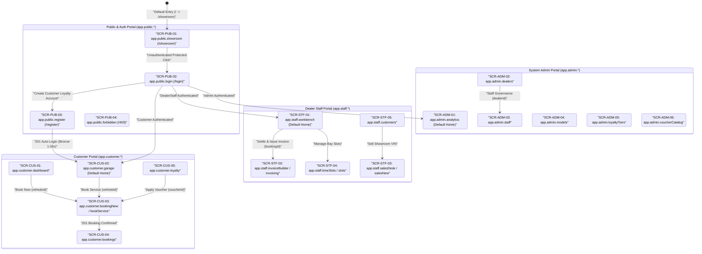

# Detail Design Specification 04 — AngularJS 1.8.3 Screen & UI Component Specifications (`DD_04`)

| Metadata | Specification |
| :--- | :--- |
| **Document ID** | `DD-04-SCREEN-MDLMP-2026` |
| **Version** | `v1.2.0` (Empirical Code-Parity Detail Design — `26` Primary Screens + `4` Aliases = `30` Navigable Routes) |
| **Project Name** | Motorcycle Dealer & Loyalty Management Platform |
| **Repository** | [https://github.com/quocanhh86/motorcycle-dealer](https://github.com/quocanhh86/motorcycle-dealer) |
| **Frontend Runtime Stack** | AngularJS `1.8.3` (`ng-strict-di`), `@uirouter/angularjs`, `Chart.js v4`, `@microsoft/signalr` |
| **Covered Artifacts** | `appShell`, `notificationBell`, `toastContainer`, `printableReceiptModal`, `35` UI-Router States (`5` Abstract + `26` Primary Feature Screens + `4` Route Aliases = `30` Navigable Routes), `12` Friendly URL Redirects |
| **Traceability** | `FR-01` through `FR-09` · `ADR-001` through `ADR-006` · `RISK-02`, `RISK-03`, `RISK-04` · `T-307`..`T-907` |
| **Companion BD/DD Suite** | [BD_00_BASIC_DESIGN_MASTER.md](../basic-design/BD_00_BASIC_DESIGN_MASTER.md) · [DD_01_COMMON_SPECIFICATION.md](./DD_01_COMMON_SPECIFICATION.md) · [DD_02_DATABASE_AND_TABLE_UPDATES.md](./DD_02_DATABASE_AND_TABLE_UPDATES.md) · [DD_03_API_SPECIFICATIONS.md](./DD_03_API_SPECIFICATIONS.md) |
| **Upstream SSOT References** | [README.md](../../README.md) · [PROGRESS.md](../../PROGRESS.md) · [TASKS.md](../../TASKS.md) · [PRD.md](../PRD.md) · [ARCHITECTURE.md](../ARCHITECTURE.md) · [DATABASE_DESIGN.md](../DATABASE_DESIGN.md) · [DESIGN.md](../DESIGN.md) · [DESIGN_SYSTEM_AND_NAVIGATION.md](../screens/DESIGN_SYSTEM_AND_NAVIGATION.md) · [CUSTOMER_PORTAL_SCREENS.md](../screens/CUSTOMER_PORTAL_SCREENS.md) · [STAFF_AND_ADMIN_SCREENS.md](../screens/STAFF_AND_ADMIN_SCREENS.md) · [MOD_06_ADMIN_ANALYTICS_AND_REPORTING.md](../modules/MOD_06_ADMIN_ANALYTICS_AND_REPORTING.md) · [RELEASE_NOTES_v1.1.0.md](../RELEASE_NOTES_v1.1.0.md) |

---

## Table of Contents

1. [Global Application Shell, Navigation & Route Architecture](#1-global-application-shell-navigation--route-architecture)
   - [1.1 AngularJS 1.8.3 Bootstrap & Shared Shell Architecture (`appShell`)](#11-angularjs-183-bootstrap--shared-shell-architecture-appshell)
   - [1.2 Complete 27-Route UI-Router State Table & URL Redirect Matrix](#12-complete-27-route-ui-router-state-table--url-redirect-matrix)
   - [1.3 Deterministic Route Guard Pipeline & Portal Navigation State Machine](#13-deterministic-route-guard-pipeline--portal-navigation-state-machine)
   - [1.4 Persistent Real-Time Notification Center (`notificationBell` & `toastContainer`)](#14-persistent-real-time-notification-center-notificationbell--toastcontainer)
   - [1.5 Shared UI Directives, Printable Receipt Modal & Presentation Filters Catalog](#15-shared-ui-directives-printable-receipt-modal--presentation-filters-catalog)
2. [Public & Authentication Portal Screen Specifications (`SCR-PUB-01` – `SCR-PUB-04`)](#2-public--authentication-portal-screen-specifications-scr-pub-01--scr-pub-04)
   - [2.1 `SCR-PUB-01` — Public Motorcycle Showroom & Dealer Stock Explorer](#21-scr-pub-01--public-motorcycle-showroom--dealer-stock-explorer)
   - [2.2 `SCR-PUB-02` — Unified Login & Demo Persona Quick-Fill](#22-scr-pub-02--unified-login--demo-persona-quick-fill)
   - [2.3 `SCR-PUB-03` — Customer Self-Registration](#23-scr-pub-03--customer-self-registration)
   - [2.4 `SCR-PUB-04` — Access Denied / 403 Forbidden](#24-scr-pub-04--access-denied--403-forbidden)
3. [Customer Portal Screen Specifications (`SCR-CUS-01` – `SCR-CUS-06`)](#3-customer-portal-screen-specifications-scr-cus-01--scr-cus-06)
   - [3.1 `SCR-CUS-01` — Customer Overview Dashboard](#31-scr-cus-01--customer-overview-dashboard)
   - [3.2 `SCR-CUS-02` — Digital VIN Garage, External VIN Registration & Maintenance Timeline](#32-scr-cus-02--digital-vin-garage-external-vin-registration--maintenance-timeline)
   - [3.3 `SCR-CUS-03` — 4-Step Workshop Service Slot Booking Wizard](#33-scr-cus-03--4-step-workshop-service-slot-booking-wizard)
   - [3.4 `SCR-CUS-04` — My Service Bookings, Cancellation, Settled Invoice & Printable Receipt](#34-scr-cus-04--my-service-bookings-cancellation-settled-invoice--printable-receipt)
   - [3.5 `SCR-CUS-05` — 4-Tier Loyalty Wallet, Point Ledger, Voucher Store & Printable Order Receipts](#35-scr-cus-05--4-tier-loyalty-wallet-point-ledger-voucher-store--printable-order-receipts)
   - [3.6 `SCR-CUS-06` — Showroom Test-Drive Scheduling & Live Status Tracker (`v1.1.0`)](#36-scr-cus-06--showroom-test-drive-scheduling--live-status-tracker-v110)
4. [Dealer Staff Portal Screen Specifications (`SCR-STF-01` – `SCR-STF-06`)](#4-dealer-staff-portal-screen-specifications-scr-stf-01--scr-stf-06)
   - [4.1 `SCR-STF-01` — Real-Time SignalR Service Booking Workbench](#41-scr-stf-01--real-time-signalr-service-booking-workbench)
   - [4.2 `SCR-STF-02` — Workshop Service Invoice Builder, OEM Spare-Parts Picker & Settlement](#42-scr-stf-02--workshop-service-invoice-builder-oem-spare-parts-picker--settlement)
   - [4.3 `SCR-STF-03` — Showroom VIN Stock Intake, Atomic Sales Desk & Printable Receipt](#43-scr-stf-03--showroom-vin-stock-intake-atomic-sales-desk--printable-receipt)
   - [4.4 `SCR-STF-04` — Workshop Time-Slot Generator & Capacity Manager](#44-scr-stf-04--workshop-time-slot-generator--capacity-manager)
   - [4.5 `SCR-STF-05` — Customer, VIN & Loyalty Checkout Lookup](#45-scr-stf-05--customer-vin--loyalty-checkout-lookup)
   - [4.6 `SCR-STF-06` — Real-Time SignalR Showroom Test-Drive Workbench (`v1.1.0`)](#46-scr-stf-06--real-time-signalr-showroom-test-drive-workbench-v110)
5. [System Admin Portal Screen Specifications (`SCR-ADM-01` – `SCR-ADM-07`)](#5-system-admin-portal-screen-specifications-scr-adm-01--scr-adm-07)
   - [5.1 `SCR-ADM-01` — Multi-Dealer Executive `Chart.js v4` Analytics & CSV Export](#51-scr-adm-01--multi-dealer-executive-chartjs-v4-analytics--csv-export)
   - [5.2 `SCR-ADM-02` — Dealer Branch Network Governance](#52-scr-adm-02--dealer-branch-network-governance)
   - [5.3 `SCR-ADM-03` — Dealer Staff Provisioning & Account Lock Control](#53-scr-adm-03--dealer-staff-provisioning--account-lock-control)
   - [5.4 `SCR-ADM-04` — Motorcycle Models & OEM Maintenance Rules Studio](#54-scr-adm-04--motorcycle-models--oem-maintenance-rules-studio)
   - [5.5 `SCR-ADM-05` — Loyalty Tier Thresholds & Multiplier Studio](#55-scr-adm-05--loyalty-tier-thresholds--multiplier-studio)
   - [5.6 `SCR-ADM-06` — Voucher Catalog & Quota Governance Studio](#56-scr-adm-06--voucher-catalog--quota-governance-studio)
   - [5.7 `SCR-ADM-07` — OEM Spare-Parts Master Catalog Studio (`v1.1.0`)](#57-scr-adm-07--oem-spare-parts-master-catalog-studio-v110)
6. [Cross-Screen SignalR Subscription & `$onDestroy` Memory Safety Matrix](#6-cross-screen-signalr-subscription--ondestroy-memory-safety-matrix)

---

## 1. Global Application Shell, Navigation & Route Architecture

### 1.1 AngularJS 1.8.3 Bootstrap & Shared Shell Architecture (`appShell`)

The Single-Page Application boots deterministically from [index.html](../../frontend/src/index.html) using `ng-app="motorcycleDealerApp"` and `ng-strict-di` (enforcing explicit `$inject` annotations on every controller, service, factory, directive, and filter). Local vendor bundles (`angular.min.js`, `angular-ui-router.min.js`, `chart.umd.js`, `signalr.min.js`) load prior to the modular AngularJS graph defined in [app.module.js](../../frontend/src/app/app.module.js):

- `app.core` (`['ui.router']`): `APP_CONFIG`, `PERMISSIONS`, `ROLES`, `ROLE_HOME`, `ROLE_PERMISSION_PRESETS`, `LOYALTY_TIERS`, `LoyaltyCalculator`, `TokenStorageService`, `AuthService`, `AuthHttpInterceptor`, `registerRouteGuards`, `ProblemDetailsMapper`, `DealerApiService`, `NotificationStore`, `SignalRClientService`, `ToastService`.
- `app.shared` (`['app.core']`): `appShell`, `notificationBell`, `toastContainer`, `printableReceiptModal`, `dealerChart`, `hasPermission`, `vinInput`, `vndCurrency`, `utcToLocal` / `utcToVnTime`.
- Feature Modules (`['app.core', 'app.shared']`): `app.features.public`, `app.features.customer`, `app.features.staff`, `app.features.admin`.

Runtime provider configuration in [app.config.js](../../frontend/src/app/app.config.js) sets HTML5 push-state routing (`$locationProvider.html5Mode({ enabled: true, requireBase: true })` with `<base href="/">` and hash prefix `'!'`), disables comment and CSS class directives (`$compileProvider.commentDirectivesEnabled(false)`, `cssClassDirectivesEnabled(false)`), toggles `$compileProvider.debugInfoEnabled` from `APP_CONFIG.enableDebugInfo`, and registers `AuthHttpInterceptor`.

#### `appShell` Layout & Control Specification ([app-shell.component.js](../../frontend/src/app/shared/app-shell.component.js))

`appShell` (`<app-shell>`, `AppShellController`, `controllerAs: '$ctrl'`) is mounted by the root abstract UI-Router state `app` and wraps all portals inside `.app-root`:

| Shell Region | Element / Control | Binding / Directive | Behavior & Visibility Rule |
| :--- | :--- | :--- | :--- |
| **Top Navbar Left** | Mobile Hamburger Button (`☰`) | `ng-click="$ctrl.toggleMobileSidebar()"` | Visible only when `$ctrl.isAuthenticated === true`; toggles `$ctrl.mobileSidebarOpen` on `<aside class="role-sidebar">`. |
| **Top Navbar Left** | Brand Logo (`APEX MOTO LOYALTY`) | `ui-sref="app.public.showroom"` | Always visible; navigates to `/showroom`. |
| **Top Navbar Left** | Primary Quick-Nav Links | `ui-sref` + `ui-sref-active="is-active"` | `Showroom` (`app.public.showroom`, always visible); `My VIN Garage` (`app.customer.garage`, `role === 'Customer'`); `Staff Workbench` (`app.staff.workbench`, `role === 'DealerStaff'`); `Executive Analytics` (`app.admin.analytics`, `role === 'Admin'`). |
| **Top Navbar Right** | SignalR Connection Pill | `● SignalR: {{ $ctrl.signalrStatus }}` + `ng-class="$ctrl.signalrBadgeClass()"` | Visible when `$ctrl.isAuthenticated`; returns `badge-success` (`Connected` / `PreviewReady`), `badge-warning` (`Connecting` / `Reconnecting`), or `badge-danger` (`Disconnected` / `Offline` / `Unavailable`). |
| **Top Navbar Right** | Customer Loyalty Pill | `◆ {{ $ctrl.user.tierCode }} ({{ $ctrl.user.tierMultiplier }}x) • {{ $ctrl.user.availablePoints }} pts` | Visible when `$ctrl.user.role === 'Customer'`; dynamic class `badge-tier-{tierCode}` updates instantly via `auth:changed` when SignalR `LoyaltyPointsUpdated` or `TierUpgraded` fires. |
| **Top Navbar Right** | DealerStaff Tenant Pill | `{{ $ctrl.user.dealerCode \|\| 'DLR-SCOPED' }}` (`badge-info`) | Visible when `$ctrl.user.role === 'DealerStaff'`; displays locked `IDealerScoped` branch code. |
| **Top Navbar Right** | Admin HQ Scope Pill | `♛ All Dealers HQ` (`badge-tier-platinum`) | Visible when `$ctrl.user.role === 'Admin'`. |
| **Top Navbar Right** | `<notification-bell>` | `ng-if="$ctrl.isAuthenticated"` | Mounts persistent SignalR + REST inbox bell trigger and slide-over drawer. |
| **Top Navbar Right** | Guest Auth CTAs | `Sign In` (`app.public.login`), `Register` (`app.public.register`) | Visible when `!$ctrl.isAuthenticated`. |
| **Top Navbar Right** | Authenticated Session Cluster | `{{ $ctrl.user.fullName }}` + `Sign Out` (`ng-click="$ctrl.logout()"`) | Visible when `$ctrl.isAuthenticated`; `logout()` calls `AuthService.logout()` (`POST /api/v1/auth/logout`, clears tokens, stops SignalR, clears toasts) and navigates to `app.public.login`. |
| **Left Role Sidebar** | `<aside class="role-sidebar">` | `ng-if="$ctrl.isAuthenticated"`, `ng-repeat="nav in $ctrl.navItems track by nav.state"` | Renders role-specific navigation menu (`NAV_BY_ROLE[$ctrl.user.role]`) with one-time bound `{{ ::nav.label }}` and `{{ ::nav.code }}`, closing mobile drawer on click. |
| **Left Role Sidebar** | Active RBAC Scope Footer | `.sidebar-scope-box` | Displays `Role: {{ $ctrl.user.role }}`, `Tenant: {{ $ctrl.user.dealerCode }}`, and `{{ $ctrl.user.dealerName }}`. |
| **Main Chrome** | Breadcrumb & Screen ID Bar | `.breadcrumb-bar` | Displays `{{ $ctrl.portalLabel }} / {{ $ctrl.activeBreadcrumb }}`, monospace badge `{{ $ctrl.activeScreenId }}`, and `API: {{ ::$ctrl.apiBaseUrl }}`. |
| **Main Viewport** | `<main class="app-viewport"><ui-view></ui-view></main>` | UI-Router Outlet | Hosts the active child namespace (`app.public`, `app.customer`, `app.staff`, `app.admin`) and active feature screen component. |
| **Global Overlay** | `<toast-container>` | Always mounted at bottom of `.app-root` | Renders non-blocking `aria-live="polite"` toast notifications (`max 4` stacked). |

#### Role-Contextual Sidebar Menu Items (`NAV_BY_ROLE` in `AppShellController`)

| Role | Code Pill | Sidebar Label | Target UI-Router State | Resolved URL |
| :--- | :---: | :--- | :--- | :--- |
| **`Customer`** | `CUS-01` | `Overview Dashboard` | `app.customer.dashboard` | `/customer/dashboard` |
| **`Customer`** | `CUS-02` | `My VIN Garage` | `app.customer.garage` | `/customer/garage` |
| **`Customer`** | `CUS-03` | `Book Service Slot` | `app.customer.bookingNew` | `/customer/bookings/new` |
| **`Customer`** | `CUS-04` | `My Appointments` | `app.customer.bookings` | `/customer/bookings` |
| **`Customer`** | `CUS-05` | `Loyalty & Vouchers` | `app.customer.loyalty` | `/customer/loyalty` |
| **`Customer`** | `CUS-06` | `My Test Drives` | `app.customer.testDrives` | `/customer/test-drives` |
| **`Customer`** | `PUB-01` | `Showroom Catalog` | `app.public.showroom` | `/showroom` |
| **`DealerStaff`** | `STF-01` | `Live Workbench` | `app.staff.workbench` | `/staff/workbench` |
| **`DealerStaff`** | `STF-02` | `Invoice Builder` | `app.staff.invoiceBuilder` | `/staff/bookings/preview-booking/invoice` |
| **`DealerStaff`** | `STF-03` | `VIN Stock & Sales` | `app.staff.salesDesk` | `/staff/sales-orders/new` |
| **`DealerStaff`** | `STF-04` | `Workshop Time Slots` | `app.staff.timeSlots` | `/staff/time-slots` |
| **`DealerStaff`** | `STF-05` | `Customer & VIN Lookup` | `app.staff.customers` | `/staff/customers` |
| **`DealerStaff`** | `STF-06` | `Test-Drive Workbench` | `app.staff.testDrives` | `/staff/test-drives` |
| **`Admin`** | `ADM-01` | `Executive Analytics` | `app.admin.analytics` | `/admin/analytics` |
| **`Admin`** | `ADM-02` | `Dealership Branches` | `app.admin.dealers` | `/admin/dealers` |
| **`Admin`** | `ADM-03` | `Dealer Staff Access` | `app.admin.staff` | `/admin/staff` |
| **`Admin`** | `ADM-04` | `Models & OEM Rules` | `app.admin.models` | `/admin/models` |
| **`Admin`** | `ADM-05` | `Loyalty Tiers & Ledger` | `app.admin.loyaltyTiers` | `/admin/loyalty/tiers` |
| **`Admin`** | `ADM-06` | `Voucher Catalog` | `app.admin.voucherCatalog` | `/admin/loyalty/vouchers` |
| **`Admin`** | `ADM-07` | `OEM Spare Parts` | `app.admin.spareParts` | `/admin/spare-parts` |

**`appShell` Lifecycle & `$onDestroy` Hygiene**: `$onInit` registers three listeners into `cleanupFns[]`: `$rootScope.$on('auth:changed', onAuthChanged)`, `$rootScope.$on('signalr:status', onSignalRStatus)`, and `$transitions.onSuccess({}, onRouteSuccess)` (which auto-closes mobile sidebar and updates `activeBreadcrumb` / `activeScreenId`). `$onDestroy` invokes every disposer in `cleanupFns` and zeroes the array.

---

### 1.2 Complete 27-Route UI-Router State Table & URL Redirect Matrix

All `32` UI-Router states (`5` abstract parent states + `27` navigable states) are registered in [app.routes.js](../../frontend/src/app/app.routes.js) (`configureRoutes`) with role landing defaults defined in [permissions.constants.js](../../frontend/src/app/core/auth/permissions.constants.js) (`ROLE_HOME`: `Customer -> app.customer.garage`, `DealerStaff -> app.staff.workbench`, `Admin -> app.admin.analytics`; anonymous fallback `app.public.showroom`).

#### A. Abstract Parent Namespace States (`5` Abstract States)

| State Name | URL Prefix | Mounted Component / Template | `state.data` Policy |
| :--- | :--- | :--- | :--- |
| `app` | *(none)* | `component: 'appShell'` | Root application chrome |
| `app.public` | *(none)* | `<ui-view></ui-view>` | `{ requiresAuth: false, portalLabel: 'Public Showroom' }` |
| `app.customer` | `/customer` | `<ui-view></ui-view>` | `{ requiresAuth: true, roles: ['Customer'], portalLabel: 'Customer Portal' }` |
| `app.staff` | `/staff` | `<ui-view></ui-view>` | `{ requiresAuth: true, roles: ['DealerStaff'], portalLabel: 'Dealer Staff Portal' }` |
| `app.admin` | `/admin` | `<ui-view></ui-view>` | `{ requiresAuth: true, roles: ['Admin'], portalLabel: 'Admin Executive HQ' }` |

#### B. Complete 27-Route Navigable UI-Router State Table (`23` Primary States + `4` Registered Alias States)

> [!NOTE]
> **Screen ID Badge Reconciliation**: In `app.routes.js`, the four public states set `state.data.screenId` to `'SCR-PUB-01'`, `'SCR-PUB-02A'`, `'SCR-PUB-02B'`, and `'SCR-PUB-03'` (matching the Phase 1 UI catalog grouping where Login and Registration were sub-views `02A`/`02B`), whereas the Detail Design 20-screen inventory numbers them sequentially `SCR-PUB-01` through `SCR-PUB-04`. Both identifiers are cross-referenced below.

| # | DD Screen ID (`data.screenId`) | UI-Router State Name | Route Kind | Full URL Pattern & Query / Path Params | Component Selector | Required Auth & Role(s) | Required Granular Permissions (`ALL` Mode) | Default Role Landing Redirect |
| :---: | :--- | :--- | :---: | :--- | :--- | :--- | :--- | :--- |
| 1 | `SCR-PUB-01` (`SCR-PUB-01`) | `app.public.showroom` | Primary | `/showroom` | `publicShowroom` | Public (`requiresAuth: false`) | None (Public anonymous + all roles) | Anonymous entry (`''` / `'/'` -> `/showroom`) |
| 2 | `SCR-PUB-02` (`SCR-PUB-02A`) | `app.public.login` | Primary | `/login?returnUrl&returnTo&reason` | `publicLogin` | Anonymous only (`redirectAuthenticatedEntry`) | None | If authenticated: `ROLE_HOME[role]` |
| 3 | `SCR-PUB-03` (`SCR-PUB-02B`) | `app.public.register` | Primary | `/register` | `publicRegister` | Anonymous only (`redirectAuthenticatedEntry`) | None | If authenticated: `ROLE_HOME[role]` |
| 4 | `SCR-PUB-04` (`SCR-PUB-03`) | `app.public.forbidden` | Primary | `/403` | `publicForbidden` | Public (`requiresAuth: false`) | None (RBAC `403` guard target) | CTA links to `ROLE_HOME[role]` or `/login` |
| 5 | `SCR-CUS-01` (`SCR-CUS-01`) | `app.customer.dashboard` | Primary | `/customer/dashboard` | `customerDashboard` | `requiresAuth: true`, `['Customer']` | `Permissions.Vehicles.ViewOwn`, `Permissions.Bookings.ViewOwn`, `Permissions.Loyalty.ViewOwn` | `Customer` secondary overview |
| 6 | `SCR-CUS-02` (`SCR-CUS-02`) | `app.customer.garage` | Primary | `/customer/garage` | `customerGarage` | `requiresAuth: true`, `['Customer']` | `Permissions.Vehicles.ViewOwn`, `Permissions.Vehicles.RegisterOwn` | **`Customer` Default Home (`ROLE_HOME.Customer`)** |
| 7 | `SCR-CUS-03` (`SCR-CUS-03`) | `app.customer.bookingNew` | Primary | `/customer/bookings/new?vehicleId&dealerId&voucherId` | `customerBookingNew` | `requiresAuth: true`, `['Customer']` | `Permissions.Bookings.Create`, `Permissions.TimeSlots.ViewAvailable` | `Customer` (`ROLE_HOME.Customer` = `/customer/garage`) |
| 8 | `SCR-CUS-03` (`SCR-CUS-03`) | `app.customer.bookService` | **Alias #1** | `/customer/book-service?vehicleId&dealerId&voucherId` | `customerBookingNew` | `requiresAuth: true`, `['Customer']` | `Permissions.Bookings.Create`, `Permissions.TimeSlots.ViewAvailable` | Alias of `app.customer.bookingNew` |
| 9 | `SCR-CUS-04` (`SCR-CUS-04`) | `app.customer.bookings` | Primary | `/customer/bookings` | `customerBookings` | `requiresAuth: true`, `['Customer']` | `Permissions.Bookings.ViewOwn`, `Permissions.Bookings.CancelOwn`, `Permissions.Invoices.ViewOwn` | `Customer` (`ROLE_HOME.Customer` = `/customer/garage`) |
| 10 | `SCR-CUS-05` (`SCR-CUS-05`) | `app.customer.loyalty` | Primary | `/customer/loyalty` | `customerLoyalty` | `requiresAuth: true`, `['Customer']` | `Permissions.Loyalty.ViewOwn`, `Permissions.Loyalty.RedeemVoucher`, `Permissions.SalesOrders.ViewOwn` | `Customer` (`ROLE_HOME.Customer` = `/customer/garage`) |
| 11 | `SCR-STF-01` (`SCR-STF-01`) | `app.staff.workbench` | Primary | `/staff/workbench` | `staffWorkbench` | `requiresAuth: true`, `['DealerStaff']` | `Permissions.Bookings.ViewDealer`, `Permissions.Bookings.UpdateStatus`, `Permissions.Vehicles.ViewDealer` | **`DealerStaff` Default Home (`ROLE_HOME.DealerStaff`)** |
| 12 | `SCR-STF-02` (`SCR-STF-02`) | `app.staff.invoiceBuilder` | Primary | `/staff/bookings/:bookingId/invoice` *(default `bookingId='preview-booking'`, `squash: false`)* | `staffInvoiceBuilder` | `requiresAuth: true`, `['DealerStaff']` | `Permissions.Invoices.CreateDealer`, `Permissions.Invoices.ViewDealer`, `Permissions.Loyalty.ViewDealerCustomer` | `DealerStaff` (`ROLE_HOME.DealerStaff` = `/staff/workbench`) |
| 13 | `SCR-STF-02` (`SCR-STF-02`) | `app.staff.invoicing` | **Alias #2** | `/staff/invoicing/:bookingId` *(default `bookingId='preview-booking'`, `squash: false`)* | `staffInvoiceBuilder` | `requiresAuth: true`, `['DealerStaff']` | `Permissions.Invoices.CreateDealer`, `Permissions.Invoices.ViewDealer`, `Permissions.Loyalty.ViewDealerCustomer` | Alias of `app.staff.invoiceBuilder` |
| 14 | `SCR-STF-03` (`SCR-STF-03`) | `app.staff.salesDesk` | Primary | `/staff/sales-orders/new` | `staffSalesDesk` | `requiresAuth: true`, `['DealerStaff']` | `Permissions.SalesOrders.Create`, `Permissions.SalesOrders.ViewDealer`, `Permissions.Inventories.ViewDealer`, `Permissions.Inventories.ManageDealer` | `DealerStaff` (`ROLE_HOME.DealerStaff` = `/staff/workbench`) |
| 15 | `SCR-STF-03` (`SCR-STF-03`) | `app.staff.salesNew` | **Alias #3** | `/staff/sales-new` | `staffSalesDesk` | `requiresAuth: true`, `['DealerStaff']` | `Permissions.SalesOrders.Create`, `Permissions.SalesOrders.ViewDealer`, `Permissions.Inventories.ViewDealer`, `Permissions.Inventories.ManageDealer` | Alias of `app.staff.salesDesk` |
| 16 | `SCR-STF-04` (`SCR-STF-04`) | `app.staff.timeSlots` | Primary | `/staff/time-slots` | `staffTimeSlots` | `requiresAuth: true`, `['DealerStaff']` | `Permissions.TimeSlots.ManageDealer`, `Permissions.TimeSlots.ViewAvailable` | `DealerStaff` (`ROLE_HOME.DealerStaff` = `/staff/workbench`) |
| 17 | `SCR-STF-04` (`SCR-STF-04`) | `app.staff.slots` | **Alias #4** | `/staff/slots` | `staffTimeSlots` | `requiresAuth: true`, `['DealerStaff']` | `Permissions.TimeSlots.ManageDealer`, `Permissions.TimeSlots.ViewAvailable` | Alias of `app.staff.timeSlots` |
| 18 | `SCR-STF-05` (`SCR-STF-05`) | `app.staff.customers` | Primary | `/staff/customers` | `staffCustomers` | `requiresAuth: true`, `['DealerStaff']` | `Permissions.Vehicles.ViewDealer`, `Permissions.Loyalty.ViewDealerCustomer` | `DealerStaff` (`ROLE_HOME.DealerStaff` = `/staff/workbench`) |
| 19 | `SCR-ADM-01` (`SCR-ADM-01`) | `app.admin.analytics` | Primary | `/admin/analytics` | `adminAnalytics` | `requiresAuth: true`, `['Admin']` | `Permissions.Analytics.ViewAllDealers`, `Permissions.Analytics.ExportReports` | **`Admin` Default Home (`ROLE_HOME.Admin`)** |
| 20 | `SCR-ADM-02` (`SCR-ADM-02`) | `app.admin.dealers` | Primary | `/admin/dealers` | `adminDealers` | `requiresAuth: true`, `['Admin']` | `Permissions.Dealers.ManageAll`, `Permissions.Dealers.ViewPublic` | `Admin` (`ROLE_HOME.Admin` = `/admin/analytics`) |
| 21 | `SCR-ADM-03` (`SCR-ADM-03`) | `app.admin.staff` | Primary | `/admin/staff?dealerId` | `adminStaff` | `requiresAuth: true`, `['Admin']` | `Permissions.Users.ManageStaff` | `Admin` (`ROLE_HOME.Admin` = `/admin/analytics`) |
| 22 | `SCR-ADM-04` (`SCR-ADM-04`) | `app.admin.models` | Primary | `/admin/models` | `adminModels` | `requiresAuth: true`, `['Admin']` | `Permissions.Showroom.ManageModels`, `Permissions.Vehicles.ManageRules` | `Admin` (`ROLE_HOME.Admin` = `/admin/analytics`) |
| 23 | `SCR-ADM-05` (`SCR-ADM-05`) | `app.admin.loyaltyTiers` | Primary | `/admin/loyalty/tiers` | `adminLoyaltyTiers` | `requiresAuth: true`, `['Admin']` | `Permissions.Loyalty.ManageTiers`, `Permissions.Loyalty.AdjustPoints` | `Admin` (`ROLE_HOME.Admin` = `/admin/analytics`) |
| 24 | `SCR-ADM-06` (`SCR-ADM-06`) | `app.admin.voucherCatalog` | Primary | `/admin/loyalty/vouchers` | `adminVoucherCatalog` | `requiresAuth: true`, `['Admin']` | `Permissions.Loyalty.ManageVoucherCatalog` | `Admin` (`ROLE_HOME.Admin` = `/admin/analytics`) |
| 25 | `SCR-CUS-06` (`SCR-CUS-06`) | `app.customer.testDrives` | Primary (`v1.1.0`) | `/customer/test-drives?modelId&dealerId` | `customerTestDrives` | `requiresAuth: true`, `['Customer']` | `Permissions.TestDrives.ViewOwn`, `Permissions.TestDrives.Create`, `Permissions.TestDrives.CancelOwn` | `Customer` (`ROLE_HOME.Customer` = `/customer/garage`) |
| 26 | `SCR-STF-06` (`SCR-STF-06`) | `app.staff.testDrives` | Primary (`v1.1.0`) | `/staff/test-drives` | `staffTestDrives` | `requiresAuth: true`, `['DealerStaff']` | `Permissions.TestDrives.ViewDealer`, `Permissions.TestDrives.UpdateStatus` | `DealerStaff` (`ROLE_HOME.DealerStaff` = `/staff/workbench`) |
| 27 | `SCR-ADM-07` (`SCR-ADM-07`) | `app.admin.spareParts` | Primary (`v1.1.0`) | `/admin/spare-parts` | `adminSpareParts` | `requiresAuth: true`, `['Admin']` | `Permissions.SpareParts.ManageCatalog` | `Admin` (`ROLE_HOME.Admin` = `/admin/analytics`) |

#### C. `$urlRouterProvider` Friendly & Legacy URL Redirect Rules (`12` `.when()` Rules + `1` `.otherwise()`)

| Source URL Pattern | Redirect Target URL | Target Primary State (`Screen ID`) | Purpose |
| :--- | :--- | :--- | :--- |
| `''` | `'/showroom'` | `app.public.showroom` (`SCR-PUB-01`) | Empty path entry redirect |
| `'/'` | `'/showroom'` | `app.public.showroom` (`SCR-PUB-01`) | Root path entry redirect |
| `'/customer/booking/new'` | `'/customer/bookings/new'` | `app.customer.bookingNew` (`SCR-CUS-03`) | Singular-path friendly alias for 4-step booking wizard |
| `'/customer/invoices'` | `'/customer/bookings'` | `app.customer.bookings` (`SCR-CUS-04`) | Routes invoice deep links to appointments & settled invoice modal |
| `'/customer/orders'` | `'/customer/loyalty'` | `app.customer.loyalty` (`SCR-CUS-05`) | Routes showroom purchase history links to Loyalty Tab 4 (`ORDERS`) |
| `'/staff/invoice-builder'` | `'/staff/bookings/preview-booking/invoice'` | `app.staff.invoiceBuilder` (`SCR-STF-02`) | Parameterless shortcut to Staff Invoice Builder queue |
| `'/staff/invoicing'` | `'/staff/invoicing/preview-booking'` | `app.staff.invoicing` (`SCR-STF-02`) | Parameterless shortcut to Staff Invoicing alias state |
| `'/staff/inventory'` | `'/staff/sales-orders/new'` | `app.staff.salesDesk` (`SCR-STF-03`) | Routes inventory URL to Sales Desk Tab 1 (`INVENTORY`) |
| `'/staff/sales-orders'` | `'/staff/sales-orders/new'` | `app.staff.salesDesk` (`SCR-STF-03`) | Routes sales orders URL to Sales Desk Tab 2 (`ORDERS`) |
| `'/admin/loyalty-tiers'` | `'/admin/loyalty/tiers'` | `app.admin.loyaltyTiers` (`SCR-ADM-05`) | Flat-slug friendly alias for Admin Loyalty Tiers Studio |
| `'/admin/loyalty/adjustments'` | `'/admin/loyalty/tiers'` | `app.admin.loyaltyTiers` (`SCR-ADM-05`) | Routes point adjustment URL to Admin Loyalty Tiers modal host |
| `'/admin/voucher-catalog'` | `'/admin/loyalty/vouchers'` | `app.admin.voucherCatalog` (`SCR-ADM-06`) | Flat-slug friendly alias for Admin Voucher Catalog Studio |
| `.otherwise('/showroom')` | `'/showroom'` | `app.public.showroom` (`SCR-PUB-01`) | Safe catch-all fallback for unknown client paths |

---

### 1.3 Deterministic Route Guard Pipeline & Portal Navigation State Machine

Route protection in [route-guard.run.js](../../frontend/src/app/core/auth/route-guard.run.js) registers two `@uirouter/angularjs` `$transitions.onBefore` hooks and works in tandem with [auth.interceptor.js](../../frontend/src/app/core/auth/auth.interceptor.js):

1. **Hook 1 (`redirectAuthenticatedEntry`)**: Intercepts transitions targeting `app.public.login` or `app.public.register`. When `AuthService.isAuthenticated()` is `true` (`_currentUser` present and access token valid with `5s` skew), redirects immediately to `ROLE_HOME[AuthService.getRole()] || 'app.public.showroom'`.
2. **Hook 2 (`enforceRbacGuard`)**: Intercepts any state where `state.data` defines `requiresAuth`, `roles`, or `permissions`. Merges parent + child `state.data` across `transition.treeChanges('to')` (`mergeEnteringStatePolicies`), then calls `AuthService.ensureValidSession()`:
   - If the in-memory JWT has `> 30s` remaining TTL, resolves `true` synchronously.
   - Otherwise, if `sessionStorage` / `localStorage` holds `mdlmp.refresh_token`, executes single-flight `AuthService.refreshTokens()` (`POST /api/v1/auth/refresh`) and reconnects `SignalRClientService`.
   - If unauthenticated or refresh fails: redirects to `app.public.login` with `{ returnUrl: requestedState, returnTo: requestedState }`.
   - If `mergedPolicy.roles` excludes `AuthService.getRole()`: redirects to `app.public.forbidden` (`/403`).
   - If `AuthService.hasPermissions(mergedPolicy.permissions, mergedPolicy.permissionMode || 'ALL')` returns `false`: redirects to `app.public.forbidden` (`/403`).
3. **Runtime HTTP `401` & `403` Interceptor (`AuthHttpInterceptor`)**:
   - Attaches `Authorization: Bearer <accessToken>` on `/api/v1/*` requests (excluding `/auth/login`, `/auth/register`, `/auth/refresh`, and preview token `'phase3-preview-mode'`).
   - On `401` (for non-excluded `/api/v1/*` calls not yet `_retried`): queues concurrent failing requests in `pendingRequests[]` behind a single `AuthService.refreshTokens()` flight and replays all queued requests with the rotated JWT; if refresh fails, clears session/SignalR and redirects to `app.public.login` with `{ reason: 'sessionExpired', returnUrl: activeState, returnTo: activeState }`.
   - On `403` with `errorCode === 'ACCOUNT_LOCKED'` or `'STAFF_DEALER_UNASSIGNED'`: immediately clears session/SignalR and redirects to `app.public.login` (`reason: 'sessionExpired'`).

---

### 1.4 Persistent Real-Time Notification Center (`notificationBell` & `toastContainer`)

#### A. `<notification-bell>` & Slide-Over Drawer Specification ([notification-bell.component.js](../../frontend/src/app/shared/notification-bell.component.js))

| Metadata | Details |
| :--- | :--- |
| **Selector & Controller** | `<notification-bell>` (`NotificationBellController`, `controllerAs: '$ctrl'`) |
| **Source Files** | [notification-bell.component.js](../../frontend/src/app/shared/notification-bell.component.js) · `NotificationStore` & `SignalRClientService` in [signalr-client.service.js](../../frontend/src/app/core/realtime/signalr-client.service.js) |
| **Implementation Status** | **Live [Phase 3–6]** |
| **Mounting & Access** | Rendered in `appShell` top navbar strictly when `$ctrl.isAuthenticated === true` (`Customer`, `DealerStaff`, `Admin`). |

##### UI Controls & Field Specification Table (`notificationBell`)

| Element / Field | Control Type | `ng-model` / Binding | Validation / Formatting | Visibility / Disable Condition |
| :--- | :--- | :--- | :--- | :--- |
| **Navbar Bell Trigger** | `<button class="bell-trigger-btn">` | `ng-click="$ctrl.toggleDrawer()"` | Displays `🔔 Alerts` + `.bell-unread-count` pill `{{ $ctrl.unreadCount }}` | Badge pill visible when `$ctrl.unreadCount > 0` |
| **Drawer Backdrop & Dialog** | `.drawer-backdrop` -> `<section class="notification-drawer" role="dialog" aria-modal="true">` | `ng-if="$ctrl.isOpen"` | Clicking backdrop invokes `$ctrl.closeDrawer()`; inner section stops propagation | Visible when `$ctrl.isOpen === true` |
| **Mark All Read CTA** | `<button class="btn btn-ghost-dark btn-sm">` | `ng-click="$ctrl.markAllRead()"` | Optimistically marks all cached items read + `POST /api/v1/notifications/read-all` | Disabled when `$ctrl.isSyncing \|\| $ctrl.unreadCount === 0` |
| **Close Drawer (`✕`)** | `<button class="btn btn-ghost-dark btn-sm">` | `ng-click="$ctrl.closeDrawer()"` | Sets `$ctrl.isOpen = false` | Always enabled inside open drawer |
| **Filter: All / Unread Only** | 2x `<button class="btn btn-sm">` | `ng-click="$ctrl.setFilter(false)"` / `setFilter(true)` | Toggles `$ctrl.unreadOnly` (`boolean`) and refreshes server inbox | Active filter highlighted with `btn-primary` |
| **Manual Sync (`↻ Sync`)** | `<button class="btn btn-secondary btn-sm">` | `ng-click="$ctrl.refreshNotifications()"` | Label toggles active syncing state vs `'↻ Sync'` | Disabled when `$ctrl.isLoading === true` |
| **Feed Error Banner** | `.alert-banner.alert-danger` | `$ctrl.feedProblem.title` & `detail` | Extracted via `ProblemDetailsMapper.extract` (suppressed for status `0` or `404`) | `ng-if="$ctrl.feedProblem"` |
| **Notification Item Card** | `<article class="notification-item">` | `ng-repeat="item in $ctrl.notifications track by item.notificationId"`, `ng-click="$ctrl.onNotificationClick(item)"` | Badge `{{ item.eventType }}` (`eventBadgeClass` including `'SalesOrderCompleted': 'badge-success'` & `'VoucherRedeemed': 'badge-info'`), timestamp `{{ item.occurredAtUtc \| utcToLocal }}`, `{{ item.title }}`, `{{ item.message }}` | `.is-unread` highlight; clicking marks read (if unread), closes drawer, and navigates via `$state.go(targetState)` |
| **Item `[Mark Read]` Button** | `<button class="btn btn-secondary btn-sm">` | `ng-click="$ctrl.markRead(item.notificationId); $event.stopPropagation()"` | Optimistic `NotificationStore.markAsRead` + `PATCH /api/v1/notifications/{id}/read` (auto-falls back to `POST` on `405`) | `ng-if="!item.isRead"` |

##### Data Synchronization, Role-Aware Deep-Link Navigation & SignalR Subscriptions (`notificationBell`)
- **Role-Aware Deep-Link Navigation (`resolveNotificationTargetState(item, role)`)**: Injects `$state` and `AuthService` to map all **`12` `NotificationEventType` values** (`BookingCreated`, `BookingStatusChanged`, `MaintenanceReminderTriggered`, `LoyaltyPointsUpdated`, `TierUpgraded`, `SalesOrderCompleted`, `VoucherRedeemed`, `TestDriveCreated`, `TestDriveStatusChanged`, `ServiceReviewSubmitted`, `WarrantyClaimCreated`, `WarrantyClaimStatusChanged`) to role-appropriate UI-Router target states (`Customer`: `bookings`/`garage`/`loyalty`/`testDrives`/`warranty`; `DealerStaff`: `workbench`/`salesDesk`/`testDrives`/`warrantyReviews`/`customers`; `Admin`: `qualityWarranty`/`loyaltyTiers`/`voucherCatalog`/`analytics`). Clicking any notification card marks it read (if unread), closes the slide-over drawer, and navigates via `$state.go(targetState)`.
- **Principal Isolation (`resolvePrincipalKey` & `handleSessionSync`)**: Tracks `activeUserKey = "{userId}:{role}"` (or `"preview:{role}"`). Whenever `auth:changed` fires and the principal changes or logs out, `NotificationStore.clear()` wipes the 50-item ring buffer immediately so notifications never leak across role switches in the same tab.
- **Epoch Race Guard (`fetchEpoch`)**: Increments `fetchEpoch` on every `refreshNotifications()` call, logout, and `$onDestroy`. Stale `$http` responses where `myEpoch !== fetchEpoch` are discarded.
- **Smart Cache Merge**: `refreshNotifications()` calls `DealerApiService.notifications.list({ pageNumber: 1, pageSize: 30, unreadOnly: $ctrl.unreadOnly ? true : undefined })` (`GET /api/v1/notifications`). When `unreadOnly === true`, `NotificationStore.mergeUnreadFeed(items, unreadCount)` merges fresh unread items with previously cached read items so toggling back to `All` is instantaneous; when `unreadOnly === false`, `NotificationStore.setServerFeed(items, unreadCount)` replaces the top-50 list.
- **Optimistic Read Rollback**: If `markRead(id)` or `markAllRead()` fails over HTTP, `.catch()` invokes `$ctrl.refreshNotifications()` to reconcile true server state.
- **SignalR & Lifecycle Subscriptions (`12` `$rootScope.$on` Listeners)**: Subscribes to all `10` live SignalR events (`signalr:BookingCreated`, `signalr:BookingStatusChanged`, `signalr:TestDriveCreated`, `signalr:TestDriveStatusChanged`, `signalr:MaintenanceReminderTriggered`, `signalr:LoyaltyPointsUpdated`, `signalr:TierUpgraded`, `signalr:ServiceReviewSubmitted`, `signalr:WarrantyClaimCreated`, `signalr:WarrantyClaimStatusChanged`), plus `auth:changed` and `signalr:reconnected` (which triggers `refreshNotifications()` to catch up missed offline alerts). All `12` deregistration functions in `deregisterFns[]` execute inside `$ctrl.$onDestroy()`.

#### B. `<toast-container>` & `ToastService` Specification ([toast-container.component.js](../../frontend/src/app/shared/toast-container.component.js))

- **`ToastService`**: Maintains an in-memory stack `activeToasts[]` capped at **4 concurrent cards**. Calling `ToastService.push({ intent, title, message, durationMs })` (or convenience helpers `.info()`, `.success()`, `.warning()`, `.danger()`) unshifts a new toast, cancels the oldest `$timeout` timer if `activeToasts.length > 4`, schedules auto-dismissal after `6000 ms` default, and broadcasts `'toasts:changed'`. `clearAll()` cancels all active `$timeout` handles (invoked on `AuthService.clearSessionAndRealtime()`).
- **`ToastContainerController`**: Renders `<aside class="toast-stack" aria-live="polite" aria-atomic="false">` with one-time bound `{{ ::toast.title }}` and `{{ ::toast.message }}` plus manual `✕` dismiss button. Deregisters `offToastsChanged` inside `$ctrl.$onDestroy()`.

---

### 1.5 Shared UI Directives, Printable Receipt Modal & Presentation Filters Catalog

| Artifact | Source File | AngularJS Type & Contract | Memory & Formatting Rules |
| :--- | :--- | :--- | :--- |
| **`hasPermission`** | [has-permission.directive.js](../../frontend/src/app/shared/has-permission.directive.js) | Attribute directive (`restrict: 'A'`) supporting literal string (`has-permission="Permissions.Bookings.Create"`) or scope expression/array (`has-permission="['Permissions.A', 'Permissions.B']"` + `permission-mode="ALL\|ANY"`). | Toggles `ng-hide`, `aria-hidden="true"`, and `disabled` property (`disabledByDirective` guard avoids clobbering native `ng-disabled`). Listens to `auth:changed` and `attrs.$observe('hasPermission')`; cleans up both on `scope.$on('$destroy')`. |
| **`vinInput`** | [vin-input.directive.js](../../frontend/src/app/shared/vin-input.directive.js) | Attribute directive (`restrict: 'A'`, `require: 'ngModel'`). Adds `.font-mono-code`, `maxlength="17"`, `autocapitalize="characters"`, `spellcheck="false"`. | `$parsers` strip whitespace and force `.toUpperCase()`. Registers `$validators.noForbiddenVinChars` (`!/[IOQ]/i.test(v)`) and `$validators.isoVin` (`/^[A-HJ-NPR-Z0-9]{17}$/`). |
| **`dealerChart`** | [dealer-chart.component.js](../../frontend/src/app/shared/dealer-chart.component.js) | Component (`bindings: { config: '<', heightPx: '@?', ariaLabel: '@?' }`). Renders `<canvas role="img">` inside `.chart-box` (`default 300px`). | Instantiates `new window.Chart(ctx, clonedConfig)` in `$postLink`; mutates `data`/`options` and calls `chartInstance.update('none')` in `$onChanges`; calls `chartInstance.destroy()` and nulls reference in `$onDestroy` (`RISK-04`). |
| **`printableReceiptModal`** (`v1.1.0`) | [printable-receipt-modal.component.js](../../frontend/src/app/shared/printable-receipt-modal.component.js) | Component (`bindings: { receiptType: '@', documentId: '<', isOpen: '<', onClose: '&' }`). Loads `GET /api/v1/sales-orders/{id}/receipt` or `/service-invoices/{id}/receipt` on `$onChanges`. | Renders `@media print` A4/thermal-clean layout (hiding `.app-navbar`, `.role-sidebar`, `.breadcrumb-bar`, `.toast-stack`), itemized `lineItems[]`, loyalty accrual summary, SHA-256 `receiptVerificationHash` seal, and `$window.print()`; registers `Escape` keydown handler only while open and cleans up on close + `$onDestroy`. |
| **`vndCurrency`** | [vnd-currency.filter.js](../../frontend/src/app/shared/vnd-currency.filter.js) | Filter `{{ amount \| vndCurrency[:suffixStyle] }}` using `Intl.NumberFormat('vi-VN', { maximumFractionDigits: 0 })`. | Rounds safely via `Math.round(Number(amount))`; outputs `'102.500.000 ₫'` by default or `'102.500.000 VND'` when `suffixStyle === 'code'`; returns `'0 ₫'` / `'0 VND'` for `null`, `undefined`, `''`, or `NaN`. |
| **`utcToLocal` / `utcToVnTime`** | [utc-to-local.filter.js](../../frontend/src/app/shared/utc-to-local.filter.js) | Dual-registered filter `{{ utcIso \| utcToLocal[:mode] }}` pinned to `timeZone: 'Asia/Ho_Chi_Minh'` (`hour12: false`, locale `'vi-VN'`). | Modes: default `'datetime'` (`HH:mm dd/MM/yyyy`), `'date'` (`dd/MM/yyyy`), `'relative'` (`'Just now'`, `'14m ago'`, `'2h ago'`, `'3d ago'`, or date fallback `>= 7d`). Returns `'—'` when falsy. |

---

## 2. Public & Authentication Portal Screen Specifications (`SCR-PUB-01` – `SCR-PUB-04`)

### 2.1 `SCR-PUB-01` — Public Motorcycle Showroom & Dealer Stock Explorer

| Attribute | Specification |
| :--- | :--- |
| **Screen ID** | `SCR-PUB-01` (`state.data.screenId = 'SCR-PUB-01'`) |
| **Screen Title** | Authorized Motorcycle Showroom & Live Branch Stock |
| **UI-Router State & URLs** | Primary: `app.public.showroom` (`/showroom`) · Redirects: `''`, `'/'`, and `.otherwise('/showroom')` |
| **AngularJS Component** | `<public-showroom>` (`PublicShowroomController`, module `app.features.public`) |
| **Source File Path** | [showroom.component.js](../../frontend/src/app/features/public/showroom.component.js) |
| **Traceability** | `FR-02`, `FR-05` · `ADR-002`, `ADR-006` · `T-307`, `T-508` |
| **Implementation Status** | **Live [Phase 3–6]** |

#### Access Control & Guard Behavior
- **Route Policy**: `requiresAuth: false` (accessible to anonymous visitors and authenticated `Customer`, `DealerStaff`, and `Admin` users).
- **In-Screen Gating**: `[Role Portal Sign-In]` header CTA renders only when `!$ctrl.isAuthenticated`. Clicking `[Book Test / Service]` navigates to `app.customer.bookingNew({ dealerId: $ctrl.filters.dealerId || undefined })`: if anonymous, `enforceRbacGuard` redirects to `/login?returnUrl=app.customer.bookingNew&returnTo=app.customer.bookingNew`; if signed in as `DealerStaff` or `Admin`, `enforceRbacGuard` redirects to `/403` (`SCR-PUB-04`).

#### Layout Structure & UI Component / Field Specification Table

| Element / Field | Control Type & ID | `ng-model` / Binding | Validation Rules & Formatting | Visibility / Disable Condition |
| :--- | :--- | :--- | :--- | :--- |
| **Header Sign-In Button** | `<a class="btn btn-secondary">` | `ui-sref="app.public.login"` | Navigates to `/login` | `ng-if="!$ctrl.isAuthenticated"` |
| **Header Book CTA** | `<a class="btn btn-primary">` | `ui-sref="app.customer.bookingNew({ dealerId })"` | Passes active `filters.dealerId` query param if selected | Always visible |
| **Catalog Problem Banner** | `.alert-banner.alert-danger` | `$ctrl.catalogProblem.title` & `detail` | Displays `RFC 7807` error when `status > 0` | `ng-if="$ctrl.catalogProblem"` |
| **City Filter Pills** | `<button class="btn btn-sm">` | `ng-repeat="cityOpt in $ctrl.cityOptions"`, `ng-click="$ctrl.selectCity(cityOpt.value)"` | Values: `''` (`All Cities`), `'Hanoi'`, `'Da Nang'`, `'Ho Chi Minh City'` | Always enabled; active pill styled `btn-primary` |
| **Dealership Branch Cards** | `.kpi-card` (`col-4` grid) | `ng-repeat="dealer in $ctrl.filteredDealers track by dealer.id"` | Displays `city`, `code`, `getDealerStockCount(dealer) + ' VINs Ready'`, `name`, `address`, `hoursDisplay`, `defaultSlotCapacity` | Filtered by `$ctrl.selectedCity` |
| **Branch Stock Toggle Button** | `<button class="btn btn-secondary btn-sm">` | `ng-click="$ctrl.filterByDealer(dealer.id)"` | Toggles `$ctrl.filters.dealerId` between `dealer.id` and `''` | Label switches to `'Filtering Branch ✓'` when active |
| **Keyword Search Input** | `<input type="search" id="showroomSearch">` | `ng-model="$ctrl.filters.search"`, `ng-change="$ctrl.applyCatalogFilters()"` | Case-insensitive substring match across `brand`, `modelName`, `modelCode`, `category` | Always enabled |
| **Category Filter Dropdown** | `<select id="showroomCategory">` | `ng-model="$ctrl.filters.category"` | Options: `''` (`All Categories`), `Scooter`, `Underbone`, `Sport`, `Naked`, `Adventure`, `Cruiser` | Always enabled |
| **Dealership Stock Scope** | `<select id="showroomDealerFilter">` | `ng-model="$ctrl.filters.dealerId"` | Populated from `$ctrl.dealerSelectOptions` (`All Authorized Dealers` + active branches) | Always enabled |
| **In-Stock Only Checkbox** | `<input type="checkbox">` | `ng-model="$ctrl.filters.inStockOnly"` | Filters models where `$ctrl.getModelStockCount(m) > 0` | Always enabled |
| **Empty Filter State Card** | `.surface-card` + `[Reset All Filters]` | `ng-click="$ctrl.resetFilters()"` | Resets `search`, `category`, `dealerId`, `inStockOnly` | `ng-if="!$ctrl.isLoading && $ctrl.filteredModels.length === 0"` |
| **Motorcycle Catalog Cards** | `<article class="col-4 surface-card">` | `ng-repeat="model in $ctrl.filteredModels track by model.id"` | Shows `brand`, `category`, `engineDisplacementCc`, stock badge, `modelName`, `modelCode`, warranty, `baseRetailPrice \| vndCurrency`, `+estimatePoints(baseRetailPrice) pts` at `$ctrl.activeMultiplier` | Rendered for each matching active model |
| **Specs & OEM Schedule Button** | `<button class="btn btn-secondary btn-sm">` | `ng-click="$ctrl.openScheduleModal(model)"` | Opens modal `#showroomModalTitle` and fetches full specs + `MaintenanceRules` | Always enabled on each model card |
| **`[Book Test Drive]` Button (`v1.1.0`)** | `<a class="btn btn-primary btn-sm">` | `ui-sref="app.customer.testDrives({ modelId: model.id, dealerId: $ctrl.filters.dealerId \|\| undefined })"` | Deep-links into `SCR-CUS-06` pre-selecting `modelId` and optional `dealerId` (preserves full URL + query params across `/login` via `AuthService.resolvePostLoginTarget`) | Rendered on every active model card & inside `#showroomModalTitle` |
| **Specs & OEM Schedule Modal** | `.modal-backdrop` (`role="dialog"`, `aria-modal="true"`) | `ng-if="$ctrl.selectedModel"` | 3 KPI cards (Engine/Warranty, Base Retail Price + Est. Pts, Available Stock), `selectedModelSpecEntries` badges, `selectedModelBranchStocks` badges, and `MaintenanceRules` 5-column table (`Code`, `Milestone`, `Interval`, `Cadence`, `OEM Checklist Summary`) | Visible while `$ctrl.selectedModel !== null` |

#### Data Loading & API Integration (`$onInit` & Refresh)
1. **Immediate Preview Seed & User Context**: `$onInit` calls `syncUserContext()` (setting `$ctrl.activeMultiplier = Number(user.tierMultiplier) || 1.0`, so signed-in `Silver`/`Gold`/`Platinum` customers see personalized loyalty point estimates on showroom prices!) and pre-populates normalized `PREVIEW_DEALERS` (`3` branches) and `PREVIEW_MODELS` (`6` models) for instant zero-CLS paint.
2. **Parallel Live API Hydration (`loadShowroomData`)**: Unless `TokenStorageService.isPreviewToken()` is `true`, executes `$q.all`:
   - `DealerApiService.listDealers()` -> `GET /api/v1/dealers` (filters `d.isActive === true`).
   - `DealerApiService.listMotorcycles({ pageSize: 50 })` -> `GET /api/v1/motorcycles?pageSize=50` (filters `m.isActive === true`).
   - `DealerApiService.listInventories({ publicOnly: true, pageSize: 100 })` -> `GET /api/v1/inventories?publicOnly=true&pageSize=100`.
3. **Client Inventory Indexing (`rebuildInventoryCounts`)**: Aggregates `Available` units into three O(1) lookup maps (`stockTotalByModel[modelId]`, `stockTotalByDealer[dealerId]`, and `stockByDealerAndModel[dealerId + '::' + modelId]`) and sets `$ctrl.hasLiveInventoryIndex = true`.

#### User Interaction Flows & Edge-Case Handling
- **Branch-Scoped Stock Filtering**: Selecting a branch in `#showroomDealerFilter` or clicking `[Filter Stock]` on a branch card recalculates `getModelStockCount(model)` for that specific `dealerId` (checking `model.dealerStocks` first, then `stockByDealerAndModel[dealerId + '::' + model.id]`).
- **Specs & OEM Schedule Modal (`openScheduleModal(model)`)**: Immediately renders cached `model.specifications` and `model.maintenanceRules`, then fires `$q.all({ detail: getMotorcycleById(model.id), rules: listMaintenanceRules(model.id) })` (`GET /api/v1/motorcycles/{id}` + `GET /api/v1/motorcycles/{id}/maintenance-rules`). Guards callback completion with `if (isDestroyed || !$ctrl.selectedModel || $ctrl.selectedModel.id !== model.id) return;` so closing or switching modals rapidly never flashes stale rules.
- **Two-Step Floor Point Preview (`estimatePoints`)**: Calls `LoyaltyCalculator.calculatePoints(priceVnd, $ctrl.activeMultiplier)` using integer basis-point arithmetic `Math.floor((Math.floor(price / 10000) * Math.round(mult * 10000)) / 10000)`.

#### Real-Time SignalR Subscriptions & `$onDestroy` Memory Hygiene
- Subscribes to `$rootScope.$on('auth:changed', syncUserContext)` and `SignalRClientService.on('TierUpgraded', onTierUpgraded)` (updating `$ctrl.activeMultiplier` immediately so showroom point previews reflect live tier promotions without reload).
- `$ctrl.$onDestroy()` sets `isDestroyed = true` and invokes all disposers in `cleanupFns[]`.

---

### 2.2 `SCR-PUB-02` — Unified Login & Demo Persona Quick-Fill

| Attribute | Specification |
| :--- | :--- |
| **Screen ID** | `SCR-PUB-02` (`state.data.screenId = 'SCR-PUB-02A'`) |
| **Screen Title** | Platform Sign In & One-Click Seeded Role Sign-In |
| **UI-Router State & URLs** | Primary: `app.public.login` (`/login?returnUrl&returnTo&reason`) |
| **AngularJS Component** | `<public-login>` (`PublicLoginController`, module `app.features.public`) |
| **Source File Path** | [login.component.js](../../frontend/src/app/features/public/login.component.js) |
| **Traceability** | `FR-01` · `ADR-002`, `ADR-006` · `T-406`, `T-408` |
| **Implementation Status** | **Live [Phase 3–6]** |

#### Access Control & Guard Behavior
- **Route Policy**: `requiresAuth: false`, guarded by `redirectAuthenticatedEntry` in `route-guard.run.js`. Any already-authenticated principal navigating to `/login` is automatically redirected to `ROLE_HOME[role]` (`/customer/garage`, `/staff/workbench`, or `/admin/analytics`).
- **Post-Login Safe Return Resolution (`AuthService.resolvePostLoginTarget`)**: Validates `$stateParams.returnUrl || $stateParams.returnTo` against both registered UI-Router state names (`^app\.[A-Za-z0-9_.]+$`) and URL paths with query strings (`/customer/test-drives?modelId=...&dealerId=...`), enforcing same-origin/non-abstract/role+permission compatibility. When a URL with query parameters is verified safe for the newly signed-in user, `login.component.js` restores the exact URL + query parameters via `$location.url(target.url)` instead of dropping deep-linked model/dealer selections; if incompatible, falls back safely to `ROLE_HOME[role]`.

#### Layout Structure & UI Component / Field Specification Table

| Element / Field | Control Type & ID | `ng-model` / Binding | Validation Rules & Formatting | Visibility / Disable Condition |
| :--- | :--- | :--- | :--- | :--- |
| **Session Expired Alert** | `.alert-banner.alert-warning` | `$ctrl.sessionExpiredNotice` | Triggered when `$stateParams.reason === 'sessionExpired'` (set by `AuthHttpInterceptor` on refresh failure or `403 ACCOUNT_LOCKED`) | `ng-if="$ctrl.sessionExpiredNotice"` |
| **Return Target Banner** | `.alert-banner.alert-info` | `$ctrl.returnTarget` | Displays target state name awaiting authentication | `ng-if="$ctrl.returnTarget && !$ctrl.problemBanner"` |
| **ProblemDetails Error Banner** | `.alert-banner.alert-danger` | `$ctrl.problemBanner` (`title`, `detail`, `errorCode`, `traceId`) | Displays `401`/`403`/`429`/`500` `RFC 7807` errors | `ng-if="$ctrl.problemBanner"` |
| **Email Address Input** | `<input type="email" id="loginEmail" name="email">` | `ng-model="$ctrl.credentials.email"`, `ng-change="$ctrl.onFieldEdited('email')"` | `required`, `type="email"`, `maxlength="256"`, `autocomplete="email"` | Always enabled |
| **Password Input** | `<input id="loginPassword" name="password">` | `ng-model="$ctrl.credentials.password"`, `ng-change="$ctrl.onFieldEdited('password')"` | `required`, `maxlength="128"`, dynamic `type="{{ $ctrl.showPassword ? 'text' : 'password' }}"` | Always enabled |
| **Show / Hide Password** | `<button class="btn btn-secondary btn-sm">` | `ng-click="$ctrl.togglePasswordVisibility()"` | Toggles `$ctrl.showPassword` | Always enabled |
| **Register Link** | `<a ui-sref="app.public.register">` | Navigates to `/register` | Customer loyalty onboarding link | Always visible |
| **Sign In Submit CTA** | `<button type="submit" id="loginSubmitBtn">` | `ng-submit="$ctrl.submitLogin()"` | Toggles submitting busy state vs `'Sign In to Portal ->'` | `ng-disabled="$ctrl.isSubmitting \|\| $ctrl.loginForm.$invalid"` |
| **Seeded Persona Cards (`8`)** | `.demo-preset-card` | `ng-repeat="preset in $ctrl.demoAccounts track by preset.email"` | Renders 8 canonical `RUNBOOK.md §3.2` accounts (`admin`, `staff-hn`, `staff-dn`, `staff-hcm`, `customer-bronze`, `customer-silver`, `customer-gold`, `customer-platinum`) with `[Fill]` and `[Sign In]` buttons | Buttons disabled while `$ctrl.isSubmitting === true` |

#### Data Loading & API Integration (`$onInit` & Submit)
- `$onInit` initializes empty credentials, inspects `$stateParams.returnUrl`, `$stateParams.returnTo`, and `$stateParams.reason`, and loads frozen `SEEDED_DEMO_ACCOUNTS` clones via `AuthService.getDemoAccounts()`.
- `executeLogin(creds)` invokes `AuthService.login(creds)`:
  1. `POST /api/v1/auth/login` (`{ email, password }`) -> stores JWT access token in memory and rotating `RefreshToken` + session snapshot in `sessionStorage` (`mdlmp.refresh_token`, `mdlmp.auth.session`), then broadcasts `'auth:changed'`.
  2. Chains `AuthService.fetchCurrentUser()` (`GET /api/v1/auth/me`) to enrich permissions, `dealerCode`, and live `availablePoints` / `lifetimeQualifyingPoints`.
  3. Invokes `SignalRClientService.start()` to connect `/hubs/notifications`.

#### User Interaction Flows & Edge-Case Handling
- **Demo Persona Quick-Fill vs. One-Click Sign-In**: `[Fill]` (`fillCredentials(preset)`) populates `email` and `password` and clears prior form/server errors without submitting; `[Sign In]` (`quickLogin(preset)`) fills credentials and immediately executes `executeLogin()`.
- **`401` / `403` Error Recovery**: On `401 INVALID_CREDENTIALS`, clears `$ctrl.credentials.password = ''` while preserving `email` and displaying `problemBanner` (`errorCode` + `traceId`). On `403 ACCOUNT_LOCKED`, displays the account lock message from `GlobalExceptionHandler`. Editing any field clears its server validity flag via `ProblemDetailsMapper.clearFieldError`.

#### Real-Time SignalR Subscriptions & `$onDestroy` Memory Hygiene
- Stateless form controller (`0` direct `$rootScope.$on` or `SignalRClientService.on` subscriptions; triggers `SignalRClientService.start()` via `AuthService.login` upon authentication success).

---

### 2.3 `SCR-PUB-03` — Customer Self-Registration

| Attribute | Specification |
| :--- | :--- |
| **Screen ID** | `SCR-PUB-03` (`state.data.screenId = 'SCR-PUB-02B'`) |
| **Screen Title** | Customer Loyalty Account Registration |
| **UI-Router State & URLs** | Primary: `app.public.register` (`/register`) |
| **AngularJS Component** | `<public-register>` (`PublicRegisterController`, module `app.features.public`) |
| **Source File Path** | [register.component.js](../../frontend/src/app/features/public/register.component.js) |
| **Traceability** | `FR-01`, `FR-05` · `ADR-002`, `ADR-003` · `T-406`, `T-408` |
| **Implementation Status** | **Live [Phase 3–6]** |

#### Access Control & Guard Behavior
- **Route Policy**: `requiresAuth: false`, guarded by `redirectAuthenticatedEntry` (redirects authenticated users to `ROLE_HOME[role]`).
- **Role Restriction (`ADR-002`)**: Self-registration exclusively provisions `Customer` accounts with an atomic `Bronze` (`1.00x`, `0` points) `LoyaltyAccount` (`DealerStaff` accounts can only be provisioned by `Admin` on `SCR-ADM-03`).

#### Layout Structure & UI Component / Field Specification Table

| Element / Field | Control Type & ID | `ng-model` / Binding | Validation Rules & Formatting | Visibility / Disable Condition |
| :--- | :--- | :--- | :--- | :--- |
| **ProblemDetails Error Banner** | `.alert-banner.alert-danger` | `$ctrl.problemBanner` | Includes `traceId` and a contextual `[Sign in with this existing account instead ->]` link when `status === 409` (`DUPLICATE_EMAIL` / `DUPLICATE_PHONE`) | `ng-if="$ctrl.problemBanner"` |
| **Full Name Input** | `<input type="text" id="regFullName" name="fullName">` | `ng-model="$ctrl.form.fullName"` | `required`, `minlength="2"`, `maxlength="150"` | Always enabled |
| **Mobile Phone Input** | `<input type="tel" id="regPhone" name="phoneNumber">` | `ng-model="$ctrl.form.phoneNumber"` | `required`, `maxlength="20"`, `ng-pattern="/^\+?[0-9]{9,15}$/"` | Always enabled |
| **Email Address Input** | `<input type="email" id="regEmail" name="email">` | `ng-model="$ctrl.form.email"` | `required`, `type="email"`, `maxlength="256"` | Always enabled |
| **Password Input + Show/Hide** | `<input id="regPassword" name="password">` | `ng-model="$ctrl.form.password"`, `ng-change="$ctrl.onPasswordChanged()"` | `required`, `minlength="8"`, `maxlength="128"`, `AuthService.isPasswordComplex(pwd)` (requires uppercase, lowercase, digit, non-whitespace special char, no spaces) | Always enabled; live `$ctrl.passwordStrengthLabel` hint (`Strong` / `Good` / `Weak`) |
| **Confirm Password Input** | `<input id="regConfirmPassword" name="confirmPassword">` | `ng-model="$ctrl.form.confirmPassword"` | `required`, `maxlength="128"`, `$ctrl.passwordsMatch()` (`password === confirmPassword`) | Always enabled |
| **Submit Registration Button** | `<button type="submit" id="registerSubmitBtn">` | `ng-submit="$ctrl.submitRegistration()"` | Toggles provisioning busy state vs `'Create Customer Account ->'` | Disabled when `isSubmitting \|\| registerForm.$invalid \|\| !isPasswordComplex() \|\| !passwordsMatch()` |
| **4-Tier Roadmap Card** | Right `col-4` `.surface-card` | Static educational reference | Explains `Bronze (0+ / 1.00x)`, `Silver (500+ / 1.20x)`, `Gold (2,000+ / 1.50x)`, `Platinum (5,000+ / 2.00x)` and `AvailablePoints` vs `LifetimeQualifyingPoints` invariant | Always visible |

#### Data Loading & API Integration (`$onInit` & Submit)
- `submitRegistration()` calls `AuthService.registerCustomer({ fullName, phoneNumber, email, password })` -> `POST /api/v1/auth/register`.
- If the response returns an `accessToken` + `refreshToken` envelope, `AuthService` immediately hydrates the authenticated session, fetches `/api/v1/auth/me`, starts `SignalRClientService`, shows `ToastService.success('Account Created', 'Welcome! Your Bronze Loyalty Wallet is active.')`, and transitions directly to `app.customer.garage` (`AuthService.getDefaultHomeState()`). Otherwise, falls back to `app.public.login`.

#### User Interaction Flows & Edge-Case Handling
- **`409` Duplicate Email / Phone**: `ProblemDetailsMapper.applyToForm` marks `email` or `phoneNumber` invalid (`$error.server`) and renders the `409` sign-in shortcut link inside `problemBanner`.
- **`400` FluentValidation Mapping**: Field-level validation dictionary entries (`FullName`, `PhoneNumber`, `Email`, `Password`) map to camelCase `$ctrl.fieldErrors` and clear automatically as the user edits each input.

#### Real-Time SignalR Subscriptions & `$onDestroy` Memory Hygiene
- Stateless registration controller (`0` direct subscriptions; `SignalRClientService.start()` is invoked automatically by `AuthService.registerCustomer` upon auto-login).

---

### 2.4 `SCR-PUB-04` — Access Denied / 403 Forbidden

| Attribute | Specification |
| :--- | :--- |
| **Screen ID** | `SCR-PUB-04` (`state.data.screenId = 'SCR-PUB-03'`) |
| **Screen Title** | Access Denied — Insufficient Role or Permission |
| **UI-Router State & URLs** | Primary: `app.public.forbidden` (`/403`) |
| **AngularJS Component** | `<public-forbidden>` (`PublicForbiddenController`, module `app.features.public`) |
| **Source File Path** | [forbidden.component.js](../../frontend/src/app/features/public/forbidden.component.js) |
| **Traceability** | `FR-01` · `ADR-002`, `ADR-006` · `T-307`, `T-408` |
| **Implementation Status** | **Live [Phase 3–6]** |

#### Access Control & Guard Behavior
- **Route Policy**: `requiresAuth: false`. Target state when `enforceRbacGuard` rejects an authenticated user whose role or granular permission set does not satisfy the target route's `roles` or `permissions` array (for example, a `Customer` navigating to `/staff/workbench` or a `DealerStaff` navigating to `/admin/analytics`).

#### Layout Structure & UI Component / Field Specification Table

| Element / Field | Control Type | `ng-model` / Binding | Validation / Formatting | Visibility / Disable Condition |
| :--- | :--- | :--- | :--- | :--- |
| **HTTP 403 Badge** | `` | Static `SCR-PUB-03 • HTTP 403 FORBIDDEN` | Semantic danger badge | Always visible |
| **Session Role Readout** | `.font-mono-code` strong text | `{{ $ctrl.currentRole \|\| 'Anonymous' }}` | Displays caller's current RBAC role | Always visible |
| **Return to Showroom CTA** | `<a class="btn btn-secondary">` | `ui-sref="app.public.showroom"` | Navigates to `/showroom` | Always visible |
| **Go to Allowed Workspace CTA** | `<a class="btn btn-primary">` | `ui-sref="{{ $ctrl.homeState }}"` | Resolves to `ROLE_HOME[role]` when authenticated, or `app.public.login` when anonymous | Always visible |

#### Data Loading, Interaction Flows & `$onDestroy` Memory Hygiene
- `$onInit` reads `AuthService.getRole()` and computes `$ctrl.homeState = AuthService.isAuthenticated() ? AuthService.getDefaultHomeState() : 'app.public.login'`. Zero HTTP requests and zero event subscriptions (`0` memory retention on route exit).

---

## 3. Customer Portal Screen Specifications (`SCR-CUS-01` – `SCR-CUS-06`)

### 3.1 `SCR-CUS-01` — Customer Overview Dashboard

| Attribute | Specification |
| :--- | :--- |
| **Screen ID** | `SCR-CUS-01` (`state.data.screenId = 'SCR-CUS-01'`) |
| **Screen Title** | Customer Overview Dashboard |
| **UI-Router State & URLs** | Primary: `app.customer.dashboard` (`/customer/dashboard`) |
| **AngularJS Component** | `<customer-dashboard>` (`CustomerDashboardController`, module `app.features.customer`) |
| **Source File Path** | [dashboard.component.js](../../frontend/src/app/features/customer/dashboard.component.js) |
| **Traceability** | `FR-03`, `FR-04`, `FR-05`, `FR-06` · `ADR-002`, `ADR-004` · `T-307`, `T-508`, `T-606` |
| **Implementation Status** | **Live [Phase 3–6]** |

#### Access Control & Guard Behavior
- **Route Policy**: `requiresAuth: true`, `roles: ['Customer']`, `permissions: ['Permissions.Vehicles.ViewOwn', 'Permissions.Bookings.ViewOwn', 'Permissions.Loyalty.ViewOwn']`.
- **Guard Redirects**: Unauthenticated visitors redirect to `/login?returnUrl=app.customer.dashboard&returnTo=app.customer.dashboard`; `DealerStaff` or `Admin` callers redirect to `/403`.

#### Layout Structure & UI Component / Field Specification Table

| Element / Field | Control Type | `ng-model` / Binding | Validation / Formatting | Visibility / Disable Condition |
| :--- | :--- | :--- | :--- | :--- |
| **Header `[Refresh]` Button** | `<button class="btn btn-secondary">` | `ng-click="$ctrl.refreshOverview()"` | Toggles active refreshing state vs `'Refresh'` | `ng-disabled="$ctrl.isLoading"` |
| **Header `[Open VIN Garage]`** | `<a class="btn btn-secondary">` | `ui-sref="app.customer.garage"` | Navigates to `/customer/garage` | Always visible |
| **Header `[Book Workshop Service ->]`** | `<a class="btn btn-primary">` | `ui-sref="app.customer.bookingNew"` | Navigates to `/customer/bookings/new` | Always visible |
| **Due Maintenance Warning Banners** | `.alert-banner.alert-warning` | `ng-repeat="dueBike in $ctrl.dueVehicles track by dueBike.id"` | Shows `[!] OVERDUE MAINTENANCE` vs `[▲] MAINTENANCE DUE SOON`, `motorcycleModelName`, `vin`, `currentMileageKm \| number`, `nextDueMileageKm \| number`, `nextMilestoneName`, and `[Book Now ->]` (`bookVehicleNow(dueBike)`) | Rendered for vehicles with `maintenanceStatus === 'Overdue' \|\| 'DueSoon'` |
| **KPI Card 1: My Garage Fleet** | `.kpi-card` (`col-4`) | `{{ $ctrl.vehicles.length }} VIN(s)` | Meta shows count of due motorcycles or `'All motorcycles on OEM schedule'` | Always visible |
| **KPI Card 2: Loyalty Tier & Points** | `.kpi-card` (`col-4`) | `{{ $ctrl.user.availablePoints \|\| 0 \| number }} pts` | Badge `badge-tier-{tierCode}` (`tierMultiplier`x) + `Lifetime: {{ lifetimeQualifyingPoints \| number }} pts` | Always visible |
| **KPI Card 3: Next Appointment** | `.kpi-card` (`col-4`) | `$ctrl.nextActiveBooking` | Shows `slotDate • slotWindow`, `dealerName`, and status badge, or `'No Active Booking'` | Always visible |
| **Registered Garage Motorcycles Panel** | Left `col-6` `.surface-card` | `ng-repeat="bike in $ctrl.vehicles track by bike.id"` | Shows `motorcycleModelName`, `vin`, `licensePlate`, `currentMileageKm \| number`, `maintenanceStatus` badge (`badge-danger` / `badge-warning` / `badge-success`), and `[Book Now]` button | Empty prompt links to `app.customer.garage` when `vehicles.length === 0` |
| **Recent Workshop Bookings Panel** | Right `col-6` `.surface-card` | `ng-repeat="bk in $ctrl.bookings \| limitTo:4 track by bk.id"` | Shows `bookingNumber`, `dealerName`, `slotDate (slotWindow)`, and `badge-status-{status}` | Shows top 4 most recent appointments |

#### Data Loading & API Integration (`$onInit` & Refresh)
- `refreshOverview()` runs `$q.all`:
  - `AuthService.fetchCurrentUser()` -> `GET /api/v1/auth/me` (refreshes `availablePoints`, `lifetimeQualifyingPoints`, `tierCode`, `tierMultiplier`).
  - `DealerApiService.listVehicles()` -> `GET /api/v1/vehicles` (customer-scoped via server `currentUser.UserId`, normalized via `normalizeVehicle`).
  - `DealerApiService.listBookings({ pageSize: 10 })` -> `GET /api/v1/bookings?pageSize=10`.
- `recomputeDerivedState()` filters `$ctrl.dueVehicles` (`Overdue` or `DueSoon`) and picks `$ctrl.nextActiveBooking` (first booking in `{ Pending, Confirmed, CheckedIn, InProgress }`).

#### User Interaction Flows & Edge-Case Handling
- **One-Click Vehicle Booking (`bookVehicleNow(vehicle)`)**: Calls `$state.go('app.customer.bookingNew', { vehicleId: vehicle.id })`, pre-selecting the vehicle inside `SCR-CUS-03`.
- **Resilient Partial Load**: Each promise inside `$q.all` catches individual HTTP errors returning `null` so a transient failure on one endpoint never blanks the remaining dashboard widgets.

#### Real-Time SignalR Subscriptions & `$onDestroy` Memory Hygiene
- Registers **5** disposers into `cleanupFns[]`:
  1. `$rootScope.$on('auth:changed', syncUser)` -> updates KPI 2 points and tier badge in place.
  2. `SignalRClientService.on('MaintenanceReminderTriggered', onReminderTriggered)` -> locates matching `vin` in `$ctrl.vehicles`, sets `maintenanceStatus = 'DueSoon'`, updates `nextDueMileageKm` and `nextMilestoneName`, and calls `recomputeDerivedState()` (or calls `refreshOverview()` if the VIN is not yet in memory).
  3. `SignalRClientService.on('BookingStatusChanged', onBookingStatusChanged)` -> mutates matching booking's `status` in `$ctrl.bookings` and recomputes `$ctrl.nextActiveBooking`.
  4. `SignalRClientService.on('LoyaltyPointsUpdated', onLoyaltyPointsUpdated)` -> triggers `AuthService.fetchCurrentUser()`.
  5. `SignalRClientService.on('TierUpgraded', onTierUpgraded)` -> triggers `AuthService.fetchCurrentUser()`.
- `$ctrl.$onDestroy()` sets `isDestroyed = true` and invokes every disposer in `cleanupFns[]`.

---

### 3.2 `SCR-CUS-02` — Digital VIN Garage, External VIN Registration & Maintenance Timeline

| Attribute | Specification |
| :--- | :--- |
| **Screen ID** | `SCR-CUS-02` (`state.data.screenId = 'SCR-CUS-02'`) |
| **Screen Title** | My Digital Motorcycle VIN Garage |
| **UI-Router State & URLs** | Primary: `app.customer.garage` (`/customer/garage`) · **`Customer` Default Role Home (`ROLE_HOME.Customer`)** |
| **AngularJS Component** | `<customer-garage>` (`CustomerGarageController`, module `app.features.customer`) |
| **Source File Path** | [garage.component.js](../../frontend/src/app/features/customer/garage.component.js) |
| **Traceability** | `FR-03`, `FR-04` · `ADR-002`, `ADR-005` · `T-508` |
| **Implementation Status** | **Live [Phase 3–6]** |

#### Access Control & Guard Behavior
- **Route Policy**: `requiresAuth: true`, `roles: ['Customer']`, `permissions: ['Permissions.Vehicles.ViewOwn', 'Permissions.Vehicles.RegisterOwn']`.
- **In-Screen Directive Gating**: `[+ Register External Bike VIN]` buttons and `[Update Odometer]` card buttons carry `has-permission="Permissions.Vehicles.RegisterOwn"`.

#### Layout Structure & UI Component / Field Specification Table

| Element / Field | Control Type & ID | `ng-model` / Binding | Validation Rules & Formatting | Visibility / Disable Condition |
| :--- | :--- | :--- | :--- | :--- |
| **Header `[Refresh]` Button** | `<button class="btn btn-secondary">` | `ng-click="$ctrl.loadGarage()"` | Reloads `/api/v1/vehicles` | `ng-disabled="$ctrl.isLoading"` |
| **Header `[+ Register External Bike VIN]`** | `<button class="btn btn-secondary">` | `ng-click="$ctrl.openRegisterModal()"` | Guarded by `has-permission="Permissions.Vehicles.RegisterOwn"` | Hidden/disabled without `Vehicles.RegisterOwn` |
| **Header `[Schedule Workshop Slot]`** | `<a class="btn btn-primary">` | `ui-sref="app.customer.bookingNew"` | Navigates to `/customer/bookings/new` | Always visible |
| **Live Reminder Alert Banner** | `.alert-banner.alert-warning` | `$ctrl.liveReminderBanner` (`milestoneName`, `vin`, `targetMileageKm`) | Includes `[Book Service ->]` CTA bound to `customerVehicleId` | `ng-if="$ctrl.liveReminderBanner"` (populated via SignalR) |
| **Garage Vehicle Cards** | `<article class="col-6 surface-card">` | `ng-repeat="bike in $ctrl.vehicles track by bike.id"` | Source badge (`✓ Verified Showroom` vs `External VIN`), `licensePlate`, `statusLabel(bike)`, `motorcycleModelName`, `vin`, `colorName`, `currentMileageKm`, `nextDueMileageKm`, `nextDueDateUtc \| utcToLocal:'date'`, `.progress-fill` (`width: wearProgressPct + '%'`), `lastServiceMileageKm` | Sorted by urgency: `Overdue (0) -> DueSoon (1) -> Upcoming (2)` |
| **Card Action Buttons** | `[Update Odometer]`, `[Reminders & Schedule]`, `[Book Service ->]` | `openOdometerModal(bike)`, `openRemindersDrawer(bike)`, `ui-sref="app.customer.bookingNew({ vehicleId: bike.id })"` | Deep-links or opens modal/drawer | `[Update Odometer]` gated by `Permissions.Vehicles.RegisterOwn` |
| **Modal 1: External VIN Input** | `<input id="extVinField" name="vin" vin-input>` | `ng-model="$ctrl.newVehicle.vin"` | `required`, `vin-input` (`17` uppercase alnum, excludes `I`, `O`, `Q`), live `{{ length }}/17` pill | Inside `$ctrl.registerModalOpen` |
| **Modal 1: Motorcycle Model** | `<select id="extModelSelect" name="motorcycleModelId">` | `ng-model="$ctrl.newVehicle.motorcycleModelId"` | `required`, active models from `GET /api/v1/motorcycles` | Inside `$ctrl.registerModalOpen` |
| **Modal 1: Current Odometer (km)** | `<input type="number" id="extMileageField" name="currentMileageKm">` | `ng-model="$ctrl.newVehicle.currentMileageKm"` | `required`, `min="0"`, `max="1000000"` | Inside `$ctrl.registerModalOpen` |
| **Modal 1: License Plate & Color** | `<input id="extPlateField">` & `<input id="extColorField">` | `newVehicle.licensePlate` (`maxlength="20"`), `newVehicle.colorName` (`maxlength="60"`) | Optional metadata | Inside `$ctrl.registerModalOpen` |
| **Modal 1: Submit Button** | `<button type="submit">` | `ng-submit="$ctrl.submitRegisterVehicle()"` | `POST /api/v1/vehicles` | Disabled when `isSavingRegister \|\| registerForm.$invalid` |
| **Modal 2: Odometer Reading** | `<input type="number" id="newMileageField" name="currentMileageKm">` | `ng-model="$ctrl.odometerDraftKm"` | `required`, `min="0"`, `max="1000000"`; shows warning hint if `< odometerVehicle.currentMileageKm` (`422 ODOMETER_REGRESSION`) | Inside `$ctrl.odometerVehicle` modal |
| **Slide-Over: Reminders & OEM Rules** | `<aside class="drawer-panel-wide">` | `ng-if="$ctrl.drawerVehicle"` | Lists `drawerReminders` (`milestoneName`, `status`, `targetMileageKm`, `dueDateUtc`, `deduplicationKey`) + `drawerRules` (`intervalKm`, `intervalMonths`, `checklistSummary`) + `[Book Workshop Service ->]` | Visible when `$ctrl.drawerVehicle !== null` |

#### Data Loading & API Integration (`$onInit` & Refresh)
- `loadGarage()` calls `DealerApiService.listVehicles()` (`GET /api/v1/vehicles`), computing `wearProgressPct = Math.min(100, Math.round(((currentKm - lastKm) / Math.max(1, nextKm - lastKm)) * 100))` and `maintenanceStatus` (`Overdue` if `cur >= target || dueMs <= nowMs`, `DueSoon` if `target - cur <= 300 km || dueMs - nowMs <= 14 days`, else `Upcoming`), then sorts via `sortVehicles()`.
- `openRegisterModal()` lazily loads active models via `DealerApiService.listMotorcycles({ pageSize: 100 })` on first open.
- `openRemindersDrawer(bike)` calls `DealerApiService.getVehicleReminders(bike.id)` (`GET /api/v1/vehicles/{id}/reminders`), and if `rules` is empty in the response, falls back to `DealerApiService.listMaintenanceRules(bike.motorcycleModelId)`.

#### User Interaction Flows & Edge-Case Handling
- **External VIN Registration (`submitRegisterVehicle`)**: Submits `POST /api/v1/vehicles` (`registrationSource = 'ExternalManual'`, `0` showroom purchase points). On `409 DUPLICATE_VIN` or `400 VALIDATION_FAILED`, maps errors into `registerFieldErrors` and `registerProblem` without closing the modal.
- **Monotonic Odometer Update (`submitOdometerUpdate`)**: Calls `PATCH /api/v1/vehicles/{id}/mileage` (`{ currentMileageKm, newMileageKm }`). If the customer submits a lower reading than recorded, server returns `422 ODOMETER_REGRESSION`, which renders inside `odometerProblem` (`title`, `errorCode`, `detail`, `traceId`) and clears on edit (`onOdometerEdited`).

#### Real-Time SignalR Subscriptions & `$onDestroy` Memory Hygiene
- Subscribes via `offReminder = SignalRClientService.on('MaintenanceReminderTriggered', onReminderTriggered)` to surface `$ctrl.liveReminderBanner`, promote the matching vehicle card to `'DueSoon'`, and re-sort `$ctrl.vehicles` so urgent bikes rise to index `0`.
- `$ctrl.$onDestroy()` sets `isDestroyed = true` and invokes `offReminder()`.

---

### 3.3 `SCR-CUS-03` — 4-Step Workshop Service Slot Booking Wizard

| Attribute | Specification |
| :--- | :--- |
| **Screen ID** | `SCR-CUS-03` (`state.data.screenId = 'SCR-CUS-03'`) |
| **Screen Title** | 4-Step Guided Workshop Service Booking Wizard |
| **UI-Router State & URLs** | Primary: `app.customer.bookingNew` (`/customer/bookings/new?vehicleId&dealerId&voucherId`) · **Alias #1**: `app.customer.bookService` (`/customer/book-service?vehicleId&dealerId&voucherId`) · Redirect: `/customer/booking/new` -> `/customer/bookings/new` |
| **AngularJS Component** | `<customer-booking-new>` (`CustomerBookingNewController`, module `app.features.customer`) |
| **Source File Path** | [booking-new.component.js](../../frontend/src/app/features/customer/booking-new.component.js) |
| **Traceability** | `FR-04`, `FR-05`, `FR-06` · `ADR-004`, `ADR-005` · `RISK-02` · `T-508`, `T-606` |
| **Implementation Status** | **Live [Phase 3–6]** |

#### Access Control & Guard Behavior
- **Route Policy**: `requiresAuth: true`, `roles: ['Customer']`, `permissions: ['Permissions.Bookings.Create', 'Permissions.TimeSlots.ViewAvailable']`.
- **In-Screen Directive Gating**: Final `[Confirm Workshop Booking ->]` button carries `has-permission="Permissions.Bookings.Create"`.

#### Layout Structure & UI Component / Field Specification Table

| Element / Field | Control Type & ID | `ng-model` / Binding | Validation Rules & Formatting | Visibility / Disable Condition |
| :--- | :--- | :--- | :--- | :--- |
| **Wizard Stepper Pills (`1..4`)** | `<button class="wizard-step-pill">` | `ng-repeat="st in $ctrl.wizardSteps"`, `ng-click="$ctrl.goToStep(st.step)"` | Steps: `1. Dealership`, `2. Vehicle VIN`, `3. Date & Slot`, `4. Confirm` | Disabled when `!$ctrl.canNavigateToStep(st.step)` |
| **Slot Concurrency Conflict Banner** | `.alert-banner.alert-warning` | `$ctrl.slotConflictAlert` (`title`, `errorCode`, `detail`) | Explains that vehicle, odometer, and notes were preserved and live bays refreshed | `ng-if="$ctrl.slotConflictAlert"` |
| **Submit Error Banner** | `.alert-banner.alert-danger` | `$ctrl.submitProblem` (`title`, `errorCode`, `detail`, `traceId`) | Displays non-slot `400`/`422`/`500` errors | `ng-if="$ctrl.submitProblem"` |
| **Step 1: Dealership Cards** | `.slot-card` + `<button>` | `ng-repeat="dlr in $ctrl.dealers"`, `ng-click="$ctrl.selectDealerAndAdvance(dlr)"` | Displays `code`, `city`, `name`, `address`, `hoursDisplay`, `defaultSlotCapacity` | Visible when `$ctrl.currentStep === 1` |
| **Step 2: Owned Vehicle VIN** | `<select id="bookingVehicleSelect">` | `ng-model="$ctrl.draft.customerVehicleId"`, `ng-change="$ctrl.onVehicleSelected()"` | `required`; pre-fills `odometerAtBookingKm = selectedVehicle.currentMileageKm` | Visible when `currentStep === 2 && vehicles.length > 0` |
| **Step 2: Workshop Service Type** | `<select id="bookingServiceType">` | `ng-model="$ctrl.draft.serviceType"` | Options: `PeriodicMaintenance`, `OilAndTire`, `Inspection`, `GeneralRepair`, `WarrantyRepair` | Visible in Step 2 |
| **Step 2: Odometer at Booking** | `<input type="number" id="bookingOdometerInput">` | `ng-model="$ctrl.draft.odometerAtBookingKm"` | `min="0"`, `max="1000000"`, must be `>= selectedVehicle.currentMileageKm` | Step 2 `[Next]` disabled if `< currentMileageKm` |
| **Step 2: Reported Notes** | `<textarea id="bookingReportedNotes">` | `ng-model="$ctrl.draft.reportedNotes"` | Optional `maxlength="1000"` with live `{{ length }}/1000` counter | Visible in Step 2 |
| **Step 3: Service Date Picker & Quick Pills** | `<select id="bookingDateSelect">` + 4x quick buttons | `ng-model="$ctrl.draft.slotDate"`, `ng-change="$ctrl.onSlotDateChanged()"` | 14-day `Asia/Ho_Chi_Minh` horizon (`Today`, `Tomorrow`, `+2d`, `+3d`) + `[↻ Refresh Live Bays]` & `[Try Next Day ->]` | Visible when `$ctrl.currentStep === 3` |
| **Step 3: Bay Time-Slot Cards** | `.slot-card` (`col-4` grid) | `ng-repeat="slot in $ctrl.slots track by slot.slotId"`, `ng-click="$ctrl.selectSlot(slot)"` | Shows `slot.window`, capacity badge (`Available` / `▲ Last Bay` / `■ Full` / `⊘ Blocked`), and `RowVer: {{ slot.rowVersion }}` | Button disabled when `!slot.isBookable` (`isBlocked \|\| remainingCapacity <= 0`) |
| **Step 4: Available Service Voucher** | `<select id="bookingVoucherSelect">` | `ng-model="$ctrl.draft.appliedCustomerVoucherId"`, `ng-change="$ctrl.onVoucherSelected()"` | Filtered to `effectiveStatus === 'Available'` and `applicableScope IN ('ServiceOnly', 'All')`; syncs `voucherCode` & `voucherRowVersion` | Visible when `$ctrl.currentStep === 4` |
| **Step 4: Manual Voucher Code** | `<input type="text" id="bookingVoucherCode">` | `ng-model="$ctrl.draft.voucherCode"`, `ng-change="$ctrl.onManualVoucherCodeChanged()"` | Optional `maxlength="32"`, uppercase lookup against `availableVouchers` | Visible when `$ctrl.currentStep === 4` |
| **Step 4: Confirm Booking CTA** | `<button id="confirmBookingSubmitBtn">` | `ng-click="$ctrl.submitBooking()"` | Sends `POST /api/v1/bookings` with `Idempotency-Key` header, `slotRowVersion`, and `voucherRowVersion` | Disabled when `isSubmitting \|\| !canSubmitBooking()` |
| **Sticky Right Live Summary** | `<aside class="col-4">` `.surface-card` | Displays `selectedDealer`, `selectedVehicle`, `selectedSlot`, and `userMultiplier`x rate | Updates reactively across Steps 1–4 | Always visible on desktop/tablet |

#### Data Loading & API Integration (`$onInit` & Step Transitions)
- `loadWizardContext()` executes `$q.all`:
  - `DealerApiService.listDealers()` -> `GET /api/v1/dealers` (active branches).
  - `DealerApiService.listVehicles()` -> `GET /api/v1/vehicles` (caller's garage).
  - `DealerApiService.vouchers.listMyVouchers({ status: 'Available' })` -> `GET /api/v1/vouchers/my?status=Available`.
- **Smart Deep-Link Auto-Advancement**: After hydrating context, if both `$stateParams.dealerId` and `$stateParams.vehicleId` were supplied, jumps directly to `$ctrl.currentStep = 3`; if `$stateParams.dealerId` was supplied, jumps to `$ctrl.currentStep = 2`; if `$stateParams.voucherId` was supplied, pre-binds `draft.appliedCustomerVoucherId`, `voucherCode`, and `voucherRowVersion`.
- Entering Step 3 invokes `loadTimeSlots()` (`GET /api/v1/time-slots?dealerId={dealerId}&fromDate={slotDate}&toDate={slotDate}`) and refreshes `slotRowVersion` if the previously selected slot is still bookable (or clears `serviceTimeSlotId` if it filled up). Entering Step 4 re-syncs `listMyVouchers({ status: 'Available' })`.

#### User Interaction Flows & Edge-Case Handling
- **Anti-Double-Booking `409` Recovery (`handleBookingSubmitError`, `RISK-02`)**: When `POST /api/v1/bookings` fails with `status === 409` and `errorCode === 'SLOT_CAPACITY_EXHAUSTED'`, `'CONCURRENCY_CONFLICT'`, or any `'SLOT*'` code:
  1. Clears `$ctrl.draft.serviceTimeSlotId = ''` and `$ctrl.draft.slotRowVersion = ''` **without** touching `dealerId`, `customerVehicleId`, `serviceType`, `odometerAtBookingKm`, `reportedNotes`, or `voucherCode`.
  2. Populates `$ctrl.slotConflictAlert`, steps back automatically to `$ctrl.currentStep = 3`, fires `ToastService.warning('Time Slot Just Filled', message)`, and calls `$ctrl.loadTimeSlots()` so the customer picks another open bay in a single click.
- **Monotonic Odometer Regression Recovery**: If `POST /api/v1/bookings` returns `errorCode === 'ODOMETER_REGRESSION'`, automatically steps back to `$ctrl.currentStep = 2` with `submitProblem` displayed.
- **Successful Booking**: Pushes `ToastService.success('Workshop Appointment Booked', confirmationMessage)` (while the backend simultaneously broadcasts SignalR `BookingCreated` to `dealer-{dealerId}`) and transitions to `app.customer.bookings` (`SCR-CUS-04`).

#### Real-Time SignalR Subscriptions & `$onDestroy` Memory Hygiene
- Listens to `$rootScope.$on('auth:changed', syncUserMultiplier)` so the sidebar loyalty rate stays accurate; `$ctrl.$onDestroy()` sets `isDestroyed = true` and invokes all `cleanupFns[]`.

---

### 3.4 `SCR-CUS-04` — My Service Bookings, Cancellation, Settled Invoice & Printable Receipt

| Attribute | Specification |
| :--- | :--- |
| **Screen ID** | `SCR-CUS-04` (`state.data.screenId = 'SCR-CUS-04'`) |
| **Screen Title** | My Service Appointments & Live Status Stepper |
| **UI-Router State & URLs** | Primary: `app.customer.bookings` (`/customer/bookings`) · Redirect: `/customer/invoices` -> `/customer/bookings` |
| **AngularJS Component** | `<customer-bookings>` (`CustomerBookingsController`, module `app.features.customer`) |
| **Source File Path** | [bookings.component.js](../../frontend/src/app/features/customer/bookings.component.js) |
| **Traceability** | `FR-04`, `FR-05`, `FR-06` · `ADR-004`, `ADR-005` · `T-508`, `T-606` |
| **Implementation Status** | **Live [Phase 3–6]** |

#### Access Control & Guard Behavior
- **Route Policy**: `requiresAuth: true`, `roles: ['Customer']`, `permissions: ['Permissions.Bookings.ViewOwn', 'Permissions.Bookings.CancelOwn', 'Permissions.Invoices.ViewOwn']`.
- **In-Screen Directive Gating**: `[🧾 View Settled Invoice]` carries `has-permission="Permissions.Invoices.ViewOwn"`; `[✕ Cancel Booking]` carries `has-permission="Permissions.Bookings.CancelOwn"`.

#### Layout Structure & UI Component / Field Specification Table

| Element / Field | Control Type & ID | `ng-model` / Binding | Validation Rules & Formatting | Visibility / Disable Condition |
| :--- | :--- | :--- | :--- | :--- |
| **Header `[Refresh]` & `[+ Book New Service Slot]`** | `<button>` & `<a>` | `loadBookings()`, `ui-sref="app.customer.bookingNew"` | Reloads appointments or opens wizard | Refresh disabled when `$ctrl.isLoading` |
| **Live Maintenance Reminder Banner** | `.alert-banner.alert-warning` | `$ctrl.reminderAlert` (`vin`, `milestoneName`, `targetMileageKm`) | Populated live via SignalR `MaintenanceReminderTriggered` | `ng-if="$ctrl.reminderAlert"` |
| **Status Filter Tabs (`4`)** | `.tab-btn` | `ng-repeat="tab in $ctrl.tabs"`, `ng-click="$ctrl.setTab(tab.key)"` | Tabs: `ALL`, `ACTIVE` (`Pending`/`Confirmed`/`CheckedIn`/`InProgress`), `COMPLETED`, `CANCELLED` (`Cancelled`/`NoShow`) with live `countForTab(tab.key)` | Always enabled |
| **Appointment Card** | `<article class="surface-card">` | `ng-repeat="bk in $ctrl.filteredBookings track by bk.id"` | Shows `bookingNumber`, status badge, `🎟 reservedVoucherCode`, `motorcycleModelName`, `vin`, `licensePlate`, `dealerName`, `slotDate (slotWindow)`, `serviceType`, `odometerAtBookingKm`, `reportedNotes`, `cancellationReason` | Highlights `.is-live-arrival` when updated via SignalR |
| **5-Stage Live Progress Stepper** | `.status-stepper-track` | `ng-repeat="st in $ctrl.stepperStages"` | Stages: `Pending -> Confirmed -> Checked-In -> In Bay -> Completed` (`✓` done, `●` current, `○` upcoming) | Hidden for `Cancelled` and `NoShow` bookings |
| **`[✕ Cancel Booking]` Button** | `<button class="btn btn-secondary btn-sm">` | `ng-click="$ctrl.openCancelModal(bk)"` | Allowed only before bay intake (`canCancelBooking`: `Pending` or `Confirmed`) | `ng-if="$ctrl.canCancelBooking(bk)"` + `Permissions.Bookings.CancelOwn` |
| **`[🧾 View Settled Invoice]` Button** | `<button class="btn btn-primary btn-sm">` | `ng-click="$ctrl.openInvoiceBreakdown(bk)"` | Opens settled `ServiceInvoice` receipt modal | `ng-if="bk.status === 'Completed'"` + `Permissions.Invoices.ViewOwn` |
| **Cancel Confirmation Modal** | `#cancelReasonInput` (`<textarea name="cancellationReason">`) | `ng-model="$ctrl.cancelReason"` | `required`, `minlength="3"`, `maxlength="300"` | Inside `$ctrl.cancellingBooking` modal; submit disabled when `isCancelling \|\| cancelForm.$invalid` |
| **Settled Invoice Breakdown Modal** | `.modal-backdrop` (`#custInvTitle`) | `$ctrl.selectedInvoice` | Displays `invoiceNumber`, `paidAtUtc \| utcToLocal`, `vin`, `odometerAtCompletionKm`, itemized `lineItems[]` (`partCodeSnapshot`, `description`, `quantity`, `unitPrice`, `lineTotal`), `laborAmount`, `partsAmount`, `grossAmount`, `-voucherDiscountAmount`, `netPaidAmount`, `paymentMethod`, `+pointsEarned`, `newTierCode`, `workSummaryNotes`, plus `[🖨 Print Official Receipt]` opening `<printable-receipt-modal receipt-type="SERVICE_INVOICE">` | Visible when `$ctrl.inspectingInvoiceBooking !== null` |

#### Data Loading & API Integration (`$onInit` & Modals)
- `loadBookings()` calls `DealerApiService.listBookings({ pageSize: 50 })` -> `GET /api/v1/bookings?pageSize=50`.
- `openInvoiceBreakdown(bk)` calls `DealerApiService.serviceInvoices.list({ bookingId: bk.id })` -> `GET /api/v1/service-invoices?bookingId={id}` and binds the matched `ServiceInvoiceDto` (guarding stale async completion if the user closes or switches bookings).

#### User Interaction Flows & Edge-Case Handling
- **Customer Cancellation & Voucher Release (`confirmCancelBooking`)**: Submits `POST /api/v1/bookings/{id}/cancel` with `{ cancellationReason, rowVersion: target.rowVersion }`. Server atomically decrements `ServiceTimeSlots.BookedCount` and restores any unexpired `ReservedOnBooking` voucher to `Available`. On `409` or `422` (for example, advisor already checked the bike into the bay), displays `cancelProblem` and calls `loadBookings()` to refresh the card's status and `rowVersion`.

#### Real-Time SignalR Subscriptions & `$onDestroy` Memory Hygiene
- Registers **3** listeners into `cleanupFns[]`:
  1. `SignalRClientService.on('BookingStatusChanged', onBookingStatusChanged)`: Updates `status` and sets `isLiveArrival = true` immediately on the matching card, re-applies tab filters, and calls `DealerApiService.getBookingById(payload.bookingId)` in the background to hydrate updated `rowVersion` and timestamps (or reloads full list if not found).
  2. `SignalRClientService.on('MaintenanceReminderTriggered', onReminderTriggered)`: Displays `$ctrl.reminderAlert`.
  3. `$rootScope.$on('signalr:reconnected', onSignalRReconnected)`: Calls `$ctrl.loadBookings()` to reconcile any transitions missed while offline.
- `$ctrl.$onDestroy()` sets `isDestroyed = true` and invokes all disposers in `cleanupFns[]`.

---

### 3.5 `SCR-CUS-05` — 4-Tier Loyalty Wallet, Point Ledger, Voucher Store & Printable Order Receipts

| Attribute | Specification |
| :--- | :--- |
| **Screen ID** | `SCR-CUS-05` (`state.data.screenId = 'SCR-CUS-05'`) |
| **Screen Title** | Loyalty Wallet, 4-Tier Progression & Voucher Store |
| **UI-Router State & URLs** | Primary: `app.customer.loyalty` (`/customer/loyalty`) · Friendly URL Redirect: `/customer/orders` -> `/customer/loyalty` (Tab 4 `ORDERS`) |
| **AngularJS Component** | `<customer-loyalty>` (`CustomerLoyaltyController`, module `app.features.customer`) |
| **Source File Path** | [loyalty.component.js](../../frontend/src/app/features/customer/loyalty.component.js) |
| **Traceability** | `FR-02`, `FR-05`, `FR-06` · `ADR-003`, `ADR-004` · `RISK-03` · `T-606` |
| **Implementation Status** | **Live [Phase 3–6]** |

#### Access Control & Guard Behavior
- **Route Policy**: `requiresAuth: true`, `roles: ['Customer']`, `permissions: ['Permissions.Loyalty.ViewOwn', 'Permissions.Loyalty.RedeemVoucher', 'Permissions.SalesOrders.ViewOwn']`.
- **In-Screen Directive Gating**: Catalog `[Redeem Now]` buttons and modal `#confirmVoucherRedeemBtn` carry `has-permission="Permissions.Loyalty.RedeemVoucher"`.

#### Layout Structure & UI Component / Field Specification Table

| Element / Field | Control Type & ID | `ng-model` / Binding | Validation Rules & Formatting | Visibility / Disable Condition |
| :--- | :--- | :--- | :--- | :--- |
| **Header `[↻ Refresh Wallet]` & Tier Badge** | `<button>` + `` | `loadWalletData()`, `◆ {{ $ctrl.tierCode }} Member • {{ $ctrl.tierMultiplier \| number:2 }}x` | Reloads 6-endpoint wallet bundle | Refresh disabled when `$ctrl.isLoading` |
| **Live Tier Promotion Banner** | `.alert-banner.alert-success` | `$ctrl.celebrationBanner` (`newTierCode`, `newPointsMultiplier`) | Gold-accented SignalR `TierUpgraded` celebration banner | `ng-if="$ctrl.celebrationBanner"` |
| **Minted Voucher Banner** | `.alert-banner.alert-success` | `$ctrl.lastRedeemedVoucher` (`voucherCode`, `title`, `applicableScope`, `id`) | Actions: `[Copy Code]` (`navigator.clipboard.writeText`), `[Apply to Booking ->]` (`ui-sref="app.customer.bookingNew({ voucherId })"` when `applicableScope !== 'ShowroomOnly'`), `[✕]` | `ng-if="$ctrl.lastRedeemedVoucher"` |
| **KPI 1: Spendable Balance** | `.kpi-card` (`col-5`) | `{{ $ctrl.availablePoints \| number }} pts` | Shows two-step floor formula + `Lifetime Spend: {{ lifetimeSpentVnd \| vndCurrency }}` | Always visible |
| **KPI 2: Lifetime Qualifying Progress** | `.kpi-card` (`col-7`) | `$ctrl.lifetimePoints` & `$ctrl.tierProgress` | Progress bar `width: progressPercent + '%'`, `pointsToNextTier` to `nextTierCode`, or `'♛ Top Platinum Tier Unlocked'` | Always visible |
| **4-Tier Roadmap Strip** | `col-3` cards | `ng-repeat="tr in $ctrl.tiers track by tr.code"` | Highlights caller's active `tierCode` with brand border/tint; shows `pointsMultiplier` & `minQualifyingPoints` | Always visible |
| **Workspace Tabs (`4`)** | `.tab-btn` | `CATALOG`, `MY_VOUCHERS`, `LEDGER`, `ORDERS` | Displays item/total counts on each tab | Always enabled |
| **Tab 1: Voucher Store Cards** | `<article class="col-6 surface-card">` | `ng-repeat="voucher in $ctrl.catalog track by voucher.id"` | Shows `codePrefix`, `applicableScope`, `minTierCode`, `title`, `description`, `discountSummary`, `minOrderAmount \| vndCurrency`, `validDays`, `remainingQuota / quotaTotal`, `pointsCost`, and dynamic button `redeemButtonLabel(voucher)` | Button disabled when `!canRedeemCatalogItem(voucher)` (`!isActive`, `remainingQuota <= 0`, `userRank < reqRank`, or `availablePoints < pointsCost`) |
| **Tab 2: My Vouchers Filter & Cards** | Status filter pills + `col-6` cards | `voucherStatusFilter` (`''`, `Available`, `ReservedOnBooking`, `Used`, `Expired`), `filteredMyVouchers` | Shows `voucherCode`, `effectiveStatus` badge, `title`, `applicableScope`, `discountSummary`, `minOrderAmount`, `pointsSpent`, `expiresAtUtc \| utcToLocal`, `[Copy Code]`, and `[Use on Workshop Booking ->]` | Booking link visible when `effectiveStatus === 'Available' && applicableScope !== 'ShowroomOnly'` |
| **Tab 3: Ledger Filter & Table** | `<select id="ledgerTxTypeSelect">` + `.data-table` | `ng-model="$ctrl.ledgerFilter.transactionType"`, `ng-repeat="entry in $ctrl.ledgerEntries track by entry.id"` | Filter options: `''`, `SalesOrderEarn`, `ServiceInvoiceEarn`, `VoucherRedeem`, `VoucherExpireRefund`, `AdminAdjustment`, `WelcomeBonus`. Columns (`::` one-time bound): `createdAtUtc \| utcToLocal`, `transactionType`, signed `pointsDelta`, `balanceAfter`, `notes` + `idempotencyKey`, plus `Previous` / `Next` pagination | Pagination bar visible when `ledgerPagination.totalPages > 1` |
| **Tab 4: Showroom Purchases (`ORDERS`)** | `.data-table` | `ng-repeat="ord in $ctrl.salesOrders track by ord.id"` | One-time bound (`::`) `OrderLedgerSnapshot` columns: `orderNumber`, `motorcycleModelName` + `vin`, `dealerName`, `finalAmount \| vndCurrency`, `+pointsEarned pts`, `createdAtUtc \| utcToLocal`, plus `[🖨 Print Receipt]` opening `<printable-receipt-modal receipt-type="SALES_ORDER">` (`v1.1.0`) | Visible when `activeTab === 'ORDERS'` |
| **Redeem Confirmation Modal** | `.modal-backdrop` (`#redeemModalTitle`) | `$ctrl.redeemingCatalogItem` | Previews `-pointsCost`, projected `availablePoints - pointsCost`, and explicit invariant notice confirming `LifetimeQualifyingPoints` and `tierCode` will NOT decrease | Visible when `$ctrl.redeemingCatalogItem !== null` |

#### Data Loading & API Integration (`$onInit` & Refresh)
- Initializes `$ctrl.tiers` via `LoyaltyCalculator.cloneTiers()` (cloning frozen `LOYALTY_TIERS` into extensible objects so `ng-repeat` never throws `$$hashKey` `TypeError` on `Object.freeze`).
- `loadWalletData()` executes a 6-way parallel `$q.all`:
  1. `DealerApiService.loyalty.getMyAccount()` -> `GET /api/v1/loyalty/me` (with `404` fallback to `/loyalty/account`), capturing `accountRowVersion`.
  2. `DealerApiService.loyalty.getTiers()` -> `GET /api/v1/loyalty/tiers`.
  3. `DealerApiService.vouchers.listCatalog()` -> `GET /api/v1/vouchers/catalog`.
  4. `DealerApiService.vouchers.listMyVouchers()` -> `GET /api/v1/vouchers/my` (computing client-side `effectiveStatus = 'Expired'` if `status === 'Available' && Date.parse(expiresAtUtc) <= Date.now()`).
  5. `DealerApiService.loyalty.getMyLedger($ctrl.ledgerFilter)` -> `GET /api/v1/loyalty/ledger?pageNumber=1&pageSize=15&transactionType={transactionType}`.
  6. `DealerApiService.listSalesOrders({ pageSize: 20 })` -> `GET /api/v1/sales-orders?pageSize=20` (OrderLedgerSnapshot rows).

#### User Interaction Flows & Edge-Case Handling
- **1-Click Voucher Redemption (`confirmRedeemVoucher`, `ADR-003`)**:
  1. Sends `POST /api/v1/vouchers/redeem` with `Idempotency-Key: VOUCHER_REDEEM-{timestamp}-{seq}-{rand}`, `voucherCatalogId`, and `accountRowVersion`.
  2. Updates `$ctrl.availablePoints` immediately (`redeemed.availablePointsAfter`), leaves `$ctrl.lifetimePoints` and `$ctrl.tierCode` untouched, sets `$ctrl.lastRedeemedVoucher = redeemed`, refreshes navbar badge via `AuthService.fetchCurrentUser()`, closes modal, and reloads wallet data.
  3. On `409` (`CONCURRENCY_CONFLICT` / `VOUCHER_QUOTA_EXHAUSTED`) or `422` (`INSUFFICIENT_POINTS` / `TIER_INELIGIBLE`), displays `redeemProblem` inside the modal and reloads wallet balances + `accountRowVersion`.

#### Real-Time SignalR Subscriptions & `$onDestroy` Memory Hygiene
- Registers **4** disposers into `cleanupFns[]`:
  1. `$rootScope.$on('auth:changed', syncLoyaltyFromSession)`.
  2. `$rootScope.$on('signalr:reconnected', loadWalletData)`.
  3. `SignalRClientService.on('LoyaltyPointsUpdated', onLoyaltyPointsUpdated)`: Updates `availablePoints`, `lifetimePoints`, and `tierProgress` immediately and triggers `loadWalletData()`.
  4. `SignalRClientService.on('TierUpgraded', onTierUpgraded)`: Updates `tierCode`, `tierMultiplier`, `tierProgress`, opens `$ctrl.celebrationBanner`, and triggers `loadWalletData()`.
- `$ctrl.$onDestroy()` sets `isDestroyed = true` and invokes every disposer in `cleanupFns[]`.

---

### 3.6 `SCR-CUS-06` — Showroom Test-Drive Scheduling & Live Status Tracker (`v1.1.0`)

| Attribute | Specification |
| :--- | :--- |
| **Screen ID** | `SCR-CUS-06` (`state.data.screenId = 'SCR-CUS-06'`) |
| **Screen Title** | Showroom Test-Drive Booking & Live Status Tracker |
| **UI-Router State & URLs** | Primary: `app.customer.testDrives` (`/customer/test-drives?modelId&dealerId`) |
| **AngularJS Component** | `<customer-test-drives>` (`CustomerTestDrivesController`, module `app.features.customer`) |
| **Source File Path** | [test-drives.component.js](../../frontend/src/app/features/customer/test-drives.component.js) |
| **Traceability** | `FR-02`, `FR-04`, `FR-06` · `ADR-002`, `ADR-004`, `ADR-005` · `T-802`, `T-804` |
| **Implementation Status** | **`Implemented & Verified [Phase 8]` (`v1.1.0`)** |

#### Access Control & Guard Behavior
- **Route Policy**: `requiresAuth: true`, `roles: ['Customer']`, `permissions: ['Permissions.TestDrives.ViewOwn', 'Permissions.TestDrives.Create', 'Permissions.TestDrives.CancelOwn']`.
- **In-Screen Directive Gating**: `#submitTestDriveBtn` carries `has-permission="Permissions.TestDrives.Create"`; `[✕ Cancel Test Drive]` carries `has-permission="Permissions.TestDrives.CancelOwn"`.

#### Layout Structure & UI Component / Field Specification Table

| Element / Field | Control Type & ID | `ng-model` / Binding | Validation Rules & Formatting | Visibility / Disable Condition |
| :--- | :--- | :--- | :--- | :--- |
| **Dealership Selector** | `<select id="tdDealerSelect">` | `ng-model="$ctrl.draft.dealerId"`, `ng-change="$ctrl.loadSlots()"` | Pre-populated from `$stateParams.dealerId` or active `Dealers`; `required` | Always enabled |
| **Motorcycle Model Selector** | `<select id="tdModelSelect">` | `ng-model="$ctrl.draft.motorcycleModelId"`, `ng-change="$ctrl.loadSlots()"` | Pre-populated from `$stateParams.modelId` or active `MotorcycleModels`; `required` | Always enabled |
| **Scheduled Date Selector** | `<select id="tdDateSelect">` | `ng-model="$ctrl.draft.scheduledDate"`, `ng-change="$ctrl.loadSlots()"` | 14-day `Asia/Ho_Chi_Minh` horizon (`Today` .. `+13d`) | Always enabled |
| **Open Demo Windows Grid** | `.slot-card` buttons | `ng-repeat="slot in $ctrl.slots track by slot.windowKey"`, `ng-click="$ctrl.selectSlot(slot)"` | Shows `startTime - endTime` (`60m`), `remainingSlots / 2` capacity badge (`Available` vs `Full`) | Disabled when `!slot.isAvailable` (`remainingSlots <= 0`) |
| **Driver License Number** | `<input type="text" id="tdLicenseInput" name="driverLicenseNumber">` | `ng-model="$ctrl.draft.driverLicenseNumber"` | `required`, `^[A-Za-z0-9 -]{6,30}$` (A1/A2 rider license) | Always enabled |
| **Customer Notes** | `<textarea id="tdNotesInput">` | `ng-model="$ctrl.draft.customerNotes"` | Optional `maxlength="500"` | Always enabled |
| **Confirm Test-Drive CTA** | `<button type="submit" id="submitTestDriveBtn">` | `ng-submit="$ctrl.submitTestDrive()"` | Sends `POST /api/v1/test-drives` with `Idempotency-Key` | Disabled when `isSubmitting \|\| !canSubmit()` |
| **My Test-Drive Cards & Cancel Modal** | `.surface-card` + `#tdCancelReasonInput` | `ng-repeat="td in $ctrl.bookings track by td.id"` | Shows `bookingNumber`, status stepper (`Pending -> Confirmed -> Completed`), `motorcycleModelName`, `dealerName`, `scheduledDate • slotWindow`, `assignedVin` (when assigned), and `[✕ Cancel Test Drive]` (`minlength="3"`, `rowVersion`) | Cancel visible for `Pending` / `Confirmed` |

#### User Interaction Flows, Concurrency Recovery & `$onDestroy` Memory Hygiene
- **Concurrency & Overlap Recovery (`409`)**: On `409 TEST_DRIVE_SLOT_FULL` or `409 TEST_DRIVE_OVERLAP`, preserves the customer's selected model, license number, and notes, displays a contextual warning banner, and calls `loadSlots()` / `loadMyTestDrives()` immediately.
- **Real-Time SignalR Subscriptions**: Subscribes to `SignalRClientService.on('TestDriveStatusChanged', onStatusChanged)` (updating card `status` and hydrating `rowVersion` + `assignedVin` via `DealerApiService.getTestDriveById` inside `$rootScope.$applyAsync`) and `$rootScope.$on('signalr:reconnected', refreshAll)`. All disposers run in `$ctrl.$onDestroy()`.

---

## 4. Dealer Staff Portal Screen Specifications (`SCR-STF-01` – `SCR-STF-06`)

> [!IMPORTANT]
> **`IDealerScoped` Branch Isolation Across `SCR-STF-01`..`SCR-STF-06` (`ADR-002`)**: Every `DealerStaff` session is bound to a single `DealerId` via JWT claims. None of the six staff screens allow selecting or viewing another branch's bookings, test drives, invoices, inventories, or time slots; server-side EF Core global query filters and service guards enforce tenant isolation on every request.

### 4.1 `SCR-STF-01` — Real-Time SignalR Service Booking Workbench

| Attribute | Specification |
| :--- | :--- |
| **Screen ID** | `SCR-STF-01` (`state.data.screenId = 'SCR-STF-01'`) |
| **Screen Title** | Zero-Refresh SignalR Live Booking Workbench |
| **UI-Router State & URLs** | Primary: `app.staff.workbench` (`/staff/workbench`) · **`DealerStaff` Default Role Home (`ROLE_HOME.DealerStaff`)** |
| **AngularJS Component** | `<staff-workbench>` (`StaffWorkbenchController`, module `app.features.staff`) |
| **Source File Path** | [workbench.component.js](../../frontend/src/app/features/staff/workbench.component.js) |
| **Traceability** | `FR-04`, `FR-06` · `ADR-002`, `ADR-004`, `ADR-005` · `T-509`, `T-607` |
| **Implementation Status** | **Live [Phase 3–6]** |

#### Access Control & Guard Behavior
- **Route Policy**: `requiresAuth: true`, `roles: ['DealerStaff']`, `permissions: ['Permissions.Bookings.ViewDealer', 'Permissions.Bookings.UpdateStatus', 'Permissions.Vehicles.ViewDealer']`.
- **In-Screen Directive Gating**: Status transition buttons (`[✓ Confirm]`, `[⇥ Check-In]`, `[▶ Start Work]`, `[No-Show]`, `[Cancel]`) carry `has-permission="Permissions.Bookings.UpdateStatus"`; `[Settle & Issue Invoice ->]` carries `has-permission="Permissions.Invoices.CreateDealer"`.

#### Layout Structure & UI Component / Field Specification Table

| Element / Field | Control Type & ID | `ng-model` / Binding | Validation Rules & Formatting | Visibility / Disable Condition |
| :--- | :--- | :--- | :--- | :--- |
| **Header `[↻ Sync Queue]`** | `<button class="btn btn-secondary">` | `ng-click="$ctrl.loadWorkbench()"` | Reloads `GET /api/v1/bookings?pageSize=100` | `ng-disabled="$ctrl.isLoading"` |
| **Header `[⚡ Simulate SignalR BookingCreated]`** | `<button class="btn btn-secondary">` | `ng-click="$ctrl.simulateLiveBooking()"` | Dispatches synthetic `BookingCreated` frame through `SignalRClientService.simulateEvent` for instant demo verification | Always enabled |
| **Header `[Manage Bay Slots]`** | `<a class="btn btn-primary">` | `ui-sref="app.staff.timeSlots"` | Navigates to `/staff/time-slots` | Always visible |
| **Live Push Arrival Banner** | `.alert-banner.alert-info` | `$ctrl.latestLiveBanner` (`bookingNumber`, `motorcycleModelName`, `vin`, `slotDate`, `slotWindow`) | Includes `[Show All Dates ({{ otherDateArrivalCount }} new)]` button when `filters.slotDate` hides the arrived date + `[Dismiss]` | `ng-if="$ctrl.latestLiveBanner"` |
| **Workshop Date Filter** | `<select id="wbDateSelect">` | `ng-model="$ctrl.filters.slotDate"`, `ng-change="$ctrl.rebuildLanes()"` | Dynamic options: `'All Scheduled Dates'`, `Today`, plus all distinct `slotDate` values in queue | Always enabled |
| **Search Filter Input** | `<input type="search" id="wbSearchInput">` | `ng-model="$ctrl.filters.search"`, `ng-change="$ctrl.rebuildLanes()"` | Matches `bookingNumber`, `vin`, `licensePlate`, `customerFullName`, `motorcycleModelName` | Always enabled; paired with `[Clear Filters]` |
| **4-Column Kanban Board** | `.kanban-lane` (`4` lanes) | `ng-repeat="lane in $ctrl.lanes track by lane.key"` | Lanes: `Pending` (`Pending`), `Confirmed` (`Confirmed` + `CheckedIn`), `InProgress` (`InProgress`), `Completed` (`Completed`) | Always visible |
| **Kanban Appointment Card** | `<article class="kanban-card">` | `ng-repeat="card in lane.items track by card.bookingNumber"` | Shows `bookingNumber`, `⚡ NEW` badge (`card.isLiveArrival`), status badge, `motorcycleModelName`, `VIN`, `slotDate • slotWindow`, `customerFullName`, `serviceType`, `🎟 reservedVoucherCode` | Action bar hidden for `Completed`, `Cancelled`, `NoShow` |
| **Workflow Action Buttons** | Contextual `<button>` / `<a>` | `transitionBooking(card, nextStatus)`, `openStaffCancelModal(card)`, `ui-sref="app.staff.invoiceBuilder({ bookingId: card.id })"` | `Pending -> Confirmed / Cancel`; `Confirmed -> CheckedIn / Settle / NoShow / Cancel`; `CheckedIn -> InProgress / Settle`; `InProgress -> Settle` | Disabled while `$ctrl.busyBookingId === card.id` |
| **Staff Cancel Modal** | `#staffCancelReason` (`<textarea name="cancellationReason">`) | `ng-model="$ctrl.staffCancelReason"` | `required`, `minlength="3"`, `maxlength="300"` | Inside `$ctrl.cancellingCard` modal |

#### Data Loading & API Integration (`$onInit` & Refresh)
- `loadWorkbench()` calls `DealerApiService.listBookings({ pageSize: 100 })` (`GET /api/v1/bookings?pageSize=100`, automatically scoped to `currentUser.DealerId` by EF Core global query filter), rebuilds `dateFilterOptions`, and partitions cards across the 4 Kanban lanes via `rebuildLanes()`.

#### User Interaction Flows & Edge-Case Handling
- **Zero-Refresh `BookingCreated` Prepend (`upsertOrPrependLiveBooking`)**:
  1. Normalizes incoming SignalR payload, sets `isLiveArrival = true`, and either merges in-place (preserving existing `rowVersion` if `sameId || sameNumber`) or prepends via `$ctrl.bookings.unshift(normalized)`.
  2. If the advisor currently filters a different date, increments `$ctrl.otherDateArrivalCount` and surfaces `[Show All Dates]` in `latestLiveBanner` without resetting the advisor's active filter!
  3. Fires `DealerApiService.getBookingById(bookingId)` in the background to hydrate full server fields (`rowVersion`, `customerPhone`, `reservedVoucherCode`) in place.
- **`RowVersion` Status Transitions (`transitionBooking`)**: Calls `PATCH /api/v1/bookings/{id}/status` with `{ newStatus, cancellationReason, notes, rowVersion: card.rowVersion }`. On `409 CONCURRENCY_CONFLICT` (colleague or customer modified the booking concurrently), displays warning toast and invokes `loadWorkbench()` to resynchronize all lanes.

#### Real-Time SignalR Subscriptions & `$onDestroy` Memory Hygiene
- Registers **3** disposers into `cleanupFns[]`:
  1. `SignalRClientService.on('BookingCreated', onBookingCreated)` wrapped in `$rootScope.$applyAsync`.
  2. `SignalRClientService.on('BookingStatusChanged', onBookingStatusChanged)` wrapped in `$rootScope.$applyAsync` (moves card across lanes in place, or calls `loadWorkbench()` if unknown ID).
  3. `$rootScope.$on('signalr:reconnected', loadWorkbench)`.
- `$ctrl.$onDestroy()` sets `isDestroyed = true` and invokes every disposer in `cleanupFns[]`.

---

### 4.2 `SCR-STF-02` — Workshop Service Invoice Builder, OEM Spare-Parts Picker & Settlement

| Attribute | Specification |
| :--- | :--- |
| **Screen ID** | `SCR-STF-02` (`state.data.screenId = 'SCR-STF-02'`) |
| **Screen Title** | Workshop Service Invoice & Real-Time Loyalty Builder |
| **UI-Router State & URLs** | Primary: `app.staff.invoiceBuilder` (`/staff/bookings/:bookingId/invoice`, default `bookingId='preview-booking'`) · **Alias #2**: `app.staff.invoicing` (`/staff/invoicing/:bookingId`) · Friendly Redirects: `/staff/invoice-builder` -> `/staff/bookings/preview-booking/invoice`, `/staff/invoicing` -> `/staff/invoicing/preview-booking` |
| **AngularJS Component** | `<staff-invoice-builder>` (`StaffInvoiceBuilderController`, module `app.features.staff`) |
| **Source File Path** | [invoice-builder.component.js](../../frontend/src/app/features/staff/invoice-builder.component.js) |
| **Traceability** | `FR-04`, `FR-05`, `FR-06` · `ADR-002`, `ADR-003`, `ADR-005` · `RISK-03` · `T-607` |
| **Implementation Status** | **Live [Phase 3–6]** |

#### Access Control & Guard Behavior
- **Route Policy**: `requiresAuth: true`, `roles: ['DealerStaff']`, `permissions: ['Permissions.Invoices.CreateDealer', 'Permissions.Invoices.ViewDealer', 'Permissions.Loyalty.ViewDealerCustomer']`.
- **In-Screen Directive Gating**: `#issueServiceInvoiceBtn` carries `has-permission="Permissions.Invoices.CreateDealer"`.

#### Layout Structure & UI Component / Field Specification Table

| Element / Field | Control Type & ID | `ng-model` / Binding | Validation Rules & Formatting | Visibility / Disable Condition |
| :--- | :--- | :--- | :--- | :--- |
| **Header `[↻ Refresh Queues]` & `[<- Back to Live Workbench]`** | `<button>` & `<a>` | `loadQueues()`, `ui-sref="app.staff.workbench"` | Reloads settleable bookings & issued invoices | Refresh disabled when `$ctrl.isLoading` |
| **Issued Invoice Receipt Banner** | `.alert-banner.alert-success` | `$ctrl.issuedReceipt` (`invoiceNumber`, `tierUpgraded`, `newTierCode`, `grossAmount`, `voucherDiscountAmount`, `netPaidAmount`, `pointsEarned`, `odometerAtCompletionKm`) | Post-settlement receipt with `★ TIER UPGRADED` badge when promoted | `ng-if="$ctrl.issuedReceipt"` |
| **Workspace Tabs (`2`)** | `.tab-btn` | `BUILDER` (`1. Settle & Issue Service Invoice`), `ISSUED` (`2. Issued Dealer ServiceInvoices`) | Displays queue counts | Always enabled |
| **Settleable Booking Selector** | `<select id="invBookingSelect" name="serviceBookingId">` | `ng-model="$ctrl.selectedBookingId"`, `ng-change="$ctrl.onBookingSelected()"` | Lists bookings in `Confirmed`, `CheckedIn`, or `InProgress` status | Visible on `BUILDER` tab |
| **Customer & Vehicle Context Strip** | Sunken summary panel | `$ctrl.selectedBooking` & `$ctrl.customerLoyalty` | Displays `customerFullName`, `motorcycleModelName (vin)`, tier badge, `odometerAtBookingKm`, `availablePoints`, `lifetimeQualifyingPoints`, `🎟 Reserved: reservedVoucherCode` | `ng-if="$ctrl.selectedBooking"` |
| **Labor Charges (VND)** | `<input type="number" id="invLabor" name="laborAmount">` | `ng-model="$ctrl.invoice.laborAmount"`, `ng-change="$ctrl.recalculate()"` | `required`, `min="0"`, `step="10000"`; `labor + parts > 0` | Visible on `BUILDER` tab |
| **OEM Spare-Parts Line-Item Picker (`v1.1.0`)** | `<select id="invSparePartSelect">` + `[+ Add OEM Part]` + `[+ Custom Part]` + line rows | `ng-repeat="li in $ctrl.invoice.lineItems track by li.clientKey"` | Loads compatible + universal `SpareParts` (`GET /api/v1/spare-parts?compatibleModelId={modelId}&pageSize=100`); each row edits `description`, `quantity` (`> 0`), `unitPrice` (`>= 0`) and auto-computes `lineTotal = round2(qty * unitPrice)` | When `lineItems.length > 0`, `invoice.partsAmount` locks (`ng-readonly="true"`) to exact `SUM(lineItems.lineTotal)` |
| **Genuine Parts & Fluids (VND)** | `<input type="number" id="invParts" name="partsAmount">` | `ng-model="$ctrl.invoice.partsAmount"`, `ng-change="$ctrl.recalculate()"` | `required`, `min="0"`, `step="10000"`; `labor + parts > 0` (auto-summed from `lineItems[]` when itemized) | Read-only when `invoice.lineItems.length > 0` |
| **Exit Odometer at Completion (km)** | `<input type="number" id="invOdometer" name="odometerAtCompletionKm">` | `ng-model="$ctrl.invoice.odometerAtCompletionKm"` | `required`, `min="0"`, `max="1000000"`, must be `>= $ctrl.minCompletionOdometerKm` (`odometerAtBookingKm`) | Inline error if `< minCompletionOdometerKm` |
| **Payment Method** | `<select id="invPaymentMethod" name="paymentMethod">` | `ng-model="$ctrl.invoice.paymentMethod"` | Options: `BankTransfer`, `Cash`, `Card`, `EWallet` | Visible on `BUILDER` tab |
| **Customer Service Voucher** | `<select id="invVoucherSelect" name="appliedCustomerVoucherId">` | `ng-model="$ctrl.invoice.appliedCustomerVoucherId"`, `ng-change="$ctrl.onVoucherSelectionChanged()"` | Lists customer's `Available` + booking's `ReservedOnBooking` vouchers (`ServiceOnly`/`All`); shows `summary.voucherIneligibleReason` if `gross < minOrderAmount` | Visible on `BUILDER` tab |
| **Active Tier Multiplier** | `<select id="invTier">` | `ng-model="$ctrl.invoice.tierMultiplier"` | Locked to customer's true server multiplier during live settlement | `ng-disabled="Boolean($ctrl.selectedBooking && !$ctrl.isPreviewMode)"` |
| **Technician Summary Notes** | `<textarea id="invWorkNotes" name="workSummaryNotes">` | `ng-model="$ctrl.invoice.workSummaryNotes"` | Optional `maxlength="1500"` (pre-filled from `Completed: reportedNotes`) | Visible on `BUILDER` tab |
| **Submit `[Finalize & Issue ServiceInvoice ->]`** | `<button type="submit" id="issueServiceInvoiceBtn">` | `ng-submit="$ctrl.submitInvoice()"` | `POST /api/v1/service-invoices` with `Idempotency-Key` | Disabled when `isSubmitting \|\| !canSubmitInvoice()` (`grossAmount <= 0`, `odo < min`, or `voucherIneligibleReason` present) |
| **Live Settlement & Loyalty Preview** | Right `col-5` `.surface-card` | `$ctrl.summary` | Displays `laborAmount`, `partsAmount`, `grossAmount`, `-discountClamped`, `netPaidAmount`, Step 1 `basePoints`, Step 2 `+pointsEarned`, `qualifyingBefore -> qualifyingAfter`, and `★ AUTOMATIC TIER PROMOTION PREVIEW!` banner when `willUpgradeTier === true` | Updates on every keystroke |
| **Tab 2: Issued Invoices Table** | `.data-table` (`8` columns) | `ng-repeat="inv in $ctrl.issuedInvoices track by inv.id"` | Columns: `Invoice #`, `Booking & VIN`, `Customer`, `Gross / Discount` (+ itemized `lineItems.length` badge), `Net Paid`, `Loyalty Accrued` (+ `★ newTierCode`), `Paid At` (`utcToLocal`), `[🖨 Print Receipt]` (`<printable-receipt-modal receipt-type="SERVICE_INVOICE">`) | Visible when `activeTab === 'ISSUED'` |

#### Data Loading & API Integration (`$onInit` & Booking Selection)
- `loadQueues()` runs `$q.all`:
  1. `DealerApiService.listBookings({ pageSize: 100 })` -> filters settleable statuses (`Confirmed`, `CheckedIn`, `InProgress`).
  2. `DealerApiService.serviceInvoices.list({ pageSize: 50 })` -> `GET /api/v1/service-invoices?pageSize=50`.
  3. `DealerApiService.loyalty.getTiers()` -> `GET /api/v1/loyalty/tiers` (fallback `LoyaltyCalculator.cloneTiers()`).
  4. `DealerApiService.vouchers.listCatalog()` -> `GET /api/v1/vouchers/catalog` (used to resolve discount rules if a `ReservedOnBooking` voucher needs metadata enrichment).
- If `$stateParams.bookingId` is a real GUID not in the top-100 page, calls `DealerApiService.getBookingById(desiredId)` directly; if that booking is already `'Completed'`, automatically displays its matching `issuedReceipt` banner!
- `onBookingSelected()` calls `DealerApiService.loyalty.getCustomerSummary(bk.customerId)` (`GET /api/v1/loyalty/customers/{customerId}`), hydrating `customerLoyalty`, `invoice.tierMultiplier`, and `eligibleVouchers` (auto-selecting `bk.appliedCustomerVoucherId` if reserved on the booking).

#### User Interaction Flows & Edge-Case Handling
- **Live Two-Step Floor & Voucher Cap Oracle (`recalculate`, `ADR-003`)**:
  - Evaluates `LoyaltyCalculator.computeVoucherDiscount(selectedVoucher, gross)`: rejects if `gross < minOrderAmount`; computes `Percentage` discount with exact 2-decimal `AwayFromZero` rounding (`Math.floor((rawPct * 100) + 0.5) / 100`) capped by `maxDiscountAmount` and `gross`.
  - Computes `netPaid = Math.max(0, gross - discount)`, `basePoints = Math.floor(netPaid / 10000)`, `pointsEarned = LoyaltyCalculator.calculatePoints(netPaid, activeMult)`, and `willUpgradeTier` by comparing `getTierRank(projectedTier.code)` against `getTierRank(currentTierCode)`.
- **Reserved Voucher Consumption vs. Release (`submitInvoice`)**: Computes `useBookingReservedVoucher = Boolean(hadReservedVoucher && chosenVoucherId === bk.appliedCustomerVoucherId)` and `removeReservedVoucher = Boolean(hadReservedVoucher && !chosenVoucherId)`. If the advisor unselects a reserved voucher (for example, because gross charges fell below `minOrderAmount`), the server atomically releases the voucher back to `'Available'` during invoice settlement!
- **Mid-Edit SignalR Draft Preservation (`syncSelectedBookingInPlace`)**: When SignalR `BookingCreated`, `BookingStatusChanged`, or `signalr:reconnected` triggers `loadQueues()` while an advisor is actively typing invoice amounts (`!$ctrl.isSubmitting`), `loadQueues()` detects `previousHydratedId && matched.id === previousHydratedId` and calls `syncSelectedBookingInPlace(matched)` instead of `onBookingSelected()`. This refreshes `selectedBooking.rowVersion` and `minCompletionOdometerKm` in place **without** overwriting the advisor's draft `laborAmount`, `partsAmount`, `odometerAtCompletionKm`, `appliedCustomerVoucherId`, or `workSummaryNotes`!

#### Real-Time SignalR Subscriptions & `$onDestroy` Memory Hygiene
- Subscribes to `SignalRClientService.on('BookingCreated', reloadPreservingDraft)`, `SignalRClientService.on('BookingStatusChanged', reloadPreservingDraft)`, and `$rootScope.$on('signalr:reconnected', reloadPreservingDraft)` (all skipped if `$ctrl.isSubmitting === true`).
- `$ctrl.$onDestroy()` sets `isDestroyed = true` and invokes every disposer in `cleanupFns[]`.

---

### 4.3 `SCR-STF-03` — Showroom VIN Stock Intake, Atomic Sales Desk & Printable Receipt

| Attribute | Specification |
| :--- | :--- |
| **Screen ID** | `SCR-STF-03` (`state.data.screenId = 'SCR-STF-03'`) |
| **Screen Title** | Showroom VIN Inventory & Bike Sales Checkout Desk |
| **UI-Router State & URLs** | Primary: `app.staff.salesDesk` (`/staff/sales-orders/new`) · **Alias #3**: `app.staff.salesNew` (`/staff/sales-new`) · Friendly Redirects: `/staff/inventory` -> `/staff/sales-orders/new`, `/staff/sales-orders` -> `/staff/sales-orders/new` |
| **AngularJS Component** | `<staff-sales-desk>` (`StaffSalesDeskController`, module `app.features.staff`) |
| **Source File Path** | [sales-desk.component.js](../../frontend/src/app/features/staff/sales-desk.component.js) |
| **Traceability** | `FR-02`, `FR-03`, `FR-05` · `ADR-002`, `ADR-003`, `ADR-005` · `T-509`, `T-607` |
| **Implementation Status** | **Live [Phase 3–6]** |

#### Access Control & Guard Behavior
- **Route Policy**: `requiresAuth: true`, `roles: ['DealerStaff']`, `permissions: ['Permissions.SalesOrders.Create', 'Permissions.SalesOrders.ViewDealer', 'Permissions.Inventories.ViewDealer', 'Permissions.Inventories.ManageDealer']`.
- **In-Screen Directive Gating**: `[+ Add VIN Stock]` and `[Reserve / Release]` buttons carry `has-permission="Permissions.Inventories.ManageDealer"`; `[Sell & Onboard VIN ->]` and modal `[Complete Sale & Onboard VIN ->]` carry `has-permission="Permissions.SalesOrders.Create"`.

#### Layout Structure & UI Component / Field Specification Table

| Element / Field | Control Type & ID | `ng-model` / Binding | Validation Rules & Formatting | Visibility / Disable Condition |
| :--- | :--- | :--- | :--- | :--- |
| **Header `[Refresh]` & `[+ Add VIN Stock]`** | `<button>` controls | `loadSalesDeskData()`, `openIntakeModal()` | Reloads inventory/orders or opens VIN intake modal | `[+ Add VIN Stock]` gated by `Inventories.ManageDealer` |
| **Workspace Tabs (`2`)** | `.tab-btn` | `INVENTORY` (`1. Dealer VIN Inventory`), `ORDERS` (`2. Showroom SalesOrders Ledger`) | Displays row counts | Always enabled |
| **Tab 1: Search & Stock Status Filters** | `<input id="invSearchInput">` + `<select id="invStatusSelect">` + `[Clear Filters]` | `filters.search`, `filters.stockStatus` (`''`, `Available`, `Reserved`, `Sold`) | Filters `filteredInventories` client-side | Visible on `INVENTORY` tab |
| **Tab 1: VIN Inventory Table (`6` cols)** | `.data-table` | `ng-repeat="unit in $ctrl.filteredInventories track by unit.id"` | Columns: `Physical VIN (17-Char)`, `Engine #`, `Motorcycle Model & Color`, `Listed Price` (`vndCurrency`), `Status` badge, `Actions` (`[Sell & Onboard VIN ->]`, `[Reserve / Release]`) | Action buttons visible only when `stockStatus === 'Available' \|\| 'Reserved'` |
| **Tab 2: SalesOrders Ledger Table** | `.data-table` (`7` cols) | `ng-repeat="ord in $ctrl.salesOrders track by ord.id"` | Columns: `Order #`, `Buyer` (`fullName` + `email`), `Sold VIN & Model`, `Final Paid`, `Loyalty Accrued` (`+pointsEarned pts`), `Completed At` (`utcToLocal`), `[🖨 Print Receipt]` (`<printable-receipt-modal receipt-type="SALES_ORDER">`, also surfaced in post-checkout `completedReceipt`) | Visible on `ORDERS` tab |
| **Modal 1: VIN Stock Intake (`#intakeVinTitle`)** | `<form name="$ctrl.intakeForm">` | `intakeDraft`: `motorcycleModelId` (`required`), `vin` (`vin-input`, `required`, 17-char no `I/O/Q`), `engineNumber` (`^[A-Za-z0-9-]{4,30}$`, `required`), `colorName` (`maxlength="60"`, `required`), `manufactureYear` (`2000..2100`, `required`), `listedPrice` (`min="1000"`, `required`) | Selecting model auto-fills `listedPrice = baseRetailPrice`; submits `POST /api/v1/inventories` | Visible when `$ctrl.intakeModalOpen === true` |
| **Modal 2: Sales Checkout (`#checkoutTitle`)** | `<form name="$ctrl.checkoutForm">` | `selectedDirectoryCustomerId` (quick-select from `SEEDED_CUSTOMER_DIRECTORY`), `checkoutDraft.customerEmail` (`type="email"`, `required`), `discountAmount` (`0..listedPrice`), `paymentMethod` (`BankTransfer`/`Cash`/`Card`/`Installment`), `licensePlate` (`maxlength="20"`), `voucherCode` (`maxlength="32"`) | Right column previews `finalAmount`, `buyerTierCode (buyerMultiplier)`, `+pointsEarned`, `projectedTierCode`, and `0 km` `CustomerVehicle` onboarding; transitions to receipt view (`$ctrl.completedReceipt`) after commit | Visible when `$ctrl.checkoutUnit !== null` |

#### Data Loading & API Integration (`$onInit` & Refresh)
- `loadSalesDeskData()` executes `$q.all`:
  - `DealerApiService.listInventories({ pageSize: 100 })` -> `GET /api/v1/inventories?pageSize=100` (`IDealerScoped` to branch).
  - `DealerApiService.listSalesOrders({ pageSize: 50 })` -> `GET /api/v1/sales-orders?pageSize=50`.
  - `DealerApiService.listMotorcycles({ pageSize: 100 })` -> `GET /api/v1/motorcycles?pageSize=100` (active models for intake picker).

#### User Interaction Flows & Edge-Case Handling
- **Stock Reserve / Release (`toggleReserveStatus(unit)`)**: Calls `PATCH /api/v1/inventories/{id}` with `{ stockStatus: nextStatus, rowVersion: unit.rowVersion }`. On `409 CONCURRENCY_CONFLICT`, warns via toast and calls `loadSalesDeskData()`.
- **Atomic Closed-Loop Bike Sale (`submitSalesOrder`)**: Calls `POST /api/v1/sales-orders` with `Idempotency-Key: sales-order-{timestamp}-{seq}-{rand}`, `dealerInventoryId`, `inventoryRowVersion`, `customerId` / `customerEmail`, `discountAmount`, `paymentMethod`, `licensePlate`, and `voucherCode`. On `201 Created`, renders in-modal `completedReceipt` (`orderNumber`, `finalAmount`, `+pointsEarned`, `newTierCode`, `tierUpgraded`, `vin`) and refreshes branch stock in the background; on `409` (VIN already sold by another advisor), displays `checkoutProblem` and reloads inventory.

#### Real-Time SignalR Subscriptions & `$onDestroy` Memory Hygiene
- `$ctrl.$onDestroy()` sets `isDestroyed = true` to cancel any in-flight `$q.all` callbacks safely (`0` orphaned listeners).

---

### 4.4 `SCR-STF-04` — Workshop Time-Slot Generator & Capacity Manager

| Attribute | Specification |
| :--- | :--- |
| **Screen ID** | `SCR-STF-04` (`state.data.screenId = 'SCR-STF-04'`) |
| **Screen Title** | Branch Workshop Bay & Time-Slot Capacity Manager |
| **UI-Router State & URLs** | Primary: `app.staff.timeSlots` (`/staff/time-slots`) · **Alias #4**: `app.staff.slots` (`/staff/slots`) |
| **AngularJS Component** | `<staff-time-slots>` (`StaffTimeSlotsController`, module `app.features.staff`) |
| **Source File Path** | [time-slots.component.js](../../frontend/src/app/features/staff/time-slots.component.js) |
| **Traceability** | `FR-04` · `ADR-002`, `ADR-005` · `T-509` |
| **Implementation Status** | **Live [Phase 3–6]** |

#### Access Control & Guard Behavior
- **Route Policy**: `requiresAuth: true`, `roles: ['DealerStaff']`, `permissions: ['Permissions.TimeSlots.ManageDealer', 'Permissions.TimeSlots.ViewAvailable']`.
- **In-Screen Directive Gating**: `[+ Generate Daily Slots]`, `[-]`/`[+]` capacity steppers, and `[Block Bay / Unblock]` buttons carry `has-permission="Permissions.TimeSlots.ManageDealer"`.

#### Layout Structure & UI Component / Field Specification Table

| Element / Field | Control Type & ID | `ng-model` / Binding | Validation Rules & Formatting | Visibility / Disable Condition |
| :--- | :--- | :--- | :--- | :--- |
| **Header `[Refresh]` & `[+ Generate Daily Slots]`** | `<button>` controls | `loadSlots()`, `openGenerateModal()` | Reloads slots or opens batch generator modal | `[+ Generate Daily Slots]` gated by `TimeSlots.ManageDealer` |
| **3-Card KPI Strip** | `.kpi-card` (`col-4` x 3) | `fromDate -> toDate` (`slots.length` windows), `totalBooked / totalCapacity Bays` (`utilizationPct%`), `totalOpenBays Open` (`blockedCount` blocked) | Recomputed on every slot fetch or update (`recomputeMetrics`) | Always visible |
| **Date Range Filter Bar** | `<select id="slotFromDate">`, `<select id="slotToDate">`, `[Today Only]`, `[Next 7 Days]` | `filters.fromDate`, `filters.toDate` (`today - 1d` through `today + 21d`) | Auto-clamps `toDate = fromDate` if `toDate < fromDate` | Always enabled |
| **Time-Slot Capacity Table (`6` cols)** | `.data-table` | `ng-repeat="slot in $ctrl.slots track by slot.slotId"` | Columns: `Date`, `Time Window`, `Booked / Max Capacity` + utilization progress bar, `Status` badge (`● Available` / `▲ Last Bay` / `■ Full` / `⊘ Blocked`), `Capacity Control` (`[-]` `maxCapacity` `[+]`), `Bay Lock` (`[Block Bay]` / `[Unblock]`) | `[-]` disabled when `busySlotId === slot.slotId \|\| maxCapacity <= 1 \|\| maxCapacity <= bookedCount`; `[+]` disabled when `maxCapacity >= 50` |
| **Batch Generate Modal (`#genSlotsTitle`)** | `<form name="$ctrl.generateForm">` | `generateDraft`: `fromDate`, `toDate` (`>= fromDate`), `slotDurationMinutes` (`60` or `30`), `maxCapacity` (`1..50`, `required`) | Calls `POST /api/v1/time-slots/generate` (`excludeLunchHour: true`); idempotently skips existing windows | Submit disabled when `isGenerating \|\| generateForm.$invalid \|\| toDate < fromDate` |

#### Data Loading, Interaction Flows & SignalR Hygiene
- `loadTimeSlots()` calls `DealerApiService.listDealerTimeSlots({ dealerId, fromDate, toDate })` -> `GET /api/v1/time-slots/dealer`.
- `adjustSlotCapacity(slot, delta)` and `toggleSlotBlock(slot)` call `PATCH /api/v1/time-slots/{slotId}` with `{ maxCapacity, isBlocked, rowVersion: slot.rowVersion }`. On `409 CONCURRENCY_CONFLICT`, warns via toast and reloads `loadTimeSlots()`.
- **Live SignalR Subscriptions**: Subscribes to `SignalRClientService.on('BookingCreated', loadSlots)`, `SignalRClientService.on('BookingStatusChanged', loadSlots)`, and `$rootScope.$on('signalr:reconnected', loadSlots)` so `bookedCount` and `[-]` floor guards update live when customers book or cancel! All 3 disposers run in `$ctrl.$onDestroy()`.

---

### 4.5 `SCR-STF-05` — Customer, VIN & Loyalty Checkout Lookup

| Attribute | Specification |
| :--- | :--- |
| **Screen ID** | `SCR-STF-05` (`state.data.screenId = 'SCR-STF-05'`) |
| **Screen Title** | Customer, VIN Garage & Maintenance Lookup |
| **UI-Router State & URLs** | Primary: `app.staff.customers` (`/staff/customers`) |
| **AngularJS Component** | `<staff-customers>` (`StaffCustomersController`, module `app.features.staff`) |
| **Source File Path** | [customers.component.js](../../frontend/src/app/features/staff/customers.component.js) |
| **Traceability** | `FR-03`, `FR-05` · `ADR-002` · `T-509` |
| **Implementation Status** | **Live [Phase 3–6]** |

#### Access Control & Guard Behavior
- **Route Policy**: `requiresAuth: true`, `roles: ['DealerStaff']`, `permissions: ['Permissions.Vehicles.ViewDealer', 'Permissions.Loyalty.ViewDealerCustomer']`.
- **Read-Only Separation of Duties**: `DealerStaff` can inspect vehicle schedules, reminders, and owner details, and navigate via `[Sell Showroom VIN ->]` (`app.staff.salesDesk`), but has zero UI controls or API permissions to alter customer loyalty balances.

#### Layout Structure & UI Component / Field Specification Table

| Element / Field | Control Type & ID | `ng-model` / Binding | Validation Rules & Formatting | Visibility / Disable Condition |
| :--- | :--- | :--- | :--- | :--- |
| **Header `[Sell Showroom VIN ->]`** | `<a class="btn btn-primary">` | `ui-sref="app.staff.salesDesk"` | Navigates to `/staff/sales-orders/new` | Always visible |
| **Reception Lookup Input** | `<input type="search" id="vinLookupInput">` + `[Lookup VIN]` + `[Clear]` | `ng-model="$ctrl.query"`, `ng-submit="$ctrl.executeLookup()"` | Smart query routing (`buildQueryParams`): 17-char ISO VIN -> `{ vin }`; contains `'@'` -> `{ email }`; 6–16 alnum -> `{ vin }`; otherwise `{ search }` | Buttons disabled while `$ctrl.isLoading` |
| **Registered Vehicles Table (`6` cols)** | `.data-table` | `ng-repeat="row in $ctrl.vehicles track by row.id"` | Columns: `Customer Owner` (`fullName`, `email`, `phone`), `Registered VIN & Model`, `Plate & Source`, `Odometer / Next Due`, `Schedule Status` badge, `[Inspect History]` (`inspectSchedule(row)`) | Empty row shown when `vehicles.length === 0` |
| **OEM History Slide-Over Drawer** | `<aside class="drawer-panel-wide">` (`#stfVehHistTitle`) | `ng-if="$ctrl.selectedVehicle"` | Displays owner summary, `currentMileageKm`, `nextDueMileageKm`, `selectedReminders` (`milestoneName`, `status`, `targetMileageKm`, `deduplicationKey`), and `selectedRules` (`intervalKm`, `intervalMonths`, `checklistSummary`) | Visible when `$ctrl.selectedVehicle !== null` |

#### Data Loading, Interaction Flows & `$onDestroy` Memory Hygiene
- `$onInit` and `executeLookup()` call `DealerApiService.listVehicles(buildQueryParams($ctrl.query))` -> `GET /api/v1/vehicles`.
- `inspectSchedule(vehicle)` opens the slide-over drawer and calls `DealerApiService.getVehicleReminders(vehicle.id)` (`GET /api/v1/vehicles/{id}/reminders`), guarding async completion with `isDestroyed` and `$ctrl.selectedVehicle.id === vehicle.id`.
- `$ctrl.$onDestroy()` sets `isDestroyed = true`.

---

### 4.6 `SCR-STF-06` — Real-Time SignalR Showroom Test-Drive Workbench (`v1.1.0`)

| Attribute | Specification |
| :--- | :--- |
| **Screen ID** | `SCR-STF-06` (`state.data.screenId = 'SCR-STF-06'`) |
| **Screen Title** | Real-Time SignalR Showroom Test-Drive Workbench |
| **UI-Router State & URLs** | Primary: `app.staff.testDrives` (`/staff/test-drives`) |
| **AngularJS Component** | `<staff-test-drives>` (`StaffTestDrivesController`, module `app.features.staff`) |
| **Source File Path** | [test-drives.component.js](../../frontend/src/app/features/staff/test-drives.component.js) |
| **Traceability** | `FR-02`, `FR-04`, `FR-06` · `ADR-002`, `ADR-004`, `ADR-005` · `T-802`, `T-804` |
| **Implementation Status** | **`Implemented & Verified [Phase 8]` (`v1.1.0`)** |

#### Access Control & Guard Behavior
- **Route Policy**: `requiresAuth: true`, `roles: ['DealerStaff']`, `permissions: ['Permissions.TestDrives.ViewDealer', 'Permissions.TestDrives.UpdateStatus']`.
- **In-Screen Directive Gating**: Status transition buttons (`[✓ Confirm]`, `[★ Complete]`, `[No-Show]`, `[Cancel]`) and demo VIN assignment controls carry `has-permission="Permissions.TestDrives.UpdateStatus"`; `[Convert to Bike Sale ->]` carries `has-permission="Permissions.SalesOrders.Create"`.

#### Layout Structure & UI Component / Field Specification Table

| Element / Field | Control Type & ID | `ng-model` / Binding | Validation Rules & Formatting | Visibility / Disable Condition |
| :--- | :--- | :--- | :--- | :--- |
| **Header `[↻ Sync Test Drives]` & `[Sell Showroom VIN ->]`** | `<button>` & `<a>` | `loadWorkbench()`, `ui-sref="app.staff.salesDesk"` | Reloads `GET /api/v1/test-drives?pageSize=100` (`IDealerScoped`) | Refresh disabled when `$ctrl.isLoading` |
| **Live Arrival Banner** | `.alert-banner.alert-info` | `$ctrl.liveArrivalBanner` (`bookingNumber`, `motorcycleModelName`, `customerFullName`, `scheduledDate`, `slotWindow`) | Surfaced instantly on SignalR `TestDriveCreated` without resetting active filters | `ng-if="$ctrl.liveArrivalBanner"` |
| **Date, Status & Keyword Filters** | `<select id="stfTdDate">`, `<select id="stfTdStatus">`, `<input id="stfTdSearch">` | `filters.scheduledDate`, `filters.status`, `filters.search` | Client-side filtering across `Pending`, `Confirmed`, `Completed`, `Cancelled`, `NoShow` | Always enabled |
| **Test-Drive Queue Cards / Table** | `<article class="surface-card">` | `ng-repeat="td in $ctrl.filteredBookings track by td.id"` | Shows `bookingNumber`, `⚡ NEW` live badge, `status`, `customerFullName` + `driverLicenseNumber`, `motorcycleModelName`, `scheduledDate • slotWindow`, optional `assignedVin`, and action bar | Highlights `.is-live-arrival` on WebSocket push |
| **Confirm / Assign Demo VIN Modal** | `<select id="stfTdVinSelect">` + `<textarea id="stfTdStaffNotes">` | `transitionDraft.assignedInventoryId`, `transitionDraft.staffNotes` | Lists branch `Available`/`Reserved` VINs matching `td.motorcycleModelId`; submits `PATCH /api/v1/test-drives/{id}/status` with `rowVersion` | Inside transition/cancel modal |
| **`[Convert to Bike Sale ->]` Handoff** | `<a class="btn btn-primary btn-sm">` | `ui-sref="app.staff.salesDesk"` | Navigates advisor to Showroom Sales Desk after a `Completed` test ride | Visible when `td.status === 'Completed'` |

#### Real-Time SignalR Subscriptions & `$onDestroy` Memory Hygiene
- Registers **3** disposers into `cleanupFns[]`: `SignalRClientService.on('TestDriveCreated', onTestDriveCreated)` (prepends card inside `$rootScope.$applyAsync` and hydrates full `rowVersion` via `getTestDriveById`), `SignalRClientService.on('TestDriveStatusChanged', onTestDriveStatusChanged)`, and `$rootScope.$on('signalr:reconnected', loadWorkbench)`. Disposes all 3 in `$ctrl.$onDestroy()`.

---

## 5. System Admin Portal Screen Specifications (`SCR-ADM-01` – `SCR-ADM-07`)

### 5.1 `SCR-ADM-01` — Multi-Dealer Executive `Chart.js v4` Analytics & CSV Export

| Attribute | Specification |
| :--- | :--- |
| **Screen ID** | `SCR-ADM-01` (`state.data.screenId = 'SCR-ADM-01'`) |
| **Screen Title** | Executive Multi-Dealer Revenue & Booking Analytics |
| **UI-Router State & URLs** | Primary: `app.admin.analytics` (`/admin/analytics`) · **`Admin` Default Role Home (`ROLE_HOME.Admin`)** |
| **AngularJS Component** | `<admin-analytics>` (`AdminAnalyticsController`, module `app.features.admin`) + 4x `<dealer-chart>` (`app.shared`) |
| **Source File Paths** | [analytics.component.js](../../frontend/src/app/features/admin/analytics.component.js) · [dealer-chart.component.js](../../frontend/src/app/shared/dealer-chart.component.js) |
| **Traceability** | `FR-07`, `FR-01`, `FR-02`, `FR-04`, `FR-05` · `ADR-001`, `ADR-002`, `ADR-006` · `RISK-04`, `RISK-05` · `T-307`, `T-701`, `T-702` |
| **Implementation Status** | **`Implemented & Verified [Phase 7]` (`T-702` — Live `Chart.js v4` `<dealer-chart>` API & UTF-8 BOM CSV Blob Download)** |

#### Access Control & Guard Behavior
- **Route Policy**: `requiresAuth: true`, `roles: ['Admin']`, `permissions: ['Permissions.Analytics.ViewAllDealers', 'Permissions.Analytics.ExportReports']`.
- **In-Screen Directive Gating**: `[Export CSV Report]` button carries `has-permission="Permissions.Analytics.ExportReports"`. Any `Customer` or `DealerStaff` attempting to visit `/admin/analytics` is blocked by `enforceRbacGuard` (`-> /403`) and rejected server-side with `403 FORBIDDEN_PERMISSION` (`RISK-05`).

#### A. Current Live Phase 3–6 Skeleton Specification ([analytics.component.js](../../frontend/src/app/features/admin/analytics.component.js))

In Phases 3–6, `AdminAnalyticsController` (`$inject = ['ToastService']`) renders the executive 4-KPI strip and 2x2 `<dealer-chart>` grid using deterministic seeded `Chart.js v4` configurations so `<dealer-chart>` canvas mounting, `$onChanges` in-place updates, and `$onDestroy` `chartInstance.destroy()` teardown (`RISK-04`) are continuously exercised in `T3.2` headless browser sweeps:

| Live Skeleton Element | Control / Selector | Current Phase 3–6 Binding & Configuration |
| :--- | :--- | :--- |
| **Header `[Export CSV Report]`** | `<button class="btn btn-secondary">` | Guarded by `has-permission="Permissions.Analytics.ExportReports"`; `ng-click="$ctrl.previewExport()"` pushes informational toast referencing `GET /api/v1/admin/analytics/export`. |
| **4-Card KPI Strip** | `.col-3.kpi-card` (`ng-repeat="kpi in $ctrl.kpis track by kpi.label"`) | One-time bound (`::`): `Combined Network Revenue` (`14.820.500.000 ₫`), `Showroom Bike Sales` (`13.450.000.000 ₫`), `Workshop Service Revenue` (`1.370.500.000 ₫`), `Total Service Bookings` (`1,284` / `91.4% Completion Rate`). |
| **Chart 1: Revenue by Dealer** | `<dealer-chart config="$ctrl.revenueByDealerChart" height-px="280">` | `type: 'bar'`, `scales: { x: { stacked: true }, y: { stacked: true, beginAtZero: true } }`, two stacked datasets (`Showroom Bike Sales (VND)` `#DC2626` + `Workshop Service Invoices (VND)` `#2563EB`) across 3 branches. |
| **Chart 2: Monthly Trends** | `<dealer-chart config="$ctrl.monthlyTrendsChart" height-px="280">` | `type: 'line'`, dual linear axes `yRevenue` (left, `#DC2626`, `tension: 0.3`) and `yBookings` (right, `#0F172A`, `grid.drawOnChartArea: false`) across `'2026-02'`..`'2026-08'`. |
| **Chart 3: Bookings by Status** | `<dealer-chart config="$ctrl.bookingsByStatusChart" height-px="260">` | `type: 'doughnut'`, 7 canonical `BookingStatus` slices (`Completed` `#16A34A`, `Confirmed` `#2563EB`, `CheckedIn` `#0891B2`, `InProgress` `#7C3AED`, `Pending` `#D97706`, `Cancelled` `#64748B`, `NoShow` `#DC2626`). |
| **Chart 4: Loyalty Distribution** | `<dealer-chart config="$ctrl.loyaltyDistributionChart" height-px="260">` | `type: 'doughnut'`, 4 canonical `LoyaltyTier` slices (`Bronze (1.0x)` `#B45309`, `Silver (1.2x)` `#64748B`, `Gold (1.5x)` `#CA8A04`, `Platinum (2.0x)` `#4F46E5`). |

#### B. Full Phase 7 (`T-702`) Interactive `Chart.js v4`, Filter & CSV Export Detail Design

Phase 7 (`T-701` backend `AdminAnalyticsController` + `T-702` frontend `analytics.component.js` & `DealerApiService.analytics`) upgrades `SCR-ADM-01` from static preview series to live RCSI covering-index queries (`< 300 ms` P95):

| Phase 7 Element / Control | Control Type & ID | `ng-model` / Binding | Validation Rules & Formatting | Visibility / Disable Condition |
| :--- | :--- | :--- | :--- | :--- |
| **Live Activity Refresh Pill** | `<button class="btn btn-secondary btn-sm">` | `ng-if="$ctrl.hasPendingLiveActivity"`, `ng-click="$ctrl.loadAnalytics()"` | Displays `● New Network Activity — Click to Refresh Charts` without thrashing active canvas animations | Shown when SignalR `BookingCreated` arrives on `role-Admin` |
| **From Date / To Date Inputs** | `<input type="date" id="anaFromDate">` & `<input type="date" id="anaToDate">` | `filters.fromDate`, `filters.toDate` (`ng-change="$ctrl.onFilterChanged()"`) | Converted to UTC ISO-8601 `fromUtc` (`00:00:00+07:00 -> Z`) and `toUtc` (`23:59:59.999+07:00 -> Z`); enforces `fromDate <= toDate` and span `<= 731 days` (`24` months) | Inline validation error disables `[Apply]` if `fromDate > toDate` |
| **Date Range Quick Presets** | 3x `<button class="btn btn-sm">` | `applyDatePreset('30D' \| 'QTR' \| 'YTD' \| '180D')` | Default `180D` (`UtcNow - 180d .. UtcNow`; `12` months for `/monthly-trends`) | Disabled while `$ctrl.isLoading` |
| **Dealership Branch Filter** | `<select id="anaDealerSelect">` | `ng-model="$ctrl.filters.dealerId"`, `ng-change="$ctrl.loadAnalytics()"` | Options: `''` (`All Authorized Dealers`) + active `Dealers` (`DLR-HCM-01`, `DLR-HN-01`, `DLR-DN-01`) | Disabled while `$ctrl.isLoading` |
| **Export CSV Report CTA** | `<button id="exportAnalyticsCsvBtn">` | `ng-click="$ctrl.exportCsvReport()"` | Guarded by `has-permission="Permissions.Analytics.ExportReports"`; triggers Blob download | Disabled when `$ctrl.isExporting \|\| $ctrl.dateRangeInvalid` |
| **5-Card Executive KPI Strip** | `.kpi-card` (`5` cards) | Bound to `overviewDto` & `loyaltyDto` | 1) `Combined Network Revenue` (`totalRevenueVnd \| vndCurrency`), 2) `Showroom Bike Sales` (`showroomRevenueVnd` + `unitsSoldCount`), 3) `Workshop Service Revenue` (`serviceRevenueVnd` + `invoicesCount`), 4) `Service Bookings` (`totalBookings` + `completionRatePct%`), 5) `Loyalty Base & Liability` (`activeAccountsCount` + `unredeemedPointsPool` / `pointsLiabilityVnd \| vndCurrency`) | Always visible |
| **Chart 1: Stacked Revenue Bar** | `<dealer-chart config="$ctrl.revenueByDealerChart" height-px="300">` | Bound to `GET /api/v1/admin/analytics/revenue-by-dealer` | `type: 'bar'`, `scales.x.stacked = true`, `scales.y.stacked = true`, zero-filled dealer axis; excludes `Cancelled`/`Pending` `SalesOrders` and uses net `ServiceInvoices.NetPaidAmount` | Updates in place via `chartInstance.update('none')` |
| **Chart 2: Booking Status Grouped Bar / Doughnut** | `<dealer-chart config="$ctrl.bookingsByStatusChart" height-px="300">` + mode toggle | Bound to `GET /api/v1/admin/analytics/bookings-by-dealer` | Toggle `'groupedBar'` (per-dealer `Completed` `#16A34A`, `Confirmed/InBay` `#2563EB`, `Cancelled/NoShow` `#DC2626`) vs `'doughnut'` (7-status network funnel) | Updates on filter or mode toggle |
| **Chart 3: 12-Month Dual-Axis Trend Line** | `<dealer-chart config="$ctrl.monthlyTrendsChart" height-px="300">` | Bound to `GET /api/v1/admin/analytics/monthly-trends` | `type: 'line'`, contiguous zero-filled `YYYY-MM` labels, left `yRevenue` (`showroomRevenueVnd + serviceRevenueVnd`, `#DC2626`), right `yBookings` (`totalBookings`, `#0F172A`, `grid.drawOnChartArea = false`) | Preserves quiet `0`-transaction months on X-axis |
| **Chart 4: Loyalty Tier Doughnut** | `<dealer-chart config="$ctrl.loyaltyDistributionChart" height-px="280">` | Bound to `GET /api/v1/admin/analytics/loyalty-distribution` | `type: 'doughnut'`, `cutout: '62%'`, zero-filled 4-tier spine (`Bronze`, `Silver`, `Gold`, `Platinum`) + footer liability summary (`500 VND / pt` exposure) | Always renders all 4 canonical tiers |
| **Per-Dealer Performance & Governance Breakdown** | `.data-table` (`11` columns) | `ng-repeat="row in $ctrl.dealerRows \| orderBy:$ctrl.sortKey:$ctrl.sortDesc track by row.dealerId"` | Columns: `Dealer Code`, `Branch Name & City`, `Units Sold`, `Showroom Rev`, `Invoices`, `Service Rev`, `Combined Rev`, `Bookings (Done %)`, `Cancel/NoShow %`, `CSAT & Warranty` (`row.averageCsatRating` `★` + `row.totalServiceReviewsCount` reviews & `row.openWarrantyClaimsCount` open claims), and Governance Actions including `[Quality ->]` (`$ctrl.openDealerGovernance(row, 'app.admin.qualityWarranty')` deep-linking `SCR-ADM-01` -> `SCR-ADM-08` via `DealerApiService.consumeAdminFocusContext()`) | Clicking header toggles `$ctrl.sortKey` / `$ctrl.sortDesc` |

##### Phase 7 Data Loading & Authenticated CSV Blob Download Flow (`T-702`)
1. **Parallel `$q.all` (`loadAnalytics`)**: Executes `DealerApiService.listDealers()` (once on init) alongside `DealerApiService.analytics.{getOverview, getRevenueByDealer, getBookingsByDealer, getMonthlyTrends, getLoyaltyDistribution}` passing `{ fromUtc, toUtc, dealerId: filters.dealerId || undefined }`. Rebuilds new immutable `config` objects for the 4 `<dealer-chart>` bindings so `$onChanges` mutates `chartInstance.data` and calls `chartInstance.update('none')` without recreating `<canvas>` elements (Note: if Chart 2 toggles `type` between `'bar'` and `'doughnut'`, `dealerChart` destroys the prior `chartInstance` before instantiating the new chart type).
2. **Authenticated Blob CSV Download (`exportCsvReport`)**:
   - Calls `$http.get(APP_CONFIG.apiBaseUrl + '/admin/analytics/export', { params: cleanParams({ fromUtc, toUtc, dealerId }), responseType: 'blob' })` so `AuthHttpInterceptor` attaches `Authorization: Bearer <accessToken>` (unlike raw `<a href>`, which would fail `401` without JWT headers).
   - Extracts filename from `Content-Disposition` header (default `'dealer-analytics-' + todayVn.replace(/-/g, '') + '.csv'`), creates `var url = $window.URL.createObjectURL(response.data)`, triggers a transient `<a download>` click, immediately revokes `URL.revokeObjectURL(url)` in a `$timeout(revokeFn, 100)` cleanup, and pushes `ToastService.success('CSV Report Downloaded', filename)`.
3. **Real-Time SignalR & `$onDestroy` Memory Hygiene (`RISK-04`)**:
   - Subscribes to `SignalRClientService.on('BookingCreated', onAdminBookingActivity)` (setting `$ctrl.hasPendingLiveActivity = true`) and `$rootScope.$on('signalr:reconnected', onAdminReconnected)`.
   - On route exit, `AdminAnalyticsController.$onDestroy()` disposes all SignalR listeners while each of the 4 child `<dealer-chart>` controllers executes `chartInstance.destroy(); chartInstance = null;`, leaving `0` detached `<canvas>` nodes or `ResizeObserver` closures in heap snapshots.

---

### 5.2 `SCR-ADM-02` — Dealer Branch Network Governance

| Attribute | Specification |
| :--- | :--- |
| **Screen ID** | `SCR-ADM-02` (`state.data.screenId = 'SCR-ADM-02'`) |
| **Screen Title** | Multi-Dealer Branch Network Governance |
| **UI-Router State & URLs** | Primary: `app.admin.dealers` (`/admin/dealers`) |
| **AngularJS Component** | `<admin-dealers>` (`AdminDealersController`, module `app.features.admin`) |
| **Source File Path** | [dealers.component.js](../../frontend/src/app/features/admin/dealers.component.js) |
| **Traceability** | `FR-01`, `FR-02` · `ADR-002` · `T-408` |
| **Implementation Status** | **Live [Phase 3–6]** |

#### Access Control & Guard Behavior
- **Route Policy**: `requiresAuth: true`, `roles: ['Admin']`, `permissions: ['Permissions.Dealers.ManageAll', 'Permissions.Dealers.ViewPublic']`.
- **In-Screen Directive Gating**: `[+ Create New Dealership]`, `[Edit]`, and modal submit buttons carry `has-permission="Permissions.Dealers.ManageAll"`; `[Staff ->]` row deep-link button carries `has-permission="Permissions.Users.ManageStaff"`.

#### Layout Structure & UI Component / Field Specification Table

| Element / Field | Control Type & ID | `ng-model` / Binding | Validation Rules & Formatting | Visibility / Disable Condition |
| :--- | :--- | :--- | :--- | :--- |
| **Header `[Refresh]` & `[+ Create New Dealership]`** | `<button>` controls | `loadDealers()`, `openCreateModal()` | Reloads branches or opens create modal | `[+ Create]` gated by `Dealers.ManageAll` |
| **Search, City & Status Filters** | `<input id="dealerSearchInput">`, `<select id="dealerCityFilter">`, `<select id="dealerStatusFilter">` | `filters.search`, `filters.city`, `filters.status` (`ALL`, `ACTIVE`, `INACTIVE`) | Client-side filtering via `applyFilters()` + `[Clear Filters]` on empty state | Always enabled |
| **Dealerships Table (`7` cols)** | `.data-table` | `ng-repeat="d in $ctrl.filteredDealers track by d.id"` | Columns: `Dealer Code`, `Branch Name & Address`, `City`, `Workshop Hours` (`openingTime - closingTime`), `Bays / hr` (`defaultSlotCapacity`), `Status` (`● Active` / `○ Inactive`), `Actions` (`[Edit]`, `[Staff ->]` -> `app.admin.staff({ dealerId: d.id })`) | Always visible |
| **Modal: Branch Code (`#dlrCode`)** | `<input name="code">` | `ng-model="$ctrl.form.code"` | `required`, `maxlength="20"`, `ng-pattern="/^DLR-[A-Z0-9-]{2,16}$/"` | `ng-readonly="Boolean($ctrl.editingDealerId)"` (immutable on edit) |
| **Modal: Name, City, Phone, Email, Address** | `<input>` fields (`#dlrName`, `#dlrCity`, `#dlrPhone`, `#dlrEmail`, `#dlrAddress`) | `form.name` (`maxlength="150"`), `city` (`maxlength="80"`), `phoneNumber` (`maxlength="20"`), `contactEmail` (`type="email"`, `maxlength="256"`), `address` (`maxlength="300"`) | All `required`; server `ProblemDetails.errors` mapped via `ProblemDetailsMapper.applyToForm` | Inside `$ctrl.modalOpen` |
| **Modal: Opening & Closing Time** | `<input id="dlrOpen">` & `<input id="dlrClose">` | `form.openingTime`, `form.closingTime` | `required`, 24h `HH:mm` / `HH:mm:ss` pattern (`00:00`–`23:59`, `ng-pattern` on `dlrOpen`/`dlrClose`), custom `$ctrl.isHoursRangeValid()` (`closeHm > openHm`) | Submit disabled if `!isHoursRangeValid()` |
| **Modal: Slot Capacity & Active Toggle** | `<input type="number" id="dlrBays">` & `<input type="checkbox">` | `form.defaultSlotCapacity` (`1..50`, `required`), `form.isActive` | Governs branch visibility in Showroom & Booking Wizard | Inside `$ctrl.modalOpen` |

#### Data Loading, Interaction Flows & `$onDestroy` Memory Hygiene
- Injects `$http` and `APP_CONFIG` directly: `loadDealers()` calls `$http.get(APP_CONFIG.apiBaseUrl + '/dealers', { params: { includeInactive: true } })`, normalizes `HH:mm` display strings, and rebuilds dynamic `cityFilterOptions`.
- `saveDealer()` normalizes `HH:mm` into `HH:mm:00` (`TimeOnly` API format) and invokes `$http.post('/dealers', payload)` (create) or `$http.put('/dealers/' + editingDealerId, payload)` (edit). On `409 DUPLICATE_DEALER_CODE` or `400 VALIDATION_FAILED`, maps field errors onto `dealerForm` without closing the modal.
- `$ctrl.$onDestroy()` sets `isDestroyed = true`.

---

### 5.3 `SCR-ADM-03` — Dealer Staff Provisioning & Account Lock Control

| Attribute | Specification |
| :--- | :--- |
| **Screen ID** | `SCR-ADM-03` (`state.data.screenId = 'SCR-ADM-03'`) |
| **Screen Title** | Dealer Staff Provisioning & Access Governance |
| **UI-Router State & URLs** | Primary: `app.admin.staff` (`/admin/staff?dealerId`) |
| **AngularJS Component** | `<admin-staff>` (`AdminStaffController`, module `app.features.admin`) |
| **Source File Path** | [staff.component.js](../../frontend/src/app/features/admin/staff.component.js) |
| **Traceability** | `FR-01` · `ADR-002` · `T-408` |
| **Implementation Status** | **Live [Phase 3–6]** |

#### Access Control & Guard Behavior
- **Route Policy**: `requiresAuth: true`, `roles: ['Admin']`, `permissions: ['Permissions.Users.ManageStaff']`.
- **In-Screen Directive Gating**: `[+ Provision Dealer Staff]`, `[Lock Account / Activate Account]`, modal submit, and confirmation buttons carry `has-permission="Permissions.Users.ManageStaff"`.

#### Layout Structure & UI Component / Field Specification Table

| Element / Field | Control Type & ID | `ng-model` / Binding | Validation Rules & Formatting | Visibility / Disable Condition |
| :--- | :--- | :--- | :--- | :--- |
| **Header `[Refresh]` & `[+ Provision Dealer Staff]`** | `<button>` controls | `reloadStaffDirectory()`, `openCreateModal()` | Reloads branch staff or opens provisioning modal | `[+ Provision]` gated by `Users.ManageStaff` |
| **Branch, Search & Status Filters** | `<select id="staffBranchSelect">`, `<input id="staffSearchInput">`, `<select id="staffStatusFilter">` | `selectedDealerId` (`'ALL'` or specific `dealerId` from `$stateParams.dealerId`), `searchText`, `statusFilter` (`ALL`, `ACTIVE`, `LOCKED`) | Changing branch triggers `onBranchSelectionChanged()` (`reloadStaffDirectory()`) | Always enabled |
| **Staff Directory Table (`6` cols)** | `.data-table` | `ng-repeat="st in $ctrl.filteredStaff track by st.userId"` | Columns: `Employee Code` (`staffEmployeeCode`), `Full Name`, `Email & Phone`, `Assigned Branch` (`dealerCode` + `dealerName`), `Account Status` (`● Active` vs `⊘ Locked`), `Access Control` (`[Lock Account]` / `[Activate Account]`) | Action button disabled while `togglingUserId === st.userId` |
| **Granted Permissions Inspector** | Collapsible `.surface-card` | `$ctrl.staffPermissionsList` (`16` policies cloned from `ROLE_PERMISSION_PRESETS.DealerStaff`) | `[Inspect Policies]` / `[Hide Policies]` toggle rendering one-time `{{ ::perm }}` badges | Always available |
| **Modal 1: Provision Staff (`#provisionStaffTitle`)** | `<form name="$ctrl.staffForm">` | `form.dealerId` (`required`), `staffEmployeeCode` (`^EMP-[A-Z0-9-]{3,25}$`, `required`), `fullName` (`2..150`, `required`), `phoneNumber` (`^\+?[0-9]{9,15}$`, `required`), `email` (`type="email"`, `required`), `password` (`8..128` + `isPasswordComplex()`, Show/Hide toggle) | Submits `POST /api/v1/dealers/{dealerId}/staff` (sending both `password` and `temporaryPassword` keys; clears alias `temporaryPassword` error on edit) | Submit disabled when `isSubmitting \|\| staffForm.$invalid \|\| !isPasswordComplex()` |
| **Modal 2: Lock / Activate Confirmation (`#confirmToggleStaffTitle`)** | `.modal-dialog` (`max-width: 480px`) | `$ctrl.confirmTarget` | Warns that locking immediately revokes active refresh tokens and blocks REST + SignalR access | Visible when `$ctrl.confirmTarget !== null` |

#### Data Loading, Interaction Flows & `$onDestroy` Memory Hygiene
- `loadBranchesThenStaff()` fetches `GET /api/v1/dealers?includeInactive=true`, validates any deep-linked `$stateParams.dealerId`, and invokes `reloadStaffDirectory()`, which fans out `$q.all` across `GET /api/v1/dealers/{branchId}/staff?includeInactive=true` for either the selected branch or all branches (`selectedDealerId === 'ALL'`), deduplicating by `userId`.
- `confirmToggleStatus()` calls `PATCH /api/v1/dealers/{dealerId}/staff/{userId}/status` with `{ isActive: !target.isActive, reason: 'Unlocked/Locked by Admin via SCR-ADM-03' }`. When a locked staff member next calls any `/api/v1/*` endpoint, `ActivePrincipalMiddleware` returns `403 ACCOUNT_LOCKED`, which `AuthHttpInterceptor` catches to immediately terminate their SPA session and SignalR connection!
- `$ctrl.$onDestroy()` sets `isDestroyed = true`.

---

### 5.4 `SCR-ADM-04` — Motorcycle Models & OEM Maintenance Rules Studio

| Attribute | Specification |
| :--- | :--- |
| **Screen ID** | `SCR-ADM-04` (`state.data.screenId = 'SCR-ADM-04'`) |
| **Screen Title** | Master Motorcycle Catalog & OEM Maintenance Rules Studio |
| **UI-Router State & URLs** | Primary: `app.admin.models` (`/admin/models`) |
| **AngularJS Component** | `<admin-models>` (`AdminModelsController`, module `app.features.admin`) |
| **Source File Path** | [models.component.js](../../frontend/src/app/features/admin/models.component.js) |
| **Traceability** | `FR-02`, `FR-03`, `FR-04` · `ADR-005` · `T-508`, `T-509` |
| **Implementation Status** | **Live [Phase 3–6]** |

#### Access Control & Guard Behavior
- **Route Policy**: `requiresAuth: true`, `roles: ['Admin']`, `permissions: ['Permissions.Showroom.ManageModels', 'Permissions.Vehicles.ManageRules']`.
- **In-Screen Directive Gating**: `[+ Add Motorcycle Model]` and `[Edit]` carry `has-permission="Permissions.Showroom.ManageModels"`; `[OEM Rules ({{ count }})]` carries `has-permission="Permissions.Vehicles.ManageRules"`.

#### Layout Structure & UI Component / Field Specification Table

| Element / Field | Control Type & ID | `ng-model` / Binding | Validation Rules & Formatting | Visibility / Disable Condition |
| :--- | :--- | :--- | :--- | :--- |
| **Header `[Refresh]` & `[+ Add Motorcycle Model]`** | `<button>` controls | `loadModels()`, `openCreateModelModal()` | Reloads models or opens model modal | `[+ Add]` gated by `Showroom.ManageModels` |
| **Search & Category Filters** | `<input id="admModelSearch">`, `<select id="admModelCategory">`, `[Clear]` | `filters.search`, `filters.category` (`''`, `Scooter`, `Underbone`, `Sport`, `Naked`, `Adventure`, `Cruiser`) | Client-side filtering via `applyFilters()` | Always enabled |
| **Master Models Table (`7` cols)** | `.data-table` | `ng-repeat="m in $ctrl.filteredModels track by m.id"` | Columns: `Model Code`, `Brand & Model` + warranty, `Category`, `Engine` (`cc`), `Base MSRP` (`vndCurrency`), `Status` (`● Active` / `○ Inactive`), `OEM Rules & Actions` (`[Edit]`, `[OEM Rules (N)]`) | Always visible |
| **Modal: Create / Edit Model (`#modelModalTitle`)** | `<form name="$ctrl.modelForm">` | `modelDraft`: `modelCode` (`^[A-Za-z0-9_-]{3,30}$`, `ng-readonly` on edit, `required`), `brand` (`maxlength="80"`, `required`), `category` (`required`), `modelName` (`maxlength="150"`, `required`), `engineDisplacementCc` (`49..2500`, `required`), `baseRetailPrice` (`min="1000"`, `required`), `warrantyMonths` (`1..120`, `required`), `warrantyMileageKm` (`1000..500000`, `required`), `specificationsJson` (`isSpecsJsonValid()`), `isActive` | Submits `POST /api/v1/motorcycles` or `PUT /api/v1/motorcycles/{id}` | Submit disabled when `isSavingModel \|\| modelForm.$invalid \|\| !isSpecsJsonValid()` |
| **Slide-Over: OEM Rules Studio (`#rulesStudioTitle`)** | `<aside class="drawer-panel-wide">` + `<form name="$ctrl.ruleForm">` | Lists `studioRules` with `[Edit]` + `[+ New Rule]`; `ruleDraft`: `milestoneCode` (`^[A-Za-z0-9_-]{3,30}$`, `required`), `milestoneName` (`maxlength="120"`, `required`), `intervalKm` (`500..200000`, `required`), `intervalMonths` (`1..120`, `required`), `leadMileageKm` (`0..5000`, `required`), `leadTimeDays` (`0..90`, `required`), `checklistSummary` (`maxlength="1000"`), `isRecurring` (`checkbox`) | Submits `POST` or `PUT /api/v1/motorcycles/{modelId}/maintenance-rules[/{ruleId}]` | Visible when `$ctrl.studioModel !== null` |

#### Data Loading, Interaction Flows & `$onDestroy` Memory Hygiene
- `loadModels()` calls `DealerApiService.listMotorcycles({ includeInactive: true, pageSize: 100 })`.
- `openRulesStudio(model)` opens the drawer with cached `model.maintenanceRules` and refreshes `DealerApiService.listMaintenanceRules(model.id, { includeInactive: true })`.
- `saveRule()` creates or updates a milestone rule (`DealerApiService.updateMaintenanceRule` automatically falls back from `PUT /maintenance-rules/{ruleId}` to `PUT /maintenance-rules` if `404`/`405`), resets the form via `startNewRule()`, and re-syncs `studioRules` + parent row count.
- `$ctrl.$onDestroy()` sets `isDestroyed = true`.

---

### 5.5 `SCR-ADM-05` — Loyalty Tier Thresholds & Multiplier Studio

| Attribute | Specification |
| :--- | :--- |
| **Screen ID** | `SCR-ADM-05` (`state.data.screenId = 'SCR-ADM-05'`) |
| **Screen Title** | Loyalty Tiers Studio & Audited Point Adjustments |
| **UI-Router State & URLs** | Primary: `app.admin.loyaltyTiers` (`/admin/loyalty/tiers`) · Friendly Redirects: `/admin/loyalty-tiers` -> `/admin/loyalty/tiers`, `/admin/loyalty/adjustments` -> `/admin/loyalty/tiers` |
| **AngularJS Component** | `<admin-loyalty-tiers>` (`AdminLoyaltyTiersController`, module `app.features.admin`) |
| **Source File Path** | [loyalty-tiers.component.js](../../frontend/src/app/features/admin/loyalty-tiers.component.js) |
| **Traceability** | `FR-05`, `FR-06` · `ADR-003` · `T-608` |
| **Implementation Status** | **Live [Phase 3–6]** |

#### Access Control & Guard Behavior
- **Route Policy**: `requiresAuth: true`, `roles: ['Admin']`, `permissions: ['Permissions.Loyalty.ManageTiers', 'Permissions.Loyalty.AdjustPoints']`.
- **In-Screen Directive Gating**: `[Edit Tier]` and tier modal save buttons carry `has-permission="Permissions.Loyalty.ManageTiers"`; `[+ Record Point Adjustment]` and `#submitPointAdjustmentBtn` carry `has-permission="Permissions.Loyalty.AdjustPoints"`.

#### Layout Structure & UI Component / Field Specification Table

| Element / Field | Control Type & ID | `ng-model` / Binding | Validation Rules & Formatting | Visibility / Disable Condition |
| :--- | :--- | :--- | :--- | :--- |
| **Header `[↻ Refresh Tiers]` & `[+ Record Point Adjustment]`** | `<button>` controls | `loadTiers()`, `openAdjustmentModal()` | Reloads 4 tiers or opens audited ledger adjustment modal | `[+ Record Point Adjustment]` gated by `Loyalty.AdjustPoints` |
| **Immutable Adjustment Confirmation Banner** | `.alert-banner.alert-success` | `$ctrl.lastAdjustmentResult` (`pointsDelta`, `availablePointsAfter`, `idempotencyKey`) | Confirms append-only `PointLedgerEntries` insert | `ng-if="$ctrl.lastAdjustmentResult"` |
| **4-Tier Governance Table (`6` cols)** | `.data-table` | `ng-repeat="tier in $ctrl.tiers track by tier.code"` | Columns: `Rank` (`#1..#4`), `Tier Badge & Name` (`Bronze`, `Silver`, `Gold`, `Platinum` + `displayName`), `Min Qualifying Points`, `Accrual Multiplier` (`pointsMultiplier`x + formula), `Member Perks (BenefitsJson)`, `[Edit Tier]` | Always visible |
| **Modal 1: Edit Loyalty Tier (`#editTierTitle`)** | `<form name="$ctrl.tierForm">` | `tierDraft`: `displayName` (`maxlength="60"`, `required`), `minQualifyingPoints` (`min="0"`, `step="50"`, `ng-readonly="editingTier.code === 'Bronze'"`, `required`), `pointsMultiplier` (`1..10`, `step="0.05"`, `required`), `benefitsText` (newline-separated perks serialized to `JSON.stringify(perks)`) | Submits `PUT /api/v1/loyalty/tiers/{tierId}` with `rowVersion` | Bronze `minQualifyingPoints` locked at `0` |
| **Modal 2: Audited Point Adjustment (`#adjModalTitle`)** | `<form name="$ctrl.adjustForm">` | `adjustDraft`: `customerId` (`<select id="adjCustomerSelect">`, `required`), `pointsDelta` (`<input type="number" id="adjDeltaInput">`, non-zero integer), `qualifiesForTier` (`checkbox`), `notes` (`<textarea id="adjNotesInput">`, `minlength="10"`, `maxlength="500"`, `required`) | Displays live `$ctrl.inspectedCustomer` wallet (`availablePoints`, `lifetimeQualifyingPoints`, `Projected Available`); submits `POST /api/v1/loyalty/adjustments` with `Idempotency-Key: ADMIN_ADJUST-{timestamp}-{seq}-{rand}` and `accountRowVersion` | Submit disabled when `!canSubmitAdjustment()` (`!customerId`, `delta === 0`, `notes.length < 10`, or `availablePoints + delta < 0`) |

#### Data Loading, Interaction Flows & `$onDestroy` Memory Hygiene
- `$onInit` clones default tiers via `LoyaltyCalculator.cloneTiers()`, loads `SEEDED_CUSTOMER_DIRECTORY`, and invokes `loadTiers()` (`GET /api/v1/loyalty/tiers`).
- `onAdjustmentCustomerChanged()` calls `DealerApiService.loyalty.getCustomerSummary(cid)` (`GET /api/v1/loyalty/customers/{customerId}`) to capture live `availablePoints`, `lifetimeQualifyingPoints`, and `rowVersion`.
- `submitPointAdjustment()` appends an immutable `AdminAdjustment` row on `PointLedgerEntries` (never updating or deleting past ledger entries per `ADR-003`). On `409 CONCURRENCY_CONFLICT`, automatically refreshes `onAdjustmentCustomerChanged()` so the admin sees the updated balance and `rowVersion`.
- `$ctrl.$onDestroy()` sets `isDestroyed = true`.

---

### 5.6 `SCR-ADM-06` — Voucher Catalog & Quota Governance Studio

| Attribute | Specification |
| :--- | :--- |
| **Screen ID** | `SCR-ADM-06` (`state.data.screenId = 'SCR-ADM-06'`) |
| **Screen Title** | Reward Voucher Catalog & Quota Governance Studio |
| **UI-Router State & URLs** | Primary: `app.admin.voucherCatalog` (`/admin/loyalty/vouchers`) · Friendly Redirect: `/admin/voucher-catalog` -> `/admin/loyalty/vouchers` |
| **AngularJS Component** | `<admin-voucher-catalog>` (`AdminVoucherCatalogController`, module `app.features.admin`) |
| **Source File Path** | [voucher-catalog.component.js](../../frontend/src/app/features/admin/voucher-catalog.component.js) |
| **Traceability** | `FR-05` · `ADR-003` · `T-608` |
| **Implementation Status** | **Live [Phase 3–6]** |

#### Access Control & Guard Behavior
- **Route Policy**: `requiresAuth: true`, `roles: ['Admin']`, `permissions: ['Permissions.Loyalty.ManageVoucherCatalog']`.
- **In-Screen Directive Gating**: `[+ Create Voucher Template]`, `[Edit]`, and modal submit buttons carry `has-permission="Permissions.Loyalty.ManageVoucherCatalog"`.

#### Layout Structure & UI Component / Field Specification Table

| Element / Field | Control Type & ID | `ng-model` / Binding | Validation Rules & Formatting | Visibility / Disable Condition |
| :--- | :--- | :--- | :--- | :--- |
| **Header `[↻ Refresh Catalog]` & `[+ Create Voucher Template]`** | `<button>` controls | `loadCatalog()`, `openCreateModal()` | Reloads catalog or opens template modal | `[+ Create]` gated by `Loyalty.ManageVoucherCatalog` |
| **Scope, Tier & Keyword Filters** | `<select id="vchScopeFilter">`, `<select id="vchTierFilter">`, `<input id="vchSearchInput">` | `filters.scope` (`''`, `ServiceOnly`, `ShowroomOnly`, `All`), `filters.minTierCode` (`''`, `Bronze`, `Silver`, `Gold`, `Platinum`), `filters.search` | Client-side filtering via `applyFilters()` | Always enabled |
| **Voucher Catalog Table (`8` cols)** | `.data-table` | `ng-repeat="item in $ctrl.filteredVouchers track by item.id"` | Columns: `Prefix` (`codePrefix`), `Reward Title & Scope` + `validDays`, `Points Cost`, `Discount & Min Order` (`discountSummary` + `minOrderAmount \| vndCurrency`), `Min Tier` badge, `Redeemed / Quota` (`quotaRedeemed / (quotaTotal ?? '∞')`), `Status` (`● Active` / `○ Paused`), `[Edit]` | Always visible |
| **Modal: Prefix, Scope & Min Tier** | `#vchPrefixInput`, `#vchScopeInput`, `#vchMinTierInput` | `draft.codePrefix` (`^[A-Za-z0-9_-]{3,15}$`, `ng-readonly` on edit, `required`), `applicableScope` (`required`), `minTierCode` (`required`) | Resolves matching GUID `minTierId` via `resolveMinTierIdByCode` | Inside `$ctrl.modalOpen` |
| **Modal: Title, Points Cost & Description** | `#vchTitleInput`, `#vchCostInput`, `#vchDescInput` | `draft.title` (`maxlength="150"`, `required`), `pointsCost` (`min="1"`, `required`), `description` (`maxlength="500"`, `required`) | Enforces `CK_VoucherCatalogs_PointsCost` | Inside `$ctrl.modalOpen` |
| **Modal: Discount Type, Value & Cap** | `#vchDiscType`, `#vchDiscVal`, `#vchMaxCap` | `draft.discountType` (`FixedAmount` vs `Percentage`), `discountValue` (`1..100` for `%`, `1..100000000` for `VND`), `maxDiscountAmount` (`min="1000"`, `required` when `Percentage`) | `#vchMaxCap` rendered conditionally via `ng-if="draft.discountType === 'Percentage'"` (`null` sent for `FixedAmount`) | Enforces `CK_VoucherCatalogs_DiscountRules` |
| **Modal: Min Gross Order, Valid Days, Quota & Active** | `#vchMinOrder`, `#vchValidDays`, `#vchQuotaTotal`, `isActive` checkbox | `minOrderAmount` (`min="0"`, `required`), `validDays` (`1..3650`, `required`), `quotaTotal` (`min="1"`, blank -> `null` unlimited), `isActive` | Submits `POST /api/v1/vouchers/catalog` or `PUT /api/v1/vouchers/catalog/{id}` | Submit disabled when `isSaving \|\| catalogForm.$invalid` |

#### Data Loading, Interaction Flows & `$onDestroy` Memory Hygiene
- `loadCatalog()` executes `$q.all({ catalog: DealerApiService.vouchers.listCatalog({ includeInactive: true }), tiers: DealerApiService.loyalty.getTiers() })`.
- `saveCatalogItem()` maps `minTierCode` to the server `LoyaltyTiers.Id` GUID (`resolveMinTierIdByCode`) and invokes `createCatalog` or `updateCatalog`. Validation errors (`400` or `409 DUPLICATE_VOUCHER_PREFIX`, or `422` attempting to lower `quotaTotal < quotaRedeemed`) bind onto `catalogForm` and `modalProblem` via `ProblemDetailsMapper`.
- `$ctrl.$onDestroy()` sets `isDestroyed = true`.

---

### 5.7 `SCR-ADM-07` — OEM Spare-Parts Master Catalog Studio (`v1.1.0`)

| Attribute | Specification |
| :--- | :--- |
| **Screen ID** | `SCR-ADM-07` (`state.data.screenId = 'SCR-ADM-07'`) |
| **Screen Title** | OEM Spare-Parts & Workshop Consumables Master Catalog Studio |
| **UI-Router State & URLs** | Primary: `app.admin.spareParts` (`/admin/spare-parts`) |
| **AngularJS Component** | `<admin-spare-parts>` (`AdminSparePartsController`, module `app.features.admin`) |
| **Source File Path** | [spare-parts.component.js](../../frontend/src/app/features/admin/spare-parts.component.js) |
| **Traceability** | `FR-04`, `FR-05` · `ADR-001`, `ADR-002` · `T-803`, `T-805` |
| **Implementation Status** | **`Implemented & Verified [Phase 8]` (`v1.1.0`)** |

#### Access Control & Guard Behavior
- **Route Policy**: `requiresAuth: true`, `roles: ['Admin']`, `permissions: ['Permissions.SpareParts.ManageCatalog']`.
- **In-Screen Directive Gating**: `[+ Add OEM Spare Part]`, `[Edit]`, and modal submit buttons carry `has-permission="Permissions.SpareParts.ManageCatalog"`.

#### Layout Structure & UI Component / Field Specification Table

| Element / Field | Control Type & ID | `ng-model` / Binding | Validation Rules & Formatting | Visibility / Disable Condition |
| :--- | :--- | :--- | :--- | :--- |
| **Header `[↻ Refresh Parts]` & `[+ Add OEM Spare Part]`** | `<button>` controls | `loadCatalog()`, `openCreateModal()` | Reloads `GET /api/v1/spare-parts?includeInactive=true&pageSize=100` + `MotorcycleModels` | `[+ Add]` gated by `SpareParts.ManageCatalog` |
| **Category, Model Compatibility & Search Filters** | `<select id="admPartCategory">`, `<select id="admPartModel">`, `<input id="admPartSearch">` | `filters.category` (`''`, `EngineOil`, `BrakeSystem`, `TireAndWheel`, `FilterAndPlug`, `Drivetrain`, `Electrical`, `Accessory`), `filters.compatibleModelId`, `filters.search` | Client-side filtering via `applyFilters()` | Always enabled |
| **OEM Spare-Parts Table (`7` cols)** | `.data-table` | `ng-repeat="part in $ctrl.filteredParts track by part.id"` | Columns: `Part Code` (`partCode`), `Part Name & Brand`, `Category`, `Model Fitment` (`Universal Fit` vs `compatibleModelName`), `Unit Price` (`unitPrice \| vndCurrency` / `unitLabel`), `Status` (`● Active` / `○ Inactive`), `[Edit]` | Always visible |
| **Create / Edit Spare Part Modal (`#sparePartModalTitle`)** | `<form name="$ctrl.partForm">` | `draft.partCode` (`^[A-Z0-9_-]{3,40}$`, uppercase, `ng-readonly` on edit, `required`), `partName` (`maxlength="160"`, `required`), `category` (`required`), `brand` (`maxlength="80"`, `required`), `compatibleModelId` (`''` -> `null` Universal Fit, or active `MotorcycleModel`), `unitLabel` (`maxlength="24"`, `required`), `unitPrice` (`min="0"`, `required`), `isActive` (`checkbox`) | Submits `POST /api/v1/spare-parts` or `PUT /api/v1/spare-parts/{partId}`; maps `409 DUPLICATE_PART_CODE` & `400 VALIDATION_FAILED` onto `partForm` | Submit disabled when `isSaving \|\| partForm.$invalid` |

#### Data Loading, Historical Price Protection & `$onDestroy` Memory Hygiene
- Updating `unitPrice` or deactivating `isActive = false` via `PUT /api/v1/spare-parts/{partId}` governs future workshop `SCR-STF-02` picker selections while leaving all historical `ServiceInvoiceLineItems` (`PartCodeSnapshot`, `Description`, `UnitPrice`, `LineTotal`) 100% immutable.
- `$ctrl.$onDestroy()` sets `isDestroyed = true`.

---

### 5.8 Phase 9 (`v1.2.0`) Post-Service CSAT & VIN Warranty Screens (`SCR-CUS-07`, `SCR-STF-07`, `SCR-ADM-08`)

| Screen ID | UI-Router State & URL | Component & Guard Policy | Key Interactive & Real-Time Features |
| :--- | :--- | :--- | :--- |
| **`SCR-CUS-07`** | `app.customer.warranty` (`/customer/warranty?vehicleId&invoiceId`) | `<customer-warranty>` · `Customer` (`Warranty.ViewOwn`, `Warranty.CreateOwn`, `Reviews.ViewOwn`) | Displays `36m / 30,000km` VIN warranty eligibility badges, files `POST /api/v1/warranty-claims`, submits 5-star CSAT reviews (`POST /api/v1/service-reviews` -> `+25` `AvailablePoints`), and updates live via SignalR `WarrantyClaimStatusChanged` + `LoyaltyPointsUpdated`. |
| **`SCR-STF-07`** | `app.staff.warrantyReviews` (`/staff/warranty-reviews`) | `<staff-warranty-reviews>` · `DealerStaff` (`Warranty.ViewDealer`, `Warranty.ManageDealer`, `Reviews.ViewDealer`, `Reviews.RespondDealer`) | Zero-refresh SignalR workbench receiving `ServiceReviewSubmitted`, `WarrantyClaimCreated`, and `WarrantyClaimStatusChanged`, supporting `RowVersion`-guarded branch CSAT responses (`PATCH /response`) and warranty claim adjudication (`PATCH /status` + compatible OEM `SpareParts`). |
| **`SCR-ADM-08`** | `app.admin.qualityWarranty` (`/admin/quality-warranty`) | `<admin-quality-warranty>` · `Admin` (`Analytics.ViewAllDealers`, `Reviews.ViewDealer`, `Warranty.ViewDealer`) | Executive CSAT & Warranty Quality Dashboard backed by `GET /api/v1/admin/analytics/quality-warranty`, rendering `Chart.js v4` per-dealer `AverageCsatRating`, recommendation rates, defect breakdown, and `ApprovedWarrantyCoveredVnd` (`chart.destroy()` in `$onDestroy`). |

---

## 6. Cross-Screen SignalR Subscription & `$onDestroy` Memory Safety Matrix

Every stateful AngularJS component in `frontend/src/app/` strictly enforces deterministic listener deregistration, `isDestroyed` async guards, and `Chart.js` canvas destruction inside `$onDestroy` to prevent detached DOM closures and `$rootScope` listener leaks (`RISK-04`):

| Screen / Shared Component | Component Selector | Registered `$rootScope.$on` / `SignalRClientService.on` / `$transitions` Subscriptions | Deterministic `$onDestroy` Teardown Contract |
| :--- | :--- | :--- | :--- |
| **Global Shell** | `<app-shell>` | `auth:changed`, `signalr:status`, `$transitions.onSuccess` | Iterates `cleanupFns[]`, invokes all 3 disposers, sets `cleanupFns.length = 0`. |
| **Notification Bell & Drawer** | `<notification-bell>` | `10` live SignalR event listeners (`BookingCreated`..`WarrantyClaimStatusChanged`), `auth:changed`, `signalr:reconnected` | Sets `isDestroyed = true`, increments `fetchEpoch`, invokes all `12` `deregisterFns[]`. |
| **Toast Stack** | `<toast-container>` | `toasts:changed` (`ToastService` manages `$timeout` handles) | Invokes `offToastsChanged()`; `AuthService.clearSessionAndRealtime()` invokes `ToastService.clearAll()`. |
| **Printable Receipt Modal (`v1.2`)** | `<printable-receipt-modal>` | Scoped `$document` `Escape` keydown listener (attached only while `isOpen === true`) | Detaches `Escape` listener on modal close and inside `$onDestroy`; sets `isDestroyed = true` & increments `requestSeq`. |
| **Chart Wrapper** | `<dealer-chart>` | `Chart.js v4` 2D canvas instance + internal `ResizeObserver` | Executes `chartInstance.destroy(); chartInstance = null;`. |
| **`SCR-PUB-01` Showroom** | `<public-showroom>` | `auth:changed`, `SignalRClientService.on('TierUpgraded')` | Sets `isDestroyed = true`, invokes both disposers in `cleanupFns[]`. |
| **`SCR-PUB-02` Login** | `<public-login>` | None (triggers `SignalRClientService.start()` on login) | Stateless form scope cleanup. |
| **`SCR-PUB-03` Register** | `<public-register>` | None (triggers `SignalRClientService.start()` on auto-login) | Stateless form scope cleanup. |
| **`SCR-PUB-04` Forbidden** | `<public-forbidden>` | None | Stateless guard target. |
| **`SCR-CUS-01` Dashboard** | `<customer-dashboard>` | `auth:changed`, `MaintenanceReminderTriggered`, `BookingStatusChanged`, `LoyaltyPointsUpdated`, `TierUpgraded` | Sets `isDestroyed = true`, invokes all 5 disposers in `cleanupFns[]`. |
| **`SCR-CUS-02` VIN Garage** | `<customer-garage>` | `SignalRClientService.on('MaintenanceReminderTriggered')` | Sets `isDestroyed = true`, invokes `offReminder()`. |
| **`SCR-CUS-03` Booking Wizard** | `<customer-booking-new>` | `auth:changed` | Sets `isDestroyed = true`, invokes `cleanupFns[]`. |
| **`SCR-CUS-04` My Bookings** | `<customer-bookings>` | `BookingStatusChanged`, `MaintenanceReminderTriggered`, `LoyaltyPointsUpdated`, `signalr:reconnected` | Sets `isDestroyed = true`, invokes all 4 disposers in `cleanupFns[]`. |
| **`SCR-CUS-05` Loyalty Wallet** | `<customer-loyalty>` | `auth:changed`, `signalr:reconnected`, `LoyaltyPointsUpdated`, `TierUpgraded` | Sets `isDestroyed = true`, invokes all 4 disposers in `cleanupFns[]`. |
| **`SCR-CUS-06` My Test Drives (`v1.1.0`)** | `<customer-test-drives>` | `TestDriveStatusChanged` (`$applyAsync`), `signalr:reconnected` | Sets `isDestroyed = true`, invokes all disposers in `cleanupFns[]`. |
| **`SCR-STF-01` Workbench** | `<staff-workbench>` | `BookingCreated` (`$applyAsync`), `BookingStatusChanged` (`$applyAsync`), `signalr:reconnected` | Sets `isDestroyed = true`, invokes all 3 disposers in `cleanupFns[]`. |
| **`SCR-STF-02` Invoice Builder** | `<staff-invoice-builder>` | `BookingCreated`, `BookingStatusChanged`, `signalr:reconnected` (preserves active draft & `lineItems[]` via `syncSelectedBookingInPlace`) | Sets `isDestroyed = true`, invokes all 3 disposers in `cleanupFns[]`. |
| **`SCR-STF-03` Sales Desk** | `<staff-sales-desk>` | None (relies on global `notificationBell` + `ToastService`) | Sets `isDestroyed = true`. |
| **`SCR-STF-04` Time Slots** | `<staff-time-slots>` | `BookingCreated`, `BookingStatusChanged`, `signalr:reconnected` | Sets `isDestroyed = true`, invokes all 3 disposers in `cleanupFns[]`. |
| **`SCR-STF-05` Customer Lookup** | `<staff-customers>` | None (relies on global `notificationBell` + `ToastService`) | Sets `isDestroyed = true`. |
| **`SCR-STF-06` Test-Drive Workbench (`v1.1.0`)** | `<staff-test-drives>` | `TestDriveCreated` (`$applyAsync`), `TestDriveStatusChanged` (`$applyAsync`), `signalr:reconnected` | Sets `isDestroyed = true`, invokes all 3 disposers in `cleanupFns[]`. |
| **`SCR-ADM-01` Analytics** | `<admin-analytics>` | `Implemented & Verified [Phase 7]`: `BookingCreated` (`role-Admin`), `signalr:reconnected` + 4x `<dealer-chart>` | Destroys all 4 `Chart.js` instances + disposes SignalR listeners + revokes CSV `Blob` URLs. |
| **`SCR-ADM-02` Dealers** | `<admin-dealers>` | None | Sets `isDestroyed = true`. |
| **`SCR-ADM-03` Staff** | `<admin-staff>` | None | Sets `isDestroyed = true`. |
| **`SCR-ADM-04` Models & Rules** | `<admin-models>` | None | Sets `isDestroyed = true`. |
| **`SCR-ADM-05` Loyalty Tiers** | `<admin-loyalty-tiers>` | None | Sets `isDestroyed = true`. |
| **`SCR-ADM-06` Voucher Catalog** | `<admin-voucher-catalog>` | None | Sets `isDestroyed = true`. |
| **`SCR-ADM-07` Spare Parts (`v1.1.0`)** | `<admin-spare-parts>` | None | Sets `isDestroyed = true`. |
| **`SCR-CUS-07` Warranty & CSAT (`v1.2.0`)** | `<customer-warranty>` | `WarrantyClaimStatusChanged` (`$applyAsync`), `LoyaltyPointsUpdated`, `signalr:reconnected` | Sets `isDestroyed = true`, invokes all disposers in `cleanupFns[]`. |
| **`SCR-STF-07` Warranty & Reviews (`v1.2.0`)** | `<staff-warranty-reviews>` | `ServiceReviewSubmitted`, `WarrantyClaimCreated`, `WarrantyClaimStatusChanged` (`$applyAsync`), `signalr:reconnected` | Sets `isDestroyed = true`, invokes all disposers in `cleanupFns[]`. |
| **`SCR-ADM-08` Quality & Warranty (`v1.2.0`)** | `<admin-quality-warranty>` | `ServiceReviewSubmitted`, `WarrantyClaimCreated`, `signalr:reconnected` + `<dealer-chart>` instances | Destroys all `Chart.js` instances + disposes SignalR listeners in `$onDestroy`. |

---

## 7. Phase 10 (`v1.3.0`) Native Android `.NET 10 MAUI` Screen Matrix (`16` Compiled `x:DataType` Views)

In addition to the `30` navigable AngularJS Web SPA routes above, Phase 10 delivers **`16` compiled `.NET 10` XAML `SourceGen` screens** (plus modal `CameraBarcodeScannerPage`) inside `mobile/src/MotorcycleDealer.Mobile.App/Views/` using `AppShell` role-adaptive tab bars and `CommunityToolkit.Mvvm` C# 13 `partial` `[ObservableProperty]` ViewModels (full wireframes & design tokens in [MOBILE_MAUI_SCREENS.md](../screens/MOBILE_MAUI_SCREENS.md)):

| Role / Shell Mode | Screen IDs | MAUI Views & Shell Routes (`MobileRoutes`) | Key Lifecycle, Offline & Hardware Guarantees |
| :--- | :--- | :--- | :--- |
| **Public Showroom (`3` Tabs) + Admin Gate** | `SCR-MOB-PUB-01`..`04` | `ShowroomCatalogPage` (`//public/showroom`), `DealerLocatorPage` (`//public/dealers`), `LoginRegisterPage` (`//public/auth`), `AdminWebConsoleNoticePage` (`//admin/web-notice`) | `100%` `x:DataType` compiled bindings; offline `CachedMotorcycleModel` & `CachedDealer`; 1-tap demo presets + `10.0.2.2`/`localhost` switcher; `Admin` redirected cleanly to Web HQ. |
| **Customer Field Portal (`5` Tabs + Bell)** | `SCR-MOB-CUS-01`..`06` | `CustomerHomePage` (`//customer/home`), `VinGaragePage` (`//customer/garage`), `BookingWizardPage` (`//customer/bookings`), `LoyaltyPassbookPage` (`//customer/loyalty`), `CustomerWarrantyPage` (`//customer/warranty`), shared `NotificationsFeedPage` (`notifications`) | Offline `QrCodeDisplayView` (`QrCodeMatrixEncoder`) for vouchers/bookings/receipts (`CachedReceiptSnapshot` infinite TTL); Camera2 17-char VIN scan; `409` slot reload banner; `+25 pts` CSAT modal; `ShimmerCardView` aborts animations on `Unloaded`. |
| **DealerStaff Field Workbench (`5` Tabs + Push + Bell)** | `SCR-MOB-STF-01`..`06` | `StaffWorkbenchPage` (`//staff/workbench`), `MobileInvoiceBuilderPage` (`staff-invoice-builder?bookingId=`), `ShowroomVinSalesPage` (`//staff/sales`), `StaffTestDrivePage` (`//staff/test-drives`), `StaffWarrantyCsatPage` (`//staff/warranty-csat`), `SlotCapacityPage` (`//staff/slots`) | `IDealerScoped` + `OwnerScopeKey` isolation; `SwipeView` bay check-in; Camera2 Booking/Voucher QR & VIN barcode scanning (with emulator manual fallback); live two-step floor preview; `10`-event SignalR paused in `Window.Stopped` & delta-synced in `Window.Resumed`. |
