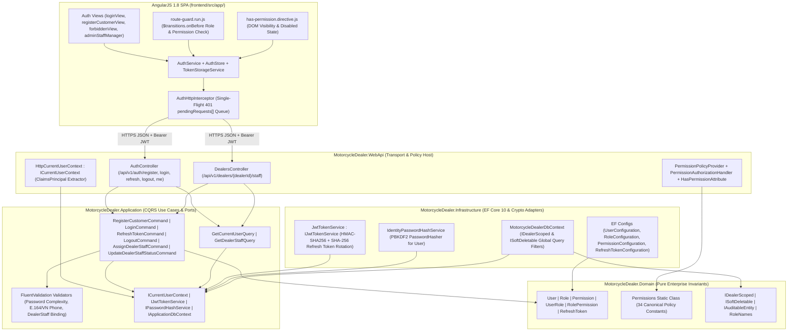
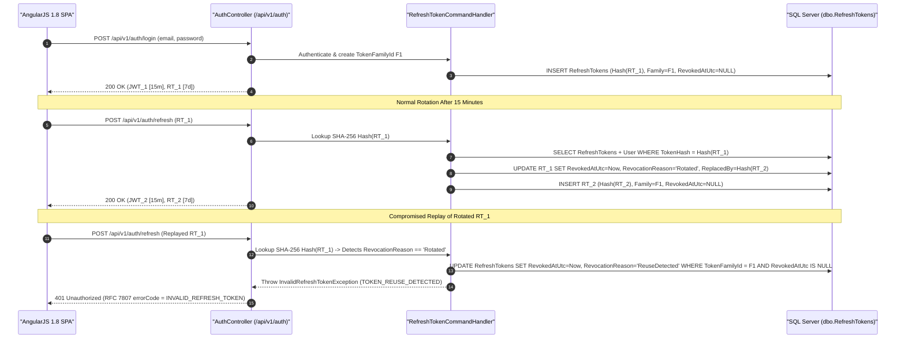
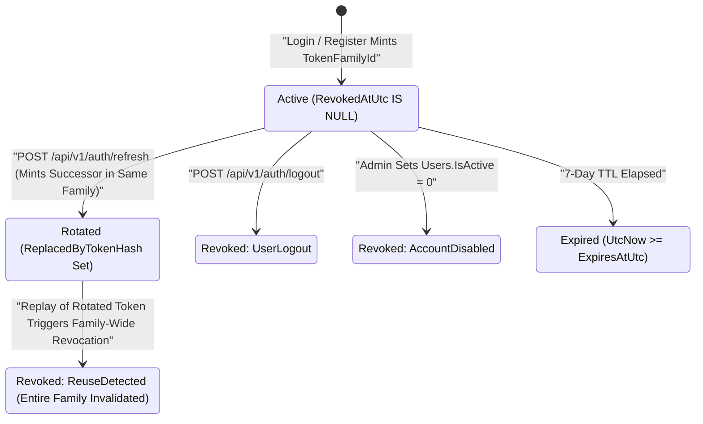

# Module 01 Blueprint — Identity, Rotating JWT Auth & Multi-Dealer Granular RBAC

| Metadata | Canonical Value |
| :--- | :--- |
| **Module ID & Title** | `MOD-01` — Identity, Rotating JWT Authentication & Multi-Dealer Granular RBAC |
| **Delivery Phase** | **Phase 4** (`T-401`, `T-404`, `T-405`..`T-409`) · Hardening in **Phase 7** (`T-706`) · Expanded RBAC in **Phase 8** (`T-801`) & **Phase 9 (`v1.2.0`)** (`T-901`) |
| **Requirement Traceability** | `FR-01`, `FR-08`, `FR-09` ([PRD.md](../PRD.md)) · Baseline Pillar 1 ([REQUIREMENTS.md](../../REQUIREMENTS.md)) |
| **Architecture Decisions** | `ADR-001` (4-Layer Clean Architecture), `ADR-002` (`DealerId` Row-Level Scoping across `8` tables), `ADR-006` (AngularJS SPA Guards & Refresh Queue) ([ARCHITECTURE.md](../ARCHITECTURE.md)) |
| **SQL Server 3NF Tables (7)** | `Users`, `Roles`, `Permissions` (`48`), `UserRoles`, `RolePermissions` (`74`), `RefreshTokens`, `Dealers` *(root tenant anchor)* + 1:1 onboarding hook into `LoyaltyAccounts` ([DATABASE_DESIGN.md](../DATABASE_DESIGN.md)) |
| **REST Route Prefixes** | `/api/v1/auth/*` (`AuthController`) · `/api/v1/dealers/{dealerId}/staff/*` (`DealersController`) · `/health` & `/api/v1/health` (`HealthController`) ([DESIGN.md](../DESIGN.md)) |
| **Application Code Status** | **Implemented & Verified in Production Code (`v1.2.0`)** (`48` RBAC Policies: `Customer = 20`, `DealerStaff = 22`, `Admin = 32` · `30` Navigable Routes) |
| **Sibling Module Links** | [MOD_02 Showroom & VIN Garage](./MOD_02_SHOWROOM_AND_VIN_GARAGE.md) · [MOD_03 Service Booking & Reminders](./MOD_03_SERVICE_BOOKING_AND_REMINDERS.md) · [MOD_04 Loyalty Tiers & Vouchers](./MOD_04_LOYALTY_TIERS_AND_VOUCHERS.md) · [MOD_05 SignalR Notifications](./MOD_05_SIGNALR_REALTIME_NOTIFICATIONS.md) · [MOD_06 Admin Analytics](./MOD_06_ADMIN_ANALYTICS_AND_REPORTING.md) |

---

## 1. Module Purpose & Architectural Boundaries

Module 01 establishes the **Zero-Trust Identity, Authentication, Authorization, and Multi-Dealer Tenant Isolation foundation** for the entire Motorcycle Dealer & Loyalty Management Platform. Every HTTP endpoint under `/api/v1/*`, every WebSocket connection to `/hubs/notifications`, every EF Core SQL query over dealer-owned records, and every AngularJS UI-Router state transition depends on the security invariants defined in this vertical slice.

### Core Security Guarantees
1. **Three Canonical Roles with Strict Separation of Duties**:
   - `Customer`: Global across dealerships (`Users.DealerId == null`); strictly restricted to self-owned aggregates (`CustomerId == CurrentUser.UserId`).
   - `DealerStaff`: Bound to exactly one physical branch (`Users.DealerId != null` and `StaffEmployeeCode != null`); isolated at both command-validation and EF Core Global Query Filter layers (`IDealerScoped`).
   - `Admin`: Platform-wide governance and cross-dealer analytics (`Users.DealerId == null`); holds administrative and read-all policies without impersonating customer self-service permissions.
2. **Short-Lived JWT Access Tokens + Rotating Token-Family Refresh Tokens**:
   - `15-minute` `HMAC-SHA256` access tokens paired with `7-day` opaque `RefreshTokens` persisted exclusively as `SHA-256` hex digests (`TokenHash`) grouped by `TokenFamilyId`. Replaying any previously rotated token triggers immediate **Token-Family Breach Revocation**.
3. **48 Granular Policy Claims (`Permissions.<Module>.<Action>`: `Customer = 20`, `DealerStaff = 22`, `Admin = 32`)**:
   - Pre-indexed in an $O(1)$ `FrozenDictionary` by `PermissionPolicyProvider` + `PermissionAuthorizationHandler` on the server (including Phase 9 `Permissions.Reviews.{CreateOwn,ViewOwn,ViewDealer,RespondDealer}` and `Permissions.Warranty.{CreateOwn,ViewOwn,ViewDealer,ManageDealer}`), paired with `ActivePrincipalMiddleware` (instant revocation check closing the 15-minute JWT window) and `AuthRateLimitOptions` (`429 RATE_LIMIT_EXCEEDED` fixed-window IP rate limiting), and mirrored across all `30` navigable `@uirouter/angularjs` routes (`$transitions.onBefore`) and the `has-permission` directive on the client.

> [!NOTE]
> **Production Verification Status (`v1.2.0`)**: All identity entities, PBKDF2-SHA512 hashing, RCSI refresh-token family rotation, `ActivePrincipalMiddleware`, `AuthRateLimitOptions`, `48` granular RBAC policies, `8`-table `IDealerScoped` query/write guards (`+ServiceReviews`, `+WarrantyClaims`), and SPA single-flight refresh queues are implemented and verified in production code (`RbacAndTenancyTests.cs`, `OwaspApiSecurityAuditTests.cs`, `verify-spa.mjs`).

---

## 2. Clean Architecture Vertical Slice Map (`Domain` -> `WebApi` -> `SPA` -> `Tests`)



### 2.1 Planned File-by-File Implementation Inventory

| Layer | Planned File Path | Responsibility & Key Types | WBS Task |
| :--- | :--- | :--- | :---: |
| **Domain** | `backend/src/MotorcycleDealer.Domain/Common/IDealerScoped.cs` | `public interface IDealerScoped { Guid DealerId { get; } }` marker for all **6** dealer-owned operational aggregates (`+TestDriveBookings`) | `T-302`, `T-801` |
| **Domain** | `backend/src/MotorcycleDealer.Domain/Common/ISoftDeletable.cs` | `IsDeleted` + `DeletedAtUtc` contract enforced globally across soft-deletable master entities (`6` tables including `SpareParts`) | `T-302`, `T-801` |
| **Domain** | `backend/src/MotorcycleDealer.Domain/Constants/RoleNames.cs` | Canonical role constants: `Customer`, `DealerStaff`, `Admin` | `T-401` |
| **Domain** | `backend/src/MotorcycleDealer.Domain/Constants/Permissions.cs` | Static nested catalog defining all **40** `Permissions.<Module>.<Action>` constants (`Customer=16`, `DealerStaff=18`, `Admin=28`) + seed helper | `T-401`, `T-801` |
| **Domain** | `backend/src/MotorcycleDealer.Domain/Entities/Identity/User.cs` | Rich `User` aggregate enforcing `DealerStaff` <-> `(DealerId, StaffEmployeeCode)` invariant and account lock state (`IsActive`) | `T-401` |
| **Domain** | `backend/src/MotorcycleDealer.Domain/Entities/Identity/Role.cs` | System role aggregate (`Name`, `DisplayName`, `IsSystemRole`) | `T-401` |
| **Domain** | `backend/src/MotorcycleDealer.Domain/Entities/Identity/Permission.cs` | Granular permission entity (`Code`, `Module`, `DisplayName`, `Description`) | `T-401` |
| **Domain** | `backend/src/MotorcycleDealer.Domain/Entities/Identity/UserRole.cs` | Composite `(UserId, RoleId)` join entity with `AssignedAtUtc` and `AssignedByUserId` | `T-401` |
| **Domain** | `backend/src/MotorcycleDealer.Domain/Entities/Identity/RolePermission.cs` | Composite `(RoleId, PermissionId)` join entity with `GrantedAtUtc` | `T-401` |
| **Domain** | `backend/src/MotorcycleDealer.Domain/Entities/Identity/RefreshToken.cs` | Token-family rotation entity (`TokenHash`, `TokenFamilyId`, `ExpiresAtUtc`, `RevokedAtUtc`, `ReplacedByTokenHash`, `RevocationReason`) | `T-401` |
| **Application** | `backend/src/MotorcycleDealer.Application/Common/Interfaces/ICurrentUserContext.cs` | Ambient principal port (`UserId`, `Email`, `Role`, `DealerId`, `Permissions`, `IsAuthenticated`, `IsDealerStaff`, `IsAdmin`) | `T-303` |
| **Application** | `backend/src/MotorcycleDealer.Application/Common/Interfaces/IJwtTokenService.cs` | Access token generation, cryptographic refresh token minting, and `SHA-256` hashing port | `T-406` |
| **Application** | `backend/src/MotorcycleDealer.Application/Common/Interfaces/IPasswordHashService.cs` | Password hashing and constant-time verification port | `T-406` |
| **Application** | `backend/src/MotorcycleDealer.Application/Features/Auth/Commands/RegisterCustomerCommand.cs` | Creates `Customer` user, assigns `Customer` role, provisions `Bronze` `LoyaltyAccount`, and issues initial token pair | `T-406` |
| **Application** | `backend/src/MotorcycleDealer.Application/Features/Auth/Commands/LoginCommand.cs` | Verifies `NormalizedEmail`, `IsActive`, and password hash; resolves permissions; starts new `TokenFamilyId` | `T-406` |
| **Application** | `backend/src/MotorcycleDealer.Application/Features/Auth/Commands/RefreshTokenCommand.cs` | Rotates active refresh token or revokes entire `TokenFamilyId` upon replay detection (`ReuseDetected`) | `T-406` |
| **Application** | `backend/src/MotorcycleDealer.Application/Features/Auth/Commands/LogoutCommand.cs` | Revokes caller's active refresh token family (`RevocationReason = "UserLogout"`) | `T-406` |
| **Application** | `backend/src/MotorcycleDealer.Application/Features/Auth/Queries/GetCurrentUserQuery.cs` | Returns fresh `CurrentUserProfileDto` (`/api/v1/auth/me`) with `role`, `dealerId`, and `permissions[]` | `T-406` |
| **Application** | `backend/src/MotorcycleDealer.Application/Features/Dealers/Staff/AssignDealerStaffCommand.cs` | (`Admin`) Provisions a `DealerStaff` user strictly bound to `dealerId` and `StaffEmployeeCode` | `T-407` |
| **Application** | `backend/src/MotorcycleDealer.Application/Features/Dealers/Staff/UpdateDealerStaffStatusCommand.cs` | (`Admin`) Locks/unlocks a `DealerStaff` user (`IsActive`) and revokes all active `RefreshTokens` immediately on lock | `T-407` |
| **Infrastructure** | `backend/src/MotorcycleDealer.Infrastructure/Identity/JwtTokenService.cs` | `HMAC-SHA256` JWT minting + 64-byte CSPRNG refresh token + `SHA256.HashData` hex digest implementation | `T-406` |
| **Infrastructure** | `backend/src/MotorcycleDealer.Infrastructure/Identity/IdentityPasswordHashService.cs` | Wraps `Microsoft.AspNetCore.Identity.PasswordHasher<User>` (`PBKDF2-HMAC-SHA512`) | `T-406` |
| **Infrastructure** | `backend/src/MotorcycleDealer.Infrastructure/Persistence/Configurations/Identity/*.cs` | 6 `IEntityTypeConfiguration<T>` classes (`Users`, `Roles`, `Permissions`, `UserRoles`, `RolePermissions`, `RefreshTokens`) | `T-401` |
| **Infrastructure** | `backend/src/MotorcycleDealer.Infrastructure/Persistence/MotorcycleDealerDbContext.cs` | Expression-tree builder composing `IDealerScoped` and `ISoftDeletable` Global Query Filters + `SaveChangesAsync` write guard | `T-404` |
| **WebApi** | `backend/src/MotorcycleDealer.WebApi/Authorization/PermissionPolicyProvider.cs` | Dynamic `IAuthorizationPolicyProvider` resolving `Permissions.*` policy names on demand | `T-407` |
| **WebApi** | `backend/src/MotorcycleDealer.WebApi/Authorization/PermissionAuthorizationHandler.cs` | Evaluates verified `permissions` JWT claims against `PermissionRequirement` | `T-407` |
| **WebApi** | `backend/src/MotorcycleDealer.WebApi/Authorization/HasPermissionAttribute.cs` | Thin `[HasPermission(Permissions.Bookings.ViewDealer)]` wrapper inheriting `AuthorizeAttribute` | `T-407` |
| **WebApi** | `backend/src/MotorcycleDealer.WebApi/Controllers/AuthController.cs` | Exposes `/api/v1/auth/{register,login,refresh,logout,me}` with rate limiting | `T-406` |
| **WebApi** | `backend/src/MotorcycleDealer.WebApi/Controllers/DealersController.cs` | Exposes `/api/v1/dealers/{dealerId}/staff` (`GET`, `POST`, `PATCH /{userId}/status`) | `T-407` |
| **AngularJS SPA** | `frontend/src/app/core/auth/{auth.service.js,auth.store.js,token-storage.service.js,auth-http.interceptor.js}` | Session state store, token persistence, and single-flight `401` `pendingRequests[]` refresh queue | `T-408` |
| **AngularJS SPA** | `frontend/src/app/core/guards/route-guard.run.js` | `@uirouter/angularjs` `$transitions.onBefore` role and granular permission enforcement | `T-408` |
| **AngularJS SPA** | `frontend/src/app/shared/directives/has-permission.directive.js` | Declarative `has-permission` attribute directive with `$destroy` listener cleanup | `T-408` |
| **AngularJS SPA** | `frontend/src/app/features/auth/*` & `features/admin-analytics/admin-staff-manager.*` | Login, Customer Registration, `/403` Forbidden view, and Admin Staff Provisioning screen | `T-408`, `T-703` |
| **Tests** | `backend/tests/MotorcycleDealer.Domain.UnitTests/Identity/*` & `Api.IntegrationTests/Security/RbacAndTenancyTests.cs` | Unit tests for `User`/`RefreshToken` invariants + full **40-permission** & cross-dealer IDOR integration suite | `T-409`, `T-807` |

---

## 3. Domain Layer Specification (`MotorcycleDealer.Domain`)

### 3.1 Core Entities & Invariants (`User`, `RefreshToken`, `IDealerScoped`)

```csharp
namespace MotorcycleDealer.Domain.Common;

public interface IDealerScoped
{
    Guid DealerId { get; }
}

public interface ISoftDeletable
{
    bool IsDeleted { get; }
    DateTimeOffset? DeletedAtUtc { get; }
}
```

#### `User` Aggregate Invariants (`dbo.Users`)
- **Primary Key**: Initialized via `Guid.CreateVersion7()` (`NEWSEQUENTIALID()` fallback in SQL Server).
- **Email Normalization**: `Email` preserves display casing (`VARCHAR(256)`); `NormalizedEmail = email.Trim().ToUpperInvariant()` backs fast case-insensitive index seeks (`UQ_Users_NormalizedEmail`).
- **Dealer Binding Invariant (`CK_Users_DealerStaff_DealerId`)**:
  - `User.CreateCustomer(email, passwordHash, fullName, phoneNumber)` forces `DealerId = null` and `StaffEmployeeCode = null`.
  - `User.CreateDealerStaff(email, passwordHash, fullName, phoneNumber, dealerId, staffEmployeeCode)` throws `DomainException("INVALID_DEALER_STAFF_BINDING")` if `dealerId == Guid.Empty` or `string.IsNullOrWhiteSpace(staffEmployeeCode)`.
  - `User.CreateAdmin(...)` forces `DealerId = null` and `StaffEmployeeCode = null`.
- **Account Lockout (`IsActive`)**: Setting `IsActive = false` via `user.Deactivate(utcNow)` immediately blocks login, blocks refresh token rotation (`403 ACCOUNT_LOCKED`), and revokes all active `RefreshTokens` rows for that `UserId`.

#### `RefreshToken` Entity State Transitions (`dbo.RefreshTokens`)
- Raw refresh tokens are **never** stored in memory objects or database columns; `RefreshToken.Create(userId, tokenHash, tokenFamilyId, expiresAtUtc, createdByIp, utcNow)` enforces `expiresAtUtc > utcNow` (`CK_RefreshTokens_Expiry`).
- Computed properties:
  - `IsExpired(DateTimeOffset utcNow) => utcNow >= ExpiresAtUtc`
  - `IsRevoked => RevokedAtUtc.HasValue`
  - `IsActive(DateTimeOffset utcNow) => !IsRevoked && !IsExpired(utcNow)`
- Domain transitions:
  - `Rotate(string successorTokenHash, DateTimeOffset utcNow)`: sets `RevokedAtUtc = utcNow`, `ReplacedByTokenHash = successorTokenHash`, `RevocationReason = "Rotated"`.
  - `Revoke(string reason, DateTimeOffset utcNow)`: sets `RevokedAtUtc = utcNow`, `RevocationReason = reason` (`"UserLogout"`, `"ReuseDetected"`, `"AccountDisabled"`).

### 3.2 Complete 40-Constant `Permissions` Static Class (`Domain/Constants/Permissions.cs`)

Placing `Permissions` inside `MotorcycleDealer.Domain.Constants` (zero external dependencies) allows `Domain`, `Application`, `Infrastructure` (`DatabaseSeeder`), and `WebApi` (`[HasPermission(...)]`) to share one compile-time source of truth across all **`40` canonical permissions** (`Customer = 16`, `DealerStaff = 18`, `Admin = 28`):

```csharp
namespace MotorcycleDealer.Domain.Constants;

public static class Permissions
{
    public static class Showroom
    {
        public const string View = "Permissions.Showroom.View";                     // #1  Customer, DealerStaff, Admin (+ Anonymous GET)
        public const string ManageModels = "Permissions.Showroom.ManageModels";     // #2  Admin
    }

    public static class Inventories
    {
        public const string ViewDealer = "Permissions.Inventories.ViewDealer";      // #3  DealerStaff (scoped), Admin
        public const string ManageDealer = "Permissions.Inventories.ManageDealer";  // #4  DealerStaff (scoped), Admin
    }

    public static class SalesOrders
    {
        public const string Create = "Permissions.SalesOrders.Create";              // #5  DealerStaff (scoped), Admin
        public const string ViewOwn = "Permissions.SalesOrders.ViewOwn";            // #6  Customer (owner)
        public const string ViewDealer = "Permissions.SalesOrders.ViewDealer";      // #7  DealerStaff (scoped), Admin
    }

    public static class Vehicles
    {
        public const string ViewOwn = "Permissions.Vehicles.ViewOwn";               // #8  Customer (owner)
        public const string RegisterOwn = "Permissions.Vehicles.RegisterOwn";       // #9  Customer (owner)
        public const string ViewDealer = "Permissions.Vehicles.ViewDealer";         // #10 DealerStaff, Admin
        public const string ManageRules = "Permissions.Vehicles.ManageRules";       // #11 Admin
    }

    public static class TimeSlots
    {
        public const string ViewAvailable = "Permissions.TimeSlots.ViewAvailable";  // #12 Customer, DealerStaff, Admin
        public const string ManageDealer = "Permissions.TimeSlots.ManageDealer";    // #13 DealerStaff (scoped), Admin
    }

    public static class Bookings
    {
        public const string Create = "Permissions.Bookings.Create";                 // #14 Customer (owner)
        public const string CancelOwn = "Permissions.Bookings.CancelOwn";           // #15 Customer (owner)
        public const string ViewOwn = "Permissions.Bookings.ViewOwn";               // #16 Customer (owner)
        public const string ViewDealer = "Permissions.Bookings.ViewDealer";         // #17 DealerStaff (scoped), Admin
        public const string UpdateStatus = "Permissions.Bookings.UpdateStatus";     // #18 DealerStaff (scoped), Admin
    }

    public static class Invoices
    {
        public const string CreateDealer = "Permissions.Invoices.CreateDealer";     // #19 DealerStaff (scoped), Admin
        public const string ViewOwn = "Permissions.Invoices.ViewOwn";               // #20 Customer (owner)
        public const string ViewDealer = "Permissions.Invoices.ViewDealer";         // #21 DealerStaff (scoped), Admin
    }

    public static class Loyalty
    {
        public const string ViewOwn = "Permissions.Loyalty.ViewOwn";                           // #22 Customer (owner)
        public const string RedeemVoucher = "Permissions.Loyalty.RedeemVoucher";               // #23 Customer (owner)
        public const string ViewDealerCustomer = "Permissions.Loyalty.ViewDealerCustomer";     // #24 DealerStaff, Admin
        public const string ManageTiers = "Permissions.Loyalty.ManageTiers";                   // #25 Admin
        public const string ManageVoucherCatalog = "Permissions.Loyalty.ManageVoucherCatalog"; // #26 Admin
        public const string AdjustPoints = "Permissions.Loyalty.AdjustPoints";                 // #27 Admin
    }

    public static class Notifications
    {
        public const string ViewOwn = "Permissions.Notifications.ViewOwn";          // #28 Customer, DealerStaff, Admin
        public const string ViewDealer = "Permissions.Notifications.ViewDealer";    // #29 DealerStaff (scoped), Admin
    }

    public static class Dealers
    {
        public const string ViewPublic = "Permissions.Dealers.ViewPublic";          // #30 Customer, DealerStaff, Admin (+ Anonymous GET)
        public const string ManageAll = "Permissions.Dealers.ManageAll";            // #31 Admin
    }

    public static class Users
    {
        public const string ManageStaff = "Permissions.Users.ManageStaff";          // #32 Admin
    }

    public static class Analytics
    {
        public const string ViewAllDealers = "Permissions.Analytics.ViewAllDealers";// #33 Admin
        public const string ExportReports = "Permissions.Analytics.ExportReports";  // #34 Admin
    }

    public static class TestDrives
    {
        public const string Create = "Permissions.TestDrives.Create";               // #35 Customer (owner)
        public const string CancelOwn = "Permissions.TestDrives.CancelOwn";         // #36 Customer (owner)
        public const string ViewOwn = "Permissions.TestDrives.ViewOwn";             // #37 Customer (owner)
        public const string ViewDealer = "Permissions.TestDrives.ViewDealer";       // #38 DealerStaff (scoped), Admin
        public const string UpdateStatus = "Permissions.TestDrives.UpdateStatus";   // #39 DealerStaff (scoped), Admin
    }

    public static class SpareParts
    {
        public const string ManageCatalog = "Permissions.SpareParts.ManageCatalog"; // #40 Admin
    }
}
```

---

## 4. Application & Infrastructure Layer Specifications

### 4.1 Application Ports & Command Contracts (`MotorcycleDealer.Application`)

```csharp
namespace MotorcycleDealer.Application.Common.Interfaces;

public interface ICurrentUserContext
{
    bool IsAuthenticated { get; }
    Guid UserId { get; }
    string? Email { get; }
    string? Role { get; }
    Guid? DealerId { get; }
    IReadOnlySet<string> Permissions { get; }

    bool IsDealerStaff => string.Equals(Role, RoleNames.DealerStaff, StringComparison.Ordinal);
    bool IsAdmin => string.Equals(Role, RoleNames.Admin, StringComparison.Ordinal);
    bool IsCustomer => string.Equals(Role, RoleNames.Customer, StringComparison.Ordinal);
    Guid RequireAssignedDealerId(); // Throws ForbiddenDealerScopeException if DealerStaff lacks DealerId
}

public sealed record IssuedTokenPair(
    string AccessToken,
    DateTimeOffset AccessTokenExpiresAtUtc,
    string RawRefreshToken,
    string RefreshTokenHash,
    DateTimeOffset RefreshTokenExpiresAtUtc);

public interface IJwtTokenService
{
    IssuedTokenPair IssueTokens(
        User user,
        string roleName,
        IReadOnlyCollection<string> permissions,
        DateTimeOffset utcNow);

    string ComputeRefreshTokenHash(string rawRefreshToken);
}
```

#### Application Command Summary
1. **`RegisterCustomerCommand(string Email, string Password, string FullName, string PhoneNumber, string? ClientIp)`**:
   - Verifies `NormalizedEmail` and active `PhoneNumber` uniqueness (`409 DUPLICATE_ACCOUNT`).
   - Hashes password via `IPasswordHashService`, creates `User` (`DealerId = null`), binds `UserRole` (`Customer`), loads `LoyaltyTier` (`TierCode == "Bronze"`), creates `LoyaltyAccount` (`AvailablePoints = 0`, `LifetimeQualifyingPoints = 0`, `CurrentTierId = bronzeTier.Id`), persists first `RefreshToken` (`TokenFamilyId = Guid.CreateVersion7()`), and commits atomically.
2. **`LoginCommand(string Email, string Password, string? ClientIp)`**:
   - Queries `Users` by `NormalizedEmail`. If missing or password hash fails, returns generic `401 INVALID_CREDENTIALS` (constant-time hash comparison prevents account enumeration).
   - If `!user.IsActive`, throws `ForbiddenAccountLockedException` (`403 ACCOUNT_LOCKED`).
   - If `role == "DealerStaff"` and (`user.DealerId == null` or target `Dealer` is inactive/deleted), throws `ForbiddenDealerScopeException` (`403 STAFF_DEALER_UNASSIGNED`).
   - Resolves granted permission codes via `UserRoles -> RolePermissions -> Permissions`, stamps `user.LastLoginAtUtc = utcNow`, creates a fresh `TokenFamilyId` in `RefreshTokens`, and returns `AuthSessionDto`.
3. **`RefreshTokenCommand(string RefreshToken, string? ClientIp)`**:
   - Computes `incomingHash = _jwtTokenService.ComputeRefreshTokenHash(request.RefreshToken)`.
   - Looks up `RefreshTokens` by `TokenHash` (`UQ_RefreshTokens_TokenHash`) joined with `Users`.
   - Enforces the **Rotating Family & Breach Detection State Machine** (detailed in Section 5.1).
4. **`LogoutCommand(string? RefreshToken)`**:
   - Revokes all unrevoked `RefreshTokens` in the caller's `TokenFamilyId` (or all active tokens for `CurrentUser.UserId` if `revokeAllDevices = true`) with `RevocationReason = "UserLogout"`.
5. **`AssignDealerStaffCommand(Guid DealerId, string Email, string TemporaryPassword, string FullName, string PhoneNumber, string StaffEmployeeCode)`**:
   - Restricted to `Permissions.Users.ManageStaff` (`Admin`).
   - Verifies `Dealers` exists and `IsActive && !IsDeleted`; creates `User` bound to `DealerId` and `StaffEmployeeCode`; assigns `DealerStaff` role (`AssignedByUserId = CurrentUser.UserId`).

### 4.2 EF Core 10 `IDealerScoped` + `ISoftDeletable` Global Query Filter Expression Tree

In `MotorcycleDealerDbContext`, EF Core Global Query Filters must compose **both** soft-delete filtering (`!e.IsDeleted`) and multi-dealer isolation (`!IsDealerStaffQueryRestricted || e.DealerId == CurrentDealerId`) without overwriting each other, because EF Core allows one `HasQueryFilter` lambda per entity type (or named query filters in EF Core 10):

```csharp
// Planned Target: backend/src/MotorcycleDealer.Infrastructure/Persistence/MotorcycleDealerDbContext.cs
public sealed class MotorcycleDealerDbContext : DbContext, IApplicationDbContext
{
    private readonly ICurrentUserContext _currentUser;

    // Evaluated dynamically per DbContext instance on every parameterized query!
    public bool EnforceDealerTenantFilter => _currentUser.IsDealerStaff;
    public Guid CurrentScopedDealerId => _currentUser.DealerId ?? Guid.Empty;

    protected override void OnModelCreating(ModelBuilder modelBuilder)
    {
        base.OnModelCreating(modelBuilder);
        modelBuilder.ApplyConfigurationsFromAssembly(typeof(MotorcycleDealerDbContext).Assembly);

        foreach (var entityType in modelBuilder.Model.GetEntityTypes())
        {
            var clrType = entityType.ClrType;
            var isSoftDeletable = typeof(ISoftDeletable).IsAssignableFrom(clrType);
            var isDealerScoped = typeof(IDealerScoped).IsAssignableFrom(clrType);

            if (!isSoftDeletable && !isDealerScoped)
            {
                continue;
            }

            var parameter = Expression.Parameter(clrType, "entity");
            Expression? combinedPredicate = null;

            if (isSoftDeletable)
            {
                // !((ISoftDeletable)entity).IsDeleted
                var isDeletedProp = Expression.Property(parameter, nameof(ISoftDeletable.IsDeleted));
                combinedPredicate = Expression.Not(isDeletedProp);
            }

            if (isDealerScoped)
            {
                // !this.EnforceDealerTenantFilter || ((IDealerScoped)entity).DealerId == this.CurrentScopedDealerId
                var ctxConstant = Expression.Constant(this);
                var enforceFilterProp = Expression.Property(ctxConstant, nameof(EnforceDealerTenantFilter));
                var scopedDealerProp = Expression.Property(ctxConstant, nameof(CurrentScopedDealerId));
                var entityDealerProp = Expression.Property(parameter, nameof(IDealerScoped.DealerId));

                var dealerPredicate = Expression.OrElse(
                    Expression.Not(enforceFilterProp),
                    Expression.Equal(entityDealerProp, scopedDealerProp));

                combinedPredicate = combinedPredicate is null
                    ? dealerPredicate
                    : Expression.AndAlso(combinedPredicate, dealerPredicate);
            }

            if (combinedPredicate is not null)
            {
                var lambda = Expression.Lambda(combinedPredicate, parameter);
                modelBuilder.Entity(clrType).HasQueryFilter(lambda);
            }
        }
    }
}
```

#### Defense-in-Depth Write Guard Inside `SaveChangesAsync`
Before delegating to `base.SaveChangesAsync(cancellationToken)`, `MotorcycleDealerDbContext` inspects `ChangeTracker.Entries<IDealerScoped>()`:
- Whenever `_currentUser.IsDealerStaff` is `true` and any `Added`, `Modified`, or `Deleted` `IDealerScoped` entry has `entry.Entity.DealerId != _currentUser.RequireAssignedDealerId()`, `SaveChangesAsync` throws `ForbiddenDealerScopeException` (`403 FORBIDDEN_DEALER_SCOPE`), guaranteeing zero cross-dealer writes even if a handler omits an explicit check.

### 4.3 `RefreshTokenConfiguration` (`IEntityTypeConfiguration<RefreshToken>`)

```csharp
public sealed class RefreshTokenConfiguration : IEntityTypeConfiguration<RefreshToken>
{
    public void Configure(EntityTypeBuilder<RefreshToken> builder)
    {
        builder.ToTable("RefreshTokens", t =>
            t.HasCheckConstraint("CK_RefreshTokens_Expiry", "[ExpiresAtUtc] > [CreatedAtUtc]"));

        builder.HasKey(rt => rt.Id).HasName("PK_RefreshTokens");
        builder.Property(rt => rt.Id).HasDefaultValueSql("NEWSEQUENTIALID()");

        builder.Property(rt => rt.TokenHash).HasMaxLength(128).IsUnicode(false).IsRequired();
        builder.Property(rt => rt.ReplacedByTokenHash).HasMaxLength(128).IsUnicode(false);
        builder.Property(rt => rt.RevocationReason).HasMaxLength(100).IsUnicode(false);
        builder.Property(rt => rt.CreatedByIp).HasMaxLength(45).IsUnicode(false);

        builder.HasIndex(rt => rt.TokenHash).IsUnique().HasDatabaseName("UQ_RefreshTokens_TokenHash");
        builder.HasIndex(rt => new { rt.UserId, rt.ExpiresAtUtc })
               .IncludeProperties(rt => new { rt.TokenHash, rt.TokenFamilyId })
               .HasFilter("[RevokedAtUtc] IS NULL")
               .HasDatabaseName("IX_RefreshTokens_UserId_Active");

        builder.HasOne<User>()
               .WithMany()
               .HasForeignKey(rt => rt.UserId)
               .OnDelete(DeleteBehavior.Cascade)
               .HasConstraintName("FK_RefreshTokens_Users");
    }
}
```

---

## 5. Security State Machines & Anti-IDOR Enforcement Flows

### 5.1 Rotating Refresh Token Family & Reuse Breach Revocation (`sequenceDiagram`)

Every login creates a new `TokenFamilyId`. Each `POST /api/v1/auth/refresh` atomically marks the presented token `Rotated` (`ReplacedByTokenHash = newHash`) and issues a successor token sharing the same `TokenFamilyId`. If an attacker steals `RT_1` and either the attacker or the legitimate user subsequently presents the already-rotated `RT_1`, the backend detects `RevokedAtUtc != null && RevocationReason == "Rotated"` and **immediately revokes every unrevoked token in `TokenFamilyId`** (`RevocationReason = "ReuseDetected"`), forcing clean re-authentication.



### 5.2 Refresh Token Lifecycle (`stateDiagram-v2`)



### 5.3 Server-Derived `DealerId` Anti-IDOR Enforcement Rule (`ADR-002`)

| Operation Type | `DealerStaff` Caller (`JWT dealer_id = D1`) | `Admin` Caller (`JWT dealer_id = null`) | `Customer` Caller (`JWT sub = U1`) |
| :--- | :--- | :--- | :--- |
| **Read Single Entity by ID** (`GET /api/v1/bookings/{d2BookingId}`) | Global Query Filter appends `WHERE DealerId = D1` -> `0` rows -> **`404 Not Found`** (`RESOURCE_NOT_FOUND`, prevents cross-dealer ID enumeration) | Global Query Filter bypassed -> **`200 OK`** | Blocked by `[HasPermission]` unless calling `/my` or own booking (`CustomerId != U1` -> **`403 FORBIDDEN_RESOURCE_OWNER`**) |
| **Read Paginated List** (`GET /api/v1/inventories?dealerId=D2`) | Handler rejects mismatched query `dealerId != D1` with **`403 FORBIDDEN_DEALER_SCOPE`** (or ignores & scopes strictly to `D1` when omitted) | Filters by requested `?dealerId=D2` or returns all dealers -> **`200 OK`** | Blocked by `Permissions.Inventories.ViewDealer` -> **`403 FORBIDDEN_PERMISSION`** |
| **Mutating Command** (`POST /api/v1/sales-orders` or `POST /api/v1/inventories`) | `DealerId` bound exclusively from `ICurrentUserContext.RequireAssignedDealerId()` (`D1`); body `dealerId == D2` fails immediately with **`403 FORBIDDEN_DEALER_SCOPE`** | Explicit `dealerId` required in command DTO and validated against active `Dealers` -> **`201 Created`** | Blocked by policy -> **`403 FORBIDDEN_PERMISSION`** |

---

## 6. WebApi Layer Contracts (`AuthController`, `DealersController` & Policy Pipeline)

### 6.1 Endpoint Specification Table

| HTTP Method & Route | Auth / Policy Attribute | Request DTO (`camelCase`) | Success Status & Envelope | Rate-Limit Policy |
| :--- | :--- | :--- | :--- | :--- |
| `POST /api/v1/auth/register` | `[AllowAnonymous]` | `RegisterCustomerRequest(email, password, fullName, phoneNumber)` | `201 Created` `ApiResponse<AuthSessionDto>` | `auth-strict` (`10 req / min / IP`) |
| `POST /api/v1/auth/login` | `[AllowAnonymous]` | `LoginRequest(email, password)` | `200 OK` `ApiResponse<AuthSessionDto>` | `auth-strict` (`10 req / min / IP`) |
| `POST /api/v1/auth/refresh` | `[AllowAnonymous]` | `RefreshTokenRequest(refreshToken)` | `200 OK` `ApiResponse<AuthSessionDto>` | `auth-refresh` (`30 req / min / IP`) |
| `POST /api/v1/auth/logout` | `[Authorize]` | `LogoutRequest(refreshToken, revokeAllDevices)` | `200 OK` `ApiResponse<LogoutResultDto>` | Authenticated default |
| `GET /api/v1/auth/me` | `[Authorize]` | — | `200 OK` `ApiResponse<CurrentUserProfileDto>` | Authenticated default |
| `GET /api/v1/dealers/{dealerId}/staff` | `[HasPermission(Permissions.Users.ManageStaff)]` | `?includeInactive=false&pageNumber=1&pageSize=20` | `200 OK` `PagedResponse<DealerStaffSummaryDto>` | Authenticated default |
| `POST /api/v1/dealers/{dealerId}/staff` | `[HasPermission(Permissions.Users.ManageStaff)]` | `AssignDealerStaffRequest(email, temporaryPassword, fullName, phoneNumber, staffEmployeeCode)` | `201 Created` `ApiResponse<DealerStaffSummaryDto>` | Authenticated default |
| `PATCH /api/v1/dealers/{dealerId}/staff/{userId}/status` | `[HasPermission(Permissions.Users.ManageStaff)]` | `UpdateStaffStatusRequest(isActive, reason)` | `200 OK` `ApiResponse<DealerStaffSummaryDto>` | Authenticated default |

### 6.2 Dynamic Policy Provider, `ActivePrincipalMiddleware` & `AuthRateLimitOptions` (`WebApi/`)

- **`HasPermissionAttribute`**: `public sealed class HasPermissionAttribute(string permission) : AuthorizeAttribute(policy: permission);`
- **`PermissionPolicyProvider`**: Pre-builds an immutable `FrozenDictionary` of all **`40`** `Permissions.*` policies in $O(1)$ lookup time with zero per-request allocations.
- **`PermissionAuthorizationHandler`**:
  1. Verifies `context.User.Identity?.IsAuthenticated == true`.
  2. Checks `HttpCurrentUserContext.GetOrExtractPermissions` (`FrozenSet<string>`) for `requirement.Permission`.
  3. If `context.User.IsInRole(RoleNames.DealerStaff)`, additionally verifies a valid `Guid` exists in the `"dealer_id"` claim before calling `context.Succeed(requirement)`.
- **`ActivePrincipalMiddleware` (Immediate Revocation Enforcement)**: Runs after `UseAuthentication()` on every authenticated request (and inside `NotificationHub.OnConnectedAsync`), performing a lightweight `AsNoTracking().IgnoreQueryFilters()` check on `dbo.Users` + `dbo.Dealers`. Locked/deleted users immediately receive `403 ACCOUNT_LOCKED`, and unassigned or branch-deactivated staff immediately receive `403 STAFF_DEALER_UNASSIGNED` without waiting for the 15-minute JWT TTL to expire.
- **`AuthRateLimitOptions` (`429 RATE_LIMIT_EXCEEDED` & Security Response Headers)**: Fixed-window IP rate limiter (`[EnableRateLimiting(AuthRateLimitOptions.PolicyName)]`) protecting `/api/v1/auth/{login,register,refresh}`, returning `429 Too Many Requests` (`application/problem+json` with `errorCode: "RATE_LIMIT_EXCEEDED"`, `traceId`, and `Retry-After` header) while `ApplySecurityResponseHeaders` stamps `X-Content-Type-Options: nosniff`, `X-Frame-Options: DENY`, and `Referrer-Policy: strict-origin-when-cross-origin`.

---

## 7. AngularJS 1.8 SPA Slice (`frontend/src/app/core/auth` & `guards`)

### 7.1 `AuthStore`, `TokenStorageService` & `AuthService`
- **`TokenStorageService`**: Keeps the short-lived `accessToken` (`15m` TTL) and parsed JWT claims (`sub`, `role`, `dealer_id`, `permissions[]`, `exp`) in memory (backed by `sessionStorage` tab hydration so F5 reloads survive within the active browser tab without exposing long-lived credentials across XSS-prone persistent globals) and manages the rotating `refreshToken`.
- **`AuthStore`**: Exposes synchronous helpers consumed by templates, directives, and guards:
  - `isAuthenticated()`, `getUserId()`, `getRole()`, `getDealerId()`, `hasPermissions(requiredArray, mode /* 'ALL' | 'ANY' */)`.
- **`AuthService`**:
  - `login(credentials)` / `register(payload)`: stores token pair, broadcasts `$rootScope.$broadcast('auth:changed', profile)`, starts `SignalRClientService.connect()`, and transitions to role default state (`app.customer.garage`, `app.staff.workbench`, or `app.admin.analytics`).
  - `ensureValidSession()`: resolves `true` immediately if `accessToken` has `> 30s` remaining TTL; otherwise delegates to the shared single-flight `refreshTokens()` promise.
  - `logout()`: calls `POST /api/v1/auth/logout`, tears down `SignalRClientService.disconnect()`, wipes `TokenStorageService`, broadcasts `auth:changed`, and navigates to `app.public.login`.

### 7.2 Single-Flight `$http` `401` Refresh Queue (`pendingRequests[]`)

When an AngularJS screen fires 3–4 concurrent `$http` requests (e.g., `app.admin.analytics` or `app.customer.garage`) right as the 15-minute access token expires, sending 4 parallel `/api/v1/auth/refresh` requests with the same `refreshToken` would trigger **Token Reuse Breach Revocation** on requests #2–#4! `AuthHttpInterceptor` eliminates this race deterministically using `pendingRequests[]`:

```javascript
// Planned Target: frontend/src/app/core/auth/auth-http.interceptor.js
(function () {
  'use strict';

  angular.module('app.core').factory('AuthHttpInterceptor', AuthHttpInterceptor);

  AuthHttpInterceptor.$inject = ['$q', '$injector', 'TokenStorageService'];
  function AuthHttpInterceptor($q, $injector, TokenStorageService) {
    var refreshPromise = null;
    var pendingRequests = [];

    function isBypassedAuthRoute(url) {
      return url.indexOf('/api/v1/auth/login') !== -1 ||
             url.indexOf('/api/v1/auth/register') !== -1 ||
             url.indexOf('/api/v1/auth/refresh') !== -1;
    }

    return {
      request: function attachBearerToken(config) {
        var accessToken = TokenStorageService.getAccessToken();
        if (accessToken && !isBypassedAuthRoute(config.url || '')) {
          config.headers = config.headers || {};
          config.headers.Authorization = 'Bearer ' + accessToken;
        }
        return config;
      },

      responseError: function handleUnauthorized(rejection) {
        var originalConfig = rejection.config || {};
        if (rejection.status !== 401 || originalConfig._retryAttempted || isBypassedAuthRoute(originalConfig.url || '')) {
          return $q.reject(rejection);
        }

        originalConfig._retryAttempted = true;
        var deferred = $q.defer();
        pendingRequests.push({ config: originalConfig, deferred: deferred });

        if (!refreshPromise) {
          var AuthService = $injector.get('AuthService');
          var $http = $injector.get('$http');
          var $state = $injector.get('$state');

          refreshPromise = AuthService.refreshTokens()
            .then(function onRefreshSuccess(freshAccessToken) {
              var snapshot = pendingRequests.slice();
              pendingRequests.length = 0;
              snapshot.forEach(function replayRequest(item) {
                item.config.headers = item.config.headers || {};
                item.config.headers.Authorization = 'Bearer ' + freshAccessToken;
                $http(item.config).then(item.deferred.resolve, item.deferred.reject);
              });
            })
            .catch(function onRefreshFailure(refreshErr) {
              var snapshot = pendingRequests.slice();
              pendingRequests.length = 0;
              snapshot.forEach(function rejectQueued(item) {
                item.deferred.reject(refreshErr);
              });
              AuthService.clearLocalSessionAndRealtime();
              $state.go('app.public.login');
            })
            .finally(function resetSingleFlightLock() {
              refreshPromise = null;
            });
        }

        return deferred.promise;
      }
    };
  }
})();
```

### 7.3 UI-Router `$transitions.onBefore` Guard Algorithm & `hasPermission` Directive

1. **Ancestor-Merged `$transitions.onBefore` Algorithm (`route-guard.run.js`)**:
   - **Hook 1 (`app.public.login | app.public.register`)**: If `AuthStore.isAuthenticated()` is already `true`, cancels transition and returns `$state.target(ROLE_HOME[AuthStore.getRole()])`.
   - **Hook 2 (Protected States)**: Matches any destination where inherited `state.data` declares `requiresAuth`, `roles`, or `permissions`:
     - Merges `transition.entering()` metadata from abstract parent (`app.staff`) down to leaf child (`app.staff.invoicing`), concatenating required `permissions[]`.
     - Awaits `AuthService.ensureValidSession()`. If `false`, redirects to `$state.target('app.public.login', { returnTo: transition.to().name })`.
     - Checks `merged.roles.includes(AuthStore.getRole())`; if `false`, redirects to `$state.target('app.public.forbidden')` (`/403`).
     - Checks `AuthStore.hasPermissions(merged.permissions, merged.permissionMode || 'ALL')`; if `false`, redirects to `$state.target('app.public.forbidden')`.
2. **`hasPermission` Attribute Directive (`has-permission.directive.js`)**:
   - Usage: `<button has-permission="Permissions.SalesOrders.Create">Create Order</button>` or array mode `permission-mode="ANY"`.
   - Evaluates against `AuthStore.hasPermissions(...)` on `link()` and whenever `$rootScope.$on('auth:changed', evaluate)` fires.
   - Adds `ng-hide`, `aria-hidden="true"`, and `disabled` when unauthorized, and invokes the listener deregistration closure inside `$scope.$on('$destroy')` to guarantee zero detached closures (`RISK-04`).

---

## 8. Validation Rules, Edge Cases & `RFC 7807 ProblemDetails` Catalog

### 8.1 `FluentValidation` Input Rules
- **`RegisterCustomerCommandValidator` / `AssignDealerStaffCommandValidator`**:
  - `Email`: non-empty, valid RFC 5322 format, `<= 256` chars.
  - `Password`: `8..128` chars, at least 1 uppercase letter, 1 lowercase letter, 1 digit, and 1 special character.
  - `FullName`: `2..150` chars, trimmed Unicode text.
  - `PhoneNumber`: matches `^(\+84|0)[35789][0-9]{8}$` (`<= 20` chars).
  - `StaffEmployeeCode` (`AssignDealerStaffCommand` only): matches `^EMP-[A-Z0-9-]{3,25}$`.

### 8.2 Security Edge Cases & Error Matrix (`application/problem+json`)

| Edge Case / Attack Vector | Detection Layer | HTTP Status | Canonical `errorCode` | Deterministic System Action |
| :--- | :--- | :---: | :--- | :--- |
| Duplicate email or phone on registration / staff creation | `RegisterCustomerCommand` / `UQ_Users_*` | `409 Conflict` | `DUPLICATE_ACCOUNT` | Rollback; return field conflict without leaking existing user metadata |
| Wrong password or non-existent login email | `LoginCommandHandler` | `401 Unauthorized` | `INVALID_CREDENTIALS` | Constant-time dummy hash check when user missing; generic message |
| Deactivated `Customer` or locked `DealerStaff` (`IsActive == false`) attempts login or token refresh | `LoginCommand` / `RefreshTokenCommand` | `403 Forbidden` | `ACCOUNT_LOCKED` | Reject token issuance; revoke any remaining active `RefreshTokens` |
| Expired refresh token (`UtcNow >= ExpiresAtUtc`) | `RefreshTokenCommand` | `401 Unauthorized` | `INVALID_REFRESH_TOKEN` | SPA clears session, stops SignalR hub, redirects to `/login` |
| Replayed (already-rotated) refresh token presented | `RefreshTokenCommand` (`RevocationReason == "Rotated"`) | `401 Unauthorized` | `INVALID_REFRESH_TOKEN` | **Revokes entire `TokenFamilyId` (`ReuseDetected`)**; logs security warning with IP |
| `DealerStaff` provisioned or mutated without valid `DealerId` or `StaffEmployeeCode` | `User` Domain Factory + `CK_Users_DealerStaff_DealerId` | `422 Unprocessable Entity` | `INVALID_DEALER_STAFF_BINDING` | Domain exception aborts write before hitting SQL |
| `DealerStaff` at Hanoi (`D1`) queries `GET /api/v1/bookings/{hcmcBookingId}` (`D2`) | `MotorcycleDealerDbContext` `IDealerScoped` Filter | `404 Not Found` | `RESOURCE_NOT_FOUND` | Row invisible to `D1` query context; prevents cross-dealer UUID probing |
| `DealerStaff` at Hanoi (`D1`) submits `dealerId = D2` in body/query | Command Guard / `SaveChangesAsync` Guard | `403 Forbidden` | `FORBIDDEN_DEALER_SCOPE` | Rejects cross-branch write attempt and logs principal + target `DealerId` |
| `Customer` calls `Admin` or `DealerStaff` endpoint (e.g., `PUT /api/v1/loyalty/tiers/{id}`) | `PermissionAuthorizationHandler` | `403 Forbidden` | `FORBIDDEN_PERMISSION` | Middleware short-circuits before controller/handler execution |
| Credential-stuffing burst (`> 10` logins/min from single IP) | ASP.NET Core `RateLimiter` (`auth-strict`) | `429 Too Many Requests` | `RATE_LIMIT_EXCEEDED` | Returns `Retry-After` header + `RFC 7807` payload |

---

## 9. Automated Verification & Test Blueprint (`Phase 4 Gate T-409`)

1. **`MotorcycleDealer.Domain.UnitTests/Identity/`**:
   - `UserTests`: verifies `CreateDealerStaff` rejects `Guid.Empty` `DealerId` or blank `StaffEmployeeCode`; verifies `CreateCustomer` and `CreateAdmin` enforce `DealerId == null`; verifies `Permissions` reflection check confirms **exact count = 40** distinct `"Permissions.*"` constants (`16 / 18 / 28`) matching `baseline-spec-snapshot.json` and `permissions.constants.js`.
   - `RefreshTokenTests`: verifies `IsActive`, `Rotate`, and `Revoke` transitions across boundary timestamps.
2. **`MotorcycleDealer.Api.IntegrationTests/Security/RbacAndTenancyTests.cs` & `OwaspApiSecurityAuditTests.cs`**:
   - **Customer Onboarding Atomicity**: `POST /api/v1/auth/register` creates `Users` + `UserRoles(Customer)` + `LoyaltyAccounts(Bronze, 0 pts)` in one transaction.
   - **Token Rotation & Replay Breach**: Logs in -> refreshes `RT_1` to get `RT_2` -> replays `RT_1` -> asserts `401 INVALID_REFRESH_TOKEN` -> asserts `RT_2` is now ALSO rejected with `401` (`RevocationReason == "ReuseDetected"` in SQL Server).
   - **40-Permission Matrix, Rate Limiting & Lockout Sweep**: Exercises all `40` policies across `Anonymous`, `Customer`, `DealerStaff`, and `Admin` tokens asserting exact `401` / `403` / `429 RATE_LIMIT_EXCEEDED` / `200` outcomes and immediate `ActivePrincipalMiddleware` lockout (`403 ACCOUNT_LOCKED`).
   - **Cross-Dealer IDOR Proof**: Authenticates as `staff.hn@motorcycledealer.vn` (`DLR-HN-01`) and attempts to read/mutate `DLR-HCM-01` inventory, slots, bookings, test drives, sales orders, receipts, and invoices -> asserts `404` on ID reads and `403 FORBIDDEN_DEALER_SCOPE` on explicit cross-dealer payloads.
