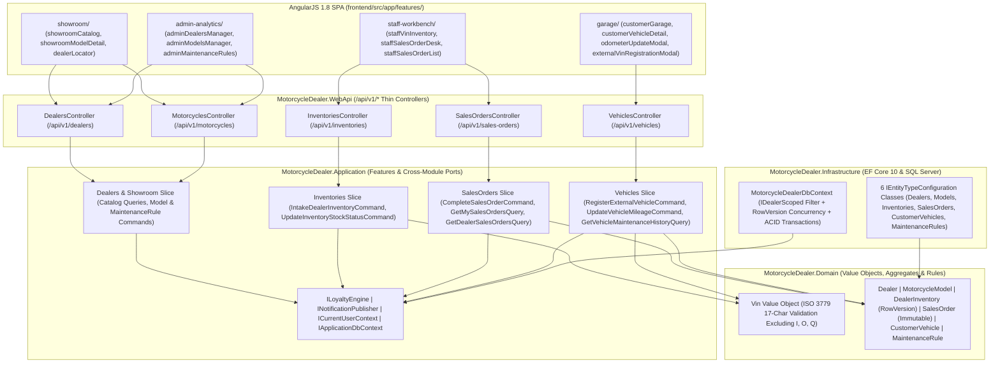
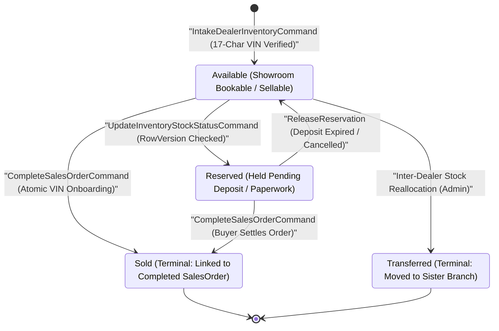
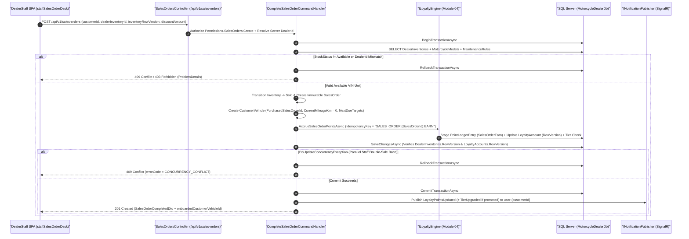

# Module 02 Blueprint — Dealer Network, Motorcycle Showroom, VIN Stock & Customer Garage

| Metadata | Canonical Value |
| :--- | :--- |
| **Module ID & Title** | `MOD-02` — Dealer Network, Showroom Catalog, Test-Drives, VIN Stock, Customer Garage & Factory Warranty Claims |
| **Delivery Phase** | **Phase 4** (`T-402`, `T-405`) · **Phase 5** (`T-501`..`T-504`, `T-508`, `T-509`) · **Phase 7** (`T-703`) · **Phase 8 (`v1.1.0`)** (`T-801`..`T-805`) · **Phase 9 (`v1.2.0`)** (`T-901`, `T-903`, `T-905` `WarrantyClaims`) |
| **Requirement Traceability** | `FR-02` (Showroom, VIN Stock & Bike Sales), `FR-03` (Customer VIN Garage), `FR-05` (Purchase Point Accrual), `FR-08` (Showroom Test-Drives & Official Printable Receipts), `FR-09` (36-Month / 30,000-km Factory VIN `WarrantyClaims`) ([PRD.md](../PRD.md)) |
| **Architecture Decisions** | `ADR-002` (`IDealerScoped` Isolation), `ADR-003` (Immutable `PointLedgerEntries` & `SalesOrders`), `ADR-004` (SignalR `TestDrive*` & `WarrantyClaim*` Events), `ADR-005` (`RowVersion` Concurrency) ([ARCHITECTURE.md](../ARCHITECTURE.md)) |
| **SQL Server 3NF Tables (8)** | `Dealers`, `MotorcycleModels`, `DealerInventories` (`RowVersion`), `SalesOrders` *(Immutable)*, `TestDriveBookings` (`IDealerScoped`, `RowVersion`), `CustomerVehicles`, `MaintenanceRules`, `WarrantyClaims` (`IDealerScoped`, `RowVersion`) ([DATABASE_DESIGN.md](../DATABASE_DESIGN.md)) |
| **REST Route Prefixes** | `/api/v1/dealers` · `/api/v1/motorcycles` · `/api/v1/inventories` · `/api/v1/sales-orders` (+`/{orderId}/receipt`) · `/api/v1/test-drives` · `/api/v1/vehicles` · `/api/v1/warranty-claims` ([DESIGN.md](../DESIGN.md)) |
| **Application Code Status** | **Implemented & Verified in Production Code (`v1.1.0`)** (`541 / 541` xUnit Tests · `56 / 56` SPA Checks) |
| **Sibling Module Links** | [MOD_01 Auth & RBAC](./MOD_01_AUTH_AND_RBAC.md) · [MOD_03 Service Booking & Reminders](./MOD_03_SERVICE_BOOKING_AND_REMINDERS.md) · [MOD_04 Loyalty Tiers & Vouchers](./MOD_04_LOYALTY_TIERS_AND_VOUCHERS.md) · [MOD_05 SignalR Notifications](./MOD_05_SIGNALR_REALTIME_NOTIFICATIONS.md) · [MOD_06 Admin Analytics](./MOD_06_ADMIN_ANALYTICS_AND_REPORTING.md) |

---

## 1. Module Purpose & Closed-Loop Business Value

Module 02 bridges **multi-branch showroom retail** with **post-sale digital vehicle ownership** at individual **17-character ISO 3779 Vehicle Identification Number (`VIN`)** granularity. Rather than treating motorcycle sales and workshop maintenance as disconnected systems, Module 02 enforces two complementary onboarding channels into `dbo.CustomerVehicles`:

1. **Closed-Loop Showroom Sale Onboarding (`RegistrationSource = 'ShowroomSale'`)**: When `DealerStaff` completes a `SalesOrder` for an `'Available'` unit in `DealerInventories`, a single ACID SQL Server transaction transitions the physical `VIN` to `'Sold'`, records the immutable financial `SalesOrder`, automatically populates the buyer's digital garage (`CustomerVehicles`) bound to model `MaintenanceRules`, and credits tiered loyalty points via `ILoyaltyEngine` (`IdempotencyKey = "SALES_ORDER:{SalesOrderId}:EARN"`).
2. **External Rider Self-Registration (`RegistrationSource = 'ExternalManual'`)**: Customers who bought motorcycles prior to joining the platform or outside the dealer network can register their 17-character `VIN` directly into `CustomerVehicles` (`PurchasedSalesOrderId = null`), unlocking automated maintenance reminders ([MOD_03](./MOD_03_SERVICE_BOOKING_AND_REMINDERS.md)) and loyalty rewards on future workshop visits ([MOD_04](./MOD_04_LOYALTY_TIERS_AND_VOUCHERS.md)).

---

## 2. Clean Architecture Vertical Slice Map (`Domain` -> `WebApi` -> `SPA` -> `Tests`)



### 2.1 Planned File-by-File Implementation Inventory

| Layer | Planned File Path | Key Classes, Records & Responsibilities | WBS Task |
| :--- | :--- | :--- | :---: |
| **Domain** | `backend/src/MotorcycleDealer.Domain/ValueObjects/Vin.cs` | Immutable `Vin` `readonly record struct` / `sealed record` enforcing 17-char ISO 3779 validation (`^[A-HJ-NPR-Z0-9]{17}$`) | `T-402`, `T-502` |
| **Domain** | `backend/src/MotorcycleDealer.Domain/Enums/ShowroomEnums.cs` | `MotorcycleCategory`, `InventoryStockStatus` (`Available`, `Reserved`, `Sold`, `Transferred`), `SalesOrderStatus` (`Pending`, `Completed`, `Cancelled`), `VehicleRegistrationSource` (`ShowroomSale`, `ExternalManual`) | `T-402` |
| **Domain** | `backend/src/MotorcycleDealer.Domain/Entities/Showroom/Dealer.cs` | `Dealer` branch entity (`Code`, `Name`, `City`, `OpeningTime`, `ClosingTime`, `DefaultSlotCapacity`, `IsActive`, `ISoftDeletable`) | `T-402` |
| **Domain** | `backend/src/MotorcycleDealer.Domain/Entities/Showroom/MotorcycleModel.cs` | Master catalog entity (`ModelCode`, `Brand`, `ModelName`, `Category`, `EngineDisplacementCc`, `BaseRetailPrice`, `WarrantyMonths`, `WarrantyMileageKm`, `SpecificationsJson`) | `T-402` |
| **Domain** | `backend/src/MotorcycleDealer.Domain/Entities/Showroom/DealerInventory.cs` | `IDealerScoped` VIN stock entity with `byte[] RowVersion`, `StockStatus`, `Reserve()`, `MarkSold(utcNow)`, `ReleaseReservation()`, `MarkTransferred()` | `T-402`, `T-502` |
| **Domain** | `backend/src/MotorcycleDealer.Domain/Entities/Showroom/SalesOrder.cs` | `IDealerScoped` immutable showroom financial receipt (`OrderNumber`, `TotalAmount`, `DiscountAmount`, `FinalAmount`, `PointsEarned`, `CompletedAtUtc`) | `T-402`, `T-503` |
| **Domain** | `backend/src/MotorcycleDealer.Domain/Entities/Garage/CustomerVehicle.cs` | Owned VIN aggregate (`VIN`, `CustomerId`, `PurchasedSalesOrderId`, `RegistrationSource`, `CurrentMileageKm`, `LastServiceMileageKm`, `NextDueMileageKm`, `NextDueDateUtc`, `UpdateOdometer(newKm, utcNow)`) | `T-402`, `T-504` |
| **Domain** | `backend/src/MotorcycleDealer.Domain/Entities/Garage/MaintenanceRule.cs` | OEM milestone rule (`MilestoneCode`, `IntervalKm`, `IntervalMonths`, `IsRecurring`, `LeadTimeDays`, `LeadMileageKm`, `ChecklistSummary`) | `T-402`, `T-501` |
| **Application** | `backend/src/MotorcycleDealer.Application/Common/Interfaces/ILoyaltyEngine.cs` | Cross-module port exposing `AccrueOrderPointsAsync(...)` (`IdempotencyKey = $"SALES_ORDER:{salesOrderId}:EARN"`) implemented in Module 04 | `T-503`, `T-601` |
| **Application** | `backend/src/MotorcycleDealer.Application/Features/Dealers/*` | `GetPublicDealersQuery`, `GetDealerByIdQuery`, `CreateDealerCommand`, `UpdateDealerCommand` + validators | `T-501` |
| **Application** | `backend/src/MotorcycleDealer.Application/Features/Showroom/*` | `GetShowroomCatalogQuery`, `GetMotorcycleModelDetailQuery`, `CreateMotorcycleModelCommand`, `UpdateMotorcycleModelCommand`, `CreateMaintenanceRuleCommand`, `UpdateMaintenanceRuleCommand` | `T-501` |
| **Application** | `backend/src/MotorcycleDealer.Application/Features/Inventories/*` | `GetDealerInventoriesQuery`, `IntakeDealerInventoryCommand`, `UpdateInventoryStockStatusCommand` + ISO 3779 VIN validators | `T-502` |
| **Application** | `backend/src/MotorcycleDealer.Application/Features/SalesOrders/*` | `CompleteSalesOrderCommand` & `CompleteSalesOrderCommandHandler`, `GetMySalesOrdersQuery`, `GetDealerSalesOrdersQuery`, `GetSalesOrderByIdQuery` | `T-503` |
| **Application** | `backend/src/MotorcycleDealer.Application/Features/Vehicles/*` | `GetMyVehiclesQuery`, `RegisterExternalVehicleCommand`, `UpdateVehicleMileageCommand`, `GetVehicleMaintenanceHistoryQuery`, `LookupCustomerVehiclesQuery` | `T-504` |
| **Infrastructure** | `backend/src/MotorcycleDealer.Infrastructure/Persistence/Configurations/{Showroom,Garage}/*.cs` | 6 `IEntityTypeConfiguration<T>` classes enforcing SQL `CHECK` constraints, `DECIMAL(18,2)`, filtered unique indexes, and `IsRowVersion()` | `T-402`, `T-404` |
| **WebApi** | `backend/src/MotorcycleDealer.WebApi/Controllers/{Dealers,Motorcycles,Inventories,SalesOrders,Vehicles}Controller.cs` | 5 thin `/api/v1/*` controllers enforcing `[HasPermission(Permissions.*)]` | `T-501`..`T-504` |
| **AngularJS SPA** | `frontend/src/app/features/{showroom,garage,staff-workbench,admin-analytics}/*` | Public catalog, Customer VIN Garage + Odometer/External-VIN modals, Staff Inventory & Sales Order Desk, Admin Catalog & Rule Studio | `T-508`, `T-509`, `T-703` |
| **Tests** | `backend/tests/MotorcycleDealer.Domain.UnitTests/{ValueObjects/VinTests.cs,Garage/CustomerVehicleTests.cs}` & `Api.IntegrationTests/Showroom/*` | ISO 3779 VIN unit tests, parallel double-sale `RowVersion` race test, atomic onboarding & odometer monotonicity integration tests | `T-502`..`T-504` |

---

## 3. Domain Layer Invariants & State Machines (`MotorcycleDealer.Domain`)

### 3.1 ISO 3779 17-Character `Vin` Value Object (`Domain/ValueObjects/Vin.cs`)

Per ISO 3779, a legal Vehicle Identification Number is **strictly 17 ASCII uppercase alphanumeric characters** and **never contains the letters `I`, `O`, or `Q`** (to prevent visual confusion with digits `1` and `0`). This rule is enforced identically in C# (`Vin.Create`), `FluentValidation`, and SQL Server (`CK_DealerInventories_VIN` and `CK_CustomerVehicles_VIN`):

```csharp
namespace MotorcycleDealer.Domain.ValueObjects;

public sealed record Vin
{
    public const int ExactLength = 17;
    private static readonly Regex Iso3779Pattern =
        new("^[A-HJ-NPR-Z0-9]{17}$", RegexOptions.Compiled | RegexOptions.CultureInvariant);

    public string Value { get; }

    private Vin(string normalizedValue) => Value = normalizedValue;

    public static Vin Create(string? rawVin)
    {
        if (string.IsNullOrWhiteSpace(rawVin))
        {
            throw new DomainValidationException("VIN", "VIN is required.");
        }

        var normalized = rawVin.Trim().ToUpperInvariant();
        if (normalized.Length != ExactLength || !Iso3779Pattern.IsMatch(normalized))
        {
            throw new DomainValidationException(
                "VIN",
                "VIN must be exactly 17 uppercase alphanumeric characters excluding 'I', 'O', and 'Q' (ISO 3779).");
        }

        return new Vin(normalized);
    }

    public override string ToString() => Value;
}
```

### 3.2 `DealerInventory` Stock Lifecycle (`stateDiagram-v2`)

`DealerInventory` implements `IDealerScoped` (`Guid DealerId`) and carries `byte[] RowVersion` (`ROWVERSION`). Transitions are strictly controlled through domain methods:



### 3.3 `CustomerVehicle` Odometer & Initial Schedule Invariants
- **Monotonic Odometer Rule**: `CustomerVehicle.UpdateOdometer(int newMileageKm, DateTimeOffset utcNow)` verifies `newMileageKm >= CurrentMileageKm`. Any attempt to submit `newMileageKm < CurrentMileageKm` throws `BusinessRuleViolationException("ODOMETER_REGRESSION", ...)` mapped to **`422 Unprocessable Entity`** (backed in SQL Server by `CK_CustomerVehicles_Mileage`).
- **Initial `NextDueMileageKm` & `NextDueDateUtc` Binding**:
  - Given the model's active `MaintenanceRules` ordered ascending by `IntervalKm`:
  - **On Showroom Sale (`CurrentMileageKm = 0`, `LastServiceMileageKm = 0`)**: selects the first milestone rule `R_1` (typically `1,000 km / 1 month` Break-In Inspection) and sets `NextDueMileageKm = R_1.IntervalKm` and `NextDueDateUtc = completedAtUtc.AddMonths(R_1.IntervalMonths)`.
  - **On External Manual Registration (`CurrentMileageKm = M`, `LastServiceMileageKm = L`)**: selects the smallest active milestone rule where `IntervalKm > Math.Max(M, L)` (or computes the next recurring step `((Math.Max(M, L) / R_rec.IntervalKm) + 1) * R_rec.IntervalKm` when `M` exceeds the highest fixed rule) and sets `NextDueDateUtc = (lastServiceDateUtc ?? utcNow).AddMonths(rule.IntervalMonths)`.

---

## 4. Closed-Loop Atomic Sales Onboarding Flow (`CompleteSalesOrderCommand`)

### 4.1 Five-Step ACID Transactional Specification (`POST /api/v1/sales-orders`)

`CompleteSalesOrderCommandHandler` executes inside an explicit `await using var tx = await _dbContext.Database.BeginTransactionAsync(ct)` boundary so partial failures roll back cleanly with zero orphaned records:

1. **Step 1 — Tenant & Inventory Verification (`RowVersion`)**:
   - Resolve `effectiveDealerId`: for `DealerStaff`, bind strictly from `_currentUser.RequireAssignedDealerId()` (throwing `403 FORBIDDEN_DEALER_SCOPE` if request specifies another dealer); for `Admin`, use `command.DealerId`.
   - Load `DealerInventory` with `MotorcycleModel` and active `MaintenanceRules`.
   - Verify `inventory.DealerId == effectiveDealerId`, `inventory.StockStatus` is `Available` (or `Reserved` for this buyer), and apply original `command.InventoryRowVersion` via `_dbContext.Entry(inventory).Property(x => x.RowVersion).OriginalValue = DecodeRowVersion(command.InventoryRowVersion)`.
   - Verify `VIN` does not already exist in `CustomerVehicles` (`409 DUPLICATE_VIN`).
2. **Step 2 — Stock State Transition (`Available -> Sold`)**:
   - Call `inventory.MarkSold(utcNow)` (`StockStatus = "Sold"`, `SoldAtUtc = utcNow`, `UpdatedAtUtc = utcNow`).
3. **Step 3 — Optional Showroom Voucher & Immutable `SalesOrders` Creation**:
   - Compute `totalAmount = inventory.ListedPrice`. If `AppliedCustomerVoucherId` is supplied, validate ownership (`CustomerId`), `ApplicableScope IN ("ShowroomOnly", "All")`, `Status == "Available"`, `ExpiresAtUtc > utcNow`, and `totalAmount >= MinOrderAmount`; mark voucher `"Used"` under `CustomerVouchers.RowVersion`.
   - Compute `finalAmount = totalAmount - discountAmount` (`>= 0m`, `DECIMAL(18,2)`).
   - Instantiate `SalesOrder` (`Id = Guid.CreateVersion7()`, `OrderNumber = GenerateOrderNumber(utcNow)`, `DealerId = effectiveDealerId`, `CustomerId = command.CustomerId`, `DealerInventoryId = inventory.Id`, `SoldByStaffId = _currentUser.UserId`, `TotalAmount = totalAmount`, `DiscountAmount = discountAmount`, `FinalAmount = finalAmount`, `PaymentMethod = command.PaymentMethod`, `Status = "Completed"`, `CompletedAtUtc = utcNow`).
4. **Step 4 — Automatic `CustomerVehicles` Garage Onboarding**:
   - Compute initial `NextDueMileageKm` and `NextDueDateUtc` from the model's lowest `IntervalKm` active `MaintenanceRule`.
   - Insert `CustomerVehicle` (`VIN = inventory.VIN`, `CustomerId = command.CustomerId`, `MotorcycleModelId = inventory.MotorcycleModelId`, `PurchasedSalesOrderId = salesOrder.Id`, `LicensePlate = NormalizePlate(command.LicensePlate)`, `ColorName = inventory.ColorName`, `RegistrationSource = "ShowroomSale"`, `OwnershipStartDateUtc = utcNow`, `CurrentMileageKm = 0`, `LastServiceMileageKm = 0`, `LastServiceDateUtc = null`, `NextDueMileageKm = initialTargetKm`, `NextDueDateUtc = initialDueDateUtc`).
5. **Step 5 — Idempotent Loyalty Accrual & Post-Commit Real-Time Dispatch**:
   - Invoke `var accrual = await _loyaltyEngine.AccrueSalesOrderPointsAsync(command.CustomerId, salesOrder.Id, salesOrder.OrderNumber, finalAmount, actorUserId: _currentUser.UserId, idempotencyKey: $"SALES_ORDER:{salesOrder.Id}:EARN", utcNow, ct)` (see [MOD_04](./MOD_04_LOYALTY_TIERS_AND_VOUCHERS.md)).
   - Stamp `salesOrder.SetPointsEarned(accrual.PointsEarned)`.
   - Stage `Notifications` records (`SalesOrderCompleted`, `LoyaltyPointsUpdated`, and `TierUpgraded` when `accrual.TierUpgraded == true`).
   - Call `await _dbContext.SaveChangesAsync(ct)` followed by `await tx.CommitAsync(ct)` (catching `DbUpdateConcurrencyException` -> rollback -> **`409 Conflict` `CONCURRENCY_CONFLICT`**).
   - **Post-Commit Only**: Push SignalR `LoyaltyPointsUpdated` and optional `TierUpgraded` to `user-{customerId}`.

### 4.2 Closed-Loop Atomic Sales Onboarding Sequence Diagram



---

## 5. External VIN Self-Registration & Odometer Monotonicity Flow

Riders who purchased a motorcycle externally (`RegistrationSource = 'ExternalManual'`) onboard their bike via `POST /api/v1/vehicles` (`RegisterExternalVehicleCommand`, guarded by `Permissions.Vehicles.RegisterOwn`):

1. **Caller Ownership Binding**: `CustomerId` is read strictly from `_currentUser.UserId` (never from request JSON).
2. **ISO 3779 Validation**: `Vin.Create(request.Vin)` normalizes and validates the 17-character `VIN` (`400 VALIDATION_FAILED` if invalid length or contains `I`, `O`, `Q`).
3. **Global Duplicate & Showroom Stock Conflict Check (`409 DUPLICATE_VIN`)**:
   - Queries `CustomerVehicles.IgnoreQueryFilters()` for any existing active record matching `VIN` -> if found, throws `ConflictException("DUPLICATE_VIN", "This VIN is already registered in a customer garage.")`.
   - Queries `DealerInventories.IgnoreQueryFilters()` where `VIN == normalizedVin && StockStatus IN ("Available", "Reserved")` -> if found, throws `ConflictException("DUPLICATE_VIN", "This VIN belongs to unsold showroom inventory and must be onboarded via a dealer SalesOrder.")` (preventing riders from claiming unsold showroom floor VINs!).
   - If `LicensePlate` is provided, verifies uniqueness against `UQ_CustomerVehicles_LicensePlate` (`409 DUPLICATE_LICENSE_PLATE`).
4. **Baseline Odometer & Schedule Initialization**:
   - Validates `CurrentMileageKm >= 0`, `LastServiceMileageKm >= 0`, and `CurrentMileageKm >= LastServiceMileageKm`.
   - Computes `NextDueMileageKm` and `NextDueDateUtc` against the selected `MotorcycleModelId`'s active `MaintenanceRules`.
   - Inserts `CustomerVehicle` with `PurchasedSalesOrderId = null` and `RegistrationSource = "ExternalManual"` (`0` showroom points granted).
5. **Subsequent Odometer Updates (`PATCH /api/v1/vehicles/{vehicleId}/mileage`)**:
   - Verifies `vehicle.CustomerId == _currentUser.UserId` (`403 FORBIDDEN_RESOURCE_OWNER` if owned by another customer).
   - Enforces **`request.CurrentMileageKm >= vehicle.CurrentMileageKm`**. Any decrease throws `BusinessRuleViolationException("ODOMETER_REGRESSION")` -> **`422 Unprocessable Entity`**.

---

## 6. REST API v1 Contracts & `FluentValidation` Rules

### 6.1 Endpoint Catalog (`Dealers`, `Motorcycles`, `Inventories`, `SalesOrders`, `Vehicles`)

| Controller | Method & Route | Permission Policy | Key Behavior & Concurrency / Scope Notes |
| :--- | :--- | :--- | :--- |
| `DealersController` | `GET /api/v1/dealers` | `[AllowAnonymous]` | Lists active dealers (`?city=`); cached/read-only `AsNoTracking()` |
| `DealersController` | `GET /api/v1/dealers/{dealerId}` | `[AllowAnonymous]` | Dealer details, hours, bay capacity, and `Available` VIN stock count |
| `DealersController` | `POST /api/v1/dealers` | `Permissions.Dealers.ManageAll` | (`Admin`) Creates branch (`UQ_Dealers_Code`, `ClosingTime > OpeningTime`) |
| `DealersController` | `PUT /api/v1/dealers/{dealerId}` | `Permissions.Dealers.ManageAll` | (`Admin`) Updates branch details, capacity (`1..50`), or `IsActive` |
| `MotorcyclesController` | `GET /api/v1/motorcycles` | `[AllowAnonymous]` | Paginated catalog (`?category=&brand=&search=&dealerId=`) via `IX_MotorcycleModels_Category_Active` |
| `MotorcyclesController` | `GET /api/v1/motorcycles/{modelId}` | `[AllowAnonymous]` | Full specs (`SpecificationsJson`), `MaintenanceRules`, and per-dealer `Available` VIN count |
| `MotorcyclesController` | `POST /api/v1/motorcycles` | `Permissions.Showroom.ManageModels` | (`Admin`) Creates catalog model (`BaseRetailPrice > 0`, `EngineDisplacementCc` `49..2500`) |
| `MotorcyclesController` | `PUT /api/v1/motorcycles/{modelId}` | `Permissions.Showroom.ManageModels` | (`Admin`) Updates model specs, MSRP, or `IsActive` |
| `MotorcyclesController` | `GET /api/v1/motorcycles/{modelId}/maintenance-rules` | `[AllowAnonymous]` | Lists OEM `MaintenanceRules` ordered by `IntervalKm ASC` |
| `MotorcyclesController` | `POST /api/v1/motorcycles/{modelId}/maintenance-rules` | `Permissions.Vehicles.ManageRules` | (`Admin`) Adds milestone rule (`UQ_MaintenanceRules_Model_Code`) |
| `MotorcyclesController` | `PUT /api/v1/motorcycles/{modelId}/maintenance-rules/{ruleId}` | `Permissions.Vehicles.ManageRules` | (`Admin`) Updates `IntervalKm`, `IntervalMonths`, `LeadMileageKm`, `LeadTimeDays`, `ChecklistSummary` |
| `InventoriesController` | `GET /api/v1/inventories` | `Permissions.Inventories.ViewDealer` | Paginated VIN stock (`?stockStatus=&modelId=`); `IDealerScoped` for `DealerStaff` |
| `InventoriesController` | `POST /api/v1/inventories` | `Permissions.Inventories.ManageDealer` | Intakes 17-char ISO 3779 `VIN` + `EngineNumber` (`StockStatus = 'Available'`) |
| `InventoriesController` | `PATCH /api/v1/inventories/{inventoryId}` | `Permissions.Inventories.ManageDealer` | Updates `StockStatus` / `ListedPrice` guarded by `rowVersion` |
| `SalesOrdersController` | `POST /api/v1/sales-orders` | `Permissions.SalesOrders.Create` | Executes atomic 5-step showroom sale + VIN garage onboarding + loyalty accrual |
| `SalesOrdersController` | `GET /api/v1/sales-orders/my` | `Permissions.SalesOrders.ViewOwn` | (`Customer`) Own purchases via `IX_SalesOrders_Customer_CreatedDesc` |
| `SalesOrdersController` | `GET /api/v1/sales-orders` | `Permissions.SalesOrders.ViewDealer` | (`DealerStaff` / `Admin`) Scoped or cross-dealer sales ledger |
| `SalesOrdersController` | `GET /api/v1/sales-orders/{orderId}` | `ViewOwn` *or* `ViewDealer` | Itemized receipt with `vin`, `onboardedCustomerVehicleId`, and `pointsEarned` |
| `SalesOrdersController` | `GET /api/v1/sales-orders/{orderId}/receipt` | `ViewOwn` *or* `ViewDealer` | (`v1.1.0`) Official `PrintableSalesOrderReceiptDto` (`RCP-SLS-{OrderNumber}`) with 16-char SHA-256 `ReceiptVerificationHash` (`403` foreign customer / `404` foreign dealer) |
| `TestDrivesController` | `GET /api/v1/test-drives/my` | `Permissions.TestDrives.ViewOwn` | (`v1.1.0` `Customer`) Paginated list of own `TestDriveBookings` and assigned demo `VIN` |
| `TestDrivesController` | `GET /api/v1/test-drives` | `Permissions.TestDrives.ViewDealer` | (`v1.1.0` `DealerStaff` / `Admin`) `IDealerScoped` branch test-drive schedule (`?preferredDate=&status=`) |
| `TestDrivesController` | `GET /api/v1/test-drives/{testDriveId}` | `TestDrives.ViewOwn` *or* `ViewDealer` | (`v1.1.0`) Full test-drive booking detail, demo `VIN`, and Base64 `rowVersion` |
| `TestDrivesController` | `POST /api/v1/test-drives` | `Permissions.TestDrives.Create` | (`v1.1.0` `Customer`) Schedules showroom test drive inside ACID tx (`<= 2` active cap -> `409 TEST_DRIVE_SLOT_FULL`, overlap -> `409 TEST_DRIVE_OVERLAP`) + post-commit SignalR `TestDriveCreated` |
| `TestDrivesController` | `POST /api/v1/test-drives/{testDriveId}/cancel` | `TestDrives.CancelOwn` *or* `UpdateStatus` | (`v1.1.0`) Cancels `Requested`/`Confirmed` test drive (`RowVersion` checked) + SignalR `TestDriveStatusChanged` |
| `TestDrivesController` | `PATCH /api/v1/test-drives/{testDriveId}/status` | `Permissions.TestDrives.UpdateStatus` | (`v1.1.0` `DealerStaff` / `Admin`) Transitions `Requested -> Confirmed -> Completed / NoShow / Cancelled` with optional demo `AssignedInventoryId` (`RowVersion`, preserving `AssignedInventoryId` even after demo `VIN` is sold via `SalesOrders`) |
| `VehiclesController` | `GET /api/v1/vehicles/my` | `Permissions.Vehicles.ViewOwn` | (`Customer`) Owned VINs with computed milestone status (`Upcoming`, `DueSoon`, `Overdue`) |
| `VehiclesController` | `POST /api/v1/vehicles` | `Permissions.Vehicles.RegisterOwn` | (`Customer`) External 17-char `VIN` self-registration (`PurchasedSalesOrderId = null`) |
| `VehiclesController` | `PATCH /api/v1/vehicles/{vehicleId}/mileage` | `Permissions.Vehicles.RegisterOwn` | (`Customer`) Monotonic odometer update (`NewMileageKm >= CurrentMileageKm`) |
| `VehiclesController` | `GET /api/v1/vehicles/{vehicleId}/maintenance-history` | `ViewOwn` *or* `ViewDealer` | Full timeline of completed `ServiceInvoices`, `MaintenanceReminders`, and upcoming `MaintenanceRules` |
| `VehiclesController` | `GET /api/v1/vehicles/lookup` | `Permissions.Vehicles.ViewDealer` | (`DealerStaff` / `Admin`) Workshop intake search by `?vin=`, `?licensePlate=`, or `?email=` |
| `WarrantyClaimsController` | `POST /api/v1/warranty-claims` & `GET /api/v1/warranty-claims/my` | `Warranty.CreateOwn` / `ViewOwn` | (`v1.2.0` `Customer`) Files `WC-*` on owned `CustomerVehicle` within `<= 36m / 30,000km` (`422 WARRANTY_COVERAGE_EXPIRED`, `409 ACTIVE_WARRANTY_CLAIM_EXISTS`) + SignalR `WarrantyClaimCreated` |
| `WarrantyClaimsController` | `GET /api/v1/warranty-claims` & `PATCH /api/v1/warranty-claims/{claimId}/status` | `Warranty.ViewDealer` / `ManageDealer` | (`v1.2.0` `DealerStaff` / `Admin`) `IDealerScoped` `WarrantyClaims` queue & `RowVersion`-guarded adjudication (`UnderReview`, `Approved`, `Rejected`, `Completed`, OEM `CoveredSparePartId`) + `WarrantyClaimStatusChanged` |

### 6.2 Key `FluentValidation` Rules & `RFC 7807` Error Mapping

- **`IntakeDealerInventoryCommandValidator`**:
  - `Vin`: `NotEmpty()`, `Length(17)`, `Matches("^[A-HJ-NPR-Z0-9]{17}$")` -> `400 VALIDATION_FAILED`.
  - `EngineNumber`: `NotEmpty()`, `MaximumLength(30)`, `Matches("^[A-Z0-9-]{5,30}$")`.
  - `ManufactureYear`: `InclusiveBetween((short)2000, (short)2100)`.
  - `ListedPrice`: `GreaterThan(0m)`.
- **`CompleteSalesOrderCommandValidator`**:
  - `CustomerId`, `DealerInventoryId`: `NotEmpty()`.
  - `InventoryRowVersion`: valid Base64 8-byte `ROWVERSION` token.
  - `DiscountAmount`: `GreaterThanOrEqualTo(0m)`.
  - `PaymentMethod`: must be one of `Cash`, `BankTransfer`, `Card`, `Installment`.
- **Domain & Persistence Conflict Codes**:
  - `409 DUPLICATE_VIN` (`UQ_DealerInventories_VIN` or `UQ_CustomerVehicles_VIN` or unsold showroom floor claim).
  - `409 CONCURRENCY_CONFLICT` (`DealerInventories.RowVersion` mismatch when two advisors sell the same VIN simultaneously).
  - `422 ODOMETER_REGRESSION` (`NewMileageKm < CurrentMileageKm`).
  - `422 DISCOUNT_EXCEEDS_TOTAL` (`DiscountAmount > TotalAmount`).

---

## 7. AngularJS 1.8 SPA Slice & Verification Matrix

### 7.1 AngularJS Component Breakdown (`controllerAs: '$ctrl'`, One-Time `::` Bindings)
1. **Public Showroom (`app.public.showroom`, `app.public.showroomDetail`, `app.public.dealers`)**:
   - `showroomCatalog`: filterable grid (`category`, `brand`, `dealerId`) using `track by model.id` and one-time bindings (`{{ ::model.modelName }}`, `{{ ::model.baseRetailPrice | vndCurrency }}`), plus a dynamic `pointsEstimatorTag` calculating `Math.floor(Math.floor(price / 10000) * activeMultiplier)` when logged in as a `Customer`.
2. **Customer VIN Garage (`app.customer.garage`, `app.customer.vehicleDetail`)**:
   - `customerGarage`: renders `vinReminderAlertBanner` (updated live via SignalR `MaintenanceReminderTriggered`), `customerVehicleCard` list (`track by vehicle.id`, `[Verified Showroom]` vs `[External VIN]` badge, progress bar `currentMileageKm / nextDueMileageKm`), `odometerUpdateModal`, and `externalVinRegistrationModal` (client-side live regex preview `^[A-HJ-NPR-Z0-9]{17}$` stripping whitespace and uppercase-normalizing input).
3. **Dealer Staff Inventory, Sales Desk & Live Test-Drive Workbench (`app.staff.salesDesk`, `app.staff.testDrives`)**:
   - `staffSalesDesk` (`SCR-STF-03`): customer lookup, available branch `VIN` selector capturing `inventoryRowVersion`, live net amount & loyalty point preview, `[Print Official Receipt]` opening `<printable-receipt-modal>` (`RCP-SLS-*`), and graceful `409 CONCURRENCY_CONFLICT` recovery.
   - `customerTestDrives` (`SCR-CUS-06`, `/customer/test-drives?modelId&dealerId`) & `staffTestDrives` (`SCR-STF-06`, `/staff/test-drives`): `[Book Test Drive]` CTA on `SCR-PUB-01` deep-links through sanitized `/login?returnUrl=...`; `staffTestDrives` receives `TestDriveCreated` cards with **zero page reloads**, assigns demo `VIN`s, and exposes 1-click `[Convert to Bike Sale ->]` handoff to `app.staff.salesDesk`.

### 7.2 Automated Test Verification (`T-501`..`T-504`, `T-802`, `T-804`)
- **`VinTests.cs` & `Phase8BoundaryTests.cs` (`Domain.UnitTests`)**: `[Theory]` covering ISO 3779 VINs, SHA-256 `ReceiptVerificationHash` (`SLS|...`), and test-drive validators.
- **`ShowroomAndGarageIntegrationTests.cs` & `TestDriveAndSparePartsIntegrationTests.cs` (`Api.IntegrationTests`)**:
  1. Verifies single `POST /api/v1/sales-orders` marks `DealerInventories.StockStatus == "Sold"`, creates `SalesOrders`, creates `CustomerVehicles` (`PurchasedSalesOrderId` populated, `NextDueMileageKm == 1000`), appends `PointLedgerEntries` (`IdempotencyKey == "SALES_ORDER:{id}:EARN"`), upgrades buyer tier, and issues `GET /api/v1/sales-orders/{id}/receipt` (`RCP-SLS-*`) enforcing `403`/`404` tenant RBAC.
  2. Fires parallel `POST /api/v1/sales-orders` on identical `VIN` (`1x 201`, `1x 409`) and `6`-way parallel `POST /api/v1/test-drives` (`2x 201`, `4x 409 TEST_DRIVE_SLOT_FULL`), plus `409 TEST_DRIVE_OVERLAP` and post-sale `Confirmed -> Sold -> Completed` demo `VIN` continuity.
  3. Verifies external `POST /api/v1/vehicles` rejects unsold showroom `VIN`s (`409 DUPLICATE_VIN`) and `PATCH /mileage` rejects odometer rollback (`422 ODOMETER_REGRESSION`).
