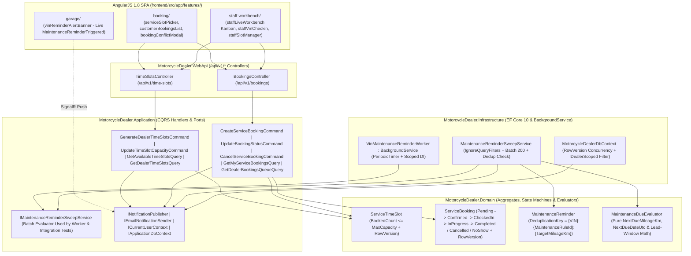
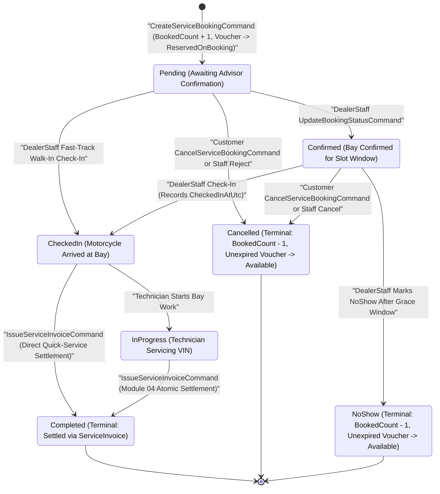
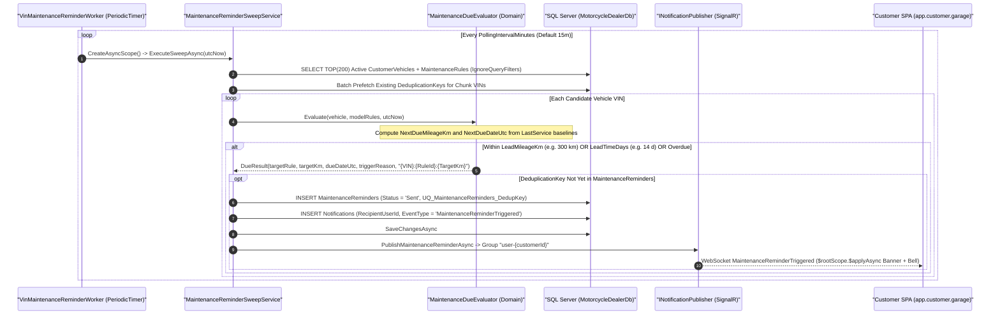

# Module 03 Blueprint — Time-Slot Service Booking, Concurrency Control & Automated VIN Reminders

| Metadata | Canonical Value |
| :--- | :--- |
| **Module ID & Title** | `MOD-03` — Time-Slot Service Booking, Concurrency Control, Automated VIN Reminders, OEM Spare-Parts Settlement & Post-Service CSAT Reviews |
| **Delivery Phase** | **Phase 4** (`T-402`, `T-404`) · **Phase 5** (`T-505`..`T-510`) · **Phase 6** (`T-605`, `T-607`) · **Phase 8 (`v1.1.0`)** (`T-801`, `T-803`, `T-805`) · **Phase 9 (`v1.2.0`)** (`T-901`, `T-902`, `T-905` `ServiceReviews`) |
| **Requirement Traceability** | `FR-04` (Service Booking & Automated VIN Reminders), `FR-06` (Instant `BookingCreated`, `MaintenanceReminderTriggered` & `ServiceReviewSubmitted` Alerts), `FR-08` (OEM Spare-Parts Catalog, Itemized Settlement & `/receipt`), `FR-09` (Post-Service 5-Star CSAT `ServiceReviews`) ([PRD.md](../PRD.md)) |
| **Architecture Decisions** | `ADR-002` (`IDealerScoped`), `ADR-003` (`IImmutableFinancialEntity` Line Items & `+25` `ServiceReviewBonus`), `ADR-004` (SignalR Group Routing), `ADR-005` (`VinMaintenanceReminderWorker` + `RowVersion` Concurrency) ([ARCHITECTURE.md](../ARCHITECTURE.md)) |
| **SQL Server 3NF Tables** | `ServiceTimeSlots` (`RowVersion`), `ServiceBookings` (`RowVersion`), `MaintenanceRules`, `MaintenanceReminders`, `SpareParts` (`ISoftDeletable`), `ServiceInvoices` & `ServiceInvoiceLineItems` *(Immutable)*, `ServiceReviews` (`IDealerScoped`, `RowVersion`), `CustomerVouchers` (`RowVersion`) ([DATABASE_DESIGN.md](../DATABASE_DESIGN.md)) |
| **REST Route Prefixes** | `/api/v1/time-slots/*` (`TimeSlotsController`) · `/api/v1/bookings/*` (`BookingsController`) · `/api/v1/spare-parts/*` (`SparePartsController`) · `/api/v1/service-invoices/*` (`ServiceInvoicesController`) · `/api/v1/service-reviews/*` (`ServiceReviewsController`) ([DESIGN.md](../DESIGN.md)) |
| **Application Code Status** | **Implemented & Verified in Production Code (`v1.1.0`)** (`541 / 541` xUnit Tests · `56 / 56` SPA Checks) |
| **Sibling Module Links** | [MOD_01 Auth & RBAC](./MOD_01_AUTH_AND_RBAC.md) · [MOD_02 Showroom & VIN Garage](./MOD_02_SHOWROOM_AND_VIN_GARAGE.md) · [MOD_04 Loyalty Tiers & Vouchers](./MOD_04_LOYALTY_TIERS_AND_VOUCHERS.md) · [MOD_05 SignalR Notifications](./MOD_05_SIGNALR_REALTIME_NOTIFICATIONS.md) · [MOD_06 Admin Analytics](./MOD_06_ADMIN_ANALYTICS_AND_REPORTING.md) |

---

## 1. Module Purpose & Operational Guarantees

Module 03 powers the **high-concurrency workshop scheduling engine** and **proactive VIN retention automation** at the heart of aftersales operations:

1. **Zero-Overbooking Capacity Locking (`BO-01`)**: Every workshop bay window (`ServiceTimeSlots`) enforces `0 <= BookedCount <= MaxCapacity` using SQL Server `ROWVERSION` optimistic concurrency tokens paired with bounded contention retries and database `CHECK` constraints (`CK_ServiceTimeSlots_Capacity`). When two riders compete for the last remaining bay at `09:00–10:00`, SQL Server guarantees **zero double-bookings** and returns an actionable `409 Conflict` (`SLOT_CAPACITY_EXHAUSTED`) to the runner-up.
2. **Atomic Voucher Reservation & Cancellation Recovery**: Customers can optionally lock an eligible `CustomerVoucher` (`Available -> ReservedOnBooking` under `CustomerVouchers.RowVersion`) when booking an appointment; cancelling the booking atomically releases both the bay (`BookedCount - 1`) and any unexpired voucher (`ReservedOnBooking -> Available`).
3. **Deduplicated Automated VIN Maintenance Reminders (`BO-03`, `ADR-005`)**: Hosted `VinMaintenanceReminderWorker` (`BackgroundService`) continuously evaluates active `CustomerVehicles` against `MaintenanceRules` mileage and calendar lead windows, enforcing a deterministic `DeduplicationKey` (`{VIN}:{MaintenanceRuleId}:{TargetMileageKm}`) via `UQ_MaintenanceReminders_DedupKey` so restarts or repeated sweeps produce **zero duplicate alerts**.

---

## 2. Clean Architecture Vertical Slice Map (`Domain` -> `WebApi` -> `SPA` -> `Tests`)



### 2.1 Planned File-by-File Implementation Inventory

| Layer | Planned File Path | Key Classes, Records & Responsibilities | WBS Task |
| :--- | :--- | :--- | :---: |
| **Domain** | `backend/src/MotorcycleDealer.Domain/Enums/BookingEnums.cs` | `BookingStatus` (`Pending`, `Confirmed`, `CheckedIn`, `InProgress`, `Completed`, `Cancelled`, `NoShow`), `ServiceType`, `ReminderTriggerReason`, `ReminderStatus` | `T-402` |
| **Domain** | `backend/src/MotorcycleDealer.Domain/Entities/Booking/ServiceTimeSlot.cs` | `IDealerScoped` bay capacity entity (`SlotDate`, `StartTime`, `EndTime`, `MaxCapacity`, `BookedCount`, `IsBlocked`, `byte[] RowVersion`, `ReserveBay()`, `ReleaseBay()`, `AdjustCapacity()`) | `T-402`, `T-505` |
| **Domain** | `backend/src/MotorcycleDealer.Domain/Entities/Booking/ServiceBooking.cs` | `IDealerScoped` appointment aggregate (`BookingNumber`, `CustomerId`, `DealerId`, `CustomerVehicleId`, `ServiceTimeSlotId`, `AppliedCustomerVoucherId`, `Status`, `byte[] RowVersion`) with strict state transition guards | `T-402`, `T-506` |
| **Domain** | `backend/src/MotorcycleDealer.Domain/Entities/Garage/MaintenanceReminder.cs` | Deduplicated reminder entity (`CustomerVehicleId`, `MaintenanceRuleId`, `TargetMileageKm`, `DueDateUtc`, `TriggerReason`, `DeduplicationKey`, `Status`, `ResolvedBookingId`) | `T-402`, `T-507` |
| **Domain** | `backend/src/MotorcycleDealer.Domain/Services/MaintenanceDueEvaluator.cs` | Pure deterministic domain evaluator computing `NextDueMileageKm`, `NextDueDateUtc`, lead-window trigger status, and canonical `DeduplicationKey` | `T-507` |
| **Application** | `backend/src/MotorcycleDealer.Application/Features/TimeSlots/*` | `GenerateDealerTimeSlotsCommand`, `UpdateTimeSlotCapacityCommand`, `GetAvailableTimeSlotsQuery`, `GetDealerTimeSlotsQuery` + `FluentValidation` | `T-505` |
| **Application** | `backend/src/MotorcycleDealer.Application/Features/Bookings/*` | `CreateServiceBookingCommand`, `UpdateBookingStatusCommand`, `CancelServiceBookingCommand`, `GetMyServiceBookingsQuery`, `GetDealerBookingsQueueQuery`, `GetServiceBookingByIdQuery` | `T-506` |
| **Application** | `backend/src/MotorcycleDealer.Application/Common/Interfaces/IMaintenanceReminderSweepService.cs` | Testable application/infrastructure service contract (`ExecuteSweepAsync(DateTimeOffset utcNow, CancellationToken ct)`) | `T-507` |
| **Infrastructure** | `backend/src/MotorcycleDealer.Infrastructure/BackgroundJobs/VinMaintenanceReminderWorker.cs` | Hosted `BackgroundService` running `PeriodicTimer`, creating scoped DI per sweep, and invoking `IMaintenanceReminderSweepService` | `T-507` |
| **Infrastructure** | `backend/src/MotorcycleDealer.Infrastructure/BackgroundJobs/ReminderWorkerOptions.cs` | Strongly-typed `IOptions<ReminderWorkerOptions>` (`PollingIntervalMinutes`, `BatchSize`, `DefaultLeadMileageKm`, `DefaultLeadTimeDays`) | `T-507` |
| **Infrastructure** | `backend/src/MotorcycleDealer.Infrastructure/Persistence/Configurations/{Booking,Garage}/*.cs` | EF Core configs for `ServiceTimeSlots`, `ServiceBookings`, `MaintenanceReminders` + indexes `IX_ServiceTimeSlots_Dealer_Date_Open`, `IX_CustomerVehicles_ReminderScan` | `T-402`, `T-404` |
| **WebApi** | `backend/src/MotorcycleDealer.WebApi/Controllers/{TimeSlotsController.cs,BookingsController.cs}` | Thin `/api/v1/time-slots` & `/api/v1/bookings` controllers with `[HasPermission]` and `bookings` rate-limiting policy | `T-505`, `T-506` |
| **AngularJS SPA** | `frontend/src/app/features/booking/*` & `features/staff-workbench/*` | Customer 3-step Slot Picker + Conflict Recovery Modal; Staff Live SignalR Kanban Workbench + Slot Capacity Grid | `T-508`, `T-509`, `T-607` |
| **Tests** | `backend/tests/MotorcycleDealer.Domain.UnitTests/Booking/*` & `Api.IntegrationTests/Booking/SlotConcurrencyAndReminderTests.cs` | State machine unit tests + parallel `Task.WhenAll` last-bay race condition test + repeated reminder worker idempotency test | `T-510` |

---

## 3. Domain State Machines (`ServiceBooking` & `CustomerVoucher` Reservation)

### 3.1 `ServiceBooking` Workshop Lifecycle (`stateDiagram-v2`)

Customer-submitted appointments enter **`Pending`** so `DealerStaff` see them immediately at the top of the Live Workbench (`app.staff.workbench`) via SignalR `BookingCreated`. Only terminal failure/abort states (`Cancelled`, `NoShow`) release `ServiceTimeSlots.BookedCount` (`BookedCount - 1`) when transitioning from an active bay-holding state; `Completed` is transitioned exclusively atomically inside `IssueServiceInvoiceCommand` ([MOD_04](./MOD_04_LOYALTY_TIERS_AND_VOUCHERS.md)) so no booking can be marked `Completed` without an audited `ServiceInvoice`!



#### Allowed Status Transition Guard Table (`ServiceBooking.TransitionTo`)
- **Customer (`CancelServiceBookingCommand`, `Permissions.Bookings.CancelOwn`)**:
  - Allowed **only** when `Status` is `Pending` or `Confirmed` (`422 INVALID_STATUS_TRANSITION` if already `CheckedIn`, `InProgress`, `Completed`, `Cancelled`, or `NoShow`).
- **DealerStaff / Admin (`UpdateBookingStatusCommand`, `Permissions.Bookings.UpdateStatus`)**:
  - `Pending -> Confirmed | CheckedIn | Cancelled`
  - `Confirmed -> CheckedIn | Cancelled | NoShow`
  - `CheckedIn -> InProgress`
  - Direct transition to `Completed` via `PATCH /api/v1/bookings/{id}/status` is **rejected** (`422 INVALID_STATUS_TRANSITION`: *"Use POST /api/v1/service-invoices to settle and complete a workshop booking."*).

---

## 4. Anti-Double-Booking Optimistic Concurrency & Voucher Locking Specification

### 4.1 Exact SQL & `RowVersion` Concurrency Mechanics (`ADR-005`)

`ServiceTimeSlots` configures `builder.Property(s => s.RowVersion).IsRowVersion();` (`ROWVERSION` / `BINARY(8)` auto-incremented by SQL Server on every row modification) alongside `CK_ServiceTimeSlots_Capacity CHECK (MaxCapacity >= 1 AND BookedCount >= 0 AND BookedCount <= MaxCapacity)`.

When `CreateServiceBookingCommandHandler` calls `slot.ReserveBay(utcNow)` (`BookedCount += 1`) and `_dbContext.SaveChangesAsync(ct)` executes inside `BeginTransactionAsync`, EF Core 10 emits parameterized optimistic concurrency SQL verifying the exact 8-byte `RowVersion` snapshot read before validation:

```sql
-- Conceptual Atomic Capacity Guard Pattern:
-- UPDATE [dbo].[ServiceTimeSlots]
-- SET [BookedCount] = [BookedCount] + 1, [UpdatedAtUtc] = @p0
-- WHERE [Id] = @p1 AND [RowVersion] = @p2 AND [BookedCount] < [MaxCapacity];

-- Exact EF Core 10 Tracked Entity Command Emitted on SaveChangesAsync:
SET IMPLICIT_TRANSACTIONS OFF;
SET NOCOUNT ON;
UPDATE [dbo].[ServiceTimeSlots]
SET [BookedCount] = @p0,
    [UpdatedAtUtc] = @p1
WHERE [Id] = @p2 AND [RowVersion] = @p3;

SELECT [RowVersion]
FROM [dbo].[ServiceTimeSlots]
WHERE @@ROWCOUNT = 1 AND [Id] = @p2;
```

- **How Race Detection Works**:
  1. Suppose `Slot S1` (`09:00–10:00`, `MaxCapacity = 4`, `BookedCount = 3`, `RowVersion = 0x00000000000007D1`) has **1 bay left**.
  2. Request A and Request B both read `BookedCount = 3` and `RowVersion = 0x00000000000007D1`.
  3. Request A commits first: SQL Server updates `BookedCount = 4`, advances `RowVersion` to `0x00000000000007D2`, and returns `@@ROWCOUNT = 1`.
  4. Request B executes `WHERE [Id] = @p2 AND [RowVersion] = 0x00000000000007D1`: SQL Server matches `0` rows (`@@ROWCOUNT = 0`), EF Core immediately throws `DbUpdateConcurrencyException`, and the transaction rolls back cleanly!

### 4.2 Bounded Retry vs. Immediate `409 Conflict` Algorithm

Because a `ServiceTimeSlot` typically holds `4` concurrent bays (`MaxCapacity = 4`), two customers booking bay #1 and bay #2 at the exact same millisecond should **not** unnecessarily fail when capacity still remains! `CreateServiceBookingCommandHandler` implements a **3-attempt bounded retry loop**:

```csharp
// Planned Target: backend/src/MotorcycleDealer.Application/Features/Bookings/Commands/CreateServiceBookingCommandHandler.cs
private static readonly int[] RetryBackoffMs = [25, 60, 120];

public async Task<ServiceBookingCreatedDto> HandleAsync(CreateServiceBookingCommand cmd, CancellationToken ct)
{
    for (var attempt = 0; attempt <= RetryBackoffMs.Length; attempt++)
    {
        await using var tx = await _dbContext.Database.BeginTransactionAsync(ct);
        try
        {
            // 1. Validate CustomerVehicle ownership & monotonic odometer
            var vehicle = await _dbContext.CustomerVehicles
                .FirstOrDefaultAsync(v => v.Id == cmd.CustomerVehicleId && !v.IsDeleted, ct)
                ?? throw new EntityNotFoundException("CustomerVehicle", cmd.CustomerVehicleId);

            if (vehicle.CustomerId != _currentUser.UserId)
                throw new ForbiddenResourceOwnerException("Cannot book service for another customer's vehicle.");

            if (cmd.OdometerAtBookingKm < vehicle.CurrentMileageKm)
                throw new BusinessRuleViolationException("ODOMETER_REGRESSION",
                    $"Declared odometer ({cmd.OdometerAtBookingKm} km) cannot be lower than recorded garage mileage ({vehicle.CurrentMileageKm} km).");

            // 2. Load fresh ServiceTimeSlot & check open capacity
            var slot = await _dbContext.ServiceTimeSlots
                .FirstOrDefaultAsync(s => s.Id == cmd.ServiceTimeSlotId && s.DealerId == cmd.DealerId, ct)
                ?? throw new EntityNotFoundException("ServiceTimeSlot", cmd.ServiceTimeSlotId);

            if (slot.IsBlocked || slot.BookedCount >= slot.MaxCapacity)
                throw new ConflictException("SLOT_CAPACITY_EXHAUSTED",
                    $"Selected slot {slot.StartTime:HH\\:mm}-{slot.EndTime:HH\\:mm} on {slot.SlotDate:yyyy-MM-dd} is now full ({slot.BookedCount}/{slot.MaxCapacity} bays booked).");

            if (attempt == 0 && cmd.SlotRowVersion is not null)
                _dbContext.Entry(slot).Property(s => s.RowVersion).OriginalValue = cmd.SlotRowVersion;

            // 3. Guard duplicate active booking for same VIN on same slot/window
            var hasDuplicateBooking = await _dbContext.ServiceBookings.AnyAsync(b =>
                b.CustomerVehicleId == vehicle.Id &&
                b.ServiceTimeSlotId == slot.Id &&
                b.Status != BookingStatus.Cancelled &&
                b.Status != BookingStatus.NoShow, ct);
            if (hasDuplicateBooking)
                throw new ConflictException("DUPLICATE_VEHICLE_BOOKING", "This motorcycle already holds an active booking in the selected time slot.");

            // 4. Atomic Optional CustomerVoucher Reservation (Available -> ReservedOnBooking)
            CustomerVoucher? voucher = null;
            if (cmd.AppliedCustomerVoucherId.HasValue)
            {
                voucher = await ReserveEligibleCustomerVoucherAsync(cmd.AppliedCustomerVoucherId.Value, cmd.VoucherRowVersion, utcNow, ct);
            }

            // 5. Reserve Bay, Insert Pending Booking, Link Open Reminder & Stage Dealer Notification
            slot.ReserveBay(utcNow); // BookedCount += 1
            var booking = ServiceBooking.CreatePending(
                customerId: _currentUser.UserId,
                dealerId: cmd.DealerId,
                customerVehicleId: vehicle.Id,
                serviceTimeSlotId: slot.Id,
                appliedCustomerVoucherId: voucher?.Id,
                serviceType: cmd.ServiceType,
                odometerAtBookingKm: cmd.OdometerAtBookingKm,
                reportedNotes: cmd.ReportedNotes,
                utcNow: utcNow);

            if (cmd.OdometerAtBookingKm > vehicle.CurrentMileageKm)
                vehicle.UpdateOdometer(cmd.OdometerAtBookingKm, utcNow);

            await LinkOpenMaintenanceRemindersAsync(vehicle.Id, booking.Id, utcNow, ct);
            var notification = Notification.CreateDealerBookingAlert(booking, vehicle, slot, utcNow);

            _dbContext.ServiceBookings.Add(booking);
            _dbContext.Notifications.Add(notification);

            await _dbContext.SaveChangesAsync(ct);
            await tx.CommitAsync(ct);

            // 6. Post-Commit Only: Push Real-Time SignalR Event to dealer-{dealerId} & role-Admin
            await _notificationPublisher.PublishBookingCreatedAsync(booking, vehicle, slot, notification.Id, ct);
            return MapToCreatedDto(booking, slot, vehicle, voucher);
        }
        catch (DbUpdateConcurrencyException) when (attempt < RetryBackoffMs.Length)
        {
            await tx.RollbackAsync(ct);
            _dbContext.ChangeTracker.Clear();
            // Retry ONLY if slot contention occurred while bays might still remain;
            // if voucher RowVersion conflicted, re-evaluation on next attempt catches Status != Available!
            await Task.Delay(RetryBackoffMs[attempt] + Random.Shared.Next(0, 15), ct);
        }
        catch (DbUpdateConcurrencyException)
        {
            await tx.RollbackAsync(ct);
            throw new ConflictException("CONCURRENCY_CONFLICT",
                "High concurrent booking activity detected on this time slot or voucher. Please refresh available slots and try again.");
        }
    }

    throw new ConflictException("SLOT_CAPACITY_EXHAUSTED", "Unable to acquire service bay lock.");
}
```

### 4.3 Atomic `CustomerVouchers` Reservation & Release Rules

| Booking Event | Precondition on `CustomerVouchers` | State Transition (`CustomerVouchers.Status`) | Concurrency & Integrity Guards |
| :--- | :--- | :--- | :--- |
| **`CreateServiceBookingCommand`** (`POST /api/v1/bookings` with `appliedCustomerVoucherId`) | Owned by caller (`LoyaltyAccount.CustomerId == CurrentUser.UserId`), `VoucherCatalog.ApplicableScope IN ('ServiceOnly', 'All')`, `Status == 'Available'`, `ExpiresAtUtc > UtcNow` | `'Available'` -> **`'ReservedOnBooking'`** (`UpdatedAtUtc = UtcNow`) | `CustomerVouchers.RowVersion` + SQL filtered unique index `UQ_ServiceBookings_ActiveVoucher` (`WHERE AppliedCustomerVoucherId IS NOT NULL AND Status NOT IN ('Cancelled', 'NoShow')`) |
| **`CancelServiceBookingCommand`** (`POST /api/v1/bookings/{id}/cancel`) or Staff marks **`Cancelled` / `NoShow`** | Booking carries `AppliedCustomerVoucherId` currently in `'ReservedOnBooking'` | If `ExpiresAtUtc > UtcNow`: **`'ReservedOnBooking'` -> `'Available'`**<br>If `ExpiresAtUtc <= UtcNow`: **`'ReservedOnBooking'` -> `'Expired'`** | Executed inside the **exact same SQL transaction** that sets `ServiceBookings.Status = 'Cancelled'`/`'NoShow'` and decrements `ServiceTimeSlots.BookedCount -= 1` |
| **`IssueServiceInvoiceCommand`** ([MOD_04](./MOD_04_LOYALTY_TIERS_AND_VOUCHERS.md)) | Booking in `'CheckedIn'` / `'InProgress'` with `'ReservedOnBooking'` voucher and `GrossAmount >= MinOrderAmount` | `'ReservedOnBooking'` -> **`'Used'`** (`UsedAtUtc = UtcNow`) | Atomic with `ServiceInvoices` insert and `ServiceBookings -> 'Completed'` |

---

## 5. Automated `VinMaintenanceReminderWorker` Specification (`ADR-005`)

### 5.1 Configuration, Polling Cadence & Batching (`ReminderWorkerOptions`)

`VinMaintenanceReminderWorker` runs in-process inside `MotorcycleDealer.Infrastructure/BackgroundJobs/` as a `Microsoft.Extensions.Hosting.BackgroundService` driven by `System.Threading.PeriodicTimer`:

```json
// appsettings.json section: "MaintenanceReminderWorker"
{
  "MaintenanceReminderWorker": {
    "Enabled": true,
    "PollingIntervalMinutes": 15,
    "InitialDelaySeconds": 10,
    "BatchSize": 200,
    "DefaultLeadMileageKm": 300,
    "DefaultLeadTimeDays": 14
  }
}
```

- **Scoped Lifecycle & Query Filter Bypass**: Because `BackgroundService` is a singleton with no HTTP `ClaimsPrincipal`, each `PeriodicTimer.WaitForNextTickAsync(stoppingToken)` iteration creates an `await using var scope = _serviceScopeFactory.CreateAsyncScope()`, resolves `IMaintenanceReminderSweepService`, and queries `CustomerVehicles.IgnoreQueryFilters().Where(v => v.IsActive && !v.IsDeleted)` ordered by `(v.NextDueDateUtc, v.Id)` in keyset/offset batches of **`200` vehicles** backed by covering index `IX_CustomerVehicles_ReminderScan`.
- **Rule-Specific vs. Worker-Default Lead Windows**: Each `MaintenanceRule` row stores `LeadMileageKm` (seeded at `200–300 km`, default `250 km` in `DATABASE_DESIGN.md`) and `LeadTimeDays` (seeded at `7–14 days`, default `7 days`); `MaintenanceDueEvaluator` uses `rule.LeadMileageKm > 0 ? rule.LeadMileageKm : options.DefaultLeadMileageKm` (e.g., `300 km`) and `rule.LeadTimeDays > 0 ? rule.LeadTimeDays : options.DefaultLeadTimeDays` (e.g., `14 days`), supporting per-milestone customization (such as a `200 km / 7-day` window on `1,000 km` break-in checks and a `300 km / 14-day` window on `4,000 km` / `12,000 km` major overhauls).

### 5.2 Deterministic Milestone Calculation & `DeduplicationKey` Formula

For every active `CustomerVehicle` (`VIN`, `CurrentMileageKm`, `LastServiceMileageKm`, `LastServiceDateUtc`, `OwnershipStartDateUtc`) and its model's active `MaintenanceRules` (`ORDER BY IntervalKm ASC`):

1. **Baseline Anchors**:
   - `baselineMileageKm = vehicle.LastServiceMileageKm` (`0` prior to first completed `ServiceInvoice`).
   - `baselineDateUtc = vehicle.LastServiceDateUtc ?? vehicle.OwnershipStartDateUtc`.
2. **Selecting the Next Actionable Rule & Computing Targets**:
   - **One-Time Progressive Rule (`IsRecurring == false`, e.g., `1,000 km` Break-In)**: Candidate when `baselineMileageKm < rule.IntervalKm`:
     - `NextDueMileageKm = rule.IntervalKm` (equivalent to `0 + IntervalKm`).
     - `NextDueDateUtc = baselineDateUtc.AddMonths(rule.IntervalMonths)`.
   - **Recurring Interval Rule (`IsRecurring == true`, e.g., every `4,000 km` / `6 months`)**:
     - `NextDueMileageKm = baselineMileageKm + rule.IntervalKm` *(or if the rider updated `CurrentMileageKm` across multiple skipped intervals without dealer invoices, `Math.Max(baselineMileageKm + rule.IntervalKm, ((baselineMileageKm / rule.IntervalKm) + 1) * rule.IntervalKm)`).*
     - `NextDueDateUtc = baselineDateUtc.AddMonths(rule.IntervalMonths)`.
   - Among all candidate rules for the model, select the rule yielding the **earliest `NextDueMileageKm`** (`targetRule`, `targetMileageKm = NextDueMileageKm`, `dueDateUtc = NextDueDateUtc`) and synchronize `vehicle.NextDueMileageKm` / `vehicle.NextDueDateUtc` if stale.
3. **Lead-Window & Overdue Trigger Classification (`TriggerReason`)**:
   - Let `effectiveLeadKm = targetRule.LeadMileageKm` (e.g., `250` or `300 km`) and `effectiveLeadDays = targetRule.LeadTimeDays` (e.g., `7` or `14 days`):
   - **Overdue**: `vehicle.CurrentMileageKm >= targetMileageKm || utcNow >= dueDateUtc` -> `TriggerReason = "Overdue"`.
   - **Mileage Lead Threshold**: `vehicle.CurrentMileageKm >= (targetMileageKm - effectiveLeadKm)` -> `TriggerReason = "MileageThreshold"`.
   - **Calendar Lead Threshold**: `utcNow >= dueDateUtc.AddDays(-effectiveLeadDays)` -> `TriggerReason = "DateThreshold"`.
   - Otherwise: **Not Yet Due** (skip vehicle).
4. **Canonical Deterministic `DeduplicationKey`**:
   ```csharp
   string deduplicationKey = $"{vehicle.VIN}:{targetRule.Id}:{targetMileageKm}";
   // Example: "RLHJF5109RZ104829:33333333-3333-3333-3333-333333333302:4000"
   ```
5. **Idempotent Persistence & Post-Commit Fan-Out**:
   - Batch-prefetch existing `DeduplicationKey` values from `dbo.MaintenanceReminders` for the current 200-vehicle chunk. If `deduplicationKey` already exists, **skip immediately**.
   - Otherwise, inside a per-reminder unit-of-work guarded by SQL unique constraint `UQ_MaintenanceReminders_DedupKey`:
     1. Insert `MaintenanceReminders` (`CustomerVehicleId = vehicle.Id`, `MaintenanceRuleId = targetRule.Id`, `TargetMileageKm = targetMileageKm`, `DueDateUtc = dueDateUtc`, `TriggerReason`, `DeduplicationKey`, `Status = "Sent"`, `SentAtUtc = utcNow`).
     2. Insert `Notifications` (`RecipientUserId = vehicle.CustomerId`, `EventType = "MaintenanceReminderTriggered"`, `Title`, `Message`, `PayloadJson`).
     3. Commit `SaveChangesAsync(ct)` (if a race hits SQL error `2601`/`2627` on `UQ_MaintenanceReminders_DedupKey`, swallow idempotently and skip dispatch).
     4. Fan-out SignalR `INotificationClient.MaintenanceReminderTriggered` to group `user-{vehicle.CustomerId}` ([MOD_05](./MOD_05_SIGNALR_REALTIME_NOTIFICATIONS.md)) and write structured email outbox entry via `IEmailNotificationSender`.



---

## 6. REST API v1 Contracts (`TimeSlotsController` & `BookingsController`)

| Controller | Method & Route | Permission Policy | Request / Query Contract | Key Validation & Concurrency Behavior |
| :--- | :--- | :--- | :--- | :--- |
| `TimeSlotsController` | `GET /api/v1/time-slots` | `Permissions.TimeSlots.ViewAvailable` | `?dealerId={guid}&fromDate=2026-05-16&toDate=2026-05-23` | Uses `IX_ServiceTimeSlots_Dealer_Date_Open`; returns `availableBays = MaxCapacity - BookedCount` and Base64 `rowVersion` |
| `TimeSlotsController` | `GET /api/v1/time-slots/dealer` | `Permissions.TimeSlots.ManageDealer` | `?fromDate=&toDate=&dealerId=` | `IDealerScoped` full workshop slot grid including blocked and `4/4` full slots |
| `TimeSlotsController` | `POST /api/v1/time-slots/dealer/generate` | `Permissions.TimeSlots.ManageDealer` | `GenerateDealerTimeSlotsRequest(fromDate, toDate, slotDurationMinutes, maxCapacity)` | Idempotently generates non-overlapping windows within `Dealers.OpeningTime..ClosingTime` (`UQ_ServiceTimeSlots_Dealer_Window` skips existing slots) |
| `TimeSlotsController` | `PATCH /api/v1/time-slots/{slotId}` | `Permissions.TimeSlots.ManageDealer` | `UpdateTimeSlotRequest(maxCapacity, isBlocked, rowVersion)` | Rejects `maxCapacity < slot.BookedCount` (`422 CAPACITY_BELOW_BOOKED_COUNT`); verifies `RowVersion` (`409 CONCURRENCY_CONFLICT`) |
| `BookingsController` | `POST /api/v1/bookings` | `Permissions.Bookings.Create` | `CreateServiceBookingRequest(dealerId, serviceTimeSlotId, slotRowVersion, customerVehicleId, appliedCustomerVoucherId, voucherRowVersion, serviceType, odometerAtBookingKm, reportedNotes)` | `RowVersion` slot lock + optional `CustomerVoucher` lock (`ReservedOnBooking`) + post-commit SignalR `BookingCreated` push |
| `BookingsController` | `GET /api/v1/bookings/my` | `Permissions.Bookings.ViewOwn` | `?status=&pageNumber=1&pageSize=20` | Customer's own appointments via `IX_ServiceBookings_Customer_CreatedDesc` |
| `BookingsController` | `POST /api/v1/bookings/{bookingId}/cancel` | `Permissions.Bookings.CancelOwn` | `CancelBookingRequest(cancellationReason, rowVersion)` | Allowed on `Pending`/`Confirmed`; decrements `BookedCount` and restores unexpired voucher to `Available` |
| `BookingsController` | `GET /api/v1/bookings/dealer` | `Permissions.Bookings.ViewDealer` | `?slotDate=2026-05-16&status=` | `IDealerScoped` workbench queue via `IX_ServiceBookings_Dealer_Status_Created` |
| `BookingsController` | `GET /api/v1/bookings/{bookingId}` | `ViewOwn` *or* `ViewDealer` | — | Full booking detail with `vin`, `motorcycleModelId` (for OEM `SpareParts` filtering), slot window, customer contact, and reserved voucher summary |
| `BookingsController` | `PATCH /api/v1/bookings/{bookingId}/status` | `Permissions.Bookings.UpdateStatus` | `UpdateBookingStatusRequest(newStatus, cancellationReason, rowVersion)` | `IDealerScoped` state machine transition + post-commit SignalR `BookingStatusChanged` to `user-{customerId}` and `dealer-{dealerId}` |
| `SparePartsController` | `GET /api/v1/spare-parts` & `GET /api/v1/spare-parts/{partId}` | `[AllowAnonymous]` *(Dual-Mode)* | `?compatibleModelId=&category=&search=&includeInactive=` | (`v1.1.0`) Returns active universal-fit (`CompatibleModelId == NULL`) + model-matched OEM SKUs; `?includeInactive=true` restricted to `Permissions.SpareParts.ManageCatalog` (`Admin`) |
| `SparePartsController` | `POST /api/v1/spare-parts` & `PUT /api/v1/spare-parts/{partId}` | `Permissions.SpareParts.ManageCatalog` | `CreateOrUpdateSparePartRequest(partCode, name, category, compatibleModelId, unitLabel, unitPriceVnd, isActive)` | (`v1.1.0` `Admin` `SCR-ADM-07`) Enforces `UQ_SpareParts_PartCode` (`409 DUPLICATE_PART_CODE`); historical `ServiceInvoiceLineItems` snapshots remain immutable |
| `ServiceInvoicesController` | `POST /api/v1/service-invoices` & `GET /api/v1/service-invoices/{invoiceId}/receipt` | `Invoices.CreateDealer` / `ViewOwn` *or* `ViewDealer` | Optional `lineItems[]` (`Part` / `Labor`) + `/receipt` | (`v1.1.0`) Validates `SpareParts` model compatibility (`422 SPARE_PART_INCOMPATIBLE`) & active state (`422 SPARE_PART_INACTIVE`), persists immutable `ServiceInvoiceLineItems` (`SUM(LineTotalVnd) == GrossAmount`), and issues SHA-256 `PrintableServiceReceiptDto` (`RCP-SVC-*`) |
| `ServiceReviewsController` | `POST /api/v1/service-reviews`, `GET /my`, `GET /`, `PATCH /{reviewId}/response` | `Reviews.CreateOwn` / `ViewOwn` / `ViewDealer` / `RespondDealer` | 1:1 `ServiceReviews` on settled `ServiceInvoice` (`UQ_ServiceReviews_ServiceInvoiceId`) | (`v1.2.0`) Credits `+25` `AvailablePoints` (`SERVICE_REVIEW:{InvoiceId}:BONUS`, `409 REVIEW_ALREADY_SUBMITTED`), pushes `ServiceReviewSubmitted`, and guards branch `StaffResponse` with `RowVersion` |

---

## 7. AngularJS 1.8 SPA Slice & `RFC 7807` Error Handling

### 7.1 Customer Guided Slot Picker & Conflict Recovery (`app.customer.bookService`)
- **`serviceSlotPicker` Component**:
  - **Step 1**: Selects owned `CustomerVehicle` (`VIN`) and pre-fills `odometerAtBookingKm = vehicle.currentMileageKm`.
  - **Step 2**: Selects `Dealer` and date; fetches `GET /api/v1/time-slots`, rendering `timeSlotCapacityGrid` (`track by slot.id`), disabling slots where `slot.availableBays === 0`, and storing `selectedSlot.rowVersion`.
  - **Step 3**: Selects `ServiceType`, optional eligible `CustomerVoucher` (`GET /api/v1/vouchers/my?status=Available`, storing `voucher.rowVersion`), and technician notes.
  - **Graceful `409 SLOT_CAPACITY_EXHAUSTED` UX**: If `POST /api/v1/bookings` returns `409 Conflict`, `bookingConflictModal` alerts the customer that the last bay in that window was just booked, automatically re-fetches `GET /api/v1/time-slots` so updated capacities render in place without losing the customer's selected `VIN`, voucher, or notes.

### 7.2 Dealer Staff Live Workbench (`app.staff.workbench` & `app.staff.slots`)
- **`staffLiveWorkbench` Component**: Subscribes to `SignalRClientService` (`BookingCreated`, `BookingStatusChanged`) inside `$onInit` (cleaning up listeners inside `$onDestroy`). Incoming `BookingCreated` payloads mutate `LiveBookingQueueStore` inside `$rootScope.$applyAsync()`, prepending a highlighted `[NEW]` card into the `Pending` column and triggering an audible/visual toast **with zero browser page reload**.

### 7.3 Module 03 Error Code Matrix (`RFC 7807 ProblemDetails`)

| HTTP Status | Canonical `errorCode` | Trigger Scenario |
| :---: | :--- | :--- |
| `400 Bad Request` | `VALIDATION_FAILED` | Past `slotDate`, invalid `ServiceType`, `endTime <= startTime`, or missing required GUIDs |
| `403 Forbidden` | `FORBIDDEN_RESOURCE_OWNER` · `FORBIDDEN_DEALER_SCOPE` | Customer attempts to book/cancel another user's `VIN`/booking, or `DealerStaff` targets another branch |
| `404 Not Found` | `RESOURCE_NOT_FOUND` | Unknown `bookingId`/`slotId`, or cross-dealer booking hidden from `DealerStaff` by `IDealerScoped` filter |
| `409 Conflict` | `SLOT_CAPACITY_EXHAUSTED` · `CONCURRENCY_CONFLICT` · `DUPLICATE_VEHICLE_BOOKING` · `VOUCHER_ALREADY_RESERVED` | Last bay taken during race, `RowVersion` mismatch after retries, duplicate active VIN booking in slot, or concurrent voucher lock |
| `422 Unprocessable Entity` | `INVALID_STATUS_TRANSITION` · `CAPACITY_BELOW_BOOKED_COUNT` · `ODOMETER_REGRESSION` · `VOUCHER_INELIGIBLE` | Illegal booking status jump, shrinking `MaxCapacity` below `BookedCount`, odometer rollback, or expired/showroom-only voucher attached |

---

## 8. Automated Verification & Test Blueprint (`Phase 5 Exit Gate T-510`)

1. **`MotorcycleDealer.Domain.UnitTests/Booking/`**:
   - `ServiceTimeSlotTests`: verifies `ReserveBay` throws when `IsBlocked` or `BookedCount == MaxCapacity`, `ReleaseBay` never drops below `0`, and `AdjustCapacity` rejects `newMaxCapacity < BookedCount`.
   - `ServiceBookingStateMachineTests`: exhaustive `[Theory]` matrix across all `7 x 7` `(fromStatus, toStatus)` pairs verifying valid transitions, terminal immutability, and prohibition of direct `PATCH` to `Completed`.
   - `MaintenanceDueEvaluatorTests`: verifies `NextDueMileageKm` and `NextDueDateUtc` math across `1,000 km` one-time break-in and `4,000 km / 6-month` recurring rules, boundary checks at exact `targetKm - LeadMileageKm` and `dueDateUtc - LeadTimeDays`, and exact `"{VIN}:{RuleId}:{TargetKm}"` `DeduplicationKey` formatting.
2. **`MotorcycleDealer.Api.IntegrationTests/Booking/SlotConcurrencyAndReminderTests.cs`**:
   - **Last-Bay Parallel Race Proof (`BO-01`)**: Seeds a `ServiceTimeSlot` with `MaxCapacity = 4` and `BookedCount = 3` (`1` bay remaining), then dispatches **10 simultaneous `POST /api/v1/bookings` HTTP requests** (`Task.WhenAll`) from 10 distinct `Customer` accounts -> asserts **exactly `1` `201 Created` and `9` `409 Conflict` (`application/problem+json`)**, and verifies in SQL Server that `BookedCount == 4` and `COUNT(ServiceBookings) == 4` (`0` overbookings).
   - **Voucher Lock & Cancellation Release Proof (`AC-04.3`)**: Books a slot with an `Available` `CustomerVoucher` -> asserts `Status == "ReservedOnBooking"` -> cancels booking -> asserts `BookedCount` decremented by `1` and `CustomerVoucher.Status == "Available"`.
   - **Idempotent `VinMaintenanceReminderWorker` Proof (`BO-03`, `AC-04.2`)**: Positions a `CustomerVehicle` inside the `LeadMileageKm` window and invokes `IMaintenanceReminderSweepService.ExecuteSweepAsync` **3 consecutive times** -> asserts **exactly `1` row** in `dbo.MaintenanceReminders` and **exactly `1` row** in `dbo.Notifications` for that `DeduplicationKey`.
