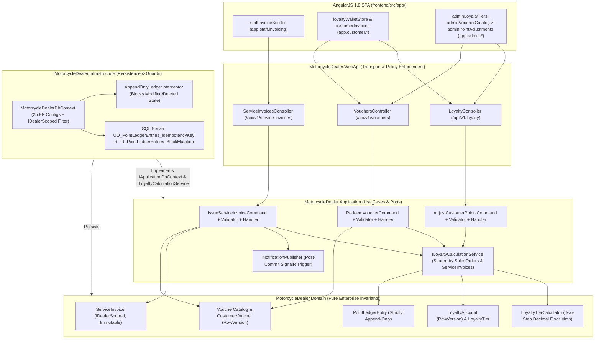
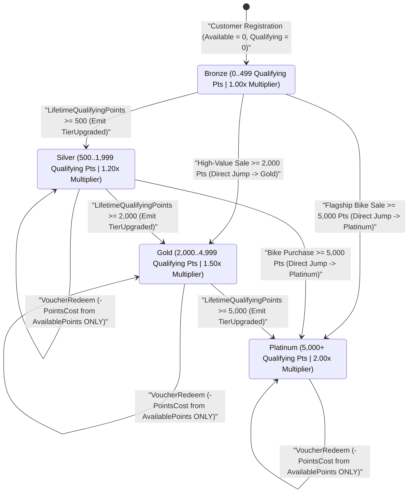
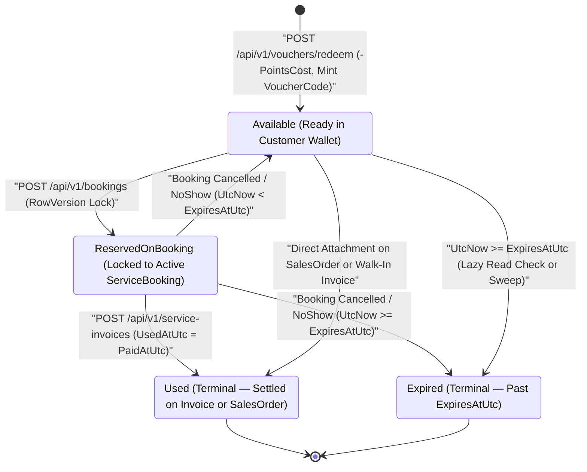

# Module 04 Blueprint — Workshop Invoicing, Immutable Loyalty Ledger, Membership Tiers & Vouchers

| Metadata | Specification |
| :--- | :--- |
| **Module ID** | `MOD-04` |
| **Module Name** | Workshop Invoicing, Immutable Loyalty Ledger, Membership Tiers & Vouchers |
| **Primary Delivery Phase** | **Phase 6** (`T-601`..`T-603`, `T-607`..`T-609`) · Entities in **Phase 4** (`T-402`, `T-403`) · Admin Studio in **Phase 7** (`T-703`) · Itemized `SpareParts` & Printable `/receipt` in **Phase 8 (`v1.1.0`)** (`T-801`, `T-803`, `T-805`) · `+25` `ServiceReviewBonus` in **Phase 9 (`v1.2.0`)** (`T-901`, `T-902`) |
| **Requirements Covered** | `FR-05` (Primary), `FR-03` (Completion Odometer Sync), `FR-04` (Booking Settlement & Reminder Resolution), `FR-06` (Real-Time Point & Tier Push), `FR-07` (Workshop Service Revenue Source), `FR-08` (Itemized `ServiceInvoiceLineItems` & Printable Receipts), `FR-09` (`+25` `ServiceReviewBonus` Spendable Engagement Credit) |
| **Governing ADRs & Risks** | `ADR-001`, `ADR-002`, `ADR-003`, `ADR-005`, `ADR-006` · Mitigates `RISK-03` (Ledger / Line-Item Drift, Double Accrual, Over-Redemption) & `RISK-05` (Cross-Dealer IDOR) |
| **Owned SQL Server Tables** | `ServiceInvoices`, `ServiceInvoiceLineItems`, `ServiceReviews`, `SpareParts`, `LoyaltyTiers`, `LoyaltyAccounts`, `PointLedgerEntries`, `VoucherCatalogs`, `CustomerVouchers` (`9` of `27` `MotorcycleDealerDb` 3NF Tables) |
| **Application Code Status** | **Implemented & Verified in Production Code (`v1.1.0`)** (`541 / 541` xUnit Tests · `56 / 56` SPA Checks) |

### Related Canonical Documents
- **Core Specifications**: [REQUIREMENTS.md](../../REQUIREMENTS.md) · [AGENTS.md](../../AGENTS.md) · [PRD.md](../PRD.md) · [ARCHITECTURE.md](../ARCHITECTURE.md) · [DATABASE_DESIGN.md](../DATABASE_DESIGN.md) · [DESIGN.md](../DESIGN.md)
- **API, QA & WBS**: [openapi.v1.yaml](../openapi.v1.yaml) · [TEST_PLAN.md](../TEST_PLAN.md) · [TASKS.md](../../TASKS.md) · [PROGRESS.md](../../PROGRESS.md)
- **Peer Modules & UI Specs**: [MOD_02 (Showroom & VIN Garage)](./MOD_02_SHOWROOM_AND_VIN_GARAGE.md) · [MOD_03 (Service Booking & Reminders)](./MOD_03_SERVICE_BOOKING_AND_REMINDERS.md) · [MOD_05 (SignalR Real-Time)](./MOD_05_SIGNALR_REALTIME_NOTIFICATIONS.md) · [MOD_06 (Admin Analytics)](./MOD_06_ADMIN_ANALYTICS_AND_REPORTING.md) · [Customer Screens](../screens/CUSTOMER_PORTAL_SCREENS.md) · [Staff & Admin Screens](../screens/STAFF_AND_ADMIN_SCREENS.md)
- **Execution Skill**: [loyalty-booking-domain](../../.agents/skills/loyalty-booking-domain/SKILL.md)

---

## 1. Module Scope, Bounded Context & RBAC Governance

Module 04 closes the commercial aftersales loop of the **Motorcycle Dealer & Loyalty Management Platform**. Whenever a showroom purchase (`SalesOrders` in `MOD-02`) or a workshop maintenance appointment (`ServiceBookings` -> `ServiceInvoices`) settles in Vietnamese Dong (`VND`), this module deterministically applies eligible `CustomerVouchers`, calculates net-spending loyalty points via the canonical **two-step floor formula**, appends an immutable financial audit record to `PointLedgerEntries`, evaluates automatic membership tier promotions across `Bronze`, `Silver`, `Gold`, and `Platinum`, rolls forward the motorcycle's garage odometer (`CustomerVehicles`), and powers the customer-facing voucher reward store.

> [!IMPORTANT]
> **Immutable Financial & Ledger Invariant (`ADR-003`)**: `ServiceInvoices` and `PointLedgerEntries` are permanent financial records. Neither table defines `IsDeleted`, and **physical `UPDATE` or `DELETE` statements against `PointLedgerEntries` are strictly prohibited** across all application layers, EF Core interceptors, and SQL Server triggers. Balance reversals or goodwill credits MUST append a new compensating `PointLedgerEntries` row carrying a signed `PointsDelta` and unique `IdempotencyKey`.

### 1.1 Owned SQL Server 3NF Tables & Concurrency Profile

| Table Name | Tenancy (`IDealerScoped`) | Concurrency (`RowVersion`) | Deletion / Mutation Policy | Primary Indexes (`DATABASE_DESIGN.md` §5) |
| :--- | :---: | :---: | :--- | :--- |
| `dbo.ServiceInvoices` | **Yes** (`DealerId NOT NULL`) | No (1:1 `UQ_ServiceInvoices_BookingId`) | **Immutable** (`IImmutableFinancialEntity`) | `IX_ServiceInvoices_Customer_PaidDesc`, `IX_ServiceInvoices_Analytics_Covering` |
| `dbo.ServiceInvoiceLineItems` | Via Parent `ServiceInvoice` | No (`UQ_ServiceInvoiceLineItems_Invoice_Line`) | **Immutable** (`IImmutableFinancialEntity`) | `UQ_ServiceInvoiceLineItems_Invoice_Line` (`Part` & `Labor` snapshots) |
| `dbo.SpareParts` | No (Platform-wide) | No | Soft Delete (`IsDeleted`) + `IsActive` | `UQ_SpareParts_PartCode`, `IX_SpareParts_Model_Category_Active` |
| `dbo.LoyaltyTiers` | No (Platform-wide) | No | `IsActive` flag (4 canonical system rows) | `UQ_LoyaltyTiers_TierCode`, `UQ_LoyaltyTiers_RankOrder`, `UQ_LoyaltyTiers_MinPoints` |
| `dbo.LoyaltyAccounts` | No (1:1 `CustomerId`) | **Yes** (`ROWVERSION`) | Permanent Customer Wallet | `UQ_LoyaltyAccounts_CustomerId`, `IX_LoyaltyAccounts_Tier_Distribution` |
| `dbo.PointLedgerEntries` | No (`LoyaltyAccountId`) | No | **Strictly Append-Only** (`INSERT` only) | `UQ_PointLedgerEntries_IdempotencyKey`, `IX_PointLedgerEntries_Account_CreatedDesc` |
| `dbo.VoucherCatalogs` | No (Platform-wide) | No | Soft Delete (`IsDeleted`) + `IsActive` | `UQ_VoucherCatalogs_CodePrefix` |
| `dbo.CustomerVouchers` | No (`LoyaltyAccountId`) | **Yes** (`ROWVERSION`) | Status State Machine (`Available`..`Expired`) | `UQ_CustomerVouchers_VoucherCode`, `IX_CustomerVouchers_Account_Usable` |

### 1.2 Granular RBAC & Tenant Isolation Matrix (`FR-01`, `ADR-002`)

| Permission Constant | `Customer` | `DealerStaff` | `Admin` | Endpoint & Data-Scope Enforcement |
| :--- | :---: | :---: | :---: | :--- |
| `Permissions.Invoices.CreateDealer` | — | Yes | Yes | `POST /api/v1/service-invoices` — `DealerStaff` strictly restricted to bookings where `ServiceBookings.DealerId == CurrentUser.DealerId`. |
| `Permissions.Invoices.ViewOwn` | Yes | — | — | `GET /api/v1/service-invoices/my`, `GET /api/v1/service-invoices/{invoiceId}` — Predicated by `CustomerId == CurrentUser.UserId`. |
| `Permissions.Invoices.ViewDealer` | — | Yes | Yes | `GET /api/v1/service-invoices`, `GET /api/v1/service-invoices/{invoiceId}` — Filtered by `IDealerScoped` (`DealerId`) for `DealerStaff`; cross-dealer for `Admin`. |
| `Permissions.Loyalty.ViewOwn` | Yes | — | — | `GET /api/v1/loyalty/account`, `GET /api/v1/loyalty/ledger`, `GET /api/v1/vouchers/my` — Bound strictly to JWT `sub` (`CustomerId`). |
| `Permissions.Loyalty.RedeemVoucher` | Yes | — | — | `POST /api/v1/vouchers/redeem` — Granted exclusively to `Customer` (Separation of Duties invariant). |
| `Permissions.Loyalty.ViewDealerCustomer` | — | Yes | Yes | `GET /api/v1/loyalty/customers/{customerId}` — Checkout lookup of customer tier badge, multiplier, and usable `CustomerVouchers`. |
| `Permissions.Loyalty.ManageTiers` | — | — | Yes | `PUT /api/v1/loyalty/tiers/{tierId}` — Update display perks (`BenefitsJson`) without altering canonical 4-tier thresholds/codes. |
| `Permissions.Loyalty.ManageVoucherCatalog` | — | — | Yes | `POST /api/v1/vouchers/catalog`, `PUT /api/v1/vouchers/catalog/{catalogId}` — Govern reward costs, discount caps, quotas, and `MinTierId`. |
| `Permissions.Loyalty.AdjustPoints` | — | — | Yes | `POST /api/v1/loyalty/accounts/{accountId}/adjustments` — Audited manual goodwill or dispute point entry with mandatory `Notes`. |

---

## 2. Clean Architecture Vertical Slice Map



### 2.1 Layer-by-Layer Component Inventory

#### A. `MotorcycleDealer.Domain` (`backend/src/MotorcycleDealer.Domain/`)
Zero NuGet or framework dependencies (`ADR-001`). All currency fields use `decimal` (`DECIMAL(18,2)`), and all timestamps use `DateTimeOffset` in UTC.

| Target Path | Artifact | Core Domain Invariants Enforced |
| :--- | :--- | :--- |
| `Enums/PointTransactionType.cs` | `PointTransactionType` | Exact 6 values matching `CK_PointLedgerEntries_TxType`: `SalesOrderEarn`, `ServiceInvoiceEarn`, `VoucherRedeem`, `VoucherExpireRefund`, `AdminAdjustment`, `WelcomeBonus`. |
| `Enums/PointReferenceType.cs` | `PointReferenceType` | Exact 5 values matching `CK_PointLedgerEntries_RefType`: `SalesOrder`, `ServiceInvoice`, `CustomerVoucher`, `AdminManual`, `AccountOnboarding`. |
| `Enums/VoucherStatus.cs` | `VoucherStatus` | Exact 4 states matching `CK_CustomerVouchers_Status`: `Available`, `ReservedOnBooking`, `Used`, `Expired`. |
| `Enums/VoucherDiscountType.cs` | `VoucherDiscountType` | `FixedAmount`, `Percentage` (paired with `ApplicableScope`: `ServiceOnly`, `ShowroomOnly`, `All`). |
| `Entities/Booking/ServiceInvoice.cs` | `ServiceInvoice : BaseEntity, IDealerScoped` | Private setters; factory `ServiceInvoice.Create(...)` enforces `LaborAmount >= 0`, `PartsAmount >= 0`, `GrossAmount == LaborAmount + PartsAmount`, `0 <= VoucherDiscountAmount <= GrossAmount`, `NetPaidAmount == GrossAmount - VoucherDiscountAmount`, `OdometerAtCompletionKm >= 0`. |
| `Entities/Loyalty/LoyaltyTier.cs` | `LoyaltyTier : BaseEntity` | Canonical `TierCode` (`Bronze`, `Silver`, `Gold`, `Platinum`), `RankOrder` (`1..4`), `MinQualifyingPoints` (`0`, `500`, `2000`, `5000`), `PointsMultiplier` (`1.00m`, `1.20m`, `1.50m`, `2.00m`). |
| `Entities/Loyalty/LoyaltyAccount.cs` | `LoyaltyAccount : BaseEntity, IAuditableEntity` | Carries `byte[] RowVersion`; exposes `AccrueFromSpending(...)`, `RedeemPoints(...)`, `ApplyManualAdjustment(...)`, and `RefundExpiredVoucher(...)` ensuring `AvailablePoints >= 0` and `LifetimeQualifyingPoints >= 0` at all times. |
| `Entities/Loyalty/PointLedgerEntry.cs` | `PointLedgerEntry : BaseEntity` | Strictly immutable value-rich entity (`init`/private properties only; zero `Update*` methods). Rejects `PointsDelta == 0`, negative `BalanceAfter`, or blank `IdempotencyKey`. |
| `Entities/Loyalty/VoucherCatalog.cs` | `VoucherCatalog : BaseEntity, ISoftDeletable` | Enforces `PointsCost > 0`, `MaxDiscountAmount > 0` when `Percentage`, `QuotaRedeemed <= QuotaTotal`, and exposes deterministic `ComputeDiscountAmount(decimal grossAmount)`. |
| `Entities/Loyalty/CustomerVoucher.cs` | `CustomerVoucher : BaseEntity, IAuditableEntity` | Carries `byte[] RowVersion`; enforces legal transitions (`ReserveOnBooking`, `ReleaseReservation`, `Consume`, `Expire`). |
| `Services/LoyaltyTierCalculator.cs` | `LoyaltyTierCalculator` | Pure deterministic static methods for two-step floor point calculation and highest qualifying tier resolution. |

#### B. `MotorcycleDealer.Application` (`backend/src/MotorcycleDealer.Application/`)

| Feature Slice | Command / Query / Interface | Responsibility & Validation Rules |
| :--- | :--- | :--- |
| `Common/Interfaces/` | `ILoyaltyCalculationService` | Domain orchestration contract shared by `CompleteSalesOrderCommandHandler` (`MOD-02`), `IssueServiceInvoiceCommandHandler`, `RedeemVoucherCommandHandler`, and `AdjustCustomerPointsCommandHandler` to compute points, construct `PointLedgerEntry` with canonical `IdempotencyKey`, mutate `LoyaltyAccount`, and detect tier promotion. |
| `Features/Invoices/Commands/` | `IssueServiceInvoiceCommand` | Validates `LaborAmount >= 0`, `PartsAmount >= 0`, `LaborAmount + PartsAmount > 0` (or `>= 0` for warranty), `OdometerAtCompletionKm >= 0`, non-empty `BookingRowVersion`. Executes 7-step atomic workshop settlement. |
| `Features/Invoices/Queries/` | `GetServiceInvoiceByIdQuery`, `GetMyServiceInvoicesQuery`, `GetDealerServiceInvoicesQuery` | Read-only DTO projections enforcing `CustomerId == CurrentUser.UserId` (`ViewOwn`) or `IDealerScoped` (`ViewDealer`). |
| `Features/Vouchers/Commands/` | `RedeemVoucherCommand` | Validates `VoucherCatalogId` and `AccountRowVersion`; verifies `IsActive`, `!IsDeleted`, `CurrentTier.RankOrder >= MinTier.RankOrder`, `QuotaRedeemed < QuotaTotal`, and `AvailablePoints >= PointsCost`; mints unique `CustomerVoucher` and appends negative `PointLedgerEntry`. |
| `Features/Vouchers/Commands/` | `CreateVoucherCatalogCommand`, `UpdateVoucherCatalogCommand` | `Admin`-only catalog management validating `CodePrefix` (`^[A-Z0-9]{3,15}$`), `DiscountType` rules, `ValidDays` (`1..3650`), and `MinTierId`. |
| `Features/Loyalty/Commands/` | `AdjustCustomerPointsCommand` | `Admin`-only manual adjustment requiring non-zero `PointsDelta`, mandatory `Notes` (`10..500` chars), `AffectQualifyingPoints` boolean flag (defaults `false` for goodwill credits, `true` only for verified invoice dispute reversals), and client `IdempotencyKey`. |
| `Features/Loyalty/Commands/` | `UpdateLoyaltyTierBenefitsCommand` | `Admin`-only update of `DisplayName` and `BenefitsJson` (valid JSON array). |
| `Features/Loyalty/Queries/` | `GetMyLoyaltyAccountQuery`, `GetMyPointLedgerQuery`, `GetLoyaltyTiersQuery`, `GetDealerCustomerLoyaltyQuery` | Returns wallet snapshot (`AvailablePoints`, `LifetimeQualifyingPoints`, `PointsToNextTier`, `NextTierCode`) and paginated ledger history. |

#### C. `MotorcycleDealer.Infrastructure` (`backend/src/MotorcycleDealer.Infrastructure/`)
Enforces append-only immutability at **two independent infrastructure barriers** before data ever touches disk:

1. **EF Core `AppendOnlyLedgerInterceptor` (`Persistence/Interceptors/AppendOnlyLedgerInterceptor.cs`)**:
```csharp
public sealed class AppendOnlyLedgerInterceptor : SaveChangesInterceptor
{
    public override InterceptionResult<int> SavingChanges(
        DbContextEventData eventData,
        InterceptionResult<int> result)
    {
        EnforceImmutability(eventData.Context);
        return base.SavingChanges(eventData, result);
    }

    public override ValueTask<InterceptionResult<int>> SavingChangesAsync(
        DbContextEventData eventData,
        InterceptionResult<int> result,
        CancellationToken cancellationToken = default)
    {
        EnforceImmutability(eventData.Context);
        return base.SavingChangesAsync(eventData, result, cancellationToken);
    }

    private static void EnforceImmutability(DbContext? context)
    {
        if (context is null) return;

        foreach (var entry in context.ChangeTracker.Entries<PointLedgerEntry>())
        {
            if (entry.State is EntityState.Modified or EntityState.Deleted)
            {
                throw new InvalidOperationException(
                    $"IMMUTABLE_LEDGER_VIOLATION: PointLedgerEntry '{entry.Entity.Id}' cannot be {entry.State}. " +
                    "Append a compensating PointLedgerEntry instead.");
            }
        }

        foreach (var invoiceEntry in context.ChangeTracker.Entries<ServiceInvoice>())
        {
            if (invoiceEntry.State is EntityState.Modified or EntityState.Deleted)
            {
                throw new InvalidOperationException(
                    $"IMMUTABLE_FINANCIAL_RECORD: ServiceInvoice '{invoiceEntry.Entity.Id}' cannot be {invoiceEntry.State}.");
            }
        }
    }
}
```
2. **SQL Server Trigger (`TR_PointLedgerEntries_BlockMutation`)**: Provisioned inside the initial EF Core migration (`migrationBuilder.Sql(...)`) as `CREATE TRIGGER dbo.TR_PointLedgerEntries_BlockMutation ON dbo.PointLedgerEntries AFTER UPDATE, DELETE AS BEGIN THROW 50001, 'PointLedgerEntries is strictly append-only and immutable.', 1; END;` so even raw SQL maintenance scripts cannot mutate historical ledger rows.

#### D. `MotorcycleDealer.WebApi` (`backend/src/MotorcycleDealer.WebApi/Controllers/`)

| Controller | HTTP Method & Route | Policy Attribute | Command / Query Dispatched | Success Status |
| :--- | :--- | :--- | :--- | :---: |
| `ServiceInvoicesController` | `POST /api/v1/service-invoices` | `Permissions.Invoices.CreateDealer` | `IssueServiceInvoiceCommand` | `201 Created` |
| `ServiceInvoicesController` | `GET /api/v1/service-invoices/my` | `Permissions.Invoices.ViewOwn` | `GetMyServiceInvoicesQuery` | `200 OK` |
| `ServiceInvoicesController` | `GET /api/v1/service-invoices` | `Permissions.Invoices.ViewDealer` | `GetDealerServiceInvoicesQuery` | `200 OK` |
| `ServiceInvoicesController` | `GET /api/v1/service-invoices/{invoiceId:guid}` | `Invoices.ViewOwn` *or* `Invoices.ViewDealer` | `GetServiceInvoiceByIdQuery` | `200 OK` |
| `LoyaltyController` | `GET /api/v1/loyalty/account` | `Permissions.Loyalty.ViewOwn` | `GetMyLoyaltyAccountQuery` | `200 OK` |
| `LoyaltyController` | `GET /api/v1/loyalty/ledger` | `Permissions.Loyalty.ViewOwn` | `GetMyPointLedgerQuery` | `200 OK` |
| `LoyaltyController` | `GET /api/v1/loyalty/tiers` | `[AllowAnonymous]` | `GetLoyaltyTiersQuery` | `200 OK` |
| `LoyaltyController` | `PUT /api/v1/loyalty/tiers/{tierId:guid}` | `Permissions.Loyalty.ManageTiers` | `UpdateLoyaltyTierBenefitsCommand` | `200 OK` |
| `LoyaltyController` | `GET /api/v1/loyalty/customers/{customerId:guid}` | `Permissions.Loyalty.ViewDealerCustomer` | `GetDealerCustomerLoyaltyQuery` | `200 OK` |
| `LoyaltyController` | `POST /api/v1/loyalty/accounts/{accountId:guid}/adjustments` | `Permissions.Loyalty.AdjustPoints` | `AdjustCustomerPointsCommand` | `201 Created` |
| `VouchersController` | `GET /api/v1/vouchers/catalog` | `[Authorize]` | `GetVoucherCatalogQuery` | `200 OK` |
| `VouchersController` | `POST /api/v1/vouchers/catalog` | `Permissions.Loyalty.ManageVoucherCatalog` | `CreateVoucherCatalogCommand` | `201 Created` |
| `VouchersController` | `PUT /api/v1/vouchers/catalog/{catalogId:guid}` | `Permissions.Loyalty.ManageVoucherCatalog` | `UpdateVoucherCatalogCommand` | `200 OK` |
| `VouchersController` | `POST /api/v1/vouchers/redeem` | `Permissions.Loyalty.RedeemVoucher` | `RedeemVoucherCommand` | `201 Created` |
| `VouchersController` | `GET /api/v1/vouchers/my` | `Permissions.Loyalty.ViewOwn` | `GetMyCustomerVouchersQuery` | `200 OK` |

#### E. Decoupled AngularJS 1.8 SPA (`frontend/src/app/features/`)
- **`staffInvoiceBuilder` (`app.staff.invoicing`, `features/staff-workbench/staff-invoice-builder.component.js`)**: Interactive settlement desk showing booking details, reserved `CustomerVoucher` eligibility badge, live `GrossAmount -> VoucherDiscountAmount -> NetPaidAmount` calculator, live preview of `PointsEarned` using the customer's `CurrentTier.PointsMultiplier`, and `OdometerAtCompletionKm` input validated `>= CurrentMileageKm`.
- **`loyaltyWalletStore` (`app.customer.loyalty`, `features/loyalty/loyalty-wallet-store.component.js`)**: Renders `tierProgressHeroCard`, `availablePointsCounter`, 3-tab interface (`Redeem Rewards Catalog`, `My Vouchers`, `Immutable Point Ledger`), and subscribes to `signalr:LoyaltyPointsUpdated` and `signalr:TierUpgraded` via `$rootScope.$applyAsync()` with mandatory `$onDestroy` deregistration.
- **Admin Governance Views (`features/admin-analytics/`)**: `adminLoyaltyTiers` (`app.admin.loyaltyTiers`), `adminVoucherCatalog` (`app.admin.voucherCatalog`), and `adminPointAdjustments` (`app.admin.pointAdjustments`).

---

## 3. Exact Financial & Loyalty Domain Algorithms

### 3.1 Workshop `ServiceInvoices` Settlement & Voucher Discount Algorithm

All financial calculations execute in `decimal` (`DECIMAL(18,2)`) with zero floating-point types (`float`/`double` are forbidden).

1. **Gross Calculation**:
   ```csharp
   decimal grossAmount = laborAmount + partsAmount; // Both >= 0.00m
   ```
2. **Voucher Eligibility & Discount Evaluation** (when `AppliedCustomerVoucherId` is attached on the booking or selected at settlement):
   - Verify `customerVoucher.LoyaltyAccount.CustomerId == booking.CustomerId` (`403 FORBIDDEN_RESOURCE_OWNER` otherwise).
   - Verify `customerVoucher.Status` is `VoucherStatus.ReservedOnBooking` (bound to this `ServiceBookingId`) or `VoucherStatus.Available`.
   - Verify `voucherCatalog.ApplicableScope` is `ServiceOnly` or `All` (`422 VOUCHER_INELIGIBLE` if `ShowroomOnly`).
   - Verify `utcNow < customerVoucher.ExpiresAtUtc` (`422 VOUCHER_INELIGIBLE` if expired).
   - Verify **`grossAmount >= voucherCatalog.MinOrderAmount`** (`422 VOUCHER_INELIGIBLE` if gross bill is below minimum spend threshold).
   - Compute `voucherDiscountAmount`:
   ```csharp
   public decimal ComputeDiscountAmount(decimal grossAmount)
   {
       if (grossAmount < MinOrderAmount)
           throw new BusinessRuleViolationException("VOUCHER_INELIGIBLE",
               $"Invoice gross amount ({grossAmount:N0} VND) is below voucher minimum ({MinOrderAmount:N0} VND).");

       decimal rawDiscount = DiscountType switch
       {
           VoucherDiscountType.FixedAmount => DiscountValue,
           VoucherDiscountType.Percentage => Math.Min(
               Math.Round(grossAmount * (DiscountValue / 100m), 2, MidpointRounding.AwayFromZero),
               MaxDiscountAmount ?? grossAmount),
           _ => throw new InvalidOperationException($"Unsupported DiscountType: {DiscountType}")
       };

       // Invariant: Discount can never exceed GrossAmount (NetPaidAmount >= 0.00m)
       return Math.Min(rawDiscount, grossAmount);
   }
   ```
3. **Net Paid Settlement**:
   ```csharp
   decimal netPaidAmount = grossAmount - voucherDiscountAmount;
   ```

#### Worked Voucher Settlement Examples

| Scenario | `LaborAmount` | `PartsAmount` | `GrossAmount` | Voucher Rule (`DiscountType`, `MinOrderAmount`, `MaxDiscountAmount`) | `VoucherDiscountAmount` | `NetPaidAmount` | Outcome |
| :--- | ---: | ---: | ---: | :--- | ---: | ---: | :--- |
| **1. Standard Fixed Voucher** | `250,000` | `680,000` | `930,000` | `FixedAmount = 100,000`, `MinOrder = 500,000` | `100,000.00` | `830,000.00` | Valid (`830k` accrues points) |
| **2. Percentage Below Cap** | `200,000` | `600,000` | `800,000` | `Percentage = 15%`, `MinOrder = 600,000`, `MaxCap = 200,000` | `120,000.00` | `680,000.00` | `15%` of `800k` = `120k < 200k` cap |
| **3. Percentage Capped by `MaxDiscountAmount`** | `500,000` | `1,500,000` | `2,000,000` | `Percentage = 15%`, `MinOrder = 600,000`, `MaxCap = 200,000` | `200,000.00` | `1,800,000.00` | `15%` (`300k`) clamped to `200k` cap |
| **4. Fixed Voucher Exceeding Small Bill** | `80,000` | `0` | `80,000` | `FixedAmount = 100,000`, `MinOrder = 0` (Complimentary wash/check) | `80,000.00` | `0.00` | Clamped to `GrossAmount` (`0` pts) |
| **5. Gross Below `MinOrderAmount`** | `150,000` | `200,000` | `350,000` | `FixedAmount = 100,000`, `MinOrder = 500,000` | — | — | **Rejected `422 VOUCHER_INELIGIBLE`** |

---

### 3.2 Canonical Two-Step Floor Loyalty Point Formula (`10,000 VND = 1 Base Point`)

Both `SalesOrders.FinalAmount` (Showroom bike sales) and `ServiceInvoices.NetPaidAmount` (Workshop invoices) invoke `LoyaltyTierCalculator.CalculatePointsEarned`:

```csharp
public static class LoyaltyTierCalculator
{
    public const decimal BaseUnitVnd = 10_000m;

    public static int CalculateBasePoints(decimal netPaidAmountVnd)
    {
        if (netPaidAmountVnd < BaseUnitVnd) return 0;
        return (int)Math.Floor(netPaidAmountVnd / BaseUnitVnd);
    }

    public static int CalculatePointsEarned(decimal netPaidAmountVnd, decimal currentTierMultiplier)
    {
        int basePoints = CalculateBasePoints(netPaidAmountVnd);
        if (basePoints <= 0) return 0;
        return (int)Math.Floor(basePoints * currentTierMultiplier);
    }
}
```

> [!NOTE]
> **Why Two-Step `Math.Floor` Is Non-Negotiable**: Step 1 floors `NetPaidAmount / 10,000m` into integer `BasePoints` (ignoring sub-`10,000 VND` remainder dust), and Step 2 floors `BasePoints * CurrentTierMultiplier`. For `455,000 VND` at `Gold` (`1.50x`), Step 1 yields `45` base points and Step 2 yields `Floor(45 * 1.50) = Floor(67.5) = 67` points. A naive single-step `Floor((455,000 / 10,000) * 1.50) = Floor(68.25)` would erroneously grant `68` points on partial `10,000 VND` fractions.

#### Worked Point Calculation Matrix Across All 4 Canonical Tiers

| Scenario / Net Paid Spend (`VND`) | Step 1: `BasePoints` (`Floor(Net / 10,000)`) | `Bronze` (`1.00x`) | `Silver` (`1.20x`) | `Gold` (`1.50x`) | `Platinum` (`2.00x`) | Edge-Case Verification Note |
| :--- | :---: | :---: | :---: | :---: | :---: | :--- |
| **`0 VND`** (100% Voucher Covered) | `0` | `0 pts` | `0 pts` | `0 pts` | `0 pts` | Zero net spend -> `0` points; no empty `0`-delta ledger row inserted (`CK_PointLedgerEntries_NonZero`). |
| **`9,999 VND`** (`< 10,000 VND`) | `0` | `0 pts` | `0 pts` | `0 pts` | `0 pts` | Sub-unit spend yields `0` points even at `Platinum 2.00x`. |
| **`10,000 VND`** (Exact 1 Unit) | `1` | `1 pt` | `1 pt` | `1 pt` | `2 pts` | `Floor(1 * 1.20) = 1`; `Floor(1 * 1.50) = 1`; `Floor(1 * 2.00) = 2`. |
| **`455,000 VND`** (Oil + Belt Service) | `45` | `45 pts` | `54 pts` | **`67 pts`** | `90 pts` | Canonical two-step proof: `Floor(45 * 1.50) = 67` (NOT `68`). |
| **`600,000 VND`** (`PRD AC-05.1`) | `60` | `60 pts` | **`72 pts`** | `90 pts` | `120 pts` | `700k` gross - `100k` voucher = `600k` net -> `+72 pts` upgrades `1,960 -> 2,032` (`Silver -> Gold`). |
| **`830,000 VND`** (`DESIGN Example C`) | `83` | `83 pts` | **`99 pts`** | `124 pts` | `166 pts` | `Floor(83 * 1.20) = Floor(99.6) = 99`; `Floor(83 * 1.50) = Floor(124.5) = 124`. |
| **`101,000,000 VND`** (Honda SH160i Sale) | `10,100` | **`10,100 pts`** | `12,120 pts` | `15,150 pts` | `20,200 pts` | Instant multi-tier leap from `Bronze` (`0`) directly to `Platinum` (`>= 5,000`)! |

---

### 3.3 4-Tier Membership State Machine & Non-Downgrade Invariant

Membership progression is governed **exclusively** by `LoyaltyAccounts.LifetimeQualifyingPoints`:

- **Pre-Transaction Multiplier Rule**: The transaction currently being settled earns points using the customer's `CurrentTier.PointsMultiplier` active **at the start of settlement**. If `LifetimeQualifyingPoints + PointsEarned` crosses one or more tier thresholds (`500`, `2,000`, `5,000`), `CurrentTierId` advances immediately inside the same SQL transaction (`TierUpgradedAtUtc = UtcNow`), taking effect on the customer's **next** purchase or workshop invoice.
- **Redemption Non-Downgrade Rule**: `RedeemVoucherCommand` deducts `PointsCost` strictly from `LoyaltyAccounts.AvailablePoints` (`LifetimeQualifyingPoints` is untouched). Spending points in the reward catalog **never** demotes a member's tier.



---

### 3.4 Vehicle Odometer Sync & Maintenance Reminder Resolution on Invoice Issue

Issuing a `ServiceInvoice` (`IssueServiceInvoiceCommandHandler`) updates the serviced `CustomerVehicle` (`MOD-02` / `MOD-03`) inside the **exact same SQL Server transaction**:
1. **Monotonic Odometer Check**: Validate `command.OdometerAtCompletionKm >= vehicle.CurrentMileageKm` and `command.OdometerAtCompletionKm >= booking.OdometerAtBookingKm`. Any lower reading throws `BusinessRuleViolationException("ODOMETER_REGRESSION")` (`422 Unprocessable Entity`).
2. **Baseline Rollforward**:
   - `vehicle.CurrentMileageKm = command.OdometerAtCompletionKm`
   - `vehicle.LastServiceMileageKm = command.OdometerAtCompletionKm`
   - `vehicle.LastServiceDateUtc = invoice.PaidAtUtc`
3. **Next Milestone Computation**: Evaluate active `MaintenanceRules` for `vehicle.MotorcycleModelId` to set `vehicle.NextDueMileageKm` (next fixed milestone `> OdometerAtCompletionKm` or recurring `OdometerAtCompletionKm + IntervalKm`) and `vehicle.NextDueDateUtc = invoice.PaidAtUtc.AddMonths(rule.IntervalMonths)`.
4. **Reminder Auto-Resolution**: Any open `MaintenanceReminders` for `vehicle.Id` (`Status IN ('Pending', 'Sent', 'Booked')`) where `ResolvedBookingId == booking.Id` OR `TargetMileageKm <= command.OdometerAtCompletionKm` transition atomically to `Status = 'Completed'` (`UpdatedAtUtc = utcNow`).

---

### 3.5 Voucher Redemption, Booking Reservation & Expiry Lifecycle



#### Verified Voucher Code Format (`33`-Char `8CharUpperAlnumNoIOQ`) & `QuotaRedeemed` Seeder Sync
- **`33`-Char ISO-Safe Voucher Codes (`VoucherAndDocumentNumberHelper`)**: Every minted `CustomerVouchers.VoucherCode` follows `{CodePrefix}-{8CharUpperAlnumNoIOQ}` drawing CSPRNG characters strictly from the 33-character uppercase alphanumeric alphabet `ABCDEFGHJKLMNPQRSTUVWXYZ0123456789` (excluding visually ambiguous `I`, `O`, and `Q`), guaranteed unique by `UQ_CustomerVouchers_VoucherCode`.
- **Atomic `QuotaRedeemed` CAS & Seeder Reconciliation**: `RedeemVoucherAsync` executes an atomic SQL `ExecuteUpdateAsync` compare-and-swap (`SET QuotaRedeemed = QuotaRedeemed + 1 WHERE Id == catalogId && (QuotaTotal == null || QuotaRedeemed < QuotaTotal)`, returning `409 VOUCHER_QUOTA_EXHAUSTED` under parallel contention), while `DatabaseSeeder` synchronizes `VoucherCatalogs.QuotaRedeemed == COUNT(CustomerVouchers)` on startup (`VoucherQuotaDriftCount == 0 / 5`).
- **Official Printable Workshop Receipts (`v1.1.0`)**: `GET /api/v1/service-invoices/{invoiceId}/receipt` returns `PrintableServiceReceiptDto` (`RCP-SVC-{InvoiceNumber}`) including itemized `ServiceInvoiceLineItems` and a deterministic 16-char SHA-256 `VerificationCode` (`ReceiptVerificationHash`).

#### Governed `VoucherExpireRefund` Policy
- By default, promotional vouchers expire unrefunded at `ExpiresAtUtc`.
- When an `Admin` authorizes a goodwill expiry refund (or when a catalog item explicitly carries a refundable policy), the application transitions/verifies `CustomerVoucher.Status == 'Expired'` and appends a compensating `PointLedgerEntry`:
  - `TransactionType = "VoucherExpireRefund"`
  - `ReferenceType = "CustomerVoucher"`, `ReferenceId = customerVoucher.Id`
  - `PointsDelta = +customerVoucher.PointsSpent`
  - `BalanceAfter = account.AvailablePoints + customerVoucher.PointsSpent`
  - `IdempotencyKey = $"VOUCHER_EXPIRE:{customerVoucher.Id:D}:REFUND"` (guarantees a voucher can never be refunded twice!)
  - Increments `LoyaltyAccounts.AvailablePoints` **only** (`LifetimeQualifyingPoints` remains unchanged because those qualifying points were never deducted upon redemption).

---

## 4. Idempotency Keys, Concurrency Locks & `RFC 7807` Error Contracts

### 4.1 Canonical `PointLedgerEntries.IdempotencyKey` Specification (`UQ_PointLedgerEntries_IdempotencyKey`)

Every ledger insertion formats a deterministic ASCII key (`VARCHAR(120)`) enforced by a unique SQL Server B-Tree index:

| `TransactionType` | `ReferenceType` | Canonical `IdempotencyKey` Pattern | `AvailablePoints` Effect | `LifetimeQualifyingPoints` Effect |
| :--- | :--- | :--- | :---: | :---: |
| `WelcomeBonus` | `AccountOnboarding` | `WELCOME_BONUS:{LoyaltyAccountId}` | `+PointsDelta` | `+0` (Non-qualifying promo) |
| `SalesOrderEarn` | `SalesOrder` | `SALES_ORDER:{SalesOrderId}:EARN` | `+PointsEarned` | `+PointsEarned` |
| `ServiceInvoiceEarn` | `ServiceInvoice` | `SERVICE_INVOICE:{ServiceInvoiceId}:EARN` | `+PointsEarned` | `+PointsEarned` |
| `ServiceReviewBonus` (`v1.2.0`) | `ServiceReview` | `SERVICE_REVIEW:{ServiceInvoiceId}:BONUS` | **`+25`** | **`+0` (Unchanged — Spendable Only)** |
| `VoucherRedeem` | `CustomerVoucher` | `VOUCHER_REDEEM:{CustomerVoucherId}:SPEND` | `-PointsCost` | `+0` (**Unchanged**) |
| `VoucherExpireRefund` | `CustomerVoucher` | `VOUCHER_EXPIRE:{CustomerVoucherId}:REFUND` | `+PointsSpent` | `+0` (**Unchanged**) |
| `AdminAdjustment` | `AdminManual` | `ADMIN_ADJUST:{ClientIdempotencyUuid}` | `+/-PointsDelta` | Optional (`+0` default; `+/-` on dispute reversal) |

> [!TIP]
> **Zero-Point Invoice Rule**: Because `CK_PointLedgerEntries_NonZero` enforces `PointsDelta <> 0`, when `PointsEarned == 0` (e.g., `NetPaidAmount < 10,000 VND` or `100%` warranty/voucher coverage), `ServiceInvoices` still persists `PointsEarned = 0` and updates `CustomerVehicles` mileage, while `ILoyaltyCalculationService` cleanly skips inserting a `0`-delta `PointLedgerEntries` row.

### 4.2 High-Contention Concurrency Scenarios & `RFC 7807 ProblemDetails` Responses

| Failure / Race Condition | Guard Mechanism | HTTP Status | `errorCode` (`ProblemDetails`) |
| :--- | :--- | :---: | :--- |
| Double-click on `POST /api/v1/service-invoices` for the same `ServiceBookingId` | `ServiceBookings.RowVersion` + `UQ_ServiceInvoices_BookingId` + `UQ_PointLedgerEntries_IdempotencyKey` | `409 Conflict` | `INVOICE_ALREADY_ISSUED` |
| Parallel `POST /api/v1/vouchers/redeem` clicks attempting to spend `300 pts` twice from a `350 pt` balance | `LoyaltyAccounts.RowVersion` (`DbUpdateConcurrencyException`) + `CK_LoyaltyAccounts_Balances (AvailablePoints >= 0)` | `409 Conflict` / `422` | `CONCURRENCY_CONFLICT` / `INSUFFICIENT_LOYALTY_POINTS` |
| Two customers redeeming the final remaining unit (`QuotaRedeemed == QuotaTotal - 1`) of a limited `VoucherCatalog` | Atomic `UPDATE VoucherCatalogs SET QuotaRedeemed = QuotaRedeemed + 1 WHERE Id = @id AND QuotaRedeemed < QuotaTotal` + `CK_VoucherCatalogs_Quota` | `422 Unprocessable Entity` | `VOUCHER_QUOTA_EXHAUSTED` |
| Customer tier below `VoucherCatalog.MinTierId` or `GrossAmount < MinOrderAmount` or expired voucher | `RedeemVoucherCommandHandler` / `IssueServiceInvoiceCommandHandler` invariant validation | `422 Unprocessable Entity` | `VOUCHER_INELIGIBLE` |
| Issuing an invoice for a `Pending`, `Cancelled`, or `NoShow` booking | `ServiceBooking` status state guard (requires `CheckedIn` or `InProgress`) | `422 Unprocessable Entity` | `INVALID_STATUS_TRANSITION` |
| Workshop exit mileage `OdometerAtCompletionKm < CurrentMileageKm` | Monotonic odometer rule on `CustomerVehicle` | `422 Unprocessable Entity` | `ODOMETER_REGRESSION` |
| `DealerStaff` at Hanoi (`D1`) attempting to issue or read an invoice for Saigon (`D3`) | `IDealerScoped` global query filter + command `DealerId` guard | `404 Not Found` / `403 Forbidden` | `RESOURCE_NOT_FOUND` / `FORBIDDEN_DEALER_SCOPE` |

---

## 5. Module Verification & Automated Test Blueprint (`T-601`..`T-603`, `T-609`)

1. **Pure Domain Unit Tests (`MotorcycleDealer.Domain.UnitTests/Loyalty/`)**:
   - `LoyaltyTierCalculatorTests`: Parameterized `[Theory]` covering `0`, `9_999`, `10_000`, `455_000`, `600_000`, `830_000`, and `101_000_000 VND` across `1.00x`, `1.20x`, `1.50x`, and `2.00x` multipliers (verifying `455,000 @ 1.50x == 67`).
   - `VoucherDiscountCalculationTests`: Fixed vs. Percentage rounding (`MidpointRounding.AwayFromZero`), `MaxDiscountAmount` ceiling, `GrossAmount` clamping, and `MinOrderAmount` rejection.
   - `TierProgressionTests`: Single-tier upgrades (`Bronze -> Silver -> Gold -> Platinum`), multi-tier jump (`Bronze -> Platinum`), and proof that `RedeemPoints` never reduces `LifetimeQualifyingPoints` or demotes `CurrentTierId`.
2. **Persistence & Concurrency Integration Tests (`MotorcycleDealer.Api.IntegrationTests/Loyalty/`)**:
   - `AppendOnlyLedgerGuardTests`: Asserts `AppendOnlyLedgerInterceptor` throws `InvalidOperationException` on `EntityState.Modified` / `EntityState.Deleted`, and raw `ExecuteSqlRawAsync("DELETE FROM dbo.PointLedgerEntries ...")` is blocked by `TR_PointLedgerEntries_BlockMutation` (`SQL Error 50001`).
   - `ParallelVoucherRedemptionRaceTests`: Fires `10` concurrent `POST /api/v1/vouchers/redeem` HTTP requests for a `300`-point voucher against an account with `500` `AvailablePoints`; asserts **exactly `1` `201 Created`** (`AvailablePoints == 200`) and `9` deterministic `409`/`422` rejections.
   - `ServiceInvoiceClosedLoopTests`: Verifies `AC-05.1` end-to-end (`700k` gross - `100k` reserved voucher = `600k` net -> `+72` Silver points -> `Silver` to `Gold` upgrade -> `CustomerVehicles` mileage updated -> `MaintenanceReminders` resolved -> SignalR `LoyaltyPointsUpdated` & `TierUpgraded` emitted).
3. **Zero-Drift Ledger Reconciliation Audit (`sqlserver-localdb-inspector` MCP)**:
   ```sql
   SELECT la.Id, la.CustomerId, la.AvailablePoints, ISNULL(SUM(ple.PointsDelta), 0) AS ComputedLedgerBalance
   FROM dbo.LoyaltyAccounts la
   LEFT JOIN dbo.PointLedgerEntries ple ON ple.LoyaltyAccountId = la.Id
   GROUP BY la.Id, la.CustomerId, la.AvailablePoints
   HAVING la.AvailablePoints <> ISNULL(SUM(ple.PointsDelta), 0);
   ```
   *(Exit-gate invariant: MUST return **`0` rows** across all seeded and test-generated accounts.)*
