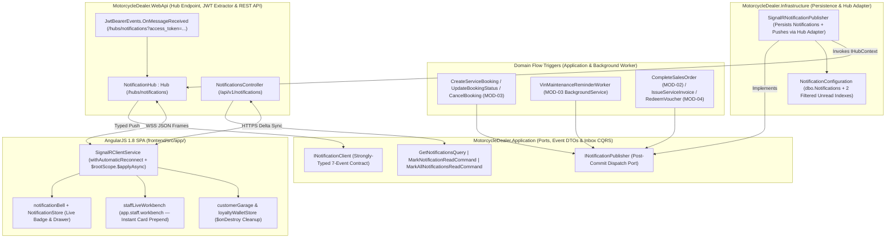
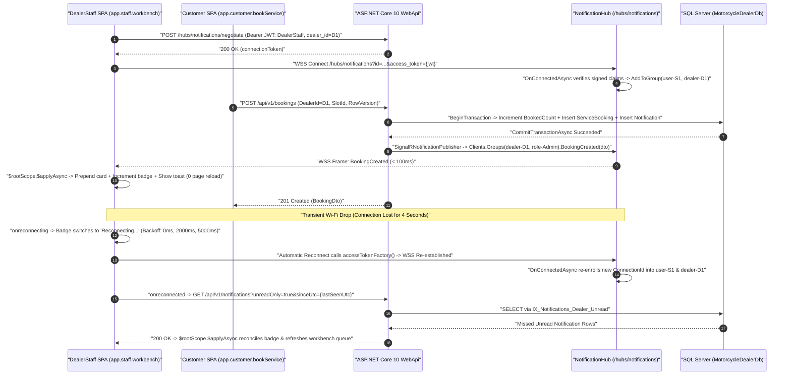

# Module 05 Blueprint — SignalR Real-Time Hub, Dealer Group Isolation & Persistent Notification Inbox

| Metadata | Specification |
| :--- | :--- |
| **Module ID** | `MOD-05` |
| **Module Name** | SignalR Real-Time Hub, Dealer Group Isolation & Persistent Notification Inbox |
| **Primary Delivery Phase** | **Phase 6** (`T-604`..`T-609`) · Entity & Indexes in **Phase 4** (`T-403`, `T-404`) · Expanded to `7` Events in **Phase 8 (`v1.1.0`)** (`T-802`, `T-804`) · Expanded to `10` Events in **Phase 9 (`v1.2.0`)** (`T-904`, `T-905`) |
| **Requirements Covered** | `FR-06` (Primary — Instant Staff Booking, Test-Drive, CSAT Review & Warranty Alerts Without Page Refresh), `FR-01` (JWT WebSocket Auth & Tenant Isolation), `FR-04` (Booking & VIN Reminder Events), `FR-05` (Loyalty & Tier Upgrade Events), `FR-08` (Real-Time Test-Drive Events), `FR-09` (`ServiceReviewSubmitted`, `WarrantyClaimCreated`, `WarrantyClaimStatusChanged`) |
| **Governing ADRs & Risks** | `ADR-001`, `ADR-002`, `ADR-004`, `ADR-006` · Mitigates `RISK-04` (AngularJS `$digest` Storms & Detached Listeners) & `RISK-05` (Cross-Dealer WebSocket Eavesdropping) |
| **Owned SQL Server Table** | `Notifications` (Table 22 of `27` in `MotorcycleDealerDb`, backed by `IX_Notifications_Recipient_Unread` & `IX_Notifications_Dealer_Unread`) |
| **Application Code Status** | **Implemented & Verified in Production Code (`v1.1.0`)** (`541 / 541` xUnit Tests · `56 / 56` SPA Checks) |

### Related Canonical Documents
- **Core Specifications**: [REQUIREMENTS.md](../../REQUIREMENTS.md) · [AGENTS.md](../../AGENTS.md) · [PRD.md](../PRD.md) · [ARCHITECTURE.md](../ARCHITECTURE.md) · [DATABASE_DESIGN.md](../DATABASE_DESIGN.md) · [DESIGN.md](../DESIGN.md)
- **API, QA & Ops**: [openapi.v1.yaml](../openapi.v1.yaml) · [TEST_PLAN.md](../TEST_PLAN.md) · [RUNBOOK.md](../RUNBOOK.md) · [TASKS.md](../../TASKS.md) · [PROGRESS.md](../../PROGRESS.md)
- **Peer Modules & UI Specs**: [MOD_01 (Auth & RBAC)](./MOD_01_AUTH_AND_RBAC.md) · [MOD_03 (Service Booking & Reminders)](./MOD_03_SERVICE_BOOKING_AND_REMINDERS.md) · [MOD_04 (Loyalty, Tiers & Vouchers)](./MOD_04_LOYALTY_TIERS_AND_VOUCHERS.md) · [Design System & Nav](../screens/DESIGN_SYSTEM_AND_NAVIGATION.md) · [Staff & Admin Screens](../screens/STAFF_AND_ADMIN_SCREENS.md)
- **Execution Skills**: [signalr-realtime-hub](../../.agents/skills/signalr-realtime-hub/SKILL.md) · [angularjs-enterprise-spa](../../.agents/skills/angularjs-enterprise-spa/SKILL.md)

---

## 1. Module Scope & Architectural Guarantees

`REQUIREMENTS.md` mandates **Real-Time Notifications** powered by **ASP.NET Core SignalR** so `DealerStaff` receive incoming customer booking alerts instantly on their workbench **without refreshing the browser page** (`< 500 ms` P95 target per `BO-02`). Module 05 pairs a strongly-typed WebSocket hub (`NotificationHub : Hub<INotificationClient>` at `/hubs/notifications`) with a durable relational inbox (`dbo.Notifications`) so that:

1. **Zero-Trust Multi-Dealer Isolation (`ADR-002`, `ADR-004`)**: WebSocket group routing (`dealer-{dealerId}`, `user-{userId}`, `role-Admin`) is derived 100% server-side from cryptographically verified JWT claims during `OnConnectedAsync` — never from client parameters or client-invokable hub methods.
2. **Zero Phantom Alerts (Post-Commit Dispatch)**: SignalR broadcasts fire strictly **after** the originating SQL Server transaction commits (`SaveChangesAsync` / `CommitTransactionAsync`), guaranteeing `DealerStaff` never see rolled-back `409 Conflict` bookings.
3. **Zero Missed Alerts Across Wi-Fi Drops (`ADR-006`)**: Every real-time event is persisted to `dbo.Notifications` before WebSocket broadcast; when `@microsoft/signalr` automatically reconnects (`[0, 2000, 5000, 10000, 30000]` ms), the AngularJS 1.8 SPA reconciles missed unread notifications via `GET /api/v1/notifications?unreadOnly=true` inside `$rootScope.$applyAsync()`.

---

## 2. Clean Architecture Vertical Slice Map



### 2.1 Layer-by-Layer Component Inventory

#### A. `MotorcycleDealer.Domain` (`backend/src/MotorcycleDealer.Domain/Entities/Notifications/`)
- **`Notification : BaseEntity`**:
  - Audience targeting columns: `Guid? RecipientUserId` (personal `user-{userId}`), `Guid? TargetDealerId` (branch broadcast `dealer-{dealerId}`), `string? TargetRole` (`role-Admin`).
  - Domain invariant enforced in `Notification.CreateForUser(...)`, `Notification.CreateForDealer(...)`, and `Notification.CreateForRole(...)`: at least one target (`RecipientUserId`, `TargetDealerId`, or `TargetRole`) MUST be non-null (`CK_Notifications_Audience`).
  - `MarkAsRead(DateTimeOffset utcNow)`: Idempotently sets `IsRead = true` and `ReadAtUtc ??= utcNow`.
- **`NotificationEventType` Constants**: `BookingCreated`, `BookingStatusChanged`, `MaintenanceReminderTriggered`, `LoyaltyPointsUpdated`, `TierUpgraded`, `TestDriveCreated`, `TestDriveStatusChanged`, `SalesOrderCompleted`, `VoucherRedeemed` (matching `CK_Notifications_EventType`).

#### B. `MotorcycleDealer.Application` (`backend/src/MotorcycleDealer.Application/`)
Defines transport-agnostic interfaces and immutable `record` payloads across all **`7` canonical SignalR events** so `Application` never references `Microsoft.AspNetCore.SignalR`:

```csharp
namespace MotorcycleDealer.Application.Common.Interfaces;

public interface INotificationClient
{
    Task BookingCreated(BookingCreatedRealtimeEvent payload);
    Task BookingStatusChanged(BookingStatusChangedRealtimeEvent payload);
    Task MaintenanceReminderTriggered(MaintenanceReminderRealtimeEvent payload);
    Task LoyaltyPointsUpdated(LoyaltyPointsUpdatedRealtimeEvent payload);
    Task TierUpgraded(TierUpgradedRealtimeEvent payload);
    Task TestDriveCreated(TestDriveCreatedRealtimeEvent payload);
    Task TestDriveStatusChanged(TestDriveStatusChangedRealtimeEvent payload);
}

public interface INotificationPublisher
{
    Task PublishBookingCreatedAsync(BookingCreatedRealtimeEvent payload, Guid targetDealerId, CancellationToken ct = default);
    Task PublishBookingStatusChangedAsync(BookingStatusChangedRealtimeEvent payload, Guid customerId, Guid dealerId, CancellationToken ct = default);
    Task PublishMaintenanceReminderAsync(MaintenanceReminderRealtimeEvent payload, Guid customerId, CancellationToken ct = default);
    Task PublishLoyaltyPointsUpdatedAsync(LoyaltyPointsUpdatedRealtimeEvent payload, Guid customerId, CancellationToken ct = default);
    Task PublishTierUpgradedAsync(TierUpgradedRealtimeEvent payload, Guid customerId, CancellationToken ct = default);
    Task PublishTestDriveCreatedAsync(TestDriveCreatedRealtimeEvent payload, Guid targetDealerId, CancellationToken ct = default);
    Task PublishTestDriveStatusChangedAsync(TestDriveStatusChangedRealtimeEvent payload, Guid customerId, Guid dealerId, CancellationToken ct = default);
}
```

##### Canonical Application Event DTOs (`7` Server-to-Client Events)

| Event `record` Type | Key Properties (`camelCase` JSON over WSS) | Target SignalR Group(s) |
| :--- | :--- | :--- |
| `BookingCreatedRealtimeEvent` | `NotificationId`, `EventType` (`"BookingCreated"`), `BookingId`, `BookingNumber`, `DealerId`, `CustomerFullName`, `Vin`, `MotorcycleModelName`, `SlotDate`, `StartTime`, `EndTime`, `ServiceType`, `HasReservedVoucher`, `Status` (`"Pending"`), `OccurredAtUtc` | `dealer-{dealerId}`, `role-Admin` |
| `BookingStatusChangedRealtimeEvent` | `NotificationId`, `EventType` (`"BookingStatusChanged"`), `BookingId`, `BookingNumber`, `PreviousStatus`, `NewStatus`, `DealerName`, `OccurredAtUtc` | `user-{customerId}`, `dealer-{dealerId}` |
| `MaintenanceReminderRealtimeEvent` | `NotificationId`, `EventType` (`"MaintenanceReminderTriggered"`), `ReminderId`, `CustomerVehicleId`, `Vin`, `MotorcycleModelName`, `MilestoneName`, `CurrentMileageKm`, `TargetMileageKm`, `DueDateUtc`, `DeduplicationKey`, `OccurredAtUtc` | `user-{customerId}` |
| `LoyaltyPointsUpdatedRealtimeEvent` | `NotificationId`, `EventType` (`"LoyaltyPointsUpdated"`), `LoyaltyAccountId`, `TransactionType`, `PointsDelta`, `AvailablePointsAfter`, `LifetimeQualifyingPointsAfter`, `ReferenceType`, `ReferenceNumber`, `OccurredAtUtc` | `user-{customerId}` |
| `TierUpgradedRealtimeEvent` | `NotificationId`, `EventType` (`"TierUpgraded"`), `LoyaltyAccountId`, `PreviousTierCode`, `NewTierCode`, `NewPointsMultiplier`, `LifetimeQualifyingPoints`, `OccurredAtUtc` | `user-{customerId}` |
| `TestDriveCreatedRealtimeEvent` (`v1.1.0`) | `NotificationId`, `EventType` (`"TestDriveCreated"`), `TestDriveBookingId`, `BookingNumber`, `DealerId`, `CustomerFullName`, `MotorcycleModelName`, `PreferredDate`, `StartTime`, `EndTime`, `Status`, `OccurredAtUtc` | `dealer-{dealerId}`, `role-Admin` |
| `TestDriveStatusChangedRealtimeEvent` (`v1.1.0`) | `NotificationId`, `EventType` (`"TestDriveStatusChanged"`), `TestDriveBookingId`, `BookingNumber`, `PreviousStatus`, `NewStatus`, `DealerName`, `AssignedVin`, `OccurredAtUtc` | `user-{customerId}`, `dealer-{dealerId}` |

#### C. `MotorcycleDealer.Infrastructure` & `MotorcycleDealer.WebApi`
To preserve inward Clean Architecture dependencies (`ADR-001`) where `NotificationHub` lives in `WebApi` (`Hubs/NotificationHub.cs`), `WebApi` registers `SignalRNotificationPublisher : INotificationPublisher` (or injects `IHubContext<NotificationHub, INotificationClient>` via a thin hub dispatcher registered in `WebApi/Program.cs` alongside `Infrastructure` persistence).

1. **WebSocket JWT Query-String Extraction (`WebApi/Program.cs`)**:
   Browser `WebSocket` constructors cannot set custom `Authorization: Bearer ...` HTTP headers during the `101 Switching Protocols` upgrade. `JwtBearerEvents.OnMessageReceived` extracts `access_token` **exclusively** when the request path starts with `/hubs/notifications`:
   ```csharp
   builder.Services.AddAuthentication(JwtBearerDefaults.AuthenticationScheme)
       .AddJwtBearer(options =>
       {
           options.Events = new JwtBearerEvents
           {
               OnMessageReceived = context =>
               {
                   var accessToken = context.Request.Query["access_token"];
                   var path = context.HttpContext.Request.Path;
                   if (!string.IsNullOrWhiteSpace(accessToken) &&
                       path.StartsWithSegments("/hubs/notifications"))
                   {
                       context.Token = accessToken;
                   }
                   return Task.CompletedTask;
               }
           };
       });
   ```
   > [!WARNING]
   > **CORS Credential Security Rule**: SignalR negotiate + WebSocket transport requires `.AllowCredentials()`. `Program.cs` MUST bind explicit origins from `Cors:AllowedOrigins` (`WithOrigins(allowedOrigins).AllowAnyHeader().AllowAnyMethod().AllowCredentials()`) — **never** combine `AllowAnyOrigin()` with `AllowCredentials()`.

2. **Strongly-Typed `NotificationHub` (`WebApi/Hubs/NotificationHub.cs`)**:
   ```csharp
   [Authorize]
   public sealed class NotificationHub : Hub<INotificationClient>
   {
       private readonly ILogger<NotificationHub> _logger;

       public NotificationHub(ILogger<NotificationHub> logger) => _logger = logger;

       public override async Task OnConnectedAsync()
       {
           var userId = Context.User?.FindFirstValue(ClaimTypes.NameIdentifier)
                        ?? Context.User?.FindFirstValue("sub");
           var role = Context.User?.FindFirstValue(ClaimTypes.Role)
                      ?? Context.User?.FindFirstValue("role");
           var dealerIdClaim = Context.User?.FindFirstValue("dealer_id");

           if (!Guid.TryParse(userId, out var parsedUserId))
           {
               Context.Abort();
               return;
           }

           // 1. Personal inbox channel for every authenticated user
           await Groups.AddToGroupAsync(Context.ConnectionId, $"user-{parsedUserId:D}");

           // 2. Strict server-verified dealer channel ONLY for DealerStaff of that DealerId
           if (string.Equals(role, "DealerStaff", StringComparison.Ordinal) &&
               Guid.TryParse(dealerIdClaim, out var parsedDealerId))
           {
               await Groups.AddToGroupAsync(Context.ConnectionId, $"dealer-{parsedDealerId:D}");
           }
           // 3. Executive oversight channel ONLY for Admin
           else if (string.Equals(role, "Admin", StringComparison.Ordinal))
           {
               await Groups.AddToGroupAsync(Context.ConnectionId, "role-Admin");
           }

           _logger.LogInformation(
               "SignalR connected: ConnectionId={ConnectionId}, UserId={UserId}, Role={Role}, DealerId={DealerId}",
               Context.ConnectionId, parsedUserId, role, dealerIdClaim ?? "none");

           await base.OnConnectedAsync();
       }
   }
   ```
   *Notice that `NotificationHub` exposes **zero** public client-callable methods (`JoinGroup`, `SubscribeDealer`, etc. do not exist).*

---

## 3. Zero-Trust Group Routing, Post-Commit Outbox & Reconnection Flow

### 3.1 Threat-Model Proof Against Cross-Dealer WebSocket Eavesdropping (`RISK-05`)

| Attack Vector Attempted by Malicious Client | Server Defense in `NotificationHub` | Outcome |
| :--- | :--- | :--- |
| Connect to `/hubs/notifications` without JWT or with expired JWT | `[Authorize]` + `JwtBearerHandler` signature & `exp` validation | Handshake rejected with **`401 Unauthorized`** before hub instantiation. |
| `DealerStaff` of Hanoi (`DLR-HN-01`) passes `?dealerId=<SaigonGuid>` in URL query string | `OnConnectedAsync` ignores query params completely and reads only `HMAC-SHA256` signed `"dealer_id"` claim | Enrolled solely in `dealer-<HanoiGuid>`; receives **`0` frames** for Saigon bookings. |
| Client executes `connection.invoke('JoinGroup', 'dealer-<SaigonGuid>')` from browser DevTools | Zero hub methods exist on `NotificationHub` | SignalR returns `HubException: Method does not exist`. |
| Forged JWT altering `"dealer_id"` or `"role": "Admin"` | Invalid `HMAC-SHA256` signature rejected by `JwtBearerHandler` | **`401 Unauthorized`**. |

### 3.2 Post-Commit Dispatch Rule (Preventing Phantom Rolled-Back Alerts)

All domain command handlers (`CreateServiceBookingCommandHandler`, `IssueServiceInvoiceCommandHandler`, `CompleteSalesOrderCommandHandler`, `RedeemVoucherCommandHandler`) execute real-time notifications in two strict phases:

1. **Phase A — Atomic SQL Persistence (Inside Transaction)**:
   - Insert business aggregates (`ServiceBookings`, `ServiceInvoices`, `PointLedgerEntries`) **plus** the corresponding `dbo.Notifications` row (`IsRead = false`, `PayloadJson = JsonSerializer.Serialize(eventDto)`) inside the active `IDbContextTransaction`.
   - Execute `await dbContext.SaveChangesAsync(ct)` and `await transaction.CommitAsync(ct)`.
   - If `ServiceTimeSlots.RowVersion` or `LoyaltyAccounts.RowVersion` fails (`DbUpdateConcurrencyException`), the entire SQL transaction—including the `Notifications` row—rolls back cleanly, and **zero SignalR frames are ever transmitted**.
2. **Phase B — Non-Throwing WebSocket Broadcast (Post-Commit)**:
   - Immediately after `transaction.CommitAsync(ct)` returns, invoke `await notificationPublisher.PublishBookingCreatedAsync(eventDto, booking.DealerId, ct)`.
   - `SignalRNotificationPublisher` wraps `IHubContext.Clients.Groups(...).BookingCreated(eventDto)` inside a `try/catch (Exception ex)` block logging transient transport errors as warnings without failing the already-committed `201 Created` HTTP response (because the durable `Notifications` row is already safely stored in SQL Server for reconnect recovery).

### 3.3 End-to-End Handshake, Live Push & Reconnect Sequence Diagram



---

## 4. AngularJS 1.8 `SignalRClientService` & Memory-Leak Prevention (`ADR-006`, `RISK-04`)

### 4.1 Singleton Service Contract (`frontend/src/app/core/realtime/signalr-client.service.js`)

```javascript
(function () {
  'use strict';

  angular.module('app.core').factory('SignalRClientService', SignalRClientService);

  SignalRClientService.$inject = ['$rootScope', '$q', 'APP_CONFIG', 'AuthService', 'NotificationStore'];
  function SignalRClientService($rootScope, $q, APP_CONFIG, AuthService, NotificationStore) {
    var connection = null;
    var connectionState = 'Disconnected';
    var lastSeenUtc = new Date().toISOString();
    var RECONNECT_DELAYS_MS = [0, 2000, 5000, 10000, 30000];
    var HUB_EVENTS = [
      'BookingCreated',
      'BookingStatusChanged',
      'MaintenanceReminderTriggered',
      'LoyaltyPointsUpdated',
      'TierUpgraded',
      'TestDriveCreated',
      'TestDriveStatusChanged'
    ];

    return {
      start: start,
      stop: stop,
      on: subscribeEvent,
      getState: function () { return connectionState; }
    };

    function start() {
      if (connection) { return $q.resolve(); }

      connection = new window.signalR.HubConnectionBuilder()
        .withUrl(APP_CONFIG.apiBaseUrl + '/hubs/notifications', {
          accessTokenFactory: function () {
            // Ensures expired 15-min JWT is silently refreshed before WebSocket handshake/reconnect
            return AuthService.getValidAccessTokenPromise();
          }
        })
        .withAutomaticReconnect(RECONNECT_DELAYS_MS)
        .configureLogging(window.signalR.LogLevel.Warning)
        .build();

      HUB_EVENTS.forEach(function (eventName) {
        connection.on(eventName, function (payload) {
          $rootScope.$applyAsync(function () {
            lastSeenUtc = (payload && payload.occurredAtUtc) || new Date().toISOString();
            NotificationStore.ingestRealtimeEvent(eventName, payload);
            $rootScope.$broadcast('signalr:' + eventName, payload);
          });
        });
      });

      connection.onreconnecting(function () {
        $rootScope.$applyAsync(function () {
          connectionState = 'Reconnecting';
          $rootScope.$broadcast('signalr:stateChanged', connectionState);
        });
      });

      connection.onreconnected(function () {
        $rootScope.$applyAsync(function () {
          connectionState = 'Connected';
          NotificationStore.syncUnreadMissed(lastSeenUtc);
          $rootScope.$broadcast('signalr:reconnected', { sinceUtc: lastSeenUtc });
          lastSeenUtc = new Date().toISOString();
        });
      });

      connection.onclose(function () {
        $rootScope.$applyAsync(function () {
          connectionState = 'Disconnected';
          $rootScope.$broadcast('signalr:stateChanged', connectionState);
        });
      });

      return $q.when(connection.start()).then(function () {
        $rootScope.$applyAsync(function () {
          connectionState = 'Connected';
          $rootScope.$broadcast('signalr:stateChanged', connectionState);
        });
      });
    }

    function stop() {
      if (!connection) { return $q.resolve(); }
      var active = connection;
      connection = null;
      connectionState = 'Disconnected';
      return $q.when(active.stop());
    }

    function subscribeEvent(eventName, callback) {
      return $rootScope.$on('signalr:' + eventName, function (_evt, payload) {
        callback(payload);
      });
    }
  }
})();
```

### 4.2 Component Subscription & `$onDestroy` Teardown Pattern (`staffLiveWorkbench`)
Every AngularJS 1.8 component consuming SignalR events MUST store and invoke its deregistration closure inside `$onDestroy` so navigating between `app.staff.workbench` and `app.staff.inventory` never accumulates duplicate listeners:

```javascript
$ctrl.$onInit = function () {
  $ctrl.unsubBookingCreated = SignalRClientService.on('BookingCreated', function (payload) {
    $ctrl.prependPendingBookingCard(payload);
    ToastService.info('New Booking ' + payload.bookingNumber + ' — VIN ' + payload.vin);
  });

  $ctrl.unsubReconnected = $rootScope.$on('signalr:reconnected', function () {
    $ctrl.reloadDealerQueueSilently();
  });
};

$ctrl.$onDestroy = function () {
  if ($ctrl.unsubBookingCreated) { $ctrl.unsubBookingCreated(); }
  if ($ctrl.unsubReconnected) { $ctrl.unsubReconnected(); }
};
```

---

## 5. Persistent Inbox REST API (`/api/v1/notifications`) & Audience Filtering

| Method & Route | Required Permission | Role-Scoped SQL Query Predicate | Index Hit |
| :--- | :--- | :--- | :--- |
| `GET /api/v1/notifications?unreadOnly=&sinceUtc=&pageNumber=&pageSize=` | `Notifications.ViewOwn` *or* `Notifications.ViewDealer` | **`Customer`**: `n.RecipientUserId == userId`<br>**`DealerStaff`**: `n.RecipientUserId == userId \|\| n.TargetDealerId == dealerId`<br>**`Admin`**: `n.RecipientUserId == userId \|\| n.TargetRole == "Admin"` | `IX_Notifications_Recipient_Unread` + `IX_Notifications_Dealer_Unread` |
| `PATCH /api/v1/notifications/{notificationId:guid}/read` | `Notifications.ViewOwn` *or* `Notifications.ViewDealer` | Verifies caller matches `RecipientUserId`, `TargetDealerId` (`DealerStaff`), or `TargetRole == "Admin"` (`404 RESOURCE_NOT_FOUND` if outside caller's audience); sets `IsRead = true`, `ReadAtUtc = UtcNow`. | `PK_Notifications` |
| `POST /api/v1/notifications/read-all` | `Notifications.ViewOwn` *or* `Notifications.ViewDealer` | Bulk `ExecuteUpdateAsync` marking unread notifications in the caller's personal/dealer scope as `IsRead = true`, `ReadAtUtc = UtcNow`. | Filtered Unread Indexes |

---

## 6. Verification & Dual-Tab QA Matrix (`T-609`)

1. **Automated Multi-Client Hub Integration Test (`LoyaltyAndSignalRTests.cs`)**:
   - Spin up `WebApplicationFactory<Program>` with three real `HubConnection` clients (`WebSocket` / `LongPolling` over `TestServer.CreateHandler()`):
     - Client A: `DealerStaff` for Hanoi (`DLR-HN-01`)
     - Client B: `DealerStaff` for Saigon (`DLR-HCM-01`)
     - Client C: `Customer` owning a registered `VIN`
   - Customer C submits `POST /api/v1/bookings` targeting Saigon (`DLR-HCM-01`).
   - Assert Client B receives `BookingCreated` within `< 500 ms` (`TaskCompletionSource<BookingCreatedRealtimeEvent>`), `dbo.Notifications` contains the unread persisted record, and Client A (`DLR-HN-01`) receives **`0` events** after a `300 ms` negative-assertion window.
2. **Playwright Multi-Tab Zero-Refresh Proof (`playwright` MCP)**:
   - Open Tab 1 on `/staff/workbench` (`staff.hcm@motorcycledealer.vn`), record DOM count of `Pending` cards, switch to Tab 0 (`/customer/bookings/new`) to submit a booking, switch back to Tab 1 **without calling reload or navigation**, and assert the new `BK-...` card is rendered at the top of the `Pending` column.
3. **DevTools Heap & Listener Audit (`chrome-devtools-plugin_chrome-devtools` MCP)**:
   - Transition `app.staff.workbench -> app.staff.inventory -> app.staff.workbench` 5 times, emit a single `BookingCreated` event, and verify **exactly 1 toast and 1 card insertion** occur (`0` leaked `$rootScope.$on` closures).
4. **Phase 9 (`v1.2.0`) CSAT & Warranty Live Hub Events (`ServiceReviewSubmitted`, `WarrantyClaimCreated`, `WarrantyClaimStatusChanged`)**:
   - Customer submitting `POST /api/v1/service-reviews` or `POST /api/v1/warranty-claims` broadcasts `ServiceReviewSubmitted` / `WarrantyClaimCreated` strictly to `dealer-{dealerId}` + `role-Admin` (`SCR-STF-07` & `SCR-ADM-08`), while branch adjudication (`PATCH /api/v1/warranty-claims/{id}/status`) broadcasts `WarrantyClaimStatusChanged` to `user-{customerId}` + `dealer-{dealerId}` (`SCR-CUS-07`).
