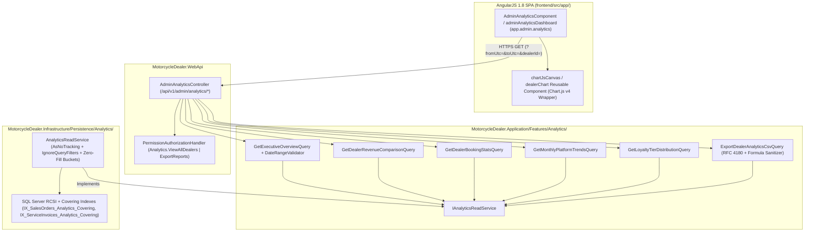
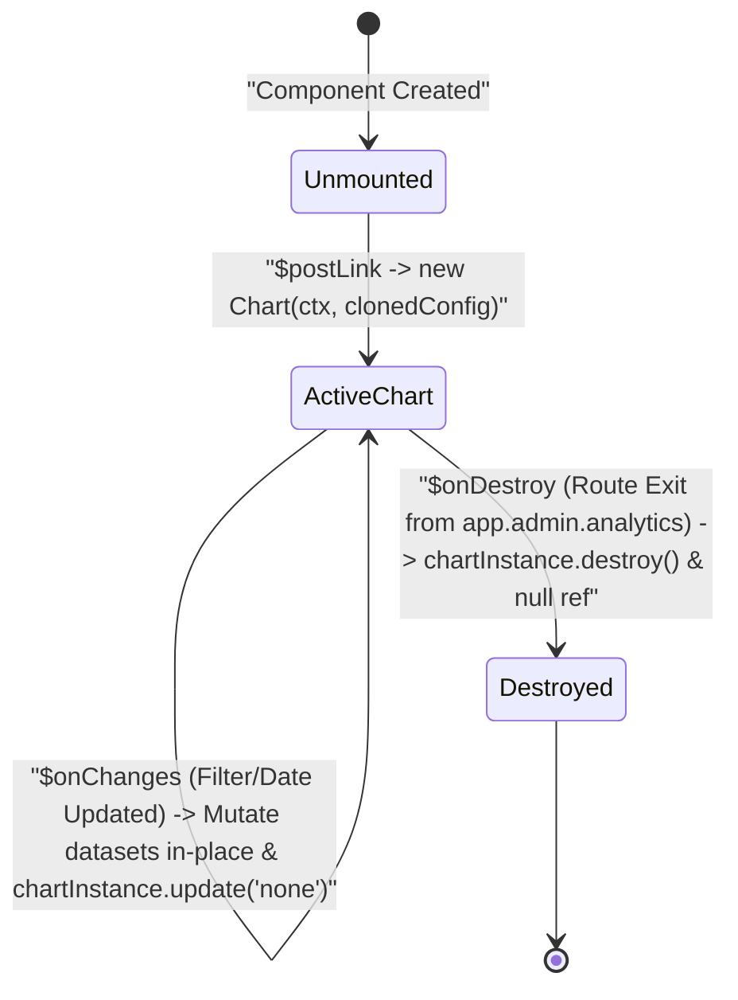

# Module 06 Blueprint — Multi-Dealer Revenue & Booking Analytics Engine (`Chart.js v4`)

| Metadata | Specification |
| :--- | :--- |
| **Module ID** | `MOD-06` |
| **Module Name** | Multi-Dealer Revenue & Booking Analytics Engine (`Chart.js v4`) |
| **Primary Delivery Phase** | **Phase 7** (`T-701`, `T-702`, `T-704`, `T-705`) · Covering Indexes Provisioned in **Phase 4** (`T-404`) · Expanded with CSAT & Warranty Quality Dashboard (`SCR-ADM-08`) in **Phase 9 (`v1.2.0`)** (`T-903`, `T-906`) |
| **Requirements Covered** | `FR-07` (Primary — Revenue & Booking Statistics per Dealer Visualized with `Chart.js`), `FR-01` (`Admin`-Only RBAC Gating), `FR-02` (`SalesOrders` Revenue), `FR-04` (`ServiceBookings` & `ServiceInvoices` Metrics), `FR-05` (`LoyaltyTiers` Distribution & Points Liability), `FR-09` (`AverageCsatRating` & `ApprovedWarrantyCoveredVnd` Quality Analytics) |
| **Governing ADRs & Risks** | `ADR-001`, `ADR-002`, `ADR-006` · Mitigates `RISK-04` (`Chart.js` Canvas & Observer Memory Leaks) & `RISK-05` (Unauthorized Cross-Dealer Revenue Disclosure) |
| **Queried SQL Server Tables** | Read-Only Projections across `Dealers`, `SalesOrders`, `ServiceInvoices`, `ServiceBookings`, `ServiceReviews`, `WarrantyClaims`, `LoyaltyAccounts`, `LoyaltyTiers` (`8` of `27` `MotorcycleDealerDb` Tables) |
| **Application Code Status** | **Implemented & Verified in Production Code (`v1.1.0`)** (`8` HTTP Route Bindings on `AdminAnalyticsController` · `541 / 541` xUnit Tests · `56 / 56` SPA Checks) |

### Related Canonical Documents
- **Core Specifications**: [REQUIREMENTS.md](../../REQUIREMENTS.md) · [AGENTS.md](../../AGENTS.md) · [PRD.md](../PRD.md) · [ARCHITECTURE.md](../ARCHITECTURE.md) · [DATABASE_DESIGN.md](../DATABASE_DESIGN.md) · [DESIGN.md](../DESIGN.md)
- **API, QA & WBS**: [openapi.v1.yaml](../openapi.v1.yaml) · [TEST_PLAN.md](../TEST_PLAN.md) · [TASKS.md](../../TASKS.md) · [PROGRESS.md](../../PROGRESS.md)
- **Peer Modules & UI Specs**: [MOD_01 (Auth & RBAC)](./MOD_01_AUTH_AND_RBAC.md) · [MOD_02 (Showroom & VIN Garage)](./MOD_02_SHOWROOM_AND_VIN_GARAGE.md) · [MOD_03 (Service Booking & Reminders)](./MOD_03_SERVICE_BOOKING_AND_REMINDERS.md) · [MOD_04 (Loyalty, Tiers & Vouchers)](./MOD_04_LOYALTY_TIERS_AND_VOUCHERS.md) · [Staff & Admin Screens](../screens/STAFF_AND_ADMIN_SCREENS.md)
- **Execution Skills**: [dotnet-clean-api](../../.agents/skills/dotnet-clean-api/SKILL.md) · [sqlserver-efcore-dba](../../.agents/skills/sqlserver-efcore-dba/SKILL.md) · [angularjs-enterprise-spa](../../.agents/skills/angularjs-enterprise-spa/SKILL.md)

---

## 1. Module Scope, Security Boundary & Performance Targets

Module 06 delivers the executive intelligence portal (`app.admin.analytics`) mandated by `FR-07`, enabling headquarters `Admin` users to compare **Showroom Motorcycle Sales Revenue** (`SalesOrders`) alongside **Workshop Service Revenue** (`ServiceInvoices`), inspect **Service Booking conversion and cancellation funnels** per dealership, track **month-over-month platform trends**, monitor **Loyalty membership distribution and unredeemed points liability**, and export auditable CSV reports.

> [!IMPORTANT]
> **Strict `Admin`-Only `IgnoreQueryFilters()` Rule (`ADR-002`, `RISK-05`)**: Because `MotorcycleDealerDbContext` applies global `IDealerScoped` and `ISoftDeletable` filters, cross-dealer aggregation queries in `AnalyticsReadService` explicitly invoke `.IgnoreQueryFilters()` paired with explicit `!d.IsDeleted` predicates where needed. Every analytics endpoint MUST enforce `[Authorize(Policy = Permissions.Analytics.ViewAllDealers)]` (or `Permissions.Analytics.ExportReports` for CSV export), and `AnalyticsReadService` independently asserts `ICurrentUserContext.Role == "Admin"` at runtime so `DealerStaff` or `Customer` callers always receive `403 Forbidden`.

### 1.1 Dedicated SQL Server Covering Indexes (`BO-05`: `< 300 ms` P95 Latency)

All analytical queries execute as read-only `AsNoTracking()` server-side SQL `GROUP BY` projections under **Read Committed Snapshot Isolation (`RCSI`)**, hitting four purpose-built covering indexes (`DATABASE_DESIGN.md` §5 — zero clustered table scans and zero key lookups):

| Canonical Index Name (Short Alias) | Target Table | Key Columns | `INCLUDE` Columns & Filter | Query Accelerated |
| :--- | :--- | :--- | :--- | :--- |
| `IX_SalesOrders_Analytics_Covering` (`IX_SalesOrders_Analytics`) | `dbo.SalesOrders` | `(DealerId ASC, CompletedAtUtc ASC)` | `INCLUDE (TotalAmount, DiscountAmount, FinalAmount, PointsEarned) WHERE Status = 'Completed'` | Showroom revenue per dealer & monthly revenue line |
| `IX_ServiceInvoices_Analytics_Covering` (`IX_ServiceInvoices_Analytics`) | `dbo.ServiceInvoices` | `(DealerId ASC, PaidAtUtc ASC)` | `INCLUDE (LaborAmount, PartsAmount, GrossAmount, VoucherDiscountAmount, NetPaidAmount, PointsEarned)` | Workshop service revenue per dealer & monthly revenue line |
| `IX_ServiceBookings_Analytics_Dealer` | `dbo.ServiceBookings` | `(DealerId ASC, CreatedAtUtc ASC, Status ASC)` | `INCLUDE (ServiceType)` | Booking status breakdown, completion rate & cancellation rate per dealer |
| `IX_LoyaltyAccounts_Tier_Distribution` | `dbo.LoyaltyAccounts` | `(CurrentTierId ASC)` | `INCLUDE (AvailablePoints, LifetimeQualifyingPoints, LifetimeSpentVnd)` | 4-tier member population & points liability KPI |

---

## 2. Clean Architecture Vertical Slice Map



### 2.1 Endpoint-to-CQRS & Permission Mapping (`AdminAnalyticsController` — `8` HTTP Bindings)

| HTTP Method & Route(s) | Policy Attribute | Service / Query Method | Default Date Window | Primary Consumer on `app.admin.analytics` |
| :--- | :--- | :--- | :--- | :--- |
| `GET /api/v1/admin/analytics/overview` *(+ alias `GET /api/v1/admin/analytics/kpis`)* | `Permissions.Analytics.ViewAllDealers` | `GetExecutiveOverviewAsync` | Last 180 days (`UtcNow - 180d .. UtcNow`) | Executive KPI Summary Cards + Per-Dealer Summary Table |
| `GET /api/v1/admin/analytics/revenue-by-dealer` | `Permissions.Analytics.ViewAllDealers` | `GetDealerRevenueComparisonAsync` | Last 180 days | **Chart 1**: `Chart.js` Stacked Bar (Showroom vs. Service Revenue) |
| `GET /api/v1/admin/analytics/bookings-by-dealer` | `Permissions.Analytics.ViewAllDealers` | `GetDealerBookingStatsAsync` | Last 180 days | **Chart 2**: `Chart.js` Grouped Bar / Status Doughnut |
| `GET /api/v1/admin/analytics/monthly-trends` | `Permissions.Analytics.ViewAllDealers` | `GetMonthlyPlatformTrendsAsync` | Last 12 calendar months | **Chart 3**: `Chart.js` Dual-Axis Multi-Line (Revenue + Bookings) |
| `GET /api/v1/admin/analytics/loyalty-distribution` | `Permissions.Analytics.ViewAllDealers` | `GetLoyaltyTierDistributionAsync` | Point-in-time snapshot | **Chart 4**: `Chart.js` 4-Tier Membership Doughnut + Liability KPI |
| `GET /api/v1/admin/analytics/export` *(+ alias `GET /api/v1/admin/analytics/export-csv`)* | `Permissions.Analytics.ExportReports` | `ExportDealerAnalyticsCsvAsync` | Last 180 days | Downloadable UTF-8 BOM `.csv` executive spreadsheet |

#### `FluentValidation` Date & Filter Rules (`AnalyticsFilterValidator`)
- `FromUtc` and `ToUtc` are optional `DateTimeOffset?` query parameters; when omitted, default to `[UtcNow.AddMonths(-6), UtcNow]` (or 12 months for `/monthly-trends`).
- Enforce `FromUtc <= ToUtc` (`400 VALIDATION_FAILED` if inverted) and `(ToUtc - FromUtc).TotalDays <= 731` (maximum 24-month window per query to bound bucket allocations).
- Optional `DealerId` (`Guid?`): when supplied, filters `/overview`, `/bookings-by-dealer`, `/monthly-trends`, and `/export` to that specific branch while `/revenue-by-dealer` can highlight or scope as requested.

---

## 3. Exact SQL Aggregation Formulas & Zero-Fill Bucket Algorithms

### 3.1 Canonical Revenue, Funnel & Loyalty Liability Formulas

Every currency metric is computed in `decimal` (`DECIMAL(18,2)`), strictly separating realized net cash from uncompleted or discounted amounts:

| Metric Identifier | Exact Mathematical / SQL Formula | Inclusion & Exclusion Invariants |
| :--- | :--- | :--- |
| **`ShowroomRevenueVnd`** | `COALESCE(SUM(so.FinalAmount), 0.00m)` where `so.Status == 'Completed'` and `so.CompletedAtUtc >= @fromUtc AND so.CompletedAtUtc <= @toUtc` | Uses post-discount `FinalAmount` (`TotalAmount - DiscountAmount`); **excludes** `Pending` and `Cancelled` `SalesOrders`. |
| **`UnitsSoldCount`** | `COUNT(so.Id)` where `so.Status == 'Completed'` and `so.CompletedAtUtc` in `[fromUtc, toUtc]` | Physical `VIN` units handed over in the window. |
| **`ServiceRevenueVnd`** | `COALESCE(SUM(si.NetPaidAmount), 0.00m)` where `si.PaidAtUtc >= @fromUtc AND si.PaidAtUtc <= @toUtc` | Uses net cash settled after `VoucherDiscountAmount` (`GrossAmount - VoucherDiscountAmount`), **never** `GrossAmount`. |
| **`TotalVoucherDiscountVnd`** | `COALESCE(SUM(so.DiscountAmount), 0.00m) + COALESCE(SUM(si.VoucherDiscountAmount), 0.00m)` | Promotional & loyalty discount cost absorbed across sales + workshop. |
| **`TotalRevenueVnd`** | `ShowroomRevenueVnd + ServiceRevenueVnd` | Combined realized dealership revenue in `VND`. |
| **`TotalBookings`** | `COUNT(sb.Id)` where `sb.CreatedAtUtc >= @fromUtc AND sb.CreatedAtUtc <= @toUtc` | All appointments scheduled in `[fromUtc, toUtc]` across all 7 statuses. |
| **`CompletedBookings`** | `COUNT(sb.Id)` where `sb.Status == 'Completed'` in `[fromUtc, toUtc]` | Appointments settled with a `ServiceInvoice`. |
| **`CancelledAndNoShowBookings`** | `COUNT(sb.Id)` where `sb.Status IN ('Cancelled', 'NoShow')` in `[fromUtc, toUtc]` | Lost/released appointment slots (`CancelledBookings + NoShowBookings`). |
| **`CompletionRatePct`** | `TotalBookings == 0 ? 0.00m : Math.Round((decimal)CompletedBookings * 100m / TotalBookings, 2, MidpointRounding.AwayFromZero)` | Safe against divide-by-zero (`0.00%` when `TotalBookings == 0`). |
| **`CancellationRatePct`** | `TotalBookings == 0 ? 0.00m : Math.Round((decimal)CancelledAndNoShowBookings * 100m / TotalBookings, 2, MidpointRounding.AwayFromZero)` | Combined attrition rate (`Cancelled` + `NoShow`) per dealer. |
| **`PointsLiability`** | `UnredeemedPointsPool = COALESCE(SUM(la.AvailablePoints), 0)`<br>`PointsLiabilityVnd = UnredeemedPointsPool * 500.00m` | Tracks total unspent `AvailablePoints` across active `LoyaltyAccounts` plus implied VND redemption exposure (`500 VND / pt` standard catalog parity, e.g., `200 pts = 100,000 VND` voucher). |

---

### 3.2 Zero-Fill Dealer & Calendar Month (`YYYY-MM`) Alignment Logic

SQL `GROUP BY` queries omit groups that have zero matching rows. Passing sparse SQL arrays directly into `Chart.js` causes catastrophic index misalignment between `labels[]` and multiple `datasets[].data[]` arrays (for example, if Da Nang has `0` bike sales in March, or if a newly opened dealership has workshop bookings but `0` completed showroom sales).

`AnalyticsReadService` enforces **deterministic zero-filling** along both axes:

#### A. Dealer Axis Zero-Fill (`GetDealerRevenueComparisonQuery` & `GetDealerBookingStatsQuery`)
1. Query all active `Dealers` (`!d.IsDeleted`, ordered deterministically by `d.Code ASC` or `TotalRevenueVnd DESC`).
2. Execute two separate `AsNoTracking()` server-side `GROUP BY DealerId` queries (avoiding Cartesian explosion from joining `SalesOrders` and `ServiceInvoices` directly!):
   ```csharp
   var salesByDealer = await _db.SalesOrders
       .AsNoTracking()
       .IgnoreQueryFilters()
       .Where(so => so.Status == SalesOrderStatus.Completed
                    && so.CompletedAtUtc >= fromUtc && so.CompletedAtUtc <= toUtc)
       .GroupBy(so => so.DealerId)
       .Select(g => new { DealerId = g.Key, ShowroomRevenueVnd = g.Sum(x => x.FinalAmount), UnitsSold = g.Count() })
       .ToDictionaryAsync(x => x.DealerId, ct);

   var serviceByDealer = await _db.ServiceInvoices
       .AsNoTracking()
       .IgnoreQueryFilters()
       .Where(si => si.PaidAtUtc >= fromUtc && si.PaidAtUtc <= toUtc)
       .GroupBy(si => si.DealerId)
       .Select(g => new { DealerId = g.Key, ServiceRevenueVnd = g.Sum(x => x.NetPaidAmount), InvoicesCount = g.Count() })
       .ToDictionaryAsync(x => x.DealerId, ct);
   ```
3. Project over the master `dealers` list, defaulting missing dictionary keys to `0.00m` and `0` so **every dealer** renders an aligned bar in `Chart.js`.

#### B. Calendar Month (`YYYY-MM`) Zero-Fill (`GetMonthlyPlatformTrendsQuery`)
1. Normalize `startMonth = new DateOnly(fromUtc.UtcDateTime.Year, fromUtc.UtcDateTime.Month, 1)` and `endMonth = new DateOnly(toUtc.UtcDateTime.Year, toUtc.UtcDateTime.Month, 1)`.
2. Build the contiguous calendar spine:
   ```csharp
   var monthBuckets = new List<(int Year, int Month, string Label)>();
   for (var cursor = startMonth; cursor <= endMonth; cursor = cursor.AddMonths(1))
   {
       monthBuckets.Add((cursor.Year, cursor.Month, $"{cursor.Year:D4}-{cursor.Month:D2}"));
   }
   ```
3. Run three independent `AsNoTracking()` `GROUP BY Year, Month` SQL queries on `SalesOrders` (`CompletedAtUtc`), `ServiceInvoices` (`PaidAtUtc`), and `ServiceBookings` (`CreatedAtUtc`), explicitly normalizing `DATETIMEOFFSET(7)` values via **`EF.Functions.AtTimeZone(..., "UTC")`** (translating to SQL Server `AT TIME ZONE 'UTC'`) prior to extracting `.Year` and `.Month` so local `+07:00` timestamps near midnight on month boundaries never mis-bucket into adjacent UTC months!
4. Map each `(Year, Month)` bucket via `TryGetValue`, emitting `0.00m` / `0` for quiet months:

| Calendar Bucket | Sparse `SalesOrders` DB Group | Sparse `ServiceInvoices` DB Group | Sparse `ServiceBookings` DB Group | Zero-Filled `Chart.js` Output (`TotalRevenueVnd` / `TotalBookings`) |
| :---: | ---: | ---: | ---: | :--- |
| `2026-02` | `1,520,000,000` | `130,000,000` | `132` | `1,650,000,000.00 VND` / `132 bookings` |
| `2026-03` | *(no row returned)* | `85,000,000` | `94` | `85,000,000.00 VND` / `94 bookings` *(Showroom zero-filled to `0.00`)* |
| `2026-04` | *(no row returned)* | *(no row returned)* | `0` | `0.00 VND` / `0 bookings` *(Month preserved on X-axis!)* |
| `2026-05` | `1,980,000,000` | `230,000,000` | `195` | `2,210,000,000.00 VND` / `195 bookings` |

#### C. 4-Tier Zero-Fill (`GetLoyaltyTierDistributionQuery`)
Query all 4 `LoyaltyTiers` (`ORDER BY RankOrder ASC`: `Bronze`, `Silver`, `Gold`, `Platinum`) and left-merge `LoyaltyAccounts` grouped by `CurrentTierId` so even if `Platinum` initially has `0` members in a fresh environment, all 4 canonical slices (`["Bronze (1.0x)", "Silver (1.2x)", "Gold (1.5x)", "Platinum (2.0x)"]`) always exist.

---

### 3.3 RFC 4180 CSV Export & Spreadsheet Formula-Injection Hardening (`ExportDealerAnalyticsCsvQuery`)

`GET /api/v1/admin/analytics/export` (and alias `/export-csv`, `[Authorize(Policy = Permissions.Analytics.ExportReports)]`) streams `Content-Type: text/csv; charset=utf-8` with `Content-Disposition: attachment; filename="dealer-analytics-YYYYMMDD.csv"`:
1. **CORS `Access-Control-Expose-Headers` Exposure**: `CorsOptions` in `Program.cs` explicitly registers `.WithExposedHeaders("Content-Disposition", "Retry-After", "Location")` so cross-origin AngularJS `$http({ responseType: 'blob' })` callers on `:4200` can read the server-generated `Content-Disposition` filename (`sanitizeCsvBasename` strips any path traversal characters).
2. **UTF-8 BOM**: Prepends `0xEF, 0xBB, 0xBF` so Microsoft Excel renders Vietnamese dealer names and city labels cleanly without mojibake.
3. **Columns**: `DealerCode,DealerName,City,UnitsSold,ShowroomRevenueVnd,InvoicesIssued,ServiceRevenueVnd,TotalRevenueVnd,TotalBookings,CompletedBookings,CancelledOrNoShowBookings,CompletionRatePct,CancellationRatePct`.
4. **CSV Injection Sanitization (OWASP)**: Any string cell starting with `=`, `+`, `-`, `@`, `\t`, or `\r` is prefixed with a single quote (`'`) and wrapped in escaped double quotes (`"..."`) so user-editable text can never execute macros in Excel or Google Sheets.

---

## 4. `Chart.js v4` Contract Mapping & Lifecycle Safety (`ADR-006`, `RISK-04`)

### 4.1 Dashboard Chart-to-API Contract Matrix (`AdminAnalyticsComponent`)

| Chart Slot | `Chart.js v4` `type` | Backing Endpoint | Scales / Axes Configuration | Color Palette (`DESIGN.md` §4.1) |
| :--- | :---: | :--- | :--- | :--- |
| **Chart 1: Revenue per Dealer** | `'bar'` (Stacked) | `/api/v1/admin/analytics/revenue-by-dealer` | `scales.x.stacked = true`, `scales.y.stacked = true`, `beginAtZero = true` (`VND` formatted tooltip) | Showroom: `#DC2626` (Racing Red)<br>Service: `#2563EB` (Workshop Blue) |
| **Chart 2: Bookings & Funnel per Dealer** | `'bar'` (Grouped) + `'doughnut'` toggle | `/api/v1/admin/analytics/bookings-by-dealer` | Grouped status bars per dealer (`Completed`, `Active`, `Cancelled/NoShow`) + network status doughnut | Completed `#16A34A`, Confirmed `#2563EB`, Pending `#D97706`, Cancelled `#64748B`, NoShow `#DC2626` |
| **Chart 3: Monthly Revenue & Booking Trends** | `'line'` (Dual-Axis) | `/api/v1/admin/analytics/monthly-trends` | Left linear axis `yRevenue` (`VND`), Right linear axis `yBookings` (`grid.drawOnChartArea = false`) | Revenue Line: `#DC2626`<br>Bookings Line: `#0F172A` |
| **Chart 4: Loyalty Tier Distribution** | `'doughnut'` | `/api/v1/admin/analytics/loyalty-distribution` | `cutout: '62%'`, center/footer KPI showing `PointsLiability` (`AvailablePoints` pool) | Bronze `#B45309`, Silver `#64748B`, Gold `#CA8A04`, Platinum `#4F46E5` |

> [!CAUTION]
> **`Chart.js v4` Breaking Syntax Guard**: Always use `Chart.js v4` object-keyed `scales: { x: {...}, y: {...}, yRevenue: {...}, yBookings: {...} }` and register required controllers/elements (`Chart.register(...)` or UMD auto-bundle). **Never** emit deprecated `Chart.js v2` `scales: { xAxes: [...], yAxes: [...] }` arrays, which silently fail to stack or bind dual axes in v4.

### 4.2 Canvas Lifecycle State Machine & Leak-Free AngularJS Component (`RISK-04`)

Re-instantiating `new Chart(ctx, ...)` on an existing `<canvas>` when the `Admin` changes date filters throws `"Canvas is already in use"` or leaks detached `ResizeObserver` closures across UI-Router state transitions. The reusable `chartJsCanvas` / `dealerChart` component enforces a strict 3-phase lifecycle:



```javascript
// Canonical Reference (Phase 7 Target: frontend/src/app/shared/components/dealer-chart.component.js)
(function () {
  'use strict';

  angular.module('app.shared').component('chartJsCanvas', {
    bindings: {
      chartConfig: '<',
      heightPx: '@?'
    },
    controllerAs: '$ctrl',
    template: '<div class="chart-canvas-host" ng-style="{height: ($ctrl.heightPx || 320) + \'px\'}"><canvas></canvas></div>',
    controller: ChartJsCanvasController
  });

  ChartJsCanvasController.$inject = ['$element'];
  function ChartJsCanvasController($element) {
    var $ctrl = this;
    var chartInstance = null;

    $ctrl.$postLink = function () {
      syncChart();
    };

    $ctrl.$onChanges = function (changes) {
      if (changes.chartConfig && !changes.chartConfig.isFirstChange()) {
        syncChart();
      }
    };

    $ctrl.$onDestroy = function () {
      if (chartInstance) {
        chartInstance.destroy();
        chartInstance = null;
      }
    };

    function syncChart() {
      if (!$ctrl.chartConfig || !$ctrl.chartConfig.data) { return; }
      var canvasEl = $element[0].querySelector('canvas');
      if (!canvasEl) { return; }

      if (chartInstance) {
        // Mutate in-place without recreating canvas or ResizeObserver
        chartInstance.data.labels = angular.copy($ctrl.chartConfig.data.labels || []);
        chartInstance.data.datasets = angular.copy($ctrl.chartConfig.data.datasets || []);
        if ($ctrl.chartConfig.options) {
          chartInstance.options = angular.copy($ctrl.chartConfig.options);
        }
        chartInstance.update('none');
        return;
      }

      chartInstance = new window.Chart(
        canvasEl.getContext('2d'),
        angular.copy($ctrl.chartConfig)
      );
    }
  }
})();
```
*(In `app.shared`, `dealerChart` may alias or delegate directly to `chartJsCanvas` so screen templates using either `<chart-js-canvas>` or `<dealer-chart>` bind identically.)*

---

## 5. Verification & QA Test Blueprint (`T-701`, `T-702`, `T-706`)

1. **SQL Aggregation & Zero-Fill Accuracy Tests (`AdminAnalyticsTests.cs`)**:
   - Seed 3 dealerships (`Hanoi`, `Da Nang`, `Saigon`) where `Hanoi` has completed + cancelled `SalesOrders` and `ServiceInvoices`, `Da Nang` has `ServiceBookings` (`1 Completed`, `1 Cancelled`, `1 NoShow`) with `0` showroom sales, and `Saigon` has `0` activity in April 2026.
   - Assert `/revenue-by-dealer` excludes `Pending`/`Cancelled` `SalesOrders`, uses `ServiceInvoices.NetPaidAmount` (excluding voucher discounts), and includes all 3 dealers (`Da Nang` `ShowroomRevenueVnd == 0.00m`).
   - Assert `/bookings-by-dealer` computes `CompletionRatePct == 33.33m` and `CancellationRatePct == 66.67m` for `Da Nang` (`1/3` completed, `2/3` cancelled + no-show), and returns `0.00m` (not `NaN` / `500`) for a dealer with `0` bookings.
   - Assert `/monthly-trends` returns a continuous `YYYY-MM` label array with `2026-04` populated as `0.00m` and `0`.
2. **RBAC & Cross-Tenant Security Tests (`RbacAndTenancyTests.cs`)**:
   - Verify unauthenticated calls to all 6 `/api/v1/admin/analytics/*` routes return `401 Unauthorized`.
   - Verify authenticated `Customer` and `DealerStaff` tokens return `403 Forbidden` (`FORBIDDEN_PERMISSION`) in `RFC 7807 ProblemDetails` format.
   - Verify an `Admin` token lacking `Permissions.Analytics.ExportReports` cannot invoke `/export` (`403 Forbidden`).
3. **Browser Heap & Canvas Leak Verification (`chrome-devtools-plugin_chrome-devtools` MCP)**:
   - Navigate `app.admin.analytics -> app.admin.dealers -> app.admin.analytics` 5 times and apply 5 date-range filter updates; run `evaluate_script` (`Object.keys(Chart.instances).length === 4`) and `take_heapsnapshot` confirming zero orphaned `<canvas>` nodes (`RISK-04`).
4. **Phase 9 (`v1.2.0`) CSAT & Warranty Quality Dashboard (`GET /api/v1/admin/analytics/quality-warranty` & `SCR-ADM-08`)**:
   - Aggregates `ServiceReviews` (`AverageCsatRating`, `WouldRecommendRatePercent`) and `WarrantyClaims` (`ApprovedWarrantyCoveredVnd`, defect category distribution) per dealership under `Permissions.Analytics.ViewAllDealers`, rendered via leak-free `Chart.js v4` canvases on `app.admin.qualityWarranty` (`SCR-ADM-08`).
