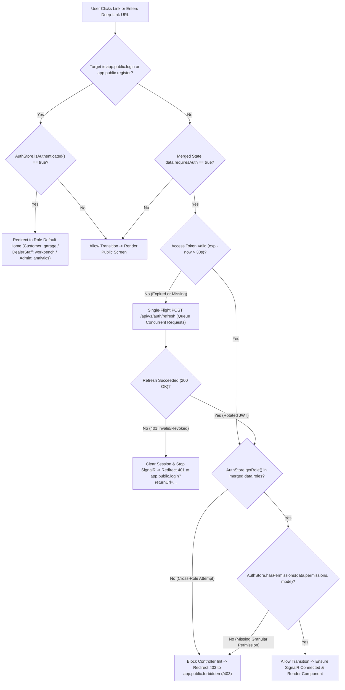

# Design System, Shared Shell & Navigation Architecture — Motorcycle Dealer & Loyalty Platform

| Metadata | Details |
| :--- | :--- |
| **Document ID** | `UX-DSNAV-MDLMP-2026-V1.2` |
| **Version** | `1.2.0` (**Implemented & Verified in Production Code** — `30` Navigable UI-Router Routes: `26` Primary + `4` Aliases) |
| **Project Name** | Motorcycle Dealer & Loyalty Management Platform |
| **Repository** | [https://github.com/quocanhh86/motorcycle-dealer](https://github.com/quocanhh86/motorcycle-dealer) |
| **Frontend Target Stack** | AngularJS `1.8.3` (`ng-strict-di`, `@uirouter/angularjs`, `Chart.js` v4, `@microsoft/signalr`, `@media print` Receipt Modal) |
| **Traceability** | `FR-01`..`FR-09` · `ADR-002`, `ADR-004`, `ADR-006` · `RISK-04` ([PRD.md](../PRD.md), [ARCHITECTURE.md](../ARCHITECTURE.md), [DESIGN.md](../DESIGN.md), [DD_04_SCREEN_SPECIFICATIONS.md](../detail-design/DD_04_SCREEN_SPECIFICATIONS.md)) |
| **Companion Screen Specs** | [CUSTOMER_PORTAL_SCREENS.md](./CUSTOMER_PORTAL_SCREENS.md) · [STAFF_AND_ADMIN_SCREENS.md](./STAFF_AND_ADMIN_SCREENS.md) · [DATABASE_DESIGN.md](../DATABASE_DESIGN.md) |

---

## Table of Contents

1. [Visual Identity & Motorsport Enterprise Design Tokens](#1-visual-identity--motorsport-enterprise-design-tokens)
   - [1.1 Brand, Neutral & Semantic Color Palette (WCAG 2.1 AA Verified)](#11-brand-neutral--semantic-color-palette-wcag-21-aa-verified)
   - [1.2 Typography Scale & Tabular Monospace Precision](#12-typography-scale--tabular-monospace-precision)
   - [1.3 Spatial Grid, Responsive Breakpoints, Z-Index & Elevation Tokens](#13-spatial-grid-responsive-breakpoints-z-index--elevation-tokens)
   - [1.4 Canonical Status & Loyalty Tier Badge Semantics](#14-canonical-status--loyalty-tier-badge-semantics)
2. [Application Shell & Shared AngularJS 1.8 Components (`frontend/src/app/shared/`)](#2-application-shell--shared-angularjs-18-components-frontendsrcappshared)
   - [2.1 Responsive Application Shell (`appShell`, `topNavbar`, `roleSidebar`, `breadcrumbBar`)](#21-responsive-application-shell-appshell-topnavbar-rolesidebar-breadcrumbbar)
   - [2.2 Real-Time SignalR Notification Center (`notificationBell`, Drawer, Connection Pill & Toast Stack)](#22-real-time-signalr-notification-center-notificationbell-drawer-connection-pill--toast-stack)
   - [2.3 Shared Directives, Filters, Printable Receipt Modal & `RFC 7807 ProblemDetails` Form Mapper](#23-shared-directives-filters-printable-receipt-modal--rfc-7807-problemdetails-form-mapper)
3. [Complete Screen Catalog & UI-Router State Machine (`27` Navigable Routes)](#3-complete-screen-catalog--ui-router-state-machine-27-navigable-routes)
   - [3.1 Master Screen & UI-Router State Catalog (`23` Primary Screens + `4` Aliases = `27` Routes)](#31-master-screen--ui-router-state-catalog-23-primary-screens--4-aliases--27-routes)
   - [3.2 UI-Router `$transitions.onBefore` Guard & Redirect Pipeline](#32-ui-router-transitionsonbefore-guard--redirect-pipeline)
   - [3.3 Multi-Role Portal Navigation & Deep-Link State Machine](#33-multi-role-portal-navigation--deep-link-state-machine)

---

## 1. Visual Identity & Motorsport Enterprise Design Tokens

The visual language balances **high-precision motorsport showroom aesthetics** (for `Public` and `Customer` journeys) with **high-density, low-fatigue operational ergonomics** (for `DealerStaff` 8-hour shift workbenches and `Admin` executive analytics). Every design token is defined as a native CSS custom property inside `frontend/src/assets/styles/tokens.css` with zero Sass/PostCSS build-chain lock-in.

### 1.1 Brand, Neutral & Semantic Color Palette (WCAG 2.1 AA Verified)

All foreground/background pairings meet or exceed **WCAG 2.1 Level AA** contrast requirements (`>= 4.5:1` for normal body text `< 18px`, `>= 3.0:1` for large headings, graphical chart marks, and active focus rings).

| Token Group | CSS Custom Property | HEX Value | Usage Role | Paired Text / Surface | Contrast Ratio (WCAG AA) |
| :--- | :--- | :---: | :--- | :--- | :---: |
| **Brand Motorsport** | `--clr-brand-primary` | `#DC2626` | Primary CTA buttons, active tab bar, showroom accents | `#FFFFFF` text on `#DC2626` | **`4.83:1` (Pass AA)** |
| **Brand Motorsport** | `--clr-brand-primary-hover` | `#B91C1C` | Primary CTA hover / active pressed state | `#FFFFFF` text on `#B91C1C` | **`6.47:1` (Pass AA)** |
| **Brand Motorsport** | `--clr-brand-primary-soft` | `#FEF2F2` | Selected slot card tint, active sidebar item background | `#991B1B` text on `#FEF2F2` | **`7.73:1` (Pass AAA)** |
| **Brand Motorsport** | `--clr-brand-primary-border` | `#FECACA` | Subtle highlight border on newly arrived `BookingCreated` cards | `#FFFFFF` / `#FEF2F2` surface | Decorative / `3.1:1` accent |
| **Carbon Neutrals** | `--clr-slate-950` | `#020617` | High-contrast top navigation bar & dark sidebar chrome | `#F8FAFC` text on `#020617` | **`19.26:1` (Pass AAA)** |
| **Carbon Neutrals** | `--clr-slate-900` | `#0F172A` | Primary headings, primary table cell copy, numeric KPIs | `#0F172A` on `#FFFFFF` | **`17.85:1` (Pass AAA)** |
| **Carbon Neutrals** | `--clr-slate-700` | `#334155` | Secondary body copy, form field labels, filter labels | `#334155` on `#FFFFFF` | **`10.33:1` (Pass AAA)** |
| **Carbon Neutrals** | `--clr-slate-600` | `#475569` | Muted metadata, helper text, pagination counters | `#475569` on `#F8FAFC` | **`7.12:1` (Pass AAA)** |
| **Carbon Neutrals** | `--clr-slate-500` | `#64748B` | Input placeholders & disabled icon glyphs (`large/non-text`) | `#64748B` on `#FFFFFF` | **`4.76:1` (Pass AA)** |
| **Carbon Neutrals** | `--clr-border-strong` | `#94A3B8` | Input borders, checkbox/radio outlines (`non-text >= 3:1`) | `#94A3B8` on `#FFFFFF` | **`3.02:1` (Pass AA UI)** |
| **Carbon Neutrals** | `--clr-border-subtle` | `#E2E8F0` | Card dividers, table row hairlines, Kanban lane borders | `#FFFFFF` / `#F8FAFC` | Structural divider |
| **Surfaces** | `--clr-surface-app` | `#F8FAFC` | Main `<ui-view>` viewport canvas background | `#0F172A` text | **`17.07:1` (Pass AAA)** |
| **Surfaces** | `--clr-surface-card` | `#FFFFFF` | Cards, data tables, modals, slide-over drawers | `#0F172A` text | **`17.85:1` (Pass AAA)** |
| **Surfaces** | `--clr-surface-sunken` | `#F1F5F9` | Kanban column track, read-only input background, code pills | `#1E293B` text | **`13.45:1` (Pass AAA)** |
| **Semantic Success** | `--clr-success-fg` / `--clr-success-bg` | `#15803D` / `#DCFCE7` | `Completed` status, `Available` stock/slot, SignalR `Connected` | `#15803D` on `#DCFCE7` | **`4.62:1` (Pass AA)** |
| **Semantic Warning** | `--clr-warning-fg` / `--clr-warning-bg` | `#92400E` / `#FEF3C7` | `Pending` booking, `Last Bay` slot, due VIN reminder, `Reconnecting` | `#92400E` on `#FEF3C7` | **`6.68:1` (Pass AA)** |
| **Semantic Danger** | `--clr-danger-fg` / `--clr-danger-bg` | `#991B1B` / `#FEE2E2` | `NoShow`, `Overdue` reminder, `400/409/422` errors, destructive CTA | `#991B1B` on `#FEE2E2` | **`6.89:1` (Pass AA)** |
| **Semantic Info** | `--clr-info-fg` / `--clr-info-bg` | `#1E40AF` / `#DBEAFE` | `Confirmed` booking, `ReservedOnBooking` voucher, informational toast | `#1E40AF` on `#DBEAFE` | **`6.70:1` (Pass AA)** |
| **Focus Accessibility** | `--clr-focus-ring` | `#2563EB` | `2px solid #2563EB` + `2px` offset `:focus-visible` keyboard ring | `#2563EB` on `#FFFFFF` | **`5.17:1` (Pass AA)** |

```css
/* Canonical Token Sheet Target: frontend/src/assets/styles/tokens.css */
:root {
  /* Brand & Neutrals */
  --clr-brand-primary: #DC2626;
  --clr-brand-primary-hover: #B91C1C;
  --clr-brand-primary-soft: #FEF2F2;
  --clr-brand-primary-border: #FECACA;

  --clr-slate-950: #020617;
  --clr-slate-900: #0F172A;
  --clr-slate-800: #1E293B;
  --clr-slate-700: #334155;
  --clr-slate-600: #475569;
  --clr-slate-500: #64748B;
  --clr-border-strong: #94A3B8;
  --clr-border-subtle: #E2E8F0;

  --clr-surface-app: #F8FAFC;
  --clr-surface-card: #FFFFFF;
  --clr-surface-sunken: #F1F5F9;

  /* Semantic Pairs */
  --clr-success-fg: #15803D;
  --clr-success-bg: #DCFCE7;
  --clr-success-accent: #16A34A;

  --clr-warning-fg: #92400E;
  --clr-warning-bg: #FEF3C7;
  --clr-warning-accent: #D97706;

  --clr-danger-fg: #991B1B;
  --clr-danger-bg: #FEE2E2;
  --clr-danger-accent: #DC2626;

  --clr-info-fg: #1E40AF;
  --clr-info-bg: #DBEAFE;
  --clr-info-accent: #2563EB;

  /* Loyalty Tier Tokens */
  --clr-tier-bronze-fg: #78350F;
  --clr-tier-bronze-bg: #FEF3C7;
  --clr-tier-bronze-accent: #B45309;

  --clr-tier-silver-fg: #1E293B;
  --clr-tier-silver-bg: #E2E8F0;
  --clr-tier-silver-accent: #64748B;

  --clr-tier-gold-fg: #713F12;
  --clr-tier-gold-bg: #FEF9C3;
  --clr-tier-gold-accent: #CA8A04;

  --clr-tier-platinum-fg: #312E81;
  --clr-tier-platinum-bg: #E0E7FF;
  --clr-tier-platinum-accent: #4F46E5;
}
```

---

### 1.2 Typography Scale & Tabular Monospace Precision

To eliminate horizontal jitter when live SignalR loyalty balances increment or financial tables align `DECIMAL(18,2)` `VND` totals, the typography system pairs geometric humanist sans-serif fonts with a mandatory tabular monospace stack:

- **Display / Page Headers (`--font-display`)**: `'Plus Jakarta Sans', 'Inter', -apple-system, BlinkMacSystemFont, 'Segoe UI', sans-serif` (supports full Vietnamese diacritics ` Tiếng Việt ` and Latin extended glyphs).
- **UI Body & Controls (`--font-sans`)**: `'Inter', -apple-system, BlinkMacSystemFont, 'Segoe UI', sans-serif`.
- **Identifiers & Financial Figures (`--font-mono`)**: `'JetBrains Mono', 'Cascadia Mono', 'Consolas', monospace` with `font-variant-numeric: tabular-nums slashed-zero`.

> [!IMPORTANT]
> **Mandatory Monospace & Tabular-Number Rule**: Every `VIN` (`VARCHAR(17)` ISO 3779, where `0` vs `O` and `1` vs `I` clarity is mission-critical), `VoucherCode` (`SVC100K-7K9P2M4X`), `BookingNumber` (`SB-202605-0041`), `OrderNumber` (`SO-202605-0042`), `InvoiceNumber` (`INV-202605-0118`), `StaffEmployeeCode` (`EMP-HCM-001`), odometer reading (`km`), and `VND` / loyalty point figure MUST apply `.u-mono` or `font-variant-numeric: tabular-nums`.

| Token | Size (`rem` / `px`) | Line Height | Weight | Font Stack | Canonical Usage |
| :--- | :---: | :---: | :---: | :--- | :--- |
| `--text-3xl` | `1.875rem` (`30px`) | `2.25rem` (`36px`) | `700` | `--font-display` | Hero Showroom headlines, Loyalty Wallet point totals, Analytics KPI primary figures |
| `--text-2xl` | `1.5rem` (`24px`) | `2rem` (`32px`) | `700` | `--font-display` | Screen `<h1>` page titles (`My Motorcycle Garage`, `Live Workshop Workbench`) |
| `--text-xl` | `1.25rem` (`20px`) | `1.75rem` (`28px`) | `600` | `--font-display` | Card group headers, Modal titles, Motorcycle model card titles |
| `--text-lg` | `1.125rem` (`18px`) | `1.625rem` (`26px`) | `600` | `--font-sans` | Section subheaders, invoice `NetPaidAmount` summary line |
| `--text-base` | `0.9375rem` (`15px`) | `1.5rem` (`24px`) | `400` / `500` | `--font-sans` | Primary body copy, form inputs, primary action buttons |
| `--text-sm` | `0.8125rem` (`13px`) | `1.25rem` (`20px`) | `400` / `500` | `--font-sans` | Data table rows, Kanban booking cards, filter dropdowns, field error messages |
| `--text-xs` | `0.75rem` (`12px`) | `1rem` (`16px`) | `600` | `--font-sans` | Uppercase table column headers (`letter-spacing: 0.04em`), status badges, timestamps |
| `--text-code` | `0.8125rem` (`13px`) | `1.25rem` (`20px`) | `500` | `--font-mono` | `VIN`, `VoucherCode`, `InvoiceNumber`, `OrderNumber`, `BookingNumber`, `DeduplicationKey` |

---

### 1.3 Spatial Grid, Responsive Breakpoints, Z-Index & Elevation Tokens

#### 4px / 8px Spacing Scale & Touch Ergonomics
- **Spacing Tokens**: `--space-1: 4px`, `--space-2: 8px`, `--space-3: 12px`, `--space-4: 16px`, `--space-5: 20px`, `--space-6: 24px`, `--space-8: 32px`, `--space-10: 40px`, `--space-12: 48px`.
- **Interactive Hit Targets**: Minimum `40px` height on desktop inputs/buttons (`36px` compact table actions) and minimum **`44px x 44px`** touch target on `< 768px` mobile viewports (`SCR-PUB-01`..`SCR-CUS-05`).
- **Border Radius**: `--radius-sm: 6px` (inputs, code pills), `--radius-md: 8px` (buttons, Kanban cards), `--radius-lg: 12px` (containers, charts, modals), `--radius-full: 9999px` (status & tier pills).

#### Responsive Breakpoints & Grid Behavior

| Breakpoint Token | Viewport Range | Grid Columns & Gutter | App Shell & Screen Adaptation |
| :--- | :---: | :---: | :--- |
| `xs` (Mobile Portrait) | `320px – 639px` | `4 cols`, `16px` gutter | Collapses sidebar into hamburger slide-over drawer; 1-column card stack; data tables transform into stacked key-value cards or horizontal scroll containers with sticky identifier column; sticky bottom CTA bar on `SCR-CUS-03`. |
| `sm` (Mobile Landscape) | `640px – 767px` | `8 cols`, `16px` gutter | 2-column time-slot capacity grid; off-canvas sidebar drawer remains collapsed. |
| `md` (Tablet / Workshop iPad) | `768px – 1023px` | `8 cols`, `20px` gutter | `64px` icon-only collapsible sidebar rail; 2-column Showroom/Garage cards; 2x2 Kanban scroll snap on `SCR-STF-01`. |
| `lg` (Standard Desktop) | `1024px – 1279px` | `12 cols`, `24px` gutter | Persistent `248px` left role sidebar; 3-column Showroom catalog; 4-column Kanban workbench (`Pending`, `Confirmed / CheckedIn`, `InProgress`, `Completed`). |
| `xl` / `2xl` (Wide Shift Monitor) | `>= 1280px` (`max 1440px` content container; `100%` fluid on `SCR-STF-01` & `SCR-ADM-01`) | `12 cols`, `24px` gutter | Full side-by-side split views (`SCR-STF-02` Invoice Calculator + Live Loyalty Preview; `SCR-ADM-01` 4-KPI strip + 2x2 `Chart.js` executive matrix). |

#### Elevation & Z-Index Layering Stack

| Layer Name | Z-Index Token | Box-Shadow Token | Assigned Components |
| :--- | :---: | :--- | :--- |
| **Base Card** | `--z-base: 1` | `--shadow-xs: 0 1px 2px rgba(15, 23, 42, 0.05)` | Standard data tables, KPI cards, `Chart.js` panels, Kanban cards |
| **Interactive Hover / Active** | `--z-raised: 10` | `--shadow-md: 0 4px 12px rgba(15, 23, 42, 0.08)` | Hovered motorcycle cards, newly prepended SignalR `BookingCreated` card |
| **Sticky Chrome** | `--z-sticky: 100` | `--shadow-sm: 0 1px 3px rgba(15, 23, 42, 0.10)` | `topNavbar` (`56px` height), sticky table headers, mobile bottom CTA bar |
| **Navigation Sidebar** | `--z-sidebar: 200` | `--shadow-lg: 0 10px 25px rgba(2, 6, 23, 0.18)` | Desktop `roleSidebar` & mobile off-canvas navigation drawer |
| **Slide-Over Drawer** | `--z-drawer: 300` | `--shadow-xl: 0 20px 32px rgba(2, 6, 23, 0.22)` | `notificationDrawer`, `milestoneTimelineDrawer`, `vinCheckinSlideOver` |
| **Modal Backdrop & Dialog** | `--z-modal: 400` | `--shadow-xl` + backdrop `rgba(15, 23, 42, 0.55)` | `confirmModal`, `externalVinRegistrationModal`, `bookingConflictModal`, Tier-Up celebration modal |
| **Real-Time Toast Stack** | `--z-toast: 500` | `--shadow-lg` + `4px` semantic left accent bar | Non-blocking SignalR `BookingCreated` / `LoyaltyPointsUpdated` / `ProblemDetails` toast alerts |

---

### 1.4 Canonical Status & Loyalty Tier Badge Semantics

Every badge renders with a `1px` subtle border, a leading geometric status indicator (`●` dot or semantic SVG icon so status is **never communicated by color alone** per WCAG 1.4.1), and exact enum mappings matching `MotorcycleDealerDb` SQL Server `CHECK` constraints ([DATABASE_DESIGN.md](../DATABASE_DESIGN.md)).

#### A. `BookingStatus` (`dbo.ServiceBookings.Status`) & Time-Slot Capacity Semantics

| Canonical Enum Value | UI Display Label | Leading Indicator | Text / Background / Border HEX | Operational Meaning |
| :--- | :--- | :---: | :---: | :--- |
| `'Pending'` | `Pending Confirmation` | `●` Pulse Amber | `#92400E` / `#FEF3C7` / `#FDE68A` | Newly booked by `Customer`; awaiting `DealerStaff` review in `SCR-STF-01` |
| `'Confirmed'` | `Confirmed` | `✓` Solid Blue | `#1E40AF` / `#DBEAFE` / `#BFDBFE` | Workshop bay reserved and acknowledged by branch advisor |
| `'CheckedIn'` | `Checked In` | `⇥` Cyan-Teal | `#155E75` / `#CFFAFE` / `#A5F3FC` | Motorcycle physically arrived at dealership; VIN & intake odometer verified |
| `'InProgress'` | `In Service Bay` | `⚙` Deep Violet | `#5B21B6` / `#EDE9FE` / `#DDD6FE` | Technician actively executing maintenance/repairs; ready for `ServiceInvoice` |
| `'Completed'` | `Completed` | `✓✓` Emerald | `#15803D` / `#DCFCE7` / `#BBF7D0` | `ServiceInvoice` settled, mileage rolled forward, loyalty points credited |
| `'Cancelled'` | `Cancelled` | `✕` Slate Neutral | `#334155` / `#F1F5F9` / `#CBD5E1` | Cancelled prior to service; `BookedCount` decremented & valid voucher released |
| `'NoShow'` | `No-Show` | `⊘` Crimson | `#991B1B` / `#FEE2E2` / `#FECACA` | Customer missed scheduled window without prior cancellation |
| *(Slot Derived)* | `Available (N of M Bays)` | `●` Emerald | `#15803D` / `#DCFCE7` / `#BBF7D0` | `MaxCapacity - BookedCount >= 2` and `IsBlocked == false` |
| *(Slot Derived)* | `Last Bay (1 Left!)` | `▲` Amber | `#92400E` / `#FEF3C7` / `#FCD34D` | `MaxCapacity - BookedCount == 1` (`RowVersion` contention hot-spot indicator) |
| *(Slot Derived)* | `Full (M/M Booked)` | `■` Muted Slate | `#475569` / `#E2E8F0` / `#CBD5E1` | `BookedCount >= MaxCapacity` (`disabled` button in `SCR-CUS-03`) |

#### B. `StockStatus` (`dbo.DealerInventories.StockStatus`)

| Canonical Enum Value | UI Display Label | Text / Background / Border HEX | Operational Meaning |
| :--- | :--- | :---: | :--- |
| `'Available'` | `In Stock (Available)` | `#15803D` / `#DCFCE7` / `#BBF7D0` | Physical 17-char `VIN` unit ready for immediate showroom `SalesOrders` checkout |
| `'Reserved'` | `Reserved Hold` | `#92400E` / `#FEF3C7` / `#FDE68A` | Temporarily held for customer deposit/inspection; excluded from new sales |
| `'Sold'` | `Sold & Onboarded` | `#1E40AF` / `#DBEAFE` / `#BFDBFE` | Atomically sold via `SalesOrders` and linked to `CustomerVehicles` |
| `'Transferred'` | `Inter-Branch Transfer` | `#475569` / `#F1F5F9` / `#CBD5E1` | Transferred out of branch inventory; non-sellable |

#### C. `VoucherStatus` (`dbo.CustomerVouchers.Status`)

| Canonical Enum Value | UI Display Label | Text / Background / Border HEX | Operational Meaning |
| :--- | :--- | :---: | :--- |
| `'Available'` | `Available to Use` | `#15803D` / `#DCFCE7` / `#BBF7D0` | Active in customer wallet (`ExpiresAtUtc > UtcNow`); selectable on booking/checkout |
| `'ReservedOnBooking'` | `Reserved on Booking` | `#1E40AF` / `#DBEAFE` / `#BFDBFE` | Locked to an active `ServiceBooking`; released automatically if cancelled before expiry |
| `'Used'` | `Redeemed & Settled` | `#334155` / `#F1F5F9` / `#CBD5E1` | Permanently consumed on a finalized `ServiceInvoice` or `SalesOrder` |
| `'Expired'` | `Expired` | `#991B1B` / `#FEE2E2` / `#FECACA` | Past `ExpiresAtUtc` without settlement; excluded from voucher pickers |

#### D. `LoyaltyTier` (`dbo.LoyaltyTiers.TierCode`)

| Canonical `TierCode` | `MinQualifyingPoints` | `PointsMultiplier` | Badge Icon | Text / Background / Border HEX | Visual Treatment |
| :--- | :---: | :---: | :---: | :---: | :--- |
| `'Bronze'` | `0` pts | `1.00x` (`1.0x`) | `◆ Bronze` | `#78350F` / `#FEF3C7` / `#F59E0B` | Warm copper-amber pill (`RankOrder = 1`, default entry tier) |
| `'Silver'` | `500` pts | `1.20x` (`1.2x`) | `◆◆ Silver` | `#1E293B` / `#E2E8F0` / `#94A3B8` | Brushed metallic slate pill (`RankOrder = 2`, `+20%` bonus accrual) |
| `'Gold'` | `2,000` pts | `1.50x` (`1.5x`) | `★ Gold` | `#713F12` / `#FEF9C3` / `#EAB308` | Rich motorsport gold pill (`RankOrder = 3`, `+50%` bonus accrual) |
| `'Platinum'` | `5,000` pts | `2.00x` (`2.0x`) | `♛ Platinum` | `#312E81` / `#E0E7FF` / `#6366F1` | Deep indigo-iridescent pill (`RankOrder = 4`, `2x` double accrual) |

---

## 2. Application Shell & Shared AngularJS 1.8 Components (`frontend/src/app/shared/`)

All shared components obey strict AngularJS `1.8.3` `.component()` architecture (`controllerAs: '$ctrl'`, unidirectional `<` inputs, `&` expression outputs, explicit `$inject`, zero `$rootScope` state mutation, and deterministic `$onDestroy` cleanup).

### 2.1 Responsive Application Shell (`appShell`, `topNavbar`, `roleSidebar`, `breadcrumbBar`)

- **Component Files**:
  - `frontend/src/app/shared/components/app-shell.component.js` (`<app-shell>`)
  - `frontend/src/app/shared/components/top-navbar.component.js` (`<top-navbar>`)
  - `frontend/src/app/shared/components/role-sidebar.component.js` (`<role-sidebar>`)
  - `frontend/src/app/shared/components/breadcrumb-bar.component.js` (`<breadcrumb-bar>`)

#### Desktop (`>= 1024px`) vs. Mobile (`< 768px`) Shell Wireframe

```text
DESKTOP SHELL (>= 1024px — Authenticated Customer / DealerStaff / Admin)
+------------------------------------------------------------------------------------------------------+
| [APEX MOTO LOYALTY]  | Branch/Tier Context Pill        [● SignalR: Connected] [🔔 3] [Lan Tran (v)] | <- topNavbar (56px, sticky)
+----------------------+-------------------------------------------------------------------------------+
| ROLE SIDEBAR (248px) | Home > Dealer Staff > Live Booking Workbench              [16/05/2026 16:05]  | <- breadcrumbBar (40px)
|                      +-------------------------------------------------------------------------------+
| [■] Live Workbench   |                                                                               |
| [ ] Invoice Builder  |   <div ui-view class="app-viewport">                                          |
| [ ] Sales & VIN Desk |     <!-- Active Screen Component Renders Here -->                             |
| [ ] Workshop Slots   |   </div>                                                                      |
| [ ] Customer Lookup  |                                                                               |
|                      |                                                                               |
| -------------------- |                                                                               |
| Scoped Branch:       |                                                                               |
| DLR-HCM-01 (Locked)  |                                                                               |
+----------------------+-------------------------------------------------------------------------------+

MOBILE SHELL (< 768px — Off-Canvas Drawer + Touch-First Header)
+-----------------------------------------------+
| [☰] [APEX MOTO]         [●] [🔔 3] [Avatar]   | <- topNavbar (56px)
+-----------------------------------------------+
| Garage > Book Service                         | <- Compact Breadcrumb
+-----------------------------------------------+
| <div ui-view class="app-viewport-mobile">     |
|   <!-- Single-Column Responsive Content -->   |
| </div>                                        |
+-----------------------------------------------+
```

#### Role-Contextual Sidebar Navigation Matrix

| Active Role | Context Pill in `topNavbar` | Sidebar Navigation Links (Guarded by `ui-sref-active` & `has-permission` — `40` Canonical Permissions) |
| :--- | :--- | :--- |
| **Anonymous (`Public`)** | `[Sign In]` · `[Register]` CTA buttons (No left sidebar; full-width showroom header) | Top links: `Showroom Catalog` (`app.public.showroom` with `[Book Test Drive]` CTA) |
| **`Customer` (`16` perms)** | Tier Badge (`Silver • 1.2x`) + Live `AvailablePoints` (`649 pts`) | `Dashboard` (`app.customer.dashboard`), `My VIN Garage` (`app.customer.garage`), `Book Service` (`app.customer.bookingNew`), `My Appointments` (`app.customer.bookings`), `Loyalty & Vouchers` (`app.customer.loyalty`), `My Test Drives` (`app.customer.testDrives`, `SCR-CUS-06`), `Showroom` (`app.public.showroom`) |
| **`DealerStaff` (`18` perms)** | Locked Tenant Pill: `DLR-HCM-01 • Apex Moto Saigon Center` (from JWT `dealer_id`) | `Live Workbench` (`app.staff.workbench`), `Invoice Builder` (`app.staff.invoiceBuilder`), `Showroom Sales & VIN Stock` (`app.staff.salesDesk`), `Workshop Time Slots` (`app.staff.timeSlots`), `Customer & VIN Lookup` (`app.staff.customers`), `Test-Drive Workbench` (`app.staff.testDrives`, `SCR-STF-06`) |
| **`Admin` (`28` perms)** | Global Scope Pill: `All Dealers • Network HQ` | `Executive Analytics` (`app.admin.analytics`), `Dealerships` (`app.admin.dealers`), `Dealer Staff` (`app.admin.staff`), `Models & OEM Rules` (`app.admin.models`), `Loyalty Tiers & Ledger` (`app.admin.loyaltyTiers`), `Voucher Catalog` (`app.admin.voucherCatalog`), `OEM Spare Parts` (`app.admin.spareParts`, `SCR-ADM-07`) |

---

### 2.2 Real-Time SignalR Notification Center (`notificationBell`, Drawer, Connection Pill & Toast Stack)

- **Component & Service Files**:
  - `frontend/src/app/core/realtime/signalr-client.service.js` (`SignalRClientService`)
  - `frontend/src/app/core/realtime/notification.store.js` (`NotificationStore`)
  - `frontend/src/app/shared/components/notification-bell.component.js` (`<notification-bell>`)
  - `frontend/src/app/shared/components/notification-drawer.component.js` (`<notification-drawer>`)
  - `frontend/src/app/shared/components/toast-stack.component.js` (`<toast-stack>` + `ToastService`)

#### ASCII Wireframe — `notificationBell`, Slide-Over Drawer & Non-Blocking Toast Stack

```text
TOP NAVBAR RIGHT CLUSTER:
  [● Connected]   [🔔 (3)]   [Minh Nguyen • Silver 1.2x v]
         |            |
         |            +---> Opens Slide-Over Drawer (380px right overlay, z-index: 300):
         |                  +-------------------------------------------------------------+
         |                  | NOTIFICATIONS (3 Unread)        [Mark All Read]  [✕ Close]  |
         |                  +-------------------------------------------------------------+
         |                  | Filter: [(•) All]  [( ) Unread Only]                        |
         |                  +-------------------------------------------------------------+
         |                  | ● [TierUpgraded • Just now]                         [Unread]|
         |                  |   Congratulations! Promoted to GOLD (1.50x Multiplier).     |
         |                  |   [View Loyalty Wallet ->]                                  |
         |                  |-------------------------------------------------------------|
         |                  | ● [MaintenanceReminderTriggered • 14m ago]          [Unread]|
         |                  |   VIN RLHJF5109RZ104829 due for 4,000 km Periodic Service.  |
         |                  |   [Book Service Now ->]                                     |
         |                  |-------------------------------------------------------------|
         |                  |   [BookingStatusChanged • 16/05/2026 09:05]           [Read]|
         |                  |   Booking SB-202605-0041 confirmed by Saigon Center.        |
         |                  +-------------------------------------------------------------+
         |
         +---> Connection Pill States:
               1. [● Connected]             (--clr-success-bg / --clr-success-fg)
               2. [↻ Reconnecting (2/5)...] (--clr-warning-bg / --clr-warning-fg, aria-live="polite")
               3. [✕ Offline • Syncing]     (--clr-danger-bg  / --clr-danger-fg, manual [Reconnect] button)

NON-BLOCKING TOAST STACK (Top-Right viewport below navbar, max 4 stacked, 6000ms auto-dismiss, pause on hover):
  +--------------------------------------------------------------------+
  | ┃ [NEW BOOKING • 09:00-10:00]                              [✕]     |
  | ┃ SB-202605-0041 • Honda SH160i (VIN: RLHJF5109RZ104829)           |
  | ┃ Customer: Minh Nguyen • Voucher Reserved     [Open in Workbench] |
  +--------------------------------------------------------------------+
```

#### SignalR Lifecycle & Digest Safety Contract (`RISK-04`)
1. **Authentication & Auto-Reconnect**: `SignalRClientService.start()` connects to `/hubs/notifications` using `accessTokenFactory` and `.withAutomaticReconnect([0, 2000, 5000, 10000, 30000])`.
2. **Digest Marshaling**: Every incoming event across all **`7` hub events** (`BookingCreated`, `BookingStatusChanged`, `MaintenanceReminderTriggered`, `LoyaltyPointsUpdated`, `TierUpgraded`, `TestDriveCreated`, `TestDriveStatusChanged`) executes inside `$rootScope.$applyAsync()` — **never** `$scope.$apply()` — updating `NotificationStore`, pushing a non-blocking toast to `ToastService`, and broadcasting `signalr:<EventName>`.
3. **Reconnect Catch-Up**: On `onreconnected`, `NotificationStore.syncUnreadSinceLastSeen()` calls `GET /api/v1/notifications?unreadOnly=true&sinceUtc={lastSeenUtc}` so zero alerts missed during Wi-Fi drops are lost (`EC-09`).
4. **Deterministic `$onDestroy` Teardown**: `notificationBell` and `notificationDrawer` store every `$rootScope.$on(...)` deregistration handle and invoke them inside `$ctrl.$onDestroy`, while `AuthService.logout()` invokes `SignalRClientService.stop()`.

---

### 2.3 Shared Directives, Filters, Printable Receipt Modal & `RFC 7807 ProblemDetails` Form Mapper

| Artifact Name | File Path (`frontend/src/app/...`) | AngularJS Type | Exact Engineering Contract & Usage |
| :--- | :--- | :--- | :--- |
| **`has-permission`** | `shared/has-permission.directive.js` | Attribute Directive (`restrict: 'A'`) | Accepts string (`has-permission="Permissions.Loyalty.RedeemVoucher"`) or array (`has-permission="[...]"` with `permission-mode="ANY"` or `"ALL"`). Applies `ng-hide`, `aria-hidden="true"`, and `disabled` when unauthorized; re-evaluates on `auth:changed`; deregisters listener on `$destroy`. UX layer only — server `[Authorize(Policy = ...)]` is authoritative. |
| **`vin-input`** | `shared/vin-input.directive.js` | Attribute Directive (`require: 'ngModel'`) | Attaches `$parsers` that trim whitespace and force `.toUpperCase()`, blocks/highlights forbidden ISO 3779 letters (`I`, `O`, `Q`), registers `ngModel.$validators.isoVin` (`^[A-HJ-NPR-Z0-9]{17}$`), applies `.u-mono`, and renders a live `17/17` counter badge. |
| **`printableReceiptModal` (`v1.1.0`)** | `shared/printable-receipt-modal.component.js` | Component (`<printable-receipt-modal>`) | Reusable Official Dealership Tax & Loyalty Receipt dialog (`bindings: { isOpen: '<', receiptType: '@', sourceId: '<', onClose: '&' }`) mounted across `SCR-STF-02`, `SCR-STF-03`, `SCR-CUS-04`, and `SCR-CUS-05`. Fetches `GET /api/v1/service-invoices/{id}/receipt` (`RCP-SVC-*`) or `GET /api/v1/sales-orders/{id}/receipt` (`RCP-SLS-*`), normalizes itemized `ServiceInvoiceLineItems` / showroom `VIN` breakdown, loyalty points earned, and the 16-char uppercase SHA-256 `verificationCode`, triggers `$window.print()`, and detaches scoped `Escape` keydown listeners on close & `$onDestroy`. |
| **`@media print` Stylesheet (`v1.1.0`)** | `styles/app-shell.css` | CSS Print Media Rules | `@media print` hides `.top-navbar`, `.role-sidebar`, `.breadcrumb-bar`, `.toast-container`, `.modal-actions`, and `.no-print` chrome (`display: none !important`), resets `.printable-receipt-sheet` to full-contrast black-on-white A4/thermal paper geometry (`box-shadow: none`, crisp borders, `.u-mono` tabular VND figures & SHA-256 verification footer). |
| **`vndCurrency`** | `shared/filters.js` | Presentation Filter | Formats C# `decimal` / SQL `DECIMAL(18,2)` numbers via `Intl.NumberFormat('vi-VN')` (`{{ ::order.finalAmount \| vndCurrency }}` -> `101.000.000 ₫`). Returns `'0 ₫'` safely on `null`/`undefined`; never uses floating-point arithmetic. |
| **`utcToLocal`** (`utcToVnTime`) | `shared/filters.js` | Presentation Filter | Converts UTC ISO-8601 strings (`"2026-05-14T09:02:18Z"`) exclusively at render time to `'Asia/Ho_Chi_Minh'` (`UTC+07:00`) via `Intl.DateTimeFormat('vi-VN', { timeZone: 'Asia/Ho_Chi_Minh', ... })`. Outbound API payloads remain strict UTC. |
| **`dealerChart`** | `shared/dealer-chart.component.js` | Component (`<dealer-chart>`) | Leak-free `Chart.js v4` wrapper (`bindings: { config: '<', heightPx: '@?' }`). Calls `chartInstance.update('none')` on `$onChanges` and `chartInstance.destroy()` inside `$onDestroy` (`RISK-04`). |
| **`ProblemDetailsMapper`** | `core/api/problem-details-mapper.service.js` | Singleton Service | Parses `application/problem+json` (`RFC 7807`) responses: (1) `400 VALIDATION_FAILED` -> maps `problem.errors[fieldName]` onto `formCtrl[camelField].$setValidity('server', false)`; (2) `409 Conflict` (`SLOT_CAPACITY_EXHAUSTED`, `TEST_DRIVE_SLOT_FULL`, `TEST_DRIVE_OVERLAP`, `CONCURRENCY_CONFLICT`, `DUPLICATE_VIN`, `DUPLICATE_PART_CODE`) -> invokes conflict recovery + `rowVersion` reload; (3) `422 Unprocessable Entity` (`SPARE_PART_INCOMPATIBLE`, `ODOMETER_REGRESSION`, etc.) -> renders domain rule banner with `traceId`; (4) `500` -> generic safe toast showing `traceId` only. |

---

## 3. Complete Screen Catalog & UI-Router State Machine (`27` Navigable Routes)

### 3.1 Master Screen & UI-Router State Catalog (`23` Primary Screens + `4` Aliases = `27` Routes)

The live `v1.1.0` AngularJS 1.8.3 SPA registers **`32` `@uirouter/angularjs` states** (`5` abstract shells + **`23` primary feature screens** + **`4` named route aliases** = **`27` navigable concrete UI-Router routes**, all verified with `0` console errors in Headless Edge CDP):

| Screen ID | Screen Title | Primary UI-Router State(s) & Route Aliases | URL Path | Allowed Role(s) | Required Permission(s) (`[HasPermission]`) | AngularJS Component Path (`frontend/src/app/features/...`) |
| :--- | :--- | :--- | :--- | :--- | :--- | :--- |
| **`SCR-PUB-01`** | Public Motorcycle Showroom, Model Specs & `[Book Test Drive]` CTA | `app.public.showroom` *(redirects `/` -> `/showroom`)* | `/showroom` | Anonymous, `Customer`, `DealerStaff`, `Admin` | Public *(Optional `Permissions.Showroom.View`, `Permissions.Dealers.ViewPublic`)* | `features/public/showroom.component.js` |
| **`SCR-PUB-02A/B`** | Authentication Portal — Sign In (`02A`) & Customer Self-Registration (`02B`) | `app.public.login`, `app.public.register` (`2` primary states) | `/login?returnUrl&returnTo&reason`, `/register` | Anonymous *(redirects authenticated users to `ROLE_HOME`)* | Anonymous | `features/public/login.component.js`, `features/public/register.component.js` |
| **`SCR-PUB-03`** | Access Denied / 403 Forbidden Guard Screen | `app.public.forbidden` | `/403` | All Roles / Anonymous | None *(System Guard Target)* | `features/public/forbidden.component.js` |
| **`SCR-CUS-01`** | Customer Portal Overview Dashboard | `app.customer.dashboard` | `/customer/dashboard` | `Customer` | `Permissions.Vehicles.ViewOwn`, `Permissions.Bookings.ViewOwn`, `Permissions.Loyalty.ViewOwn` | `features/customer/dashboard.component.js` |
| **`SCR-CUS-02`** | Digital VIN Garage, Odometer & Maintenance Schedule | `app.customer.garage` | `/customer/garage` | `Customer` | `Permissions.Vehicles.ViewOwn`, `Permissions.Vehicles.RegisterOwn` | `features/customer/garage.component.js` |
| **`SCR-CUS-03`** | Guided Workshop Service Booking & Slot Picker | `app.customer.bookingNew` *(+ alias `app.customer.bookService`)* | `/customer/bookings/new?vehicleId&dealerId&voucherId` *(+ `/customer/book-service`)* | `Customer` | `Permissions.Bookings.Create`, `Permissions.TimeSlots.ViewAvailable` | `features/customer/booking-new.component.js` |
| **`SCR-CUS-04`** | My Service Appointments, Live Stepper & Printable Service Receipts | `app.customer.bookings` | `/customer/bookings` | `Customer` | `Permissions.Bookings.ViewOwn`, `Permissions.Bookings.CancelOwn`, `Permissions.Invoices.ViewOwn` | `features/customer/bookings.component.js` |
| **`SCR-CUS-05`** | Loyalty Wallet, 4-Tier Progress, Voucher Store & Printable Order Receipts | `app.customer.loyalty` | `/customer/loyalty` | `Customer` | `Permissions.Loyalty.ViewOwn`, `Permissions.Loyalty.RedeemVoucher`, `Permissions.SalesOrders.ViewOwn` | `features/customer/loyalty.component.js` |
| **`SCR-CUS-06`** | Showroom Test-Drive Scheduling & Live Status Tracker (`v1.1.0`) | `app.customer.testDrives` | `/customer/test-drives?modelId&dealerId` | `Customer` | `Permissions.TestDrives.ViewOwn`, `Permissions.TestDrives.Create` | `features/customer/test-drives.component.js` |
| **`SCR-STF-01`** | Zero-Refresh SignalR Live Booking Workbench & VIN Check-In | `app.staff.workbench` | `/staff/workbench` | `DealerStaff` *(scoped to `DealerId`)* | `Permissions.Bookings.ViewDealer`, `Permissions.Bookings.UpdateStatus`, `Permissions.Vehicles.ViewDealer` | `features/staff/workbench.component.js` |
| **`SCR-STF-02`** | Workshop Service Invoice Builder, OEM Spare-Parts Picker & Official Receipt | `app.staff.invoiceBuilder` *(+ alias `app.staff.invoicing`)* | `/staff/bookings/:bookingId/invoice` *(+ `/staff/invoicing/:bookingId`)* | `DealerStaff` *(scoped to `DealerId`)* | `Permissions.Invoices.CreateDealer`, `Permissions.Invoices.ViewDealer`, `Permissions.Loyalty.ViewDealerCustomer` | `features/staff/invoice-builder.component.js` |
| **`SCR-STF-03`** | Showroom VIN Inventory, Bike Sales Checkout & Official Receipt | `app.staff.salesDesk` *(+ alias `app.staff.salesNew`)* | `/staff/sales-orders/new` *(+ `/staff/sales-new`)* | `DealerStaff` *(scoped to `DealerId`)* | `Permissions.SalesOrders.Create`, `Permissions.SalesOrders.ViewDealer`, `Permissions.Inventories.ViewDealer`, `Permissions.Inventories.ManageDealer` | `features/staff/sales-desk.component.js` |
| **`SCR-STF-04`** | Branch Workshop Bay & Service Time-Slot Manager | `app.staff.timeSlots` *(+ alias `app.staff.slots`)* | `/staff/time-slots` *(+ `/staff/slots`)* | `DealerStaff` *(scoped to `DealerId`)* | `Permissions.TimeSlots.ManageDealer`, `Permissions.TimeSlots.ViewAvailable` | `features/staff/time-slots.component.js` |
| **`SCR-STF-05`** | Branch Customer, VIN Garage & Loyalty Lookup | `app.staff.customers` | `/staff/customers` | `DealerStaff` | `Permissions.Vehicles.ViewDealer`, `Permissions.Loyalty.ViewDealerCustomer` | `features/staff/customers.component.js` |
| **`SCR-STF-06`** | Zero-Refresh SignalR Showroom Test-Drive Workbench (`v1.1.0`) | `app.staff.testDrives` | `/staff/test-drives` | `DealerStaff` *(scoped to `DealerId`)* | `Permissions.TestDrives.ViewDealer`, `Permissions.TestDrives.UpdateStatus` | `features/staff/test-drives.component.js` |
| **`SCR-ADM-01`** | Executive Multi-Dealer `Chart.js v4` Analytics Dashboard | `app.admin.analytics` | `/admin/analytics` | `Admin` | `Permissions.Analytics.ViewAllDealers`, `Permissions.Analytics.ExportReports` | `features/admin/analytics.component.js` |
| **`SCR-ADM-02`** | Multi-Dealer Branch Network Governance | `app.admin.dealers` | `/admin/dealers` | `Admin` | `Permissions.Dealers.ManageAll`, `Permissions.Dealers.ViewPublic` | `features/admin/dealers.component.js` |
| **`SCR-ADM-03`** | Dealer Staff Provisioning & Access Governance | `app.admin.staff` | `/admin/staff?dealerId` | `Admin` | `Permissions.Users.ManageStaff` | `features/admin/staff.component.js` |
| **`SCR-ADM-04`** | Master Motorcycle Models & OEM Maintenance Rules | `app.admin.models` | `/admin/models` | `Admin` | `Permissions.Showroom.ManageModels`, `Permissions.Vehicles.ManageRules` | `features/admin/models.component.js` |
| **`SCR-ADM-05`** | Loyalty Tiers Studio & Audited Point Adjustments | `app.admin.loyaltyTiers` | `/admin/loyalty/tiers` | `Admin` | `Permissions.Loyalty.ManageTiers`, `Permissions.Loyalty.AdjustPoints` | `features/admin/loyalty-tiers.component.js` |
| **`SCR-ADM-06`** | Reward Voucher Catalog & Quota Governance | `app.admin.voucherCatalog` | `/admin/loyalty/vouchers` | `Admin` | `Permissions.Loyalty.ManageVoucherCatalog` | `features/admin/voucher-catalog.component.js` |
| **`SCR-ADM-07`** | OEM Spare-Parts Master Catalog Studio (`v1.1.0`) | `app.admin.spareParts` | `/admin/spare-parts` | `Admin` | `Permissions.SpareParts.ManageCatalog` | `features/admin/spare-parts.component.js` |

---

### 3.2 UI-Router `$transitions.onBefore` Guard & Redirect Pipeline

Every state navigation in `@uirouter/angularjs` passes through the deterministic guard pipeline before any feature controller instantiates or fires `$http` calls (`FR-01`, `ADR-006`):



---

### 3.3 Multi-Role Portal Navigation & Deep-Link State Machine

```mermaid
stateDiagram-v2
    [*] --> PublicShowroom: "Anonymous Entry (/showroom)"

    state "Public Namespace (app.public.*)" as PublicNS {
        PublicShowroom: "SCR-PUB-01: app.public.showroom"
        PublicLogin: "SCR-PUB-02A: app.public.login"
        PublicRegister: "SCR-PUB-02B: app.public.register"
        PublicForbidden: "SCR-PUB-03: app.public.forbidden (/403)"

        PublicShowroom --> PublicLogin: "Click Book Service / Sign In"
        PublicLogin --> PublicRegister: "New Customer? Create Account"
        PublicRegister --> CustGarage: "201 Registered (Auto-Provision Bronze Tier)"
    }

    state "Customer Portal (app.customer.*)" as CustomerNS {
        CustDash: "SCR-CUS-01: app.customer.dashboard"
        CustGarage: "SCR-CUS-02: app.customer.garage"
        CustBookNew: "SCR-CUS-03: app.customer.bookService (bookingNew)"
        CustBookings: "SCR-CUS-04: app.customer.bookings"
        CustLoyalty: "SCR-CUS-05: app.customer.loyalty"
        CustTestDrives: "SCR-CUS-06: app.customer.testDrives"
        CustWarranty: "SCR-CUS-07: app.customer.warranty"

        CustDash --> CustGarage: "Inspect VIN / Odometer"
        CustGarage --> CustBookNew: "Book Maintenance (Pre-fills vehicleId)"
        CustGarage --> CustWarranty: "File VIN Warranty Claim"
        CustLoyalty --> CustBookNew: "Apply Available CustomerVoucher"
        CustBookNew --> CustBookings: "201 Booking Created"
        CustBookings --> CustLoyalty: "Invoice Completed -> View Points"
        CustBookings --> CustWarranty: "Submit 5-Star CSAT Review (+25 pts)"
    }

    state "Dealer Staff Portal (app.staff.* — Scoped to DealerId)" as StaffNS {
        StaffWorkbench: "SCR-STF-01: app.staff.workbench"
        StaffInvoice: "SCR-STF-02: app.staff.invoiceBuilder (invoicing)"
        StaffSales: "SCR-STF-03: app.staff.salesDesk (salesNew)"
        StaffSlots: "SCR-STF-04: app.staff.timeSlots (slots)"
        StaffCustomers: "SCR-STF-05: app.staff.customers"
        StaffTestDrives: "SCR-STF-06: app.staff.testDrives"
        StaffWarrantyReviews: "SCR-STF-07: app.staff.warrantyReviews"

        StaffWorkbench --> StaffInvoice: "Status == InProgress -> Issue Invoice"
        StaffInvoice --> StaffWorkbench: "201 Settled -> Completed Column"
        StaffTestDrives --> StaffSales: "Completed Test Drive -> Convert to Sale"
        StaffCustomers --> StaffSales: "Sell Available VIN to Customer"
        StaffWorkbench --> StaffSlots: "Adjust Daily Bay Capacity"
    }

    state "Admin Portal (app.admin.* — Cross-Dealer HQ)" as AdminNS {
        AdminAnalytics: "SCR-ADM-01: app.admin.analytics"
        AdminDealers: "SCR-ADM-02: app.admin.dealers"
        AdminStaff: "SCR-ADM-03: app.admin.staff"
        AdminModels: "SCR-ADM-04: app.admin.models"
        AdminTiers: "SCR-ADM-05: app.admin.loyaltyTiers"
        AdminVouchers: "SCR-ADM-06: app.admin.voucherCatalog"
        AdminSpareParts: "SCR-ADM-07: app.admin.spareParts"
        AdminQualityWarranty: "SCR-ADM-08: app.admin.qualityWarranty"

        AdminAnalytics --> AdminDealers: "Drill Down Branch Row"
        AdminAnalytics --> AdminQualityWarranty: "Inspect CSAT & Warranty KPIs"
        AdminDealers --> AdminStaff: "Manage Branch Staff"
        AdminModels --> AdminSpareParts: "Configure Model-Compatible OEM Parts"
        AdminTiers --> AdminVouchers: "Configure Tier-Gated Rewards"
    }

    PublicShowroom --> CustTestDrives: "[Book Test Drive] CTA (?modelId&dealerId)"
    PublicLogin --> CustGarage: "Role == Customer (or sanitized returnUrl)"
    PublicLogin --> StaffWorkbench: "Role == DealerStaff"
    PublicLogin --> AdminAnalytics: "Role == Admin"

    CustomerNS --> PublicForbidden: "Unauthorized Route Attempt (403)"
    StaffNS --> PublicForbidden: "Unauthorized Route Attempt (403)"
```


