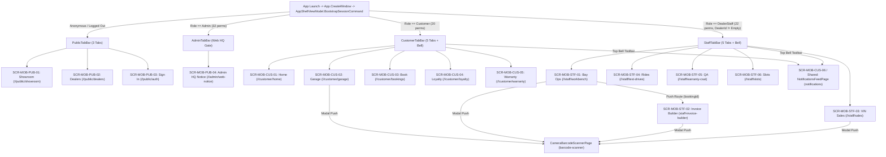

# Native Android & iOS `.NET 10 MAUI` Field App Screen Specifications (`v1.4.0`)

| Metadata | Canonical Value |
| :--- | :--- |
| **Document ID** | `UX-MOB-001-V1.4.0` |
| **Platform & Targets** | Native C# `.NET 10 MAUI` (**`net10.0-android;net10.0-ios`**, Android API `26`–`35`, Apple iOS `15.0+`, `.NET 10` `SafeAreaEdges="All"`, `ApplicationId: vn.motorcycledealer.mobile`, Display Title: `Apex Moto`) |
| **XAML, Atelier UI, Motion & i18n Engine** | `.NET 10` XAML `SourceGen` (`26/26` `x:DataType` views) · **`9` Bundled TTFs** (`Space Grotesk`, `Be Vietnam Pro`, `JetBrains Mono`, `Phosphor`, `Phosphor-Fill`) · **`SkiaSharp.Views.Maui.Controls 3.119.4` + `SkiaSharp.Extended.UI.Maui 3.0.0`** (`4` bundled Lottie JSONs) · **`8` Offline Studio Images** (`MotorcycleImageResolver`) · **`LocalizationService`** (`vi-VN` default `<->` `en-US` hot-switch, `803` `.resx` keys, **`Humanizer.Core.vi 2.14.1`**) · **`CommunityToolkit.Maui 13.0`** (`StatusBarBehavior`, `Expander`, `TouchBehavior` `x:Reference`, `EmailValidationBehavior`, `Toast`/`Snackbar`) · `CommunityToolkit.Mvvm` C# 13 `partial` (`179` properties) · `FluentValidation 11.11` · Polly v8 `Http.Resilience` |
| **Screen Inventory** | **`16` Native Compiled Pages** (`4` Public/Gate + `5` Customer Tabs + `6` DealerStaff Field Views + `1` Shared Real-Time Notifications & Activity Feed) + **`10` Compiled Controls & Modal Scanner** (`26/26` `x:DataType`) |
| **Role Scope & Data Integrity** | **2-Role Field Super-App (100% Zero-Mock Real-Data)**: Anonymous `Public Showroom` (`3` tabs), `Customer` (`20` perms, `5` tabs), `DealerStaff` (`22` perms `DealerId`-scoped, `5` tabs + pushed Invoice Builder); `Admin` (`32` perms) redirects to Web HQ (`AdminWebConsoleNoticePage`). Live-verified across `9/9` screenshots on `Pixel_8_API_35` (`0` logcat errors) + `0`-warning `net10.0-ios` Release compile. |
| **Companion Specifications** | [DESIGN_SYSTEM_AND_NAVIGATION.md](./DESIGN_SYSTEM_AND_NAVIGATION.md) · [PRD.md](../PRD.md) (`FR-10`) · [ARCHITECTURE.md](../ARCHITECTURE.md) (`ADR-007`) · [DESIGN.md](../DESIGN.md) · [DD_04_SCREEN_SPECIFICATIONS.md](../detail-design/DD_04_SCREEN_SPECIFICATIONS.md) · [mobile/AGENTS.md](../../mobile/AGENTS.md) |

---

## 1. Role-Adaptive `AppShell` Navigation Architecture (`AppShell.xaml`)

`MotorcycleDealer.Mobile.App` uses a single declarative **`AppShell`** (`FlyoutBehavior="Disabled"`, bound to `AppShellViewModel`) that dynamically switches active `TabBar` visibility based on `MobileSessionState` and enforces route guards inside `AppShell.OnNavigating` via `MobileRoleGuard.CanAccessRoute(route, session)`:

- **App Lifecycle, Localization, Theme & SignalR Coordination (`App.xaml.cs`, `AppShell.xaml(.cs)` & `MauiProgram.cs`)**:
  - `AppShell.xaml` renders **`14/14` Phosphor `FontImageSource` tabs** (`FontFamily="Phosphor"`, `Size="20"`) bound to `AppShellViewModel.Loc.Tab*` and refreshes tab titles live on `CultureChangedMessage`; `App.xaml.cs` hydrates `AppPreferenceKeys.Theme` from `MauiPreferencesStore` (MAUI `Preferences`, preserving exact `9` `SQLCipher` tables) and hot-switches `UserAppTheme` on `ThemeChangedMessage`.
  - `MauiProgram.cs` chains `.UseSkiaSharp()`, registers all **`9` bundled TTFs**, wires `MauiPreferencesStore`, `MauiMotionPreferencesService`, and native `MauiHapticService` (iOS `UINotificationFeedbackGenerator` / Android API 30+ `Confirm`/`Reject`), and configures iOS adaptive `UINavigationBarAppearance` + `UITabBarAppearance`.
  - `Window.Created` triggers `AppShellViewModel.BootstrapSessionCommand` to restore platform secure tokens (`MauiSecureTokenStore` over Android Keystore / Apple iOS Keychain), hydrate `MobileSessionState`, verify `/api/v1/auth/me` over Polly v8 idempotent resilience (`DealerMobileResilience`), or fall back gracefully to encrypted `SQLCipher` offline snapshots, and connect `SignalRMobileService`.
  - Cross-ViewModel mutations broadcast typed `WeakReferenceMessenger` (`IMessenger`) events (`BookingMutatedMessage`, `WalletMutatedMessage`, `VehicleMutatedMessage`, `WarrantyMutatedMessage`, `TestDriveMutatedMessage`, `CultureChangedMessage`, `ThemeChangedMessage`) and surface native `CommunityToolkit.Maui 13.0` **`Toast` / `Snackbar`** feedback (`MauiUserFeedbackService`: `#020617` Carbon / `#F8FAFC` White / `#DC2626` Crimson).
  - `Window.Stopped` invokes `ISignalRMobileService.OnAppBackgroundedAsync()` to pause WebSockets cleanly without draining battery; `Window.Resumed` reconnects `/hubs/notifications`, fetches delta unread events via `GET /api/v1/notifications?sinceUtc=...`, and flushes allow-listed offline outbox items.

---

## 2. Motorsport Adaptive Design System (Light Showroom `<->` Dark Pit-Lane, `v1.4.0`)

Defined in `Resources/Styles/MotorsportColors.xaml` and `Resources/Styles/MotorsportStyles.xaml` using `AppThemeBinding` for WCAG 2.1 Level AA (`>= 4.5:1`) parity with `frontend/src/styles/design-tokens.css`:

| Token Category | Light Showroom Mode | Dark Pit-Lane Mode | Usage & Ergonomic Standard |
| :--- | :--- | :--- | :--- |
| **Brand Motorsport Crimson** | `#DC2626` (`#B91C1C` pressed, `#FEF2F2` soft) | `#DC2626` (`#B91C1C` pressed, `#450A0A` soft) | Primary CTAs (`PrimaryPillCta`), active tab indicator, racing apex chevron (`appiconfg.svg`) |
| **App Canvas / Card / Sunken** | `#F8FAFC` / `#FFFFFF` / `#F1F5F9` | `#020617` / `#0F172A` / `#1E293B` | High-legibility outdoor showroom & dark workshop pit-lane surfaces; `DoubleBezelOuter` + `DoubleBezelInner` card frames |
| **Borders & Radii** | `#E2E8F0` subtle, `#94A3B8` strong | `#334155` subtle, **`#64748B` strong (`3.75:1` AA)** | Crisp `1dp` hairline borders; `6dp` badges, `8dp` buttons/inputs, `12dp` cards (`RoundRectangle`) |
| **Bundled Typography (`9` TTFs)** | `#0F172A` primary, `#334155` secondary, `#64748B` muted | `#F8FAFC` primary, `#CBD5E1` secondary, `#94A3B8` muted | `Space Grotesk` (SemiBold/Bold headings), `Be Vietnam Pro` (Regular/Medium/SemiBold Vietnamese UI), `JetBrains Mono` (Medium/SemiBold VIN/VND/Points), `Phosphor` + `Phosphor-Fill` (`Icons/PhosphorIcons.cs`, `58` verified glyphs) |
| **4 Loyalty Tier Metallics** | `Bronze` (`#B45309`), `Silver` (`#64748B`), `Gold` (`#CA8A04`), **Titanium Ice-Cyan `Platinum`** (`#0C4A6E`/`#E0F2FE`/`#38BDF8`) | 3-stop brushed metallic foil gradients matching Web `design-tokens.css` | `LoyaltyPassbookCardView` + 1-shot `lottie_tier_sparkle.json` + specular sheen |
| **Semantic Status Triplets** | `Success` (`#15803D`/`#DCFCE7`), `Warning` (`#92400E`/`#FEF3C7`), `Danger` (`#991B1B`/`#FEE2E2`), `Info` (`#1E40AF`/`#DBEAFE`), `CheckedIn` (`#155E75`/`#CFFAFE`), **Distinct `InProgress` Violet** (`#5B21B6`/`#EDE9FE`) | High-contrast dark-surface triplets (`#86EFAC`/`#052E16`, `#FDE68A`/`#451A03`, `#FCA5A5`/`#450A0A`, `#93C5FD`/`#172554`, `#67E8F9`/`#083344`, **`InProgress` `#C4B5FD`/`#2E1065`**) | `StatusBadgeView` (Phosphor glyph + `LocalizationService.GetEnumLabel`) across bookings, test-drives, warranty claims, and online/offline indicators |
| **Touch Target, Safe Areas & Field Ergonomics** | **`>= 48dp` minimum interactive height** + **`.NET 10` `SafeAreaEdges="All"`** across pages | Same `>= 48dp` floor + zero-warning Android/iOS safe-area insets | One-handed glove-friendly workshop bay operation; zero raw emojis/Unicode hacks (`★`/`▾`/`→`) |

---

## 3. Reusable Compiled (`x:DataType`) Controls, Motion & Hardware Modules (`Controls/`, `Motion/`)

| Control / Module | Source File(s) | Capabilities & Lifecycle Hygiene |
| :--- | :--- | :--- |
| **`SkeletonLoaderView`** *(NEW `v1.4.0`)* | `Controls/SkeletonLoaderView.xaml(.cs)` | Multi-variant GPU shimmer (`ShowroomCard`, `KpiBento`, `ListRow`, `DetailHero`, `PassbookCard`; `1400ms` sweep) that auto-pauses on `IsVisible=False`, `Unloaded`, or `IMotionPreferencesService.IsReducedMotionEnabled`. |
| **`EmptyStateView` & `ErrorRetryBannerView`** *(NEW `v1.4.0`)* | `Controls/EmptyStateView.xaml(.cs)`, `Controls/ErrorRetryBannerView.xaml(.cs)` | Consistent zero-state (`LottieOrIconView` + Phosphor fallback + CTA) and localized RFC 7807 retry banners refreshing live on `CultureChangedMessage`. |
| **`LottieOrIconView` & `MotionHelper`** *(NEW `v1.4.0`)* | `Controls/LottieOrIconView.xaml(.cs)`, `Motion/MotionHelper.cs` | Wraps `SkiaSharp.Extended.UI.Controls.SKLottieView` for `4` self-hosted `Resources/Raw/lottie_*.json` animations (`moto_loading`, `empty_garage`, `success_check`, `tier_sparkle`), stopping `IsAnimationEnabled=false` on `Unloaded` and falling back to Phosphor glyphs under OS reduced-motion; `MotionHelper` provides `ExpoOut` entrances & `RotateChevronAsync`. |
| **`OfflineBannerView`** *(NEW `v1.4.0`)* | `Controls/OfflineBannerView.xaml(.cs)` | Smooth `ExpoOut` slide-fade offline strip with Phosphor `WifiSlash` and live `LocalizationService` copy. |
| **`StatusBadgeView`** | `Controls/StatusBadgeView.xaml(.cs)` | Renders Phosphor fill glyphs + localized `LocalizationService.GetEnumLabel` strings across all `16+` backend enum groups with live culture/theme sync. |
| **`ShimmerCardView`** | `Controls/ShimmerCardView.xaml(.cs)` | Backward-compatible skeleton card that halts animations cleanly on `IsVisible=False`, `Unloaded`, or reduced-motion (`RISK-04` mobile parity). |
| **`LoyaltyPassbookCardView`** | `Controls/LoyaltyPassbookCardView.xaml(.cs)` | Brushed 3-stop metallic 4-tier digital membership card with diagonal specular sheen, 1-shot `lottie_tier_sparkle.json`, animated `ProgressTo`, **`toolkit:TouchBehavior`** (`x:Reference`), and live `/api/v1/loyalty/tiers` progress. |
| **`QrCodeDisplayView` + `QrCodeMatrixEncoder`** | `Controls/QrCodeDisplayView.xaml(.cs)`, `Controls/QrCodeMatrixEncoder.cs` | **100% offline, AOT-safe pure C# ISO/IEC 18004 QR matrix encoder** (`Microsoft.Maui.Graphics.IDrawable`) rendering scannable basement-bay QR codes for `dealer://voucher|booking|receipt/v1`. |
| **`CameraBarcodeScannerPage`** | `Controls/CameraBarcodeScannerPage.xaml(.cs)` | Dual-platform 1D/2D scanner (`ZXing.Net.Maui.Controls`: Android **Camera2** + Apple iOS **AVFoundation `AVCaptureDevice`**) with `SafeAreaEdges="All"`, torch toggle, laser reticle, haptic confirmation (`MauiHapticService`), and neutral localized manual VIN/QR fallback. |
| **`CommunityToolkit.Maui 13.0` (`x:Reference` Rule)** | `App.xaml`, `Services/MauiUserFeedbackService.cs`, `Views/**` | Official converters, `StatusBarBehavior`, `Expander` (Phosphor `CaretDown` rotation), `EmailValidationBehavior`, native `Toast`/`Snackbar`, and **`TouchBehavior` bound strictly via `Source={x:Reference PageRoot}, Path=ViewModel.<Cmd>`** (Toolkit 13.0 does not inherit `BindingContext` onto behaviors). |

---

## 4. Complete 16-Screen Native Android & iOS Catalog (`SCR-MOB-*`)

### 4.1 Public Showroom & Role Gate Screens (`SCR-MOB-PUB-01` .. `SCR-MOB-PUB-04`)

| Screen ID | MAUI Page & Shell Route | ViewModel (`Mobile.Core`) | Role / Permission Scope | Key UI Capabilities, Offline Cache & API Bindings |
| :--- | :--- | :--- | :--- | :--- |
| **`SCR-MOB-PUB-01`** | `ShowroomCatalogPage` `//public/showroom` | `ShowroomCatalogViewModel` | Anonymous / `Permissions.Showroom.View` | Searchable motorcycle catalog (`GET /api/v1/motorcycles`) with `Humanizer` dynamic model/branch/unit counts (`"6 models across 3 dealership branches"`), **`toolkit:StatusBarBehavior`**, **`toolkit:Expander` (`IsExpanded="True"`, OEM Coverage & Branch Stock Breakdown)**, **`toolkit:TouchBehavior`** primary CTA, VND MSRP formatting, pull-to-refresh, and offline `CachedMotorcycleModel` fallback (`SQLCipher`). |
| **`SCR-MOB-PUB-02`** | `DealerLocatorPage` `//public/dealers` | `DealerLocatorViewModel` | Anonymous / `Permissions.Dealers.ViewPublic` | Regional dealership directory (`GET /api/v1/dealers`) hydrated dynamically from live SQL Server branches with city filter, opening hours (`Asia/Ho_Chi_Minh`), `Humanizer` bay/unit counts, one-tap native Android/iOS phone dialer & maps launcher (`tel:`/`maps:`), and offline `CachedDealer` fallback. |
| **`SCR-MOB-PUB-03`** | `LoginRegisterPage` `//public/auth` | `LoginRegisterViewModel` | Anonymous | 100% real-data Sign In / Customer Registration form (`POST /api/v1/auth/login`, `POST /api/v1/auth/register`; **zero hardcoded demo presets**) with **`toolkit:StatusBarBehavior`**, **`toolkit:EmailValidationBehavior`** real-time visual cue, **`FluentValidation`** (`LoginInputValidator` / `RegisterInputValidator`), RFC 7807 inline errors, native **`Toast`** feedback, and a collapsed **`toolkit:Expander` (`IsExpanded="False"`, `"Backend API Endpoint & Health Check ▾"`)** exposing `10.0.2.2:5080` (Android Emulator) / `localhost:5080` (ADB reverse & iOS Simulator `IosSimulatorBaseUrl`) + live `/api/v1/health` probe. |
| **`SCR-MOB-PUB-04`** | `AdminWebConsoleNoticePage` `//admin/web-notice` | `AdminWebConsoleNoticeViewModel` | `Admin` (`32` perms) | Intercepted automatically by `MobileRoleGuard` when an `Admin` signs in on mobile; explains that network-wide `Chart.js` analytics and catalog administration live on the AngularJS Web HQ console (`http://localhost:4200`), with `[Open Web Console]` browser launcher and device-safe `[Sign Out]` CTA. |

### 4.2 Customer Field Portal Screens (`SCR-MOB-CUS-01` .. `SCR-MOB-CUS-06`)

| Screen ID | MAUI Page & Shell Route | ViewModel (`Mobile.Core`) | Required Permissions (`Customer = 20`) | Key UI Capabilities, Offline Cache, SignalR & Hardware Integration |
| :--- | :--- | :--- | :--- | :--- |
| **`SCR-MOB-CUS-01`** | `CustomerHomePage` `//customer/home` | `CustomerHomeViewModel` | `Vehicles.ViewOwn`, `Bookings.ViewOwn`, `Loyalty.ViewOwn` | Compact `LoyaltyPassbookCardView`, proactive due/overdue VIN maintenance alert strip, active booking/test-drive cards (`CachedActiveAppointment`), SignalR live connection badge, unread notification bell button, and quick-action shortcuts. |
| **`SCR-MOB-CUS-02`** | `VinGaragePage` `//customer/garage` | `VinGarageViewModel` | `Vehicles.ViewOwn`, `Vehicles.RegisterOwn` | Owned `CustomerVehicles` fleet (`GET /api/v1/vehicles/my` + `CachedCustomerVehicle`), **Camera2 17-char ISO 3779 VIN barcode scan** into external bike registration (`POST /api/v1/vehicles`), monotonic odometer update (`PATCH /mileage` — queues into `OfflineMutationQueueItem` when offline, surfaces `422 ODOMETER_REGRESSION`), and OEM `MaintenanceRules` / `MaintenanceReminders` drawer. |
| **`SCR-MOB-CUS-03`** | `BookingWizardPage` `//customer/bookings` | `BookingWizardViewModel` | `Bookings.Create`, `Bookings.ViewOwn`, `Bookings.CancelOwn`, `TimeSlots.ViewAvailable`, `Invoices.ViewOwn`, `Reviews.CreateOwn` | Unified **3-Step Workshop Booking Wizard** (online-only `ADR-005` with `Idempotency-Key` & `RowVersion`; preserves draft & auto-reloads live slots on **`409 SLOT_CAPACITY_EXHAUSTED`**), active/historical bookings list with **offline Check-In QR (`dealer://booking/v1`)**, **5-Star CSAT Review sheet (`POST /api/v1/service-reviews` awarding `+25` `AvailablePoints` ONLY)**, and **printable/shareable SHA-256 receipt (`RCP-SVC-*`)** cached with infinite TTL in `CachedReceiptSnapshot`. |
| **`SCR-MOB-CUS-04`** | `LoyaltyPassbookPage` `//customer/loyalty` | `LoyaltyPassbookViewModel` | `Loyalty.ViewOwn`, `Loyalty.RedeemVoucher`, `SalesOrders.ViewOwn` | Full-bleed metallic `LoyaltyPassbookCardView` (`CachedLoyaltyWallet`), **My Vouchers tab with offline `QrCodeDisplayView` (`dealer://voucher/v1?code=...&id=...&rv=...` from `CachedCustomerVoucher`)**, online-only Reward Catalog redemption (`POST /api/v1/vouchers/redeem` with `Idempotency-Key`), immutable `PointLedgerEntries` feed (including `+25` `ServiceReviewBonus`), and Showroom `SalesOrders` receipts (`RCP-SLS-*`). |
| **`SCR-MOB-CUS-05`** | `CustomerWarrantyPage` `//customer/warranty` | `CustomerWarrantyViewModel` | `Warranty.ViewOwn`, `Warranty.CreateOwn`, `Reviews.ViewOwn` | `36`-month / `30,000`-km OEM warranty eligibility meter per VIN, claim submission form (`POST /api/v1/warranty-claims`, offline outbox eligible with `409`/`422` drop guard), live adjudication status timeline reacting to SignalR `WarrantyClaimStatusChanged`, and covered OEM `SparePart` / VND details. |
| **`SCR-MOB-CUS-06`** *(Shared Bell)* | `NotificationsFeedPage` `notifications` | `NotificationsFeedViewModel` | `Notifications.ViewOwn` *(+ `ViewDealer` for `DealerStaff`)* | Dual-section **Alerts Feed + Live Activity Logs** view: persistent SignalR `10`-event inbox (`GET /api/v1/notifications` / `/dealer`, `Unread Only`, offline-queued read actions) + live **User Action Audit Trail** switching between On-Device logs (`user_actions.ndjson`, Android `logcat` / iOS Console) and Server-correlated multi-platform trail (`GET /api/v1/activity-logs/my`) with `[Sync Logs]`. |

### 4.3 Dealer Staff Field Workbench Screens (`SCR-MOB-STF-01` .. `SCR-MOB-STF-06`)

All six `DealerStaff` screens are strictly scoped to the signed-in advisor's `DealerId` (`IDealerScoped` server enforcement + `OwnerScopeKey` local `SQLCipher` partitioning) and display live SignalR status:

| Screen ID | MAUI Page & Shell Route | ViewModel (`Mobile.Core`) | Required Permissions (`DealerStaff = 22`) | Key Field Capabilities, Camera2 Scan & SignalR Behavior |
| :--- | :--- | :--- | :--- | :--- |
| **`SCR-MOB-STF-01`** | `StaffWorkbenchPage` `//staff/workbench` | `StaffWorkbenchViewModel` | `Bookings.ViewDealer`, `Bookings.UpdateStatus`, `Vehicles.ViewDealer` | Segmented live workshop lanes (`Pending`, `Confirmed`, `CheckedIn`, `InProgress`, `Completed`) prepending incoming **`BookingCreated`** alerts via SignalR with zero manual refresh; Android **`SwipeView` bay check-in & status transitions** (`RowVersion`-guarded); **Camera2 scan of customer Booking QR (`dealer://booking/v1`) or 17-char chassis VIN** for instant lookup; 1-tap `[Settle Invoice]` navigation to `SCR-MOB-STF-02`. |
| **`SCR-MOB-STF-02`** | `MobileInvoiceBuilderPage` `staff-invoice-builder?bookingId=` | `MobileInvoiceBuilderViewModel` | `Invoices.CreateDealer`, `Invoices.ViewDealer`, `Loyalty.ViewDealerCustomer` | Pushed via `IQueryAttributable` (`bookingId`) from `SCR-MOB-STF-01`. Interactive model-compatible **OEM `SpareParts` line-item picker** + labor charges, **Camera2 Voucher QR scan (`dealer://voucher/v1`)**, sticky bottom bar computing live **`TwoStepLoyaltyPreviewCalculator`** (`Floor(Floor(NetPaidAmount / 10000m) * TierMultiplier)`) and tier-upgrade preview, online-only `POST /api/v1/service-invoices` settlement (`ADR-003`), and immediate offline-cached `RCP-SVC-*` QR & native Android Share Sheet export. |
| **`SCR-MOB-STF-03`** | `ShowroomVinSalesPage` `//staff/sales` | `ShowroomVinSalesViewModel` | `Inventories.ViewDealer`, `Inventories.ManageDealer`, `SalesOrders.Create`, `SalesOrders.ViewDealer` | Branch `DealerInventories` (`VIN`) browser + **Camera2 17-char ISO 3779 VIN barcode intake** (`POST /api/v1/inventories`), atomic Showroom **`SalesOrders` checkout** (`POST /api/v1/sales-orders`, online-only, `RowVersion` protected, auto-onboarding `CustomerVehicles` & accruing points), and instant `RCP-SLS-*` receipt QR/share. |
| **`SCR-MOB-STF-04`** | `StaffTestDrivePage` `//staff/test-drives` | `StaffTestDriveViewModel` | `TestDrives.ViewDealer`, `TestDrives.UpdateStatus` | Live showroom test-drive queue prepending incoming SignalR **`TestDriveCreated`** cards without refresh, branch `Available` demo VIN picker (`RowVersion`-guarded `PATCH /api/v1/test-drives/{id}/status`), `Confirmed -> Completed` post-sale VIN continuity, and 1-tap handoff to `SCR-MOB-STF-03`. |
| **`SCR-MOB-STF-05`** | `StaffWarrantyCsatPage` `//staff/warranty-csat` | `StaffWarrantyCsatViewModel` | `Warranty.ViewDealer`, `Warranty.ManageDealer`, `Reviews.ViewDealer`, `Reviews.RespondDealer` | Dual-tab live quality desk receiving SignalR **`WarrantyClaimCreated`** and **`ServiceReviewSubmitted`** alerts; `RowVersion`-guarded warranty claim adjudication (`UnderReview`, `Approved`, `Completed`, `Rejected` with compatible OEM `CoveredSparePartId` & VND coverage) and official dealership CSAT review responses (`PATCH /api/v1/service-reviews/{id}/response`). |
| **`SCR-MOB-STF-06`** | `SlotCapacityPage` `//staff/slots` | `SlotCapacityViewModel` | `TimeSlots.ManageDealer`, `TimeSlots.ViewAvailable` | Branch daily workshop bay capacity grid (`GET /api/v1/time-slots/dealer`), batch slot generator (`POST /api/v1/time-slots/dealer/generate`), and `RowVersion`-guarded capacity/block stepper (`PATCH /api/v1/time-slots/{slotId}`, handling `409 CAPACITY_BELOW_BOOKED` / `CONCURRENCY_CONFLICT`). |
